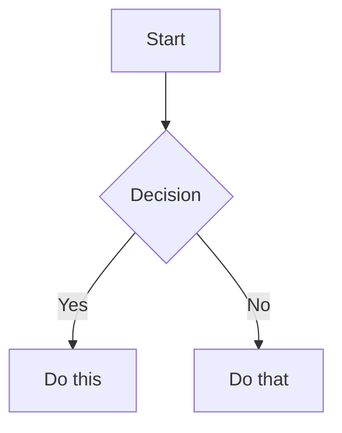

# Obsidian Flavored Markdown Skill

Create and edit valid Obsidian Flavored Markdown. Obsidian extends CommonMark and GFM with wikilinks, embeds, callouts, properties, comments, and other syntax. This skill covers only Obsidian-specific extensions -- standard Markdown (headings, bold, italic, lists, quotes, code blocks, tables) is assumed knowledge.

## Workflow: Creating an Obsidian Note

1. **Add frontmatter** with properties (title, tags, aliases) at the top of the file. See [PROPERTIES.md](references/PROPERTIES.md) for all property types.
2. **Write content** using standard Markdown for structure, plus Obsidian-specific syntax below.
3. **Link related notes** using wikilinks (`[[Note]]`) for internal vault connections, or standard Markdown links for external URLs.
4. **Embed content** from other notes, images, or PDFs using the `![[embed]]` syntax. See [EMBEDS.md](references/EMBEDS.md) for all embed types.
5. **Add callouts** for highlighted information using `> [!type]` syntax. See [CALLOUTS.md](references/CALLOUTS.md) for all callout types.
6. **Verify** the note renders correctly in Obsidian's reading view.

> When choosing between wikilinks and Markdown links: use `[[wikilinks]]` for notes within the vault (Obsidian tracks renames automatically) and `[text](url)` for external URLs only.

---

## 1. Internal Links (Wikilinks) & Heading Anchors

```markdown
[[Note Name]]                          Link to note
[[Note Name|Display Text]]             Custom display text
[[Note Name#Heading]]                  Link to heading
[[Note Name#^block-id]]                Link to block
[[#Heading in same note]]              Same-note heading link
```

### Clean Plain-Text Headings for Resilient Wikilinks
- **NEVER** embed LaTeX math (`$...$`) or code backticks (`` `...` ``) directly in Markdown headings (`#`, `##`, `###`).
- Keep headings in plain descriptive text (e.g., `### 3.4.2 The Family of JOIN Operators (Bowtie / Join)` instead of `### 3.4.2 The Family of JOIN Operators ($\bowtie$)`).
- Place mathematical symbols and code keywords immediately in the body text or callouts under the heading. This guarantees 100% resilient Obsidian wikilink anchors across the entire vault.

### Defining Block IDs
Define a block ID by appending `^block-id` to any paragraph:
```markdown
This paragraph can be linked to. ^my-block-id
```

For lists and quotes, place the block ID on a separate line after the block:
```markdown
> A quote block

^quote-id
```

---

## 2. Embeds

Prefix any wikilink with `!` to embed its content inline:

```markdown
![[Note Name]]                         Embed full note
![[Note Name#Heading]]                 Embed section
![[image.png]]                         Embed image
![[image.png|300]]                     Embed image with width
![[document.pdf#page=3]]               Embed PDF page
```

See [EMBEDS.md](references/EMBEDS.md) for audio, video, search embeds, and external images.

---

## 3. Callouts

```markdown
> [!note]
> Basic callout.

> [!warning] Custom Title
> Callout with a custom title.

> [!faq]- Collapsed by default
> Foldable callout (- collapsed, + expanded).
```

Common types: `note`, `tip`, `warning`, `info`, `example`, `quote`, `bug`, `danger`, `success`, `failure`, `question`, `abstract`, `todo`.

See [CALLOUTS.md](references/CALLOUTS.md) for the full list with aliases, nesting, and custom CSS callouts.

---

## 4. Properties (Frontmatter)

```yaml
---
title: My Note
date: 2024-01-15
tags:
  - project
  - active
aliases:
  - Alternative Name
cssclasses:
  - custom-class
---
```

Default properties: `tags` (searchable labels), `aliases` (alternative note names for link suggestions), `cssclasses` (CSS classes for styling).

See [PROPERTIES.md](references/PROPERTIES.md) for all property types, tag syntax rules, and advanced usage.

> [!IMPORTANT]
> **Conditional Rule**: Frontmatter properties must only be placed at the very top of standalone notes files. When compiling, merging, or appending lecture notes to a master note (as in the `lecture-to-obsidian` workflow), **NEVER** add frontmatter at the top of the appended section, as multiple frontmatters break markdown rendering inside the master note.

---

## 5. Tags & Comments

```markdown
#tag                    Inline tag
#nested/tag             Nested tag with hierarchy
==Highlighted text==    Highlight syntax
%%Hidden comment%%      Inline comment
```

```markdown
%%
This entire block is hidden in reading view.
%%
```

---

## 6. Math (LaTeX)

```markdown
Inline: $e^{i\pi} + 1 = 0$

Block:
$$
\frac{a}{b} = c
$$
```

---

## 7. Diagrams (Mermaid)

````markdown

````

To link Mermaid nodes to Obsidian notes, add `class NodeName internal-link;`.

### Strict Mermaid Syntax Constraints
To prevent syntax and rendering errors in Obsidian and Quartz, you must strictly follow these constraints:
1. **No Spaces in Node or Subgraph IDs**:
   - Subgraph and node identifiers must not contain spaces (e.g., use `ViewLayer` instead of `View Layer`).
   - Wrap display labels containing spaces in double quotes:
     ```mermaid
     subgraph ViewLayer ["View Layer - PHP, HTML/CSS"]
         homePage["Home Page"]
     end
     ```
2. **No Special Characters in Class Member Types/Names**:
   - Avoid using characters like `&`, `{`, `}`, or `*` directly inside class diagrams' attributes or methods (replace `shipping&Handling` with `shippingAndHandling`).
3. **Stereotype Syntax**:
   - Stereotypes for classes must be applied on a separate line (e.g., `<<abstract>> Sale`) instead of inside the class braces.
4. **No Markdown Lists in Node Labels (Unsupported markdown: list)**:
   - Node labels and titles must not contain text that parses as a Markdown list item (e.g., text starting with `- `, `* `, `+ `, or `1. `).
   - If a numbered label is needed, escape the period with a backslash (e.g. `Step1["1\. Classification"]`) or use a colon (e.g. `Step1[1: Classification]`).

---

## 8. Footnotes

```markdown
Text with a footnote[^1].

[^1]: Footnote content.

Inline footnote.^[This is inline.]
```

---

## References

- [Obsidian Flavored Markdown](https://help.obsidian.md/obsidian-flavored-markdown)
- [Internal links](https://help.obsidian.md/links)
- [Embed files](https://help.obsidian.md/embeds)
- [Callouts](https://help.obsidian.md/callouts)
- [Properties](https://help.obsidian.md/properties)
