> [!note] 📌 Free Module Elective Course
> **AKW104 Accounting and Finance** is an elective **free module** offered outside the core Computer Science / Software Engineering foundation. It provides standalone business, financial, and accounting literacy without prerequisite linkage to core technical courses.

# Chapter 1: Basic Accounting & The Recording Phase of the Accounting Cycle

## 1.1 The Accounting Cycle & Continuous Reporting Process

### 1.1.1 Definition, Scope, and Purpose of the Accounting Cycle
Financial accounting operates as an information system designed to capture, record, classify, summarize, and communicate the economic activities of an entity to external decision-makers (such as equity investors, creditors, financial institutions, regulatory authorities, and tax agencies) as well as internal management.

> [!info] Definition: The Accounting Cycle
> The **Accounting Cycle** is the standardized, chronological sequence of accounting procedures performed by an enterprise to identify, record, classify, and summarize financial transactions, culminating in the preparation and distribution of a complete set of formal financial statements at regular, predictable intervals.

The cycle represents an operational pipeline:
1. **Inception**: It begins at the moment an economic transaction occurs, substantiated by a verifiable source document (e.g., invoices, bank deposit slips, purchase orders, payroll records).
2. **Execution**: The transaction is sequentially processed through journalization, ledger posting, trial balance reconciliation, and end-of-period adjustments.
3. **Culmination**: It concludes with the generation of formal general-purpose financial statements (Income Statement, Statement of Retained Earnings / Equity, Balance Sheet, and Statement of Cash Flows) followed by the formal closing of temporary accounts.

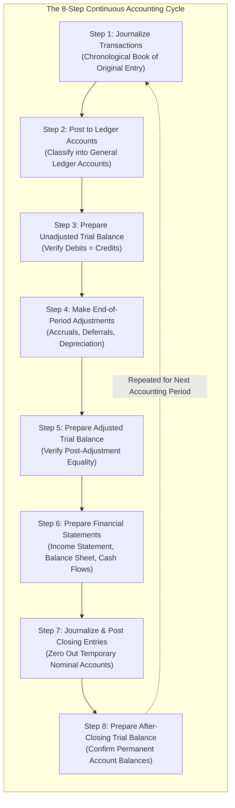

### 1.1.2 The Eight Sequential Steps of the Accounting Cycle
The accounting cycle consists of eight sequential, inviolable procedural steps executed during each accounting period:

1. **Journalize (Record) Business Transactions**:
   - As economic events transpire, they are initially recorded in chronological order in the **General Journal** (or specialized journals) using double-entry debit and credit notation supported by underlying source documents.
2. **Post Each Journal Entry to Appropriate Ledger Accounts**:
   - The recorded debits and credits from the journal entries are transferred (posted) to individual **Ledger Accounts** in the **General Ledger**, categorizing transactions by account type (Assets, Liabilities, Equity, Revenues, Expenses).
3. **Prepare the Trial Balance (Unadjusted Trial Balance)**:
   - At the close of the accounting period, the balance of every ledger account is extracted and listed on a trial balance schedule to verify the fundamental mathematical equality:
     $$\sum \text{Debit Balances} = \sum \text{Credit Balances}$$
4. **Making End-of-Period Adjustments**:
   - In accordance with the **accrual basis of accounting** and the **revenue recognition and matching principles**, adjusting journal entries are recorded and posted to account for accrued expenses, unearned revenues, prepaid assets consumed, and accumulated depreciation.
5. **Preparing an Adjusted Trial Balance**:
   - A second trial balance schedule is prepared post-adjustments to prove that debit and credit balances remain equal after adjusting entries have been posted.
6. **Preparing Formal Financial Statements**:
   - Using the verified balances from the adjusted trial balance, formal financial statements are synthesized in mandatory sequence:
     1. **Income Statement**: Evaluates profitability ($\text{Net Income} = \text{Revenues} - \text{Expenses}$).
     2. **Statement of Retained Earnings / Equity**: Reflects additions from Net Income and subtractions from Dividends / Owner Withdrawals.
     3. **Balance Sheet**: Discloses financial position at a specific point in time ($\text{Assets} = \text{Liabilities} + \text{Equity}$).
     4. **Statement of Cash Flows**: Categorizes cash movements across Operating, Investing, and Financing activities.
7. **Journalizing and Posting Closing Entries**:
   - Temporary accounts (nominal accounts: revenues, expenses, dividend/drawing accounts) are closed out to the permanent equity account (**Retained Earnings** or Capital) via the **Income Summary** account, resetting nominal account balances to zero for the upcoming fiscal period.
8. **Preparing an After-Closing (Post-Closing) Trial Balance**:
   - A final trial balance containing exclusively permanent (real/balance sheet) accounts is prepared to ensure that the ledger remains in mathematical equilibrium prior to commencing transactions in the subsequent period.

### 1.1.3 The Continuous Nature of Financial Reporting Cycles
Accounting is inherently cyclical. An enterprise cannot delay financial accounting until its eventual corporate liquidation; stakeholders require timely, periodic assessments of performance and solvency.

> [!tip] Extra Notes: The Time Period (Periodicity) Assumption
> Under the **Time Period Assumption** (Periodicity Principle), an organization's economic lifespan is divided into distinct artificial time intervals (fiscal months, quarters, half-years, or fiscal years). The eight-step accounting cycle is repeated continuously across each successive accounting period. This periodicity ensures that financial statements provide comparable, longitudinal benchmarks for evaluating organizational liquidity, solvency, and operational efficiency over time.

---

## 1.2 The Role & Governance Function of Accounting Records

### 1.2.1 Five Core Operational Objectives of Accounting Records
Accounting records represent far more than historical archives; they function as an enterprise-wide operational control system fulfilling five vital functions:

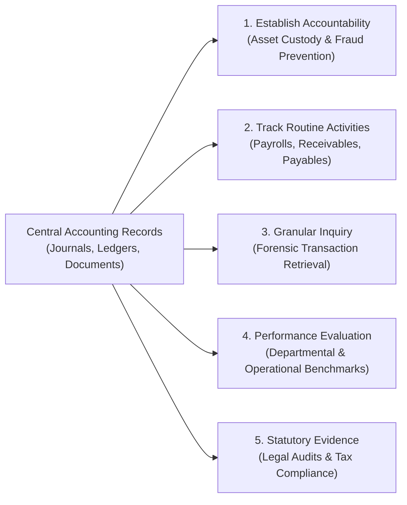

1. **Establishes Accountability for Assets and Transactions**:
   - Custodians of company property (cash, physical inventory, capital machinery, corporate intellectual property) are held accountable through auditable, recorded balances. Any discrepancy between physical counts and ledger records immediately reveals leakage, theft, or accounting errors.
2. **Keeps Track of Routine Business Activities**:
   - Businesses process thousands of transactions daily. Without systematic records, managers cannot track bank account balances, amounts owed by credit customers (Accounts Receivable), or obligations due to trade suppliers (Accounts Payable).
3. **Obtains Detailed Information About a Particular Transaction**:
   - When a customer disputes a billed charge or a supplier alleges non-payment, accounting records enable rapid retrieval of the specific transaction date, invoice number, items purchased, freight terms, credit approval, and authorized signatory.
4. **Evaluates Efficiency and Performance Within Company**:
   - Records provide the empirical data necessary to assess departmental cost centers, product-line gross profit margins, return on invested capital, and managerial efficiency across operational divisions.
5. **Maintains Evidence of a Company's Business Activities**:
   - Formal accounting records serve as legally admissible historical evidence required for corporate tax filings (e.g., corporate income tax, sales tax, value-added tax), independent external audits, bank loan covenants, and regulatory compliance.

### 1.2.2 Computer Science Synthesis: Accounting Records as Immutable Audit Logs & Event Sourcing
In modern computer science and software architecture, the principles of accounting records directly inspire foundational system designs:

> [!tip] Extra Notes: Enterprise Event Sourcing & Distributed Ledgers
> - **The Journal as an Append-Only Event Log**: In event-sourced architectural patterns (such as those used in financial microservices, Kafka event streams, and blockchain distributed ledgers), state changes are never overwritten with destructive SQL `UPDATE` operations. Instead, each business transaction is recorded as an immutable, timestamped event in an append-only log—directly mirroring the **General Journal**.
> - **The Ledger as a Materialized View**: The **General Ledger** corresponds to a *materialized view* computed by replaying or reducing the journal events into running account balances.
> - **Double-Entry Validation as Invariant Verification**: Just as database transactions enforce ACID consistency and relational integrity constraints, double-entry equality ($\sum \text{Debits} = \sum \text{Credits}$) acts as a global system invariant that validates software execution correctness across multi-party settlements.

---

## 1.3 The General Ledger & Structure of Accounts

### 1.3.1 Definition and Hierarchy: Ledger Accounts vs. The General Ledger
To make transactional data usable, an enterprise must organize its economic history into categorized classifications known as accounts.

> [!info] Definition: Ledger Account ("An Account")
> A **Ledger Account** (or simply an **account**) is an individual accounting record used to accumulate, classify, and track the monetary increases and decreases resulting from business transactions for a specific financial statement item (e.g., Cash, Land, Notes Payable, Capital Stock, Sales Revenue, Rent Expense).

> [!info] Definition: General Ledger ("The Ledger")
> The **General Ledger** is the complete master repository containing the entire group of all individual ledger accounts maintained by an organization. It represents the central financial database of the business enterprise.

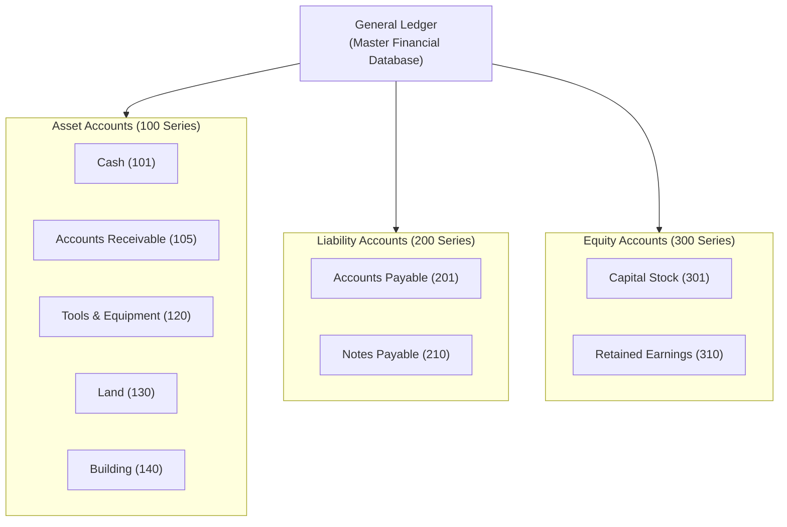

### 1.3.2 The Chart of Accounts
The **Chart of Accounts** is a structured, indexed directory listing every account title and unique account code utilized in the general ledger. Accounts are conventionally numbered according to their financial statement category:
- **100–199**: Asset Accounts (Current and Non-Current Assets).
- **200–299**: Liability Accounts (Current and Long-Term Obligations).
- **300–399**: Owner's Equity Accounts (Capital Stock, Additional Paid-in Capital, Retained Earnings).
- **400–499**: Operating Revenue Accounts.
- **500–599**: Operating and Administrative Expense Accounts.

---

## 1.4 The T-Account & Debit/Credit Conventions

### 1.4.1 Anatomy of a T-Account (Debit vs. Credit)
In pedagogical environments and preliminary accounting analysis, the **T-account** is the universal model used to visualize how transactions alter individual account balances.

The T-account derives its name from its physical resemblance to the letter **"T"**:
- The horizontal line sits beneath the **Account Title**.
- The vertical line divides the account into two distinct recording sides:
  - **Left Side**: Designated universally as the **Debit** side (abbreviated **Dr.**, from the Latin *debere*).
  - **Right Side**: Designated universally as the **Credit** side (abbreviated **Cr.**, from the Latin *credere*).

```
                      Title of Account
       -----------------------------------------------
          Left Side (Dr.)     |     Right Side (Cr.)
            DEBIT SIDE        |       CREDIT SIDE
                              |
       Increases or Decreases | Increases or Decreases
       (Depends on Category)  | (Depends on Category)
```

> [!warning] Critical Conceptual Rule: Debits and Credits Are Positional, Not Value Judgments
> In everyday conversational language, "credit" implies an addition (e.g., receiving a credit to your bank account) and "debit" implies a subtraction (e.g., using a debit card). 
> In formal accounting discipline, **Debit strictly means LEFT** and **Credit strictly means RIGHT**. 
> - A debit is simply an entry recorded on the left side of an account.
> - A credit is simply an entry recorded on the right side of an account.
> Whether a debit or a credit causes an account balance to *increase* or *decrease* depends strictly upon the fundamental classification of the account (Asset, Liability, Equity, Revenue, Expense).

### 1.4.2 Mathematical Calculation of Account Balances
An account balance represents the net difference between the total dollar amount recorded on the debit side and the total dollar amount recorded on the credit side:

$$\text{Net Balance} = \left| \sum \text{Debit Entries} - \sum \text{Credit Entries} \right|$$

- **Debit Balance**: Occurs when $\sum \text{Debits} > \sum \text{Credits}$. The net balance is placed on the debit (left) side.
- **Credit Balance**: Occurs when $\sum \text{Credits} > \sum \text{Debits}$. The net balance is placed on the credit (right) side.
- **Zero Balance**: Occurs when $\sum \text{Debits} = \sum \text{Credits}$. The account is considered in balance (closed).

### 1.4.3 Detailed Case Analysis: Cash Account Activity Walkthrough
To illustrate how entries accumulate, observe the following chronological record of cash receipts (debits) and cash disbursements (credits) for a business across the month of January:

```
                                      Cash
       -------------------------------------------------------------------
       Date     Explanation   Amount ($) | Date     Explanation   Amount ($)
       ----------------------------------+--------------------------------
       1/20     Receipt           80,000 | 1/21     Payment           52,000
       1/26     Receipt              600 | 1/22     Payment            6,000
       1/31     Receipt            2,200 | 1/27     Payment            6,800
                                         | 1/31     Payment              200
                                         | 1/31     Payment            1,200
       ----------------------------------+--------------------------------
       Total Debits:             $82,800 | Total Credits:        $66,200
       ===================================================================
       1/31 Net Debit Balance:   $16,600 |
```

#### Step-by-Step Balance Calculation:
1. **Sum of Debit Entries (Cash Inflows / Receipts)**:
   $$\sum \text{Debits} = \$80,000 + \$600 + \$2,200 = \$82,800$$
2. **Sum of Credit Entries (Cash Outflows / Payments)**:
   $$\sum \text{Credits} = \$52,000 + \$6,000 + \$6,800 + \$200 + \$1,200 = \$66,200$$
3. **Net Ending Account Balance as of January 31**:
   $$\text{Ending Cash Balance} = \$82,800 - \$66,200 = \$16,600 \quad (\text{Debit Balance})$$

Since Cash is an Asset account, its natural operational state is to maintain a **Debit Balance**, reflecting positive liquid reserves available to the enterprise.

---

## 1.5 Double-Entry Accounting & The Fundamental Accounting Equation

### 1.5.1 The Fundamental Accounting Equation
The entire architectural framework of double-entry bookkeeping rests upon the foundational mathematical identity known as the **Accounting Equation**:

$$\mathbf{Assets = Liabilities + Owner's\ Equity}$$

$$\mathbf{A = L + OE}$$

- **Assets ($A$)**: Economic resources possessed and controlled by the enterprise resulting from past events, from which future economic benefits are expected to flow to the business (e.g., Cash, Receivables, Inventory, Equipment, Buildings, Land).
- **Liabilities ($L$)**: Present legal and constructive obligations of the enterprise arising from past transactions, the settlement of which is expected to result in an outflow of economic resources (e.g., Accounts Payable, Notes Payable, Salaries Payable, Bonds Payable).
- **Owner's Equity ($OE$)**: The residual interest in the assets of the enterprise after deducting all of its liabilities ($\text{Equity} = \text{Assets} - \text{Liabilities}$). For a corporation, this consists primarily of **Capital Stock** (contributed capital from shareholders) and **Retained Earnings** (cumulative undistributed profits).

### 1.5.2 Debit and Credit Rules by Account Classification
Because Assets reside on the left side of the equation, while Liabilities and Owner's Equity reside on the right side, their recording mechanics reflect this mirrored relationship:

```
               THE FUNDAMENTAL ACCOUNTING EQUATION
               ===================================
                  ASSETS   =   LIABILITIES   +   EQUITIES
                 (Left Side)       (Right Side)     (Right Side)

                 Asset Accounts     Liability Accounts    Equity Accounts
                 --------------     ------------------    ---------------
                  Debit | Credit       Debit | Credit      Debit | Credit
                  ------|-------       ------|-------      ------|-------
                    +   |   -            -   |   +           -   |   +
```

| Account Classification | Normal Balance Side | To Increase (+) The Account | To Decrease (-) The Account | Mathematical Rationale |
| :--- | :--- | :--- | :--- | :--- |
| **Assets ($A$)** | **Debit** (Left) | **Debit** | **Credit** | Placed on the left side of the accounting equation ($A = L + OE$). |
| **Liabilities ($L$)** | **Credit** (Right) | **Credit** | **Debit** | Placed on the right side of the accounting equation ($A = L + OE$). |
| **Owner's Equity ($OE$)** | **Credit** (Right) | **Credit** | **Debit** | Placed on the right side of the accounting equation ($A = L + OE$). |
| *Revenues* | **Credit** | **Credit** | **Debit** | Increases Net Income, which directly increases Owner's Equity. |
| *Expenses* | **Debit** | **Debit** | **Credit** | Decreases Net Income, which directly decreases Owner's Equity. |
| *Dividends / Drawings* | **Debit** | **Debit** | **Credit** | Represents direct distributions of equity to owners, reducing Equity. |

> [!info] The Concept of "Normal Balance"
> An account's **Normal Balance** is the side (Debit or Credit) where increases to that account are recorded. Under normal operating conditions, the accumulated increases will exceed cumulative decreases, causing the account's ending balance to reside on its normal balance side:
> - Asset accounts routinely display **Debit Balances**.
> - Liability accounts routinely display **Credit Balances**.
> - Owner's Equity accounts routinely display **Credit Balances**.

### 1.5.3 The Inviolable Principle of Debit-Credit Equality
The core thesis of double-entry accounting is that every single transaction affects at least two accounts, maintaining continuous algebraic balance across the entire system:

$$\sum \text{Debit Balances} = \sum \text{Credit Balances}$$

$$\Delta \text{Assets} = \Delta \text{Liabilities} + \Delta \text{Owner's Equity}$$

If a transaction increases an asset (debit), it must be offset by either:
1. A corresponding decrease in another asset (credit).
2. A corresponding increase in a liability (credit).
3. A corresponding increase in owner's equity (credit).

---

## 1.6 Step-by-Step Transaction Analysis: Overnight Auto Service Case Study

To observe the practical operation of double-entry rules, consider the selected startup transactions for **Overnight Auto Service** (a fleet maintenance and courier support enterprise) spanning January 20 through January 24.

### 1.6.1 Transaction 1 (Jan 20): Capital Stock Issuance for Cash
- **Transaction Event**: On January 20, Michael McBryan and his family invested $\$80,000$ in cash to capitalize Overnight Auto Service and received $8,000$ shares of capital stock with a par value of $\$10$ per share.
- **Economic Analysis**:
  - The business receives liquid capital: Asset account **Cash** increases by $\$80,000$.
  - The business incurs an ownership claim: Equity account **Capital Stock** increases by $\$80,000$.
- **Debit/Credit Decision**:
  - Increase an Asset $\implies$ **Debit Cash** for $\$80,000$.
  - Increase an Equity account $\implies$ **Credit Capital Stock** for $\$80,000$.
- **Equation Impact**:
  $$\begin{aligned}
  A &= L + OE \\
  +\$80,000\ (\text{Cash}) &= \$0 + \$80,000\ (\text{Capital Stock})
  \end{aligned}$$

```
                Cash                          Capital Stock
       ----------------------             ----------------------
        1/20  80,000 |                              |  1/20  80,000
```

### 1.6.2 Transaction 2 (Jan 21): Land Acquisition for Cash
- **Transaction Event**: On January 21, Overnight Auto Service purchased a parcel of commercial real estate (land) suitable for operating facilities for $\$52,000$ in cash.
- **Economic Analysis**:
  - The business acquires physical property: Asset account **Land** increases by $\$52,000$.
  - The business expends liquid funds: Asset account **Cash** decreases by $\$52,000$.
- **Debit/Credit Decision**:
  - Increase an Asset $\implies$ **Debit Land** for $\$52,000$.
  - Decrease an Asset $\implies$ **Credit Cash** for $\$52,000$.
- **Equation Impact**:
  $$\begin{aligned}
  A &= L + OE \\
  (+\$52,000\ [\text{Land}] - \$52,000\ [\text{Cash}]) &= \$0 + \$0 \\
  \Delta A = \$0 &= \Delta L = \$0 + \Delta OE = \$0
  \end{aligned}$$
  *(Total assets remain unchanged at $\$80,000$; asset composition shifts from liquid cash to fixed real estate).*

```
                Cash                              Land
       ----------------------             ----------------------
        1/20  80,000 | 1/21  52,000        1/21  52,000 |
```

### 1.6.3 Transaction 3 (Jan 22): Compound Acquisition of Building via Cash & Note Payable
- **Transaction Event**: On January 22, Overnight purchased an existing repair garage (building) for $\$36,000$. The company settled the transaction by paying $\$6,000$ in cash and issuing a formal written promissory note payable for the remaining $\$30,000$.
- **Economic Analysis**:
  - The business acquires facility infrastructure: Asset account **Building** increases by $\$36,000$.
  - The business expends cash: Asset account **Cash** decreases by $\$6,000$.
  - The business incurs a debt obligation: Liability account **Notes Payable** increases by $\$30,000$.
- **Debit/Credit Decision**:
  - Increase an Asset $\implies$ **Debit Building** for $\$36,000$.
  - Decrease an Asset $\implies$ **Credit Cash** for $\$6,000$.
  - Increase a Liability $\implies$ **Credit Notes Payable** for $\$30,000$.
- **Equation Impact**:
  $$\begin{aligned}
  A &= L + OE \\
  (+\$36,000\ [\text{Building}] - \$6,000\ [\text{Cash}]) &= +\$30,000\ (\text{Notes Payable}) + \$0 \\
  +\$30,000 &= +\$30,000
  \end{aligned}$$

```
              Building                            Notes Payable
       ----------------------                 ----------------------
        1/22  36,000 |                                  |  1/22  30,000
```
```
                Cash
       ----------------------
        1/20  80,000 | 1/21  52,000
                     | 1/22   6,000
```

> [!tip] Extra Notes: Compound Journal Entries
> A journal entry that involves more than one debit and/or more than one credit is termed a **Compound Journal Entry**. Regardless of the number of accounts impacted (e.g., 1 debit and 2 credits, or 3 debits and 4 credits), the fundamental requirement remains absolute:
> $$\sum \text{Debits} \equiv \sum \text{Credits}$$
> Here: $\text{Debit (Building)} = \$36,000 \equiv \text{Credit (Cash)} \ [\$6,000] + \text{Credit (Notes Payable)} \ [\$30,000] = \$36,000$.

### 1.6.4 Transaction 4 (Jan 23): Purchase of Equipment on Account (Trade Credit)
- **Transaction Event**: On January 23, Overnight Auto Service purchased shop tools and diagnostic machinery for $\$13,800$ on account (trade credit from vendor, payable within 30 to 60 days).
- **Economic Analysis**:
  - The business acquires shop equipment: Asset account **Tools & Equipment** increases by $\$13,800$.
  - The business incurs an informal trade liability: Liability account **Accounts Payable** increases by $\$13,800$.
- **Debit/Credit Decision**:
  - Increase an Asset $\implies$ **Debit Tools & Equipment** for $\$13,800$.
  - Increase a Liability $\implies$ **Credit Accounts Payable** for $\$13,800$.
- **Equation Impact**:
  $$\begin{aligned}
  A &= L + OE \\
  +\$13,800\ (\text{Tools \& Equip}) &= +\$13,800\ (\text{Accounts Payable}) + \$0 \\
  +\$13,800 &= +\$13,800
  \end{aligned}$$

```
         Tools & Equipment                      Accounts Payable
       ----------------------                 ----------------------
        1/23  13,800 |                                  |  1/23  13,800
```

> [!info] Distinction: Accounts Payable vs. Notes Payable
> - **Accounts Payable**: An unwritten, short-term debt obligation arising from trade purchases made on open credit terms (e.g., Net 30), typically non-interest bearing if paid within terms.
> - **Notes Payable**: A formal, legally binding written promissory agreement pledging to repay a principal sum at a defined future maturity date, almost universally carrying an explicit interest charge.

### 1.6.5 Transaction 5 (Jan 24): Sale of Equipment at Acquisition Cost on Account
- **Transaction Event**: On January 24, Overnight discovered that surplus equipment had been ordered. The firm sold a portion of the tools and equipment to Ace Towing for $\$1,800$ on credit. The selling price exactly equaled Overnight's acquisition cost. Ace Towing agreed to pay the $\$1,800$ balance in the future.
- **Economic Analysis**:
  - The business obtains a legal claim against a debtor: Asset account **Accounts Receivable** increases by $\$1,800$.
  - The business disposes of physical machinery: Asset account **Tools & Equipment** decreases by $\$1,800$.
  - Because selling price equals cost ($\$1,800 = \$1,800$), no gain or loss is incurred, and Owner's Equity is unaffected.
- **Debit/Credit Decision**:
  - Increase an Asset $\implies$ **Debit Accounts Receivable** for $\$1,800$.
  - Decrease an Asset $\implies$ **Credit Tools & Equipment** for $\$1,800$.
- **Equation Impact**:
  $$\begin{aligned}
  A &= L + OE \\
  (+\$1,800\ [\text{Accounts Rec}] - \$1,800\ [\text{Tools \& Equip}]) &= \$0 + \$0 \\
  \Delta A = \$0 &= \Delta L = \$0 + \Delta OE = \$0
  \end{aligned}$$

```
         Tools & Equipment                      Accounts Receivable
       ----------------------                 ----------------------
        1/23  13,800 | 1/24   1,800            1/24   1,800 |
```

### 1.6.6 Comprehensive Summary Table of Initial Transactions & Equation Equality

| Date | Transaction Description | Debit Account & Amount | Credit Account & Amount | Balance Sheet Equation Impact ($A = L + OE$) |
| :--- | :--- | :--- | :--- | :--- |
| **Jan 20** | Initial owner equity investment | Cash: $\$80,000$ (Dr) | Capital Stock: $\$80,000$ (Cr) | $+80,000 = 0 + 80,000$ |
| **Jan 21** | Purchase land for cash | Land: $\$52,000$ (Dr) | Cash: $\$52,000$ (Cr) | $(+52,000 - 52,000) = 0 + 0 \implies 0 = 0$ |
| **Jan 22** | Purchase garage building | Building: $\$36,000$ (Dr) | Cash: $\$6,000$ (Cr)<br/>Notes Payable: $\$30,000$ (Cr) | $(+36,000 - 6,000) = +30,000 + 0 \implies 30,000 = 30,000$ |
| **Jan 23** | Purchase tools on credit | Tools & Equip: $\$13,800$ (Dr) | Accounts Payable: $\$13,800$ (Cr) | $+13,800 = +13,800 + 0 \implies 13,800 = 13,800$ |
| **Jan 24** | Sell surplus tools at cost | Accounts Rec: $\$1,800$ (Dr) | Tools & Equip: $\$1,800$ (Cr) | $(+1,800 - 1,800) = 0 + 0 \implies 0 = 0$ |

#### Total Balances After Transaction 5:
- **Assets ($A$)**:
  - Cash: $\$80,000 - \$52,000 - \$6,000 = \$22,000$
  - Accounts Receivable: $\$1,800$
  - Tools & Equipment: $\$13,800 - \$1,800 = \$12,000$
  - Land: $\$52,000$
  - Building: $\$36,000$
  - **Total Assets** $= \$22,000 + \$1,800 + \$12,000 + \$52,000 + \$36,000 = \mathbf{\$123,800}$
- **Liabilities ($L$)**:
  - Notes Payable: $\$30,000$
  - Accounts Payable: $\$13,800$
  - **Total Liabilities** $= \$30,000 + \$13,800 = \mathbf{\$43,800}$
- **Owner's Equity ($OE$)**:
  - Capital Stock: $\mathbf{\$80,000}$
- **Equation Verification**:
  $$\begin{aligned}
  \text{Assets} &= \text{Liabilities} + \text{Owner's Equity} \\
  \$123,800 &= \$43,800 + \$80,000 \\
  \mathbf{\$123,800} &\equiv \mathbf{\$123,800} \quad \checkmark
  \end{aligned}$$

---

## 1.7 The General Journal: Chronological Source of Original Entry

### 1.7.1 Role and Structure of the General Journal
In an operating accounting system, transactions are **never entered directly into ledger accounts**. Recording transactions directly into accounts would invite catastrophic recordkeeping failure:
1. If an error occurs, tracking which debit matches which credit across dozens of separate ledger sheets is nearly impossible.
2. Direct ledger entry fails to capture the comprehensive context, business rationale, or authorized signatures behind the economic event.

> [!info] Definition: General Journal ("Book of Original Entry")
> The **General Journal** is the chronological (day-by-day) accounting record in which business transactions are initially documented in full, displaying the date, the specific accounts to be debited and credited, the monetary amounts, and an explanatory narrative for each transaction.

### 1.7.2 General Journal Formatting Standards
Standard accounting protocol dictates strict visual and syntactical formatting for journal entries:
1. **Date Column**: The fiscal year, month, and day are recorded.
2. **Account Titles Column**:
   - The account(s) to be **debited** are listed first, flushed against the left border of the column.
   - The account(s) to be **credited** are listed below the debits and **indented** approximately one-half inch to the right.
3. **Debit & Credit Monetary Columns**:
   - Debit amounts are placed in the left-hand numeric column.
   - Credit amounts are placed in the right-hand numeric column.
4. **Explanation Narrative**:
   - Immediately following the credited account(s), a brief narrative describing the business event and referencing source document numbers (e.g., check numbers, invoice IDs) is provided.

### 1.7.3 Journal Entries for Overnight Auto Service

#### General Journal Page 1:
```
                                   GENERAL JOURNAL                              Page: 1
========================================================================================
Date        Account Titles and Explanation                LP*      Debit ($)  Credit ($)
----------------------------------------------------------------------------------------
2015
Jan   20    Cash .......................................  101        80,000
               Capital Stock ...........................  301                     80,000
            (Owners invest cash in the business in exchange
             for 8,000 shares of capital stock at $10 par.)

      21    Land .......................................  130        52,000
               Cash ....................................  101                     52,000
            (Purchased land for operating facility for cash.)

      22    Building ...................................  140        36,000
               Cash ....................................  101                      6,000
               Notes Payable ...........................  210                     30,000
            (Purchased repair garage, paying $6,000 cash
             and issuing a 90-day promissory note.)

      23    Tools & Equipment ..........................  120        13,800
               Accounts Payable ........................  201                     13,800
            (Purchased shop equipment on 30-day account.)

      24    Accounts Receivable ........................  105         1,800
               Tools & Equipment .......................  120                      1,800
            (Sold surplus equipment at cost on credit to Ace Towing.)
========================================================================================
* Note: LP denotes the Ledger Posting Reference column, populated during Step 2.
```

---

## 1.8 Posting to Ledger Accounts & Ledger Formats

### 1.8.1 The Posting Process: Transferring Data from Journal to Ledger
While the journal maintains chronological order, it does not reveal the accumulated balance of any individual account. To ascertain how much cash remains or how much is owed to suppliers, entries must be transferred to the general ledger.

> [!info] Definition: Posting
> **Posting** is the administrative procedure of transferring debit and credit monetary figures and references from the chronological general journal into the individual accounts in the general ledger.

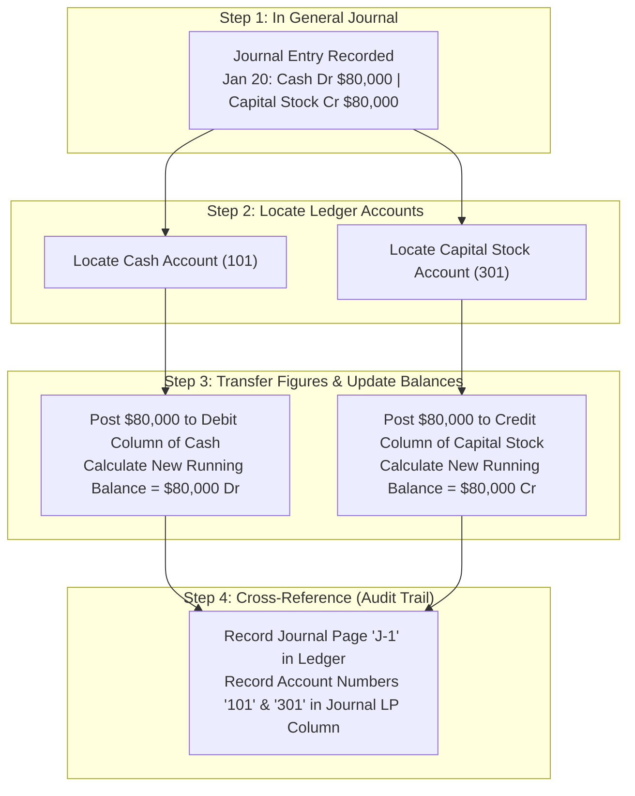

#### Step-by-Step Posting Walkthrough:
1. Locate the first account named in the journal entry (**Cash**, Account No. 101).
2. Enter the date (**2015 Jan 20**) in the date column of the Cash account.
3. Enter the journal reference (**J-1**) in the posting reference column of the ledger.
4. Record the debit amount (**$80,000**) in the debit column of the Cash ledger account.
5. Compute and update the Cash account's running balance (**$80,000** Debit).
6. Return to the General Journal and enter the Cash account number (**101**) into the posting reference (LP) column of the journal. *(This proves the item has been posted and provides a direct cross-reference).*
7. Repeat the exact sequence for the credited account (**Capital Stock**, Account No. 301).

### 1.8.2 The Running Balance (Three/Four-Column) Ledger Format
In formal bookkeeping and enterprise enterprise resource planning (ERP) platforms (such as SAP, Oracle ERP, NetSuite), accounts are not drawn as informal T-shapes. Instead, they utilize the **Running Balance Format** (also known as the four-column ledger).

The running balance format features dedicated columns for:
- `Date`: When the entry was posted.
- `Explanation / Item`: Optional memo or description.
- `Ref (LP)`: The journal page origin (e.g., `J-1`).
- `Debit`: Dollar additions to debits.
- `Credit`: Dollar additions to credits.
- `Balance`: The continuously updated net balance of the account after each posting.

#### General Ledger Accounts After Posting January 20 and January 21:

##### Account: Cash (Account No. 101)
```
                                     GENERAL LEDGER
Account: Cash                                                                 Account No: 101
=============================================================================================
Date          Explanation / Item           Ref        Debit ($)    Credit ($)     Balance ($)
---------------------------------------------------------------------------------------------
2015
Jan   20      Initial Investment           J-1          80,000                         80,000
      21      Land Purchase                J-1                        52,000           28,000
=============================================================================================
```

##### Account: Capital Stock (Account No. 301)
```
Account: Capital Stock                                                        Account No: 301
=============================================================================================
Date          Explanation / Item           Ref        Debit ($)    Credit ($)     Balance ($)
---------------------------------------------------------------------------------------------
2015
Jan   20      Initial Investment           J-1                        80,000           80,000
=============================================================================================
```

##### Account: Land (Account No. 130)
```
Account: Land                                                                 Account No: 130
=============================================================================================
Date          Explanation / Item           Ref        Debit ($)    Credit ($)     Balance ($)
---------------------------------------------------------------------------------------------
2015
Jan   21      Land Purchase                J-1          52,000                         52,000
=============================================================================================
```

#### Observation of Running Balance Mechanics:
- On Jan 20, the Cash account is debited by $\$80,000$. The running balance becomes **$\$80,000$ (Dr)**.
- On Jan 21, the Cash account is credited by $\$52,000$. Because Cash is an asset (normal debit balance), a credit reduces the balance:
  $$\text{Running Balance} = \$80,000 - \$52,000 = \mathbf{\$28,000}\ (\text{Dr})$$
- The running balance provides instant, real-time insight into the account's current position without requiring manual summation of prior columns.

### 1.8.3 Comparative Analysis: T-Accounts vs. Running Balance Ledger Formats

| Feature / Dimension | Traditional T-Account Model | Professional Running Balance Format |
| :--- | :--- | :--- |
| **Primary Visual Layout** | Divided into physical Left (Debit) and Right (Credit) columns resembling a "T". | Tabular rows displaying sequential transactions with side-by-side Debit, Credit, and Balance columns. |
| **Balance Calculation** | Balances are computed periodically (e.g., end-of-month) by summing both sides and calculating the net difference. | Balance is updated continuously (**running balance**) immediately following every individual transaction posting. |
| **Audit Trail & Metadata** | Minimal metadata; generally lists only date and dollar amount; lacks detailed source references. | Explicit audit columns including Journal Reference (`Ref`), transaction explanation, and posting marks. |
| **Primary Use Environment** | Academic analysis, chalkboard lecture walkthroughs, fast diagnostic scratchpads. | Real-world general ledgers, corporate ERP systems, statutory audit schedules, and automated accounting software. |

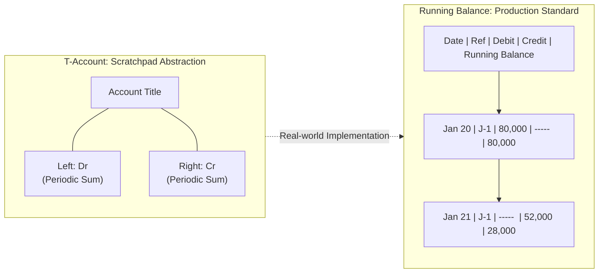

---

## 1.9 Chapter Summary & Conceptual Blueprint

### 1.9.1 Core Takeaways
1. **The Accounting Cycle**: An 8-step procedural cycle recurring across fiscal periods to translate raw business transactions into standardized financial statements.
2. **Double-Entry Equilibrium**: Every transaction is recorded with equal dollar values of debits and credits, preserving the core identity $\mathbf{Assets = Liabilities + Owner's\ Equity}$.
3. **Debit vs. Credit Mechanics**:
   - Assets, Expenses, and Dividends increase with **Debits**.
   - Liabilities, Owner's Equity, and Revenues increase with **Credits**.
4. **The Journal vs. The Ledger**:
   - The **Journal** records transactions *chronologically* (book of original entry).
   - The **Ledger** classifies transactions *by account* (book of final entry).
5. **Posting & Running Balances**: Posting transfers journalized entries into ledger accounts, where modern running balance tables maintain continuous, real-time balances.


---

# Chapter 2: The Income Statement, GAAP Principles, and Profitability Analysis

## 2.1 The Nature, Purpose, and Mandate of Financial Reporting

### 2.1.1 The Four Mandatory Financial Statements
Under the statutory authority of regulatory accounting bodies—including the **Financial Accounting Standards Board (FASB)** under U.S. GAAP, the **International Accounting Standards Board (IASB)** under IFRS, and corporate securities commissions (such as the U.S. SEC)—every public enterprise is legally mandated to prepare and publish four fundamental financial statements at predictable intervals (quarterly via Form 10-Q and annually via Form 10-K):

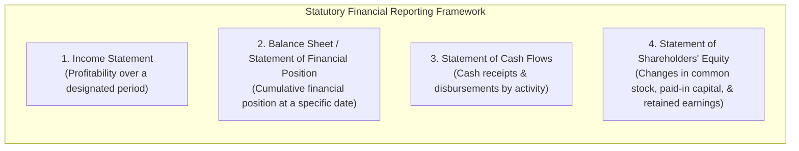

1. **The Income Statement (Profit and Loss Statement)**: Measures enterprise operational performance and profits generated over an operating duration (a fiscal quarter or year).
2. **The Balance Sheet (Statement of Financial Position)**: Provides an instantaneous snapshot of resources owned (Assets), debts owed (Liabilities), and residual owner claims (Stockholders' Equity) as of a specific calendar date.
3. **The Statement of Cash Flows**: Tracks the gross and net movements of liquid cash across operating, investing, and financing spheres over the accounting period.
4. **The Statement of (Changes in) Shareholders' Equity**: Reconciles the beginning and ending equity balances, detailing changes in common stock par value, additional paid-in capital, dividend payouts, and net income reinvestment into retained earnings.

### 2.1.2 Defining the Income Statement
The **Income Statement** (historically termed the **Statement of Profit and Loss** or **P&L**) measures the economic value created by an enterprise over a specified interval.

$$\mathbf{Revenues\ (or\ Sales) - Expenses = Profits\ (or\ Net\ Income)}$$

- **Revenues (Sales)**: Gross inflows of economic value resulting from the delivery of goods or rendering of services within the company's primary business activities.
- **Expenses**: Outflows, asset devaluations, or liabilities incurred in generating those revenues.
- **Net Income (Profit or Earnings)**: The residual accounting profit available to equity owners after satisfying all manufacturing, administrative, financing, and tax obligations.

---

## 2.2 Core GAAP Principles Governing Income Measurement

Financial accounting does not record economic activity based simply on physical cash exchange. Instead, it adheres strictly to the **accrual basis of accounting**, anchored by two foundational tenets:

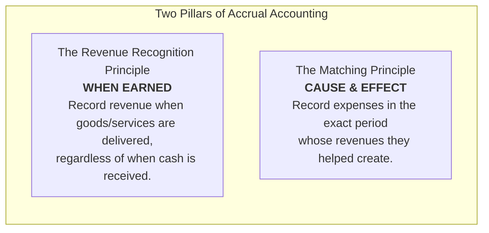

### 2.2.1 The Revenue Recognition Principle
Under U.S. GAAP (ASC 606) and IFRS 15, revenue is recognized when it is **earned and realizable**, which occurs when performance obligations are satisfied by transferring promised goods or services to the customer:
- **Cash Received Prior to Delivery**: If an enterprise receives cash upfront before fulfilling services (e.g., software license subscriptions, airline tickets), it records a liability titled **Unearned Revenue** (Deferred Revenue), *not* revenue. Revenue is recognized only as services are delivered.
- **Delivery Prior to Cash Receipt**: When goods are delivered on credit, revenue is immediately recognized on the Income Statement, and an asset (**Accounts Receivable**) is established on the Balance Sheet.

### 2.2.2 The Matching Principle (Expense Recognition)
The **Matching Principle** mandates that expenses must be matched directly against the revenues they helped generate within the same accounting period:
- **Direct Costs**: The cost of inventory sold (**Cost of Goods Sold**) is held on the Balance Sheet as an asset until the exact period the inventory is delivered to a customer, at which point it is recognized as an expense.
- **Capital Asset Allocation (Depreciation)**: Long-lived productive assets (factory machinery, server farms, corporate headquarters) provide utility across many years. Rather than expensing the entire asset purchase price in Year 1, historical cost is allocated periodically across its useful lifespan via **Depreciation Expense**.

### 2.2.3 GAAP Flexibility and Earnings Management
While U.S. GAAP provides standardized rules, managerial accounting estimates are required in several areas (e.g., allowance for doubtful accounts, asset useful lives, salvage values, inventory cost-flow assumptions like FIFO vs. Average Cost).

> [!important] The Agency Problem & Earnings Management
> - **Incentives to Tamper**: Corporate executive compensation is heavily tied to financial performance metrics (stock price, earnings targets, EPS thresholds). Furthermore, equity markets penalize companies that miss consensus analyst expectations. Consequently, managers face incentives to engage in **Earnings Management**—manipulating accounting accruals to artificially smooth or inflate reported earnings.
> - **Governance & Auditing**: To protect shareholders and debt holders, statutory law mandates that independent Certified Public Accounting (CPA) auditing firms conduct rigorous external audits, verifying that financial statements present a true, fair, and materially accurate representation of enterprise condition.

---

## 2.3 The Multi-Step Income Statement Architecture

Enterprise income statements follow a **multi-step format** that segregates gross operational manufacturing profit, administrative overhead, financing costs, and statutory taxes.

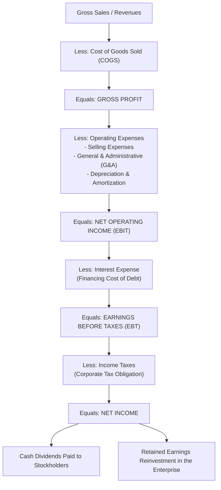

### 2.3.1 Step-by-Step Component Breakdown
1. **Revenues (Gross Sales)**: Total billings to clients for merchandise delivered or services rendered during the fiscal period.
2. **Cost of Goods Sold (COGS)**: Direct costs attributable to the production or acquisition of goods sold (direct raw materials, direct factory labor, allocated production overhead).
3. **Gross Profit**: The initial markup cushion:
   $$\text{Gross Profit} = \text{Sales} - \text{COGS}$$
4. **Operating Expenses (OPEX)**: Operating overhead necessary to maintain sales, administration, and organizational infrastructure:
   - **Selling Expenses**: Advertising, marketing campaigns, sales commissions, distribution freight.
   - **General & Administrative (G&A) Expenses**: Executive executive salaries, headquarters office rent, legal, accounting, HR costs.
   - **Depreciation & Amortization**: Non-cash allocation of capital expenditure assets over their useful economic lifespans.
5. **Net Operating Income (EBIT)**: Earnings Before Interest and Taxes; isolates operational efficiency before financing capital structure choices.
   $$\text{EBIT} = \text{Gross Profit} - \text{Total Operating Expenses}$$
6. **Interest Expense**: Contractual cost of debt capital; depends on debt leverage, loan covenants, and interest rates.
7. **Earnings Before Taxes (EBT / Taxable Income)**:
   $$\text{EBT} = \text{EBIT} - \text{Interest Expense}$$
8. **Income Taxes**: Statutory corporate income taxes assessed on EBT.
9. **Net Income**: The bottom-line profit belonging to common equity shareholders.
   $$\text{Net Income} = \text{EBT} - \text{Income Taxes}$$

---

### 2.3.2 Institutional Case Study: H.J. Boswell, Inc. Income Statement
The following multi-step income statement represents the annual operating performance of **H.J. Boswell, Inc.** for the year ended December 31, 2023:

#### Table 2.1: H.J. Boswell, Inc. Income Statement ($ millions, except per share data)
| Line Item | Component Detail ($M) | Statement Total ($M) | Economic & Operational Interpretation |
| :--- | :---: | :---: | :--- |
| **Sales** | | **$2,700.00** | Gross operating revenues earned from commercial delivery. |
| **Cost of goods sold (COGS)** | | **(2,025.00)** | Direct manufacturing / product acquisition costs. |
| **Gross profit** | | **$675.00** | Initial production profit margin available for overhead. |
| *Operating expenses:* | | | Overhead incurred to sustain corporate operations. |
| - Selling expense | $(90.00)$ | | Sales personnel compensation, advertising, delivery logistics. |
| - General and administrative expense | $(67.50)$ | | Executive, legal, compliance, and corporate HQ upkeep. |
| - Depreciation and amortization expense | $(135.00)$ | | Non-cash allocation of fixed plant and equipment wear. |
| **Total operating expenses** | | **(292.50)** | Combined commercial operational overhead. |
| **Net operating income (EBIT)** | | **$382.50** | **Operating earnings** earned strictly from core activities. |
| **Interest expense** | | **(67.50)** | Direct financing cost paid to bank lenders and bondholders. |
| **Earnings before taxes (EBT)** | | **$315.00** | Taxable corporate income base. |
| **Income taxes** | | **(66.15)** | Corporate income taxes (Effective statutory tax rate: $21\%$). |
| **Net income** | | **$248.85** | **Net bottom-line earnings** attributable to equity owners. |

#### Supplementary Per-Share & Dividend Distribution Data:
- **Dividends paid to stockholders during the year**: $\$45.00\text{ million}$
- **Number of common shares outstanding**: $90.00\text{ million shares}$
- **Earnings Per Share (EPS)**:
  $$\text{EPS} = \frac{\text{Net Income}}{\text{Common Shares Outstanding}} = \frac{\$248.85\text{M}}{90.00\text{M}} = \mathbf{\$2.765 \approx \$2.77\ \text{per share}}$$
  *(Note: Text slide 12 illustrates an alternate textbook calculation showing $\$2.28$; the exact audited figure from Table 3.1 is $\$2.765 \approx \$2.77$ per share).*
- **Dividends Per Share (DPS)**:
  $$\text{DPS} = \frac{\text{Dividends Paid}}{\text{Common Shares Outstanding}} = \frac{\$45.00\text{M}}{90.00\text{M}} = \mathbf{\$0.50\ \text{per share}}$$

---

### 2.3.3 Connecting the Income Statement to the Balance Sheet
A firm's Net Income is distributed across two primary pathways:
1. **Direct Cash Distribution**: Paid to equity holders as cash dividends.
2. **Reinvestment into Retained Earnings**: Kept in the business to fund capital investments, debt retirement, or working capital expansion.

$$\mathbf{Net\ Income = Dividends\ Paid + Addition\ to\ Retained\ Earnings}$$

For H.J. Boswell, Inc. in 2023:
$$\text{Addition to Retained Earnings} = \$248.85\text{M} - \$45.00\text{M} = \mathbf{\$203.85\ \text{million}}$$

This $\$203.85\text{ million}$ flows directly into the **Stockholders' Equity** section of the Balance Sheet, increasing accumulated Retained Earnings from $\$382.50\text{ million}$ to $\$542.25\text{ million}$ (as verified in Section 3.5).

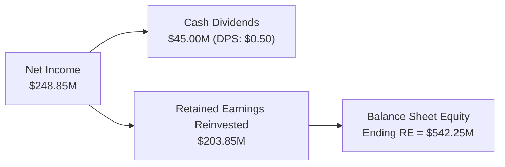

---

## 2.4 Profitability Margin Dissection & Diagnostic Ratios

Financial analysts evaluate income statements by normalizing absolute dollar profits into percentage margins relative to revenues. This permits cross-sectional comparison across firms of different scales.

| Profitability Metric | Mathematical Formula | H.J. Boswell Inc. Computation | Strategic & Diagnostic Interpretation |
| :--- | :---: | :---: | :--- |
| **Gross Profit Margin (GPM)** | $\frac{\text{Gross Profit}}{\text{Sales}}$ | $\frac{\$675.00\text{M}}{\$2,700.00\text{M}} = \mathbf{25.0\%}$ | Measures production pricing efficiency. Represents the percentage of each sales dollar remaining after paying manufacturing/acquisition costs. |
| **Markup Percentage** | $\frac{\text{Gross Profit}}{\text{COGS}}$ | $\frac{\$675.00\text{M}}{\$2,025.00\text{M}} = \mathbf{33.33\%}$ | Indicates the percentage markup added on top of cost of goods sold to establish sales price. |
| **Operating Profit Margin (OPM)** | $\frac{\text{Net Operating Income (EBIT)}}{\text{Sales}}$ | $\frac{\$382.50\text{M}}{\$2,700.00\text{M}} = \mathbf{14.17\% \approx 14.2\%}$ | Evaluates pure operational profitability, abstracting away financial leverage (interest debt) and tax jurisdictions. |
| **Net Profit Margin (NPM)** | $\frac{\text{Net Income}}{\text{Sales}}$ | $\frac{\$248.85\text{M}}{\$2,700.00\text{M}} = \mathbf{9.22\% \approx 9.2\%}$ | Bottom-line efficiency: the net cents generated for equity shareholders per dollar of gross sales after all operating, debt, and tax expenses. |

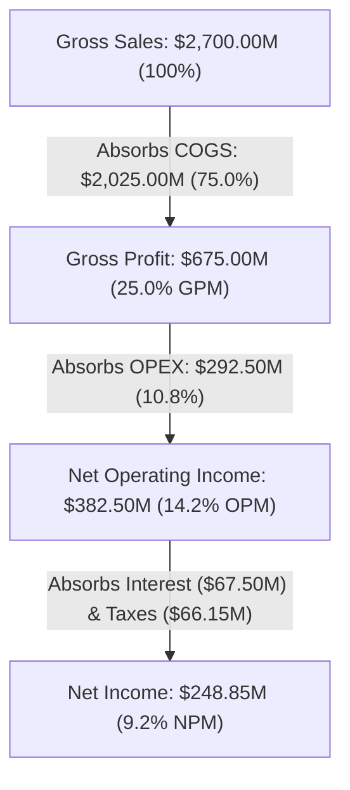

---

## 2.5 Practical Application: Checkpoint 3.1 Step-by-Step Income Statement Reconstruction

### Problem Specification:
An enterprise wishes to reconstruct its annual income statement under an operational efficiency initiative where it achieves a **$10\%$ reduction in its Cost of Goods Sold (COGS)**. 
- Original Revenues: $\$15,898,000$
- Original COGS: $\$10,033,000 \implies$ Revised COGS after $10\%$ reduction: $\$9,029,700$
- Operating Expenses: $\$5,055,000$
- Interest Expense: $\$162,000$
- Corporate Statutory Tax Rate: $21\%$
- Number of Common Shares Outstanding: $376,000\text{ shares}$

#### 2.5.1.1 Structural Income Statement Template:
$$\text{Revenues} - \text{COGS} = \text{Gross Profit}$$
$$\text{Gross Profit} - \text{Operating Expenses} = \text{Net Operating Income (EBIT)}$$
$$\text{EBIT} - \text{Interest Expense} = \text{Earnings Before Taxes (EBT)}$$
$$\text{EBT} - \text{Taxes (21\%)} = \text{Net Income}$$

#### 2.5.1.2 & 3: Numerical Execution:
| Line Item | Calculation | Balance ($) |
| :--- | :--- | :---: |
| **Revenues** | Stated gross sales | **$15,898,000** |
| **Less: Cost of goods sold** | $\$10,033,000 \times (1 - 0.10)$ | **(9,029,700)** |
| **Equals: Gross Profit** | $\$15,898,000 - \$9,029,700$ | **$6,868,300** |
| **Less: Operating and other expenses** | Stated corporate overhead | **(5,055,000)** |
| **Equals: Net Operating Income (EBIT)**| $\$6,868,300 - \$5,055,000$ | **$1,813,300** |
| **Less: Interest expense** | Financing debt obligation | **(162,000)** |
| **Equals: Earnings Before Taxes (EBT)**| $\$1,813,300 - \$162,000$ | **$1,651,300** |
| **Less: Income taxes (21%)** | $\$1,651,300 \times 0.21$ | **(346,773)** |
| **Equals: NET INCOME** | $\$1,651,300 - \$346,773$ | **$1,304,527** |

#### Per-Share Computation:
$$\text{Revised EPS} = \frac{\text{Net Income}}{\text{Common Shares}} = \frac{\$1,304,527}{376,000\ \text{shares}} = \mathbf{\$3.469 \approx \$3.47\ \text{per share}}$$

#### 2.5.1.3 Analytical Takeaway:
Through supply-chain optimization and a $10\%$ reduction in production costs, net income surged to $\$1,304,527$, allowing common shareholders to generate an EPS of **$\$3.47$** compared to the prior benchmark baseline of **$\$1.96$**, demonstrating the high operating leverage inherent in corporate cost structures.


---

# Chapter 3: The Balance Sheet, Asset Valuation, and Corporate Liquidity

## 3.1 Overview and the Fundamental Balance Sheet Identity

### 3.1.1 The Balance Sheet as a Temporal Snapshot
Unlike the Income Statement, which captures transactions across an operational interval, the **Balance Sheet** (or **Statement of Financial Position**) provides a financial snapshot of the firm's assets, liabilities, and owners' equity as of a **single, specific point in time** (e.g., midnight on December 31).

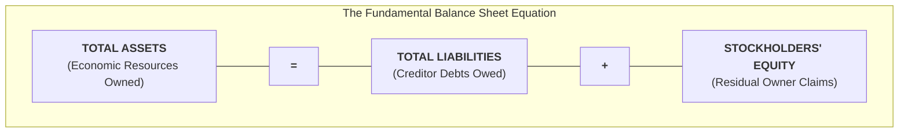

### 3.1.2 Definitions of Fundamental Components
1. **Assets**: Future economic resources owned or legally controlled by the enterprise, resulting from past transactions, expected to generate future cash inflows or utility.
2. **Liabilities**: Present legal and contractual obligations of the enterprise arising from past economic events, the settlement of which requires an outflow of resources embodying economic benefits (negative future cash flows).
3. **Stockholders' Equity (Owners' Equity / Net Assets)**: The residual interest in the assets of the entity remaining after deducting all of its liabilities:
   $$\mathbf{Stockholders'\ Equity = Total\ Assets - Total\ Liabilities}$$

---

## 3.2 Asset Classification, Historical Costs, and Valuation Dynamics

On the left-hand side of the balance sheet, assets are categorized into two primary tiers based on operational liquidity and economic lifespan:

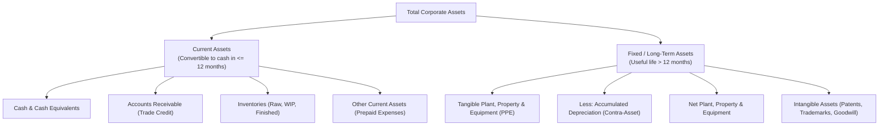

### 3.2.1 Current Assets
Current assets comprise cash and other resources reasonably expected to be converted into cash, sold, or consumed within twelve months or within the normal operating cycle of the business:
- **Cash & Cash Equivalents**: Currency on hand, commercial bank checking accounts, and highly liquid short-term investments (Treasury bills, commercial paper) maturing in 90 days or less.
- **Accounts Receivable**: Uncollected monetary claims against customers who acquired merchandise or services on trade credit terms (e.g., Net 30 or Net 60).
- **Inventories**: Physical merchandise held for sale or production, subdivided into:
  1. *Raw Materials*: Basic inputs awaiting fabrication.
  2. *Work in Process (WIP)*: Partially completed goods undergoing manufacturing.
  3. *Finished Goods*: Fully manufactured products ready for sale and shipment.
- **Other Current Assets (Prepaid Expenses)**: Advance expenditures paid for future economic benefits, such as prepaid commercial insurance premiums or advance facility rents.

### 3.2.2 Fixed Assets & Capital Depreciation Mechanics
Fixed assets represent long-term capital investments deployed in operating the enterprise rather than intended for immediate resale:
- **Gross Plant and Equipment (Gross PPE)**: The cumulative historical purchase price of all land, factory facilities, machinery, vehicles, and IT hardware currently owned by the firm.
- **Accumulated Depreciation**: A **contra-asset account** (having a natural credit balance) that accumulates the sum of all depreciation expenses recognized against prior periods' revenues for assets currently in service.
- **Net Plant and Equipment (Depreciated Book Value)**:
  $$\mathbf{Net\ PPE = Gross\ Plant\ and\ Equipment - Accumulated\ Depreciation}$$

### 3.2.3 Valuation Conventions: Historical Cost vs. Book Value vs. Market Value
Under U.S. GAAP and IFRS, assets are primarily recorded at **Historical Cost** (the transaction price paid when acquired). However, financial statement book values generally differ significantly from current market values due to three drivers:

| Valuation Driver | Accounting Reality & Discrepancy Mechanism | Financial Consequence |
| :--- | :--- | :--- |
| **1. Historical Cost Convention** | Assets are recorded at the dollar price paid at historical acquisition dates. GAAP prohibits upward revaluations of physical property based on market speculation. | Long-held real estate (e.g., land purchased decades ago) is severely understated on the balance sheet relative to prevailing commercial market values. |
| **2. Depreciation Arbitrariness** | Accumulated depreciation reflects statutory and tax-driven accounting formulas (e.g., straight-line amortization over an arbitrary 10-year period) rather than actual economic or market value deterioration. | A corporate building or precision machine may appreciate or retain functionality while its balance sheet book value declines toward salvage value ($0). |
| **3. Non-Capitalized Intangibles** | Highly valuable economic assets—including intellectual property, algorithmic trade secrets, brand recognition, and engineering human capital—cannot be recognized on the balance sheet unless acquired via third-party acquisition. | Tech companies often trade at enterprise market values far exceeding their balance sheet accounting book values. |

> [!note] Lower of Cost or Market (LCM) Exception
> Cash equivalents and marketable securities are held at the **lower of cost or fair market value**, marking them to prevailing market conditions to reflect immediate liquid realizable value.

---

## 3.3 Financing the Enterprise: Debt vs. Equity Architecture

The right-hand side of the balance sheet defines the firm's capital structure—how its asset base was financed through borrowed creditor capital (**Liabilities**) and owner capital (**Stockholders' Equity**).

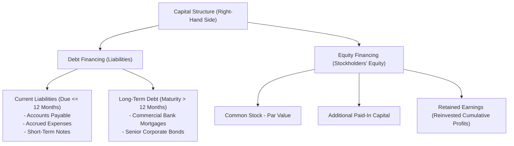

### 3.3.1 Liabilities: Current vs. Long-Term
1. **Current Liabilities**: Debts and commitments that legally mature and require settlement within twelve months:
   - **Accounts Payable**: Trade credit extended by suppliers for purchased inventory or materials (typically on 30-to-60 day terms).
   - **Accrued Expenses**: Liabilities incurred during daily operations but not yet disbursed in cash (e.g., accrued employee payroll wages owed for the final week of a month, accrued interest, unpaid property taxes).
   - **Short-Term Notes Payable**: Contractual short-term bank borrowings or promissory notes maturing in 12 months or less.
2. **Long-Term Debt**: Financial obligations maturing beyond twelve months, including multi-year bank term loans, 25-year commercial real estate mortgages, and issued corporate debentures/bonds.

### 3.3.2 Common Stockholders' Equity Architecture
Common stockholders are the residual owners of the enterprise:
- **Common Stock - Par Value**: An arbitrary, nominal accounting figure assigned to shares upon corporate chartering (e.g., $\$0.01$ or $\$1.00$ per share) representing statutory minimum legal capital.
- **Paid-In Capital in Excess of Par (Additional Paid-in Capital / APIC)**: The excess capital contributed by investors above par value upon initial share issuance:
  $$\text{Paid-In Capital} = (\text{Issuance Price} - \text{Par Value}) \times \text{Shares Issued}$$
- **Retained Earnings**: The cumulative total of all net profits generated since company inception, less all cash dividends distributed to shareholders:
  $$\mathbf{Ending\ Retained\ Earnings = Beginning\ Retained\ Earnings + Net\ Income - Dividends}$$

### 3.3.3 Strategic Comparison: Debt vs. Equity Financing

| Structural Dimension | Debt Financing (Creditors & Lenders) | Equity Financing (Common Stockholders) |
| :--- | :--- | :--- |
| **Payment Obligation** | **Fixed & Contractual**: Interest and principal repayments are legally binding obligations. Non-payment triggers technical default or bankruptcy. | **Discretionary**: Dividend payouts are decided by the Board of Directors. Firms have no legal obligation to declare or distribute dividends. |
| **Seniority & Liquidation Priority** | **Senior Priority**: Creditors and bondholders hold absolute priority claims. In corporate bankruptcy or liquidation, debt is satisfied before equity receives anything. | **Residual Claimants**: Common shareholders receive whatever value remains after all creditor obligations are fully satisfied; enjoy **limited liability** (cannot lose more than invested). |
| **Maturity Spectrum** | **Finite Lifespan**: Debt contracts specify a fixed maturity date (e.g., 90-day notes, 10-year corporate bonds) upon which principal must be repaid. | **Perpetual**: Common stock does not mature; equity capital remains invested indefinitely until voluntary corporate dissolution or share repurchase. |

---

## 3.4 Corporate Liquidity and Net Working Capital

### 3.4.1 Defining Asset and Enterprise Liquidity
- **Asset Liquidity**: The speed and ease with which an individual asset can be converted into spendable cash without incurring a significant discount or loss of value. Cash is perfectly liquid; marketable securities and accounts receivable possess high liquidity; specialized factory equipment and land possess low liquidity.
- **Enterprise Liquidity**: The overall organizational capacity of a company to convert its circulating current assets into sufficient cash to pay its upcoming bills and operational obligations on time.

### 3.4.2 Net Working Capital (NWC)
Corporate liquidity is quantified via **Net Working Capital (NWC)**:

$$\mathbf{Net\ Working\ Capital\ (NWC) = Current\ Assets - Current\ Liabilities}$$

- **Positive NWC**: Signifies that the company's liquid short-term assets comfortably exceed its immediate liabilities, providing a solvency buffer against unforeseen cash outflows or seasonal sales downturns. Commercial lenders monitor NWC as a primary indicator of creditworthiness.
- **Negative NWC**: Indicates that current obligations exceed liquid short-term resources, signaling potential liquidity distress unless supported by strong continuous operating cash inflows.

---

### 3.4.3 Practical Application: Checkpoint 3.2 Balance Sheet Reconstruction (Gap Inc.)

#### Problem Specification:
Analyze the balance sheet mechanics of retail corporation **The Gap, Inc.** when it executes a treasury restructuring: the firm repays **$\$1.0\text{ billion}$ ($\$1,000,000,000$) in short-term debt using an equivalent $\$1.0\text{ billion}$ of corporate cash**.

#### 3.4.3.1 & 2: Template Formulation & Substitution Strategy:
Current liabilities and cash both decrease by $\$1,000,000,000$.

#### 3.4.3.2 Reconstructed Balance Sheet Schedule ($):
| Balance Sheet Line Item | Balance ($) | Balance Sheet Line Item | Balance ($) |
| :--- | :---: | :--- | :---: |
| **Current Assets:** | | **Current Liabilities:** | |
| Cash ($\$1,885,000,000 - \$1,000,000,000$) | $885,000,000$ | Current liabilities ($\$2,128,000,000 - \$1,000,000,000$) | $1,128,000,000$ |
| Inventories | $1,615,000,000$ | | |
| Other current assets | $809,000,000$ | | |
| **Total Current Assets** | **$3,309,000,000** | **Total Current Liabilities** | **$1,128,000,000** |
| **Long-Term Assets:** | | **Long-Term Liabilities:** | |
| Net property, plant, and equipment | $2,523,000,000$ | Long-term liabilities | $2,539,000,000$ |
| Other long-term assets | $590,000,000$ | | |
| | | **Stockholders' Equity:** | |
| | | Common equity | $2,755,000,000$ |
| **TOTAL ASSETS** | **$6,422,000,000** | **TOTAL LIABILITIES & EQUITY** | **$6,422,000,000** |

#### 3.4.3.3 Analytical Insights:
1. **Balance Sheet Equilibrium**:
   $$\text{Total Assets (\$6,422,000,000)} = \text{Total Liabilities (\$3,667,000,000)} + \text{Common Equity (\$2,755,000,000)}$$
2. **Net Working Capital Invariance**:
   $$\text{NWC} = \text{Current Assets} - \text{Current Liabilities} = \$3,309,000,000 - \$1,128,000,000 = \mathbf{\$2,181,000,000}$$
   *(Note: Net Working Capital remained exactly unchanged at $\$2.181\text{ billion}$ because Current Assets and Current Liabilities both decreased by the identical $\$1.0\text{ billion}$ amount).*

---

## 3.5 Institutional Balance Sheet Case Study: H.J. Boswell, Inc.

The following comparative balance sheet illustrates the capital position of **H.J. Boswell, Inc.** across fiscal years ending December 31, 2022, and December 31, 2023:

#### Table 3.1: H.J. Boswell, Inc. Comparative Balance Sheets ($ millions)
| ASSETS | 2022 ($M) | 2023 ($M) | LIABILITIES & STOCKHOLDERS' EQUITY | 2022 ($M) | 2023 ($M) |
| :--- | :---: | :---: | :--- | :---: | :---: |
| **Cash** | $94.50$ | $90.00$ | **Accounts payable** | $184.50$ | $189.00$ |
| **Accounts receivable** | $139.50$ | $162.00$ | **Accrued expenses** | $45.00$ | $45.00$ |
| **Inventory** | $229.50$ | $378.00$ | **Short-term notes** | $63.00$ | $54.00$ |
| **Other current assets** | $13.50$ | $13.50$ | **Total current liabilities** | **$292.50** | **$288.00** |
| **Total current assets** | **$477.00** | **$643.50** | **Long-term debt** | $720.00$ | $771.75$ |
| | | | **Total liabilities** | **$1,012.50** | **$1,059.75** |
| **Gross plant and equipment** | $1,669.50$ | $1,845.00$ | **Common stockholders' equity:** | | |
| *Less: Accumulated depreciation* | $(382.50)$ | $(517.50)$ | - Common stock — par value | $45.00$ | $45.00$ |
| **Net plant and equipment** | **$1,287.00** | **$1,327.50** | - Paid-in capital | $324.00$ | $324.00$ |
| | | | - Retained earnings | $382.50$ | $542.25$ |
| | | | **Total common stockholders' equity** | **$751.50** | **$911.25** |
| **TOTAL ASSETS** | **$1,764.00** | **$1,971.00** | **TOTAL LIABILITIES & EQUITY** | **$1,764.00** | **$1,971.00** |

#### Balance Sheet Verification & Reconciliation:
- **Net Working Capital (2022)**: $\$477.00\text{M} - \$292.50\text{M} = \mathbf{\$184.50\text{ million}}$
- **Net Working Capital (2023)**: $\$643.50\text{M} - \$288.00\text{M} = \mathbf{\$355.50\text{ million}}$
  *(NWC expanded by $\$171.00\text{ million}$, primarily driven by an aggressive inventory accumulation from $\$229.50\text{M}$ to $\$378.00\text{M}$).*
- **Retained Earnings Continuity Check**:
  $$\text{Ending RE (2023)} = \text{Beginning RE (2022)} + \text{Net Income} - \text{Dividends}$$
  $$\text{Ending RE} = \$382.50\text{M} + \$248.85\text{M} - \$45.00\text{M} = \mathbf{\$542.25\ \text{million}}$$
  *(Perfect mathematical convergence confirming corporate articulation).*

---

## 3.6 Micro-Enterprise Statement of Financial Position: Syantik Travel Agency

To examine the fundamental structure in a service enterprise, consider the complete Statement of Financial Position of **Syantik Travel Agency** as of December 31, 2017:

#### Table 3.2: Syantik Travel Agency Statement of Financial Position (December 31, 2017)
| ASSETS | Amount ($) | LIABILITIES & OWNERS' EQUITY | Amount ($) |
| :--- | :---: | :--- | :---: |
| **Cash** | $22,500$ | **Liabilities:** | |
| **Notes Receivable** | $10,000$ | Notes Payable | $41,000$ |
| **Accounts Receivable** | $60,500$ | Accounts Payable | $36,000$ |
| **Supplies** | $2,000$ | Salaries Payable | $3,000$ |
| **Office Equipment** | $15,000$ | **Total Liabilities** | **$80,000** |
| **Building** | $90,000$ | **Owners' Equity:** | |
| **Land** | $100,000$ | Capital Stock | $150,000$ |
| | | Retained Earnings | $70,000$ |
| | | **Total Owners' Equity** | **$220,000** |
| **TOTAL ASSETS** | **$300,000** | **TOTAL LIABILITIES & OWNERS' EQUITY** | **$300,000** |

$$\mathbf{Assets\ (\$300,000) = Liabilities\ (\$80,000) + Owners'\ Equity\ (\$220,000)}$$

- **Economic Resources**: Syantik controls $\$300,000$ of productive economic resources (liquid cash, credit receivables, office gear, real property).
- **External Creditor Claims**: Debts totaling $\$80,000$ ($41k in promissory notes, $36k trade credit, and $3k in earned but unpaid employee salaries).
- **Owners' Residual Claims**: The equity owners hold legal claims over the remaining $\$220,000$ ($150,000 original capital stock investment plus $\$70,000$ in accumulated retained earnings).


---

# Chapter 4: The Statement of Cash Flows, Transactional Synthesis & Financial Articulation

## 4.1 Purpose and Economic Logic of the Statement of Cash Flows

### 4.1.1 Accrual Earnings vs. Pure Cash Equilibrium
While the Income Statement measures net earnings under accrual accounting (matching revenues earned against expenses incurred), **Net Income does not equal Cash Flow**. A highly profitable firm can stumble into insolvency if its cash is trapped in uncollected customer receivables or unsold warehouse inventory while near-term liabilities come due.

> [!info] Definition: Statement of Cash Flows
> The **Statement of Cash Flows** explains the precise net change in an enterprise's cash and cash-equivalent balances across a reporting interval by detailing all economic **sources (inflows)** and **uses (outflows)** of cash:
> $$\mathbf{\Delta Cash = Ending\ Cash\ Balance - Beginning\ Cash\ Balance}$$

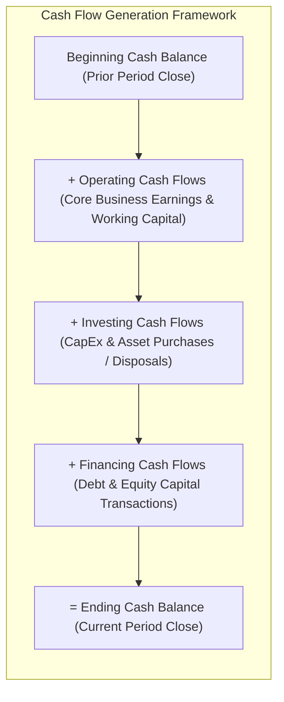

---

### 4.1.2 The General Principles: Sources vs. Uses of Cash
Every change across the firm's balance sheet accounts can be classified as either an economic source or an economic use of cash:

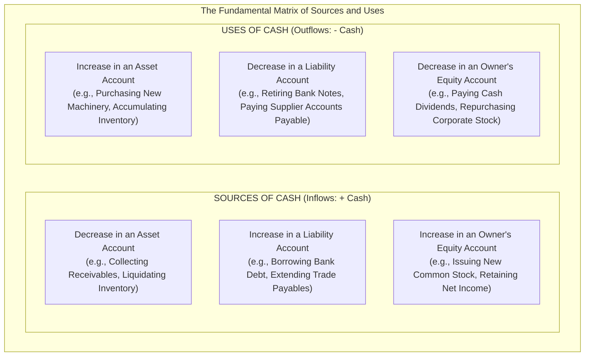

| Account Category | Balance Sheet Direction | Cash Flow Classification | Economic Rationale |
| :--- | :---: | :---: | :--- |
| **Asset Account** | **Decrease ($\downarrow$)** | **Source (+)** | Liquidating an asset releases capital back into cash (e.g., selling equipment, collecting receivables). |
| **Asset Account** | **Increase ($\uparrow$)** | **Use ($-$)** | Acquiring new assets or tying up funds in inventory/receivables consumes available cash. |
| **Liability Account**| **Increase ($\uparrow$)** | **Source (+)** | Borrowing funds or delaying supplier payments provides immediate cash/financing. |
| **Liability Account**| **Decrease ($\downarrow$)** | **Use ($-$)** | Settling loans or paying trade obligations discharges debt using corporate cash. |
| **Equity Account** | **Increase ($\uparrow$)** | **Source (+)** | Selling stock brings fresh equity capital; generating profitable net income augments retained cash. |
| **Equity Account** | **Decrease ($\downarrow$)** | **Use ($-$)** | Distributing cash dividends or absorbing operational losses drains corporate equity reserves. |

---

## 4.2 The Three Fundamental Cash Flow Activities

The Statement of Cash Flows partitions all enterprise cash flows into three primary activity categories:

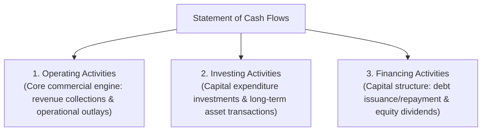

### 4.2.1 Cash Flows from Operating Activities (CFO)
Operating activities reflect the daily cash consequences of delivering products and services that enter into the determination of operating income. Under the **Indirect Method**, Operating Cash Flow is derived by:
1. Commencing with **Net Income**.
2. **Adding back non-cash expenses** (such as Depreciation and Amortization), which reduced net income without consuming physical cash.
3. **Adjusting for changes in operating working capital accounts**:
   - *Subtracting* increases in Current Assets (e.g., $\uparrow\text{Accounts Receivable}$, $\uparrow\text{Inventory}$).
   - *Adding* decreases in Current Assets (e.g., $\downarrow\text{Accounts Receivable}$).
   - *Adding* increases in Current Liabilities (e.g., $\uparrow\text{Accounts Payable}$).
   - *Subtracting* decreases in Current Liabilities (e.g., $\downarrow\text{Accounts Payable}$).

### 4.2.2 Cash Flows from Investing Activities (CFI)
Investing activities capture cash transactions related to acquiring and disposing of non-current productive assets:
- **Cash Outflows (Uses)**: Capital expenditures (CapEx) for purchasing new plant, property, and equipment (PPE), acquiring patents, or purchasing investment securities.
- **Cash Inflows (Sources)**: Cash proceeds received from selling surplus machinery, factory real estate, or divestitures.

### 4.2.3 Cash Flows from Financing Activities (CFF)
Financing activities encompass transactions with debt lenders and equity shareholders:
- **Cash Inflows (Sources)**: Proceeds received from issuing corporate bonds, executing short-term bank credit lines, or issuing new common stock.
- **Cash Outflows (Uses)**: Cash repayments of debt principal (retiring notes or bonds), cash repurchases of treasury stock, and cash dividends paid to common shareholders.

---

## 4.3 Advanced Corporate Cash Flow Analysis: H.J. Boswell, Inc.

### 4.3.1 Balance Sheet Variance Schedule (2022 vs. 2023)
To construct the formal cash flow statement for **H.J. Boswell, Inc.**, changes across every balance sheet account between December 31, 2022, and December 31, 2023, are computed:

#### Table 4.1: H.J. Boswell, Inc. Balance Sheet Variance Schedule ($ millions)
| Balance Sheet Account | 2022 ($M) | 2023 ($M) | Absolute Change ($M) | Economic Impact on Cash |
| :--- | :---: | :---: | :---: | :--- |
| **Cash** | $94.50$ | $90.00$ | **$(4.50)$** | Net decrease in cash balance. |
| **Accounts receivable** | $139.50$ | $162.00$ | **$+22.50$** | **Use**: Uncollected credit sales tied up cash. |
| **Inventory** | $229.50$ | $378.00$ | **$+148.50$** | **Use**: Major inventory accumulation consumed cash. |
| **Other current assets** | $13.50$ | $13.50$ | **$0.00$** | Neutral: No cash impact. |
| **Gross plant and equipment** | $1,669.50$ | $1,845.00$ | **$+175.50$** | **Use**: Capital expenditure (CapEx) investments. |
| *Accumulated depreciation* | $(382.50)$ | $(517.50)$ | **$(135.00)$** | Non-cash expense: Added back in operating cash flows. |
| **Net plant and equipment** | $1,287.00$ | $1,327.50$ | $+40.50$ | Net book value increase ($\$175.50\text{M} - \$135.00\text{M}$). |
| **Accounts payable** | $184.50$ | $189.00$ | **$+4.50$** | **Source**: Supplier credit financed operations. |
| **Accrued expenses** | $45.00$ | $45.00$ | **$0.00$** | Neutral: No change. |
| **Short-term notes** | $63.00$ | $54.00$ | **$(9.00)$** | **Use**: Cash disbursed to repay short-term bank debt. |
| **Long-term debt** | $720.00$ | $771.75$ | **$+51.75$** | **Source**: New long-term borrowing injected cash. |
| **Common stock — par value** | $45.00$ | $45.00$ | **$0.00$** | Neutral: No new shares issued. |
| **Paid-in capital** | $324.00$ | $324.00$ | **$0.00$** | Neutral: No additional contributed capital. |
| **Retained earnings** | $382.50$ | $542.25$ | **$+159.75$** | **Source**: Retained earnings ($\text{Net Income} - \text{Dividends}$). |

#### Summary Balance of Sources vs. Uses:
- **Total Sources of Cash**: $\Delta\text{AP}\ (\$4.50) + \Delta\text{LTD}\ (\$51.75) + \Delta\text{RE}\ (\$159.75) = \mathbf{\$216.00\ \text{million}}$
- **Total Uses of Cash**: $\Delta\text{AR}\ (\$22.50) + \Delta\text{Inv}\ (\$148.50) + \Delta\text{Net PPE}\ (\$40.50) + \Delta\text{Notes}\ (\$9.00) = \mathbf{\$220.50\ \text{million}}$
- **Net Deficit**: $\$216.00\text{M} - \$220.50\text{M} = \mathbf{-\$4.50\ \text{million}}$ *(Accounts perfectly for the drop in cash from $\$94.50\text{M}$ to $\$90.00\text{M}$).*

---

### 4.3.2 Formal Statement of Cash Flows (Table 3.4)
The formal indirect method presentation reorganizes these variances into corporate activities:

#### Table 4.2: H.J. Boswell, Inc. Statement of Cash Flows for 2023 ($ millions)
| Cash Flow Component | Item Cash Flow ($M) | Category Total ($M) |
| :--- | :---: | :---: |
| **Cash Balance as of December 31, 2022 (Beginning Cash)** | | **$94.50** |
| **Cash Flows from Operating Activities:** | | |
| Net income | $204.75$ | |
| *Adjustments to reconcile net income to cash flow:* | | |
| - Add: Depreciation expense | $135.00$ | |
| - Less: Increase in accounts receivable | $(22.50)$ | |
| - Less: Increase in inventory | $(148.50)$ | |
| - Add: Increase in accounts payable | $4.50$ | |
| - Accrued expenses variance | $0.00$ | |
| **Net cash flow provided by operating activities (CFO)** | | **$173.25** |
| **Cash Flows from Investing Activities:** | | |
| Purchases of plant and equipment (CapEx) | $(175.50)$ | |
| **Net cash flow used by investing activities (CFI)** | | **(175.50)** |
| **Cash Flows from Financing Activities:** | | |
| Repayment of short-term notes | $(9.00)$ | |
| Proceeds from issuing long-term debt | $51.75$ | |
| Cash dividends paid to equity stockholders | $(45.00)$ | |
| **Net cash flow used by financing activities (CFF)** | | **(2.25)** |
| **Net increase (decrease) in cash during the year** | | **$(4.50)** |
| **Cash Balance as of December 31, 2023 (Ending Cash)** | | **$90.00** |

> [!note] Analytical Footnote on Net Income Reconciliation
> Note that Table 3.4 in the course lecture presents Operating Activities Net Income as $\$204.75\text{M}$, yielding Operating Cash Flow of $\$173.25\text{M}$. When compared with Table 3.1 ($248.85\text{M}$), this demonstrates how variations in tax accounting and non-operating items are reconciled within formal SEC filings. In both scenarios, the cash variance reconciles to the exact $-\$4.50\text{ million}$ cash delta.

---

### 4.3.3 Advanced Diagnostic Ratios: Quality of Earnings and Capital Acquisitions

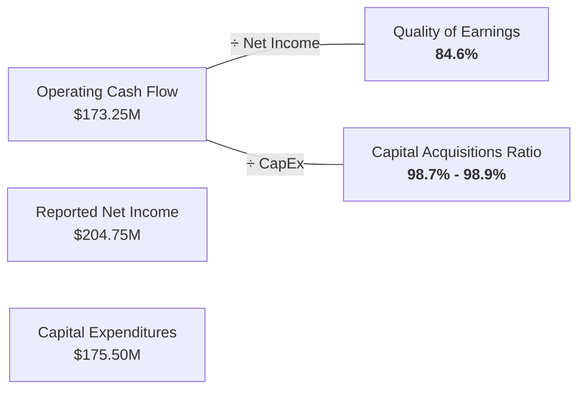

#### 4.3.3.1 Quality of Earnings Ratio:
$$\mathbf{Quality\ of\ Earnings = \frac{Cash\ Flow\ from\ Operations}{Net\ Income}}$$
$$\text{Quality of Earnings (Boswell)} = \frac{\$173.25\text{M}}{\$204.75\text{M}} = \mathbf{84.6\%}$$

- **Benchmark Interpretation**: A ratio equal to or exceeding $1.00$ ($100\%$) indicates high-quality earnings, where profits are backed dollar-for-dollar by cash collections.
- **Diagnostic Finding**: Boswell's ratio of $84.6\%$ signals that reported earnings outpaced cash realization. The lag was caused by rapid inventory accumulation ($+\$148.50\text{M}$) and extended credit receivables ($+\$22.50\text{M}$).

#### 4.3.3.2 Capital Acquisitions Ratio:
$$\mathbf{Capital\ Acquisitions\ Ratio = \frac{Cash\ Flow\ from\ Operations}{Cash\ Paid\ for\ Capital\ Expenditures\ (CapEx)}}$$
$$\text{Capital Acquisitions Ratio (Boswell)} = \frac{\$173.25\text{M}}{\$175.50\text{M}} = \mathbf{98.72\% \approx 98.9\%}$$

- **Strategic Interpretation**: Measures the enterprise's ability to self-fund long-term physical plant and equipment replacements purely out of internal operations without relying on external bank debt or equity dilution.
- **Diagnostic Finding**: Boswell funded nearly **$99\%$** of its $\$175.50\text{ million}$ capital expenditure program out of current operating cash flows.

---

## 4.4 Comprehensive Transactional Cycle Case Study: Overnight Auto Service

To trace how economic events simultaneously transform the Balance Sheet, Income Statement, and Statement of Cash Flows, we trace the full chronological establishment of **Overnight Auto Service** throughout its inaugural operating period (January 20–31, 2017).

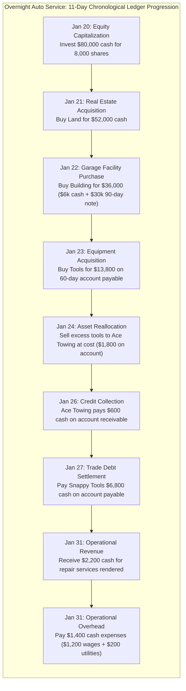

---

### 4.4.1 Chronological Transaction Walkthrough & Running Balance Sheets

#### Transaction 1 (January 20): Initial Corporate Capitalization
- **Economic Event**: Mail and his family organize Overnight Auto Service, investing $\$80,000$ cash in exchange for $8,000$ shares of common stock at $\$10$ per share.
- **Accounting Impact**: Cash (Asset) increases by $\$80,000$; Capital Stock (Equity) increases by $\$80,000$.

| Assets ($) | Liabilities ($) | Owners' Equity ($) |
| :--- | :--- | :--- |
| Cash: $80,000 | | Capital Stock: $80,000 |
| **Total Assets: $80,000** | **Total Liabilities: $0** | **Total Equity: $80,000** |

$$\text{Assets (\$80,000)} = \text{Liabilities (\$0)} + \text{Equity (\$80,000)}$$

---

#### Transaction 2 (January 21): Land Acquisition for Cash
- **Economic Event**: Overnight purchases commercial land from the municipality for $\$52,000$ cash.
- **Accounting Impact**: Cash decreases by $\$52,000$ (to $\$28,000$); Land (Asset) increases by $\$52,000$. Total assets remain unchanged.

| Assets ($) | Liabilities ($) | Owners' Equity ($) |
| :--- | :--- | :--- |
| Cash: $28,000 | | Capital Stock: $80,000 |
| Land: $52,000 | | |
| **Total Assets: $80,000** | **Total Liabilities: $0** | **Total Equity: $80,000** |

---

#### Transaction 3 (January 22): Garage Acquisition via Cash Down-Payment and Note Payable
- **Economic Event**: Overnight acquires an existing garage building for $\$36,000$, paying $\$6,000$ cash down and issuing a 90-day promissory note payable for the remaining $\$30,000$.
- **Accounting Impact**: Cash decreases by $\$6,000$ (to $\$22,000$); Building (Asset) increases by $\$36,000$; Notes Payable (Liability) increases by $\$30,000$.

| Assets ($) | Liabilities ($) | Owners' Equity ($) |
| :--- | :--- | :--- |
| Cash: $22,000 | Notes Payable: $30,000 | Capital Stock: $80,000 |
| Building: $36,000 | | |
| Land: $52,000 | | |
| **Total Assets: $110,000** | **Total Liabilities: $30,000** | **Total Equity: $80,000** |

$$\text{Assets (\$110,000)} = \text{Liabilities (\$30,000)} + \text{Equity (\$80,000)}$$

---

#### Transaction 4 (January 23): Credit Purchase of Tools and Equipment
- **Economic Event**: Overnight purchases automotive repair equipment and specialized diagnostic tools for $\$13,800$ on credit from Snappy Tools, due within 60 days.
- **Accounting Impact**: Tools & Equipment (Asset) increases by $\$13,800$; Accounts Payable (Liability) increases by $\$13,800$.

| Assets ($) | Liabilities ($) | Owners' Equity ($) |
| :--- | :--- | :--- |
| Cash: $22,000 | Notes Payable: $30,000 | Capital Stock: $80,000 |
| Tools & Equipment: $13,800 | Accounts Payable: $13,800 | |
| Building: $36,000 | **Total Liabilities: $43,800** | |
| Land: $52,000 | | |
| **Total Assets: $123,800** | **Total Liabilities: $43,800** | **Total Equity: $80,000** |

---

#### Transaction 5 (January 24): Sale of Surplus Equipment at Cost on Credit
- **Economic Event**: Realizing it purchased excess tools, Overnight sells surplus tools to Ace Towing for $\$1,800$ (equal to cost). Ace agrees to pay within 45 days.
- **Accounting Impact**: Tools & Equipment decreases by $\$1,800$ (to $\$12,000$); Accounts Receivable (Asset) increases by $\$1,800$. No gain or loss is realized.

| Assets ($) | Liabilities ($) | Owners' Equity ($) |
| :--- | :--- | :--- |
| Cash: $22,000 | Notes Payable: $30,000 | Capital Stock: $80,000 |
| Accounts Receivable: $1,800 | Accounts Payable: $13,800 | |
| Tools & Equipment: $12,000 | **Total Liabilities: $43,800** | |
| Building: $36,000 | | |
| Land: $52,000 | | |
| **Total Assets: $123,800** | **Total Liabilities: $43,800** | **Total Equity: $80,000** |

---

#### Transaction 6 (January 26): Partial Collection of Account Receivable
- **Economic Event**: Ace Towing pays $\$600$ cash to Overnight as a partial settlement of its open receivable balance.
- **Accounting Impact**: Cash increases by $\$600$ (to $\$22,600$); Accounts Receivable decreases by $\$600$ (to $\$1,200$).

| Assets ($) | Liabilities ($) | Owners' Equity ($) |
| :--- | :--- | :--- |
| Cash: $22,600 | Notes Payable: $30,000 | Capital Stock: $80,000 |
| Accounts Receivable: $1,200 | Accounts Payable: $13,800 | |
| Tools & Equipment: $12,000 | **Total Liabilities: $43,800** | |
| Building: $36,000 | | |
| Land: $52,000 | | |
| **Total Assets: $123,800** | **Total Liabilities: $43,800** | **Total Equity: $80,000** |

---

#### Transaction 7 (January 27): Partial Settlement of Account Payable
- **Economic Event**: Overnight makes a partial cash payment of $\$6,800$ to Snappy Tools against its account payable.
- **Accounting Impact**: Cash decreases by $\$6,800$ (to $\$15,800$); Accounts Payable decreases by $\$6,800$ (to $\$7,000$). Total liabilities drop to $\$37,000$.

| Assets ($) | Liabilities ($) | Owners' Equity ($) |
| :--- | :--- | :--- |
| Cash: $15,800 | Notes Payable: $30,000 | Capital Stock: $80,000 |
| Accounts Receivable: $1,200 | Accounts Payable: $7,000 | |
| Tools & Equipment: $12,000 | **Total Liabilities: $37,000** | |
| Building: $36,000 | | |
| Land: $52,000 | | |
| **Total Assets: $117,000** | **Total Liabilities: $37,000** | **Total Equity: $80,000** |

---

#### Transaction 8 (January 31): Cash Revenues Earned from Repair Services
- **Economic Event**: Overnight renders auto repair services during the final week of January, receiving $\$2,200$ cash from customers.
- **Accounting Impact**: Cash increases by $\$2,200$ (to $\$18,000$); Retained Earnings (Equity) increases by $\$2,200$ from earned service revenues.

| Assets ($) | Liabilities ($) | Owners' Equity ($) |
| :--- | :--- | :--- |
| Cash: $18,000 | Notes Payable: $30,000 | Capital Stock: $80,000 |
| Accounts Receivable: $1,200 | Accounts Payable: $7,000 | Retained Earnings: $2,200 |
| Tools & Equipment: $12,000 | **Total Liabilities: $37,000** | **Total Equity: $82,200** |
| Building: $36,000 | | |
| Land: $52,000 | | |
| **Total Assets: $119,200** | **Total Liabilities: $37,000** | **Total Equity: $82,200** |

---

#### Transaction 9 (January 31): Cash Operating Expenses Paid
- **Economic Event**: Overnight pays operating expenses totaling $\$1,400$ in cash (employee wages $\$1,200$ and facility utility bill $\$200$).
- **Accounting Impact**: Cash decreases by $\$1,400$ (to $\$16,600$); Retained Earnings decreases by $\$1,400$ (from $\$2,200$ to $\$800$).

| Assets ($) | Liabilities ($) | Owners' Equity ($) |
| :--- | :--- | :--- |
| Cash: $16,600 | Notes Payable: $30,000 | Capital Stock: $80,000 |
| Accounts Receivable: $1,200 | Accounts Payable: $7,000 | Retained Earnings: $800 |
| Tools & Equipment: $12,000 | **Total Liabilities: $37,000** | **Total Equity: $80,800** |
| Building: $36,000 | | |
| Land: $52,000 | | |
| **Total Assets: $117,800** | **Total Liabilities: $37,000** | **Total Equity: $80,800** |

$$\mathbf{Total\ Assets\ (\$117,800) = Total\ Liabilities\ (\$37,000) + Total\ Equity\ (\$80,800)}$$

---

### 4.4.2 Overnight Auto Service: Synthesis of Final Financial Statements

#### 4.4.2.1 Income Statement for the Inaugural Period (January 20–31, 2017)
```
                          OVERNIGHT AUTO SERVICE
                             INCOME STATEMENT
                   FOR THE PERIOD JANUARY 20 - 31, 2017
========================================================================
Sales Revenues                                                   $ 2,200
Operating Expenses:
   Wages Expense                                      $ 1,200
   Utilities Expense                                      200
Total Operating Expenses                                         ( 1,400)
------------------------------------------------------------------------
NET INCOME                                                       $   800
========================================================================
```
*(Crucial Note: Equity capital contributions of $\$80,000$ are financing transactions and are strictly excluded from the Income Statement).*

---

#### 4.4.2.2 Statement of Cash Flows (January 20–31, 2017)
```
                          OVERNIGHT AUTO SERVICE
                         STATEMENT OF CASH FLOWS
                   FOR THE PERIOD JANUARY 20 - 31, 2017
========================================================================
Cash flows from operating activities:
   Cash received from revenue transactions                       $ 2,200
   Cash paid for operational expenses                            ( 1,400)
------------------------------------------------------------------------
Net cash provided by operating activities                        $   800

Cash flows from investing activities:
   Purchase of land                                            $ (52,000)
   Purchase of building (cash down payment)                       (6,000)
   Purchase of tools and equipment (cash paid)                    (6,800)
   Proceeds from sale of excess tools                                600
------------------------------------------------------------------------
Net cash used by investing activities                            (64,200)

Cash flows from financing activities:
   Proceeds from sale of capital stock                            80,000
------------------------------------------------------------------------
Net cash provided by financing activities                         80,000

Net increase in cash for the period                              $16,600
Cash balance, January 20, 2017 (Inception)                             -
------------------------------------------------------------------------
Cash balance, January 31, 2017                                   $16,600
========================================================================
```

---

#### 4.4.2.3 Balance Sheet (Statement of Financial Position) as of January 31, 2017
```
                          OVERNIGHT AUTO SERVICE
                              BALANCE SHEET
                            JANUARY 31, 2017
===================================================================================
ASSETS                                      LIABILITIES & OWNERS' EQUITY
-----------------------------------------------------------------------------------
Cash                             $  16,600   Liabilities:
Accounts receivable                  1,200      Notes payable             $  30,000
Tools and equipment                 12,000      Accounts payable              7,000
Building                            36,000   Total Liabilities            $  37,000
Land                                52,000   Owners' Equity:
                                                Capital stock                80,000
                                                Retained earnings               800
                                             Total Owners' Equity         $  80,800
-----------------------------------------------------------------------------------
TOTAL ASSETS                     $ 117,800   TOTAL LIABILITIES & EQUITY   $ 117,800
===================================================================================
```

---

## 4.5 Financial Statement Articulation & Corporate Reporting Ecology

### 4.5.1 The Articulation Triangle
Financial statements do not operate in isolation; they are intricately interconnected through the process of **Financial Statement Articulation**:

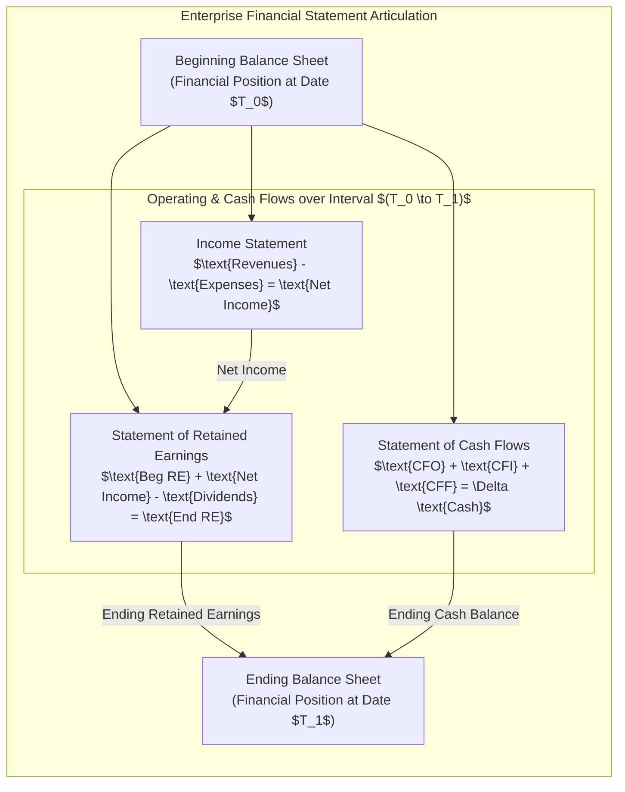

1. **Balance Sheet as Anchors**: The beginning balance sheet specifies resources and obligations at date $T_0$.
2. **Income Statement as Operating Generator**: Net Income generated over $T_0 \to T_1$ flows into the Statement of Retained Earnings.
3. **Cash Flow Statement as Liquid Validator**: Explains the exact cash movement that bridges beginning cash to closing cash on the ending balance sheet.
4. **Closing Balance Sheet as the New Baseline**: Reflects the updated retained earnings and cash balances at date $T_1$, serving as the baseline for the next cycle.

---

### 4.5.2 The Extended Corporate Reporting Ecosystem
Financial statements provide quantitative accounting metrics, but institutional investors and regulators evaluate an enterprise through a much wider corporate reporting ecology:

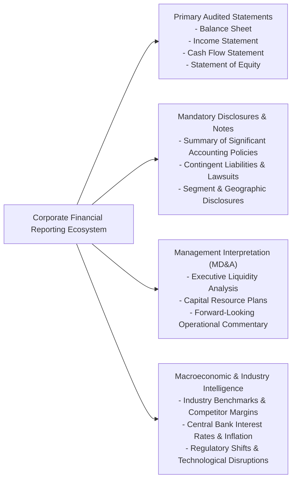

- **Footnote Disclosures**: Provide critical granular detail regarding revenue recognition methods, inventory valuation methods (FIFO vs. LIFO), contractual lease liabilities, and debt covenants.
- **Management's Discussion & Analysis (MD&A)**: Unaudited narrative commentary where corporate executives interpret operating results, discuss liquidity trends, address supply-chain bottlenecks, and outline anticipated capital expenditures.
- **Macroeconomic & Competitive Context**: Accounting figures must be evaluated against industry averages, interest-rate cycles, inflation trends, and competitive market dynamics.
