# Chapter 1: Introduction to Operating Systems & Computer System Architecture

## 1.1 Fundamentals of Operating Systems

### 1.1.1 What is an Operating System?
A computer system consists of two primary operational domains: **Hardware** (tangible physical and electronic components such as the Central Processing Unit, Random Access Memory, storage drives, and peripheral controllers) and **Software** (programs, data structures, and instruction sets executed by the processor).

> [!info] Definition: Operating System (OS)
> An **Operating System** is the chief software component of a computer system. It acts as an intermediary between user applications and the raw underlying hardware, responsible for managing, virtualizing, and arbitrating all hardware resources (processing time, main memory, physical storage, and I/O devices) while enforcing system protection, security, and access control.

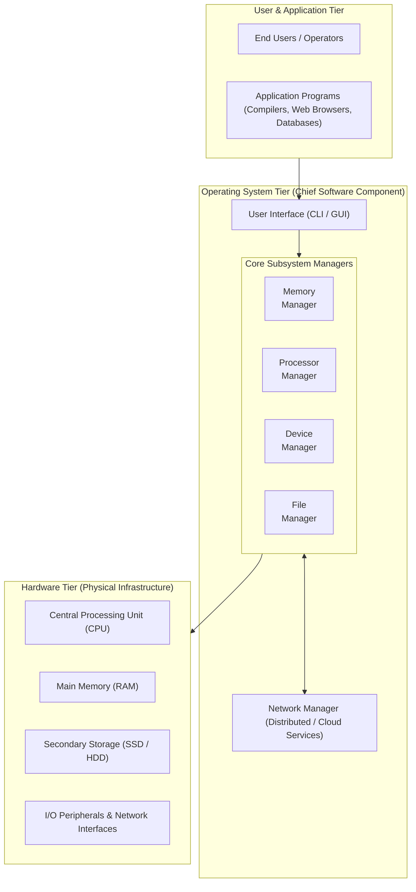

The operating system executes two primary, non-negotiable responsibilities:
1. **Resource Arbitration:** Enforcing policies that resolve:
   - *Who* gets access to each system resource.
   - *When* access is granted.
   - *How much* time or capacity is allocated.
2. **Resource Allocation and Deallocation:** Dynamically reserving physical resources upon valid request and reclaiming them cleanly when operations complete or terminate.

---

## 1.2 Operating System Subsystem Architecture

Modern operating systems are constructed from modular subsystem managers. Each manager performs a specialized role while interacting continuously with neighboring managers to maintain system integrity.

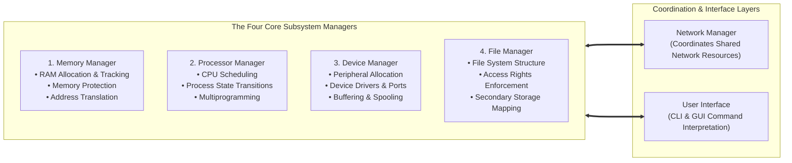

### 1.2.1 Main Memory Manager
Main Memory (Random Access Memory, RAM) is the high-speed workspace where instructions and active data must reside for the CPU to execute them.
- **Volatile Storage:** RAM requires an uninterrupted electrical current to maintain its state; disconnecting power results in instantaneous data loss.
- **Subsystem Responsibilities:**
  1. *Validation:* Checks the validity and legality of every incoming memory request from active processes.
  2. *Allocation & Mapping:* Assigns contiguous or virtual address blocks to incoming programs.
  3. *Protection:* Strictly guards the memory block assigned to the operating system kernel from unauthorized user-space mutation.
  4. *Deallocation & Reclaiming:* Reclaims allocated memory upon job termination and compacts/rearranges fragmented areas.

> [!note] Firmware and Read-Only Memory (ROM)
> In contrast to volatile RAM, **Read-Only Memory (ROM)** is permanent, non-volatile memory embedded on the motherboard. ROM stores the system firmware (BIOS / UEFI), which contains the initialization instructions executed immediately upon powering on the computer to locate, verify, and load the operating system bootloader from secondary storage into RAM.

### 1.2.2 Processor Manager
The Processor Manager controls access to the Central Processing Unit (CPU) and tracks the lifecycle of every active program in execution (a **process**).
- **Process Traffic Controller:** When a process completes its task, blocks for an I/O operation, or exhausts its allocated execution time slice (quantum), the Processor Manager interrupts execution, preserves state registers, reclaims the CPU, and assigns it to the next ready process.
- **Multicore & Multiprocessor Coordination:** On modern multicore processors, the Processor Manager orchestrates load balancing, thread affinities, and synchronization to avoid cache thrashing and deadlocks.

### 1.2.3 Device Manager
The Device Manager monitors, configures, and interfaces with all physical peripherals connected to the computer system (monitors, keyboards, storage disk controllers, printers, USB buses, and network cards).
- **Subsystem Responsibilities:**
  1. Identifies each peripheral device uniquely and attaches appropriate device drivers.
  2. Implements device allocation policies (dedicated allocation, shared allocation, or virtual spooling).
  3. Initiates device operations and monitors status registers and hardware interrupts.
  4. Reclaims devices upon process completion.

### 1.2.4 File Manager
The File Manager maintains the logical structure, hierarchical directories, and physical storage records for every file on the system (data files, compiled binaries, shell scripts, and system utilities).
- **Subsystem Responsibilities:**
  1. *Access Permissions:* Enforces strict access controls (read-only, read-write, execute, append, delete).
  2. *Storage Allocation:* Determines how file bytes are organized onto physical storage blocks (contiguous, linked, or indexed block allocation).
  3. *Cataloging & Indexing:* Maintains directories, file allocation tables, inodes, and metadata pointers for rapid retrieval.

### 1.2.5 Network Manager & User Interface
- **Network Manager:** Required in networked and distributed operating systems. Coordinates communications across local and wide-area networks, enabling authorized sharing of distributed memory, remote CPUs, network storage (NAS/SAN), databases, and printers.
- **User Interface (UI):** Direct user-facing component that accepts commands and translates them into system requests:
  - **Command-Line Interface (CLI):** Text-driven terminal shell requiring precise syntax, flags, and keyword commands. Offers high automation capability through scripting.
  - **Graphical User Interface (GUI):** Visual desktop environment with windows, icons, menus, and pointer devices (WIMP). Lowers cognitive barrier for non-technical users.

---

## 1.3 Subsystem Cooperation: A Complete Interaction Lifecycle

No operating system manager functions in isolation. A single routine user action triggers a coordinated cascade across all subsystem managers.

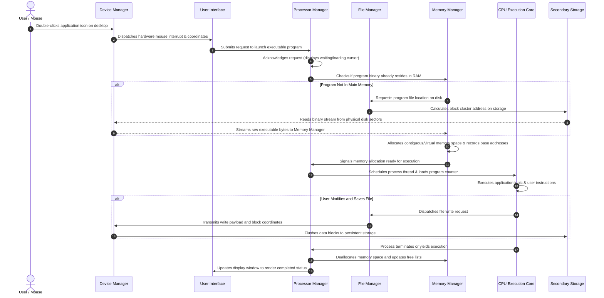

---

## 1.4 Evolution of Computing Hardware and Operating Systems

Operating system architectures have evolved in direct synchronization with underlying semiconductor breakthroughs and hardware paradigms.

### 1.4.1 Moore's Law and Hardware Classifications
In 1965, Gordon Moore posited that the number of transistors packed onto an integrated circuit would double approximately every 18 to 24 months, with per-component cost declining exponentially. This exponential trajectory transformed computing systems across five operational tiers:

| Computing Platform | Typical Operating Systems | Primary Architectural Focus |
| :--- | :--- | :--- |
| **Supercomputers** | Linux, UNIX custom microkernels | Extreme parallel throughput, petaflop processing, scientific MPI |
| **Mainframe Computers** | IBM z/OS, Linux, UNIX | High-volume I/O, enterprise transaction consistency (ACID), zero downtime |
| **Workstations & Servers** | Linux, Windows Server, macOS Server, UNIX | Multi-tenant virtualization, containerization, microservice orchestration |
| **Laptops & Desktops** | Microsoft Windows, macOS, Linux distributions | Responsive GUI, interactive multimedia, user-friendly device plug-and-play |
| **Mobile & Embedded / IoT** | Android, iOS, FreeRTOS, Embedded Linux | Power conservation, minimal memory footprints, real-time sensor processing |

### 1.4.2 Historical Timeline of Operating Systems

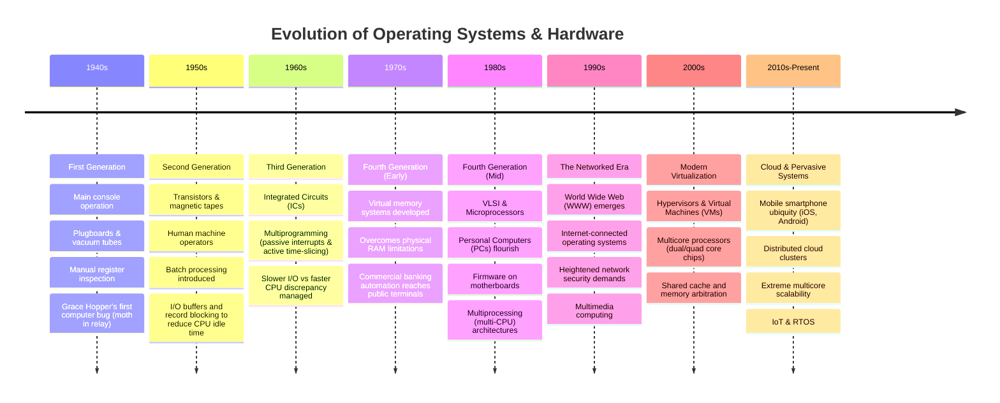

> [!example] Historical Note: Dr. Grace Hopper and the First Computer Bug
> In 1947, while working on the Harvard Mark II electromechanical computer, Dr. Grace Hopper and her engineering team investigated an unexplained machine stoppage. Inside relay #70 of Panel F, they discovered a moth trapped between the contact points. They taped the moth into their logbook with the entry: *"First actual case of bug being found."* This incident popularized the terms **debugging** and **bug** in software engineering.

---

## 1.5 Taxonomy and Classifications of Operating Systems

Operating systems are categorized based on two primary operational criteria: **Response Time** (the latency elapsed between receiving an input stimulus and producing an output reaction) and the **Method of Data Entry**.

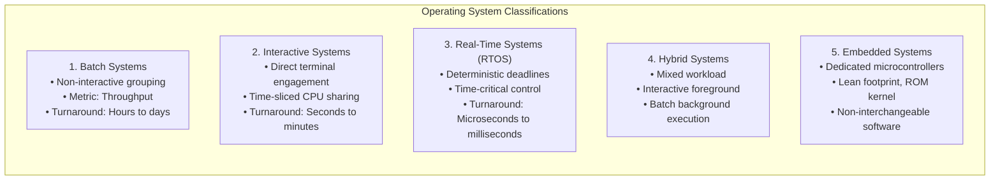

### 1.5.1 Batch Systems
- **Mechanics:** User jobs are collected into batches and submitted as a single bundle. The operating system processes jobs sequentially without user interaction.
- **Performance Metric:** Measured by **throughput** (the total number of jobs completed per unit of time) rather than immediate response latency.
- **Turnaround:** Ranging from hours to days. Ideal for bulk payroll calculations, end-of-month financial reconciliations, and batch billing runs.

### 1.5.2 Interactive Systems
- **Mechanics:** Designed for direct, conversational interaction between users and running programs via terminals or GUIs.
- **Architecture:** The CPU shares its processing time across multiple concurrent jobs using round-robin time slicing, providing rapid turnaround for iterative program authoring and debugging.
- **Turnaround:** Fractions of a second to a few minutes.

### 1.5.3 Real-Time Operating Systems (RTOS)
Used in mission-critical, time-sensitive environments where the **predictable timeliness** of a computation is as critical as its logical correctness.
- **Hard Real-Time Systems:** Missing an execution deadline constitutes a catastrophic system failure (e.g., flight control fly-by-wire avionics, nuclear reactor monitoring, missile guidance systems, and medical defibrillators).
- **Soft Real-Time Systems:** Missing a deadline results in degraded performance or quality of service, but does not cause total physical destruction (e.g., multimedia video streaming, telecommunications packet routing, and industrial automated manufacturing sensors).

### 1.5.4 Hybrid and Embedded Systems
- **Hybrid Operating Systems:** Combines interactive and batch capabilities. Supports interactive user sessions in the foreground while executing compute-heavy batch workloads in the background during idle CPU cycles.
- **Embedded Operating Systems:** Specialized, lean operating systems burned directly into non-volatile ROM/Flash chips embedded within consumer and industrial appliances (automobiles, elevators, IoT edge nodes, and smart thermostats). Characteristics include a minimal microkernel, highly constrained memory footprints, and non-interchangeable software configurations.

---

## 1.6 Role and Objectives of the Software Designer

The overarching goal of an operating system architect is to **maximize the utilization of physical resources (memory, processing cores, storage devices, and communication channels) while minimizing downtime and operational latency**.

In designing an operating system, the system architect must balance complex competing constraints:
- Available RAM physical limits and hardware memory protection mechanisms.
- Number, type, and cache coherence of available CPU cores.
- Variety and throughput capabilities of supported peripheral hardware.
- High-assurance security and cryptographic access barriers against network intrusions.

---

# Chapter 2: Early Memory Management Schemes, Allocation Strategies & Dynamic Compaction

## 2.1 The Memory Management Problem

System throughput and computing performance are inextricably bound to memory management:
1. The **volume of physical memory** available to concurrent programs.
2. The **algorithmic efficiency** with which the Memory Manager allocates, monitors, protects, and reclaims memory blocks during active execution.

> [!info] Main Memory (RAM) vs. Secondary Storage (SSD/HDD)
> Both main memory and secondary storage measure capacity in bytes (KB, MB, GB, TB) and hold binary programs and data. However, their physical mechanisms diverge:
> - **Main Memory (Primary Storage):** High-speed, semiconductor-based, byte-addressable, and **volatile**. All program instructions must be staged into RAM before the CPU can fetch and execute them.
> - **Secondary Storage (Persistent Storage):** Magnetic or flash-based (HDD/SSD), block-addressable, significantly slower (orders of magnitude greater latency), and **non-volatile**.

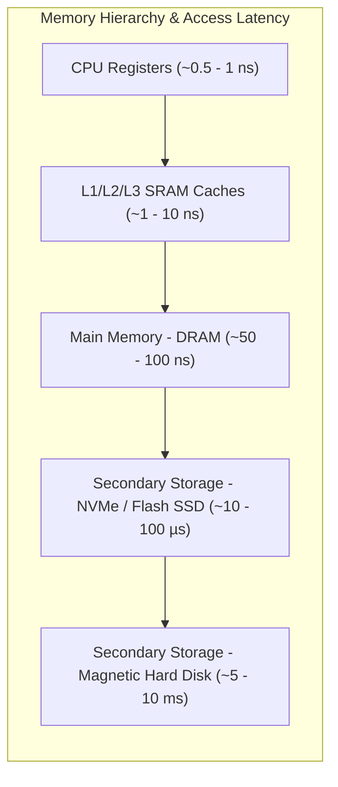

### 2.1.1 The PC Bootstrapping Sequence
The bootstrapping process demonstrates how firmware bridges permanent non-volatile storage and volatile main memory:
1. Power is applied to the motherboard; CPU hardware registers are initialized to a hardwired memory address pointing to the **ROM BIOS / UEFI** firmware.
2. The firmware executes the **Power-On Self-Test (POST)** to verify processor registers, RAM modules, device buses, and hardware controllers.
3. The BIOS queries CMOS settings to determine the prioritized boot sequence (NVMe SSD, SATA HDD, USB Flash Drive, or Network PXE).
4. The initial sector (Master Boot Record / EFI System Partition) is loaded into RAM, transferring execution control to the OS **bootloader** (e.g., GRUB or Windows Boot Manager).
5. The bootloader loads the core operating system kernel into protected RAM, initializes the Memory Manager and Processor Manager, and transfers control to the kernel init process.

---

## 2.2 Four Foundational Early Memory Allocation Schemes

To trace the development of modern virtual memory, operating system engineering evaluates four historical memory allocation architectures.

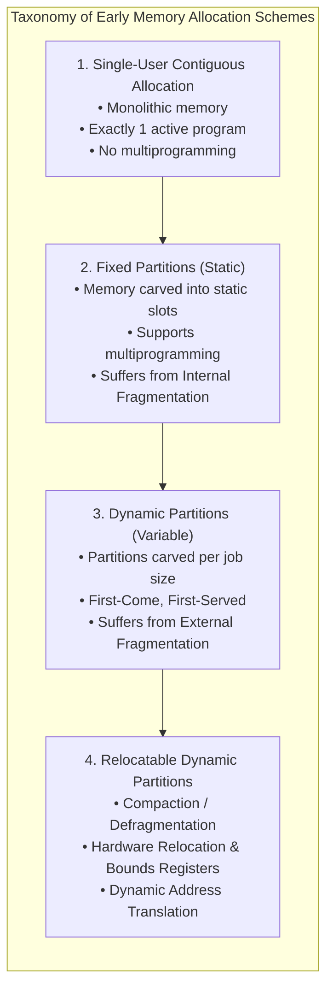

### 2.2.1 Scheme 1: Single-User Contiguous Allocation
In early computing systems (late 1940s and early 1950s), the entire physical memory was allocated contiguously to a single active program at any given time.
- **Workflow:**
  1. The Memory Manager checks the size of an incoming job from the submission queue.
  2. If the job size is smaller than or equal to total available user memory space, the entire program is loaded into memory starting from the boundary of the OS space.
  3. The job executes to completion.
  4. Upon termination, the Memory Manager clears the memory space, reclaims the entire partition, and evaluates the next job in the queue.
- **Severe Limitations:**
  - Zero support for multiprogramming: CPU remains idle whenever the running job blocks for slow I/O devices (magnetic tape reads).
  - Unused memory capacity is completely wasted.
  - Commercially unviable for modern multi-user enterprises.

### 2.2.2 Scheme 2: Fixed Partitions
Introduced to enable **multiprogramming** by partitioning main memory into multiple discrete, static regions.
- **Mechanics:**
  - Main memory is subdivided into fixed partitions during system configuration (reconfiguration requires a full operating system reboot).
  - Each partition can host **exactly one job** at a time.
  - The Memory Manager tracks the state of each partition using a structured **Memory Table**:

| Partition Size | Memory Start Address | Current Access / Job | Partition Status |
| :--- | :--- | :--- | :--- |
| **100 KB** | `200K` | Job 1 (80 KB) | Busy |
| **25 KB** | `300K` | Job 4 (25 KB) | Busy |
| **25 KB** | `325K` | — | **Free** |
| **50 KB** | `350K` | Job 2 (30 KB) | Busy |

- **Failure Modes & Fragmentation:**
  - If incoming jobs are significantly larger than the available partitions, they cannot be loaded and suffer extensive turnaround delays.
  - If a job is smaller than its assigned fixed partition, the leftover unused memory within that partition cannot be allocated to any other process. This phenomenon is known as **Internal Fragmentation**.

> [!warning] Definition: Internal Fragmentation
> **Internal Fragmentation** is the memory waste occurring *inside* an allocated partition when the memory space assigned to a job is larger than the actual memory requested or required by that job. Because the entire fixed partition is reserved for a single process, the residual space remains unusable by all other jobs.

### 2.2.3 Scheme 3: Dynamic Partitions
Dynamic Partitioning eliminates internal fragmentation by allocating to each incoming job **only the exact volume of contiguous memory requested** when the job is loaded.
- **Mechanics:**
  - Memory is not subdivided in advance.
  - When Job 1 arrives requesting 200 KB, the Memory Manager carves out a 200 KB partition exactly. When Job 2 arrives requesting 150 KB, a 150 KB block is carved out immediately adjacent.
  - As long as initial jobs enter sequentially, memory utilization approaches 100%.
- **Emergence of External Fragmentation:**
  - As jobs complete execution in unpredictable order, they leave arbitrary empty holes throughout the address space.
  - When new jobs arrive, their sizes may not match the vacated holes.
  - Memory becomes peppered with tiny non-contiguous blocks of free memory. Even if the *sum* of all free spaces is more than enough to satisfy an incoming job, the job cannot load because it requires a single **contiguous** allocation. This is known as **External Fragmentation**.

> [!warning] Definition: External Fragmentation
> **External Fragmentation** is the memory waste occurring *between* allocated memory blocks when total free physical memory is mathematically sufficient to satisfy a process request, but the free space is fragmented into scattered, non-contiguous holes such that no single contiguous block is large enough to load the job.

---

## 2.3 Partition Allocation Algorithms: First-Fit vs. Best-Fit

When a process requests memory in a system with variable free blocks, the Memory Manager must apply an allocation algorithm to select an appropriate block from the free list.

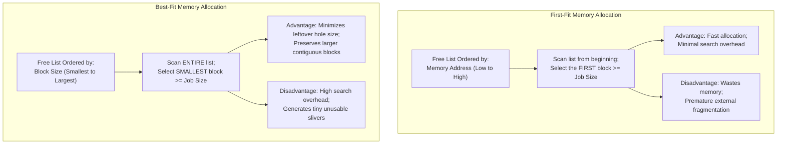

### 2.3.1 Comparative Analysis: First-Fit vs. Best-Fit

| Dimension | First-Fit Allocation | Best-Fit Allocation |
| :--- | :--- | :--- |
| **List Organization** | Ordered sequentially by **memory address** (from lowest memory location to highest). | Ordered strictly by **memory block size** (from smallest block to largest block). |
| **Search Strategy** | Scans from start of list and stops at the **very first block** large enough to hold the job. | Must search the **entire table** to find the smallest block that fits the job. |
| **Allocation Speed** | **Fast:** Halts scanning immediately upon discovering a suitable hole. | **Slower:** Incurs high processing overhead evaluating every entry or re-sorting lists. |
| **Memory Efficiency** | Tends to fragment lower memory addresses rapidly; leaves large blocks intact at higher addresses. | Minimizes unused residual space in the allocated block, reducing immediate space loss. |
| **Fragment Characteristics**| Produces medium-sized leftover fragments that may still accommodate smaller jobs. | Produces microscopic leftover holes ("slivers") that are too small for any real process to utilize. |

### 2.3.2 Bookshelf Analogy
- **Best-Fit:** Imagine organizing books onto shelves where shelves are ordered strictly by height. When a new book arrives, you search every shelf to find the tightest fit so minimal vertical gap is wasted.
- **First-Fit:** You walk past the shelves starting at the bottom and push the book into the very first shelf that has sufficient clearance, regardless of whether a tighter fit exists higher up.

### 2.3.3 Hypothetical Alternatives: Next-Fit and Worst-Fit
- **Next-Fit:** Begins scanning from the memory location of the *last allocated block* rather than restarting from the beginning of the list each time. Distributes allocations more evenly across memory, preventing excessive fragmentation at the bottom.
- **Worst-Fit:** Allocates the *largest available free block* to the job. The theoretical rationale is that subtracting a job from the largest block will leave a substantial residual hole that is still large enough to comfortably accommodate another process. While useful in theoretical modeling, it performs poorly in actual systems.

---

## 2.4 Deallocation Mechanics in Dynamic Partition Systems

When a process terminates, the Memory Manager must reclaim its physical space and maintain the integrity of the free memory tables. In a dynamic-partition system, deallocation is classified into three topological cases depending on the adjacency of the released block:

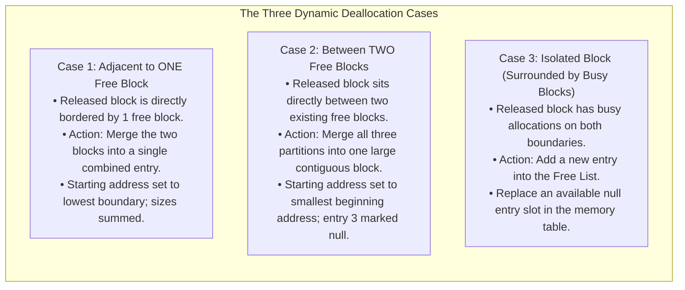

### 2.4.1 Case 1: Joining Two Free Blocks
- **Scenario:** The released memory block sits immediately adjacent to one existing free memory block (either above or below).
- **Execution:**
  - Let Job A release a block of size $200$ at address $7600$.
  - An existing free block of size $5$ resides at address $7800$ (or immediately adjacent).
  - The Memory Manager updates the entry's starting address to reflect the lowest address ($7600$) and sums the sizes:
    $$\text{New Combined Size} = 200 + 5 = 205 \text{ units}$$
  - The total number of free entries in the table remains unchanged.

### 2.4.2 Case 2: Joining Three Free Blocks
- **Scenario:** The released memory block is sandwiched directly between two existing free memory blocks.
- **Execution:**
  - Example: Free block of size $20$ at starting address $7560$; released block of size $200$ at address $7580$; adjacent free block of size $205$ at address $7780$.
  - The Memory Manager merges all three partitions into a single contiguous entry:
    $$\text{Total Unified Size} = 20 + 200 + 205 = 425 \text{ units}$$
  - The starting address is set to the lowest boundary ($7560$).
  - The second redundant free list entry is cleared and assigned a **null entry** status, freeing up an entry in the table.

### 2.4.3 Case 3: Deallocating an Isolated Block
- **Scenario:** The released memory block is isolated from all other free blocks (both upper and lower boundaries are occupied by busy active jobs).
- **Execution:**
  - The released block cannot be merged with neighboring blocks.
  - The Memory Manager searches the Free List for an available **null entry** slot.
  - The starting address and size of the released block are written into this newly allocated slot in the Free List.

---

## 2.5 Relocatable Dynamic Partitions: Compaction & Hardware Registers

### 2.5.1 Memory Compaction (Defragmentation)
To solve the external fragmentation inherent in dynamic partitions, the operating system employs **Memory Compaction** (also termed *defragmentation* or *garbage collection*).
- **Process:** The Memory Manager halts active processing, relocates running programs toward one contiguous boundary of memory (typically starting directly above the operating system kernel), and consolidates all scattered empty holes into a single, unified free memory partition.
- **Outcome:** Waiting jobs that previously could not load due to fragmented space can now fit into the consolidated free partition.


### 2.5.2 Hardware Assistance: Bounds & Relocation Registers
Relocating a program in physical memory invalidates all absolute memory addresses embedded in its code (such as jump targets, function pointers, and global variable addresses). To execute compaction without manually recompiling or patching binary code, modern computer architectures implement **Hardware Address Translation Registers**:

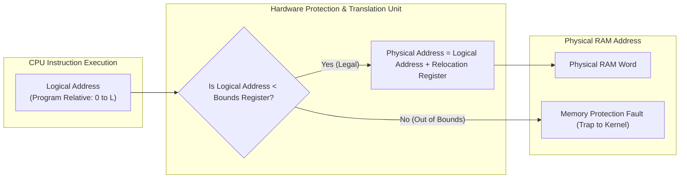

1. **Bounds Register (Protection):**
   - Stores the maximum legal logical address or length of the allocated partition.
   - For every memory access instruction generated by the CPU, hardware compares the logical address against the Bounds Register. If the program attempts to read or write an address beyond this bound, the CPU triggers a **Memory Protection Fault** interrupt, halting execution before memory corruption can occur.
2. **Relocation Register (Base Address Translation):**
   - Holds the physical base memory address where the program currently resides in RAM.
   - Whenever a program instruction references an address, the hardware automatically adds the contents of the Relocation Register to the logical address before placing the signal onto the physical memory bus:
     $$\text{Physical Address} = \text{Logical Address} + \text{Contents of Relocation Register}$$
   - When the Memory Manager moves a program during compaction, it updates **only the value in the Relocation Register**. The executable binary code requires zero internal modification.

### 2.5.3 Compaction Overhead and Timing Strategies
Compaction is computationally expensive. Moving megabytes or gigabytes of memory blocks consumes substantial CPU cycles and suspends all user-space execution. 

System designers optimize compaction timing by triggering the routine under specific conditions:
1. **On-Demand Allocation Failure:** Trigger compaction only when an incoming job cannot find a contiguous block, but total free memory is greater than or equal to the requested size.
2. **Threshold Occupancy:** Trigger compaction when the percentage of busy fragmented memory crosses a predefined threshold (e.g., $75\%$ fragmentation).
3. **Queue Wait-Time Expiration:** Trigger compaction when one or more jobs have lingered in the waiting queue beyond a maximum tolerated latency window.
4. **Prescribed Time Intervals:** Execute periodic defragmentation during scheduled low-load operational periods.

---

# Chapter 3: Virtual Memory Management: Paging, Segmentation, and Caching

## 3.1 Paged Memory Allocation

### 3.1.1 Fundamentals and Non-Contiguous Allocation
Early memory schemes required allocating jobs into single contiguous blocks of physical memory, resulting in severe internal or external fragmentation. **Paged Memory Allocation** eliminates the requirement for contiguous memory allocation by dividing both the incoming program and physical memory into fixed-sized blocks.


- **Pages:** The fixed-sized divisions of an incoming program or job.
- **Page Frames (Frames):** The fixed-sized physical slots in main memory engineered to accommodate exactly one page.
- **Sectors:** The smallest non-divisible physical storage block on secondary storage (disk/flash).
- **The Ideal Condition:** For maximum architectural efficiency, **$\text{Page Size} = \text{Page Frame Size} = \text{Disk Sector Size}$**.

#### Benefits and Trade-Offs of Basic Paging
- **Elimination of External Fragmentation:** Because any free page frame can house any program page, memory compaction is completely eliminated.
- **Internal Fragmentation Confined to Last Page:** Internal fragmentation occurs solely in the job's final page frame if the program's total size is not an exact multiple of the page size.
- **Architectural Trade-Off:** The operating system incurs increased runtime overhead to maintain and query lookup tables for every active job.

---

### 3.1.2 Paging Tracking Tables: JT, PMT, and MMT
To coordinate non-contiguous allocation, the Memory Manager maintains three dedicated data structures in the operating system's reserved memory partition:

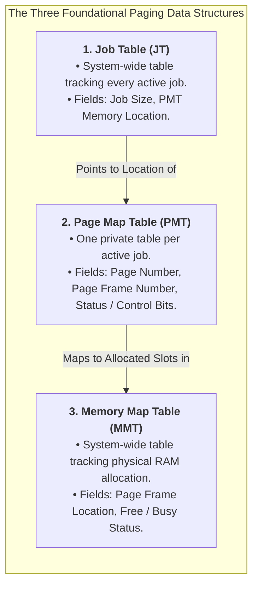

#### Job Table Lifecycle
When an active job completes execution, the operating system releases its corresponding entry in the Job Table, frees its assigned page frames in the Memory Map Table, and reallocates the table slot to incoming queued jobs.

---

### 3.1.3 Mathematical Address Resolution and Page Displacement
When a program executes, CPU instructions reference logical addresses within the job's private address space ($0 \le \text{Logical Address} < \text{Job Size}$). The hardware Memory Management Unit (MMU) dynamically translates this into an absolute physical memory address using **Page Displacement (Offset)**:

$$\text{Page Number} = \left\lfloor \frac{\text{Job Space Address}}{\text{Page Size}} \right\rfloor$$

$$\text{Displacement (Offset)} = \text{Job Space Address} \pmod{\text{Page Size}}$$

$$\text{Physical Address} = (\text{Page Frame Number} \times \text{Page Frame Size}) + \text{Displacement}$$

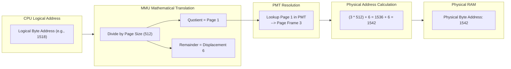

#### Worked Numerical Examples

##### Example 1: Basic Address Resolution
- **Parameters:** Page Size = $512\text{ bytes}$, Target Logical Address = Byte $1076$.
- **Calculation:**
  $$\text{Page Number} = \lfloor 1076 / 512 \rfloor = 2$$
  $$\text{Displacement} = 1076 \pmod{512} = 52$$
- **Verdict:** The target data resides on **Page 2 at displacement 52**.

##### Example 2: Out-of-Bounds and Boundary Constraints
- **Parameters:** Page Size = $4096\text{ bytes}$, Logical Address = Byte $6134$.
  $$\text{Page Number} = \lfloor 6134 / 4096 \rfloor = 1, \quad \text{Displacement} = 6134 \pmod{4096} = 2038$$
- **Boundary Rules:**
  1. *Smallest possible displacement:* $0$ (the very first byte of the page frame).
  2. *Largest legal displacement:* $\text{Page Size} - 1$ ($4095$ for a $4096$-byte page). A displacement $\ge 4096$ indicates an illegal address residing in another page.
  3. *Out-of-Bounds Handling:* If the calculated page number exceeds the total number of pages defined in the Job Table, the operating system raises a **Memory Boundary Error** trap, terminating the offending program.

##### Example 3: Full Physical Address Derivation
- **Parameters:** A system with page size and page frame size of $512\text{ bytes}$. A job's PMT indicates that Page 0 is in Frame 5, and Page 1 is in Frame 3. Locate logical Byte $1518$:
  1. $\text{Page Number} = \lfloor 1518 / 512 \rfloor = 1$, $\text{Displacement} = 1518 \pmod{512} = 6$.
  2. PMT lookup for Page 1 returns **Page Frame 3**.
  3. $\text{Starting Address of Frame} = 3 \times 512 = 1536$.
  4. $\text{Absolute Physical Address} = 1536 + 6 = \mathbf{1542}$.

---

## 3.2 Demand Paging Memory Allocation

### 3.2.1 The Concept of Demand Paging
In basic paged allocation, the *entire* program must be loaded into memory prior to execution. **Demand Paging** removes this constraint: it loads only the active portions of a program into physical memory on demand.

> [!info] The Principle of Demand Paging
> Exploit program locality and structure:
> 1. Many large program modules are executed infrequently (e.g., error recovery routines, rare configuration handlers).
> 2. Mutually exclusive options (e.g., export to PDF vs. export to CSV) never execute simultaneously.
> 3. Large arrays and data structures can be accessed incrementally.

Demand paging introduces the foundation of **Virtual Memory**, providing users and applications with the illusion of an almost boundless main memory space backed by high-speed Direct Access Storage Devices (DASD / SSD).

---

### 3.2.2 The Page Fault Handling Cycle
When the CPU references a logical address whose corresponding page is not currently resident in main memory, hardware issues a specialized interrupt known as a **Page Fault**:

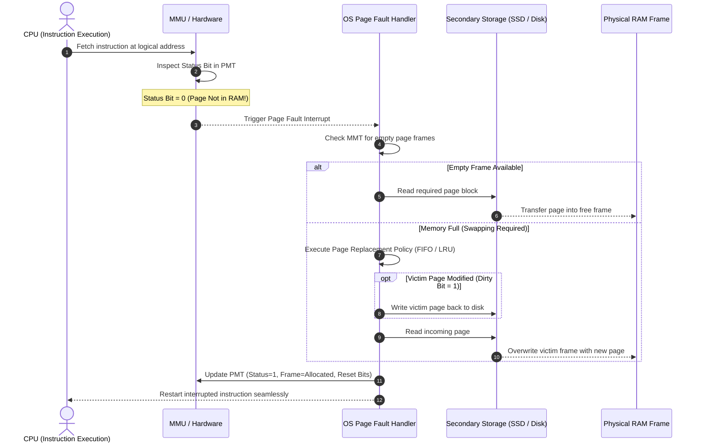

---

### 3.2.3 Status Bits in the Page Map Table
Under demand paging, each PMT entry is expanded to incorporate critical hardware status flags:

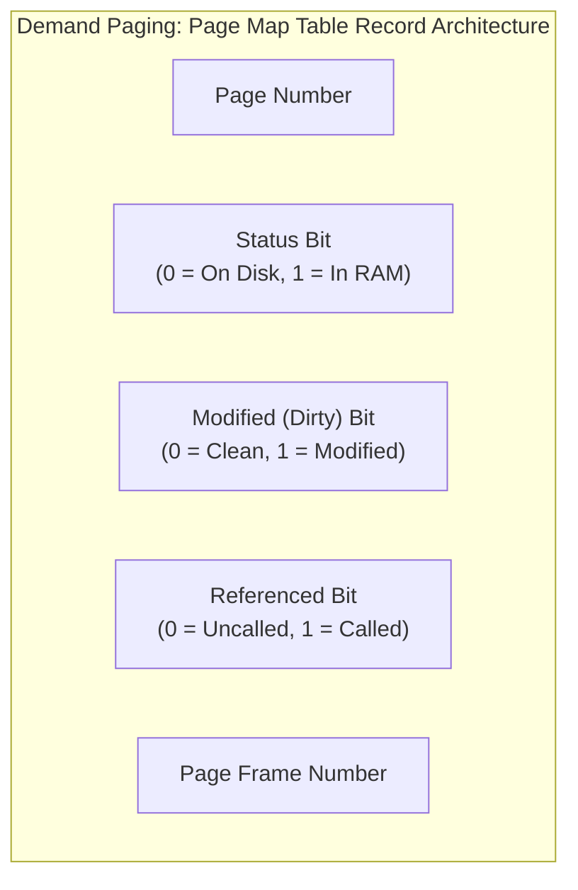

| Bit Combination | Modified? | Referenced? | Architectural Meaning & Swap Action |
| :---: | :---: | :---: | :--- |
| **Case 1** | $0$ | $0$ | **Clean, Not Referenced:** Prime candidate for page eviction; no disk write-back required. |
| **Case 2** | $0$ | $1$ | **Clean, Recently Referenced:** Recently used, but pristine; eviction requires no disk write. |
| **Case 3** | $1$ | $0$ | **Modified, Not Referenced:** Modified in past execution cycles, but idle recently; must be written to disk before frame overwrite. |
| **Case 4** | $1$ | $1$ | **Modified, Recently Referenced:** Active working page; lowest priority for eviction. |

---

### 3.2.4 System Thrashing
If the operating system allocates too few page frames to a process, or if the process executes tight loops that cross page boundaries, the system spends more time servicing page faults than executing actual CPU instructions. This pathological state is known as **Thrashing**.

- **Cross-Job Thrashing:** Occurs when too many jobs are admitted to memory simultaneously, leaving insufficient page frames per job.
- **Intra-Job Thrashing:** Occurs within a single program when a loop continuously branches back and forth across a page boundary (e.g., loop body on Page 1 referencing array data on Page 2 in every single iteration).

---

## 3.3 Page Replacement Policies

When a page fault occurs and no page frames are free, the operating system must choose a resident page (the "victim") to swap out.

### 3.3.1 First-In, First-Out (FIFO) & Belady's Anomaly
The **FIFO** replacement algorithm tracks the arrival order of pages in physical memory, choosing the page that has resided in memory for the longest duration.

> [!warning] FIFO Anomaly (Belady's Anomaly)
> In classical intuition, providing a computer with more physical RAM should always reduce or maintain page faults. However, László Bélády proved in 1969 that under FIFO, **allocating additional page frames can actually cause an increase in the number of page faults** for certain page reference strings!

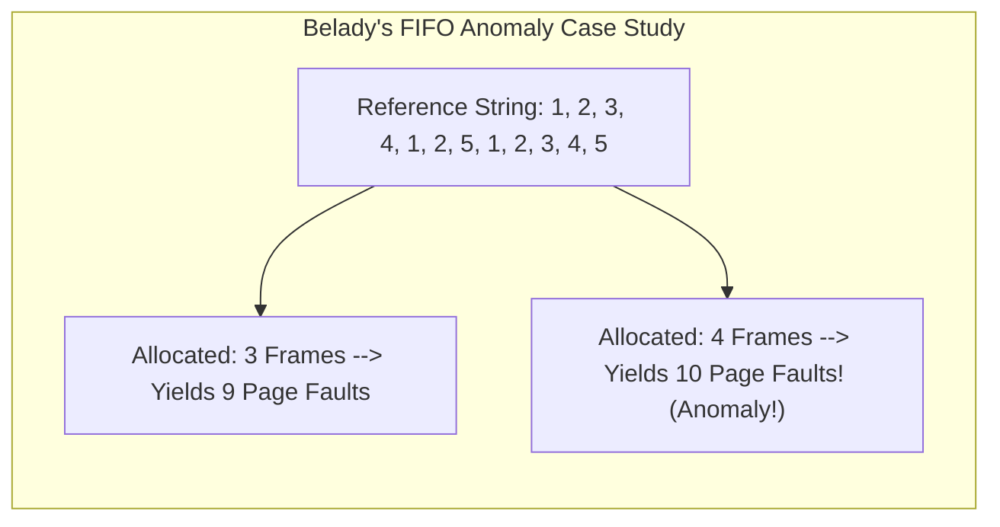

---

### 3.3.2 Least Recently Used (LRU) Replacement
The **LRU** algorithm evicts the page that has not been referenced for the longest period of time. LRU is grounded in the **Principle of Locality of Reference**: pages used recently are highly likely to be used again in the near future.
- **Stack Property:** LRU belongs to the class of *stack algorithms*, which are mathematically immune to Belady's Anomaly. Adding memory frames will **never** increase page faults under LRU.

#### Practical Hardware Implementations of LRU
Because sorting timestamps for every memory access is prohibitively expensive, hardware employs two low-overhead approximations:

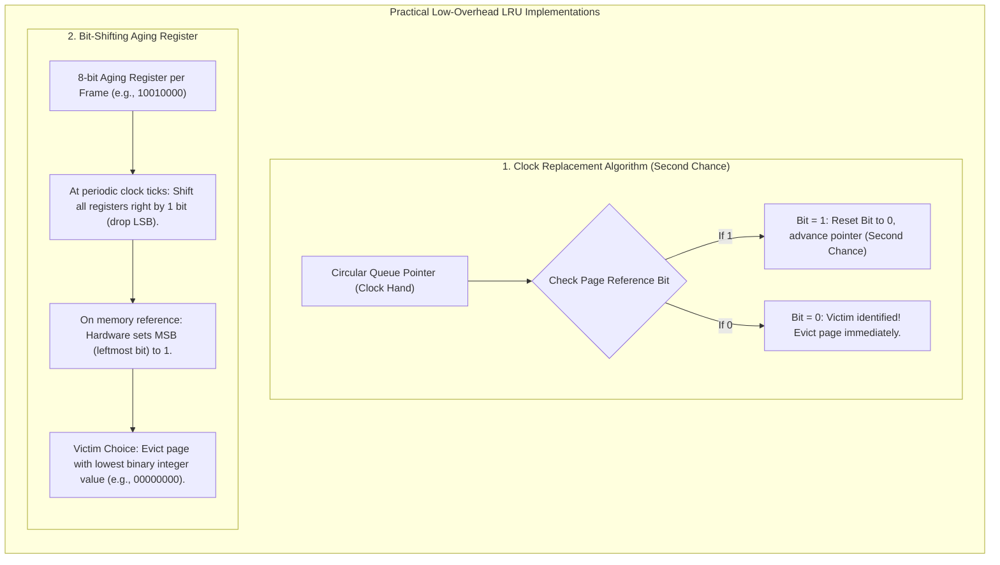

---

### 3.3.3 The Working Set Concept (Peter Denning)
Formalized by Peter Denning, the **Working Set** $W(t, \Delta)$ is the set of pages referenced by a process during the most recent time parameter window $\Delta$.

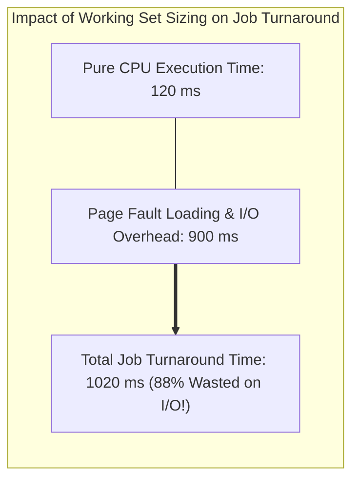

- **Operating System Mandate:** If an interactive operating system cannot guarantee that a process's entire working set can fit into physical RAM, it should suspend the process (swapping it out completely) rather than allowing it to run and induce thrashing.

---

## 3.4 Segmented Memory Allocation

### 3.4.1 Logical Modular Segmentation
While paging divides code into arbitrary, fixed physical blocks without regard to program logic, **Segmented Memory Allocation** divides a job into variable-sized logical segments reflecting the developer's source code architecture:

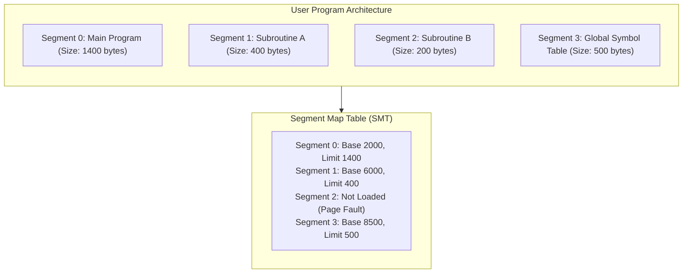

- **Logical Advantages:**
  - Loops and subroutines are preserved within a single segment, eliminating intra-job loop thrashing across page boundaries.
  - Fine-grained memory protection: individual segments can be marked with distinct permissions (e.g., Code segment: *Read/Execute only*; Data segment: *Read/Write*).
- **Two-Dimensional Addressing:** Instructions address memory via a 2D tuple: **$(\text{Segment Number}, \text{Displacement})$**.
- **The Core Disadvantage:** Because segments are of variable size, memory allocation is dynamic, reintroducing **External Fragmentation** and necessitating memory compaction.

---

## 3.5 Segmented/Demand Paged Memory Allocation

To harvest the logical benefits of segmentation while enjoying the physical efficiency of paging, modern operating systems combine both paradigms into **Segmented/Demand Paged Memory Allocation**:

```mermaid
flowchart LR
    subgraph ThreeD_Address["3D Virtual Memory Address"]
        Seg["Segment Number (s)"]
        Pg["Page Number (p)"]
        Disp["Displacement (d)"]
    end

    subgraph FourTierTables["Four-Tier Translation Hierarchy"]
        JT["1. Job Table (JT)"]
        SMT["2. Segment Map Table (SMT)"]
        PMT["3. Page Map Table (PMT)"]
        MMT["4. Memory Map Table (MMT)"]
    end

    subgraph PhysicalRAM["Physical RAM Execution"]
        Frame["Physical Page Frame Word"]
    end

    ThreeD_Address --> FourTierTables --> PhysicalRAM
```

1. **Subdivision of Segments:** Each logical segment is subdivided into equal-sized physical pages.
2. **Elimination of External Fragmentation:** Segments are mapped to pages; pages are allocated to arbitrary page frames, completely eliminating external fragmentation and compaction.
3. **Addressing Scheme (3-Dimensional):** **$(\text{Segment Number}, \text{Page Number}, \text{Displacement})$**.
4. **Hardware Acceleration via Associative Memory (TLB):** Traversing four nested tables in RAM for every memory access would quadruple CPU latency. Computer architectures implement **Translation Lookaside Buffers (TLB / Associative Memory)**—specialized on-chip cache registers that execute parallel lookups of $(\text{Segment}, \text{Page})$ mappings in sub-nanosecond clock cycles.

---

## 3.6 Virtual Memory Synthesis: Paging vs. Segmentation

| Architectural Dimension | Paging | Segmentation | Segmented Paging |
| :--- | :--- | :--- | :--- |
| **Basic Unit Nature** | Physical unit (fixed size) | Logical unit (variable size) | Logical segment composed of physical pages |
| **Visibility to Program** | Invisible to developer/compiler | Visible to programmer/linker | Visible logically; paging details invisible |
| **Addressing Paradigm** | 1D Address ($\text{Page}, \text{Displacement}$) | 2D Address ($\text{Segment}, \text{Displacement}$) | 3D Address ($\text{Segment}, \text{Page}, \text{Displacement}$) |
| **Internal Fragmentation** | Yes (in last page frame only) | None | Yes (in last page of each segment) |
| **External Fragmentation** | None | Yes (requires compaction) | None |
| **Primary Tables** | Job Table, PMT, MMT | Job Table, SMT, MMT | Job Table, SMT, PMT, MMT |

---

## 3.7 Cache Memory Architecture and Mathematical Models

### 3.7.1 Hardware Hierarchy and Caching Principles
**Cache Memory** is a small, ultra-fast static RAM (SRAM) storage block situated directly between the CPU registers and main dynamic RAM (DRAM), designed to bridge the widening speed gap between processors and memory busses.

```mermaid
flowchart LR
    subgraph MemoryHierarchy["System Memory Speed Hierarchy"]
        direction LR
        Reg["CPU Registers<br/>(< 1 ns)"]
        L1["L1 Cache (On-Die)<br/>(~1 ns)"]
        L2["L2/L3 Cache<br/>(~3-10 ns)"]
        RAM["Main Memory (DRAM)<br/>(~50-100 ns)"]
        SSD["Secondary Storage (SSD)<br/>(~10-100 us)"]
        Reg <--> L1 <--> L2 <--> RAM <--> SSD
    end
```

- **L1 Cache:** Dual caches built directly into the CPU core (one dedicated to instructions, one for data).
- **L2 / L3 Cache:** Larger intermediate caches buffering bus traffic between the core and main memory.

---

### 3.7.2 Mathematical Caching Models

#### 3.7.2.1 Cache Hit Ratio
The efficiency of a cache subsystem is measured by its **Hit Ratio** ($h$):

$$\text{Hit Ratio } (h) = \frac{\text{Number of Requests Found in Cache}}{\text{Total Number of Requests}} \times 100\%$$

#### 3.7.2.2 Average Memory Access Time (AMAT)
The effective memory access time experienced by the CPU is modeled as:

$$\text{Avg\_Mem\_AccTime} = \text{Avg\_Cache\_AccessTime} + (1 - h) \times \text{Avg\_MainMem\_AccTime}$$

> [!tip] Worked Numerical Example: Caching Performance
> - **Parameters:** Cache Access Time = $15\text{ ns}$, Main Memory Access Time = $100\text{ ns}$, Cache Hit Ratio = $85\%$ ($h = 0.85$).
> - **Calculation:**
>   $$\text{Avg\_Mem\_AccTime} = 15\text{ ns} + (1 - 0.85) \times 100\text{ ns} = 15 + (0.15 \times 100) = 15 + 15 = \mathbf{30\text{ ns}}$$
> - **Conclusion:** Incorporating an $85\%$ effective cache reduces the average memory access latency from $100\text{ ns}$ down to $30\text{ ns}$, delivering a **$70\%$ reduction in memory stalls**.

---

# Chapter 4: Processor Management: Job Scheduling, Process Dispatching, and State Models

## 4.1 Foundations of Processor Management

### 4.1.1 Evolution of Execution Environments
In early single-user systems, processor management was trivial: the CPU was dedicated entirely to the solitary user's program and sat idle during input/output operations. In modern **multiprogramming** and **multi-core** environments, multiple processes actively compete for processing time, demanding fair, robust, and mathematically optimized CPU scheduling algorithms.

- **Multi-Core Engineering:** Placing multiple physical CPU cores onto a single silicon die circumvents quantum leakage and heat dissipation limits, enabling true concurrent parallel execution.

---

### 4.1.2 Foundational Definitions and Taxonomies

```mermaid
flowchart TD
    subgraph OSDefinitions["Processor Management Core Concepts"]
        direction TB
        CPU["<b>Processor (CPU)</b><br/>The active physical hardware unit performing logic and instruction execution."]
        Job["<b>Program (Job)</b><br/>An inactive, passive unit of work stored as an executable binary on disk."]
        Proc["<b>Process (Task)</b><br/>An active execution entity; an instantiated program with dedicated registers, PC, and memory."]
        Thrd["<b>Thread (Lightweight Process)</b><br/>A schedulable unit of execution within a process; shares memory and resources with sibling threads."]
    end
    Job ==>|Loaded & Instantiated| Proc
    Proc ==>|Decomposed into| Thrd
    Thrd ==>|Scheduled on| CPU
```

#### Multiprogramming vs. Multithreading
- **Multiprogramming:** The operational technique of keeping multiple independent processes in main memory concurrently, switching the CPU between them to maximize utilization.
- **Multithreading:** Allowing a single process to spawn multiple concurrent threads of control sharing the same address space (e.g., a modern web browser running separate threads for network requests, tab rendering, and UI event listening).

---

### 4.1.3 Interrupts and Context Switching
When an event demands immediate CPU attention (such as an I/O completion signal or a hardware timer tick), hardware asserts an **Interrupt**.

```mermaid
sequenceDiagram
    autonumber
    actor CPU as CPU
    participant PA as Process A (User Space)
    participant Kernel as OS Kernel / Dispatcher
    participant PB as Process B (User Space)

    PA->>CPU: Executing user instructions
    Note over CPU: Hardware Timer Interrupt Fires!
    CPU->>Kernel: Trap to Interrupt Service Routine
    Note over Kernel: CONTEXT SWITCH: Save PA registers, PC, stack pointer into PCB_A
    Kernel->>Kernel: Select Process B from READY Queue
    Note over Kernel: Load PB registers, PC, memory bounds from PCB_B
    Kernel->>CPU: Dispatch Process B
    CPU->>PB: Resume execution of Process B
```

> [!info] The Dual-Task Real-Life Analogy
> Imagine studying for an exam (Job A) while heating a pot of water on the stove (Job B). You study until the pot begins to boil over (an **Interrupt**). You place a bookmark in your textbook to record your exact reading position (**Context Switch: Save State**), tend to the stove (**Service Interrupt**), return to your desk, reopen the textbook to the bookmark, and resume studying (**Context Switch: Restore State**).

---

## 4.2 The Two-Tier (and Three-Tier) Scheduling Hierarchy

Processor management is structured hierarchically across two primary submanagers (with a third added in interactive systems):

```mermaid
flowchart TD
    subgraph SchedulingHierarchy["Hierarchical Scheduling Architecture"]
        direction TB
        subgraph Level1["1. Job Scheduler (High-Level Scheduler / Long-Term)"]
            JS1["Selects jobs from HOLD queue spooler on disk."]
            JS2["Determines job initiation based on available system memory and priority."]
            JS3["Balances I/O-bound vs. CPU-bound jobs to keep all resources saturated."]
        end
        subgraph Level2["2. Process Scheduler (Low-Level Scheduler / Dispatcher / Short-Term)"]
            PS1["Selects active process from the READY queue in RAM."]
            PS2["Assigns CPU core to execute process instructions."]
            PS3["Enforces time-slice preemption and handles I/O interrupts."]
        end
        subgraph Level3["3. Mid-Level Scheduler (Interactive Swapper)"]
            MS1["Detects memory overload or thrashing in interactive environments."]
            MS2["Temporarily swaps active processes out of RAM to disk to lower multiprogramming degree."]
        end
        Level1 ==> Level2
        Level2 <==> Level3
    end
```

---

### 4.2.1 CPU-Bound vs. I/O-Bound Workloads
Processes alternate cyclically between **CPU Bursts** (intense calculation) and **I/O Bursts** (waiting for storage or network operations):

```mermaid
flowchart LR
    subgraph WorkloadDistribution["Workload Characteristics"]
        direction TB
        subgraph IOBound["I/O-Bound Jobs"]
            IO1["Brief CPU bursts + Long I/O waits"]
            IO2["Examples: Web servers, document printers, database queries"]
        end
        subgraph CPUBound["CPU-Bound Jobs"]
            CPU1["Extended CPU bursts + Short I/O operations"]
            CPU2["Examples: Matrix math, video encoding, scientific simulations"]
        end
    end
```

- **Scheduling Balance:** Empirical systems show an overwhelming frequency of short CPU bursts. An effective Job Scheduler mixes I/O-bound and CPU-bound jobs so that the CPU is never idle waiting for slow mechanical disk operations.

---

## 4.3 Job and Process State Machine

As a program traverses the operating system, its status transitions through five canonical states:

```mermaid
stateDiagram-v2
    [*] --> HOLD : User Submits Job
    HOLD --> READY : Job Scheduler Admits Job (Allocates Memory)
    READY --> RUNNING : Process Scheduler Dispatches CPU
    RUNNING --> READY : Time-Slice Expires / Preempted
    RUNNING --> WAITING : I/O Request Issued / Resource Unavailable
    WAITING --> READY : I/O Operation Completes (Signal from Device Manager)
    RUNNING --> FINISHED : Process Terminates / Completes
    FINISHED --> [*] : Resources Released
```

### Detailed Breakdown of the Five States
1. **HOLD:** The user has submitted a job; it is spooled on secondary storage waiting for resource allocation. The Job Scheduler evaluates estimated CPU time, memory limits, and priority before creating its entry.
2. **READY:** The job has been assigned memory and required initial resources; it is resident in RAM waiting in the READY queue for an available CPU core.
3. **RUNNING:** The Process Scheduler has dispatched the process; instructions are actively being executed by the CPU.
4. **WAITING (BLOCKED):** The process issued a blocking system call (e.g., waiting for disk read or user keystroke). It cannot run even if a CPU is free.
5. **FINISHED:** The process has concluded execution (either through normal termination or runtime fault); resources are deallocated and its PCB is purged.

---

## 4.4 Thread States and OS Thread Lifecycle

Modern operating systems manage concurrent execution at the thread granularity. A thread progresses through five specialized states:

```mermaid
stateDiagram-v2
    [*] --> READY : Thread Created
    READY --> RUNNING : Scheduled to Core
    RUNNING --> WAITING : Awaiting External Event / Sibling Thread
    WAITING --> READY : Event Occurs / Dependency Satisfied
    RUNNING --> DELAYED : Sleep / Timer Specified
    DELAYED --> READY : Sleep Duration Elapsed
    RUNNING --> BLOCKED : I/O Requested
    BLOCKED --> READY : I/O Finished
    RUNNING --> FINISHED : Thread Exits
    FINISHED --> [*]
```

### Mandatory OS Thread Management Duties
The operating system kernel must provide mechanisms to:
- Instantiate new threads and allocate their private stack space.
- Suspend, delay, or sleep threads for designated time windows.
- Synchronize thread execution using synchronization primitives (**Semaphores, Mutex Locks, Condition Variables**).
- Terminate threads gracefully and reclaim stack and thread descriptors.

---

## 4.5 Process Control Blocks (PCB) and Queue Topologies

For every active process, the kernel maintains an authoritative data structure called the **Process Control Block (PCB)** (and a corresponding **Thread Control Block (TCB)** for each thread):

```mermaid
flowchart TD
    subgraph PCB_Structure["Process Control Block (PCB) Contents"]
        direction TB
        PID["Process Identification (PID) & User ID"]
        P_State["Current State (HOLD, READY, WAITING, RUNNING, FINISHED)"]
        PC["Program Counter (Next Instruction Address)"]
        Regs["CPU Registers (Accumulators, Index, Stack Pointer)"]
        MemBounds["Memory Management Info (Base/Bounds, PMT/SMT Pointers)"]
        Account["Accounting & Priority Data (CPU Time Used, Scheduling Priority)"]
        IO_Info["I/O Status Info (Allocated Devices, Open File Descriptors)"]
        QueuePtr["Queue Link Pointers (Next PCB in Linked List)"]
    end
```

> [!important] Queue Architecture Principle
> Operating system queues (such as the READY queue or WAITING queue) do **not** shuffle megabytes of executable binary data. Instead, operating system queues are lightweight **linked lists of pointers to Process Control Blocks**. Moving a process between queues involves updating only a single pointer in memory.

---

## 4.6 Process Scheduling Policies and Optimization Criteria

### 4.6.1 Six Foundational Criteria for Scheduling Evaluation
When designing or configuring a process scheduling policy, operating system architects balance six competing metrics:
1. **Maximize Throughput:** Complete the maximum number of jobs per unit of time.
2. **Minimize Turnaround Time:** Minimize the total elapsed wall-clock time from initial job submission to final completion.
3. **Minimize Response Time:** Minimize the delay between an interactive user request and the first observable system output.
4. **Minimize Waiting Time:** Minimize the total time processes languish passively in the READY queue.
5. **Maximize CPU Utilization:** Keep expensive CPU cores saturated at $100\%$ operational capacity.
6. **Ensure Strict Fairness:** Guarantee that no process starves indefinitely, providing equitable CPU slices and I/O access.

---

### 4.6.2 Preemptive vs. Non-Preemptive Scheduling
- **Non-Preemptive Scheduling:** Once the CPU has been allocated to a process, the process retains control until it willingly yields the processor (e.g., issues an I/O request) or terminates.
  - *Risk:* A CPU-bound program with an infinite loop or heavy computations monopolizes the system, starving interactive processes.
- **Preemptive Scheduling:** The operating system reserves the authority to forcibly suspend a currently running process using a hardware timer interrupt when its allocated **Time Slice (Quantum)** expires, re-inserting it into the READY queue and context-switching to another process. Essential for time-sharing, real-time, and modern interactive desktop/server operating systems.
