# Chapter 1: Introduction to Database Systems & The Evolution of Data Processing

## 1.1 Data vs. Information: The Foundations of Knowledge

The field of database systems is rooted in the operational distinction between **raw data** and **meaningful information**:

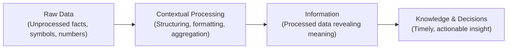

> [!info] Data vs. Information
> - **Data (Raw Facts):** Unprocessed, raw observations, atomic facts, numbers, or symbols that have not yet been evaluated, organized, or contextualized to reveal their operational meaning (e.g., `37.8`, `A102`, `180024`). Data constitutes the raw building block of all information.
> - **Information:** The refined product generated by processing, structuring, formatting, and analyzing raw data to unveil its contextual significance, relationships, and implications (e.g., *"Patient temperature is 37.8°C at 14:00"* or *"Flight A102 is delayed by 45 minutes"*). High-quality information must be **accurate**, **relevant**, and **timely** to support sound organizational decision-making.

---

## 1.2 Database and Database Management System (DBMS) Concepts

### 1.2.1 What is a Database?
A **database** is a shared, integrated computer structure designed to store and manage a collection of:
1. **End-User Data:** Raw facts, records, and measurements of operational interest to the organization.
2. **Metadata (Data About Data):** A comprehensive description of data characteristics, data types, lengths, constraints, and relational associations linking records across the entire database structure. Metadata enables the database to be self-describing and integrated.

### 1.2.2 What is a DBMS?
A **Database Management System (DBMS)** is a complex suite of software programs that manages the physical and logical database structure, arbitrates all user and application access, and enforces system security, integrity, and operational concurrency.

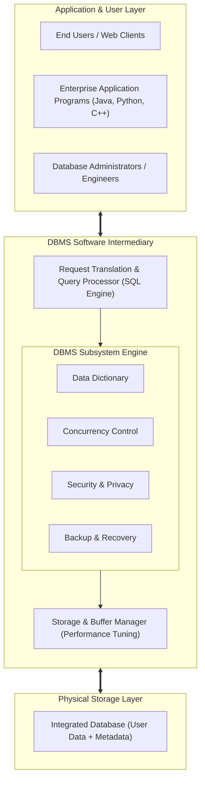

### 1.2.3 The Pivotal Role of the DBMS
The DBMS acts as an essential **software intermediary**:
- **Abstraction and Complexity Hiding:** Shields application developers and end users from the low-level physical complexities of disk block addressing, indexing B-trees, page swapping, and binary record serialization.
- **Data Sharing & Integrated View:** Presents each authorized user and application with an integrated, consistent, and customized view of organizational data.
- **Request Translation:** Intercepts high-level queries (such as SQL statements), translates them into low-level physical I/O commands, optimizes the execution plan, and returns structured result sets.

---

## 1.3 Taxonomy and Classifications of Databases

Databases are categorized across multiple operational dimensions:

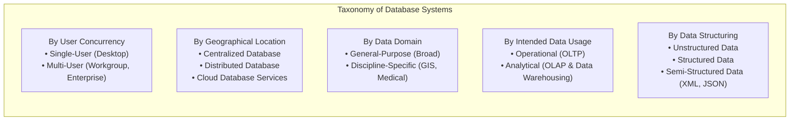

| Classification Criteria | Database Category | Characteristics & Real-World Examples |
| :--- | :--- | :--- |
| **User Concurrency** | **Single-User (Desktop)** | Supports exactly one active user session at a time; runs locally on a personal workstation (e.g., SQLite, MS Access). |
| | **Multi-User (Workgroup)** | Supports a localized group of users (typically $<50$) or a single business department (e.g., departmental MySQL). |
| | **Multi-User (Enterprise)** | Scales to hundreds or thousands of concurrent users across an entire multinational enterprise (e.g., Oracle, IBM Db2). |
| **Geographic Location**| **Centralized Database** | All data and DBMS engines reside physically at a single centralized location or data center. |
| | **Distributed Database** | Data is partitioned or replicated across multiple geographically distinct physical sites connected via network links. |
| | **Cloud Database** | Hosted, maintained, and dynamically scaled on managed cloud infrastructure with defined SLAs (e.g., Amazon RDS, Google Cloud Spanner). |
| **Data Domain** | **General-Purpose** | Holds multi-disciplinary organizational records across accounting, sales, logistics, and personnel. |
| | **Discipline-Specific** | Tailored strictly to specialized domains (e.g., Geographic Information Systems [GIS], biomedical informatics, CompuStat). |
| **Intended Data Usage**| **Operational (OLTP)** | Online Transaction Processing; optimized for high-frequency, low-latency reads and writes reflecting day-to-day operations. |
| | **Analytical (OLAP)** | Online Analytical Processing; optimized for complex queries, multi-dimensional aggregations, data warehouses, and business intelligence (BI). |
| **Data Structure Degree**| **Unstructured Data** | Raw state without predefined tabular schema (e.g., audio streams, raw video, social media posts). |
| | **Structured Data** | Formatted rigorously into records, tables, and typed fields derived from a formal data model. |
| | **Semi-Structured Data** | Contains self-describing tags or hierarchical markup to separate data elements without rigid relational schema (e.g., XML, JSON). |

---

## 1.4 The Importance of Database Design

Database design defines the precise architecture, schema, relational constraints, and storage structures used to store and manage organizational records.
- **Well-Designed Database:** Facilitates reliable data management, enforces integrity rules, minimizes storage redundancy, and yields prompt, accurate query results for strategic decision-makers.
- **Poorly-Designed Database:** Introduces subtle, difficult-to-trace bugs, generates conflicting data copies, degrades query execution performance, and frequently produces flawed reports that lead to disastrous business decisions.

---

## 1.5 Evolution of Data Processing: From File Systems to Databases

To appreciate the architectural significance of modern databases, we must examine the limitations of historical file processing systems.

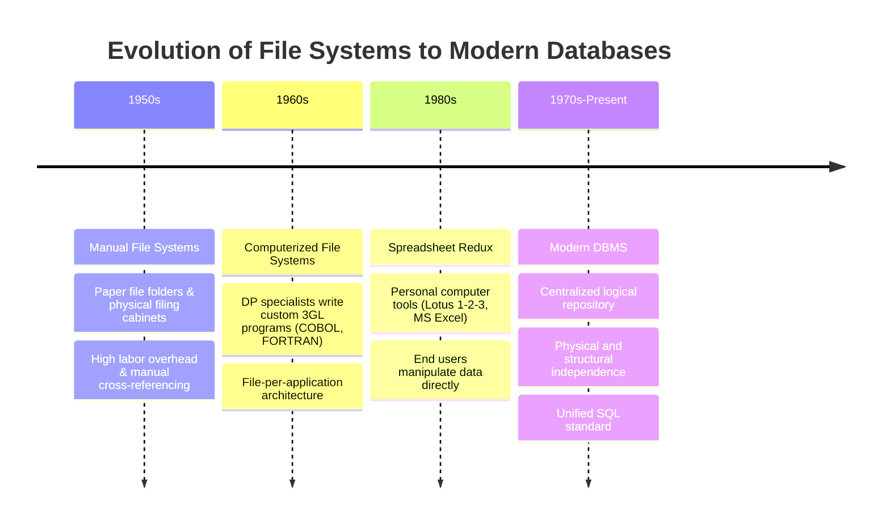

### 1.5.1 The Architecture of Early Computerized File Systems
In early computerized file processing, organizations hired **Data Processing (DP) specialists** to write custom programs (in languages like COBOL) for each specific reporting requirement. 
- The Accounting department had its own customer file and custom accounting programs.
- The Sales department maintained a separate sales file and separate programs.
- Each program defined its own internal record structure and read its dedicated sequential files directly from tape or disk.

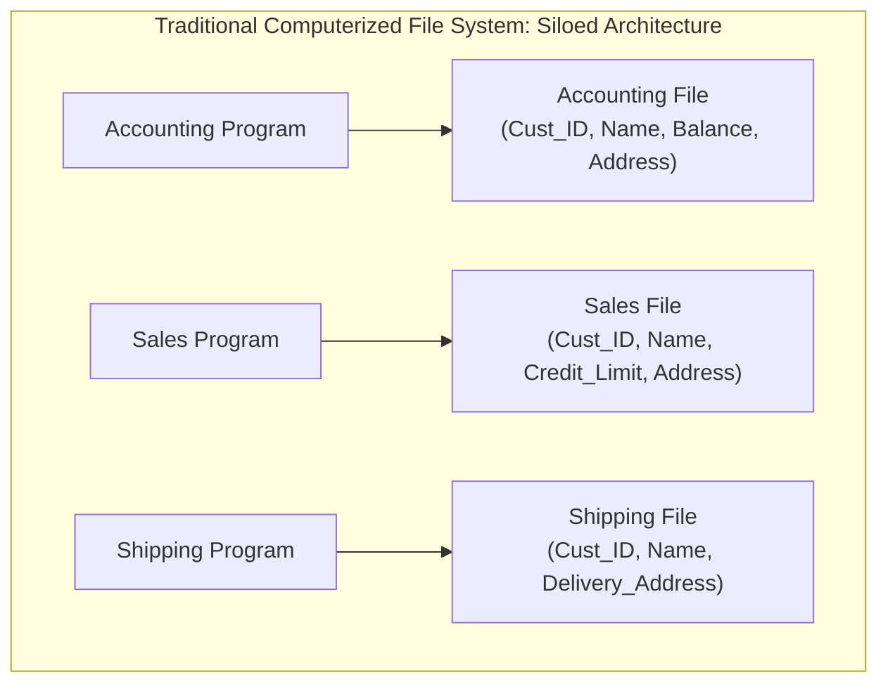

### 1.5.2 Critical Flaws and Hazards of File Systems

#### 1.5.2.1 Structural Dependence
- **Problem:** Access to data in a file system is tightly coupled to the physical and logical layout of the file itself.
- **Consequence:** If an engineer alters a file's structure (e.g., expanding a ZIP code field from 5 to 9 characters), **every single application program** that opens or reads that file must be manually rewritten, recompiled, and verified.
- **Database Contrast (Structural Independence):** In a DBMS, file structures can be modified (e.g., adding a column) without invalidating existing application programs that do not use that specific column.

#### 1.5.2.2 Data Dependence
- **Problem:** Program code contains hardwired assumptions about physical data storage characteristics (byte order, integer width, decimal formatting).
- **Consequence:** Changing storage hardware or data formatting breaks application code.
- **Database Contrast (Data Independence):** The DBMS provides a logical data abstraction; storage characteristics can change without impacting program logic.

#### 1.5.2.3 Data Redundancy and "Islands of Information"
- **Problem:** Because different departments create their own files, the same fundamental real-world data (e.g., customer name, address, contact phone) is duplicated across scattered storage locations (**islands of information**).
- **Consequences:**
  - *Storage Waste:* Identical records consume duplicate physical disk space.
  - *Data Inconsistency:* Updating a customer address in the Sales file while leaving the Accounting file unedited creates conflicting records, destroying data integrity.
  - *Data Integrity Violations:* Security permissions and validation rules are inconsistently enforced across files.

#### 1.5.2.4 Data Anomalies
Data anomalies develop when required modifications to redundant data are not executed uniformly across all files.

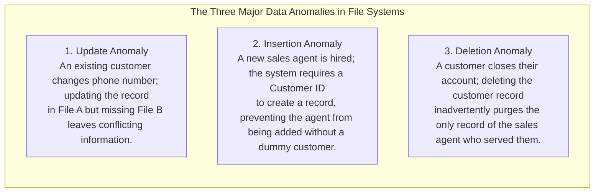

> [!warning] Detailed Anomaly Examples
> 1. **Update Anomaly:** Agent Leah changes her mobile phone number. If an operator updates her number in one customer's record but fails to update other records where Leah appears, queries produce contradictory contact details.
> 2. **Insertion Anomaly:** The company hires a new agent, Carlos. Because the file structure couples customer records to agent data, Carlos cannot be entered into the system until a customer is assigned to him.
> 3. **Deletion Anomaly:** Customer Sarah terminates her policy. Deleting Sarah's record deletes the row containing the details of Agent Marcus, erasing Marcus's employment information from the system.

---

## 1.6 Core Functions of a Modern DBMS

A modern DBMS eliminates the hazards of file processing through nine essential system services:

```mermaid
flowchart TD
    subgraph DBMSFunctions["The Nine Core DBMS Functions"]
        direction TB
        F1["1. Data Dictionary Management<br/>(Stores schema definitions & metadata relationships)"]
        F2["2. Data Storage Management & Tuning<br/>(Physical allocation, disk caching, performance optimization)"]
        F3["3. Data Transformation & Presentation<br/>(Translates physical formats to logical presentation)"]
        F4["4. Security Management<br/>(User authentication, role-based access control, privacy)"]
        F5["5. Multi-User Access Control<br/>(Concurrency control, ACID transaction locks)"]
        F6["6. Backup and Recovery Management<br/>(Transaction logging, automated disaster recovery)"]
        F7["7. Data Integrity Management<br/>(Foreign key referential integrity, check constraints)"]
        F8["8. Database Access Languages & APIs<br/>(SQL query execution, DDL, DML, programmatic drivers)"]
        F9["9. Database Communication Interfaces<br/>(ODBC/JDBC network listeners, web service endpoints)"]
    end
```

1. **Data Dictionary Management:** Automatically stores and maintains metadata definitions, table structures, column datatypes, and relationship constraints in a centralized system catalog.
2. **Data Storage Management:** Allocates physical storage space for data, tables, and indexes, utilizing internal performance-tuning algorithms (disk buffer caching, query optimization).
3. **Data Transformation & Presentation:** Formats incoming user inputs to conform to required database types and transforms raw internal bitstreams into human-readable representations.
4. **Security Management:** Authenticates user identities and enforces granular authorization rules restricting read, insert, update, or delete privileges.
5. **Multi-User Access Control:** Employs sophisticated locking and isolation algorithms to guarantee that concurrent users access and modify records without compromising consistency (**ACID** properties: Atomicity, Consistency, Isolation, Durability).
6. **Backup and Recovery Management:** Maintains transaction logs (`WAL` - Write-Ahead Logging) to restore the database to a verified consistent state following system crashes or power failures.
7. **Data Integrity Management:** Minimizes redundancy and enforces integrity rules (e.g., primary key uniqueness, foreign key referential integrity, datatype boundary checks).
8. **Database Access Languages & APIs:** Provides standard query languages:
   - **Data Definition Language (DDL):** Defines and alters schemas (`CREATE`, `ALTER`, `DROP`).
   - **Data Manipulation Language (DML):** Queries and updates records (`SELECT`, `INSERT`, `UPDATE`, `DELETE`).
   - **Structured Query Language (SQL):** The universal, de facto declarative standard supported across vendors.
9. **Database Communication Interfaces:** Exposes network listeners supporting connections via standard APIs (JDBC, ODBC, RESTful web services).

---

## 1.7 Strategic Advantages and Trade-Offs of Database Systems

| Advantages of Database Systems | Inherent Trade-Offs & Disadvantages |
| :--- | :--- |
| **Comprehensive Data Sharing:** Centralized access for diverse enterprise applications. | **Increased Upfront & Licensing Costs:** High software license fees, enterprise support contracts, and hardware requirements. |
| **Enforced Data Integrity & Consistency:** Foreign key constraints prevent invalid or orphaned records. | **Management Complexity:** Demands dedicated, highly skilled Database Administrators (DBAs). |
| **Ad-Hoc Query Capability via SQL:** Instantaneous data filtering and aggregation without custom programming. | **Maintaining Currency:** Continuous software patching, performance tuning, and schema refactoring. |
| **Structural & Data Independence:** Application code remains stable when schemas evolve. | **Vendor Dependence & Lock-In:** Migrating schemas and stored procedures between vendors incurs heavy switching costs. |
| **Centralized Security Governance:** Unified audit logs, encrypted storage, and access controls. | **Frequent Upgrade / Replacement Cycles:** Underlying hardware and database versions become obsolete rapidly. |

---

# Chapter 2: Data Models, Business Rules & Levels of Data Abstraction

## 2.1 Fundamentals of Data Modeling

### 2.1.1 What is a Data Model?
A **data model** is an abstract representation of real-world data structures, entity characteristics, relationships, operational constraints, and transformation rules within a specified problem domain.

> [!info] Data Model as an Architectural Blueprint
> Just as an architect constructs a physical or 3D blueprint before laying the foundation of a skyscraper, a database designer authors a data model to establish a verified blueprint before creating tables or executing DDL scripts. The data model serves as a shared communication bridge between non-technical business stakeholders and technical database engineers.

### 2.1.2 Basic Building Blocks of All Data Models
Every data model is constructed from four foundational elements:

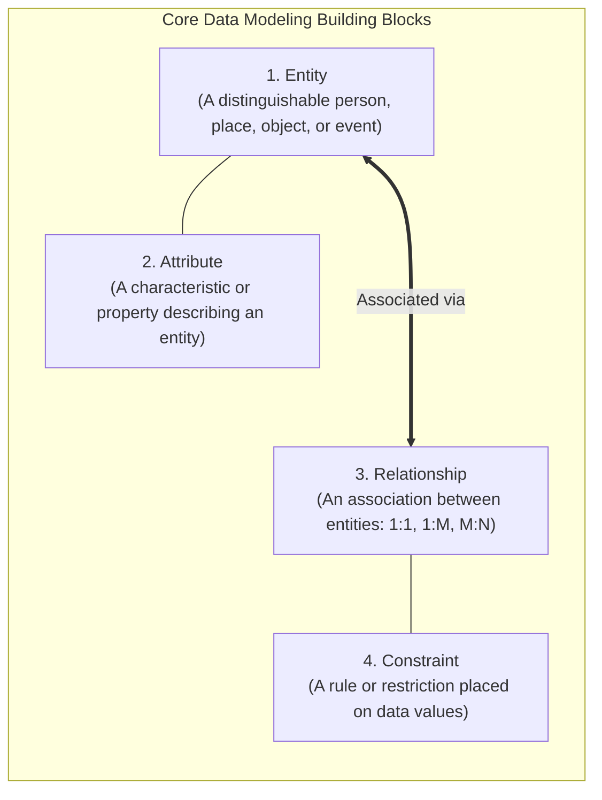

1. **Entity:** A distinct real-world person, place, physical object, conceptual item, or event about which the organization collects and persists data (e.g., `STUDENT`, `COURSE`, `INVOICE`).
2. **Attribute:** A specific characteristic or property that qualifies an entity (e.g., for `STUDENT`: `Student_ID`, `First_Name`, `Email`, `GPA`).
3. **Relationship:** An active or passive association linking two or more entities. Expressed via **connectivity** (cardinality):
   - **One-to-One ($1:1$):** Each instance of Entity A is associated with exactly one instance of Entity B (e.g., an employee manages at most one store; a store is managed by exactly one employee).
   - **One-to-Many ($1:M$):** Each instance of Entity A is associated with many instances of Entity B, but each instance of Entity B is associated with exactly one instance of Entity A (e.g., a customer generates many invoices; an invoice belongs to one customer).
   - **Many-to-Many ($M:N$):** Each instance of Entity A is associated with many instances of Entity B, and each instance of Entity B is associated with many instances of Entity A (e.g., a student enrolls in many classes; a class contains many students).
4. **Constraint:** A precise assertion, boundary condition, or business policy limiting allowed data values or relationships (e.g., *"A student cannot enroll in more than 4 courses per term"* or *"Account balance cannot drop below zero"*).

---

## 2.2 Business Rules: Bridging Business Logic to Schemas

### 2.2.1 What is a Business Rule?
A **business rule** is a brief, precise, and unambiguous statement of an organizational policy, operational procedure, or principle.

> [!info] Examples of Explicit Business Rules
> - *"A customer may generate many invoices; each invoice is generated by exactly one customer."* ($1:M$)
> - *"A customer may rent many bicycles; each bicycle is rented by only one customer at any given time."* ($1:M$)
> - *"A training session cannot be scheduled for fewer than 10 employees or more than 20 employees."* (Numerical Constraint)
> - *"A student may register for a maximum of four academic subjects in a semester."* (Participation Constraint)

### 2.2.2 Sources and Identification of Business Rules
Business rules are discovered through interviews with department managers, system users, operational manuals, company handbooks, and policy documentation. Identifying them ensures:
- A standardized, shared organizational view of data.
- Accurate discovery of entity boundaries, attribute ownership, and relationship constraints.

### 2.2.3 Translating Business Rules into Data Model Components
A database engineer translates natural-language business rules into structural elements through linguistic decomposition:

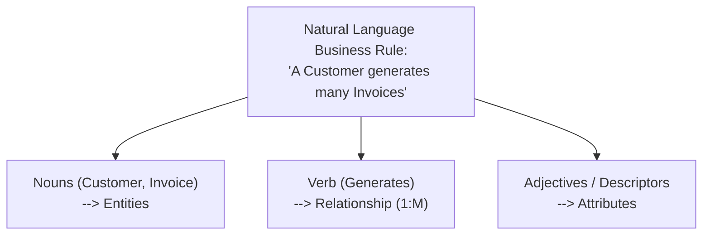

### 2.2.4 Determining Relationship Type: The Two-Question Diagnostic
To establish connectivity without ambiguity, the designer asks two bidirectional questions:
1. *How many instances of Entity B relate to exactly one instance of Entity A?*
2. *How many instances of Entity A relate to exactly one instance of Entity B?*

> [!example] Diagnostic Walkthrough: Student and Class
> - **Question 1:** How many classes can one student enroll in? **Answer:** Many.
> - **Question 2:** How many students can enroll in one class? **Answer:** Many.
> - **Conclusion:** The relationship between `STUDENT` and `CLASS` is **Many-to-Many ($M:N$)**. (In a relational database, this is implemented via a composite bridge entity).

---

## 2.3 Chronological Evolution of Data Models

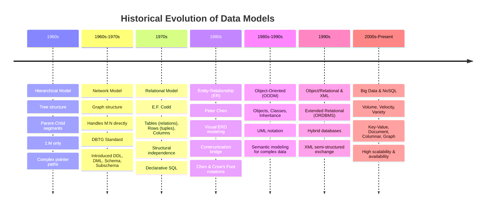

### 2.3.1 Hierarchical Model (1960s)
- **Structure:** Modeled as an inverted tree consisting of **segments** (records). Each parent segment can have multiple child segments, but every child has **exactly one parent** ($1:M$ only).
- **Advantages:** Conceptual simplicity for rigid $1:M$ hierarchies; fast access along hardwired physical pointer chains.
- **Disadvantages:** Cannot represent $M:N$ relationships; severe structural dependence; queries require low-level navigational traversal of pointer chains; modifying tree structure invalidates all application code.

### 2.3.2 Network Model (Late 1960s – 1970s)
- **Structure:** Developed by the Database Task Group (**DBTG** / CODASYL) to represent complex real-world relationships. Modeled as a **graph** where a record (member) can have **multiple parent records** (owners), supporting $M:N$ associations.
- **Standardized Concepts (Still Used Today):**
  - **Schema:** The complete logical database definition of all records and relationships.
  - **Subschema:** The specific portion of the database seen by a particular application program (view).
  - **Data Manipulation Language (DML):** Commands to query and modify records.
  - **Data Definition Language (DDL):** Statements to define schema constructs.
- **Disadvantages:** Extreme implementation complexity; navigating pointer chains required deep technical familiarity with storage layout; inflexible to ad-hoc query requests.

### 2.3.3 The Relational Model (1970s)
Pioneered by **E. F. Codd** of IBM in 1970, the relational model revolutionized data processing by separating logical data representation from physical storage mechanisms.
- **Key Tenets:**
  - Data is represented as a collection of two-dimensional tables called **relations**.
  - Each table consists of intersecting rows (**tuples**) and columns (**attributes**).
  - Tables are completely independent from one another physically.
  - Tables are linked logically through **common attributes** (Primary Key $\leftrightarrow$ Foreign Key).
- **Relational Database Management System (RDBMS):** Implements relational algebra engines and hides physical pointer manipulation entirely behind declarative **SQL**.

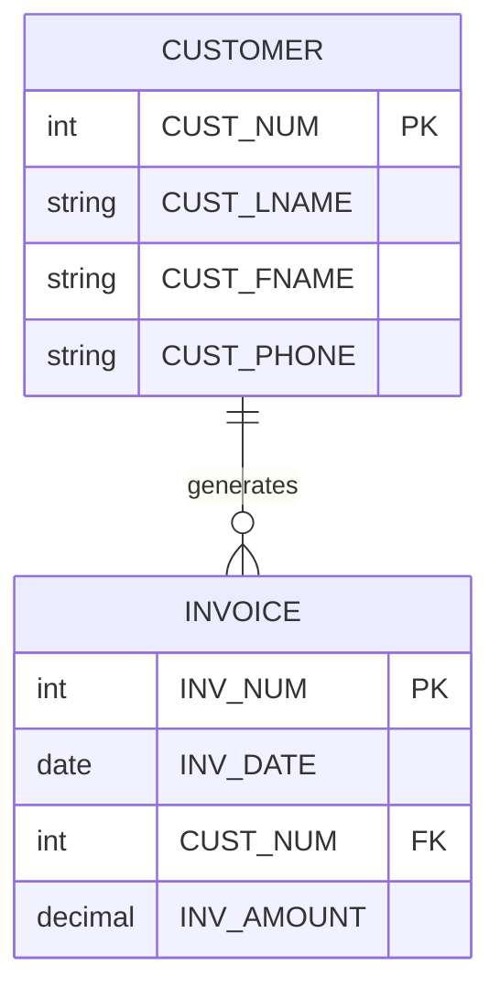

- **Advantages:** Unrivaled structural independence; natural tabular view; declarative SQL removes navigational code; simplified database maintenance.
- **Disadvantages:** Substantial CPU and memory overhead; potential performance bottlenecks for complex multi-table joins at scale.

### 2.3.4 The Entity-Relationship (ER) Model (1980s)
Introduced by **Peter Chen** in 1976. Rather than replacing the relational model, the ER model complements it by serving as the dominant visual conceptual modeling standard.
- **ER Diagrams (ERD):** Graphical visual diagrams representing entities as boxes, attributes as text lists or ovals, and relationships as connecting lines with cardinality symbols (Crow's Foot or Chen notation).
- **Value:** Serves as a universally understood visual communication artifact between end users, systems analysts, and software engineers.

### 2.3.5 Object-Oriented Data Model (OODM) & Object/Relational (ORDBMS)
- **OODM:** Represents data as encapsulated **objects** combining attributes (state) and methods (behavior). Objects belong to a **class**, and classes are arranged in a **class hierarchy** with **inheritance**. Depicted using UML class diagrams.
- **Object/Relational Database Management System (ORDBMS):** Hybrid extension adding object-oriented features (inheritance, user-defined types) into established relational engines (e.g., PostgreSQL, Oracle Spatial).
- **XML & Semi-Structured Data:** Extensible Markup Language (XML) and later JSON emerged to exchange semi-structured data across distributed web architectures.

### 2.3.6 The Big Data Era & NoSQL Databases (2000s – Present)
The exponential surge in web traffic, IoT sensor streams, and social media generated datasets characterized by the **3 Vs**:
- **Volume:** Massive datasets measuring petabytes or exabytes, overwhelming single-server relational capacity.
- **Velocity:** High-frequency, millisecond-latency data ingestion streams.
- **Variety:** Diverse, evolving, and semi-structured formats (JSON documents, graphs, key-value blobs) incompatible with rigid SQL table schemas.

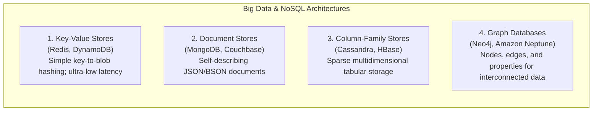

- **Core NoSQL Characteristics:**
  - Non-relational; does not require predefined schema.
  - Engineered for horizontal scale-out across clusters of commodity servers.
  - Trades strict immediate consistency (ACID) for high availability, fault tolerance, and **eventual consistency** (BASE model).
  - Supported by distributed frameworks like the **Hadoop Distributed File System (HDFS)** and **MapReduce**.

---

## 2.4 The ANSI/SPARC Four Levels of Data Abstraction

To ensure structural and data independence, the database design lifecycle is organized into four distinct levels of abstraction:

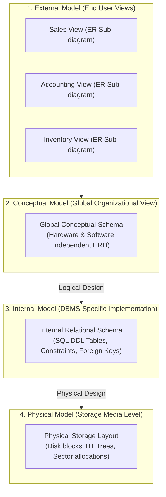

### 2.4.1 1. The External Model (External Schema)
- **Perspective:** The localized view of the database environment as perceived by specific end-user groups or departments.
- **Characteristics:**
  - The entire database is subdivided into tailored **subschemas**.
  - The Sales department sees only customer contacts and order totals; the HR department sees employee salaries and tax IDs.
  - Represented using focused ER sub-diagrams.

### 2.4.2 2. The Conceptual Model (Conceptual Schema)
- **Perspective:** A unified, global view of the entire database representing all organizational entities, attributes, relationships, and constraints.
- **Independence:** **Software-Independent and Hardware-Independent**.
  - It does not depend on the choice of DBMS vendor (Oracle vs. PostgreSQL vs. MongoDB).
  - It does not depend on the hardware infrastructure.
- **Logical Design:** The engineering activity of translating requirements into an integrated global ER diagram.

### 2.4.3 3. The Internal Model (Internal Schema)
- **Perspective:** The representation of the database as adapted to a specific chosen database software technology (e.g., mapping the conceptual ERD into relational tables, primary/foreign key columns, datatypes, and check constraints in Oracle or PostgreSQL).
- **Independence:** **Hardware-Independent, but Software-Dependent**.
  - Changing the DBMS software requires rewriting the internal schema.
- **Logical Independence:** You can modify the internal schema (e.g., refactoring table indexes or column definitions) without altering the global conceptual model.

### 2.4.4 4. The Physical Model
- **Perspective:** Operates at the lowest level of abstraction, describing how binary records are physically organized, indexed, clustered, and stored on persistent media (magnetic platters, NVMe SSD blocks).
- **Independence:** **Physical Independence**.
  - Modifying physical storage parameters (e.g., migrating from magnetic RAID arrays to NVMe flash storage, or changing block allocation sizes) does not require changes to the internal model or application code.
