# Chapter 1: Introduction to Database Systems & The Evolution of Data Processing

## 1.1 The Ubiquity of Databases: Everyday Systems & Operations

In modern digital society, virtually every personal, commercial, and governmental activity interacts with underlying database management systems. Whether shopping online, interacting with peers, booking transit, or obtaining healthcare, databases operate as the persistent operational nervous system of contemporary software.

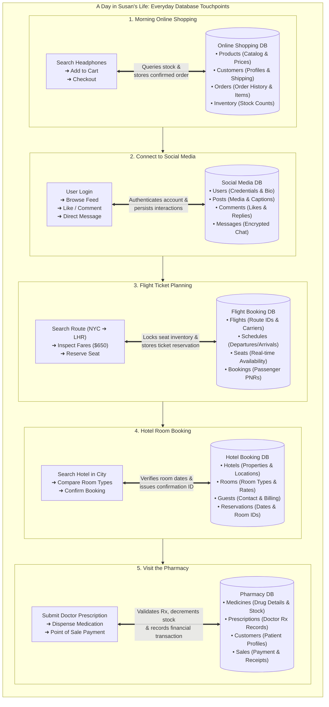

### 1.1.1 The Five Core Operational Mandates: Why Databases Are Needed
Across every domain illustrated in Susan's day, databases are fundamentally required to fulfill five indispensable engineering mandates:

1. **Store Data Safely:** Provide durable, fault-tolerant persistence for vast volumes of structured and unstructured records across clustered storage arrays.
2. **Search Quickly:** Execute sub-second query retrieval using internal index structures ($B^+$ trees, hash indexes) even when navigating billions of rows.
3. **Update Records Accurately:** Coordinate synchronized, concurrent modifications so that stock quantities, account balances, and flight seats reflect reality without race conditions.
4. **Track Transactions & Audit Trails:** Maintain chronological transaction logs (Write-Ahead Logging / WAL) to record, monitor, and reconstruct mission-critical business events.
5. **Improve Data Accuracy & Integrity:** Systematically enforce domain, entity, and referential constraints to eradicate data-entry errors and maintain trustworthy information.

---

## 1.2 Data vs. Information: The Foundations of Knowledge

The discipline of database systems is founded on the operational distinction between **raw data** and **actionable information**:

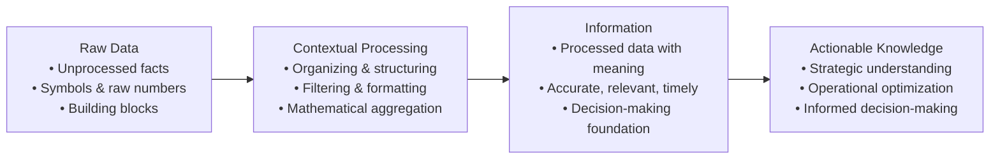

> [!info] Formal Definitions: Data vs. Information
> - **Data (Raw Facts):** Unprocessed, atomic facts, raw measurements, numbers, or symbols that have not yet been evaluated, organized, or contextualized to reveal their operational significance (e.g., `37.8`, `A102`, `180024`, `012-3456789`). Data constitutes the raw, foundational building blocks of all organizational systems.
> - **Information:** The refined, contextualized product generated by processing, structuring, formatting, and analyzing raw data to uncover its operational meaning, relationships, and implications (e.g., *"Patient body temperature is 37.8°C at 14:00"* or *"Flight A102 is delayed by 45 minutes"*).
> 
> **Prerequisites for High-Quality Information:**
> 1. **Accuracy:** Must represent a truthful, error-free reflection of the real-world state.
> 2. **Relevance:** Must directly pertain to the specific operational problem or context.
> 3. **Timeliness:** Must be available within the operational decision window before opportunities expire or conditions deteriorate.

> [!tip] Extra Notes: The DIKW Pyramid
> In computer science and enterprise architecture, data and information form the lower tiers of the **DIKW Hierarchy** (Data $\to$ Information $\to$ Knowledge $\to$ Wisdom):
> - *Data:* `42000` (an isolated integer).
> - *Information:* *"January 2017 Sales Forecast was 42,000 units, but actual sales were 38,532 units (Variation: -3,468)."*
> - *Knowledge:* Understanding that sales dip in January due to seasonal post-holiday consumer spending contraction.
> - *Wisdom:* Dynamically reducing January production quotas and scaling marketing campaigns in December to mitigate inventory holding costs.

---

## 1.3 Introducing the Database & The Foundational Role of Metadata

### 1.3.1 What is a Database?
A **database** is a shared, integrated computer structure designed to store and manage a collection of:
1. **End-User Data:** Raw facts, records, entities, and measurements of operational interest to the enterprise.
2. **Metadata (Data About Data):** A comprehensive description of data characteristics, data types, field lengths, domain boundaries, integrity constraints, and relational associations linking records across the entire database structure.

### 1.3.2 Concrete Multi-Tier Manifestations of Metadata vs. Data
Metadata is what allows modern database systems to be **self-describing** and **integrated**. The relationship between metadata and data exists at every layer of computing:

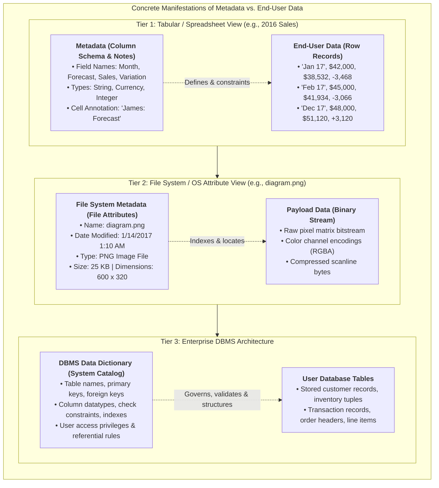

---

## 1.4 Database Management Systems (DBMS): Architecture, Roles & Intermediation

### 1.4.1 What is a DBMS?
A **Database Management System (DBMS)** is a complex collection of software programs that manages the physical and logical database structure, arbitrates all user and application access, enforces security and integrity, and coordinates concurrent multi-user execution.

### 1.4.2 Departmental User Roles & Centralized DBMS Access
In a modern enterprise, distinct business roles with completely different operational requirements interact with a unified central database through the DBMS:

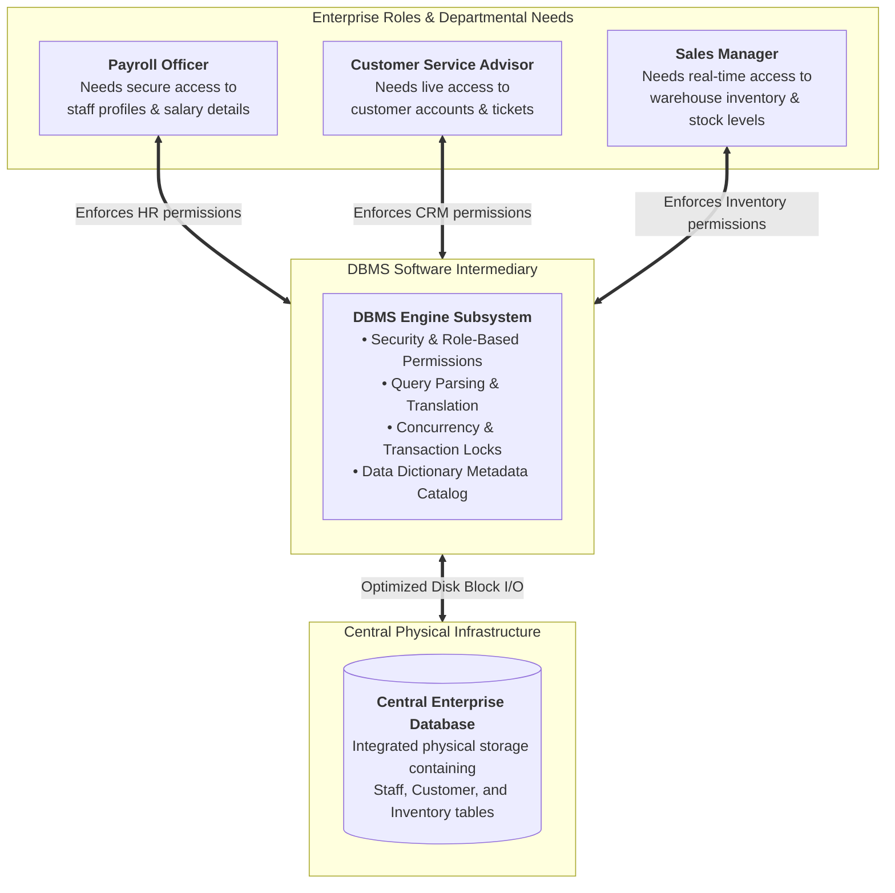

#### The Landscape of Modern DBMS Technologies
The modern software landscape encompasses diverse DBMS offerings adapted for specific deployment environments:
- **Desktop & Embedded DBMS:** SQLite, Microsoft Access, TurboDB Embedded, DBISAM, ElevateDB.
- **Enterprise Relational DBMS (RDBMS):** Oracle Database, PostgreSQL, MySQL, MariaDB Foundation, Microsoft SQL Server, IBM Db2.
- **Cloud-Native Database Services:** Microsoft SQL Azure, Amazon Relational Database Service (RDS), Amazon Aurora, Google Cloud Spanner.

### 1.4.3 The Intermediary Role of the DBMS
The DBMS operates as an indispensable **software intermediary** between applications and the physical storage layer:
1. **Intermediary Access Control:** Applications and end users never touch physical disk blocks directly; all read, write, update, and delete requests are submitted to the DBMS.
2. **Data Sharing Enabler:** Arbitrates concurrent access, enabling diverse programs across multiple departments to share identical records safely.
3. **Integrated Conceptual View:** Presents users with a seamless, integrated logical view of data, regardless of whether underlying files are split across multiple storage arrays.
4. **Request Translation:** Intercepts high-level declarative queries (e.g., SQL statements), analyzes syntax, computes optimal query plans, and translates them into low-level physical disk read/write instructions.
5. **Complexity Abstraction:** Hides low-level physical complexities (such as $B^+$ tree pointers, disk sector allocation, memory buffer paging, and binary serialization) from programmers and analysts.

### 1.4.4 The DBMS Interaction Model & Internal Subsystems
The DBMS manages the entire transaction lifecycle between the user and the stored records:

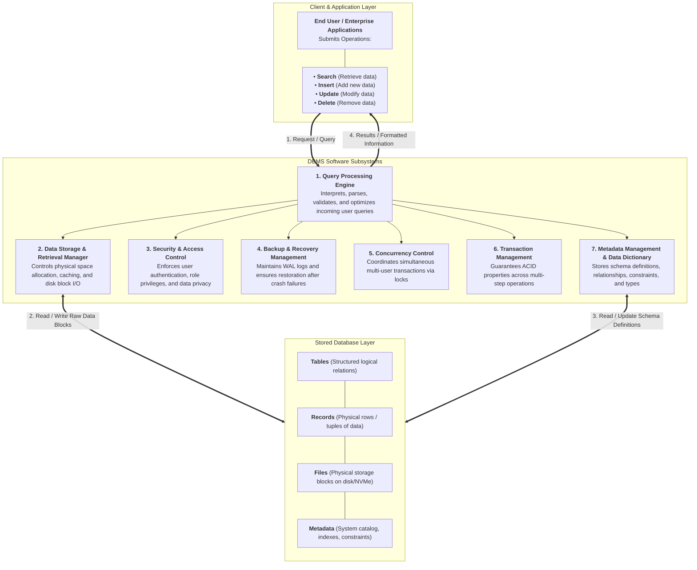

### 1.4.5 Comprehensive Advantages of Implementing a DBMS
Deploying a modern DBMS delivers three tiers of organizational advantages:

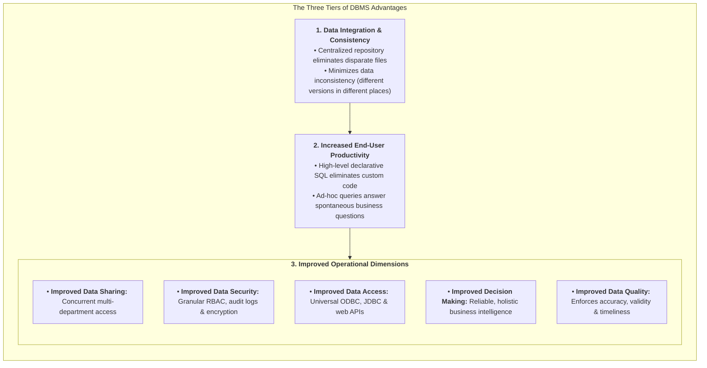

> [!info] Definition: Data Inconsistency
> **Data inconsistency** exists when different and conflicting versions of the exact same real-world data appear simultaneously in different locations across an organization's filing systems. Inconsistency destroys trust in reports, creates operational chaos, and violates fundamental data integrity.

---

## 1.5 Comprehensive Taxonomy and Classification of Databases

Databases are categorized across **five distinct operational dimensions**:

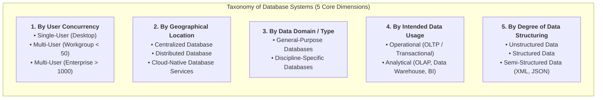

### 1.5.1 Detailed Classification Matrix

| Dimension | Category | Architecture & Operational Characteristics | Real-World Examples |
| :--- | :--- | :--- | :--- |
| **User Concurrency** | **Single-User (Desktop)** | Supports exactly one active user session at a time; runs locally on a personal workstation or embedded inside an application. | SQLite, Microsoft Access, TurboDB. |
| | **Multi-User (Workgroup)** | Supports a localized group of concurrent users (typically $< 50$) or a single business department. | Departmental MySQL, MariaDB workgroup server. |
| | **Multi-User (Enterprise)** | Scales to hundreds or thousands of simultaneous concurrent users across an entire multinational enterprise. | Oracle Database, IBM Db2, Microsoft SQL Server, PostgreSQL. |
| **Geographic Location** | **Centralized Database** | All data and DBMS processing engines reside physically at a single centralized data center or physical host. | Mainframe database, on-premises enterprise data center. |
| | **Distributed Database** | Data is partitioned, sharded, or replicated across multiple geographically distinct physical sites connected via network links. | CockroachDB, Google Cloud Spanner, Apache Cassandra. |
| | **Cloud Database** | Hosted, maintained, and dynamically scaled on managed cloud infrastructure with defined SLAs (storage, IOPS throughput, high availability). | Amazon RDS, Microsoft Azure SQL, Google Cloud Firestore. |
| **Stored Data Domain** | **General-Purpose** | Holds multi-disciplinary, broad organizational records across accounting, sales, logistics, and scholarly literature. | LexisNexis, ProQuest, enterprise ERP systems (SAP). |
| | **Discipline-Specific** | Tailored strictly to specialized domains requiring domain-specific indexing, geometries, or time-series precision. | Geographic Information Systems (GIS), CompuStat (financial), NCBI GenBank (genomics). |
| **Intended Data Usage** | **Operational (OLTP)** | Online Transaction Processing; optimized for high-frequency, low-latency reads and writes reflecting day-to-day operations. | Core banking systems, e-commerce checkout databases, point-of-sale registers. |
| | **Analytical (OLAP)** | Online Analytical Processing; optimized for complex queries, multi-dimensional aggregations, and historical trend analysis. | Enterprise Data Warehouses (Snowflake, Google BigQuery, Amazon Redshift). |
| **Data Structuring** | **Unstructured Data** | Exists in its original raw state without a predefined tabular schema or typed fields. | Raw audio streams, surveillance video, memos, social media posts. |
| | **Structured Data** | Formatted rigorously into records, tables, and typed fields derived from a formal relational data model. | SQL relational tables with declared primary and foreign keys. |
| | **Semi-Structured Data** | Contains self-describing tags or hierarchical markup to separate data elements without rigid relational schema. | Extensible Markup Language (XML), JSON documents, YAML configurations. |

> [!info] Analytical Architecture: Data Warehouses, OLAP, and Business Intelligence (BI)
> - **Data Warehouse:** A specialized centralized repository storing historical enterprise data extracted, transformed, and consolidated from multiple operational (OLTP) databases, formatted specifically for decision support.
> - **Online Analytical Processing (OLAP):** Analytical tools that enable analysts to rapidly retrieve, process, model, slice, dice, and aggregate multidimensional data cubes from the data warehouse.
> - **Business Intelligence (BI):** A comprehensive suite of tools, processes, and architectures that capture and process business data to generate actionable insights supporting tactical and strategic decision-making.

---

## 1.6 The Critical Importance of Database Design & Normalization Case Study

Database design focuses on architecting the precise database structure that will be used to store and manage end-user data:
- **Well-Designed Database:** Facilitates efficient data management, guarantees data integrity, prevents redundant storage, and generates accurate, timely, and valuable information.
- **Poorly-Designed Database:** Introduces subtle, difficult-to-trace bugs, duplicates data across inconsistent copies, degrades query performance, and generates flawed reports that lead to disastrous managerial decisions.

### 1.6.1 Case Study: Employee Skills Certification in a Poor Design
To understand the engineering consequences of poor design, consider the unnormalized spreadsheet-like table below (adapted from *Figure 1.5, pp. 13*):

#### Unnormalized Table: Flat File `EMPLOYEE_SKILLS`
| ID | ENum | Name | Title | HireDate | Skill1 | Skill1Date | Skill2 | Skill2Date | Skill3 | Skill3Date |
| :--- | :--- | :--- | :--- | :--- | :--- | :--- | :--- | :--- | :--- | :--- |
| 1 | 02345 | Brian Oates | DBA | 2/14/1997 | Basic Database Management | 2/14/2004 | Advanced Database Management | 2/14/2007 | Basic Web Design | 8/9/2005 |
| 2 | 08273 | Marco Bienz | Analyst | 7/28/2008 | Basic Web Design | 3/8/2011 | Advance Process Modeling | 8/19/2014 | | |
| 3 | 06234 | Jasmine Patel | Programmer | 8/10/2007 | Basic Web Design | 8/10/2009 | Advanced C# programming | 8/10/2009 | Basic DB manipulation | 1/29/2014 |
| 4 | 03373 | Franklin Johnson, Jr. | Purchasing Agent | 3/15/2004 | Advanced Spreadsheets | 6/20/2013 | | | | |
| 5 | 13567 | Almond, Robert | Analyst | 9/30/2014 | Basic Process Modeling | 9/30/2016 | Basic Database Design | 5/23/2017 | | |
| 6 | 10282 | Richardson, Amanda | Clerk | 4/11/2013 | | | | | | |
| 7 | 09382 | Susan Mathis | Database Programmer | 8/2/2012 | Basic DB Design | 8/2/2014 | Basic Database Manipulation | 8/2/2014 | Advanced DB Manipulation | 5/1/2015 |
| 8 | 14311 | Duong, Lee | Programmer | 9/1/2016 | Basic Web Design | 9/1/2018 | | | | |
| 9 | | | | | Master Database Programming | | | | | |
| 10 | | | | | Basic Spreadsheets | | | | | |
| 11 | 09002 | Wade Gaither | Clerk | 5/20/2012 | Advanced Spreadsheets | 5/16/2015 | Basic Web Design | 5/16/2015 | | |
| 12 | 13383 | Raymond F. Matthews | Programmer | 3/12/2014 | Basic C# Programming | 3/12/2016 | | | | |
| 13 | 09283 | Chavez, Juan | Clerk | 7/4/2012 | | | | | | |
| 14 | 04893 | Patricia Richards | DBA | 6/11/2006 | Advanced Database Management | 6/11/2008 | Advanced Database Manipulation | 9/20/2014 | | |
| 15 | 13932 | Lee Megan | Programmer | 9/29/2015 | | | | | | |

#### Analysis of the Five Fatal Design Flaws:
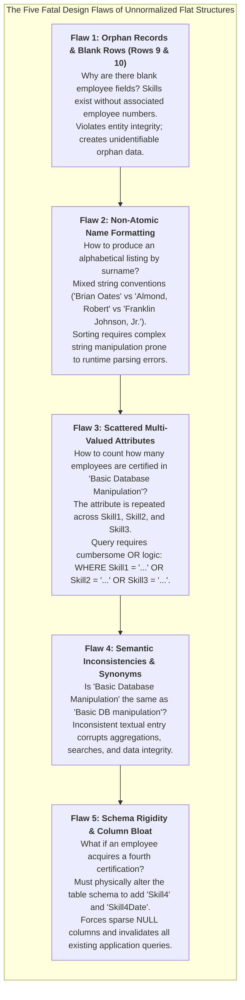

### 1.6.2 The Relational Solution: Normalization into Database Programmer
To eliminate every flaw, relational database engineering decomposes the single flawed flat structure into **three normalized, atomic relational tables**:

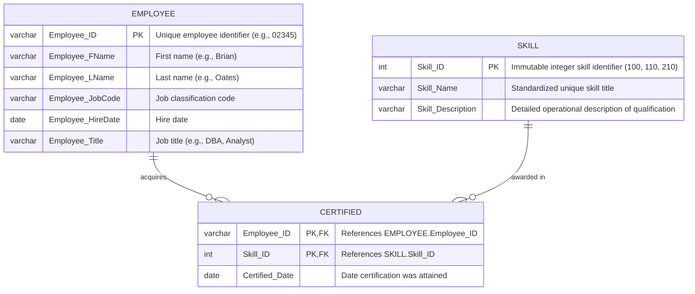

#### Standardized Catalog Table: `SKILL`
Centralizes qualifications, eliminating synonyms and typos:

| Skill_ID | Skill_Name | Skill_Description |
| :---: | :--- | :--- |
| **100** | Basic Database Management | Create and manage database user accounts |
| **110** | Basic Web Design | Create and maintain basic HTML and CSS documents |
| **120** | Advanced Spreadsheets | Use of advanced functions, user-defined functions, and macroing |
| **130** | Basic Process Modeling | Create core business process models using standard libraries |
| **140** | Basic Database Design | Create simple data models |
| **150** | Master Database Programming | Create integrated trigger and procedure packages for distributed environments |
| **160** | Basic Spreadsheets | Create single-tab worksheets with basic formulas |
| **170** | Basic C# Programming | Create simple tier data-aware modules |
| **180** | Advanced Database Management | Manage Database Server Clusters |
| **190** | Advance Process Modeling | Evaluate and Redesign cross-functional internal and external business processes |
| **200** | Advanced C# Programming | Create multi-tier applications using multi-threading |
| **210** | Basic Database Manipulation | Create simple data retrieval and manipulation statements in SQL |
| **220** | Advanced Database Manipulation | Use of advanced data manipulation methods for multi-table inserts and subqueries |

#### Associative Bridge Entity: `CERTIFIED`
Implements the $M:N$ relationship cleanly. When an employee gains a 4th or 10th certification, the DBA simply inserts new rows into `CERTIFIED` without altering table columns!

| Employee_ID | Skill_ID | Certified_Date |
| :---: | :---: | :---: |
| 02345 | 100 | 2/14/2004 |
| 02345 | 180 | 2/14/2007 |
| 02345 | 110 | 8/9/2005 |
| 08273 | 110 | 3/8/2011 |
| 08273 | 190 | 8/19/2014 |
| 06234 | 110 | 8/10/2009 |
| 06234 | 200 | 8/10/2009 |
| 06234 | 210 | 1/29/2014 |
| 09382 | 140 | 8/2/2014 |
| 09382 | 210 | 8/2/2014 |
| 09382 | 220 | 5/1/2015 |

---

## 1.7 Evolution of Data Processing: From File Systems to Databases

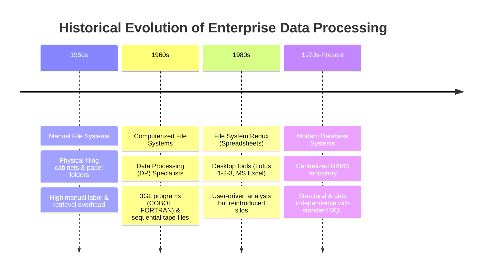

### 1.7.1 The Architecture of Early Computerized File Systems
In the 1960s, computerized file systems replaced manual paper filing cabinets. Organizations established **Data Processing (DP) departments** where DP specialists authored specialized programs (in third-generation languages like COBOL or FORTRAN) to track operational data and produce static reports:

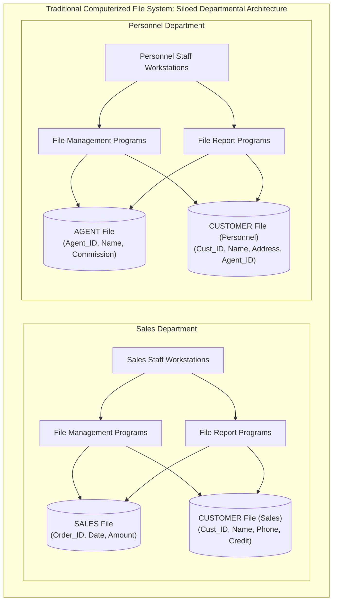

### 1.7.2 Foundational File Processing Terminology
Understanding traditional file processing requires defining the four hierarchical building blocks of file systems:

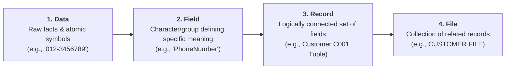

| File Term | Formal Definition | Concrete Operational Example |
| :--- | :--- | :--- |
| **Data** | Raw facts (such as a telephone number, birth date, customer name, or credit limit) that have little inherent meaning until organized logically. | `012-3456789`, `15 Jan 2000`, `Ali bin Ahmad`, `5000`. |
| **Field** | A character or group of characters (alphabetic or numeric) that has a specific meaning. Used to define and store a distinct data attribute. | `CustomerID`, `Name`, `PhoneNumber`, `DateOfBirth`, `CreditLimit`. |
| **Record** | A logically connected set of one or more fields that describes a specific real-world person, place, entity, or transaction. | Record for Customer `C001`: `[C001, Ali bin Ahmad, 123 Jalan Kenanga 11800 Penang, 012-3456789, 15 Jan 2000, 5000, 1200]`. |
| **File** | A collection of related records stored persistently on secondary media. | `CUSTOMER FILE` storing all student or customer records for an enterprise. |

#### Concrete File System Structure: `CUSTOMER FILE`
| CustomerID | Name | Address | PhoneNumber | DateOfBirth | CreditLimit | UnpaidBalance |
| :---: | :--- | :--- | :---: | :---: | :---: | :---: |
| **C001** | Ali bin Ahmad | 123, Jalan Kenanga, 11800 Penang | 012-3456789 | 15 Jan 2000 | 5000 | 1200 |
| **C002** | Siti Nurhaliza | 45, Jalan Melur, 11600 Penang | 019-8765432 | 22 Mar 1998 | 3000 | 0 |
| **C003** | Lim Wei Ming | 8, Jalan Cempaka, 11700 Penang | 016-1122334 | 5 Jul 1995 | 4000 | 750 |

---

## 1.8 Critical Flaws of File Systems & The Three Fundamental Data Anomalies

### 1.8.1 Inherent Weaknesses of File System Processing
Traditional file processing environments suffer from five severe operational bottlenecks:
1. **Lengthy Development Times:** Creating new reports or queries requires writing brand-new 3GL application programs from scratch.
2. **Difficulty of Getting Quick Answers:** Ad-hoc questions cannot be answered spontaneously; management must submit requests to DP specialists and wait days or weeks for custom program development.
3. **Complex System Administration:** As the organization grows, managing hundreds of disparate file layouts, file formats, and access scripts becomes administratively unmanageable.
4. **Lack of Security and Limited Data Sharing:** Security is constrained to primitive operating system file-level permissions (read/write/execute on the entire file); column-level, row-level, or role-based security is impossible without custom application code.
5. **Extensive Programming Requirements:** Every routine operation (opening files, parsing byte offsets, checking end-of-file markers, allocating I/O buffers) must be manually coded by the programmer.

### 1.8.2 Structural Dependence vs. Structural Independence
- **Structural Dependence:** A condition where access to data in a file is strictly dependent on the physical and logical layout of the file itself.
  - *Mechanism:* Application code hardcodes fixed byte offsets (e.g., reading 10 bytes for Customer ID, followed by 30 bytes for Name).
  - *Consequence:* If a field structure is modified (e.g., expanding postal codes from 5 to 9 digits, or adding an email address), **every single application program** that accesses that file must be manually rewritten, recompiled, retested, and redeployed.
- **Structural Independence:** An architectural quality where file/table structures can be altered (e.g., adding a new column) without invalidating existing application programs that do not reference that specific column. Achieved in a DBMS via the system data dictionary.

### 1.8.3 Data Dependence vs. Data Independence
- **Data Dependence:** A condition where data access routines are tightly coupled to the physical data storage characteristics (e.g., integer width, floating-point encoding, endianness, or disk block sizing). Changing storage hardware or storage formatting invalidates application logic.
- **Data Independence:** A condition where physical storage characteristics can be altered dynamically without affecting the application program's ability to access the data. The DBMS translates high-level logical requests into hardware-specific operations.

### 1.8.4 Data Redundancy & "Islands of Information"
Because departments traditionally maintained isolated files, the same real-world data (e.g., customer name, phone number, address) was duplicated across scattered departmental files (**islands of information**).

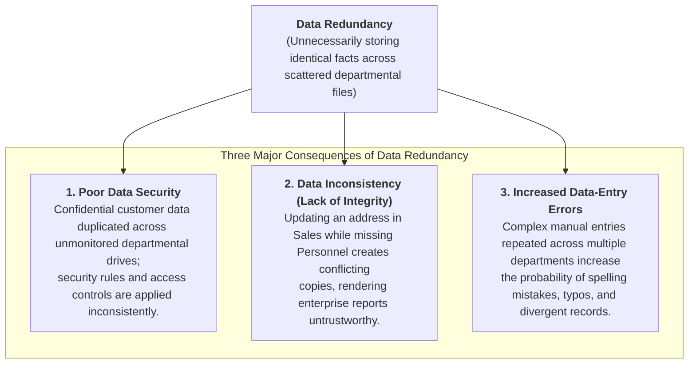

### 1.8.5 The Three Fundamental Data Anomalies: Insurance Agency Case Study
A **data anomaly** develops when required modifications to redundant data are not executed uniformly across all files.

To observe data anomalies in action, consider the historical unnormalized file table below:

#### Unnormalized Insurance Agency Policy File
| C_NAME | C_PHONE | C_ADDRESS | C_ZIP | A_NAME | A_PHONE | TP | AMT | REN |
| :--- | :---: | :--- | :---: | :--- | :---: | :---: | :---: | :---: |
| Alfred A. Ramas | 615-844-2573 | 218 Fork Rd., Babs, TN | 36123 | Leah F. Hahn | 615-882-1244 | T1 | 100.00 | 05-Apr-2018 |
| Leona K. Dunne | 713-894-1238 | Box 12A, Fox, KY | 25246 | Alex B. Alby | 713-228-1249 | T1 | 250.00 | 16-Jun-2018 |
| Kathy W. Smith | 615-894-2265 | 125 Oak Ln, Babs, TN | 36123 | Leah F. Hahn | **615-882-2144** | S2 | 150.00 | 29-Jan-2019 |
| Paul F. Olowski | 615-894-2180 | 217 Lee Ln., Babs, TN | 36123 | Leah F. Hahn | 615-882-1244 | S1 | 300.00 | 14-Oct-2018 |
| Myron Orlando | 615-222-1672 | Box 111, New, TN | 36155 | Alex B. Alby | 713-228-1249 | T1 | 100.00 | 28-Dec-2018 |
| Amy B. O'Brian | 713-442-3381 | 387 Troll Dr., Fox, KY | 25246 | John T. Okon | 615-123-5589 | T2 | 850.00 | 22-Sep-2018 |
| James G. Brown | 615-297-1228 | 21 Tye Rd., Nash, TN | 37118 | Leah F. Hahn | 615-882-1244 | S1 | 120.00 | 25-Mar-2018 |
| George Williams | 615-290-2556 | 155 Maple, Nash, TN | 37119 | John T. Okon | 615-123-5589 | S1 | 250.00 | 17-Jul-2018 |
| Anne G. Farriss | 713-382-7185 | 2119 Elm, Crew, KY | 25432 | Alex B. Alby | 713-228-1249 | T2 | 100.00 | 03-Dec-2018 |
| Olette K. Smith | 615-297-3809 | 2782 Main, Nash, TN | 37118 | John T. Okon | 615-123-5589 | S2 | 500.00 | 14-Mar-2019 |

*Legend:* `C_NAME` = Customer Name, `C_PHONE` = Customer Phone, `C_ADDRESS` = Customer Address, `C_ZIP` = Zip Code, `A_NAME` = Agent Name, `A_PHONE` = Agent Phone, `TP` = Insurance Policy Type, `AMT` = Policy Amount (in $1,000s), `REN` = Policy Renewal Date.

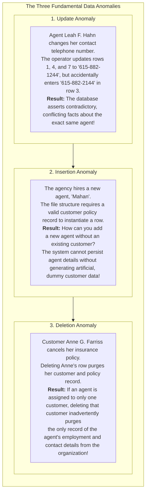

---

## 1.9 Modern Database Systems Architecture & The Five Environment Components

### 1.9.1 Modern Database Systems
A modern database system eliminates the vulnerabilities of file processing by storing logically related data in a **single logical data repository**:
- The repository appears to the end user and applications as a single, unified, coherent unit, even if the underlying data is physically partitioned or distributed across multiple servers.
- Current-generation DBMS software:
  1. Stores schema data structures, relationships between entities, and multi-tier access paths.
  2. Defines, stores, and optimizes all access paths, indices, and hardware components automatically.

### 1.9.2 Contrasting File Systems and Database Systems
The architectural distinction between traditional file processing and modern database environments is profound:

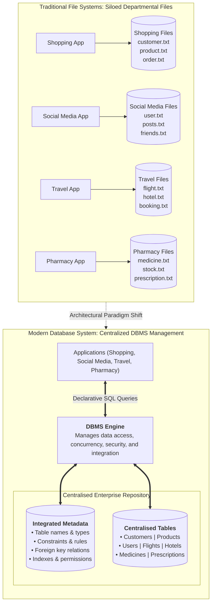

### 1.9.3 The Five Major Components of the Database System Environment
A complete database system consists of five tightly coupled components: **Hardware, Software, People, Procedures, and Data**.

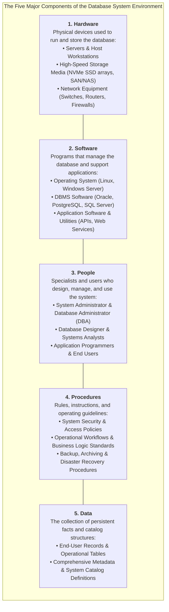

#### People Roles & System Interaction Topology
The interaction between people roles, procedures, software, hardware, and data follows a strict hierarchical governance workflow:

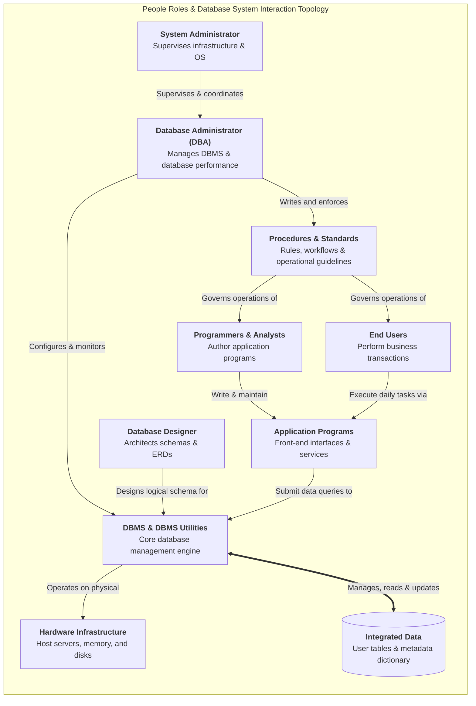

---

## 1.10 The Nine Core Functions of a Modern DBMS

A production-grade DBMS eliminates the hazards of file processing through nine essential system services:

```mermaid
flowchart TD
    subgraph TheNineFunctions["The Nine Core Functions of a Modern DBMS"]
        direction TB

        F1["<b>1. Data Dictionary Management</b><br/>Stores definitions of all data elements, types, relationships & constraints in a centralized catalog"]
        F2["<b>2. Data Storage Management & Performance Tuning</b><br/>Allocates disk structures; uses intelligent buffer caching & query optimization to maximize I/O speed"]
        F3["<b>3. Data Transformation & Presentation</b><br/>Transforms entered inputs to match required internal structures; formats outputs for user presentation"]
        F4["<b>4. Security Management</b><br/>Enforces user authentication, granular role-based access control (RBAC), and privacy encryption"]
        F5["<b>5. Multi-User Access Control</b><br/>Employs sophisticated concurrency locking algorithms ensuring simultaneous access without integrity loss"]
        F6["<b>6. Backup and Recovery Management</b><br/>Maintains Write-Ahead Logs (WAL); enables full database restoration to a consistent state following crash failures"]
        F7["<b>7. Data Integrity Management</b><br/>Enforces primary key uniqueness, foreign key referential integrity, and domain boundary constraints"]
        F8["<b>8. Database Access Languages & APIs</b><br/>Executes declarative SQL queries (DDL for schemas, DML for data manipulation), abstracting operational logic"]
        F9["<b>9. Database Communication Interfaces</b><br/>Exposes standard network listeners (ODBC, JDBC, REST endpoints) across diverse heterogeneous client environments"]

        F1 --> F2 --> F3 --> F4 --> F5 --> F6 --> F7 --> F8 --> F9
    end
```

1. **Data Dictionary Management:** Automatically records, updates, and provides lookup access for metadata definitions, table schemas, attribute datatypes, constraints, and relational associations in a centralized system catalog.
2. **Data Storage Management & Performance Tuning:** Manages the physical allocation of disk blocks, table spaces, indexes, and transaction logs. Implements performance tuning algorithms (such as memory buffer pooling and index caching) to ensure optimal storage utilization and access speed.
3. **Data Transformation & Presentation:** Translates raw user inputs into structured database datatypes (e.g., parsing localized date strings like `15 Jan 2000` into standardized internal ISO-8601 representations) and transforms internal bitstreams into human-readable views.
4. **Security Management:** Authenticates user credentials and enforces granular authorization policies restricting read, insert, update, or delete privileges to authorized users and application roles.
5. **Multi-User Access Control:** Coordinates concurrent access among hundreds or thousands of users using advanced locking protocols and isolation levels, ensuring transactions satisfy ACID properties without dirty reads or lost updates.
6. **Backup and Recovery Management:** Continuously maintains transaction write-ahead logs (`WAL`) and automated snapshot facilities, allowing the DBA to recover the database to an exact, verified point-in-time following hardware crashes, operating system panics, or power interruptions.
7. **Data Integrity Management:** Minimizes data redundancy and enforces data integrity rules automatically (e.g., rejecting duplicate primary keys, preventing orphaned foreign key records, and enforcing column validation checks).
8. **Database Access Languages & Application Programming Interfaces (APIs):** Provides standard declarative query languages:
   - **Data Definition Language (DDL):** Formulates, alters, and drops schema structures (`CREATE TABLE`, `ALTER TABLE`, `DROP TABLE`).
   - **Data Manipulation Language (DML):** Selects, filters, inserts, updates, and deletes records (`SELECT`, `INSERT`, `UPDATE`, `DELETE`).
   - **Structured Query Language (SQL):** The universal, de facto declarative query language standard supported by virtually all DBMS vendors, letting users specify *what* data is required without specifying *how* the computer must retrieve it.
9. **Database Communication Interfaces:** Exposes standard network communication interfaces and drivers (JDBC for Java, ODBC for C/C++/C#, RESTful JSON endpoints) to accept queries over heterogeneous local and cloud network environments.

---

## 1.11 Inherent Trade-Offs and Disadvantages of Database Systems

While database systems provide revolutionary operational capabilities, they introduce significant technical and organizational trade-offs:

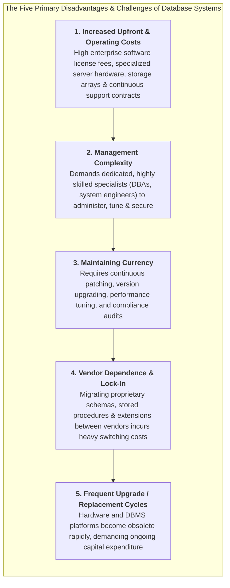

### Strategic Comparison: Advantages vs. Inherent Trade-Offs

| Advantages of Database Systems | Inherent Trade-Offs & Disadvantages |
| :--- | :--- |
| **Comprehensive Data Sharing:** Centralized access across diverse enterprise applications without siloing. | **Increased Costs:** Expensive enterprise DBMS licenses, high-spec host hardware, and ongoing vendor maintenance contracts. |
| **Enforced Data Integrity & Consistency:** Automatic constraints prevent orphaned records, contradictory entries, and anomalies. | **Management Complexity:** Demands dedicated, highly skilled Database Administrators (DBAs) and systems engineers. |
| **Declarative Ad-Hoc SQL Querying:** Instantaneous data filtering and aggregation without authoring custom 3GL code. | **Maintaining Currency:** Continuous overhead applying critical security patches, performance tuning, and schema refactoring. |
| **Structural & Data Independence:** Application programs remain stable when physical storage schemas or indexes evolve. | **Vendor Dependence:** Proprietary SQL extensions, stored procedures, and clustering features lock enterprises into specific vendor ecosystems. |
| **Centralized Security Governance:** Unified role-based access control, encrypted storage, and immutable audit logs. | **Frequent Upgrade Cycles:** Rapid technological obsolescence necessitates periodic hardware replacements and disruptive DBMS migrations. |

---

# Chapter 2: Data Models, Business Rules & Levels of Data Abstraction

## 2.1 Fundamentals of Data Modeling & The Importance of Blueprints

### 2.1.1 What is a Data Model?
A **data model** is a simple, typically graphical, abstract representation of complex real-world data structures, entity characteristics, relationships, operational constraints, and transformation rules within a specified problem domain.

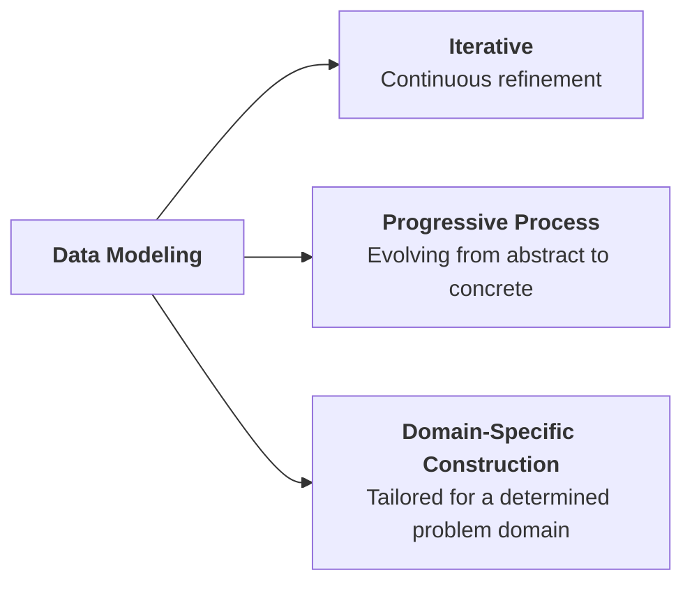

> [!info] Data Model as an Architectural Blueprint
> Just as a civil architect produces detailed architectural blueprints before laying the foundation of a modern skyscraper, a database designer authors a data model to establish a verified blueprint before creating physical tables or executing SQL DDL scripts. The data model serves as a shared communication bridge uniting non-technical business stakeholders with technical software engineers and database administrators.

### 2.1.2 The Spectrum of Semantic Data Models
Over the evolution of computing, multiple semantic data models have been developed to capture organizational reality:
1. **Relational Data Model:** Represents data in two-dimensional tabular form consisting of intersecting rows and columns.
2. **Entity-Relationship (ER) Data Model:** A visual, graphical modeling paradigm depicting entities and associations; by far the most widely adopted standard for conceptual communication during database development.
3. **Object-Based Data Model:** Integrates object-oriented programming paradigms (classes, encapsulation, methods) with data persistence.
4. **Semi-Structured Data Model:** Uses tagged, hierarchical markup (such as Extensible Markup Language - XML and JSON) to exchange flexible, self-describing datasets without rigid tabular schemas.

### 2.1.3 The Four Strategic Pillars of Data Model Importance
A data model is essential to enterprise software engineering across four foundational pillars:

```mermaid
flowchart TD
    subgraph ImportanceRoot["The Four Strategic Pillars of Data Model Importance"]
        direction TB

        subgraph P1["1. Organize Data for Diverse Stakeholders"]
            direction TB
            U1["<b>Company President</b><br/>Needs high-level, strategic global view"]
            U2["<b>Inventory Manager</b><br/>Focuses on stock levels & reorder alerts"]
            U3["<b>Purchasing Manager</b><br/>Tracks item acquisition costs & vendor pricing"]
        end

        subgraph P2["2. Serve as Universal Communication Tool"]
            direction TB
            C1["<b>Database Designer</b><br/>Translates business requirements into schemas"]
            C2["<b>Application Programmer</b><br/>Writes queries & integrates software services"]
            C3["<b>End User</b><br/>Validates operational rules & business accuracy"]
        end

        P3["<b>3. Provide Holistic Global View</b><br/>Unifies disjointed departmental data into an integrated enterprise schema"]
        P4["<b>4. Essential Abstraction for Good Design</b><br/>Acts as the verified conceptual foundation preventing costly downstream schema rework"]

        P1 --- P2 --- P3 --- P4
    end
```

---

## 2.2 Core Data Modeling Building Blocks

Every data model, regardless of its underlying paradigm, is constructed from **four foundational building blocks**:

```mermaid
flowchart TD
    subgraph BuildingBlocks["The Four Basic Building Blocks of All Data Models"]
        direction TB

        subgraph B1["1. Entities"]
            direction LR
            E_Def["<b>Unique, distinguishable object</b> used to collect & persist data"]
            E_Ex["• <b>Physical Objects:</b> CUSTOMER, PRODUCT, STUDENT, AGENT<br/>• <b>Conceptual Abstractions:</b> FLIGHT_ROUTE, CONCERT, INVOICE"]
            E_Def --- E_Ex
        end

        subgraph B2["2. Attributes"]
            direction LR
            A_Def["<b>Distinguishing characteristic</b> or property of an entity<br/>(Equivalent to fields in file systems)"]
            A_Ex["• <b>AGENT Entity Attributes:</b><br/>Agent_Code, Agent_Name, Agent_Phone, Agent_Address, Commission_Rate"]
            A_Def --- A_Ex
        end

        subgraph B3["3. Relationships"]
            direction LR
            R_Def["<b>Bidirectional associations</b> linking entities together"]
            R_Ex["• <b>One-to-Many (1:M or 1..*):</b> CUSTOMER generates INVOICE<br/>• <b>Many-to-Many (M:N or *:*):</b> STUDENT takes CLASS<br/>• <b>One-to-One (1:1 or 1..1):</b> EMPLOYEE manages STORE"]
            R_Def --- R_Ex
        end

        subgraph B4["4. Constraints"]
            direction LR
            C_Def["<b>Explicit rules and restrictions</b> ensuring data integrity"]
            C_Ex["• <b>CGPA Boundary:</b> Student CGPA must be between 0.00 and 4.00<br/>• <b>Work Hours Boundary:</b> Employee working hours must be &ge; 0.00"]
            C_Def --- C_Ex
        end

        B1 --> B2 --> B3 --> B4
    end
```

1. **Entity:** A distinct real-world physical object (e.g., `CUSTOMER`, `PRODUCT`, `STUDENT`) or conceptual event/abstraction (e.g., `FLIGHT_ROUTE`, `CONCERT`, `INVOICE`) about which an enterprise gathers and stores data.
2. **Attribute:** A specific characteristic, property, or descriptor that qualifies an entity. Directly corresponds to fields in traditional file processing.
3. **Relationship:** An active or passive association linking entities. In relational modeling, relationships are strictly **bidirectional** and are classified by their connectivity (cardinality):
   - **One-to-Many ($1:M$ or $1..\text{*}$):** One customer generates many invoices; each invoice belongs to exactly one customer.
   - **Many-to-Many ($M:N$ or $\text{*}..\text{*}$):** One student takes many classes; each class is taken by many students.
   - **One-to-One ($1:1$ or $1..1$):** One employee manages at most one store; each store is managed by exactly one employee.
4. **Constraint:** An explicit logical assertion, boundary condition, or business policy limiting allowed data values or operational associations, systematically preventing invalid entries.

---

## 2.3 Business Rules: Formulation, Governance & Structural Translation

### 2.3.1 What is a Business Rule?
A **business rule** is a brief, precise, and unambiguous statement of an organizational policy, operational procedure, or principle. It describes the main and distinguishing characteristics of the organizational data and serves as the primary mechanism for deriving the data model's building blocks.

> [!info] Operational Examples of Business Rules
> - **Relationship Rules:**
>   - *"A customer may generate many invoices; an invoice is generated by only one customer."* ($1:M$)
>   - *"A customer may rent many bicycles; each bicycle is rented by only one customer at any given time."* ($1:M$)
> - **Constraint Rules:**
>   - *"A student may register for a maximum of four academic subjects in a semester."* (Participation limit)
>   - *"A corporate training session cannot be scheduled for fewer than 10 employees or more than 20 employees."* (Capacity constraint)
>   - *"A student's CGPA must fall within the range of 0.00 to 4.00."* (Domain validation)

### 2.3.2 Sources of Business Rules
To discover and formulate comprehensive business rules, database designers examine five distinct organizational sources:

```mermaid
flowchart TD
    subgraph Sources["The Five Primary Sources of Business Rules"]
        direction TB
        S1["<b>1. Company Managers</b><br/>Strategic operational guidelines & enterprise policies"]
        S2["<b>2. Policy Makers</b><br/>Regulatory, compliance, and corporate governance standards"]
        S3["<b>3. Department Managers</b><br/>Specific day-to-day divisional workflows and accounting procedures"]
        S4["<b>4. Written Documentation</b><br/>Company handbooks, training manuals, forms, and audit checklists"]
        S5["<b>5. Direct User Interviews</b><br/>Firsthand operational insights from frontline end users"]
        
        S1 --- S2 --- S3 --- S4 --- S5
    end
```

### 2.3.3 Why Identifying Business Rules is Vital
Systematically discovering and documenting business rules achieves three critical objectives:
1. **Standardizes the Corporate View of Data:** Establishes a shared, standardized vocabulary and organizational consensus regarding what data elements mean.
2. **Serves as a Communication Bridge:** Provides an understandable, natural-language communication medium between non-technical business users and technical database engineers.
3. **Empowers the Database Designer to:**
   - Deeply understand the nature, role, scope, and operational flow of corporate data.
   - Formulate accurate relationship participation rules and cardinality bounds.
   - Construct a robust, normalized data model that mirrors real-world business activities.

### 2.3.4 Translating Natural-Language Rules into Schema Components
A database engineer translates informal business rules into formal data model structures via linguistic decomposition:

```mermaid
flowchart TD
    subgraph LinguisticTranslation["Linguistic Decomposition of Business Rules"]
        direction TB
        
        Rule["<b>Natural Language Business Rule:</b><br/>'A student may register for many subjects. Each subject may be registered by many students.'"]
        
        subgraph TranslationMechanics["Structural Mapping"]
            direction LR
            Nouns["<b>Nouns</b><br/>('Student', 'Subject')<br/>➜ <b>Entities</b>"]
            Verbs["<b>Verbs</b><br/>('Registers for', 'Registered by')<br/>➜ <b>Relationships</b>"]
            Adj["<b>Adjectives / Attributes</b><br/>('Student Name', 'Subject Code')<br/>➜ <b>Attributes</b>"]
        end

        Bidir["<b>Bidirectional Invariant:</b><br/>Every relationship must be defined in both directions (Student ➔ Subject, Subject ➔ Student)"]

        Rule --> TranslationMechanics
        TranslationMechanics --> Bidir
    end
```

### 2.3.5 Naming Conventions & Self-Documentation
Consistent, disciplined naming conventions are crucial for long-term database maintainability:
- **Entity Names:** Must use descriptive, familiar terminology in uppercase singular nouns (e.g., `STUDENT`, `STAFF`, `BOOK`, `CUSTOMER`).
- **Attribute Names:** Must clearly describe the data element, prefixed or qualified by the entity context (e.g., `STUDENT_FNAME`, `STUDENT_CGPA`, `BOOK_ISBN`, `STAFF_HIREDATE`).
- **Benefits of Rigorous Naming:**
  1. *Facilitates Cross-Team Communication:* Developers, DBAs, and analysts instantly recognize table purposes.
  2. *Promotes Self-Documentation:* Eliminates ambiguity in complex SQL queries and programmatic joins without requiring external data dictionaries.

### 2.3.6 Determining Relationship Connectivity: The Two-Question Diagnostic
To establish relationship connectivity without ambiguity, the designer poses two bidirectional questions:
1. *How many instances of Entity B relate to exactly one instance of Entity A?*
2. *How many instances of Entity A relate to exactly one instance of Entity B?*

> [!example] Diagnostic Walkthrough: Student and Class
> - **Question 1:** *How many classes can one student enroll in?*
>   - **Answer:** Many classes.
> - **Question 2:** *How many students can enroll in one class?*
>   - **Answer:** Many students.
> - **Conclusion:** The relationship between `STUDENT` and `CLASS` is **Many-to-Many ($M:N$)**. (In relational database implementations, this is realized by decomposing into two $1:M$ relationships via a composite associative entity).

---

## 2.4 Chronological Evolution of Data Models: Early Navigational Models

The evolution of data models reflects a continuous architectural journey from low-level, hardware-bound navigational systems toward high-level declarative abstractions:

```mermaid
timeline
    title Chronological Progression of Data Models
    1960s : File Systems & Early Tape Storage : Sequential records & custom 3GL processing
    Late 1960s : Hierarchical & Network Models : Segment trees & CODASYL DBTG pointer graphs
    1970s : Relational Model (E.F. Codd) : Tables, tuples, attributes & declarative SQL
    1976 : Entity-Relationship (ER) Model (Peter Chen) : Visual conceptual modeling & cardinality notations
    1985-1990s : Object-Oriented (OODM) & O/R DBMS : Encapsulated objects, inheritance & XML hybrid DBMS
    2009-Present : Big Data & NoSQL Movement : High volume, velocity & variety; schema-less distributed stores
```

---

### 2.4.1 The Hierarchical Model (Late 1960s)
Pioneered by North American Rockwell and IBM during the Apollo space program (manifested in IBM's Information Management System - IMS).
- **Structure:** Data is organized as an inverted tree consisting of **levels** or **segments** (the equivalent of a file system's record type).
- **Relational Connectivity:** Strictly models **One-to-Many ($1:M$)** relationships. Every child segment can have **exactly one parent segment**, but a parent can have multiple children.

```mermaid
flowchart TD
    subgraph HierarchicalTree["Hierarchical Tree Architecture: Pavement Management Case Study"]
        direction TB

        Parent["<b>Parent Segment:</b><br/>Pavement Improvement"]

        Child1["<b>Child Segment 1:</b><br/>Reconstruction"]
        Child2["<b>Child Segment 2:</b><br/>Maintenance"]
        Child3["<b>Child Segment 3:</b><br/>Rehabilitation"]

        SubChild1["Routine Maintenance"]
        SubChild2["Corrective Maintenance"]
        SubChild3["Preventive Maintenance"]

        Parent --> Child1 & Child2 & Child3
        Child2 --> SubChild1 & SubChild2 & SubChild3
    end
```

#### Advantages and Disadvantages of the Hierarchical Model

| Strategic Advantages | Inherent Disadvantages & Critical Flaws |
| :--- | :--- |
| **Promotes Data Sharing:** Centralized data access under a single mainframe engine. | **Physical Storage Coupling:** Requires programmers to possess deep knowledge of physical disk layouts and byte offsets. |
| **Conceptual Simplicity for 1:M:** Clear parent/child hierarchy promotes immediate data integrity for pure tree structures. | **Navigational Traversal Required:** Data retrieval relies on hardcoded pointer paths; finding a child requires traversing all ancestor segments. |
| **Centralized Database Security:** Provided and enforced directly by the DBMS layer. | **Structural Dependence:** Altering tree levels or adding segments requires modifying and recompiling every accessing 3GL program. |
| **High Efficiency for Rigid 1:M Hierarchies:** Direct physical disk pointers deliver rapid retrieval along predefined hierarchical spines. | **Severe Implementation Limitations:** Incapable of naturally representing Many-to-Many ($M:N$) associations. |
| | **Lack of Standards:** No standard Data Definition Language (DDL); implementation was strictly proprietary to vendor hardware. |

---

### 2.4.2 The Network Model (Late 1960s – 1970s)
Created by the **Conference on Data Systems Languages (CODASYL)** Database Task Group (**DBTG**) to overcome the rigid single-parent limitation of hierarchical systems.
- **Structure:** Modeled as a **directed graph** where a record type (called a **member**) can have **multiple parent record types** (called **owners**).
- **Relational Connectivity:** Directly represents both **One-to-Many ($1:M$)** and **Many-to-Many ($M:N$)** relationships.

```mermaid
flowchart TD
    subgraph NetworkGraph["Network Graph Architecture: Multi-Parent Maintenance Case Study"]
        direction TB

        Root["<b>Owner Segment:</b><br/>Preventive Maintenance"]

        Rigid["Rigid Pavement"]
        Flexible["Flexible Pavement"]

        Spall["Spall Repair"]
        Joint["Joint Seal"]
        Crack["Crack Seal"]
        Patch["Patching"]

        Silicone["<b>Member: Silicone Sealant</b><br/>(Owner: Joint Seal)"]
        Asphalt["<b>Member: Asphalt Sealant</b><br/>(Multiple Owners: Joint Seal, Crack Seal, Patching)"]

        Root --> Rigid & Flexible
        Rigid --> Spall & Joint
        Flexible --> Crack & Patch

        Joint --> Silicone
        Joint --> Asphalt
        Crack --> Asphalt
        Patch --> Asphalt
    end
```

#### Foundational Standards Introduced by the DBTG
While the network model's complex pointer graphs are rarely implemented today, the CODASYL DBTG committee established architectural concepts that remain foundational to modern database engineering:

```mermaid
flowchart TD
    subgraph StandardsArchitecture["DBTG Standard Database Concepts"]
        direction TB

        SchemaBox["<b>1. Global Schema (Sales Database System)</b><br/>Conceptual organization and structural blueprint of the entire database<br/>as viewed and managed by the Database Administrator (DBA)"]

        subgraph Subschemas["2. Subschemas (User & Application Views)"]
            direction LR
            SubA["<b>Subschema A</b><br/>(Finance Department)"]
            SubB["<b>Subschema B</b><br/>(Customer Service)"]
            SubC["<b>Subschema C</b><br/>(Employee Records)"]
        end

        SchemaBox ==>|Interacts & derives| Subschemas
    end
```

1. **Schema:** The complete conceptual organization of the entire database as viewed and administered by the Database Administrator (DBA).
2. **Subschema:** The specific portion of the database seen by a particular application program or user group (equivalent to modern views/external schemas).
3. **Data Definition Language (DDL):** Enables the DBA to define schema components, record layouts, and storage residency rules (e.g., `CREATE`, `ALTER`, `DROP`).
4. **Data Manipulation Language (DML):** Provides commands to query, insert, update, and navigate records within the database environment (e.g., `SELECT`, `INSERT`, `UPDATE`, `DELETE`).

#### Advantages and Disadvantages of the Network Model

| Strategic Advantages | Inherent Disadvantages & Limitations |
| :--- | :--- |
| **Conceptual Familiarity:** Graph structure models complex real-world interconnections. | **Physical Storage Coupling:** Requires exhaustive technical knowledge of pointer chains and physical disk addresses. |
| **Handles Complex Relationships:** Naturally accommodates $M:N$ and multi-parent structures. | **Navigational Traversal Complexity:** Writing queries requires manual navigation of linked pointer chains (record-at-a-time). |
| **Flexible Data Access:** Members can be reached from multiple owner pathways. | **High Structural Dependence:** Changing record structures requires updating all dependent application programs. |
| **Conformance to Standards:** Formalized under the CODASYL DBTG specification. | **Implementation Overhead:** Complex pointer management degrades performance as data volume expands. |
| **Formal DDL and DML Separation:** Decoupled schema definition from program manipulation. | |

---

## 2.5 The Relational Database Model & SQL Architecture

### 2.5.1 Conceptualization & Core Tenets
Pioneered by **Dr. Edgar F. Codd** of IBM in his landmark 1970 paper, the relational model revolutionized data management by establishing absolute mathematical rigor:
- Based on the formal mathematical concept of a **relation**.
- A **relation (or table)** is a two-dimensional logical structure formed by intersecting rows and columns:
  - Each horizontal row is termed a **tuple** (representing a single entity occurrence).
  - Each vertical column is termed an **attribute** (representing a specific property of the entity).
- Tables are physically independent from one another; data is not connected via physical disk pointers.

```mermaid
flowchart TD
    subgraph RelationalAnatomy["Anatomy of a Relational Table"]
        direction LR
        Rel["<b>Relation / Table</b><br/>(Two-dimensional logical structure)"]
        Rel --> Tuples["<b>Tuples / Rows</b><br/>Individual entity records"]
        Rel --> Attrs["<b>Attributes / Columns</b><br/>Specific typed properties"]
    end
```

### 2.5.2 Relational Database Management Systems (RDBMS)
An **RDBMS** is a software suite that performs all foundational database functions while hiding the physical storage and pointer complexities from end users and programmers.
- **Key Commercial & Open-Source Engines:** Oracle Database, Microsoft SQL Server, MySQL, PostgreSQL.
- **Relational Links via Common Attributes:** Tables are linked logically through shared common values rather than hardwired physical pointers.

```mermaid
erDiagram
    AGENT ||--o{ CUSTOMER : "services"

    AGENT {
        varchar AGENT_CODE PK "Primary Key (Unique Agent Identifier)"
        varchar AGENT_LNAME "Last Name"
        varchar AGENT_FNAME "First Name"
        char AGENT_INITIAL "Middle Initial"
        char AGENT_AREACODE "Area Code"
        varchar AGENT_PHONE "Phone Number"
        varchar AGENT_ADDRESS "Street Address"
        varchar AGENT_CITY "City"
        char AGENT_STATE "State"
        char AGENT_ZIP "Postal Zip Code"
        date AGENT_DATE_HIRED "Date Hired"
        decimal AGENT_YTD_PAY "Year-To-Date Pay"
        decimal AGENT_YTD_FIT "Year-To-Date Federal Tax"
        decimal AGENT_YTD_FICA "Year-To-Date Social Security"
        decimal AGENT_YTD_SLS "Year-To-Date Sales Volume"
        int AGENT_DEP "Dependents Count"
    }

    CUSTOMER {
        varchar CUS_CODE PK "Primary Key (Unique Customer Code)"
        varchar CUS_LNAME "Customer Last Name"
        varchar CUS_FNAME "Customer First Name"
        char CUS_INITIAL "Middle Initial"
        char CUS_AREACODE "Area Code"
        varchar CUS_PHONE "Customer Phone"
        char CUS_INSURE_TYPE "Insurance Policy Type"
        decimal CUS_INSURE_AMT "Policy Coverage Amount"
        date CUS_RENEW_DATE "Policy Renewal Date"
        varchar AGENT_CODE FK "Foreign Key referencing AGENT.AGENT_CODE"
    }
```

![[figure2_2_relational_diagram.jpg|Figure 2.2: A Relational Diagram (Slide 26)]]

> [!info] Operational Mechanics of Figure 2.2: A Relational Diagram
> - In table `AGENT`, `AGENT_CODE` is designated as the **Primary Key (PK)**, guaranteeing that every sales agent is uniquely identified.
> - In table `CUSTOMER`, `AGENT_CODE` appears as a **Foreign Key (FK)**.
> - By matching the common attribute value in `CUSTOMER.AGENT_CODE` with `AGENT.AGENT_CODE`, the RDBMS dynamically links each customer to their assigned agent without maintaining physical disk pointers, creating a clean $1:M$ relationship.

### 2.5.3 Three-Tier Architecture of SQL-Based Relational Applications
An SQL-based database environment operates through three integrated tiers:

```mermaid
flowchart TD
    subgraph ThreeTierSQL["Architecture of an SQL-Based Relational Application"]
        direction TB
        T1["<b>1. End-User Interface</b><br/>Graphical user interfaces, web applications & BI dashboards allowing users to interact with data"]
        T2["<b>2. Collection of Independent Tables</b><br/>Independent relational tables stored in persistent media; rows are related dynamically via common values in common attributes"]
        T3["<b>3. Declarative SQL Engine</b><br/>Parses, optimizes, and executes incoming queries; returns structured tabular result sets"]

        T1 ==>|Submits SQL Request| T3
        T3 <==>|Reads/Writes Tuples| T2
        T3 ==>|Returns Formatted Results| T1
    end
```

#### Advantages and Disadvantages of the Relational Model

| Strategic Advantages | Inherent Disadvantages & Challenges |
| :--- | :--- |
| **Structural Independence:** Independent tables permit schema alterations without breaking existing queries. | **Substantial Hardware Overhead:** Demands powerful multi-core CPUs and large RAM buffer pools to process relational joins. |
| **Conceptual Simplicity:** Tabular layout (rows and columns) is intuitive and universally understood. | **Poor Implementation by Untrained Users:** Conceptual simplicity can lead naive users to build unnormalized, flawed schemas. |
| **Declarative Ad-Hoc SQL Querying:** Eliminates procedural navigation code; users specify *what* data is needed. | **"Islands of Information" Risk:** Desktop tools (MS Access) make it easy for individual departments to spin up isolated databases. |
| **Isolates Physical Details:** Users and programmers are completely shielded from disk sectors, hashing, and indexing trees. | |
| **Management Simplicity:** Simplified schema migration and maintenance workflows. | |

---

## 2.6 The Entity-Relationship (ER) Model & Notation Systems

### 2.6.1 Foundations & Purpose
Introduced by **Peter Chen** in 1976, the **Entity-Relationship (ER) Model** serves as a graphical standard for conceptual database modeling, complementing the relational model:
- **Entity:** Represented visually as a labeled rectangle.
- **Attributes:** Properties describing the entity.
- **Relationships / Connectivity:** Visual connectors specifying associations and cardinality ($1:1$, $1:M$, $M:N$).

### 2.6.2 Master Three-Way Notation Comparison
Database engineering relies on three standardized notation dialects: **Chen Notation**, **Crow's Foot Notation**, and **UML Class Diagram Notation**.

> [!info] Slide 30 Reference Diagram: Master Three-Way ER Notation Comparison
> ![[er_model_notations_comparison.jpg|The ER Model Notations Comparison]]
> *Figure 2.3: Visual dialect comparison across One-to-Many (1:M), Many-to-Many (M:N), and One-to-One (1:1) relationship models (Slide 30).*

---

#### 2.6.2.1 Detailed Breakdown by Relationship Case

##### Case 1: One-to-Many (1:M) Relationship
> **Business Rule:** *"A PAINTER can paint many PAINTINGS; each PAINTING is painted by one PAINTER."*

- **Chen Notation (Entity Rectangles & Relationship Diamonds):**
```mermaid
flowchart LR
    PAINTER["PAINTER"] ---|1| R1{"paints"} ---|M| PAINTING["PAINTING"]
```

- **Crow's Foot Notation (Tables & Cardinality Fork Terminals):**
```mermaid
erDiagram
    PAINTER ||--|{ PAINTING : paints
```

- **UML Class Diagram Notation (Classes with Multiplicities & Directional Verbs):**
```mermaid
classDiagram
    direction LR
    class PAINTER
    class PAINTING
    PAINTER "1..1" -- "1..*" PAINTING : paints >
```

- **Structural Reading & Constraints:**
  - **PAINTER End ($1$ / $\parallel$ / `1..1`):** Exactly one painter is recorded as the creator of an individual painting.
  - **PAINTING End ($M$ / $\parallel\in$ / `1..*`):** A painter may produce multiple paintings over time.

---

##### Case 2: Many-to-Many (M:N) Relationship
> **Business Rule:** *"An EMPLOYEE can learn many SKILLS; each SKILL can be learned by many EMPLOYEES."*

- **Chen Notation (Entity Rectangles & Relationship Diamonds):**
```mermaid
flowchart LR
    EMPLOYEE["EMPLOYEE"] ---|M| R2{"learns"} ---|N| SKILL["SKILL"]
```

- **Crow's Foot Notation (Tables & Cardinality Fork Terminals):**
```mermaid
erDiagram
    EMPLOYEE }|--|{ SKILL : learns
```

- **UML Class Diagram Notation (Classes with Multiplicities & Directional Verbs):**
```mermaid
classDiagram
    direction LR
    class EMPLOYEE
    class SKILL
    EMPLOYEE "1..*" -- "1..*" SKILL : learns >
```

- **Structural Reading & Constraints:**
  - **EMPLOYEE End ($M$ / $\ni\parallel$ / `1..*`):** A given skill can be mastered by many different employees.
  - **SKILL End ($N$ / $\parallel\in$ / `1..*`):** An employee can acquire and possess multiple distinct skills.
  - *Relational Implementation Note:* In physical relational databases, direct $M:N$ relationships cannot be implemented via foreign keys alone without data redundancy. They are normalized into two $1:M$ relationships linked through a composite associative entity (e.g., `EMPLOYEE_SKILL`).

---

##### Case 3: One-to-One (1:1) Relationship
> **Business Rule:** *"An EMPLOYEE manages one STORE; each STORE is managed by one EMPLOYEE."*

- **Chen Notation (Entity Rectangles & Relationship Diamonds):**
```mermaid
flowchart LR
    EMPLOYEE["EMPLOYEE"] ---|1| R3{"manages"} ---|1| STORE["STORE"]
```

- **Crow's Foot Notation (Tables & Cardinality Fork Terminals):**
```mermaid
erDiagram
    EMPLOYEE ||--|| STORE : manages
```

- **UML Class Diagram Notation (Classes with Multiplicities & Directional Verbs):**
```mermaid
classDiagram
    direction LR
    class EMPLOYEE
    class STORE
    EMPLOYEE "1..1" -- "1..1" STORE : manages >
```

- **Structural Reading & Constraints:**
  - **EMPLOYEE End ($1$ / $\parallel$ / `1..1`):** Each store has at most one designated managing employee.
  - **STORE End ($1$ / $\parallel$ / `1..1`):** Each employee manages at most one store branch.

---

#### 2.6.2.2 Master Comparative Notation Matrix

| Design Dimension | Chen Notation | Crow's Foot Notation | UML Class Diagram Notation |
| :--- | :--- | :--- | :--- |
| **Origin & Standard** | Peter Chen (1976) | Gordon Everest / Clive Finkelstein | Rational Software (OMG Standard) |
| **Entity Representation** | Labeled single rectangular box (`[ENTITY]`) | Rectangular box with optional attribute compartments | Three-compartment class rectangle (Class Name, Attributes, Operations) |
| **Relationship Representation** | Dedicated **diamond** symbol (`{verb}`) along connecting lines | Direct line with active verb labeled above or below line | Solid association line with verb phrase and reading arrowhead (`paints ▶`) |
| **Cardinality / Multiplicity Syntax** | Numeric/letter labels on branch lines ($1$, $M$, $N$) | Graphical line endpoints: double bars ($\parallel$), crow's foot fork ($\in$), circle ($\bigcirc$) | Multiplicity range intervals at endpoints (`1..1`, `1..*`, `0..1`, `0..*`) |
| **Bidirectional Reading** | Single verb phrase centered within relationship diamond | Single verb phrase centered along association line | Supports bidirectional role descriptors (e.g., `paints ▶` / `◀ painted by`) |
| **Primary Domain / Strength** | Conceptual data modeling; emphasizes relationships as distinct first-class conceptual entities | Logical & physical database schema design; compact and directly translatable to relational tables | Object-oriented application modeling; bridges database persistence with object behavior & methods |

---

#### 2.6.2.3 Crow's Foot Cardinality Terminal Symbols Reference

| Symbol | Syntax | Connectivity Meaning | UML Multiplicity | Verbal Interpretation |
| :---: | :---: | :--- | :---: | :--- |
| ∥ | <code>&#124;&#124;</code> | Mandatory One | 1..1 (or 1) | Exactly one instance must exist |
| ◯ ∥ | <code>o&#124;</code> | Optional One | 0..1 | At most one instance (zero or one) |
| ∥∈ | <code>&#124;{</code> | Mandatory Many | 1..* | At least one, up to many instances |
| ◯ ∈ | <code>o{</code> | Optional Many | 0..* | Zero, one, or many instances |

---

### 2.6.3 Advantages and Disadvantages of the Entity-Relationship Model

| Strategic Advantages | Inherent Disadvantages & Modeling Limits |
| :--- | :--- |
| **Visual Conceptual Simplicity:** Intuitive graphical representation abstracts complex schemas. | **Limited Constraint Representation:** Cannot easily depict complex arithmetic or temporal validation constraints. |
| **Effective Communication Tool:** Bridging vehicle uniting business clients with software architects. | **Limited Relationship Nuance:** Complex multi-party (ternary/n-ary) relationships can become ambiguous. |
| **Direct Integration with Relational Schemas:** Readily translated into physical SQL tables, keys, and foreign keys. | **Loss of Information Content:** Attributes are frequently omitted from visual ERDs to prevent display crowding, masking details. |

---

## 2.7 Object-Oriented (OODM) & Extended Relational (ORDBMS) Models

### 2.7.1 The Object-Oriented Data Model (OODM)
Developed in response to increasing demands for complex data types (multimedia, CAD/CAM engineering, GIS geographic objects). OODM serves as the foundation for **Object-Oriented Database Management Systems (OODBMS)**:
- Consists of **objects** combining attributes (state), relationships, and operations/**methods** (behavior).
- Regarded as a **semantic data model** because it captures real-world meaning (**semantics**) alongside raw state.

```mermaid
classDiagram
    class Employee {
        +String name
        +String employee_num
        +String department
        +hire()
        +fire()
        +assignProject()
    }
    class Project {
        +String project_id
        +String project_name
    }
    Employee "1..*" --> "1..*" Project : works on
```

#### Key OODM Terminology
- **Class:** A collection of similar objects with shared structure (attributes) and behavior (methods) organized into a **class hierarchy**.
- **Class Hierarchy:** An inverted tree in which each subclass inherits from a single parent superclass.
- **Inheritance:** An object instance automatically inherits all methods and attributes belonging to its parent class.
- **Object Instance:** A concrete instance of a class (e.g., `Fred_Bloggs:Employee` with `name: Fred Bloggs`, `Employee #: 234609234`, `Department: Marketing`).
- **Object Identity:** Two distinct objects may possess identical attribute values while remaining distinct unique entities via system-assigned Object Identifiers (OID).

### 2.7.2 Multiplicity & Association Modeling (Slide 38)
When modeling associations in UML, designers pose diagnostic questions to establish multiplicity bounds:
- *Can a campaign exist without a member of staff to manage it?*
  - If yes, association is **optional** at the Staff end: zero or more (`0..*`).
  - If no, association is **mandatory**: one or more (`1..*`).
  - If exactly one staff member must manage it: exactly one (`1` or `1..1`).
- *Does every member of staff manage a campaign?*
  - No, so multiplicity at Campaign end is zero or more (`0..*`).

#### Multiplicity Range Syntax
- **`0..1`**: Optional (zero or one).
- **`1` or `1..1`**: Exactly one (mandatory single).
- **`0..*` or `*`**: Zero or more (optional many).
- **`1..*`**: One or more (mandatory many).
- **`2..6`**: Bounded numerical range.

### 2.7.3 Structural Comparison: OO, UML, and ER Models (Slide 39)
The three paradigms represent the same operational reality (`CUSTOMER` generates `INVOICE` with `LINE` items) using distinct structural mechanisms:

> [!info] Slide 39 Reference Diagram: Comparison of OO, UML, and ER Models
> ![[comparison_oo_uml_er.png|Structural Comparison of OO, UML, and ER Models]]
> *Figure 2.4: Architectural and structural comparison of Object Representation, UML Class Diagram, and Crow's Foot ER Model (Slide 39).*

---

#### 2.7.3.1 Paradigm Breakdown & Native Visual Models

##### 2.7.3.1.1 Object Representation (OODM Encapsulation)
In the **Object-Oriented Data Model (OODM)**, an entity is treated as an autonomous, self-contained object instance with direct internal references. Rather than using external foreign key columns to join records, relationships are embedded directly as internal object attributes or reference pointers:
- **Attributes:** Encapsulates the internal state (`INV_DATE`, `INV_NUMBER`, `INV_SHIP_DATE`, `INV_TOTAL`).
- **Single Object Reference:** Holds a direct pointer to the associated `CUSTOMER` object instance ($1$).
- **Collection Reference:** Holds an internal array or collection of embedded `LINE` item objects ($M$).

```mermaid
flowchart TB
    subgraph InvoiceObj["INVOICE Object (Encapsulated Structure)"]
        direction TB
        
        subgraph StateBox["Internal State (Attributes)"]
            direction TB
            Attrs["• <b>INV_NUMBER:</b> Integer<br/>• <b>INV_DATE:</b> Date<br/>• <b>INV_SHIP_DATE:</b> Date<br/>• <b>INV_TOTAL:</b> Double"]
        end

        subgraph RefBox["Embedded Object References"]
            direction TB
            RefC["<b>CUSTOMER [1]:</b> Direct Object Reference Pointer"]
            RefL["<b>LINE [M]:</b> Collection / Array of Line Item Objects"]
        end

        StateBox --- RefBox
    end
```

---

##### 2.7.3.1.2 UML Class Diagram (Structural & Behavioral Modeling)
The **Unified Modeling Language (UML)** depicts classes within a three-compartment structure (Name, Attributes, Operations). Relationships are modeled as typed associations with explicit multiplicity bounds and directional reading labels:
- **`CUSTOMER` to `INVOICE`:** A customer generates zero or more invoices (`0..*`), while each invoice belongs to exactly one customer (`1..1`).
- **`INVOICE` to `LINE`:** An invoice must have one or more line items (`1..*`), and each line item belongs to exactly one invoice (`1..1`).

```mermaid
classDiagram
    direction TB

    class CUSTOMER {
    }

    class INVOICE {
        +Integer INV_NUMBER
        +Date INV_DATE
        +Date INV_SHIP_DATE
        +Double INV_TOTAL
    }

    class LINE {
    }

    CUSTOMER "1..1" -- "0..*" INVOICE : generates >
    INVOICE "1..1" -- "1..*" LINE : has >
```

---

##### 2.7.3.1.3 Crow's Foot ER Model (Relational Data Modeling)
In the **Relational / Entity-Relationship (ER) Model**, independent relational tables are linked dynamically via matching values in primary and foreign keys:
- **`CUSTOMER` to `INVOICE`:** A $1:M$ relationship (`||` mandatory one on `CUSTOMER` to `o{` optional many on `INVOICE`).
- **`INVOICE` to `LINE`:** A $1:M$ relationship (`||` mandatory one on `INVOICE` to `|{` mandatory many on `LINE`).

```mermaid
erDiagram
    CUSTOMER ||--o{ INVOICE : generates
    INVOICE ||--|{ LINE : has

    INVOICE {
        int INV_NUMBER PK
        date INV_DATE
        date INV_SHIP_DATE
        double INV_TOTAL
    }
```

---

#### 2.7.3.2 Master Comparative Paradigm Matrix

| Architectural Feature | Object Representation (OODM) | UML Class Diagram | Relational / Crow's Foot ER Model |
| :--- | :--- | :--- | :--- |
| **Primary Focus** | Encapsulation of state and object behavior | Object-oriented software design & architecture | Logical & physical data normalization and storage |
| **Relationship Mechanism** | Direct memory pointers & embedded object collections | Association lines with multiplicity ranges (`1..1`, `0..*`) | Shared common values (Primary Key $\to$ Foreign Key matching) |
| **Many-to-Many Representation** | Collection attributes holding object lists | Direct $M:N$ association line (`*` to `*`) | Requires an associative composite junction table |
| **Data Normalization** | Redundant/denormalized nested structures permitted | Logical view, independent of physical normalization | Strict relational normalization to eliminate update anomalies |
| **Query Mechanism** | Navigational path traversal via pointer chaining | Programmatic API method invocations | Declarative SQL queries (Relational Algebra joins) |

#### Advantages and Disadvantages of OODM

| Strategic Advantages | Inherent Disadvantages & Roadblocks |
| :--- | :--- |
| **Rich Semantic Content:** Encapsulates business behavior directly within data objects. | **Slow Development of Standards:** Lack of a unified standard led vendors to implement proprietary engines, compromising adoption. |
| **Visual Expressiveness:** UML class diagrams convey rich inheritance and multiplicity semantics. | **Complex Navigational Retrieval:** Navigating deep object graphs creates heavy pointer-chasing overhead. |
| **Inheritance Promotes Integrity:** Eliminates duplicated attribute/method declarations across related entities. | **High System Overhead:** Complex runtime serialization severely slows high-frequency transaction throughput. |

---

### 2.7.4 The Object/Relational Model (ORDBMS) & XML
Rather than abandoning the relational standard for pure OODBMS, the database industry converged on the **Extended Relational Data Model (ERDM)**, giving rise to **Object/Relational Database Management Systems (O/R DBMS)**:
- **Core Principle:** Extends established relational engines (such as Oracle, PostgreSQL, and IBM Db2) by adding object-oriented capabilities (user-defined complex data types, inheritance, geospatial extensions) while preserving declarative SQL querying.
- **Integration with XML (Extensible Markup Language):** O/R DBMS engines natively support parsing, indexing, and querying semi-structured XML documents for data exchange across distributed web environments:

```xml
<studentsList>
  <student id="1">
    <firstName>Greg</firstName>
    <lastName>Dean</lastName>
    <certificate>True</certificate>
    <scores>
      <module1>70</module1>
      <module2>80</module2>
      <module3>90</module3>
    </scores>
  </student>
  <student id="2">
    <firstName>Wirt</firstName>
    <lastName>Wood</lastName>
    <certificate>True</certificate>
    <scores>
      <module1>80</module1>
      <module2>80.2</module2>
      <module3>80</module3>
    </scores>
  </student>
</studentsList>
```

---

## 2.8 The Big Data Era & NoSQL Database Architectures

### 2.8.1 The Big Data Phenomenon & The Three Vs
The exponential explosion of internet services, social networks, mobile devices, and IoT sensors created datasets that exceeded the operational capacity of traditional relational architectures. Big Data is characterized by **the Three Vs**:

```mermaid
flowchart LR
    BD["<b>Big Data</b>"] --> V1["<b>1. Volume</b><br/>Unprecedented quantities measuring petabytes to exabytes"]
    BD --> V2["<b>2. Velocity</b><br/>High-frequency real-time generation requiring millisecond ingestion"]
    BD --> V3["<b>3. Variety</b><br/>Multiple evolving formats: structured, semi-structured, and unstructured"]
```

#### Big Data Challenges for Conventional Systems (Slide 45)
1. **Volume Overwhelms Conventional Structures:** Relational table structures cannot scale vertically on a single server without exponential hardware costs.
2. **Extreme Financial Cost:** Scaling enterprise relational clusters across specialized hardware is cost-prohibitive.
3. **OLAP Tool Failure:** Traditional Online Analytical Processing engines proved inconsistent and brittle when processing semi-structured or unstructured sensor data.

---

### 2.8.2 Core Architectural Principles of NoSQL
**NoSQL** refers to a generation of distributed, non-relational database systems designed specifically to conquer Big Data constraints:
- **Non-Relational Storage:** Does not rely on rigid tabular relations or mathematical relational algebra.
- **Distributed Shared-Nothing Architecture:** Clusters run on low-cost commodity hardware, scaling horizontally by adding commodity nodes.
- **High Availability & Fault Tolerance:** Employs data replication across distributed nodes to guarantee zero single points of failure.
- **Sparse Data & Dynamic Schemas:** Accommodates entities with widely varying, fluctuating attributes without requiring NULL column padding.
- **Performance Over Strict Immediate Consistency:** Trades immediate ACID consistency for rapid write throughput and **eventual consistency** (the BASE model: Basically Available, Soft state, Eventual consistency).

---

### 2.8.3 Case Study: Trucks-R-Us — Relational vs. Key-Value Storage (Slide 47)
Consider a logistics trucking firm tracking driver certifications (`Driver 2732`, `Driver 2946`, `Driver 3650`).

#### 2.8.3.1 Traditional Relational Storage (Sparse Null Wastage)
| DID | CERT1 | CERT2 | CERT3 | DOB | LICTYPE |
| :---: | :---: | :---: | :---: | :---: | :---: |
| **2732** | 80 | *NULL* | 95 | 1/24/1962 | P |
| **2946** | *NULL* | 92 | *NULL* | 4/11/1970 | *NULL* |
| **3650** | 86 | *NULL* | *NULL* | 11/27/1963 | R |

- *Relational Invariants:* Each row represents one entity instance; every column represents a single declared attribute; values in a column must strictly match the declared datatype.
- *Problem:* Drivers hold different numbers and types of certifications, forcing sparse *NULL* padding that wastes physical disk storage and slows table scan speeds.

#### 2.8.3.2 NoSQL Key-Value Store Representation
In a key-value store, each row represents exactly **one attribute-value pair** for an entity instance:

| DID (Entity Key) | KEY (Attribute Descriptor) | VALUE (String Payload) |
| :---: | :--- | :--- |
| **2732** | CERT1 | 80 |
| **2732** | CERT3 | 95 |
| **2732** | DOB | 1/24/1962 |
| **2732** | LICTYPE | P |
| **2946** | CERT2 | 92 |
| **2946** | DOB | 4/11/1970 |
| **3650** | CERT1 | 86 |
| **3650** | DOB | 11/27/1963 |
| **3650** | LICTYPE | R |

- *Key-Value Mechanics:*
  1. Each row stores a single property for an entity.
  2. The `KEY` column can represent *any* arbitrary attribute name dynamically.
  3. The `VALUE` column is assigned an elastic string data type, absorbing any format.
  4. **Zero Nulls:** Missing attributes simply have no row, maximizing storage density and write throughput!

---

### 2.8.4 The Big Data Technology Ecosystem (Slide 48)
NoSQL databases operate within a wider ecosystem of distributed big data processing frameworks:

```mermaid
flowchart TD
    subgraph BigDataStack["The Big Data Distributed Processing Stack"]
        direction TB

        Core["<b>Big Data Technologies Core</b>"]
        
        HDFS["<b>Hadoop Distributed File System (HDFS)</b><br/>Distributes huge file blocks across commodity server clusters with automated replication"]
        MR["<b>MapReduce Engine</b><br/>Divides analytical computation into parallel Map and Reduce tasks across worker nodes"]
        Hadoop["<b>Apache Hadoop Ecosystem</b><br/>Open-source framework coordinating clustered distributed storage & batch processing"]
        NoSQL["<b>NoSQL Storage Engines</b><br/>Key-Value, Document, Column-Family, and Graph databases"]

        Core --- HDFS
        Core --- MR
        Core --- Hadoop
        Core --- NoSQL
    end
```

#### Advantages and Disadvantages of NoSQL

| Strategic Advantages | Inherent Disadvantages & Trade-Offs |
| :--- | :--- |
| **Extreme Scalability & Availability:** Seamless horizontal scale-out across commodity clusters. | **Complex Application Programming:** Developers must manually handle consistency, data formatting, and join logic in application code. |
| **Low-Cost Commodity Hardware:** Eliminates expensive proprietary storage area networks (SAN). | **No Native Relationship Support:** Lacks automatic foreign key cascading and relational join optimizations. |
| **Optimized for Big Data:** Handles massive volumes of unstructured sensor/web logs effortlessly. | **No ACID Transaction Integrity:** Lacks immediate ACID guarantees, introducing temporary stale reads under eventual consistency. |
| **High Storage Density:** Key-value schema-less layout eliminates sparse null padding. | |

---

## 2.9 Master Comparative Synthesis of Data Models

### 2.9.1 Chronological Evolution Matrix (Slide 50)
The evolutionary trajectory of data models tracks the expansion of **semantic expressiveness** up to the mid-1990s, followed by the pragmatic performance-driven shift of Big Data:

```mermaid
flowchart TD
    subgraph EvolutionSemantics["Evolution of Data Models vs. Semantic Expressiveness"]
        direction TB

        M1["<b>1960–1969: Hierarchical & Network (Least Semantics)</b><br/>• Structural-level dependency; record-at-a-time access<br/>• Navigational access paths predefined in physical code<br/>• Difficult to represent M:N relationships (Hierarchical)"]

        M2["<b>1970: Relational Model (E.F. Codd)</b><br/>• Conceptual simplicity & full structural independence<br/>• Set-oriented access; declarative ad-hoc SQL querying"]

        M3["<b>1976: Entity-Relationship Model (Peter Chen)</b><br/>• Easy to understand; introduces rich visual modeling semantics<br/>• Limited to conceptual design (no native physical implementation engine)"]

        M4["<b>1978–1990s: Semantic Models (OODM & Extended Relational O/R)</b><br/>• <i>1983: Internet & WWW Born</i><br/>• Maximum semantic richness: complex objects, encapsulation, inheritance, behavior<br/>• Integrated semi-structured XML for distributed data exchanges"]

        M5["<b>2009–Present: Big Data & NoSQL (Pragmatic Performance)</b><br/>• Deliberately sacrifices complex semantics to solve petabyte-scale volume/velocity<br/>• Schema-less key-value / document models optimized for large sparse distributed stores"]

        M1 ==> M2 ==> M3 ==> M4 ==> M5
    end
```

### 2.9.2 Master Terminology Comparison Across Data Models (Slide 51)
To translate concepts across database paradigms, refer to the master terminology cross-reference table below:

| Real-World Domain | Concrete Example | Traditional File Processing | Hierarchical Model | Network Model | Relational Model | Entity-Relationship (ER) | Object-Oriented (OO) Model |
| :--- | :--- | :--- | :--- | :--- | :--- | :--- | :--- |
| **A group of vendors** | Vendor filing cabinet | **File** | Segment type | Record type | **Table** | Entity set | **Class** |
| **A single vendor** | Global Supplies Inc. | **Record** | Segment occurrence | Current record | **Row (Tuple)** | Entity occurrence | **Object instance** |
| **The contact name** | Johnny Ventura | **Field** | Segment field | Record field | **Table attribute** | Entity attribute | **Object attribute** |
| **The vendor identifier** | `G12987` | **Index** | Sequence field | Record key | **Primary Key** | Entity identifier | **Object identifier (OID)** |

---

## 2.10 The ANSI/SPARC Four Levels of Data Abstraction

To manage database complexity, ensure system maintainability, and achieve data independence, database design is partitioned into four distinct levels of data abstraction, formally established by the **ANSI/SPARC (American National Standards Institute / Standards Planning and Requirements Committee)** framework:

```mermaid
flowchart TD
    subgraph ExternalLevel["1. External Model (End-User Views)"]
        direction LR
        V1["Student Registration View<br/>(Subschema / ERD)"]
        V2["Class Scheduling View<br/>(Subschema / ERD)"]
        V3["Accounting / Finance View<br/>(Subschema / ERD)"]
    end

    subgraph ConceptualLevel["2. Conceptual Model (Designer's Global View)"]
        GlobalERD["Global Conceptual Schema<br/>• Hardware-Independent<br/>• Software-Independent (DBMS-Independent)<br/>• Comprehensive Organizational Blueprint"]
    end

    subgraph InternalLevel["3. Internal Model (DBMS View)"]
        InternalSchema["Internal Relational Schema<br/>• Specific DBMS Implementation (e.g., Oracle, PostgreSQL)<br/>• Tables, Primary & Foreign Keys, Datatypes, Check Constraints<br/>• Hardware-Independent, Software-Dependent"]
    end

    subgraph PhysicalLevel["4. Physical Model (Storage Media View)"]
        PhysicalLayout["Physical Storage Layout<br/>• Disks, Tapes, NVMe SSDs<br/>• Sectors, Disk Blocks, B-Trees, Record Clustering, Access Paths<br/>• Hardware-Dependent, Software-Dependent"]
    end

    ExternalLevel -->|Integration / Synthesis| ConceptualLevel
    ConceptualLevel -->|Logical Design| InternalLevel
    InternalLevel -->|Physical Design| PhysicalLevel

    ConceptualLevel -.->|"Logical Data Independence"| InternalLevel
    InternalLevel -.->|"Physical Data Independence"| PhysicalLevel
```

---

### 2.10.1 Foundational Framework & Degrees of Abstraction Hierarchy (Slides 52–53)

Database modeling translates complex real-world enterprises into digital storage structures through four hierarchical tiers:
1. **External Model** (End-user perspective)
2. **Conceptual Model** (System designer/architect perspective)
3. **Internal Model** (Database management system / DBMS perspective)
4. **Physical Model** (Storage hardware and operating system perspective)

#### Degrees of Abstraction and Model Classifications (Slide 53)
Different database paradigms operate at varying inherent levels of abstraction:

```mermaid
flowchart TD
    subgraph AbstractionHierarchy["Degrees of Data Abstraction"]
        direction TB
        HighAbs["HIGH ABSTRACTION<br/><b>Object-Oriented Model (OODM)</b><br/>• Hardware-Independent<br/>• Software-Independent<br/>• Captures rich semantic meaning directly"]
        MedAbs["MEDIUM ABSTRACTION<br/><b>Relational Model (RDBMS)</b><br/>• Hardware-Independent<br/>• Software-Dependent<br/>• Tabular logical structure decoupled from physical pointers"]
        LowAbs["LOW ABSTRACTION<br/><b>Network & Hierarchical Models</b><br/>• Hardware-Dependent<br/>• Software-Dependent<br/>• Bound to explicit physical storage paths & disk pointers"]
        HighAbs --> MedAbs
        MedAbs --> LowAbs
    end
```

| Degree of Abstraction | Paradigm / Model | Independence Characteristics | Architectural Nature |
| :--- | :--- | :--- | :--- |
| **High** | **Object-Oriented (OODM)** | **Hardware-Independent**<br/>**Software-Independent** | Models real-world entities, attributes, methods, and class inheritance hierarchies without referencing DBMS internals or physical storage. |
| **Medium** | **Relational Model** | **Hardware-Independent**<br/>**Software-Dependent** | Isolates end-users from storage layouts through tables; dependent on relational engine capabilities (SQL dialect, table constraints). |
| **Low** | **Network & Hierarchical** | **Hardware-Dependent**<br/>**Software-Dependent** | Explicit record-at-a-time navigation; tightly coupled to specific disk structures, record pointers, and physical file locations. |

#### Architectural Data Independence Principles
- **Logical Data Independence:** The capacity to modify the internal schema (such as altering table structures, adding foreign key constraints, or changing data types) without requiring changes to the conceptual model or external user views.
- **Physical Data Independence:** The capacity to alter the physical storage structures (e.g., changing storage devices from magnetic disks to NVMe SSD arrays, re-indexing tables, or reorganizing block allocations) without impacting the internal schema, logical queries, or application logic.

---

### 2.10.2 The External Model: Tailored End-User Perspectives (Slides 54–55)

The **External Model** represents the data environment from the perspective of specific end-user groups or operational departments:
- **External Schema (Subschema):** A specific, customized representation of an external view tailored to the workflow requirements of a specific group of users.
- **Visual Representation:** Modeled using focused Entity-Relationship Diagrams (ERDs) that display only relevant entities, relationships, and business constraints while filtering out extraneous enterprise data.

#### Departmental Case Studies (Slide 55)

> [!info] Slide 55 Reference Diagram: Examples of External Models
> ![[external_models_examples.jpg|Examples of External Models (Student Registration & Class Scheduling)]]
> *Figure 2.5: Separate external models (subschemas) designed for Student Registration and Class Scheduling departments (Slide 55).*

```mermaid
erDiagram
    %% Student Registration External View
    STUDENT ||--o{ ENROLL : "enrolls in (max 6 classes)"
    "CLASS" ||--o{ ENROLL : "is taken by (capped at 35)"
    COURSE ||--o{ "CLASS" : "generates"

    STUDENT {
        string STU_NUM PK
        string STU_NAME
    }
    ENROLL {
        string CLASS_CODE FK
        string STU_NUM FK
        string ENROLL_GRADE
    }
    "CLASS" {
        string CLASS_CODE PK
        string CRS_CODE FK
        int CLASS_SEATS
    }
    COURSE {
        string CRS_CODE PK
        string CRS_TITLE
    }
```

```mermaid
erDiagram
    %% Class Scheduling External View
    ROOM ||--o{ "CLASS" : "is used for (many classes)"
    PROFESSOR ||--o{ "CLASS" : "teaches (max 3 classes)"
    COURSE ||--o{ "CLASS" : "generates"

    ROOM {
        string ROOM_CODE PK
        string ROOM_TYPE
    }
    PROFESSOR {
        int PROF_NUM PK
        string PROF_NAME
    }
    "CLASS" {
        string CLASS_CODE PK
        string ROOM_CODE FK
        int PROF_NUM FK
    }
    COURSE {
        string CRS_CODE PK
        string CRS_TITLE
    }
```

1. **Student Registration View:**
   - **Business Rules:**
     - A student may take up to six classes per registration period ($0..6$).
     - A class is limited to a maximum capacity of 35 students ($0..35$).
     - Each course generates multiple class sections.
   - **Entity Relationships:**
     - `STUDENT` $\parallel$——o{ `ENROLL` (A student enrolls in many classes via the bridge entity `ENROLL`).
     - `"CLASS"` $\parallel$——o{ `ENROLL` (A class enrollment contains many student records).
     - `COURSE` $\parallel$——o{ `"CLASS"` (A course generates one or more scheduled classes).

2. **Class Scheduling View:**
   - **Business Rules:**
     - A physical room may be used to teach many classes across different time slots.
     - Each class is taught in only one room.
     - Each class is taught by exactly one professor.
     - A professor may teach up to three classes per academic term ($0..3$).
   - **Entity Relationships:**
     - `ROOM` $\parallel$——o{ `"CLASS"` (A room is used for multiple scheduled classes).
     - `PROFESSOR` $\parallel$——o{ `"CLASS"` (A professor teaches up to three classes).
     - `COURSE` $\parallel$——o{ `"CLASS"` (A course generates scheduled class offerings).

---

### 2.10.3 The Conceptual Model: Global Organizational Blueprint & Logical Design (Slides 56–57)

The **Conceptual Model** represents a single, unified, global view of the entire database as seen by the entire organization:
- **Conceptual Schema:** The enterprise-wide specification integrating all disparate external views into a single consistent data architecture.
- **Characteristics:**
  - **Hardware-Independent and Software-Independent:** The conceptual model is completely decoupled from DBMS engine selection (Oracle, SQL Server, MySQL, PostgreSQL) and physical hardware infrastructure.
  - **Semantic Completeness:** Documents all enterprise entities, attributes, relationships, cardinality limits, and business constraints.
- **Logical Design:** The critical engineering process of discovering requirements, synthesizing departmental external schemas, resolving structural discrepancies, and assembling the unified global conceptual data model.

#### Unified Global Conceptual ERD (Slide 57)
The two separate external schemas (Student Registration and Class Scheduling) are synthesized into the enterprise conceptual model:

> [!info] Slide 57 Reference Diagram: Example of Conceptual Model
> ![[conceptual_model_global_erd.png|Example of Conceptual Model]]
> *Figure 2.6: Integrated conceptual schema combining the Student Registration and Class Scheduling external views (Slide 57).*

```mermaid
erDiagram
    STUDENT ||--o{ ENROLL : "enrolls in"
    "CLASS" ||--o{ ENROLL : "is taken by"
    PROFESSOR ||--o{ "CLASS" : "teaches"
    ROOM ||--o{ "CLASS" : "is used for"
    COURSE ||--o{ "CLASS" : "generates"

    STUDENT {
        number STU_ID PK
        string STU_LNAME
        string STU_FNAME
    }
    ENROLL {
        number CLASS_ID FK
        number STU_ID FK
        string ENROLL_GRADE
    }
    "CLASS" {
        number CLASS_ID PK
        string CRS_ID FK
        number PROF_ID FK
        string ROOM_ID FK
    }
    PROFESSOR {
        number PROF_ID PK
        string PROF_LNAME
        string PROF_FNAME
        string PROF_INITIAL
    }
    ROOM {
        string ROOM_ID PK
        string ROOM_TYPE
    }
    COURSE {
        string CRS_ID PK
        string CRS_NAME
        number CRS_CREDITS
    }
```

---

### 2.10.4 The Internal Model: DBMS Mapping & Logical Independence (Slides 58–59)

The **Internal Model** is the concrete implementation of the conceptual model mapped directly to a specific Database Management System (DBMS):
- **Internal Schema:** The database specification defined using the native structural constructs, data definition languages, and constraint syntax supported by the chosen DBMS software (e.g., Relational SQL DDL).
- **Software-Dependent:** Tightly bound to the selected DBMS software platform; switching DBMS vendors requires migrating and rewriting the internal schema.
- **Hardware-Independent:** Remains decoupled from underlying disk hardware, storage architectures, and block structures.
- **Logical Independence:** The capability to alter the internal schema (such as reorganizing tables, adding non-key columns, or defining secondary indexes) without modifying the high-level conceptual model or disrupting end-user external views.

#### SQL DDL Implementation of the Conceptual Schema (Slide 59)

The global conceptual ERD is directly translated into relational table definitions using SQL Data Definition Language (DDL):

```sql
-- 1. PROFESSOR Table Definition
CREATE TABLE PROFESSOR (
    PROF_ID       NUMBER         PRIMARY KEY,
    PROF_LNAME    CHAR(15)       NOT NULL,
    PROF_INITIAL  CHAR(1),
    PROF_FNAME    CHAR(15)       NOT NULL
);

-- 2. ROOM Table Definition
CREATE TABLE ROOM (
    ROOM_ID       CHAR(8)        PRIMARY KEY,
    ROOM_TYPE     CHAR(3)        NOT NULL
);

-- 3. COURSE Table Definition
CREATE TABLE COURSE (
    CRS_ID        CHAR(8)        PRIMARY KEY,
    CRS_NAME      CHAR(25)       NOT NULL,
    CRS_CREDITS   NUMBER         NOT NULL
);

-- 4. CLASS Table Definition with Referential Integrity Foreign Keys
CREATE TABLE CLASS (
    CLASS_ID      NUMBER         PRIMARY KEY,
    CRS_ID        CHAR(8)        REFERENCES COURSE(CRS_ID),
    PROF_ID       NUMBER         REFERENCES PROFESSOR(PROF_ID),
    ROOM_ID       CHAR(8)        REFERENCES ROOM(ROOM_ID)
);
```

```mermaid
flowchart LR
    subgraph ConceptualMapping["Conceptual-to-Internal Translation"]
        direction TB
        CERD["Conceptual Entity: PROFESSOR"] -->|DDL Translation| ISQL1["CREATE TABLE PROFESSOR (PROF_ID, ...)"]
        CERD2["Conceptual Entity: ROOM"] -->|DDL Translation| ISQL2["CREATE TABLE ROOM (ROOM_ID, ...)"]
        CERD3["Conceptual Entity: COURSE"] -->|DDL Translation| ISQL3["CREATE TABLE COURSE (CRS_ID, ...)"]
        CERD4["Conceptual Entity: CLASS<br/>+ Foreign Keys"] -->|DDL Translation| ISQL4["CREATE TABLE CLASS (CLASS_ID, CRS_ID FK, PROF_ID FK, ROOM_ID FK)"]
    end
```

---

### 2.10.5 The Physical Model: Low-Level Storage Media & Physical Independence (Slide 60)

The **Physical Model** operates at the lowest level of data abstraction:
- **Perspective:** Governs how binary data bits, records, and index structures are physically written, structured, and retrieved on persistent storage media (hard disk drives, magnetic tapes, NVMe solid-state flash memory).
- **Key Responsibilities:**
  - Defining physical storage allocations, disk blocks, sector geometry, and page file clusters.
  - Designing low-level data access methods (B+ tree indexes, hash clusters, sequential block scans).
  - Optimizing data buffer cache pools, transaction write-ahead logs (WAL), and file striping configurations.
- **Physical Independence:** Changes to physical storage media, disk controller hardware, block allocation sizing, or low-level indexing algorithms have zero impact on the internal relational schema, logical SQL queries, or end-user applications.

---

### 2.10.6 Master Summary Matrix: Levels of Data Abstraction (Slide 61)

The following master reference synthesizes the four ANSI/SPARC abstraction tiers across degree of abstraction, focus, and independence boundaries:

| Model Tier | Degree of Abstraction | Focus / Stakeholder View | Independent Of | Dependent On |
| :--- | :--- | :--- | :--- | :--- |
| **External Model** | **High** | Tailored end-user and departmental workflows | **Hardware and Software** | Specific user group operational requirements |
| **Conceptual Model** | **High** | Global enterprise view (database model independent) | **Hardware and Software** | Entire organizational business rules |
| **Internal Model** | **Medium** | Specific database model implementation (e.g., Relational SQL) | **Hardware** | **Software (DBMS Vendor)** |
| **Physical Model** | **Low** | Physical storage allocation, disk blocks, and access paths | **Neither hardware nor software** | **Both Hardware and Software** (OS & storage architecture) |

```mermaid
flowchart TD
    subgraph AbstractionSummaryFlow["ANSI/SPARC Abstraction & Independence Spectrum"]
        direction TB
        Ext["EXTERNAL MODEL<br/>• End-user departmental views<br/>• Hardware & Software Independent"]
        Con["CONCEPTUAL MODEL<br/>• Enterprise global schema<br/>• Hardware & Software Independent"]
        Int["INTERNAL MODEL<br/>• DBMS schema (SQL DDL)<br/>• Hardware Independent | Software Dependent"]
        Phy["PHYSICAL MODEL<br/>• Storage media & access methods<br/>• Hardware & Software Dependent"]

        Ext -->|Synthesis| Con
        Con -->|Logical Design| Int
        Int -->|Physical Design| Phy

        Con -.- LI["Logical Independence:<br/>Altering Internal Schema does not affect Conceptual Model"] -.- Int
        Int -.- PI["Physical Independence:<br/>Altering Storage Layout does not affect Internal Schema"] -.- Phy
    end
```

---

# Chapter 3: The Relational Database Model: Structure, Operators, and Integrity

## 3.1 Logical View of Data and Relational Table Anatomy

### 3.1.1 Logical Representation: Decoupling Logical Data from Physical Storage
Conceptualized by Dr. Edgar F. Codd at IBM in 1970, the **Relational Database Model** revolutionized data management by establishing a strict separation between the **logical view** of data and its **physical storage layout**:
- **Logical View:** Enables human designers, developers, and users to perceive and manipulate data as intuitive, two-dimensional tables (termed **Relations**) without needing any awareness of low-level disk sector geometries, memory pointers, page layouts, or physical record offsets.
- **Physical Independence:** The underlying RDBMS engine handles physical storage management, indexing, block allocation, and I/O buffer management completely behind the scenes. Application programs and ad hoc SQL queries interact solely with logical relation constructs.

```mermaid
flowchart TD
    subgraph LogicalView["Logical Layer: Relational Schema & User Perception"]
        direction TB
        R_Heading["Relation Schema / Heading: Set of (Attribute Name, Domain) Definitions"]
        subgraph RelationBody["Relation Body (Collection of Tuples / Rows)"]
            direction TB
            T1["Tuple 1: (321452, 'Bowser', 'William', 'C', '1985-02-12', 42, 'So', 2.84, 0, 'BIOL', 2134, 205)"]
            T2["Tuple 2: (324257, 'Smithson', 'Anne', 'K', '1991-11-15', 81, 'Jr', 3.27, 1, 'CIS', 2256, 222)"]
            T3["Tuple 3: (324258, 'Brewer', 'Juliette', NULL, '1979-08-23', 36, 'So', 2.26, 1, 'ACCT', 2256, 228)"]
        end
        R_Heading --> RelationBody
    end

    subgraph PhysicalView["Physical Layer: Hardware & Operating System Storage"]
        direction TB
        Blocks["Disk Data Blocks / Clustered Extents<br/>• Raw Byte Streams & Record Offsets<br/>• Internal B+ Tree Storage Pointers<br/>• WAL Transaction Logs on Flash/HDD"]
    end

    LogicalView <-->|"RDBMS Abstraction Engine<br/>(Physical Data Independence)"| PhysicalView
```

- **Relation (Table):** A perceived two-dimensional matrix of horizontal rows and vertical columns representing an entity set.
- **Tuple (Row / Record):** A single horizontal row describing an individual real-world entity instance within the relation.
- **Attribute (Column / Field):** A named vertical column describing a specific property, measurement, or characteristic of the entity.
- **Domain:** The pool of all legal, atomic values that an attribute is mathematically permitted to hold (e.g., $\text{Domain}(\text{STU\_GPA}) = [0.00, 4.00]$, $\text{Domain}(\text{STU\_CLASS}) = \{\text{'Fr'}, \text{'So'}, \text{'Jr'}, \text{'Sr'}\}$).

---

### 3.1.2 The TinyCollege STUDENT Table Case Study
To illustrate relational table anatomy, consider the foundational `STUDENT` table from the `Ch03_TinyCollege` database:

```
Database: Ch03_TinyCollege
Table:    STUDENT (8 Rows/Tuples, 12 Columns/Attributes)
```

| STU_NUM | STU_LNAME | STU_FNAME | STU_INIT | STU_DOB | STU_HRS | STU_CLASS | STU_GPA | STU_TRANSFER | DEPT_CODE | STU_PHONE | PROF_NUM |
| :---: | :--- | :--- | :---: | :---: | :---: | :---: | :---: | :---: | :---: | :---: | :---: |
| **321452** | Bowser | William | C | 02/12/1985 | 42 | So | 2.84 | 0 | BIOL | 2134 | 205 |
| **324257** | Smithson | Anne | K | 11/15/1991 | 81 | Jr | 3.27 | 1 | CIS | 2256 | 222 |
| **324258** | Brewer | Juliette | *(null)* | 08/23/1979 | 36 | So | 2.26 | 1 | ACCT | 2256 | 228 |
| **324269** | Oblonski | Walter | H | 09/16/1986 | 66 | Jr | 3.09 | 0 | CIS | 2114 | 222 |
| **324273** | Smith | John | D | 12/30/1968 | 102 | Sr | 2.11 | 1 | ENGL | 2231 | 199 |
| **324274** | Katinga | Raphael | P | 10/21/1989 | 114 | Sr | 3.15 | 0 | ACCT | 2267 | 228 |
| **324291** | Robertson | Gerald | T | 04/08/1983 | 120 | Sr | 3.87 | 0 | EDU | 2267 | 311 |
| **324299** | Smith | John | B | 11/30/1996 | 15 | Fr | 2.92 | 0 | ACCT | 2315 | 230 |

#### Comprehensive Attribute Directory
1. `STU_NUM`: Student identification number (Unique numeric identifier serving as Primary Key).
2. `STU_LNAME`: Student last name (Character string / Text).
3. `STU_FNAME`: Student first name (Character string / Text).
4. `STU_INIT`: Student middle initial (Single character; permits `null` if middle name does not exist, e.g., Juliette Brewer).
5. `STU_DOB`: Student date of birth (Date format: `MM/DD/YYYY`).
6. `STU_HRS`: Total cumulative credit hours earned (Integer numeric).
7. `STU_CLASS`: Student academic standing classification (`'Fr'` = Freshman, `'So'` = Sophomore, `'Jr'` = Junior, `'Sr'` = Senior).
8. `STU_GPA`: Cumulative grade point average (Floating-point numeric within domain $[0.00, 4.00]$).
9. `STU_TRANSFER`: Transfer status indicator (Logical boolean / binary flag: `1` = True/Transferred from another college, `0` = False/Entered directly).
10. `DEPT_CODE`: Academic department code (Short character string: `BIOL`, `CIS`, `ACCT`, `ENGL`, `EDU`).
11. `STU_PHONE`: 4-digit internal campus extension (Numeric/Character sequence, e.g., `2134`, `2256`).
12. `PROF_NUM`: Faculty identifier of the professor acting as the student's primary academic advisor (Foreign Key referencing `PROFESSOR`).

---

### 3.1.3 Entities, Entity Types, and Entity Sets
A frequent source of conceptual confusion in database engineering is the distinction among an **Entity**, an **Entity Type**, and an **Entity Set**:

```mermaid
flowchart TD
    subgraph EntityTaxonomy["Entity Terminology and Relational Equivalencies"]
        direction TB
        
        subgraph TypeLevel["1. Entity Type (Schema / Category Level)"]
            ET["<b>Entity Type:</b> A generic category or template defining a class of objects.<br/><i>RDBMS Equivalent:</i> <b>Relation Schema / Table Structure</b> (e.g. <code>Employees</code>)"]
        end

        subgraph SetLevel["2. Entity Set (Collection / Extent Level)"]
            ES["<b>Entity Set:</b> The collection of all current entity occurrences of an entity type.<br/><i>RDBMS Equivalent:</i> <b>All Rows currently stored in the Relation</b> (e.g. <code>{E1, E2, E3, E4, E5}</code>)"]
        end

        subgraph InstanceLevel["3. Entity (Instance / Tuple Level)"]
            E1["<b>Entity Occurrence (Instance):</b> A single distinct real-world object with independent existence.<br/><i>RDBMS Equivalent:</i> <b>A Single Row / Record / Tuple</b> (e.g. Row 1: Alex Smith)"]
        end

        TypeLevel --> SetLevel --> InstanceLevel
    end
```

| Concept | Conceptual / Real-World Meaning | Exact RDBMS Implementation | Concrete Enterprise Example |
| :--- | :--- | :--- | :--- |
| **Entity** | A single real-world object possessing an independent existence. | A single horizontal **tuple / row** in a table. | Row `(1, 1, 'Alex Smith', 'Admin', $90,000, 'Boulder')`. |
| **Entity Type** | A category, definition, or blueprint describing a class of entities. | The **relation name and column schema**. | The definition of `Employees(EmpId, ManagerId, Name, Department, Salary, City)`. |
| **Entity Set** | The active collection of all instances belonging to a specific entity type. | The entire **set of active rows** currently residing in the table. | The complete set of employee records $\{E_1, E_2, E_3, E_4, E_5\}$. |

---

### 3.1.4 Foundational Characteristics of a Relational Table
To qualify as a valid mathematical relation, every relational table must satisfy eight formal properties:
1. **Perceived Two-Dimensional Structure:** A relation is visually and logically represented as a grid of rows (tuples) and columns (attributes).
2. **Entity Occurrence per Row:** Each horizontal tuple represents exactly one distinct entity instance within the overall entity set.
3. **Distinct Attribute Names:** Every vertical column must have a distinct, unambiguous name within that specific relation schema.
4. **Data Type Uniformity:** All values appearing in a specific column must strictly conform to the exact same data format and data type (e.g., all values in `STU_GPA` must be numeric decimals).
5. **Atomic Cell Values:** Every intersection of a row and a column contains exactly one single (atomic) value. Multi-valued attributes (repeating groups, arrays, or embedded lists) are strictly forbidden in first normal form.
6. **Attribute Domain Constraints:** Each column possesses a predefined domain—a bounded range of valid permissible values (e.g., student GPA must fall in $[0.00, 4.00]$).
7. **Order Independence of Rows and Columns:** The physical sequence of rows and the physical order of columns are completely immaterial to the RDBMS and SQL query execution.
8. **Primary Key Requirement:** Every table must possess an identifying attribute or combination of attributes (Primary Key) that uniquely identifies each individual tuple without ambiguity.

---

### 3.1.5 Relation vs. Relvar (C.J. Date Formulation)
In formal database theory, C.J. Date established a crucial theoretical distinction between an immutable **Relation** and a mutable **Relvar (Relation Variable)**:

```mermaid
flowchart LR
    subgraph RelvarConcept["C.J. Date's Relvar Model"]
        direction TB
        Relvar["<b>Relvar (Relation Variable)</b><br/>• Named container / variable<br/>• Fixed Heading: (Attribute Name, Type)<br/>• Persists across transactions"]
        
        subgraph DynamicStates["Assigned Relation Values (States over Time)"]
            R_T0["Relation State at t₀<br/>Set of 4 tuples: {E1, E2, E3, E4}"]
            R_T1["Relation State at t₁<br/>Set of 3 tuples: {E1, E2, E3}"]
        end
        
        Relvar <-->|"Bound to at t₀"| R_T0
        Relvar -.->|"Bound to at t₁<br/>(After DELETE)"| R_T1
    end
```

- **Relvar (Relation Variable):** A persistent, named container whose state is a relation. The relvar schema (the **heading**) defines the structure and types, which remain stable over time.
- **Relation (Value):** An immutable mathematical set of tuples residing inside the relvar at any specific nanosecond. Relations cannot be altered in-place; when an `INSERT`, `UPDATE`, or `DELETE` executes, a *new relation value* is assigned to the relvar.

#### Concrete Dynamic SQL Walkthrough
Consider a relvar named `EMP`:

```sql
-- Initial state of relvar EMP (contains 4 tuples):
-- EMPNO | ENAME  | DEPTNO | SALARY
-- E1    | Lopez  | D1     | 40000
-- E2    | Cheng  | D1     | 42000
-- E3    | Finzi  | D2     | 30000
-- E4    | Saito  | D2     | 35000

DELETE FROM EMP WHERE EMPNO = 'E4';

-- Subsequent state of relvar EMP (contains 3 tuples):
-- EMPNO | ENAME  | DEPTNO | SALARY
-- E1    | Lopez  | D1     | 40000
-- E2    | Cheng  | D1     | 42000
-- E3    | Finzi  | D2     | 30000
```
*Operational Insight:* The identifier `EMP` represents the **relvar** (the container). Before the statement, `EMP` held the 4-tuple relation value; after execution, `EMP` holds an entirely new 3-tuple relation value.

---

## 3.2 Relational Keys, Determination, and Functional Dependencies

### 3.2.1 The Concept and Mathematical Foundations of Determination
The mathematical cornerstone of the relational database model is **Determination**—the state in which knowing the value of one attribute makes it possible to uniquely and unambiguously determine the value of another attribute:

> [!info] Principle of Determination
> In a relational table, attribute $A$ **determines** attribute $B$ if each value of $A$ is associated with exactly one value of $B$. 
> 
> Mathematical Notation:
> $$A \to B \quad (\text{"A functionally determines B"})$$
> - **$A$ (Determinant):** The attribute or set of attributes whose value identifies the target attribute.
> - **$B$ (Dependent):** The attribute whose value is identified or fixed by the determinant.

```mermaid
flowchart LR
    Determinant["Determinant Attribute (A)<br/>e.g. STU_NUM = 321452"] -->|"Uniquely Determines (➜)"| Dependent["Dependent Attribute (B)<br/>e.g. STU_LNAME = 'Bowser'"]
    
    style Determinant fill:#1e293b,stroke:#3b82f6,stroke-width:2px,color:#fff
    style Dependent fill:#1e293b,stroke:#10b981,stroke-width:2px,color:#fff
```

#### Operational Mechanics and Shorthand Rules
1. **Mathematical Analogy:** Consider the arithmetic equation $A - B = C$. Given the values of any two variables, the third variable is strictly determined. Similarly, in a relational table, determination reflects real-world business constraints among data properties.
2. **Multi-Attribute Dependencies:** If determinant $A$ determines multiple attributes $B, C, \text{and } D$, it is written collectively as:
   $$A \to (B, C, D)$$
   For example, in the `STUDENT` table:
   $$\text{STU\_NUM} \to (\text{STU\_FNAME}, \text{STU\_LNAME}, \text{STU\_INIT}, \text{STU\_DOB}, \text{STU\_GPA})$$
3. **Asymmetry of Determination:** Determination is strictly non-commutative. While $\text{STU\_NUM} \to \text{STU\_LNAME}$ holds true, the reverse **does not hold**:
   $$\text{STU\_LNAME} \not\to \text{STU\_NUM}$$
   Because multiple distinct students can share identical last names (e.g. John Smith and Kevin Smith), knowing only `"Smith"` does not determine a unique student number.

---

### 3.2.2 Functional Dependence vs. Full Functional Dependence

```mermaid
flowchart TD
    subgraph FunctionalDepTypes["Taxonomy of Functional Dependencies"]
        direction TB
        FD["<b>Standard Functional Dependence:</b> X → Y<br/>Every value of determinant X maps to exactly one value of dependent Y."]
        FFD["<b>Full Functional Dependence:</b> (X₁, X₂) → Y<br/>Dependent Y requires the <i>entire</i> composite determinant (X₁, X₂).<br/>No subset (X₁ → Y or X₂ → Y) can determine Y independently."]
        FD -->|When Determinant is Composite & Minimal| FFD
    end
```

> [!info] Formal Definition: Full Functional Dependence
> In a relation with a composite determinant $(A, B)$, attribute $C$ is **fully functionally dependent** on $(A, B)$ if and only if $C$ depends on the complete combination $(A, B)$ and is **not** functionally dependent on any proper subset of the determinant:
> $$(A, B) \to C \quad \text{such that} \quad A \not\to C \quad \text{and} \quad B \not\to C$$

#### Case Study 1: TinyCollege Academic Course Grades
Consider a university enrollment relation:
```
Table: Student_info(StudentID, StudentName, CampusAddress, Major, CourseID, CourseTitle, Instructor, InstructorLocation, CourseGrade)
```
- Query: *What attributes functionally determine `CourseGrade`?*
- **Analysis:**
  - $\text{StudentID} \to \text{CourseGrade}$ **Fails**: A single student takes multiple courses and receives a different grade in each course.
  - $\text{CourseID} \to \text{CourseGrade}$ **Fails**: A single course has dozens of enrolled students, each receiving different grades.
  - Joint Determinant: Only the combined pair $(\text{StudentID}, \text{CourseID})$ uniquely isolates the specific course attempt by that specific student:
    $$(\text{StudentID}, \text{CourseID}) \to \text{CourseGrade} \quad \text{[Full Functional Dependence]}$$

#### Case Study 2: Enterprise Project Tracking
Consider an engineering consultancy tracking employee hours:
```
Table: Project_Assignment(ProjectNum, ProjectName, EmployeeNum, WorkingHours)
```
- $\text{ProjectNum} \to \text{ProjectName}$ represents standard functional dependence (a project number uniquely identifies its name).
- However, for `WorkingHours`, knowing only `ProjectNum` does not indicate hours (many employees work on the project). Knowing only `EmployeeNum` does not indicate hours (an employee allocates hours across multiple projects).
- Therefore, `WorkingHours` is fully functionally dependent on the composite determinant:
  $$(\text{ProjectNum}, \text{EmployeeNum}) \to \text{WorkingHours}$$

---

### 3.2.3 Comprehensive Taxonomy of Relational Database Keys
Keys serve three vital engineering purposes in relational database management:
1. **Unique Tuple Identification:** Guarantee that every row in a table is distinctly identifiable without ambiguity.
2. **Table Relationship Establishment:** Provide common attributes across relations that serve as logical reference points.
3. **Data Integrity Enforcement:** Maintain mathematical entity and referential constraints across operations.

```mermaid
flowchart TD
    subgraph KeysConcentric["The Relational Key Hierarchy (Concentric Inclusion)"]
        direction TB
        SK["<b>Superkey (Outer Boundary)</b><br/>Any attribute or combination that uniquely identifies a row.<br/>(Contains redundant / non-essential attributes)"]
        CK["<b>Candidate Key (Minimal Boundary)</b><br/>An irreducible, minimal Superkey.<br/>(No attribute can be removed without losing uniqueness)"]
        PK["<b>Primary Key (Core Choice)</b><br/>The chosen Candidate Key selected by the designer.<br/>(Enforces Entity Integrity: Unique, strictly NOT NULL)"]
        
        SK -->|"Remove Redundancies (Minimal Subset)"| CK
        CK -->|Designated by Architect| PK
    end
```

| Key Type | Formal Mathematical Definition | Real-World Database Example | Functional Role in Schema |
| :--- | :--- | :--- | :--- |
| **Composite Key** | A key composed of two or more attributes (a multi-attribute key). Each attribute is a *key attribute*. | $(\text{COURSE\_CODE}, \text{SECTION\_ID})$ | Uniquely identifies entity instances that cannot be isolated by single attributes. |
| **Superkey** | Any set of attributes $K$ such that for any two distinct tuples $t_1, t_2$, $t_1[K] \ne t_2[K]$. Functionally determines all attributes in the row. | $(\text{STU\_NUM})$, $(\text{STU\_NUM}, \text{STU\_LNAME})$, $(\text{STU\_NUM}, \text{STU\_DOB})$ | Guarantees row uniqueness; may carry redundant attributes. |
| **Candidate Key** | A minimal (irreducible) superkey such that no proper subset of attributes is itself a superkey. Based on full functional dependency. | $\text{STU\_NUM}$, or $(\text{IC\_NUMBER})$ | Eligible candidates available for selection as Primary Key. |
| **Primary Key (PK)** | The specific candidate key chosen by the database designer to act as the primary tuple identifier. | $\underline{\text{STU\_NUM}}$ | Enforces Entity Integrity; cannot contain NULLs; uniquely indexes rows. |
| **Foreign Key (FK)** | An attribute or combination in relation $R_1$ whose values must match the PK of relation $R_2$ or be NULL. | $\text{DEPT\_CODE}$ in $\text{STUDENT}$ referencing $\text{DEPARTMENT}$ | Establishes relationships; enforces Referential Integrity. |
| **Secondary Key** | An attribute or combination used strictly for indexing and fast data retrieval; uniqueness is not required. | $(\text{CUS\_LNAME}, \text{CUS\_PHONE})$ | Accelerates search queries for users who cannot recall IDs. |

---

### 3.2.4 Real-World Case Walkthrough: The TinyCollege and Employee Key Analysis

#### The Employee Candidate Key Case Study
Consider an enterprise `EMPLOYEE` table containing legal identifiers:
```
Table: EMPLOYEE(EMPLOYEE_ID, EMPLOYEE_NAME, EMPLOYEE_DOB, EMP_ADDRESS, EMP_PASSPORT_NUM, LICENCE_NUMBER, SSN, DEPARTMENT_NUMBER)
```

```mermaid
flowchart TD
    subgraph EmployeeKeyClassification["Classification of EMPLOYEE Table Attributes"]
        direction TB
        subgraph CandidatePool["Candidate Keys (Minimal Unique Identifiers)"]
            CK1["EMPLOYEE_ID (Internal Company ID)"]
            CK2["EMP_PASSPORT_NUM (International Travel ID)"]
            CK3["LICENCE_NUMBER (State Driving ID)"]
            CK4["SSN (Social Security Number)"]
        end

        subgraph SuperkeyExamples["Superkeys (Combinations Containing a Candidate Key)"]
            SK1["(EMPLOYEE_ID, EMPLOYEE_NAME)"]
            SK2["(SSN, EMP_ADDRESS)"]
            SK3["(LICENCE_NUMBER, DEPARTMENT_NUMBER, EMPLOYEE_NAME)"]
        end

        subgraph ChosenPK["Primary Key (Selected Candidate Key)"]
            PK_Emp["<u>EMPLOYEE_ID</u>"]
        end

        CandidatePool -.->|Chosen as Primary| ChosenPK
        CandidatePool -->|Add Redundant Attrs| SuperkeyExamples
    end
```

- **Candidate Keys:** The table possesses four independent candidate keys: `EMPLOYEE_ID`, `EMP_PASSPORT_NUM`, `LICENCE_NUMBER`, and `SSN`. Each is irreducible and uniquely identifies an employee.
- **Primary Key:** The architect selects `EMPLOYEE_ID` because it is compact, numerical, under complete enterprise control, and does not expose sensitive government identifiers (like SSN) on printed reports.
- **Superkeys:** Any combination containing one of the candidate keys (e.g. `(EMPLOYEE_ID, EMPLOYEE_NAME)`) is a valid superkey. However, it is not a candidate key because `EMPLOYEE_NAME` is redundant.

---

### 3.2.5 Concept Check Exercises: Superkeys vs. Candidate Keys (With Solutions)

#### Exercise 1: Identifying Superkeys
**Scenario:** An organization maintains an employee table:
```
Table: Employee(EmployeeID, Name, Title, DepartmentID)
```
*Question:* Which of the following attribute sets are superkeys?
1. `EmployeeID`
2. `(EmployeeID, Name)`
3. `(EmployeeID, Title)`
4. `(EmployeeID, DepartmentID)`
5. `(EmployeeID, Name, DepartmentID)`

> [!tip] Solution & Operational Rationale
> **Answer: All five (1, 2, 3, 4, and 5) are Superkeys!**
> - *Rationale:* By definition, a superkey is **any** attribute combination that uniquely identifies every row. Since `EmployeeID` is unique, knowing `EmployeeID` guarantees unique identification. Appending any additional attributes (`Name`, `Title`, `DepartmentID`) preserves uniqueness, satisfying the mathematical condition of a superkey.

#### Exercise 2: Identifying Candidate Keys (Minimal Superkeys)
*Question:* For the same `Employee(EmployeeID, Name, Title, DepartmentID)` table, which of the options from Exercise 1 is a **Candidate Key**?

> [!tip] Solution & Operational Rationale
> **Answer: Only Option 1 (`EmployeeID`) is a Candidate Key!**
> - *Rationale:* A candidate key must be a **minimal** superkey. In options 2 through 5, `EmployeeID` alone suffices to identify the row; removing `Name`, `Title`, or `DepartmentID` leaves a set that is still a superkey. Therefore, options 2–5 contain unnecessary (redundant) attributes and fail the irreducibility test.

#### Exercise 3: Multiple Candidate Keys
**Scenario:** The employee table is extended to record an official Malaysian Employees Provident Fund ID (`EPF_ID`):
```
Table: Employee(EmployeeID, Name, Title, DepartmentID, EPF_ID)
```
*Question:* Assuming both `EmployeeID` and `EPF_ID` are guaranteed unique in reality, what are the candidate keys?

> [!tip] Solution & Operational Rationale
> **Answer: Both `EmployeeID` and `EPF_ID` are Candidate Keys!**
> - *Rationale:* Both attributes are minimal and uniquely identify every employee record. The database designer can choose either one as the table's Primary Key.

---

## 3.3 Relational Integrity Rules: Entity and Referential Integrity

### 3.3.1 Entity Integrity: Primary Key Requirements and Uniqueness
Relational database reliability rests upon the bedrock principle of **Entity Integrity**:

> [!info] Principle of Entity Integrity
> Entity integrity is the condition in which each row (tuple) in a relational table possesses its own unique, unmistakable identity.
> 
> **The Two Inviolable Rules of Entity Integrity:**
> 1. **Uniqueness:** All values in the Primary Key must be strictly unique across all rows in the relation ($t_1[\text{PK}] \ne t_2[\text{PK}]$ for all $t_1 \ne t_2$).
> 2. **Non-Nullability:** No key attribute composing the Primary Key can ever contain a `NULL` value ($\text{PK} \ne \text{NULL}$).

```mermaid
flowchart TD
    subgraph EntityIntegrityModel["Entity Integrity Enforcement"]
        direction TB
        PK_Col["Primary Key Column(s)<br/>(e.g., <code>STU_NUM</code>)"]
        
        subgraph Validations["Engine-Enforced Invariants"]
            V1["1. Uniqueness Guard:<br/>Rejects duplicate values on INSERT / UPDATE"]
            V2["2. NOT NULL Guard:<br/>Rejects missing, empty, or unknown values"]
        end
        
        Outcome["Guaranteed Result:<br/>Every entity instance represents a distinct, verifiable real-world object."]
        
        PK_Col --> Validations --> Outcome
    end
```

*Engineering Significance:* If a Primary Key were permitted to contain `NULL`, the database engine could neither identify that specific real-world entity nor distinguish it from other unassigned or incomplete entities.

---

### 3.3.2 Referential Integrity: Foreign Keys and Parent-Child Coordination
While Entity Integrity governs individual tables, **Referential Integrity** coordinates relationships *across* tables:

> [!info] Principle of Referential Integrity
> Referential integrity is the condition in which every reference to an entity instance by another entity instance is completely valid and consistent.
> 
> **The Referential Integrity Rule:**
> An attribute (or combination of attributes) designated as a **Foreign Key (FK)** in a child table must satisfy one of two states:
> 1. Its value must **match an existing Primary Key (PK) value** in the referenced parent table, **OR**
> 2. Its value must be explicitly **`NULL`** (indicating that the relationship is optional or not yet assigned).

```mermaid
flowchart LR
    subgraph ParentTable["Parent Table (1 Side): VENDOR"]
        direction TB
        V_PK["<u>VEND_CODE</u> (PK)<br/>• 230<br/>• 231<br/>• 232<br/>• 234<br/>• 235"]
    end

    subgraph ChildTable["Child Table (Many Side): PRODUCT"]
        direction TB
        P_FK["VEND_CODE (FK)<br/>• 232 (Matches Vendor 232)<br/>• 235 (Matches Vendor 235)<br/>• 231 (Matches Vendor 231)<br/>• 232 (Matches Vendor 232)"]
    end

    P_FK ==>|Foreign Key Reference Must Match Valid PK| V_PK
```

#### Dual Operational Objectives of Referential Integrity
1. **Preventing Invalid References:** It is entirely valid for an attribute to not have a corresponding value (assigned `NULL`), but it is mathematically impossible to point to a non-existent, invalid foreign key value.
2. **Preventing Orphan Child Records:** The RDBMS engine blocks the deletion of a row in a parent table whose primary key is currently referenced by mandatory matching foreign key values in child tables (e.g. deleting Vendor `232` is rejected while Products reference `232`).

---

### 3.3.3 The Concept of Controlled Redundancy: Why Common Attributes Make RDBMS Work
In relational theory, **data redundancy** is generally discouraged because uncontrolled duplication causes update, insertion, and deletion anomalies. However, relational databases cannot function without a specific, deliberate form of duplication termed **Controlled Redundancy**:

```mermaid
flowchart TD
    subgraph ControlledRedundancyComparison["Data Redundancy in RDBMS: Toxic vs. Controlled"]
        direction TB
        subgraph Toxic["Uncontrolled Redundancy (Anomalous)"]
            T1["Duplicating Customer Address across 50 Order Rows"]
            T2["Leads to Update Anomalies & Inconsistent Data"]
        end
        subgraph Controlled["Controlled Redundancy (Architecturally Required)"]
            C1["Repeating Foreign Key (e.g. <code>VEND_CODE</code>) across Product Rows"]
            C2["Mathematically required to link tables and establish 1:M relationships!"]
        end
    end
```

- **The Relational Link Mechanism:** Relational tables do not utilize physical memory pointers or hardwired network links to connect records. Instead, relationships are established purely through **common attributes**.
- **Case Study (Vendor and Product):** In the `PRODUCT` table, multiple records share the foreign key value `VEND_CODE = 232`. In relational terms, these repeated occurrences are **not redundant in a harmful sense**; they represent controlled redundancy required by the relational model to establish and traverse the $1:M$ relationship between `VENDOR` and `PRODUCT`.

---

### 3.3.4 Diagnosing Referential Integrity: Real-World Case Studies

#### Case Study 1: Valid vs. Violated Referential Integrity in Order Management
Consider an e-commerce database with `Customer` and `Order` tables:

**Table: Customer (PK: Cust_ID)**

| Cust_ID | Name | Address |
| :---: | :--- | :--- |
| 1 | Jon | London |
| 2 | Peter | Glasgow |
| 3 | Glen | Glasgow |

**Table: Order (PK: Order #, FK: Cust_ID)**

| Order # | Cust_ID | Validation Status |
| :---: | :---: | :--- |
| 001 | 1 | VALIDATED (Matches Cust_ID = 1 in Customer) |
| 002 | 2 | VALIDATED (Matches Cust_ID = 2 in Customer) |
| 003 | 5 | ❌ ERROR! Referential Integrity Violation (Cust_ID 5 does not exist!) |

```mermaid
flowchart LR
    subgraph OrderTable["Order Table"]
        O1["Order 001 | Cust_ID: 1"]
        O2["Order 002 | Cust_ID: 2"]
        O3["Order 003 | Cust_ID: 5"]
    end

    subgraph CustomerTable["Customer Table"]
        C1["Cust_ID: 1 (Jon)"]
        C2["Cust_ID: 2 (Peter)"]
        C3["Cust_ID: 3 (Glen)"]
    end

    O1 -->|Valid FK Match| C1
    O2 -->|Valid FK Match| C2
    O3 -.->|FAILED: Phantom Reference| Err["❌ Error: Foreign Key 5 Not Found"]
```

#### Case Study 2: Permissible NULL Foreign Keys in Customer and Agent Relations
Consider an insurance database where customers are assigned to sales agents:

**Table: CUSTOMER (PK: CUS_CODE, FK: AGENT_CODE)**

| CUS_CODE | CUS_LNAME | CUS_FNAME | AGENT_CODE | Status Analysis |
| :---: | :--- | :--- | :---: | :--- |
| 10010 | Ramas | Alfred | 502 | Valid: Matches Agent 502 in AGENT table. |
| 10011 | Dunne | Leona | 501 | Valid: Matches Agent 501 in AGENT table. |
| 10012 | Smith | Kathy | 502 | Valid: Matches Agent 502 in AGENT table. |
| 10013 | Olowski | Paul | *(null)* | Valid: Permissible NULL (No agent assigned yet). |
| 10014 | Orlando | Myron | 501 | Valid: Matches Agent 501 in AGENT table. |

**Table: AGENT (PK: AGENT_CODE)**

| AGENT_CODE | AGENT_LNAME | AGENT_PHONE |
| :---: | :--- | :--- |
| 501 | Alby | 228-1249 |
| 502 | Hahn | 682-1244 |
| 503 | Okon | 123-5689 |

> [!tip] Referential Integrity Analysis: Customer Olowski
> Customer `10013` (Paul F. Olowski) has `AGENT_CODE = NULL`. Does this violate referential integrity?
> - **NO!** Referential integrity explicitly allows foreign keys to be `NULL`. This reflects the real-world business rule that a new customer might not yet have an assigned sales representative.
> - Meanwhile, all populated `AGENT_CODE` values (`501`, `502`) match valid primary keys in `AGENT`. Hence, referential integrity is **100% satisfied**.

---

### 3.3.5 Proper Handling of Null Values: Operational Problems, Flags, and Table Constraints

#### The Nature and Dangers of Nulls
A `NULL` signifies the complete absence of a data value. It carries three distinct semantic meanings:
1. **Unknown Attribute Value:** The value exists in reality, but is currently unknown to the system (e.g. a student's GPA prior to grade submission).
2. **Known but Missing Value:** The value exists, but was omitted or uncollected during entry (e.g. an optional home telephone number).
3. **"Not Applicable" (N/A) Condition:** The attribute has no logical meaning for that specific entity (e.g. spouse name for an unmarried individual).

> [!warning] Operational Hazards of Nulls
> Excessive nulls in a relational schema typically signal flawed database design. Nulls complicate relational algebra, yield three-valued logic (`TRUE`, `FALSE`, `UNKNOWN`), and can distort aggregate calculations (e.g. `COUNT`, `AVG` ignore nulls).

#### Handling Nulls via Dummy Variable Flags
To prevent query ambiguities and allow indexing on non-nullable foreign keys, database architects frequently utilize **Flags (Dummy Values)**:

```
Table: AGENT (Using Dummy Variable Flag for Unassigned Representatives)
```

| AGENT_CODE | AGENT_AREACODE | AGENT_PHONE | AGENT_LNAME | AGENT_YTD_SLS |
| :---: | :---: | :---: | :--- | :---: |
| **-99** *(Flag)* | 000 | 000-0000 | None | $0.00 |
| **501** | 713 | 228-1249 | Alby | $132,735.75 |
| **502** | 615 | 682-1244 | Hahn | $138,967.35 |
| **503** | 615 | 123-5689 | Okon | $127,093.45 |

- When adding customer Paul Olowski (`CUS_CODE = '10013'`) without a designated representative, instead of storing a raw `NULL`, the application assigns `AGENT_CODE = '-99'`.
- Any join or reporting query immediately identifies `'-99'` as an unassigned account, avoiding null propagation bugs.

#### Column-Level Constraints in RDBMS
To enforce integrity automatically at the storage engine level, SQL schemas apply two core column constraints:
- **`NOT NULL` Constraint:** Placed on an attribute to guarantee that every single tuple in the table contains an explicit, valid value for that column (rejects any attempt to insert a `NULL`).
- **`UNIQUE` Constraint:** Enforces that no two rows can contain duplicate values for that column, even if the column is not designated as the Primary Key (e.g., placing `UNIQUE` on `EMAIL` or `EMP_PASSPORT_NUM`).

---

## 3.4 Relational Algebra and Set Operators

### 3.4.1 Theoretical Foundations of Relational Algebra and the Property of Closure
Relational algebra is a formal theoretical language consisting of a set of mathematical operations that take one or more relations as input and manipulate their contents to produce an output relation. Every relational operator satisfies the fundamental mathematical property of **Closure**:

> [!info] The Property of Closure
> The execution of any relational algebra operator (or chained sequence of operators) on existing relations always produces a **new relation** as its output.
> 
> **Architectural Significance:**
> Because the output of every operation is itself a valid relation, relational operations can be infinitely nested, cascaded, and piped into subsequent operations:
> $$\text{Output} = \pi_{\text{Attributes}}(\sigma_{\text{Condition}}(R \bowtie S))$$
> This closure property forms the mathematical foundation of SQL query composition and optimizer execution plans.

```mermaid
flowchart TD
    subgraph RelationalOperators["The Eight Core Relational Algebra Operators"]
        direction TB
        
        subgraph UnaryGroup["Unary Operators (Single Relation Input)"]
            direction LR
            Op_Sel["<b>SELECT / RESTRICT</b> (σ)<br/>Horizontal Row Filtering"]
            Op_Proj["<b>PROJECT</b> (π)<br/>Vertical Column Extraction"]
        end

        subgraph BinarySetGroup["Binary Set Operators (Requires Union-Compatibility)"]
            direction LR
            Op_Union["<b>UNION</b> (∪)<br/>Combines Rows (Set Addition)"]
            Op_Int["<b>INTERSECT</b> (∩)<br/>Shared Rows (Overlap)"]
            Op_Diff["<b>DIFFERENCE</b> (−)"]
        end

        subgraph ProductJoinGroup["Multi-Table Joining & Division"]
            direction LR
            Op_Prod["<b>PRODUCT</b> (×)<br/>Cartesian Pairing"]
            Op_Join["<b>JOIN</b> (⋈)<br/>Common-Attribute Matching"]
            Op_Div["<b>DIVIDE</b> (÷)<br/>Universal Qualification"]
        end

        UnaryGroup --> BinarySetGroup --> ProductJoinGroup
    end
```

---

### 3.4.2 Unary Operators: SELECT (Sigma) and PROJECT (Pi) Walkthroughs

#### 3.4.2.1 SELECT (or RESTRICT) ($\sigma$)
- **Mathematical Symbol:** $\sigma$ (lowercase Greek sigma).
- **Nature:** Unary horizontal filtering operator; evaluates every tuple against a logical predicate and outputs only those tuples that evaluate to `TRUE`.
- **Formal Syntax:**
  $$\sigma_{\text{Condition}}(\text{Relation})$$

##### Concrete Walkthrough: Hardware Store Inventory
Consider the baseline `PRODUCT` inventory relation:

**Table: PRODUCT**

| P_CODE | P_DESCRIPT | PRICE |
| :--- | :--- | ---: |
| 123456 | Flashlight | 5.26 |
| 123457 | Lamp | 25.15 |
| 123458 | Box Fan | 10.99 |
| 213345 | 9v battery | 1.92 |
| 254467 | 100W bulb | 1.47 |
| 311452 | Powerdrill | 34.99 |

1. **Unconditional Selection (Yields All Rows):**
   $$\sigma_{\text{TRUE}}(\text{PRODUCT})$$

   *Output Relation (All 6 Tuples):*

| P_CODE | P_DESCRIPT | PRICE |
| :--- | :--- | ---: |
| 123456 | Flashlight | 5.26 |
| 123457 | Lamp | 25.15 |
| 123458 | Box Fan | 10.99 |
| 213345 | 9v battery | 1.92 |
| 254467 | 100W bulb | 1.47 |
| 311452 | Powerdrill | 34.99 |

2. **Horizontal Value Filtering ($\text{PRICE} < 2.00$):**
   $$\sigma_{\text{PRICE} < 2.00}(\text{PRODUCT})$$

   *Output Relation (2 Tuples):*

| P_CODE | P_DESCRIPT | PRICE |
| :--- | :--- | ---: |
| 213345 | 9v battery | 1.92 |
| 254467 | 100W bulb | 1.47 |

3. **Exact Primary Key Lookup ($\text{P\_CODE} = '311452'$):**
   $$\sigma_{\text{P\_CODE} = '311452'}(\text{PRODUCT})$$

   *Output Relation (1 Tuple):*

| P_CODE | P_DESCRIPT | PRICE |
| :--- | :--- | ---: |
| 311452 | Powerdrill | 34.99 |

---

#### 3.4.2.2 PROJECT ($\pi$)
- **Mathematical Symbol:** $\pi$ (lowercase Greek pi).
- **Nature:** Unary vertical projection operator; extracts specified vertical columns from a relation and discards unrequested columns.
- **Set Characteristic:** Because relational algebra operates on pure mathematical sets, duplicate rows resulting from projection are automatically eliminated.
- **Formal Syntax:**
  $$\pi_{\text{AttributeList}}(\text{Relation})$$

##### Concrete Projections on the PRODUCT Table

1. **Single Attribute Projection ($\pi_{\text{PRICE}}(\text{PRODUCT})$):**
   $$\pi_{\text{PRICE}}(\text{PRODUCT})$$

   *Output Relation (6 Tuples, 1 Column):*

| PRICE |
| ---: |
| 5.26 |
| 25.15 |
| 10.99 |
| 1.92 |
| 1.47 |
| 34.99 |

2. **Multi-Attribute Projection ($\pi_{\text{P\_DESCRIPT, PRICE}}(\text{PRODUCT})$):**
   $$\pi_{\text{P\_DESCRIPT, PRICE}}(\text{PRODUCT})$$

   *Output Relation (6 Tuples, 2 Columns):*

| P_DESCRIPT | PRICE |
| :--- | ---: |
| Flashlight | 5.26 |
| Lamp | 25.15 |
| Box Fan | 10.99 |
| 9v battery | 1.92 |
| 100W bulb | 1.47 |
| Powerdrill | 34.99 |

3. **Chained Unary Operations (Project-over-Select):**
   Extract only the first and last name of the customer with account code `10010`:
   $$\pi_{\text{CUS\_FNAME, CUS\_LNAME}}(\sigma_{\text{CUS\_CODE} = '10010'}(\text{CUSTOMER}))$$
   *Execution Flow:* The inner $\sigma$ filters horizontally to row `10010`; the outer $\pi$ extracts only the two requested name columns.

   *Output Relation (1 Tuple, 2 Columns):*

| CUS_FNAME | CUS_LNAME |
| :--- | :--- |
| Alfred | Ramas |

---

### 3.4.3 Binary Set Operators and Union-Compatibility: UNION, INTERSECT, and DIFFERENCE

> [!important] Mandatory Prerequisite: Union-Compatibility
> Two relations $R$ and $S$ are mathematically **Union-Compatible** if and only if:
> 1. They possess the exact same degree (identical number of columns: $\text{deg}(R) = \text{deg}(S) = n$).
> 2. Corresponding columns share compatible data types and identical domains ($\text{Domain}(R.A_i) = \text{Domain}(S.B_i)$ for all $1 \le i \le n$).

```mermaid
flowchart LR
    subgraph VennOperations["Venn Representations of Set Operators"]
        direction TB
        subgraph V_Union["1. UNION (A ∪ B)"]
            direction LR
            U_Desc["All rows from A plus all rows from B.<br/>Duplicates eliminated."]
        end
        subgraph V_Intersect["2. INTERSECT (A ∩ B)"]
            direction LR
            I_Desc["Only rows appearing in BOTH A and B simultaneously."]
        end
        subgraph V_Diff["3. DIFFERENCE (A - B)"]
            direction LR
            D_Desc["Rows in Table A that DO NOT appear in Table B."]
        end
    end
```

##### Baseline Relations for Binary Set Operations
Consider two union-compatible relations, `STUDENT` and `EMPLOYEE` (both sharing schema: `FNAME`, `LNAME`):

**Table: STUDENT (5 Tuples)**

| STU_FNAME | STU_LNAME |
| :--- | :--- |
| George | Jones |
| Jane | Smith |
| Peter | Robinson |
| Franklin | Johnson |
| Martin | Lopez |

**Table: EMPLOYEE (4 Tuples)**

| EMP_FNAME | EMP_LNAME |
| :--- | :--- |
| Franklin | Lopez |
| William | Turner |
| Franklin | Johnson |
| Susan | Rogers |

---

#### 3.4.3.1 UNION ($\cup$)
- **Symbol:** $\cup$
- **Operation:** Combines all tuples from relation $R$ and relation $S$, discarding duplicates.
- **Concrete Walkthrough:**
  $$\text{STUDENT} \cup \text{EMPLOYEE}$$

  *Output Relation (8 Tuples — Duplicates Removed):*

| FNAME | LNAME |
| :--- | :--- |
| George | Jones |
| Jane | Smith |
| Peter | Robinson |
| Franklin | Johnson |
| Martin | Lopez |
| Franklin | Lopez |
| William | Turner |
| Susan | Rogers |

  *(Note: Franklin Johnson appears in both tables but is included only once because mathematical sets prohibit duplicate tuples).*

- **Non-Compatible Schema Resolution:** If `SUPPLIER` and `VENDOR` have different column counts, project compatible single-column subsets first:
  $$\pi_{\text{SUPPLIER\_NAME}}(\text{SUPPLIER}) \cup \pi_{\text{VENDOR\_NAME}}(\text{VENDOR})$$

---

#### 3.4.3.2 INTERSECT ($\cap$)
- **Symbol:** $\cap$
- **Operation:** Yields only the tuples that appear simultaneously in both relation $R$ and relation $S$.
- **Concrete Walkthrough:**
  $$\text{STUDENT} \cap \text{EMPLOYEE}$$

  *Output Relation (1 Tuple):*

| STU_FNAME | STU_LNAME |
| :--- | :--- |
| **Franklin** | **Johnson** |

*(Note: Franklin Lopez is not in the intersection because in the STUDENT table his name is Martin Lopez; only Franklin Johnson exists in both tables).*

---

#### 3.4.3.3 DIFFERENCE ($-$)
- **Symbol:** $-$
- **Operation:** Yields all tuples residing in the first relation that do not exist in the second relation ($R - S$). Note that difference is non-commutative: $R - S \ne S - R$.
- **Concrete Walkthrough (Students who are NOT Employees):**
  $$\text{STUDENT} - \text{EMPLOYEE}$$

  *Output Relation (4 Tuples):*

| STU_FNAME | STU_LNAME |
| :--- | :--- |
| George | Jones |
| Jane | Smith |
| Peter | Robinson |
| Martin | Lopez |

*(Franklin Johnson is removed because he appears in the EMPLOYEE table).*

- **Reverse Difference (Employees who are NOT Students):**
  $$\text{EMPLOYEE} - \text{STUDENT}$$

  *Output Relation (3 Tuples):*

| EMP_FNAME | EMP_LNAME |
| :--- | :--- |
| Franklin | Lopez |
| William | Turner |
| Susan | Rogers |

---

### 3.4.4 The PRODUCT (Cartesian Product) Operator Mechanics
- **Mathematical Symbol:** $\times$
- **Operation:** Pairs every tuple of Relation $R$ with every tuple of Relation $S$.
- **Cardinality & Degree Invariants:**
  $$|R \times S| = |R| \times |S| \quad \text{(Total Rows)}$$
  $$\text{deg}(R \times S) = \text{deg}(R) + \text{deg}(S) \quad \text{(Total Columns)}$$

##### Concrete Walkthrough: Hardware Products and Store Locations
Consider combining $R = \text{PRODUCT}$ (6 rows, 3 columns) with $S = \text{STORE\_LOCATIONS}$ (3 rows, 3 columns):

**Table R: PRODUCT (6 Tuples)**

| P_CODE | P_DESCRIPT | PRICE |
| :---: | :--- | ---: |
| 123456 | Flashlight | 5.26 |
| 123457 | Lamp | 25.15 |
| 123458 | Box Fan | 10.99 |
| 213345 | 9v battery | 1.92 |
| 254467 | 100W bulb | 1.47 |
| 311452 | Powerdrill | 34.99 |

**Table S: STORE_LOCATIONS (3 Tuples)**

| STORE | AISLE | SHELF |
| :---: | :---: | :---: |
| 23 | W | 5 |
| 24 | K | 9 |
| 25 | Z | 6 |

$$\text{PRODUCT} \times \text{STORE\_LOCATIONS}$$

*Result Dimensions:* $6 \times 3 = 18$ tuples; $3 + 3 = 6$ columns:

| P_CODE | P_DESCRIPT | PRICE | STORE | AISLE | SHELF |
| :---: | :--- | ---: | :---: | :---: | :---: |
| 123456 | Flashlight | 5.26 | 23 | W | 5 |
| 123456 | Flashlight | 5.26 | 24 | K | 9 |
| 123456 | Flashlight | 5.26 | 25 | Z | 6 |
| 123457 | Lamp | 25.15 | 23 | W | 5 |
| 123457 | Lamp | 25.15 | 24 | K | 9 |
| 123457 | Lamp | 25.15 | 25 | Z | 6 |
| 123458 | Box Fan | 10.99 | 23 | W | 5 |
| 123458 | Box Fan | 10.99 | 24 | K | 9 |
| 123458 | Box Fan | 10.99 | 25 | Z | 6 |
| 213345 | 9v battery | 1.92 | 23 | W | 5 |
| 213345 | 9v battery | 1.92 | 24 | K | 9 |
| 213345 | 9v battery | 1.92 | 25 | Z | 6 |
| 254467 | 100W bulb | 1.47 | 23 | W | 5 |
| 254467 | 100W bulb | 1.47 | 24 | K | 9 |
| 254467 | 100W bulb | 1.47 | 25 | Z | 6 |
| 311452 | Powerdrill | 34.99 | 23 | W | 5 |
| 311452 | Powerdrill | 34.99 | 24 | K | 9 |
| 311452 | Powerdrill | 34.99 | 25 | Z | 6 |

---

### 3.4.5 The Family of JOIN Operators: Inner vs. Outer Joins
The **JOIN** operator ($\bowtie$) links related data across tables based on common attributes without requiring manual Cartesian products:

```mermaid
flowchart TD
    subgraph JoinFamily["The Relational JOIN Taxonomy"]
        direction TB
        
        subgraph InnerJoins["1. Inner Joins (Strict Matched Records Only)"]
            direction TB
            NJ["<b>Natural Join (⋈):</b><br/>Links on common attribute names; auto-projects out duplicate join column."]
            EJ["<b>Equijoin (=):</b><br/>Links on explicit equality condition; retains duplicate join columns."]
            TJ["<b>Theta Join (⋈θ):</b><br/>Links using inequality comparison operators (<, <=, >, >=, !=)."]
        end

        subgraph OuterJoins["2. Outer Joins (Preserves Unmatched Tuples via NULLs)"]
            direction TB
            LOJ["<b>Left Outer Join:</b><br/>Preserves all left table rows; unmatched right cells = NULL."]
            ROJ["<b>Right Outer Join:</b><br/>Preserves all right table rows; unmatched left cells = NULL."]
            FOJ["<b>Full Outer Join:</b><br/>Preserves all rows from both tables; fills non-matches with NULL."]
        end

        InnerJoins <===> OuterJoins
    end
```

---

### 3.4.6 The Three-Stage Mathematical Mechanics of a Natural Join
A **Natural Join** ($\text{CUSTOMER} \bowtie \text{AGENT}$) is formally derived from three fundamental relational operators:

```mermaid
flowchart TD
    subgraph NaturalJoin3Steps["The Three-Stage Natural Join Pipeline"]
        direction TB
        S1["<b>Stage 1: Cartesian Product (×)</b><br/>Generate full pairing of all tuples: <code>CUSTOMER × AGENT</code> (24 rows)"]
        S2["<b>Stage 2: Equality Selection (σ)</b><br/>Filter pairs matching on the common key: <code>σ(CUSTOMER.AGENT_CODE = AGENT.AGENT_CODE)</code> (5 rows)"]
        S3["<b>Stage 3: Vertical Projection (π)</b><br/>Project out redundant join column, preserving a single copy of <code>AGENT_CODE</code>"]
        S1 --> S2 --> S3
    end
```

#### Step-by-Step Data Walkthrough
Consider the input tables:

**Table: CUSTOMER (6 Tuples)**

| CUS_CODE | CUS_LNAME | CUS_ZIP | AGENT_CODE |
| :---: | :--- | :---: | :---: |
| 1132445 | Walker | 32145 | 231 |
| 1217782 | Adares | 32145 | 125 |
| 1312243 | Rakowski | 34129 | 167 |
| 1321242 | Rodriguez | 37134 | 125 |
| 1542311 | Smithson | 37134 | 421 |
| 1657399 | Vanloo | 32145 | 231 |

**Table: AGENT (4 Tuples)**

| AGENT_CODE | AGENT_PHONE |
| :---: | :---: |
| 125 | 6152439887 |
| 167 | 6153426778 |
| 231 | 6152431124 |
| 333 | 9041234445 |

1. **Stage 1 (Cartesian Product $\text{CUSTOMER} \times \text{AGENT}$):**
   Yields $6 \times 4 = 24$ rows and 6 columns (`CUS_CODE, CUS_LNAME, CUS_ZIP, CUSTOMER.AGENT_CODE, AGENT.AGENT_CODE, AGENT_PHONE`).
2. **Stage 2 (Selection on Equality):**
   Execute $\sigma_{\text{CUSTOMER.AGENT\_CODE = AGENT.AGENT\_CODE}}(\text{CUSTOMER} \times \text{AGENT})$.
   Yields 5 matching rows, but retains **both** `CUSTOMER.AGENT_CODE` and `AGENT.AGENT_CODE`.
3. **Stage 3 (Projection to Eliminate Redundant Column):**
   The final Natural Join output contains 5 rows and 5 columns:

| CUS_CODE | CUS_LNAME | CUS_ZIP | AGENT_CODE | AGENT_PHONE |
| :---: | :--- | :---: | :---: | :---: |
| 1217782 | Adares | 32145 | 125 | 6152439887 |
| 1321242 | Rodriguez | 37134 | 125 | 6152439887 |
| 1312243 | Rakowski | 34129 | 167 | 6153426778 |
| 1132445 | Walker | 32145 | 231 | 6152431124 |
| 1657399 | Vanloo | 32145 | 231 | 6152431124 |

*(Note: Customer Smithson with `AGENT_CODE = 421` and Agent `333` are both discarded because they have no matching partner).*

---

### 3.4.7 EQUIJOIN and THETA JOIN Comparisons
- **Equijoin:** Links tables strictly on the basis of an equality condition (`=`) comparing specified columns.
  - *Distinction from Natural Join:* An equijoin **does not eliminate duplicate columns**. Its output is structurally identical to **Stage 2** of the Natural Join pipeline.
- **Theta Join ($\bowtie_\theta$):** Links tables using inequality comparison operators ($<, \le, >, \ge, \ne$) in the join predicate.
  - *Example:* Linking an employee salary to a pay-grade bracket table where $\text{EMP\_SALARY} \ge \text{MIN\_SALARY} \land \text{EMP\_SALARY} \le \text{MAX\_SALARY}$.

---

### 3.4.8 OUTER JOINS for Diagnosing Referential Integrity Anomalies

> [!important] Outer Joins as Diagnostic Audit Tools
> While an Inner Join silently discards non-matching rows, an **Outer Join** retains unmatched rows and populates the missing side with `NULL`. This provides an invaluable mechanism for database administrators to detect orphaned records and referential integrity violations.

```mermaid
flowchart TD
    subgraph OuterJoinDiagnostics["Diagnosing Schema Anomalies with Outer Joins"]
        direction TB
        LOJ["<b>LEFT OUTER JOIN:</b><br/>Preserves all Customer rows.<br/>Unmatched Agent columns = NULL.<br/>➜ <i>Diagnoses invalid FKs or unassigned reps!</i>"]
        ROJ["<b>RIGHT OUTER JOIN:</b><br/>Preserves all Agent rows.<br/>Unmatched Customer columns = NULL.<br/>➜ <i>Diagnoses idle agents with 0 accounts!</i>"]
    end
```

#### 3.4.8.1 LEFT OUTER JOIN Walkthrough ($\text{CUSTOMER} \ \text{LEFT JOIN} \ \text{AGENT}$)
Preserves all 6 rows from `CUSTOMER`:

| CUS_CODE | CUS_LNAME | CUS_ZIP | CUS.AGENT_CODE | AGENT.AGENT_CODE | AGENT_PHONE | Diagnostic Analysis |
| :---: | :--- | :---: | :---: | :---: | :---: | :--- |
| 1217782 | Adares | 32145 | 125 | 125 | 6152439887 | Matched |
| 1321242 | Rodriguez | 37134 | 125 | 125 | 6152439887 | Matched |
| 1312243 | Rakowski | 34129 | 167 | 167 | 6153426778 | Matched |
| 1132445 | Walker | 32145 | 231 | 231 | 6152431124 | Matched |
| 1657399 | Vanloo | 32145 | 231 | 231 | 6152431124 | Matched |
| **1542311** | Smithson | 37134 | **421** | *(null)* | *(null)* | ⚠️ **Anomaly: Refers to non-existent agent 421!** |

#### 3.4.8.2 RIGHT OUTER JOIN Walkthrough ($\text{CUSTOMER} \ \text{RIGHT JOIN} \ \text{AGENT}$)
Preserves all 4 rows from `AGENT`:

| CUS_CODE | CUS_LNAME | CUS_ZIP | CUS.AGENT_CODE | AGENT.AGENT_CODE | AGENT_PHONE | Diagnostic Analysis |
| :---: | :--- | :---: | :---: | :---: | :---: | :--- |
| 1217782 | Adares | 32145 | 125 | 125 | 6152439887 | Matched |
| 1321242 | Rodriguez | 37134 | 125 | 125 | 6152439887 | Matched |
| 1312243 | Rakowski | 34129 | 167 | 167 | 6153426778 | Matched |
| 1132445 | Walker | 32145 | 231 | 231 | 6152431124 | Matched |
| 1657399 | Vanloo | 32145 | 231 | 231 | 6152431124 | Matched |
| *(null)* | *(null)* | *(null)* | *(null)* | **333** | 9041234445 | ℹ️ **Operational Fact: Agent 333 has no customers.** |

---

### 3.4.9 The DIVIDE Operator (Division) and Universal Qualification Queries
- **Mathematical Symbol:** $\div$
- **Input:** Operates on a 2-column table $R(A, B)$ (the **Dividend**) and a 1-column table $S(B)$ (the **Divisor**), where column $B$ is common to both.
- **Output:** A single-column relation containing all values of column $A$ that are paired with **every single value** present in divisor $S$.
- **Real-World Purpose:** Solves "Universal Qualification" ("Find entities associated with **ALL** instances of...") queries.

```mermaid
flowchart LR
    Dividend["Dividend Table R(A, B)<br/>Student | Task"] --> DivOp["DIVIDE (÷)"]
    Divisor["Divisor Table S(B)<br/>Task (Target Requirements)"] --> DivOp
    DivOp --> Result["Result Table (A)<br/>Students who completed ALL target tasks!"]
```

#### Case Study: University Project Completion
Consider determining which students have completed **all** assigned Database project tasks:

**Table R: Completed (Dividend)**

| Student | Task | Notes |
| :--- | :--- | :--- |
| Fred | Database1 | ✔ Completed |
| Fred | Database2 | ✔ Completed |
| Fred | Compiler1 | |
| Eugene | Database1 | ✔ Completed (Missing Database2!) |
| Eugene | Compiler1 | |
| Sarah | Database1 | ✔ Completed |
| Sarah | Database2 | ✔ Completed |

**Table S: DBProject (Divisor)**

| Task |
| :--- |
| Database1 |
| Database2 |

$$\text{Completed} \div \text{DBProject}$$

*Output Relation:*

| Student | Qualification Analysis |
| :--- | :--- |
| **Fred** | Completed both `Database1` and `Database2` (Included). |
| **Sarah** | Completed both `Database1` and `Database2` (Included). |

*(Eugene is disqualified because he only completed `Database1` and is missing `Database2`).*

---

## 3.5 Data Dictionaries, Catalogs, and Relationship Implementation

### 3.5.1 The Data Dictionary: "The Database Designer's Database"
A **Data Dictionary** is a specialized metadata repository created and maintained by database designers to document, record, and communicate architectural decisions regarding all relations, attributes, types, and constraints across the system:

```mermaid
flowchart TD
    subgraph DataDictionaryRole["Operational Role of the Data Dictionary"]
        direction TB
        DD["<b>Data Dictionary (Metadata Repository)</b><br/>• Exact Attribute Names & Logical Descriptions<br/>• Storage Data Types, Formats, and Domain Ranges<br/>• Mandatory Status (NOT NULL Requirements)<br/>• Primary and Foreign Key Designations"]
        
        Dev["Application Engineers<br/>(Write correct SQL schemas)"]
        DBA["Database Administrators<br/>(Optimize indexes & enforce security)"]
        User["Business Analysts<br/>(Understand entity attributes)"]
        
        DD --> Dev
        DD --> DBA
        DD --> User
    end
```

#### Detailed Case Study: Sample Enterprise Data Dictionary
The following comprehensive data dictionary documents the `CUSTOMER` and `AGENT` relations from the `Ch03_InsureCo` database:

**Table 3.6: A Comprehensive Sample Data Dictionary**

| Table Name | Attribute Name | Contents / Meaning | Data Type | Storage Format | Range / Domain | Required? | Key Type | FK Referenced Table |
| :--- | :--- | :--- | :--- | :--- | :--- | :---: | :---: | :--- |
| **CUSTOMER** | `CUS_CODE` | Customer account code | `CHAR(5)` | `99999` | 10000–99999 | **Y** | **PK** | — |
| **CUSTOMER** | `CUS_LNAME` | Customer last name | `VARCHAR(20)` | `Xxxxxxxx` | — | **Y** | — | — |
| **CUSTOMER** | `CUS_FNAME` | Customer first name | `VARCHAR(20)` | `Xxxxxxxx` | — | **Y** | — | — |
| **CUSTOMER** | `CUS_INITIAL` | Customer middle initial | `CHAR(1)` | `X` | — | N | — | — |
| **CUSTOMER** | `CUS_RENEW_DATE` | Insurance policy renewal date | `DATE` | `dd-mmm-yyyy` | — | N | — | — |
| **CUSTOMER** | `AGENT_CODE` | Assigned sales agent code | `CHAR(3)` | `999` | — | N | **FK** | `AGENT` |
| **AGENT** | `AGENT_CODE` | Agent identification code | `CHAR(3)` | `999` | — | **Y** | **PK** | — |
| **AGENT** | `AGENT_AREACODE` | Telephone area code | `CHAR(3)` | `999` | — | **Y** | — | — |
| **AGENT** | `AGENT_PHONE` | Direct phone number | `CHAR(8)` | `999-9999` | — | **Y** | — | — |
| **AGENT** | `AGENT_LNAME` | Agent last name | `VARCHAR(20)` | `Xxxxxxxx` | — | **Y** | — | — |
| **AGENT** | `AGENT_YTD_SLS` | Year-to-date sales total | `NUMBER(9,2)`| `9,999,999.99`| — | N | — | — |

> [!info] Data Type Implementation Standards
> - **`CHAR(n)`:** Fixed-length character string (1–255 characters). Unused character slots are padded with trailing spaces.
> - **`VARCHAR(n)`:** Variable-length character string (1–2,000+ characters). Allocates only the physical bytes needed for the actual string length.
> - **`NUMBER(p, s)`:** Fixed-point numeric storage where $p$ is total precision (total digits) and $s$ is scale (digits to the right of the decimal). E.g., `NUMBER(9,2)` stores values up to `9,999,999.99`. Some enterprise systems support native `CURRENCY` or `MONEY` types.

---

### 3.5.2 The System Catalog: Structural and Environmental Metadata
While a Data Dictionary is typically author-facing and design-centric, the **System Catalog** is an active, dynamic internal repository managed automatically by the RDBMS engine itself:
- **Scope:** Contains environmental, operational, and structural metadata detailing all database objects:
  - Physical relation names, owners, and creation timestamps.
  - Number of columns and storage page allocations.
  - Active index structures, B+ tree depths, and clustering keys.
  - User authorization tables, passwords, role access privileges, and execution statistics.
- **Relational Accessibility:** In compliance with Dr. Codd's Rule 4, the system catalog is stored as ordinary relational tables that can be queried by authorized administrators using standard SQL:
  ```sql
  SELECT table_name, num_rows, blocks 
  FROM user_tables;
  ```

---

### 3.5.3 Resolving Semantic Confusion: Homonyms and Synonyms
The data dictionary serves as the central architectural authority to eradicate semantic naming anomalies that degrade database maintainability:

```mermaid
flowchart LR
    subgraph SemanticPitfalls["Semantic Naming Anomalies in Schema Design"]
        direction TB
        
        subgraph HomonymBox["1. Homonym (Same Name, Different Things)"]
            H1["Attribute name <code>NAME</code> used for Customer Name and Consultant Name."]
            H_Fix["<b>Resolution:</b> Prefix with Entity Context ➜ <code>CUS_NAME</code>, <code>CONS_NAME</code>"]
            H1 --> H_Fix
        end

        subgraph SynonymBox["2. Synonym (Different Names, Same Thing)"]
            S1["Attribute <code>CAR_ID</code> in Vehicle table vs. <code>AUTO_NO</code> in Policy table."]
            S_Fix["<b>Resolution:</b> Standardize onto single Enterprise Term ➜ <code>VEHICLE_VIN</code>"]
            S1 --> S_Fix
        end
    end
```

- **Homonym:** Occurs when the **exact same attribute name** is used to represent entirely different entities or concepts (e.g. using `C_NAME` to store both customer names and consultant names). 
  - *Architectural Fix:* Qualify attribute names unambiguously with entity-specific prefixes (e.g., `CUS_NAME` vs. `CONS_NAME`).
- **Synonym:** Occurs when **different attribute names** are used to describe the exact same real-world characteristic (e.g., using `car_code`, `auto_no`, and `vehicle_id` across different modules).
  - *Architectural Fix:* Standardize attribute terminology across the enterprise system into a single canonical dictionary definition.

---

### 3.5.4 Implementing 1:M Relationships: The Painter and Painting Case Study
The **$1:M$ (One-to-Many) Relationship** is the architectural standard and workhorse of the relational database model:
- **Implementation Rule:** To implement a $1:M$ relationship, the Primary Key of the table on the **"1" side** is placed as a Foreign Key in the table on the **"many" side**.

```mermaid
flowchart LR
    subgraph OneSide["'1' Side: PAINTER"]
        direction TB
        P_PK["<u>PAINTER_NUM</u> (PK)<br/>• 123 (Ross, Georgette)<br/>• 126 (Itero, Julio)"]
    end

    subgraph ManySide["'Many' Side: PAINTING"]
        direction TB
        P_Row1["Painting 1338: Dawn Thunder (FK: 123)"]
        P_Row2["Painting 1339: Vanilla Roses (FK: 123)"]
        P_Row3["Painting 1340: Tired Flounders (FK: 126)"]
        P_Row4["Painting 1341: Hasty Exit (FK: 123)"]
        P_Row5["Painting 1342: Plastic Paradise (FK: 126)"]
    end

    ManySide ==>|Foreign Key: PAINTER_NUM| OneSide
```

#### Schema and Table Data (TinyCollege Museum Database)

**Table: PAINTER (PK: PAINTER_NUM, FK: none)**

| PAINTER_NUM | PAINTER_LNAME | PAINTER_FNAME | PAINTER_INITIAL |
| :---: | :--- | :--- | :---: |
| 123 | Ross | Georgette | P |
| 126 | Itero | Julio | G |

**Table: PAINTING (PK: PAINTING_NUM, FK: PAINTER_NUM)**

| PAINTING_NUM | PAINTING_TITLE | PAINTER_NUM |
| :---: | :--- | :---: |
| 1338 | Dawn Thunder | 123 |
| 1339 | Vanilla Roses To Nowhere | 123 |
| 1340 | Tired Flounders | 126 |
| 1341 | Hasty Exit | 123 |
| 1342 | Plastic Paradise | 126 |

*Operational Analysis:* One painter creates many paintings. Each individual painting is created by exactly one painter. The foreign key `PAINTER_NUM` in `PAINTING` enforces referential integrity back to `PAINTER`.

---

### 3.5.5 Implementing 1:1 Relationships: The Professor and Department Null-Minimization Principle
A **$1:1$ (One-to-One) Relationship** indicates that one entity instance is associated with exactly one instance of another entity:
- **Architectural Scarcity:** Genuine $1:1$ relationships are rare in relational schemas; frequently, two entities in a $1:1$ relationship are merged into a single table.
- **Design Dilemma:** When two tables are required (e.g. `PROFESSOR` and `DEPARTMENT`), the designer must decide **which table should receive the Foreign Key**.

> [!tip] The Golden Rule of 1:1 Implementation: Null Minimization
> Always place the Foreign Key into the table that **minimizes the occurrence of NULL values**!

```mermaid
flowchart TD
    subgraph OptionComparison["Evaluating FK Placement for 1:1 PROFESSOR chairs DEPARTMENT"]
        direction TB
        
        subgraph FlawedOption["Option A: Place DEPT_CODE (FK) into PROFESSOR Table (FLAWED)"]
            direction TB
            F1["TinyCollege employs 300 professors."]
            F2["Only 10 professors serve as Department Chairs."]
            F3["➜ <b>Result:</b> 290 professor records contain NULL in DEPT_CODE! (Massive waste & null clutter)"]
            F1 --> F2 --> F3
        end

        subgraph OptimalOption["Option B: Place EMP_NUM (FK) into DEPARTMENT Table (OPTIMAL)"]
            direction TB
            O1["TinyCollege operates 10 academic departments."]
            O2["Every single department has exactly one chair."]
            O3["➜ <b>Result:</b> ZERO NULL values across all rows in DEPARTMENT!"]
            O1 --> O2 --> O3
        end
    end
```

#### Optimal Implementation Schema
```sql
-- Table DEPARTMENT contains foreign key EMP_NUM referencing PROFESSOR:
CREATE TABLE DEPARTMENT (
    DEPT_CODE       VARCHAR(10) PRIMARY KEY,
    DEPT_NAME       VARCHAR(50) NOT NULL,
    SCHOOL_CODE     VARCHAR(10),
    EMP_NUM         INT UNIQUE, -- Foreign Key to PROFESSOR (1:1 enforced by UNIQUE)
    DEPT_ADDRESS    VARCHAR(50),
    DEPT_EXTENSION  CHAR(4),
    FOREIGN KEY (EMP_NUM) REFERENCES PROFESSOR(EMP_NUM)
);
```
*Result:* Placing `EMP_NUM` in `DEPARTMENT` guarantees 100% data density and completely eradicates null pollution.

---

### 3.5.6 Resolving M:N Relationships: Bridge Entities and Composite Keys
The relational model **cannot directly implement an $M:N$ (Many-to-Many) relationship** between two tables because doing so would require multi-valued attributes or repeating foreign key groups, violating First Normal Form ($1\text{NF}$).

```mermaid
flowchart LR
    subgraph ConceptualMN["Conceptual Phase: Direct M:N Relationship (Unsupported)"]
        STUDENT["STUDENT"] <===>|M:N| CLASS["CLASS"]
    end

    subgraph RelationalDecomposition["Logical Phase: Decomposed into Two 1:M Relationships"]
        direction LR
        S["STUDENT<br/><u>STU_NUM</u>"] -->|1:M| E["ENROLL (Bridge Entity)<br/><u>CLASS_CODE, STU_NUM</u><br/>ENROLL_GRADE"]
        C["CLASS<br/><u>CLASS_CODE</u>"] -->|1:M| E
    end

    ConceptualMN ==>|Decompose via Bridge Entity| RelationalDecomposition
```

#### The Bridge Entity Protocol (Composite / Associative Entity)
To implement an $M:N$ relationship:
1. Decompose the $M:N$ relationship into **two distinct $1:M$ relationships**.
2. Create an intermediate **Bridge Entity** (also termed a **Composite Entity** or **Associative Entity**), such as `ENROLL`.
3. The Primary Key of the bridge entity is a **Composite Primary Key** formed by combining the Primary Keys of the two parent tables:
   $$\text{PK}(\text{ENROLL}) = (\text{CLASS\_CODE}, \text{STU\_NUM})$$
4. Each component of the composite primary key simultaneously operates as a **Foreign Key** referencing its respective parent table.
5. The bridge entity can host additional descriptive payload attributes describing the transaction (e.g., `ENROLL_GRADE`, `ENROLL_DATE`).

#### Concrete Data Walkthrough: Student Enrollment

**Table: STUDENT (PK: STU_NUM)**

| STU_NUM | STU_LNAME |
| :---: | :--- |
| 321452 | Bowser |
| 324257 | Smithson |

**Table: CLASS (PK: CLASS_CODE)**

| CLASS_CODE | CRS_CODE | CLASS_SECTION | CLASS_TIME | CLASS_ROOM | PROF_NUM |
| :---: | :--- | :---: | :--- | :--- | :---: |
| 10014 | ACCT-211 | 3 | TTh 2:30-3:45 p.m. | BUS252 | 342 |
| 10018 | CIS-220 | 2 | MWF 9:00-9:50 a.m. | KLR211 | 114 |
| 10021 | QM-261 | 1 | MWF 8:00-8:50 a.m. | KLR200 | 114 |

**Table: ENROLL (Bridge Entity; Composite PK: CLASS_CODE + STU_NUM; FKs: CLASS_CODE, STU_NUM)**

| CLASS_CODE | STU_NUM | ENROLL_GRADE | Relational Semantics |
| :---: | :---: | :---: | :--- |
| 10014 | 321452 | C | Student Bowser enrolled in ACCT-211 (Grade: C) |
| 10014 | 324257 | B | Student Smithson enrolled in ACCT-211 (Grade: B) |
| 10018 | 321452 | A | Student Bowser enrolled in CIS-220 (Grade: A) |
| 10018 | 324257 | B | Student Smithson enrolled in CIS-220 (Grade: B) |
| 10021 | 321452 | C | Student Bowser enrolled in QM-261 (Grade: C) |
| 10021 | 324257 | C | Student Smithson enrolled in QM-261 (Grade: C) |

---

## 3.6 Advanced Relational Engineering: Historical Accuracy and Indexing

### 3.6.1 Controlled Redundancy for Historical Accuracy: The Order Invoice Line Price Case Study
While schema normalization aims to eliminate redundant attributes, database architects deliberately introduce **controlled redundancy** to preserve **Historical Accuracy**:

```mermaid
flowchart LR
    CUST["CUSTOMER<br/><u>CUS_CODE</u>"] -->|1:M| INV["INVOICE<br/><u>INV_NUMBER</u><br/>INV_DATE"]
    INV -->|1:M| LINE["LINE (Line Item)<br/><u>INV_NUMBER, LINE_NUMBER</u><br/>PROD_CODE (FK)<br/>LINE_UNITS<br/><b>LINE_PRICE</b> (Historical Price Snapshot)"]
    PROD["PRODUCT<br/><u>PROD_CODE</u><br/>PROD_DESCRIPT<br/><b>PROD_PRICE</b> (Current Catalog Price)"] -->|1:M| LINE
```

> [!important] Why LINE_PRICE Must Be Redundant
> The `LINE` table stores `LINE_PRICE` alongside `PROD_CODE`, even though the `PRODUCT` table already contains `PROD_PRICE`.
> 
> **The Critical Engineering Rationale:**
> Product catalog prices fluctuate constantly due to inflation, supplier cost adjustments, or promotional sales.
> - If `LINE_PRICE` were omitted, calculating the total of an invoice issued three years ago would force the system to multiply units sold by the **current** `PRODUCT.PROD_PRICE`.
> - If the product price rose from RM 100 to RM 150, past financial records, tax audits, and revenue reports would be retroactively and illegally altered!
> - Duplicating `LINE_PRICE` at the instant of checkout freezes the exact transaction price, preserving immutable financial history.

---

### 3.6.2 Physical and Logical Indexing Mechanics: Keys, Pointers, and B-Trees
An **Index** is an auxiliary data structure engineered to enable sub-second record retrieval without scanning millions of data pages sequentially ($O(N)$ linear table scan):

```mermaid
flowchart LR
    subgraph TableScan["Without Index: Full Table Scan (O(N))"]
        direction TB
        Scan["Read Disk Block 1 ➜ Block 2 ➜ Block 3 ➜ ... ➜ Block 1,000,000<br/>High I/O latency, heavy disk buffer churn."]
    end

    subgraph IndexedSearch["With Index: Logarithmic / Hash Search (O(log N))"]
        direction TB
        Key["Index Key: PAINTER_NUM = 126"] --> BTree["B+ Tree Root ➜ Internal Node ➜ Leaf Pointer"]
        BTree --> RowRef["Direct Physical Storage Offset: Rows 3, 5"]
    end
```

- **Anatomy of an Index:**
  1. **Index Key:** The ordered reference attribute (the search key, e.g. `PAINTER_NUM` or `CUS_LNAME`).
  2. **Set of Pointers:** Physical record addresses (Row IDs / Block Offsets) pointing directly to disk sectors where the full entity tuple is stored.
- **Search Optimization:** Reduces query retrieval latency from $O(N)$ scans down to $O(\log N)$ logarithmic traversals using balanced B+ Trees or $O(1)$ hash structures.

---

### 3.6.3 Unique vs. Non-Unique Indexes: Structure and Performance Impact
Indexes are classified based on the cardinality of their pointer sets:

```mermaid
flowchart TD
    subgraph IndexTypes["Unique vs. Non-Unique Index Topologies"]
        direction TB
        
        subgraph UniqueIdx["1. Unique Index (One-to-One: Key ➜ Single Pointer)"]
            UK["Key: STU_NUM = 321452"] --> UP["Row Pointer: Block 42, Offset 100"]
        end

        subgraph NonUniqueIdx["2. Non-Unique Index (One-to-Many: Key ➜ Pointer List)"]
            NUK["Key: PAINTER_NUM = 123"] --> NUP["Pointers: [Row 1, Row 2, Row 4]"]
            NUK2["Key: PAINTER_NUM = 126"] --> NUP2["Pointers: [Row 3, Row 5]"]
        end
    end
```

#### Detailed Architecture of a Non-Unique Index (Painting Index on Painter_Num)
Consider an index built on the `PAINTING` table using `PAINTER_NUM` as the index key (Slide 81, Figure 3.31):

**Index Name: `PAINTING_PAINTER_NUM_IDX` (Non-Unique Secondary Index)**

| Index Key (`PAINTER_NUM`) | Pointers to Matching `PAINTING` Table Rows |
| :---: | :--- |
| 123 | Row 1 (Dawn Thunder), Row 2 (Vanilla Roses), Row 4 (Hasty Exit) |
| 126 | Row 3 (Tired Flounders), Row 5 (Plastic Paradise) |

- **Unique Index:** Guarantees that each index key maps to exactly one physical pointer. RDBMS engines automatically construct unique indexes upon Primary Key and `UNIQUE` column declarations.
- **Non-Unique Index:** Permits an index key to map to a dynamic list of multiple row pointers. Essential for accelerating foreign key joins and search columns (e.g. searching customers by `CUS_LNAME`).

---

## 3.7 Dr. E. F. Codd's Twelve Relational Database Rules (1985)

### 3.7.1 Overview and System Benchmark Context of Codd's Rules
In 1985, Dr. Edgar F. Codd published twelve foundational rules (supplemented by "Rule Zero") to benchmark commercial software systems. As relational database theory gained widespread commercial popularity in the 1980s, numerous software vendors marketed legacy hierarchical and network systems as "relational" without actually implementing mathematical relational integrity. Codd formulated these thirteen rules as an uncompromising acid test for true relational compliance.

```mermaid
mindmap
  root((Dr. Codd's 12 Relational Rules))
    Core Architecture
      Rule 0: Foundation Rule
      Rule 1: Information Rule
      Rule 2: Guaranteed Access
    Engine Data Handling
      Rule 3: Systematic Treatment of Nulls
      Rule 4: Dynamic Online Catalog
      Rule 5: Comprehensive Data Sublanguage
      Rule 6: View Updating
    Storage and Independence
      Rule 7: Set-Level Insert, Update, Delete
      Rule 8: Physical Data Independence
      Rule 9: Logical Data Independence
    Security and Integrity
      Rule 10: Integrity Independence
      Rule 11: Distribution Independence
      Rule 12: Nonsubversion Rule
```

---

### 3.7.2 Comprehensive Reference of Dr. Codd's Rules (Rule 0 through Rule 12)

| Rule # | Formal Rule Name | Detailed Architectural Description & Operational Meaning |
| :---: | :--- | :--- |
| **0** | **Foundation Rule** | For any system that is claimed to be a relational database management system, that system must manage its database exclusively through its relational capabilities. |
| **1** | **The Information Rule** | All information in a relational database must be represented explicitly at the logical level in exactly one way: as values in tables (relations) consisting of rows (tuples) and columns (attributes). |
| **2** | **Guaranteed Access Rule** | Every individual data value in a relational database is logically guaranteed to be accessible by providing a precise combination of: `(Table Name, Primary Key Value, Column Name)`. |
| **3** | **Systematic Treatment of Nulls** | Null values must be represented and handled in a systematic way to denote missing or inapplicable data, entirely independent of the underlying attribute data type. |
| **4** | **Dynamic Online Catalog Based on the Relational Model** | The database description (metadata) must be stored and managed in the same manner as ordinary user data—in relational tables accessible via the standard database language (SQL). |
| **5** | **Comprehensive Data Sublanguage Rule** | The system must support at least one well-defined language with a linear syntax supporting data definition (DDL), view definition, data manipulation (DML), integrity constraints, authorization, and transaction boundaries (`BEGIN`, `COMMIT`, `ROLLBACK`). |
| **6** | **View Updating Rule** | Any view that is theoretically updatable (i.e. where updates can be unambiguously propagated back to underlying base relations) must be updatable by the RDBMS engine. |
| **7** | **High-Level Insert, Update, and Delete** | The system must support set-oriented operations. The capability to handle a base relation or a derived relation as a single operand applies not only to the retrieval of data, but also to the insertion, update, and deletion of data. |
| **8** | **Physical Data Independence** | Application programs and ad hoc terminal facilities remain logically unaffected whenever changes are made to physical storage structures, access methods, or internal disk allocations. |
| **9** | **Logical Data Independence** | Application programs and ad hoc terminal facilities remain logically unaffected whenever information-preserving structural changes are made to base tables (e.g., adding a new column or reordering existing columns). |
| **10** | **Integrity Independence** | Relational integrity constraints (entity, referential, domain, and check constraints) must be definable in the relational data sublanguage and stored directly in the system catalog, not hardcoded into application programs. |
| **11** | **Distribution Independence** | Application programs and terminal activities remain logically unaffected whether data is centralized on a single machine or distributed across multiple heterogeneous networked nodes. |
| **12** | **The Nonsubversion Rule** | If the system provides a low-level, record-at-a-time procedural interface, that low-level interface cannot be used to subvert or bypass the database integrity constraints defined in the relational language. |

> [!tip] Vendor Conformance Reality
> In real-world software engineering, very few commercial enterprise RDBMSs (such as Oracle, PostgreSQL, Microsoft SQL Server, or MySQL) achieve 100% full compliance with all twelve rules (particularly regarding universal view updatability and complete nonsubversion). However, Dr. Codd's rules remain the definitive theoretical benchmark for relational architecture.

---

# Chapter 4: Entity-Relationship (ER) Modeling: Concepts, Cardinality, and Schema Design

## 4.1 Foundations of the Entity-Relationship (ER) Model

### 4.1.1 The Relational Database Model vs. The Entity-Relationship Model
In modern database engineering, the **Relational Database Model** and the **Entity-Relationship (ER) Model** represent two complementary, interconnected phases of the software design lifecycle:
- **Entity-Relationship (ER) Model (Conceptual Design):** Focuses on the high-level, human-comprehensible visual representation of organizational data requirements. Introduced by Dr. Peter Chen in 1976, it represents real-world business entities, attributes, and relationships without imposing physical storage constraints or specific DBMS syntax.
- **Relational Database Model (Logical Implementation):** Focuses on the formal mathematical structuring of data into two-dimensional tables (relations) linked by foreign keys, optimized for SQL querying, transaction safety (ACID), and relational normalization.

```mermaid
flowchart LR
    subgraph ConceptualPhase["1. Conceptual Phase: Entity-Relationship Model"]
        direction TB
        ER_Req["User Business Requirements & Narratives"]
        ER_Diag["Visual ER Diagram (Chen / Crow's Foot)<br/>• Entities (Rectangles)<br/>• Relationships (Diamonds / Lines)<br/>• Cardinalities & Multiplicities"]
        ER_Req --> ER_Diag
    end

    subgraph ImplementationPhase["2. Logical & Implementation Phase: Relational Model"]
        direction TB
        Rel_Tables["Relational Schema (Tables, Tuples, Attributes)"]
        Rel_Keys["Common Key Links (PK ➜ FK)"]
        Rel_SQL["Declarative SQL DDL / DML Implementation"]
        Rel_Tables --> Rel_Keys --> Rel_SQL
    end

    ConceptualPhase ==>|Schema Mapping & Normalization| ImplementationPhase
```

| Dimension | Relational Database Model | Entity-Relationship (ER) Model |
| :--- | :--- | :--- |
| **Primary Focus** | Implementation and logical structure of tabular data. | Conceptual representation of business domain data and real-world associations. |
| **Data Organization** | Two-dimensional tables consisting of rows (tuples) and columns (attributes). | Entities representing real-world objects/concepts and relationships representing associations. |
| **Linkage Mechanism** | Established strictly through values matching **Primary Keys** and **Foreign Keys**. | Visual connectors (diamonds in Chen model; connectives/crow's feet lines in Crow's Foot model). |
| **Design Emphasis** | Normalization, eliminating data anomalies, referential integrity, and SQL query joins. | Visual communication, semantic clarity, cardinality bounds, and requirement capture. |
| **Technology / Language** | Declarative SQL (Structured Query Language); engine-specific storage formats. | Visual modeling tools, CASE software, Chen diagrams, Crow's Foot diagrams, UML class notation. |
| **Lifecycle Stage** | Transition and implementation stage (Logical & Physical Design). | Initial discovery, business analysis, and conceptual architecture phase. |

---

### 4.1.2 Side-by-Side Implementation Comparison: Sales Transactions in RDBMS vs. ERD
To understand the direct architectural translation from an ER diagram into a physical relational schema, consider a commercial sales transaction system:

```mermaid
erDiagram
    CUSTOMER ||--o{ TRANSACTION : generates
    PRODUCT ||--o{ TRANSACTION : includes

    CUSTOMER {
        int id PK
        string lname
        string fname
    }
    PRODUCT {
        int id PK
        string name
        decimal pricePerKG
    }
    TRANSACTION {
        int transactionId PK
        date purchaseDate
        int customerId FK
        int productId FK
    }
```

#### Relational Implementation Tables (With Real Data)

**Table: Transaction**

| Transaction ID | Customer ID | Product ID | Purchase Date |
| :------------: | :---------: | :--------: | :-----------: |
| 53666 | 24221 | 389 | 06-02-2023 |
| 50333 | 24222 | 789 | 06-02-2023 |
| 54673 | 24223 | 879 | 06-02-2023 |
| 58930 | 24224 | 975 | 06-02-2023 |

**Table: Product**

| Product ID | Product Name | Price per kg (RM) |
| :--------: | :----------- | :---------------: |
| 389 | Banana | 4 |
| 789 | Apple | 5 |
| 879 | Watermelon | 5 |
| 975 | Mango | 7 |

**Table: Customer**

| Customer ID | Last Name | First Name |
| :---------: | :-------- | :--------- |
| 24221 | Smith | James |
| 24222 | Jones | Sam |
| 24223 | Taylor | Ann |
| 24224 | Burton | Sue |

*Architectural Bridge:* In the conceptual ER diagram, `PRODUCT` and `CUSTOMER` each maintain a $1:M$ relationship with `TRANSACTION`. In the relational model, this is realized by placing `Product ID` and `Customer ID` as foreign keys inside the `Transaction` table.

---

### 4.1.3 Relational Keys in ER Schema Implementation: Candidate, Alternate, and Superkeys
When transitioning an ER diagram into relational tables, attribute properties dictate key classifications:

```mermaid
flowchart TD
    subgraph TableKeysHierarchy["Key Classifications Across Relations"]
        direction TB
        
        subgraph Table1["TABLE-1: EMPLOYEE"]
            direction TB
            T1_Cols["EmpId (1001, 1002, 1003)<br/>EmpName (Matt, Maxy, Roy)<br/>EmpLicence (LC1201, LC2078, LK00928)<br/>EmpPassport (MA100LC, XY100LC2, LK100RO)<br/>DId (1, 2, 3)"]
        end

        subgraph Table2["TABLE-2: DEPARTMENT"]
            direction TB
            T2_Cols["<u>DId</u> (1, 2, 3)<br/>Designation (BPO, Account, IT)"]
        end

        subgraph KeyMapping["Key Mapping Engine"]
            direction LR
            PK["<b>Primary Key:</b> EmpId"]
            CK["<b>Candidate Keys:</b> {EmpId}, {EmpLicence}, {EmpPassport}"]
            AK["<b>Alternate Keys:</b> {EmpLicence}, {EmpPassport}"]
            FK["<b>Foreign Key:</b> DId referencing TABLE-2"]
            SK["<b>Superkeys:</b> Any set containing a Candidate Key"]
        end

        Table1 --> KeyMapping
        Table1 -.->|DId References| Table2
    end
```

- **Candidate Keys:** Any minimal attribute set capable of uniquely identifying a record without redundant attributes. In `EMPLOYEE`, `EmpId`, `EmpLicence`, and `EmpPassport` are all candidate keys.
- **Primary Key (PK):** The specific candidate key designated by the architect as the tuple identifier (`EmpId`).
- **Alternate Keys:** Candidate keys that were not chosen as the primary key (`EmpLicence`, `EmpPassport`).
- **Foreign Key (FK):** An attribute in one table (`DId`) referencing the Primary Key of another table (`DEPARTMENT`).
- **Superkey:** Any combination containing a candidate key (e.g. `(EmpId, EmpName)`, `(EmpLicence, DId)`).

---

### 4.1.4 SQL Table Definition and Unique Constraints
While the Primary Key strictly prohibits `NULL` values, real-world schemas frequently require alternate candidate keys to enforce uniqueness while allowing occasional empty entries:

```sql
-- DDL Implementation demonstrating Primary Key vs UNIQUE Constraints
CREATE TABLE Student (
    Roll_number     INT NOT NULL,          -- Primary Key: Cannot be NULL, strictly unique
    Name            VARCHAR(150),
    Batch           VARCHAR(50),
    Phone_number    VARCHAR(15),
    Citizen_ID      VARCHAR(20) UNIQUE,    -- Unique Key: Guarantees uniqueness, allows one NULL
    PRIMARY KEY (Roll_number)              -- Designating Roll_number as the Primary Key
);
```

> [!info] Primary Key vs. UNIQUE Constraint
> - **Primary Key (`PRIMARY KEY`):** Enforces entity integrity. Automatically creates a unique index; **zero NULL values** are permitted under any circumstance.
> - **Unique Constraint (`UNIQUE`):** Enforces uniqueness across all populated rows, but standard SQL implementations (such as PostgreSQL and Oracle) permit **one or more NULL values** because a `NULL` represents an unknown value rather than a duplicate value.

---

### 4.1.5 Entity Definitions: Entity Set vs. Entity Instance
In ER modeling, precise terminology is vital to prevent architectural confusion:
- **Entity (in ER Modeling):** Refers strictly to the **Entity Set** (the entire table or collection of objects, e.g., the `EMPLOYEE` entity set). In the ER model, the term *entity* corresponds to an entire table—**not** to a single row as commonly colloquialized in relational terminology.
- **Entity Occurrence (Instance):** Refers to an individual, single real-world occurrence within the entity set (corresponds to a single row/tuple in a relational table).

**Table: Employees (Entity Type / Entity Set)**

| EmpId | ManagerId | Name | Department | Salary | City | Occurrence Mapping |
| :---: | :---: | :--- | :--- | ---: | :--- | :--- |
| 1 | 1 | Alex Smith | Admin | $90,000 | Boulder | Tuple |
| 2 | 1 | Amy Mars | Admin | $50,000 | Longmont | **Single Entity Occurrence ($E_1$)** |
| 3 | 1 | Logan Mars | Admin | $70,000 | Longmont | Tuple |
| 4 | 1 | James Mont | Marketing | $55,000 | Boulder | Tuple |
| 5 | 6 | John Smith | Marketing | $60,000 | Boulder | **Single Entity Occurrence ($E_2$)** |

```mermaid
flowchart TD
    subgraph EntitySetStructure["Entity Set vs. Entity Instance Architecture"]
        direction TB
        EType["<b>Entity Type / Table:</b> EMPLOYEE"]
        ESet["<b>Entity Set:</b> {E1, E2, E3, E4, E5}<br/>The complete collection of all employee occurrences"]
        subgraph Occurrences["Single Entity Occurrences (Tuples)"]
            direction LR
            E1["E1: Tuple (2, 1, Amy Mars, Admin, $50,000, Longmont)"]
            E2["E2: Tuple (5, 6, John Smith, Marketing, $60,000, Boulder)"]
        end
        EType --> ESet
        ESet --> Occurrences
    end
```

> [!info] Architectural Terminology Distinction
> In ER modeling, an **Entity** or **Entity Type** represents the general category or blueprint (`EMPLOYEE`), the **Entity Set** represents the active collection of records currently populated in the database, and an **Entity Occurrence** represents an atomic, individual instance (a single record/row).

---

## 4.2 Attributes Classification in ER Models

Attributes define the characteristics and operational properties of entities. They are classified across five structural dimensions:

```mermaid
flowchart TD
    subgraph AttributeTaxonomy["Comprehensive Attribute Taxonomy in ER Modeling"]
        direction TB
        
        subgraph Dim1["1. Value Requirement"]
            D1A["<b>Required Attribute:</b> Must hold a non-null value (e.g., STU_LNAME, STU_FNAME)."]
            D1B["<b>Optional Attribute:</b> May be left blank or null (e.g., STU_INITIAL, STU_EMAIL)."]
        end

        subgraph Dim2["2. Structural Complexity"]
            D2A["<b>Simple Attribute:</b> Atomic; cannot be subdivided (e.g., Age, Gender)."]
            D2B["<b>Composite Attribute:</b> Subdividable into components (e.g., Address ➜ Street, City, Zip)."]
        end

        subgraph Dim3["3. Value Multiplicity"]
            D3A["<b>Single-Valued:</b> Exactly one value per entity instance (e.g., IC Number, VIN)."]
            D3B["<b>Multi-Valued:</b> Multiple values per instance (e.g., College Degrees, Car Colors)."]
        end

        subgraph Dim4["4. Origin / Calculation"]
            D4A["<b>Stored Attribute:</b> Persisted directly in physical media (e.g., Date of Birth)."]
            D4B["<b>Derived Attribute:</b> Computed dynamically via algorithm (e.g., Age = CurrentDate - DOB)."]
        end

        subgraph Dim5["5. Entity Identification"]
            D5A["<b>Identifier (PK):</b> Underlined attribute uniquely identifying entity instances."]
            D5B["<b>Composite Identifier:</b> Multi-attribute primary key (e.g., CRS_CODE + CLASS_SECTION)."]
        end

        Dim1 --> Dim2 --> Dim3 --> Dim4 --> Dim5
    end
```

---

### 4.2.1 Required vs. Optional Attributes (The Student Entity Case Study)
- **Required Attribute:** An attribute that must contain a valid, non-null value for every entity occurrence.
- **Optional Attribute:** An attribute that does not require a value and may be left empty (`NULL`).

```mermaid
flowchart LR
    subgraph ChenStudent["Chen Notation"]
        direction TB
        S_Rect["STUDENT"]
        O_Req1((<u>STU_NUM</u>)) --- S_Rect
        O_Req2((STU_LNAME)) --- S_Rect
        O_Req3((STU_FNAME)) --- S_Rect
        O_Opt1((STU_INITIAL)) -.- S_Rect
        O_Opt2((STU_EMAIL)) -.- S_Rect
        O_Opt3((STU_PHONE)) -.- S_Rect
    end

    subgraph CrowsFootStudent["Crow's Foot Notation"]
        direction TB
        CF_Stud["STUDENT<br/><u>PK STU_NUM</u><br/>-- Required Attributes --<br/>STU_LNAME<br/>STU_FNAME<br/>-- Optional Attributes --<br/>STU_INITIAL (null)<br/>STU_EMAIL (null)<br/>STU_PHONE (null)"]
    end

    ChenStudent <===> CrowsFootStudent
```

*Notation Standard:* In Chen notation, attributes are represented by ovals linked to the entity rectangle (identifiers are underlined). In Crow's Foot notation, attributes are listed inside the entity box, with bold text or dedicated compartments denoting required vs. optional fields.

---

### 4.2.2 Attribute Domains and Identifiers: Single and Composite Identifiers
- **Domain:** The set of all permissible values for an attribute (e.g., $\text{Domain}(\text{STU\_GPA}) = [0.00, 4.00]$, $\text{Domain}(\text{GENDER}) = \{'M', 'F'\}$).
- **Identifier:** One or more attributes that uniquely identify each entity instance (mapped to Primary Keys in tables).
- **Table Shorthand Notation:**
  $$\text{TABLE\_NAME}(\underline{\text{KEY\_ATTRIBUTE\_1}}, \text{ATTRIBUTE\_2}, \dots, \text{ATTRIBUTE\_K})$$
  *Example:* $\text{CAR}(\underline{\text{CAR\_VIN}}, \text{MOD\_CODE}, \text{CAR\_YEAR}, \text{CAR\_COLOR})$

#### Composite Identifiers
A **Composite Identifier** is a primary key composed of more than one attribute:

```
Table: CLASS (Original Schema with Surrogate Single Key)
CLASS (CLASS_CODE, CRS_CODE, CLASS_SECTION, CLASS_TIME, ROOM_CODE, PROF_NUM)
```
- In the original table, `CLASS_CODE` is the primary key, while the combination of `(CRS_CODE, CLASS_SECTION)` is a candidate key.
- If `CLASS_CODE` is removed, the candidate key `(CRS_CODE, CLASS_SECTION)` becomes an acceptable **Composite Primary Key**:
  $$\text{CLASS}(\underline{\text{CRS\_CODE}}, \underline{\text{CLASS\_SECTION}}, \text{CLASS\_TIME}, \text{ROOM\_CODE}, \text{PROF\_NUM})$$
- *Notation:* Both key attributes are underlined in shorthand notation and tagged with `PK` in Crow's Foot diagrams.

---

### 4.2.3 Structural Decomposition: Simple vs. Composite Attributes
- **Simple Attribute:** An attribute that cannot be subdivided into smaller meaningful components (e.g., `Age`, `Sex`, `Marital_Status`).
- **Composite Attribute:** An attribute that can be subdivided into smaller meaningful component attributes.
  - *Example 1:* `ADDRESS` subdivided into `STREET_ADDRESS`, `CITY`, `STATE`, and `ZIP_CODE`.
  - *Example 2:* `PHONE_NUMBER` subdivided into `AREA_CODE` and `EXCHANGE_NUMBER`.

> [!warning] Distinction Alert: Composite Attribute vs. Composite Key
> A **Composite Attribute** is an attribute that can be broken into smaller sub-attributes (e.g. Address). A **Composite Key** is a primary key formed by combining multiple columns (e.g. Course Code + Section). They are entirely different database concepts!

---

### 4.2.4 Value Cardinality: Single-Valued vs. Multi-Valued Attributes
- **Single-Valued Attribute:** An attribute that can have only a single value for any given entity occurrence (e.g., an individual has exactly one National ID/IC number; a machine part has one serial number).
- **Multi-Valued Attribute:** An attribute that can take multiple values for a single entity occurrence (e.g., a person may possess multiple university degrees; a car may have multiple colors: body, roof, and trim).
  - *Chen Representation:* Drawn with a **double-lined oval** around the attribute name.

---

### 4.2.5 Resolving Multi-Valued Attributes: Structural Rigidity vs. Relational Child Entities

```mermaid
flowchart TD
    subgraph MultiValuedResolution["Architectural Strategies for Multi-Valued Attributes"]
        direction TB
        
        subgraph Option1["Option 1: Add Multiple Columns (FLAWED / ANTI-PATTERN)"]
            direction TB
            O1_Cols["Table: CAR(<u>CAR_VIN</u>, MOD_CODE, CAR_YEAR, <b>CAR_TOPCOLOR</b>, <b>CAR_TRIMCOLOR</b>, <b>CAR_BODYCOLOR</b>)"]
            O1_Flaw["❌ <b>Flaws:</b><br/>• Structural Rigidity: What if a custom car has 4 or 5 colors?<br/>• Wasted Storage: Monochromatic cars store NULLs across unused color columns.<br/>• Complex Queries: Searching for 'Red' requires checking 3 columns with OR operators."]
            O1_Cols --> O1_Flaw
        end

        subgraph Option2["Option 2: Create a Related Child Entity (OPTIMAL / BEST PRACTICE)"]
            direction TB
            O2_Rel["Parent Table: CAR(<u>CAR_VIN</u>, MOD_CODE, CAR_YEAR)<br/>Child Table: CAR_COLOR(<u>PK,FK CAR_VIN</u>, <u>PK COL_SECTION</u>, COL_COLOR)"]
            O2_Adv["✔ <b>Benefits:</b><br/>• Infinite Flexibility: Supports cars with 1, 3, or 10 color zones.<br/>• Zero Wasted Space: Stores only colors that actually exist.<br/>• Clean Querying: <code>SELECT * FROM CAR_COLOR WHERE COL_COLOR = 'Red';</code>"]
            O2_Rel --> O2_Adv
        end
    end
```

#### The Identifying Child Entity Pattern
When resolving multi-valued attributes via Option 2, the child entity `CAR_COLOR` inherits `CAR_VIN` from `CAR`. The primary key of `CAR_COLOR` is a composite key `(CAR_VIN, COL_SECTION)`, creating a **Strong (Identifying) Relationship** between `CAR` and `CAR_COLOR`.

---

### 4.2.6 Derived and Computed Attributes (The Employee Age Case Study)
A **Derived Attribute** (or computed attribute) is an attribute whose value is not stored physically in persistent storage, but is calculated dynamically when queried using an algorithm or existing stored attributes:
- **Mathematical Formula:**
  $$\text{EMP\_AGE} = \lfloor (\text{CurrentDate} - \text{EMP\_DOB}) / 365.25 \rfloor$$
- **Chen Notation:** Represented by a **dashed oval** linked to the entity rectangle.
- **Crow's Foot Notation:** Indicated with a formula notation or tagged as derived.

```mermaid
flowchart LR
    DOB["Stored Attribute:<br/><code>EMP_DOB = 12/30/1968</code>"] --> Calc["Algorithm Engine:<br/><code>CurrentDate - EMP_DOB</code>"]
    Calc --> Age["Derived Attribute:<br/><code>EMP_AGE = 57</code>"]
```

---

### 4.2.7 Storage Trade-Offs: The Stored vs. Not Stored Decision Matrix
Database architects evaluate whether to physically persist derived attributes or compute them dynamically on the fly:

| Architectural Metric | Physically STORED in Database | Computed Dynamically (NOT STORED) |
| :--- | :--- | :--- |
| **CPU Processing Overhead** | **Advantage:** Saves CPU processing cycles; no real-time arithmetic required on query. | **Disadvantage:** Consumes CPU cycles upon every single query execution. |
| **Data Access Latency** | **Advantage:** Fast retrieval; values are instantly available on disk blocks. | **Disadvantage:** Increases query execution time for large table scans. |
| **Historical Data Integrity** | **Advantage:** Preserves point-in-time snapshots (e.g. invoice line item totals). | **Disadvantage:** Inapplicable if historical context is required (always yields current value). |
| **Storage Consumption** | **Disadvantage:** Consumes extra physical disk storage blocks. | **Advantage:** Minimizes disk space footprint; zero storage redundancy. |
| **Maintenance & Sync Overhead**| **Disadvantage:** Requires triggers/batch jobs to keep current; risks data staleness. | **Advantage:** Value is guaranteed 100% current and fresh; zero sync maintenance. |
| **Query Coding Complexity** | **Advantage:** Simpler SQL (`SELECT EMP_AGE FROM ...`). | **Disadvantage:** More complex SQL queries with arithmetic expressions or functions. |

---

### 4.2.8 Practice Exercise Walkthrough: Boston College Student-Professor Advising System

> [!example] Exam Problem Formulation (Slide 16 - 6 Marks)
> **Database Name:** `Boston College`  
> Given the relational data tables below, derive and draw **both the Chen and Crow's Foot models** representing the underlying association. *(Constraint: Attributes should not be stated on the diagrams).*

**Table: STUDENT**

| Stu_Code | Prof_Code |
| :---: | :---: |
| 128569 | 2 |
| 512272 | 4 |
| 531235 | 2 |
| 553427 | 1 |

**Table: PROFESSOR**

| Prof_Code | Dept_Code |
| :---: | :---: |
| 1 | 2 |
| 2 | 6 |
| 3 | 6 |
| 4 | 4 |

**Dual-Model Representation (Chen & Crow's Foot):**

1. **Chen Model:**
```mermaid
flowchart LR
    P["PROFESSOR"] ---|1| ADV{"advises"}
    ADV ---|M| S["STUDENT"]
```

2. **Crow's Foot Model:**
```mermaid
erDiagram
    PROFESSOR ||--o{ STUDENT : advises
```

> [!tip] Solution Walkthrough: Deriving the Model
> 1. **Foreign Key Analysis:** `Prof_Code` in `STUDENT` is a Foreign Key referencing the Primary Key `Prof_Code` of `PROFESSOR`.
> 2. **Multiplicity & Connectivity:** 
>    - Professor `2` advises two students (`128569` and `531235`). 
>    - Professor `3` advises zero students. 
>    - Each student record contains exactly one professor code. 
>    - Therefore, the connectivity is **$1:M$** from `PROFESSOR` to `STUDENT`.
> 3. **Participation Constraints:**
>    - `STUDENT` side: Every student possesses a valid professor code (Mandatory, minimum cardinality = $1$).
>    - `PROFESSOR` side: Professor `3` has no advisees; thus, advising is Optional for faculty (minimum cardinality = $0$).
>    - **Crow's Foot Markings:** `PROFESSOR` side has `||` (mandatory one); `STUDENT` side has `o{` (optional many from the professor perspective: minimum $0$, maximum $M$).

---

## 4.3 Relationships: Connectivity, Cardinality, and Existence

### 4.3.1 Relationship Semantics: Participants, Verbs, and Bidirectional Traversal
- **Relationship:** A logical association between entities.
- **Participants:** The entities that take part in the relationship.
- **Active / Passive Verbs:** Relationship names must be descriptive verbs:
  - *A STUDENT **takes** a CLASS.*
  - *A PROFESSOR **teaches** a CLASS.*
  - *A DEPARTMENT **employs** a PROFESSOR.*
  - *A DIVISION **is managed by** an EMPLOYEE.*
  - *An AIRCRAFT **is flown by** a CREW.*
- **Mandatory Bidirectional Rule:** Relationships between entities **always operate in both directions**:
  - Direction 1: *A CUSTOMER may generate many INVOICEs.*
  - Direction 2: *Each INVOICE is generated by exactly one CUSTOMER.*

---

### 4.3.2 Establishing Connectivities: The Division Management Business Rule Dilemma
When analyzing business requirements, knowing only one direction is insufficient to determine connectivity:
- Suppose a business statement states: *"A DIVISION is managed by one EMPLOYEE."*
- *The Ambiguity:* Does this imply a $1:1$ or a $1:M$ relationship?
- *Architectural Resolution:* The designer must ask the reverse operational question:
  - *"Can an employee manage more than one division?"*
  - **Case A (Answer = Yes):** The connectivity is **$1:M$** (*An EMPLOYEE may manage many DIVISIONs*).
  - **Case B (Answer = No):** The connectivity is **$1:1$** (*An EMPLOYEE may manage only one DIVISION*).

---

### 4.3.3 Connectivity vs. Cardinality: Quantifying Minimum and Maximum Bounds
- **Connectivity:** Classifies the overall structural relationship type ($1:1$, $1:M$, $M:N$).
- **Cardinality:** Expresses the exact **minimum and maximum number of entity occurrences** associated with one occurrence of the related entity, formatted as $(min, max)$:

```mermaid
flowchart LR
    subgraph ProfClassCardinality["Professor Teaches Class Cardinality Mechanics"]
        direction LR
        P["PROFESSOR<br/><u>PROF_ID</u><br/>001<br/>002"] -- "teaches" --- C["CLASS<br/><u>CLASS_ID</u>, PROF_ID<br/>5001 (001)<br/>5002 (001)<br/>5003 (001)<br/>5004 (001)<br/>5005 (002)"]
    end
```

#### Detailed Case Study: Professor Teaches Class
- Business Rule: *"Each professor teaches between 1 and 4 classes. Each class is taught by exactly one professor."*
- **Cardinality Bounds:**
  - On the `PROFESSOR` side: $(1, 1)$ — Exactly one professor per class.
  - On the `CLASS` side: $(1, 4)$ — A professor teaches at least 1 and at most 4 classes.
- *Real Data Mapping:* Professor `001` teaches 4 classes (`5001, 5002, 5003, 5004`); Professor `002` teaches 1 class (`5005`). Both satisfy $(1, 4)$.

---

### 4.3.4 Existence Dependence vs. Existence Independence: Strong vs. Weak Entities
- **Existence Dependence:** An entity can exist in the database only when it is associated with another related entity occurrence:
  - *Example 1:* A `CLASS` cannot exist without its parent `COURSE` entity.
  - *Example 2:* `FAMILY_MEMBERS` / `DEPENDENT` cannot exist without the `EMPLOYEE` sponsor.
- **Existence Independence:** An entity can exist in the database independently of any other entity:
  - Referred to as a **Strong Entity** or **Regular Entity**.

---

### 4.3.5 The Industrial Parts Scenario: In-House vs. Vendor Supply
Consider an engineering firm, `XYZ Corporation`, producing products from raw parts:
- **Operational Reality:** Some parts are manufactured completely in-house; other parts are purchased from external vendors.
- **Existence Analysis:**
  - In the relationship *"PART is supplied by VENDOR"*, does `PART` depend on `VENDOR` for existence?
  - **NO!** Because at least some parts are created in-house without any vendor involvement, a `PART` can exist in the database with `VEND_CODE = NULL`.
  - Therefore, `PART` is **existence-independent** from `VENDOR` and qualifies as a **Strong (Regular) Entity**.

---

## 4.4 Relationship Strength and Weak Entity Modeling

### 4.4.1 Relationship Strength: Weak (Non-Identifying) vs. Strong (Identifying) Relationships
The **Strength** of a relationship is determined strictly by how the Primary Key of the related child entity is defined:

```mermaid
flowchart TD
    subgraph RelStrength["Relationship Strength Architectural Criteria"]
        direction TB
        
        subgraph NonIdentifyingBox["Weak (Non-Identifying) Relationship"]
            direction TB
            NI_Def["<b>Criterion:</b> Primary Key of child entity does NOT contain the parent's PK."]
            NI_Line["<b>Notation:</b> Represented by a <b>DASHED LINE</b> in Crow's Foot ERDs."]
            NI_Ex["<b>Example:</b> COURSE (<u>CRS_CODE</u>) ➜ CLASS (<u>CLASS_CODE</u>, CRS_CODE)<br/>(CRS_CODE is merely a foreign key, not part of PK)"]
            NI_Def --> NI_Line --> NI_Ex
        end

        subgraph IdentifyingBox["Strong (Identifying) Relationship"]
            direction TB
            I_Def["<b>Criterion:</b> Primary Key of child entity CONTAINS the parent's PK as a component."]
            I_Line["<b>Notation:</b> Represented by a <b>SOLID LINE</b> in Crow's Foot ERDs."]
            I_Ex["<b>Example:</b> COURSE (<u>CRS_CODE</u>) ➜ CLASS (<u>CRS_CODE, CLASS_SECTION</u>)<br/>(CRS_CODE is both foreign key and composite primary key component)"]
            I_Def --> I_Line --> I_Ex
        end
    end
```

---

### 4.4.2 Course and Class Strength Variations: Dashed Line vs. Solid Line

#### Schema A: Weak (Non-Identifying) Relationship (Dashed Line)
```
COURSE (CRS_CODE, DEPT_CODE, CRS_DESCRIPTION, CRS_CREDIT)
CLASS  (CLASS_CODE, CRS_CODE, CLASS_SECTION, CLASS_TIME, ROOM_CODE, PROF_NUM)
```
- The primary key of `CLASS` is `CLASS_CODE`.
- `CRS_CODE` is purely a Foreign Key (`FK1`).
- Because the PK of `CLASS` does not contain `CRS_CODE`, the relationship is **Weak (Non-Identifying)** and rendered as a **dashed line**.

#### Schema B: Strong (Identifying) Relationship (Solid Line)
```
COURSE (CRS_CODE, DEPT_CODE, CRS_DESCRIPTION, CRS_CREDIT)
CLASS  (CRS_CODE, CLASS_SECTION, CLASS_TIME, ROOM_CODE, PROF_NUM)
```
- `CLASS_CODE` is omitted; the primary key of `CLASS` is the composite pair `(CRS_CODE, CLASS_SECTION)`.
- `CRS_CODE` operates as both a Primary Key component and a Foreign Key referencing `COURSE`.
- Because the child inherits its identity from the parent, the relationship is **Strong (Identifying)** and rendered as a **solid line**.

---

### 4.4.3 Customer and Order Strength Analysis
The architectural decision between identifying and non-identifying relationships directly alters key structures and ER diagram lines:

```mermaid
erDiagram
    %% Variant 1: Non-Identifying (Dashed Line)
    CUSTOMER_V1 ||..o{ ORDER_V1 : places
    CUSTOMER_V1 {
        int CustID PK
        string LName
        string FName
    }
    ORDER_V1 {
        int OrderID PK
        int CustID FK
        date OrdDate
    }

    %% Variant 2: Identifying (Solid Line)
    CUSTOMER_V2 ||--o{ ORDER_V2 : places
    CUSTOMER_V2 {
        int CustID PK
        string LName
        string FName
    }
    ORDER_V2 {
        int OrderID PK
        int CustID PK,FK
        date OrdDate
    }
```

- **Variant 1: Weak (Non-Identifying) Relationship (Dashed Line):**
  - Schema: `Customer(CustID)` linked to `Order(OrderID, CustID, OrdDate)`.
  - `OrderID` independently serves as the entire Primary Key of `Order`.
  - `CustID` is merely a regular Foreign Key (`FK1`).
  - Represented with a **dashed relationship line** (`..o{`).
- **Variant 2: Strong (Identifying) Relationship (Solid Line):**
  - Schema: `Customer(CustID)` linked to `Order(OrderID, CustID, OrdDate)`.
  - `CustID` is absorbed into the composite primary key `(OrderID, CustID)`.
  - `Order` cannot be identified without referencing `Customer`; hence, `Order` becomes a weak entity.
  - Represented with a **solid relationship line** (`--o{`).

---

### 4.4.4 Formal Criteria for Weak Entities
In ER modeling, an entity is classified as a **Weak Entity** if and only if it satisfies **both** of the following mandatory conditions:
1. **Existence-Dependent:** The entity cannot exist in the database without an associated parent entity occurrence.
2. **Derived Primary Key:** The entity's primary key is partially or totally derived from the parent entity (its PK contains the parent's PK as a component).

> [!important] The Rule of Weak Entities and Strong Relationships
> A **Strong (Identifying) Relationship** indicates that the related child entity is a **Weak Entity**. Whenever a child entity derives its identity from a parent, both conditions of a weak entity are satisfied.

---

### 4.4.5 Weak Entity Case Study: Employee and Dependent (Ch04_ShortCo Walkthrough)

![[ch04_slide33_weak_entity_dependent.png|Figure 4.13: A Weak Entity in an ERD (Slide 33)]]

**Dual Notation: Chen and Crow's Foot Representations (Slide 33)**

1. **Chen Model (Double Rectangle for Weak Entity):**
```mermaid
flowchart LR
    subgraph ChenWeakModel["Chen Model: Weak Entity & Identifying Relationship"]
        direction LR
        EMP["EMPLOYEE<br/>(Parent / Strong)"] ---|"1 (0,N)"| HAS{{"has"}}
        HAS ---|"M (1,1)"| DEP[["DEPENDENT<br/>(Child / Weak)"]]
    end
```
*Chen Modeling Convention:* Weak entities are depicted with a **double-walled rectangle** (`DEPENDENT`), and identifying relationships are depicted with a **double-walled diamond** (`has`).

2. **Crow's Foot Model (Solid Relationship Line):**
```mermaid
erDiagram
    EMPLOYEE ||--o{ DEPENDENT : has

    EMPLOYEE {
        int EMP_NUM PK
        string EMP_LNAME
        string EMP_FNAME
        char EMP_INITIAL
        date EMP_DOB
        date EMP_HIREDATE
    }
    DEPENDENT {
        int EMP_NUM PK,FK
        int DEP_NUM PK
        string DEP_FNAME
        date DEP_DOB
    }
```

#### Real Data Walkthrough (Ch04_ShortCo Database)
**Table: EMPLOYEE (Strong Entity)**

| EMP_NUM | EMP_LNAME | EMP_FNAME | EMP_INITIAL | EMP_DOB | EMP_HIREDATE |
| :---: | :--- | :--- | :---: | :---: | :---: |
| 1001 | Callifante | Jeanine | J | 12-Mar-64 | 25-May-97 |
| 1002 | Smithson | William | K | 23-Nov-70 | 28-May-97 |
| 1003 | Washington | Herman | H | 15-Aug-68 | 28-May-97 |
| 1006 | Ortega | Jorge | G | 12-Jul-79 | 05-Jan-02 |
| 1008 | Brzenski | Barbara | A | 12-Feb-70 | 01-Nov-03 |

**Table: DEPENDENT (Weak Entity: Composite PK = EMP_NUM + DEP_NUM)**

| EMP_NUM | DEP_NUM | DEP_FNAME | DEP_DOB | Operational Relationship Analysis |
| :---: | :---: | :--- | :---: | :--- |
| 1001 | 1 | Annelise | 05-Dec-97 | 1st child of Jeanine Callifante |
| 1001 | 2 | Jorge | 30-Sep-02 | 2nd child of Jeanine Callifante |
| 1003 | 1 | Suzanne | 25-Jan-04 | 1st child of Herman Washington |
| 1006 | 1 | Carlos | 25-May-01 | 1st child of Jorge Ortega |
| 1008 | 1 | Michael | 19-Feb-95 | 1st child of Barbara Brzenski |
| 1008 | 2 | George | 27-Jun-98 | 2nd child of Barbara Brzenski |
| 1008 | 3 | Katherine | 18-Aug-03 | 3rd child of Barbara Brzenski |

- **Why DEPENDENT is a Weak Entity:**
  1. `DEP_NUM` alone (1, 2, 3) cannot uniquely identify a dependent (multiple employees have a "Child 1").
  2. `DEPENDENT` inherits `EMP_NUM` from `EMPLOYEE` to form the composite PK `(EMP_NUM, DEP_NUM)`.
  3. If an employee resigns and is purged, their dependents are existence-dependent and cannot remain in the database.

---

### 4.4.6 Weak Entity Architectural Case Study: Building and Room
- **Business Rule:** *"A ROOM can only exist in a BUILDING."*
- In a university campus, Room `101` exists inside the Science Building, the Arts Building, and the Engineering Tower.
- `ROOM_NUM` alone cannot serve as a Primary Key. The primary key of `ROOM` must be `(BLDG_CODE, ROOM_NUM)`.
- Hence, `ROOM` is a **Weak Entity** connected to `BUILDING` through a **Strong (Identifying) Relationship**.

---

## 4.5 Relationship Participation and Crow's Foot Cardinality Notation

### 4.5.1 Optional vs. Mandatory Participation Semantics
- **Optional Participation:** One entity occurrence does **not** require a corresponding entity occurrence in the relationship. Minimum cardinality = $0$. Rendered as a **small circle ($O$)** on the relationship line.
- **Mandatory Participation:** One entity occurrence **strictly requires** at least one corresponding entity occurrence. Minimum cardinality $\ge 1$. Rendered as a **small vertical bar ($|$)** on the relationship line.

---

### 4.5.2 Optional Participation Walkthroughs
1. **Course Catalog Generation (`COURSE` generates `CLASS`):**
   - A university maintains 50 approved courses in its academic catalog.
   - In any given semester, only 35 of those courses are actively scheduled as classes; 15 courses have zero class sections offered.
   - Therefore, `CLASS` is **optional** to `COURSE`. Cardinality bounds: $(1, 1)$ on `COURSE`, $(0, N)$ on `CLASS`.

![[ch04_slide37_optional_participation.jpg|CLASS is Optional to COURSE in Crow's Foot Model (Slide 37)]]

```mermaid
erDiagram
    COURSE ||--o{ "CLASS" : generates
```

2. **Research Faculty (`PROFESSORS` teach `CLASSES`):**
   - At Marvel College, specialized research professors work exclusively on funded research and do not teach any courses.
   - Therefore, `CLASSES` is **optional** to `PROFESSORS`.
   - In Chen notation, optional participation is depicted by placing a **small circle ($O$)** on the side of the optional entity:

![[ch04_slide38_chen_optional.jpg|Chen Model: Optional Entity Participation (Slide 38)]]

---

### 4.5.3 Mandatory Participation Walkthroughs
1. **Class Existence (`COURSE` generates `CLASS`):**
   - A scheduled class section (e.g. `ACCT-211 Section 3`) cannot exist without an underlying approved catalog course (`ACCT-211`).
   - Therefore, `COURSE` is **mandatory** to `CLASS`. The minimum cardinality on the course side is at least $1$ (specifically $(1, 1)$).

```mermaid
erDiagram
    COURSE ||--|{ "CLASS" : generates
```

2. **Faculty Teaching Assignment:**
   - College policy mandates that every scheduled class must have an assigned instructor.
   - Therefore, `PROFESSOR` is **mandatory** to `CLASS` (minimum cardinality = $1$).
   - In Chen notation, mandatory participation is depicted by placing a **vertical line ($|$)** across the relationship line on the mandatory side:

![[ch04_slide40_chen_mandatory.jpg|Chen Model: Mandatory and Optional Participation Combined (Slide 40)]]

---

### 4.5.4 Comprehensive Reference Table of Crow's Foot Cardinality Symbols

**Table 4.3: Crow's Foot Cardinality and Connectivity Symbols**

| Crow's Foot Symbol | Cardinality Range | Operational Meaning & Comment | Architectural Context |
| :---: | :---: | :--- | :--- |
| `O{` | $(0, N)$ | **Zero or Many:** The "many" side is optional. | E.g. A course may have zero or many classes scheduled. |
| `\|{` | $(1, N)$ | **One or Many:** The "many" side is mandatory. | E.g. An invoice must contain at least one line item. |
| `\|\|` | $(1, 1)$ | **One and Only One:** The "1" side is mandatory. | E.g. A class must be associated with exactly one course. |
| `O\|` | $(0, 1)$ | **Zero or One:** The "1" side is optional. | E.g. An employee may be married to zero or one spouse. |

---

## 4.6 Relationship Degrees and Recursive Topologies

### 4.6.1 Classification of Relationship Degrees: Unary, Binary, and Ternary
The **Degree** of a relationship indicates the total number of entity sets participating in the association:
1. **Unary Relationship (Degree 1):** An association maintained within occurrences of a **single entity set**. Also termed a **Recursive Relationship**.
2. **Binary Relationship (Degree 2):** An association between **two distinct entity sets** (e.g., `PROFESSOR teaches CLASS`). Binary relationships represent over 90% of real-world database associations.
3. **Ternary Relationship (Degree 3):** A simultaneous association among **three distinct entity sets**.

![[ch04_slide43_relationship_degrees.jpg|Figure 4.24: Three Types of Relationship Degree in Conceptual and Crow's Foot Models (Slide 43)]]

---

### 4.6.2 Recursive Topologies: 1:1, 1:M, and M:N
A recursive relationship occurs when an entity set is related to itself:

![[ch04_slide44_recursive_relationships.png|Figure 4.25: The Various Forms of a Recursive Relationship (Slide 44)]]

- **1. 1:1 Unary: Marriage:** An employee may be married to one and only one other employee.
- **2. 1:M Unary: Management Hierarchy:** An employee (manager) manages many employees; each employee is managed by one employee.
- **3. M:N Unary: Course Prerequisites:** A course may be a prerequisite to many other courses, and a course may have many other courses as prerequisites.

---

### 4.6.3 Ternary Relationships: Conceptual Triad vs. Relational Decomposition
Consider the medical business rules governing prescriptions:
- *A DOCTOR writes one or more PRESCRIPTIONs.*
- *A PATIENT may receive one or more PRESCRIPTIONs.*
- *A DRUG may appear in one or more PRESCRIPTIONs.*
*(Rule Constraint: Each prescription slip contains exactly one prescribed drug; multiple drugs require separate prescriptions).*

```mermaid
flowchart TD
    subgraph ConceptualTernary["Conceptual Model (Degree 3)"]
        DOC["DOCTOR"] --- PRES_DIAM{"prescribes"}
        PAT["PATIENT"] --- PRES_DIAM
        DRUG["DRUG"] --- PRES_DIAM
    end

    subgraph RelationalTernary["Logical Relational Implementation (Three 1:M Joins)"]
        direction LR
        D["DOCTOR<br/><u>DOC_ID</u>"] -->|1:M writes| P["PRESCRIPTION (Bridge Table)<br/><u>PRES_NUM</u><br/>DOC_ID (FK)<br/>PAT_ID (FK)<br/>DRUG_CODE (FK)<br/>PRES_DATE, DOSAGE"]
        PT["PATIENT<br/><u>PAT_ID</u>"] -->|1:M receives| P
        DR["DRUG<br/><u>DRUG_CODE</u>"] -->|1:M appears in| P
    end

    ConceptualTernary ==>|Decompose into Associative Table| RelationalTernary
```

*Relational Transformation:* Relational database engines cannot enforce ternary constraints directly. The ternary association is converted into an intermediate associative table (`PRESCRIPTION`) hosting foreign keys from all three participating parent entities.

---

## 4.7 Resolving M:N Relationships with Associative (Bridge) Entities

### 4.7.1 Why Relational Engines Reject Direct M:N Relationships
Relational database tables cannot implement $M:N$ (Many-to-Many) relationships directly:
1. **First Normal Form ($1\text{NF}$) Violation:** Storing multiple foreign key IDs in a single cell creates repeating groups or multi-valued attributes.
2. **Column Proliferation:** Adding multiple fixed foreign key columns (`CLASS_1`, `CLASS_2`, `CLASS_3`) creates structural rigidity, limits maximum classes, and causes empty `NULL` cells.

---

### 4.7.2 The Bridge Entity Pattern: Decomposing M:N into Two 1:M Relationships
To implement an $M:N$ relationship:
1. Decompose the $M:N$ relationship into **two separate $1:M$ relationships**.
2. Introduce an intermediate **Associative Entity** (also termed a **Composite Entity** or **Bridge Entity**), such as `ENROLL`.
3. The bridge entity inherits the Primary Keys of both parent entities as Foreign Keys.
4. The combination of these foreign keys forms the **Composite Primary Key** of the bridge entity.

![[ch04_slide46_convert_mn_to_1m.png|Figure 4.27: Converting the M:N Relationship into Two 1:M Relationships (Slide 46)]]

```mermaid
flowchart LR
    subgraph DirectMN["Direct Conceptual M:N (Unsupported in RDBMS)"]
        S_Direct["STUDENT"] <===>|M:N has| C_Direct["CLASS"]
    end

    subgraph BridgeResolved["Decomposed Relational Implementation"]
        direction LR
        S["STUDENT<br/><u>STU_NUM</u>"] -->|1:M registers| E["ENROLL (Bridge Entity)<br/><u>CLASS_CODE, STU_NUM</u><br/>ENROLL_GRADE"]
        C["CLASS<br/><u>CLASS_CODE</u>"] -->|1:M shows in| E
    end

    DirectMN ==>|Decompose via Bridge Entity| BridgeResolved
```

---

### 4.7.3 Structural Anatomy of Bridge Entities
- **Composite Primary Key:** Composed of the Primary Keys of both participating parent tables:
  $$\text{PK}(\text{ENROLL}) = (\underline{\text{CLASS\_CODE}}, \underline{\text{STU\_NUM}})$$
- **Dual FK Role:** `CLASS_CODE` is both a Primary Key component and a Foreign Key referencing `CLASS`. `STU_NUM` is both a Primary Key component and a Foreign Key referencing `STUDENT`.
- **Payload Attributes:** Can host independent transactional data describing the association, such as `ENROLL_GRADE` or `ENROLL_DATE`.

---

### 4.7.4 Concrete Data Walkthrough: TinyCollege Student Enrollment in Class Sections

![[ch04_slide49_relational_diagram_bridge.png|Figure 4.28: Relational Diagram for the Bridge Entity Pattern (Slide 49)]]

**Table: STUDENT (Parent Table 1)**

| STU_NUM | STU_LNAME |
| :---: | :--- |
| 321452 | Bowser |
| 324257 | Smithson |

**Table: CLASS (Parent Table 2)**

| CLASS_CODE | CRS_CODE | CLASS_SECTION | CLASS_TIME | ROOM_CODE | PROF_NUM |
| :---: | :--- | :---: | :--- | :--- | :---: |
| 10014 | ACCT-211 | 3 | TTh 2:30-3:45 p.m. | BUS252 | 342 |
| 10018 | CIS-220 | 2 | MWF 9:00-9:50 a.m. | KLR211 | 114 |
| 10021 | QM-261 | 1 | MWF 8:00-8:50 a.m. | KLR200 | 114 |

**Table: ENROLL (Bridge Entity: PK = CLASS_CODE + STU_NUM)**

| CLASS_CODE | STU_NUM | ENROLL_GRADE | Operational Semantics |
| :---: | :---: | :---: | :--- |
| 10014 | 321452 | C | Student Bowser enrolled in ACCT-211 Section 3 |
| 10014 | 324257 | B | Student Smithson enrolled in ACCT-211 Sec 3 |
| 10018 | 321452 | A | Student Bowser enrolled in CIS-220 Section 2 |
| 10018 | 324257 | B | Student Smithson enrolled in CIS-220 Sec 2 |
| 10021 | 321452 | C | Student Bowser enrolled in QM-261 Section 1 |
| 10021 | 324257 | C | Student Smithson enrolled in QM-261 Sec 1 |

---

## 4.8 Developing an Enterprise ER Diagram: Methodology and Tiny College Blueprint

### 4.8.1 The Six-Step Enterprise ERD Engineering Methodology
Designing an enterprise database schema follows a structured, iterative six-step process:

```mermaid
flowchart TD
    subgraph SixStepMethodology["The Six-Step Enterprise ERD Design Protocol"]
        direction TB
        S1["<b>Step 1: Create Detailed Operational Narrative</b><br/>Document comprehensive textual descriptions of organizational business activities."]
        S2["<b>Step 2: Extract Unambiguous Business Rules</b><br/>Isolate concise policy statements governing entities, multiplicities, and constraints."]
        S3["<b>Step 3: Identify Candidate Entities & Relationships</b><br/>Extract candidate nouns (Entities) and candidate action verbs (Relationships)."]
        S4["<b>Step 4: Draft Initial ER Diagram</b><br/>Map connectivities (1:1, 1:M, M:N), cardinalities, and relationship strengths."]
        S5["<b>Step 5: Attribute Assignment & Key Selection</b><br/>Assign attributes to entities, select Primary Keys, and resolve multi-valued attributes."]
        S6["<b>Step 6: Review, Normalization, & Iterative Refinement</b><br/>Verify schema against user requirements, eliminate fan traps, and normalize tables."]
        S1 --> S2 --> S3 --> S4 --> S5 --> S6
    end
```

---

### 4.8.2 Comprehensive Entity-Relationship Matrix of Tiny College (The 12 Enterprise Relationships Blueprint)
The complete architecture of the `Tiny College` enterprise database encompasses 12 foundational business relationships:

**Table 4.4: The Complete Tiny College Entity-Relationship Specification Matrix**

| # | Participating Entity 1 | Active Verb Relationship | Connectivity | Participating Entity 2 | Architectural Operational Semantics |
| :-: | :--- | :--- | :---: | :--- | :--- |
| **1** | `SCHOOL` | operates | **1:M** | `DEPARTMENT` | A school operates many academic departments; each department belongs to one school. |
| **2** | `DEPARTMENT` | has | **1:M** | `STUDENT` | A department has many majors (students); each student belongs to one department. |
| **3** | `DEPARTMENT` | employs | **1:M** | `PROFESSOR` | A department employs faculty; each professor is employed by one department. |
| **4** | `DEPARTMENT` | offers | **1:M** | `COURSE` | A department offers courses; each course is owned by one department. |
| **5** | `COURSE` | generates | **1:M** | `CLASS` | A catalog course generates scheduled class sections; each class belongs to one course. |
| **6** | `PROFESSOR` | is dean of | **1:1** | `SCHOOL` | A professor serves as dean of one school; each school is led by one dean. |
| **7** | `PROFESSOR` | chairs | **1:1** | `DEPARTMENT` | A professor chairs one department; each department is chaired by one professor. *(FK placed in DEPARTMENT to minimize NULLs)*. |
| **8** | `PROFESSOR` | teaches | **1:M** | `CLASS` | A professor teaches multiple class sections; each class is taught by one professor. |
| **9** | `PROFESSOR` | advises | **1:M** | `STUDENT` | A professor advises multiple student majors; each student has one primary advisor. |
| **10**| `STUDENT` | enrolls in | **M:N** | `CLASS` | Implemented via composite bridge entity `ENROLL` with composite PK `(CLASS_CODE, STU_NUM)`. |
| **11**| `BUILDING` | contains | **1:M** | `ROOM` | A physical building contains multiple rooms; `ROOM` is a weak entity `(BLDG_CODE, ROOM_NUM)`. |
| **12**| `ROOM` | is used for | **1:M** | `CLASS` | A room hosts multiple scheduled classes across time slots; each class meets in one room. |

```mermaid
erDiagram
    SCHOOL ||--|{ DEPARTMENT : operates
    DEPARTMENT ||--|{ STUDENT : has
    DEPARTMENT ||--|{ PROFESSOR : employs
    DEPARTMENT ||--|{ COURSE : offers
    COURSE ||--o{ "CLASS" : generates
    PROFESSOR ||--o| SCHOOL : "is dean of"
    PROFESSOR ||--o| DEPARTMENT : chairs
    PROFESSOR ||--o{ "CLASS" : teaches
    PROFESSOR ||--o{ STUDENT : advises
    STUDENT ||--|{ ENROLL : registers
    "CLASS" ||--|{ ENROLL : "shows in"
    BUILDING ||--|{ ROOM : contains
    ROOM ||--o{ "CLASS" : "is used for"
```

---
