# Chapter 1: Introduction to Database Systems & The Evolution of Data Processing

## 1.1 The Ubiquity of Databases: Everyday Systems & Operations

In modern digital society, virtually every personal, commercial, and governmental activity interacts with underlying database management systems. Whether shopping online, interacting with peers, booking transit, or obtaining healthcare, databases operate as the persistent operational nervous system of contemporary software.

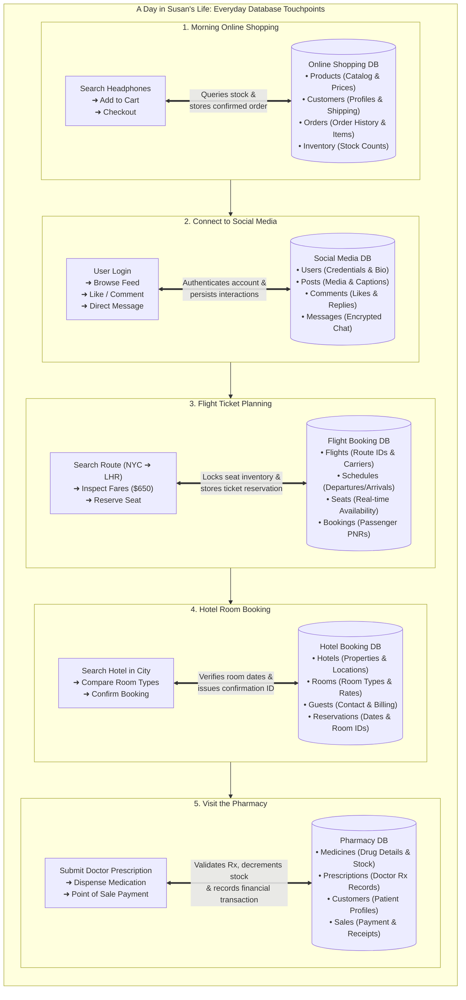

### 1.1.1 The Five Core Operational Mandates: Why Databases Are Needed
Across every domain illustrated in Susan's day, databases are fundamentally required to fulfill five indispensable engineering mandates:

1. **Store Data Safely:** Provide durable, fault-tolerant persistence for vast volumes of structured and unstructured records across clustered storage arrays.
2. **Search Quickly:** Execute sub-second query retrieval using internal index structures ($B^+$ trees, hash indexes) even when navigating billions of rows.
3. **Update Records Accurately:** Coordinate synchronized, concurrent modifications so that stock quantities, account balances, and flight seats reflect reality without race conditions.
4. **Track Transactions & Audit Trails:** Maintain chronological transaction logs (Write-Ahead Logging / WAL) to record, monitor, and reconstruct mission-critical business events.
5. **Improve Data Accuracy & Integrity:** Systematically enforce domain, entity, and referential constraints to eradicate data-entry errors and maintain trustworthy information.

---

## 1.2 Data vs. Information: The Foundations of Knowledge

The discipline of database systems is founded on the operational distinction between **raw data** and **actionable information**:

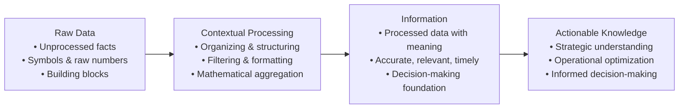

> [!info] Formal Definitions: Data vs. Information
> - **Data (Raw Facts):** Unprocessed, atomic facts, raw measurements, numbers, or symbols that have not yet been evaluated, organized, or contextualized to reveal their operational significance (e.g., `37.8`, `A102`, `180024`, `012-3456789`). Data constitutes the raw, foundational building blocks of all organizational systems.
> - **Information:** The refined, contextualized product generated by processing, structuring, formatting, and analyzing raw data to uncover its operational meaning, relationships, and implications (e.g., *"Patient body temperature is 37.8°C at 14:00"* or *"Flight A102 is delayed by 45 minutes"*).
> 
> **Prerequisites for High-Quality Information:**
> 1. **Accuracy:** Must represent a truthful, error-free reflection of the real-world state.
> 2. **Relevance:** Must directly pertain to the specific operational problem or context.
> 3. **Timeliness:** Must be available within the operational decision window before opportunities expire or conditions deteriorate.

> [!tip] Extra Notes: The DIKW Pyramid
> In computer science and enterprise architecture, data and information form the lower tiers of the **DIKW Hierarchy** (Data $\to$ Information $\to$ Knowledge $\to$ Wisdom):
> - *Data:* `42000` (an isolated integer).
> - *Information:* *"January 2017 Sales Forecast was 42,000 units, but actual sales were 38,532 units (Variation: -3,468)."*
> - *Knowledge:* Understanding that sales dip in January due to seasonal post-holiday consumer spending contraction.
> - *Wisdom:* Dynamically reducing January production quotas and scaling marketing campaigns in December to mitigate inventory holding costs.

---

## 1.3 Introducing the Database & The Foundational Role of Metadata

### 1.3.1 What is a Database?
A **database** is a shared, integrated computer structure designed to store and manage a collection of:
1. **End-User Data:** Raw facts, records, entities, and measurements of operational interest to the enterprise.
2. **Metadata (Data About Data):** A comprehensive description of data characteristics, data types, field lengths, domain boundaries, integrity constraints, and relational associations linking records across the entire database structure.

### 1.3.2 Concrete Multi-Tier Manifestations of Metadata vs. Data
Metadata is what allows modern database systems to be **self-describing** and **integrated**. The relationship between metadata and data exists at every layer of computing:

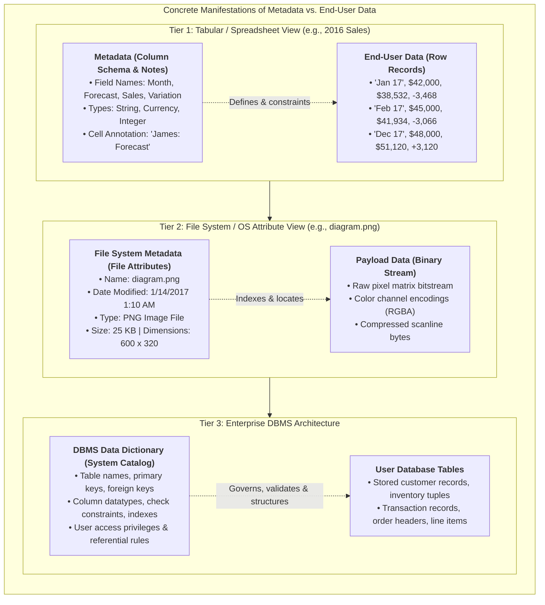

---

## 1.4 Database Management Systems (DBMS): Architecture, Roles & Intermediation

### 1.4.1 What is a DBMS?
A **Database Management System (DBMS)** is a complex collection of software programs that manages the physical and logical database structure, arbitrates all user and application access, enforces security and integrity, and coordinates concurrent multi-user execution.

### 1.4.2 Departmental User Roles & Centralized DBMS Access
In a modern enterprise, distinct business roles with completely different operational requirements interact with a unified central database through the DBMS:

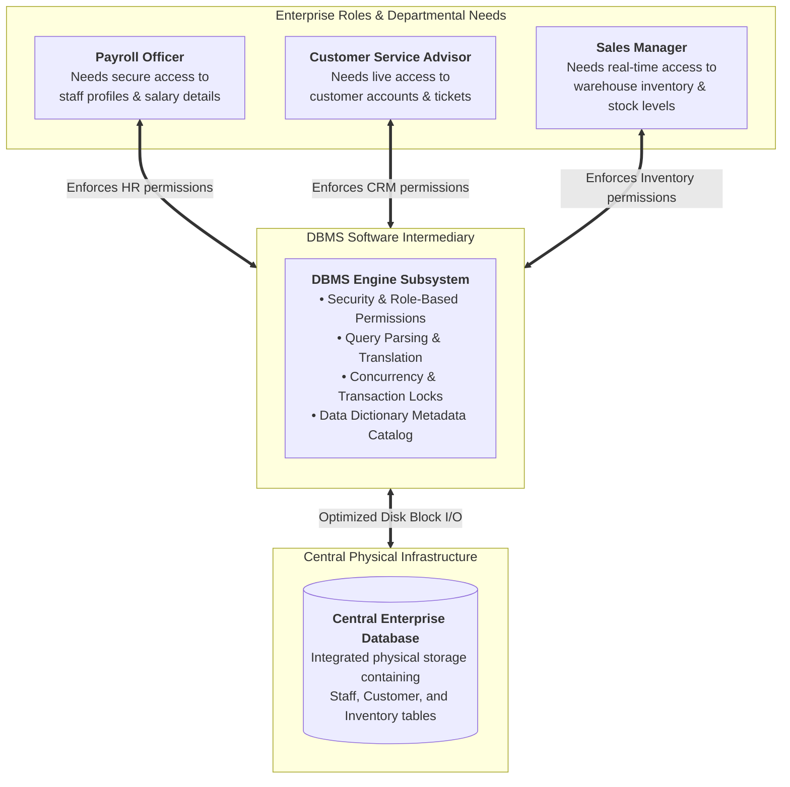

#### The Landscape of Modern DBMS Technologies
The modern software landscape encompasses diverse DBMS offerings adapted for specific deployment environments:
- **Desktop & Embedded DBMS:** SQLite, Microsoft Access, TurboDB Embedded, DBISAM, ElevateDB.
- **Enterprise Relational DBMS (RDBMS):** Oracle Database, PostgreSQL, MySQL, MariaDB Foundation, Microsoft SQL Server, IBM Db2.
- **Cloud-Native Database Services:** Microsoft SQL Azure, Amazon Relational Database Service (RDS), Amazon Aurora, Google Cloud Spanner.

### 1.4.3 The Intermediary Role of the DBMS
The DBMS operates as an indispensable **software intermediary** between applications and the physical storage layer:
1. **Intermediary Access Control:** Applications and end users never touch physical disk blocks directly; all read, write, update, and delete requests are submitted to the DBMS.
2. **Data Sharing Enabler:** Arbitrates concurrent access, enabling diverse programs across multiple departments to share identical records safely.
3. **Integrated Conceptual View:** Presents users with a seamless, integrated logical view of data, regardless of whether underlying files are split across multiple storage arrays.
4. **Request Translation:** Intercepts high-level declarative queries (e.g., SQL statements), analyzes syntax, computes optimal query plans, and translates them into low-level physical disk read/write instructions.
5. **Complexity Abstraction:** Hides low-level physical complexities (such as $B^+$ tree pointers, disk sector allocation, memory buffer paging, and binary serialization) from programmers and analysts.

### 1.4.4 The DBMS Interaction Model & Internal Subsystems
The DBMS manages the entire transaction lifecycle between the user and the stored records:

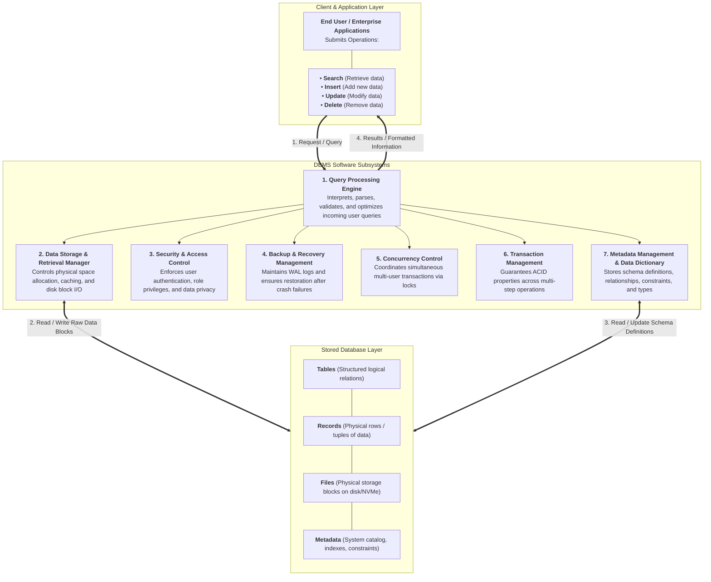

### 1.4.5 Comprehensive Advantages of Implementing a DBMS
Deploying a modern DBMS delivers three tiers of organizational advantages:

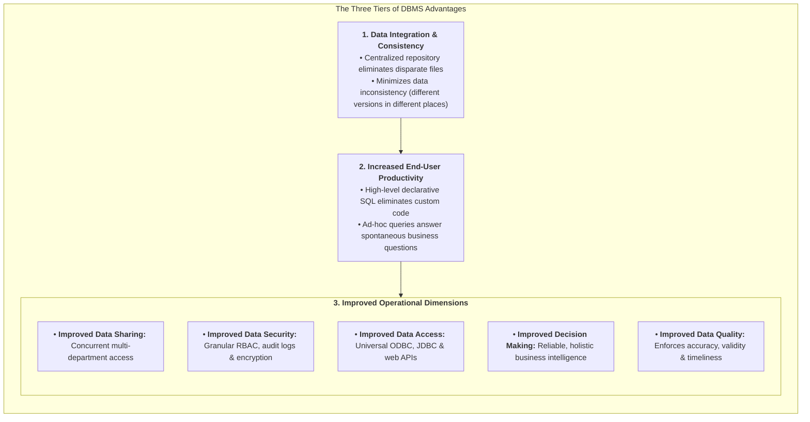

> [!info] Definition: Data Inconsistency
> **Data inconsistency** exists when different and conflicting versions of the exact same real-world data appear simultaneously in different locations across an organization's filing systems. Inconsistency destroys trust in reports, creates operational chaos, and violates fundamental data integrity.

---

## 1.5 Comprehensive Taxonomy and Classification of Databases

Databases are categorized across **five distinct operational dimensions**:

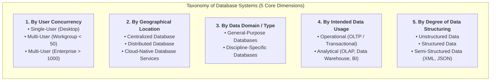

### 1.5.1 Detailed Classification Matrix

| Dimension | Category | Architecture & Operational Characteristics | Real-World Examples |
| :--- | :--- | :--- | :--- |
| **User Concurrency** | **Single-User (Desktop)** | Supports exactly one active user session at a time; runs locally on a personal workstation or embedded inside an application. | SQLite, Microsoft Access, TurboDB. |
| | **Multi-User (Workgroup)** | Supports a localized group of concurrent users (typically $< 50$) or a single business department. | Departmental MySQL, MariaDB workgroup server. |
| | **Multi-User (Enterprise)** | Scales to hundreds or thousands of simultaneous concurrent users across an entire multinational enterprise. | Oracle Database, IBM Db2, Microsoft SQL Server, PostgreSQL. |
| **Geographic Location** | **Centralized Database** | All data and DBMS processing engines reside physically at a single centralized data center or physical host. | Mainframe database, on-premises enterprise data center. |
| | **Distributed Database** | Data is partitioned, sharded, or replicated across multiple geographically distinct physical sites connected via network links. | CockroachDB, Google Cloud Spanner, Apache Cassandra. |
| | **Cloud Database** | Hosted, maintained, and dynamically scaled on managed cloud infrastructure with defined SLAs (storage, IOPS throughput, high availability). | Amazon RDS, Microsoft Azure SQL, Google Cloud Firestore. |
| **Stored Data Domain** | **General-Purpose** | Holds multi-disciplinary, broad organizational records across accounting, sales, logistics, and scholarly literature. | LexisNexis, ProQuest, enterprise ERP systems (SAP). |
| | **Discipline-Specific** | Tailored strictly to specialized domains requiring domain-specific indexing, geometries, or time-series precision. | Geographic Information Systems (GIS), CompuStat (financial), NCBI GenBank (genomics). |
| **Intended Data Usage** | **Operational (OLTP)** | Online Transaction Processing; optimized for high-frequency, low-latency reads and writes reflecting day-to-day operations. | Core banking systems, e-commerce checkout databases, point-of-sale registers. |
| | **Analytical (OLAP)** | Online Analytical Processing; optimized for complex queries, multi-dimensional aggregations, and historical trend analysis. | Enterprise Data Warehouses (Snowflake, Google BigQuery, Amazon Redshift). |
| **Data Structuring** | **Unstructured Data** | Exists in its original raw state without a predefined tabular schema or typed fields. | Raw audio streams, surveillance video, memos, social media posts. |
| | **Structured Data** | Formatted rigorously into records, tables, and typed fields derived from a formal relational data model. | SQL relational tables with declared primary and foreign keys. |
| | **Semi-Structured Data** | Contains self-describing tags or hierarchical markup to separate data elements without rigid relational schema. | Extensible Markup Language (XML), JSON documents, YAML configurations. |

> [!info] Analytical Architecture: Data Warehouses, OLAP, and Business Intelligence (BI)
> - **Data Warehouse:** A specialized centralized repository storing historical enterprise data extracted, transformed, and consolidated from multiple operational (OLTP) databases, formatted specifically for decision support.
> - **Online Analytical Processing (OLAP):** Analytical tools that enable analysts to rapidly retrieve, process, model, slice, dice, and aggregate multidimensional data cubes from the data warehouse.
> - **Business Intelligence (BI):** A comprehensive suite of tools, processes, and architectures that capture and process business data to generate actionable insights supporting tactical and strategic decision-making.

---

## 1.6 The Critical Importance of Database Design & Normalization Case Study

Database design focuses on architecting the precise database structure that will be used to store and manage end-user data:
- **Well-Designed Database:** Facilitates efficient data management, guarantees data integrity, prevents redundant storage, and generates accurate, timely, and valuable information.
- **Poorly-Designed Database:** Introduces subtle, difficult-to-trace bugs, duplicates data across inconsistent copies, degrades query performance, and generates flawed reports that lead to disastrous managerial decisions.

### 1.6.1 Case Study: Employee Skills Certification in a Poor Design
To understand the engineering consequences of poor design, consider the unnormalized spreadsheet-like table below (adapted from *Figure 1.5, pp. 13*):

#### Unnormalized Table: Flat File `EMPLOYEE_SKILLS`
| ID | ENum | Name | Title | HireDate | Skill1 | Skill1Date | Skill2 | Skill2Date | Skill3 | Skill3Date |
| :--- | :--- | :--- | :--- | :--- | :--- | :--- | :--- | :--- | :--- | :--- |
| 1 | 02345 | Brian Oates | DBA | 2/14/1997 | Basic Database Management | 2/14/2004 | Advanced Database Management | 2/14/2007 | Basic Web Design | 8/9/2005 |
| 2 | 08273 | Marco Bienz | Analyst | 7/28/2008 | Basic Web Design | 3/8/2011 | Advance Process Modeling | 8/19/2014 | | |
| 3 | 06234 | Jasmine Patel | Programmer | 8/10/2007 | Basic Web Design | 8/10/2009 | Advanced C# programming | 8/10/2009 | Basic DB manipulation | 1/29/2014 |
| 4 | 03373 | Franklin Johnson, Jr. | Purchasing Agent | 3/15/2004 | Advanced Spreadsheets | 6/20/2013 | | | | |
| 5 | 13567 | Almond, Robert | Analyst | 9/30/2014 | Basic Process Modeling | 9/30/2016 | Basic Database Design | 5/23/2017 | | |
| 6 | 10282 | Richardson, Amanda | Clerk | 4/11/2013 | | | | | | |
| 7 | 09382 | Susan Mathis | Database Programmer | 8/2/2012 | Basic DB Design | 8/2/2014 | Basic Database Manipulation | 8/2/2014 | Advanced DB Manipulation | 5/1/2015 |
| 8 | 14311 | Duong, Lee | Programmer | 9/1/2016 | Basic Web Design | 9/1/2018 | | | | |
| 9 | | | | | Master Database Programming | | | | | |
| 10 | | | | | Basic Spreadsheets | | | | | |
| 11 | 09002 | Wade Gaither | Clerk | 5/20/2012 | Advanced Spreadsheets | 5/16/2015 | Basic Web Design | 5/16/2015 | | |
| 12 | 13383 | Raymond F. Matthews | Programmer | 3/12/2014 | Basic C# Programming | 3/12/2016 | | | | |
| 13 | 09283 | Chavez, Juan | Clerk | 7/4/2012 | | | | | | |
| 14 | 04893 | Patricia Richards | DBA | 6/11/2006 | Advanced Database Management | 6/11/2008 | Advanced Database Manipulation | 9/20/2014 | | |
| 15 | 13932 | Lee Megan | Programmer | 9/29/2015 | | | | | | |

#### Analysis of the Five Fatal Design Flaws:
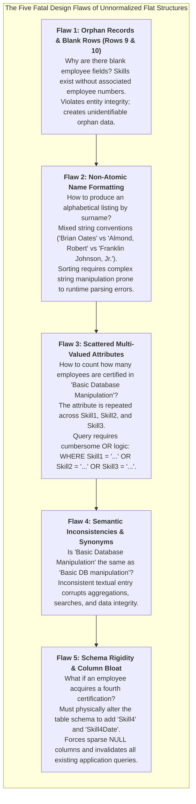

### 1.6.2 The Relational Solution: Normalization into Database Programmer
To eliminate every flaw, relational database engineering decomposes the single flawed flat structure into **three normalized, atomic relational tables**:

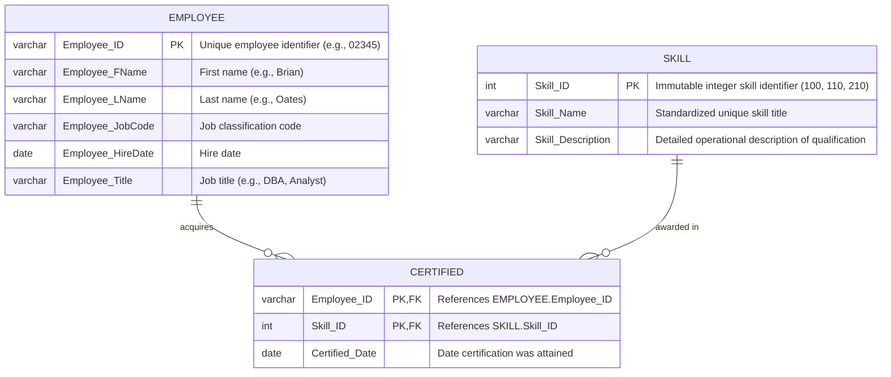

#### Standardized Catalog Table: `SKILL`
Centralizes qualifications, eliminating synonyms and typos:

| Skill_ID | Skill_Name | Skill_Description |
| :---: | :--- | :--- |
| **100** | Basic Database Management | Create and manage database user accounts |
| **110** | Basic Web Design | Create and maintain basic HTML and CSS documents |
| **120** | Advanced Spreadsheets | Use of advanced functions, user-defined functions, and macroing |
| **130** | Basic Process Modeling | Create core business process models using standard libraries |
| **140** | Basic Database Design | Create simple data models |
| **150** | Master Database Programming | Create integrated trigger and procedure packages for distributed environments |
| **160** | Basic Spreadsheets | Create single-tab worksheets with basic formulas |
| **170** | Basic C# Programming | Create simple tier data-aware modules |
| **180** | Advanced Database Management | Manage Database Server Clusters |
| **190** | Advance Process Modeling | Evaluate and Redesign cross-functional internal and external business processes |
| **200** | Advanced C# Programming | Create multi-tier applications using multi-threading |
| **210** | Basic Database Manipulation | Create simple data retrieval and manipulation statements in SQL |
| **220** | Advanced Database Manipulation | Use of advanced data manipulation methods for multi-table inserts and subqueries |

#### Associative Bridge Entity: `CERTIFIED`
Implements the $M:N$ relationship cleanly. When an employee gains a 4th or 10th certification, the DBA simply inserts new rows into `CERTIFIED` without altering table columns!

| Employee_ID | Skill_ID | Certified_Date |
| :---: | :---: | :---: |
| 02345 | 100 | 2/14/2004 |
| 02345 | 180 | 2/14/2007 |
| 02345 | 110 | 8/9/2005 |
| 08273 | 110 | 3/8/2011 |
| 08273 | 190 | 8/19/2014 |
| 06234 | 110 | 8/10/2009 |
| 06234 | 200 | 8/10/2009 |
| 06234 | 210 | 1/29/2014 |
| 09382 | 140 | 8/2/2014 |
| 09382 | 210 | 8/2/2014 |
| 09382 | 220 | 5/1/2015 |

---

## 1.7 Evolution of Data Processing: From File Systems to Databases

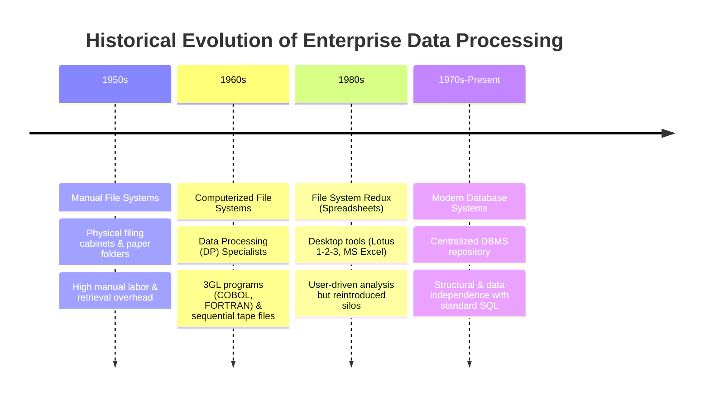

### 1.7.1 The Architecture of Early Computerized File Systems
In the 1960s, computerized file systems replaced manual paper filing cabinets. Organizations established **Data Processing (DP) departments** where DP specialists authored specialized programs (in third-generation languages like COBOL or FORTRAN) to track operational data and produce static reports:

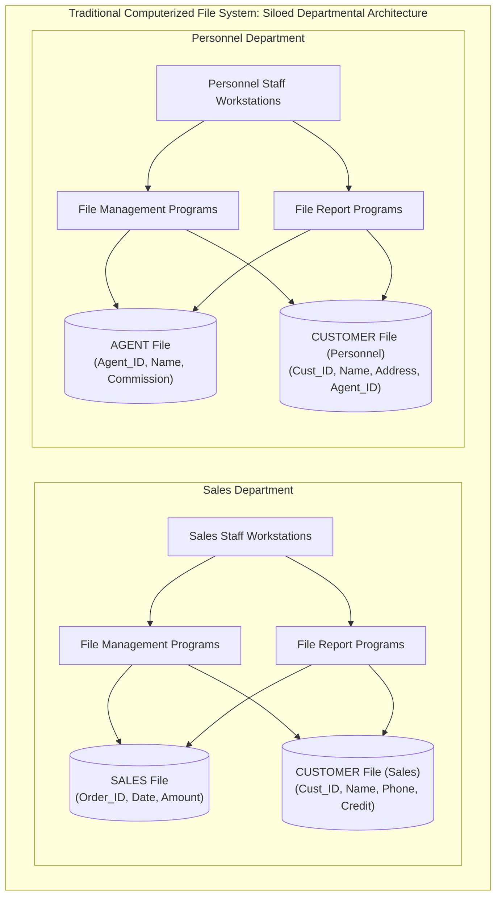

### 1.7.2 Foundational File Processing Terminology
Understanding traditional file processing requires defining the four hierarchical building blocks of file systems:

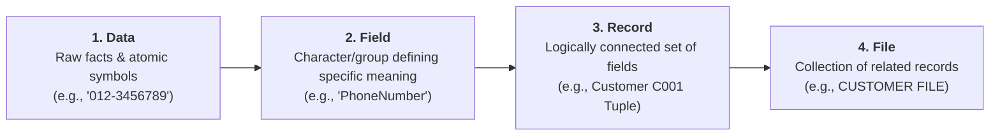

| File Term | Formal Definition | Concrete Operational Example |
| :--- | :--- | :--- |
| **Data** | Raw facts (such as a telephone number, birth date, customer name, or credit limit) that have little inherent meaning until organized logically. | `012-3456789`, `15 Jan 2000`, `Ali bin Ahmad`, `5000`. |
| **Field** | A character or group of characters (alphabetic or numeric) that has a specific meaning. Used to define and store a distinct data attribute. | `CustomerID`, `Name`, `PhoneNumber`, `DateOfBirth`, `CreditLimit`. |
| **Record** | A logically connected set of one or more fields that describes a specific real-world person, place, entity, or transaction. | Record for Customer `C001`: `[C001, Ali bin Ahmad, 123 Jalan Kenanga 11800 Penang, 012-3456789, 15 Jan 2000, 5000, 1200]`. |
| **File** | A collection of related records stored persistently on secondary media. | `CUSTOMER FILE` storing all student or customer records for an enterprise. |

#### Concrete File System Structure: `CUSTOMER FILE`
| CustomerID | Name | Address | PhoneNumber | DateOfBirth | CreditLimit | UnpaidBalance |
| :---: | :--- | :--- | :---: | :---: | :---: | :---: |
| **C001** | Ali bin Ahmad | 123, Jalan Kenanga, 11800 Penang | 012-3456789 | 15 Jan 2000 | 5000 | 1200 |
| **C002** | Siti Nurhaliza | 45, Jalan Melur, 11600 Penang | 019-8765432 | 22 Mar 1998 | 3000 | 0 |
| **C003** | Lim Wei Ming | 8, Jalan Cempaka, 11700 Penang | 016-1122334 | 5 Jul 1995 | 4000 | 750 |

---

## 1.8 Critical Flaws of File Systems & The Three Fundamental Data Anomalies

### 1.8.1 Inherent Weaknesses of File System Processing
Traditional file processing environments suffer from five severe operational bottlenecks:
1. **Lengthy Development Times:** Creating new reports or queries requires writing brand-new 3GL application programs from scratch.
2. **Difficulty of Getting Quick Answers:** Ad-hoc questions cannot be answered spontaneously; management must submit requests to DP specialists and wait days or weeks for custom program development.
3. **Complex System Administration:** As the organization grows, managing hundreds of disparate file layouts, file formats, and access scripts becomes administratively unmanageable.
4. **Lack of Security and Limited Data Sharing:** Security is constrained to primitive operating system file-level permissions (read/write/execute on the entire file); column-level, row-level, or role-based security is impossible without custom application code.
5. **Extensive Programming Requirements:** Every routine operation (opening files, parsing byte offsets, checking end-of-file markers, allocating I/O buffers) must be manually coded by the programmer.

### 1.8.2 Structural Dependence vs. Structural Independence
- **Structural Dependence:** A condition where access to data in a file is strictly dependent on the physical and logical layout of the file itself.
  - *Mechanism:* Application code hardcodes fixed byte offsets (e.g., reading 10 bytes for Customer ID, followed by 30 bytes for Name).
  - *Consequence:* If a field structure is modified (e.g., expanding postal codes from 5 to 9 digits, or adding an email address), **every single application program** that accesses that file must be manually rewritten, recompiled, retested, and redeployed.
- **Structural Independence:** An architectural quality where file/table structures can be altered (e.g., adding a new column) without invalidating existing application programs that do not reference that specific column. Achieved in a DBMS via the system data dictionary.

### 1.8.3 Data Dependence vs. Data Independence
- **Data Dependence:** A condition where data access routines are tightly coupled to the physical data storage characteristics (e.g., integer width, floating-point encoding, endianness, or disk block sizing). Changing storage hardware or storage formatting invalidates application logic.
- **Data Independence:** A condition where physical storage characteristics can be altered dynamically without affecting the application program's ability to access the data. The DBMS translates high-level logical requests into hardware-specific operations.

### 1.8.4 Data Redundancy & "Islands of Information"
Because departments traditionally maintained isolated files, the same real-world data (e.g., customer name, phone number, address) was duplicated across scattered departmental files (**islands of information**).

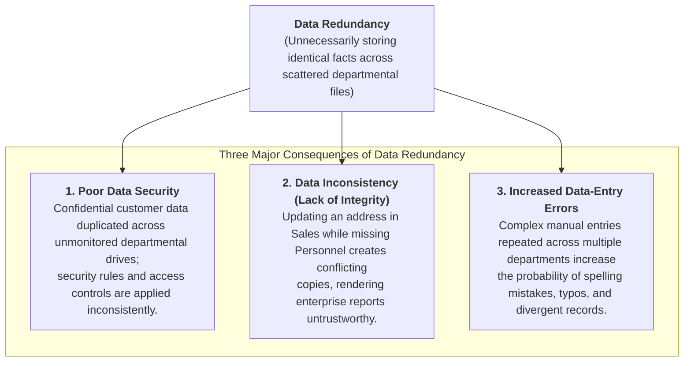

### 1.8.5 The Three Fundamental Data Anomalies: Insurance Agency Case Study
A **data anomaly** develops when required modifications to redundant data are not executed uniformly across all files.

To observe data anomalies in action, consider the historical unnormalized file table below:

#### Unnormalized Insurance Agency Policy File
| C_NAME | C_PHONE | C_ADDRESS | C_ZIP | A_NAME | A_PHONE | TP | AMT | REN |
| :--- | :---: | :--- | :---: | :--- | :---: | :---: | :---: | :---: |
| Alfred A. Ramas | 615-844-2573 | 218 Fork Rd., Babs, TN | 36123 | Leah F. Hahn | 615-882-1244 | T1 | 100.00 | 05-Apr-2018 |
| Leona K. Dunne | 713-894-1238 | Box 12A, Fox, KY | 25246 | Alex B. Alby | 713-228-1249 | T1 | 250.00 | 16-Jun-2018 |
| Kathy W. Smith | 615-894-2265 | 125 Oak Ln, Babs, TN | 36123 | Leah F. Hahn | **615-882-2144** | S2 | 150.00 | 29-Jan-2019 |
| Paul F. Olowski | 615-894-2180 | 217 Lee Ln., Babs, TN | 36123 | Leah F. Hahn | 615-882-1244 | S1 | 300.00 | 14-Oct-2018 |
| Myron Orlando | 615-222-1672 | Box 111, New, TN | 36155 | Alex B. Alby | 713-228-1249 | T1 | 100.00 | 28-Dec-2018 |
| Amy B. O'Brian | 713-442-3381 | 387 Troll Dr., Fox, KY | 25246 | John T. Okon | 615-123-5589 | T2 | 850.00 | 22-Sep-2018 |
| James G. Brown | 615-297-1228 | 21 Tye Rd., Nash, TN | 37118 | Leah F. Hahn | 615-882-1244 | S1 | 120.00 | 25-Mar-2018 |
| George Williams | 615-290-2556 | 155 Maple, Nash, TN | 37119 | John T. Okon | 615-123-5589 | S1 | 250.00 | 17-Jul-2018 |
| Anne G. Farriss | 713-382-7185 | 2119 Elm, Crew, KY | 25432 | Alex B. Alby | 713-228-1249 | T2 | 100.00 | 03-Dec-2018 |
| Olette K. Smith | 615-297-3809 | 2782 Main, Nash, TN | 37118 | John T. Okon | 615-123-5589 | S2 | 500.00 | 14-Mar-2019 |

*Legend:* `C_NAME` = Customer Name, `C_PHONE` = Customer Phone, `C_ADDRESS` = Customer Address, `C_ZIP` = Zip Code, `A_NAME` = Agent Name, `A_PHONE` = Agent Phone, `TP` = Insurance Policy Type, `AMT` = Policy Amount (in $1,000s), `REN` = Policy Renewal Date.

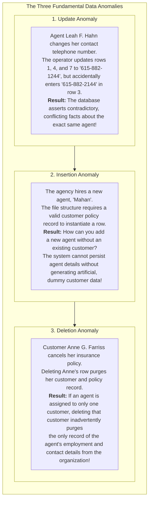

---

## 1.9 Modern Database Systems Architecture & The Five Environment Components

### 1.9.1 Modern Database Systems
A modern database system eliminates the vulnerabilities of file processing by storing logically related data in a **single logical data repository**:
- The repository appears to the end user and applications as a single, unified, coherent unit, even if the underlying data is physically partitioned or distributed across multiple servers.
- Current-generation DBMS software:
  1. Stores schema data structures, relationships between entities, and multi-tier access paths.
  2. Defines, stores, and optimizes all access paths, indices, and hardware components automatically.

### 1.9.2 Contrasting File Systems and Database Systems
The architectural distinction between traditional file processing and modern database environments is profound:

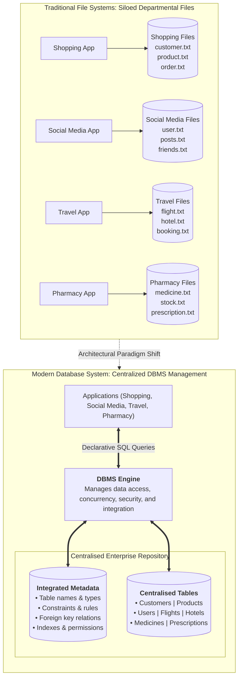

### 1.9.3 The Five Major Components of the Database System Environment
A complete database system consists of five tightly coupled components: **Hardware, Software, People, Procedures, and Data**.

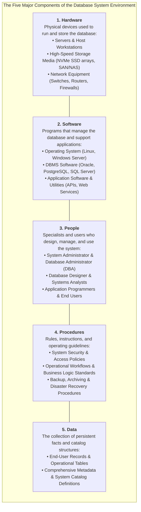

#### People Roles & System Interaction Topology
The interaction between people roles, procedures, software, hardware, and data follows a strict hierarchical governance workflow:

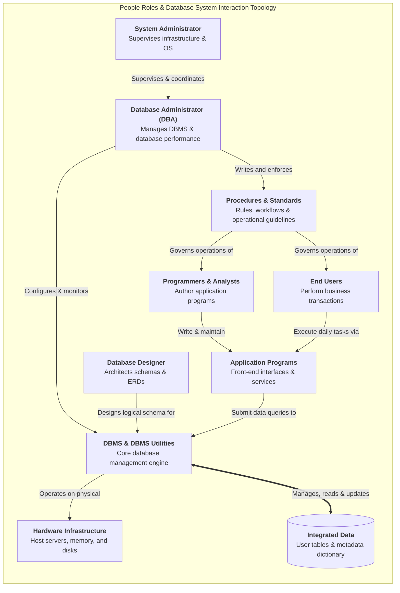

---

## 1.10 The Nine Core Functions of a Modern DBMS

A production-grade DBMS eliminates the hazards of file processing through nine essential system services:

```mermaid
flowchart TD
    subgraph TheNineFunctions["The Nine Core Functions of a Modern DBMS"]
        direction TB

        F1["<b>1. Data Dictionary Management</b><br/>Stores definitions of all data elements, types, relationships & constraints in a centralized catalog"]
        F2["<b>2. Data Storage Management & Performance Tuning</b><br/>Allocates disk structures; uses intelligent buffer caching & query optimization to maximize I/O speed"]
        F3["<b>3. Data Transformation & Presentation</b><br/>Transforms entered inputs to match required internal structures; formats outputs for user presentation"]
        F4["<b>4. Security Management</b><br/>Enforces user authentication, granular role-based access control (RBAC), and privacy encryption"]
        F5["<b>5. Multi-User Access Control</b><br/>Employs sophisticated concurrency locking algorithms ensuring simultaneous access without integrity loss"]
        F6["<b>6. Backup and Recovery Management</b><br/>Maintains Write-Ahead Logs (WAL); enables full database restoration to a consistent state following crash failures"]
        F7["<b>7. Data Integrity Management</b><br/>Enforces primary key uniqueness, foreign key referential integrity, and domain boundary constraints"]
        F8["<b>8. Database Access Languages & APIs</b><br/>Executes declarative SQL queries (DDL for schemas, DML for data manipulation), abstracting operational logic"]
        F9["<b>9. Database Communication Interfaces</b><br/>Exposes standard network listeners (ODBC, JDBC, REST endpoints) across diverse heterogeneous client environments"]

        F1 --> F2 --> F3 --> F4 --> F5 --> F6 --> F7 --> F8 --> F9
    end
```

1. **Data Dictionary Management:** Automatically records, updates, and provides lookup access for metadata definitions, table schemas, attribute datatypes, constraints, and relational associations in a centralized system catalog.
2. **Data Storage Management & Performance Tuning:** Manages the physical allocation of disk blocks, table spaces, indexes, and transaction logs. Implements performance tuning algorithms (such as memory buffer pooling and index caching) to ensure optimal storage utilization and access speed.
3. **Data Transformation & Presentation:** Translates raw user inputs into structured database datatypes (e.g., parsing localized date strings like `15 Jan 2000` into standardized internal ISO-8601 representations) and transforms internal bitstreams into human-readable views.
4. **Security Management:** Authenticates user credentials and enforces granular authorization policies restricting read, insert, update, or delete privileges to authorized users and application roles.
5. **Multi-User Access Control:** Coordinates concurrent access among hundreds or thousands of users using advanced locking protocols and isolation levels, ensuring transactions satisfy ACID properties without dirty reads or lost updates.
6. **Backup and Recovery Management:** Continuously maintains transaction write-ahead logs (`WAL`) and automated snapshot facilities, allowing the DBA to recover the database to an exact, verified point-in-time following hardware crashes, operating system panics, or power interruptions.
7. **Data Integrity Management:** Minimizes data redundancy and enforces data integrity rules automatically (e.g., rejecting duplicate primary keys, preventing orphaned foreign key records, and enforcing column validation checks).
8. **Database Access Languages & Application Programming Interfaces (APIs):** Provides standard declarative query languages:
   - **Data Definition Language (DDL):** Formulates, alters, and drops schema structures (`CREATE TABLE`, `ALTER TABLE`, `DROP TABLE`).
   - **Data Manipulation Language (DML):** Selects, filters, inserts, updates, and deletes records (`SELECT`, `INSERT`, `UPDATE`, `DELETE`).
   - **Structured Query Language (SQL):** The universal, de facto declarative query language standard supported by virtually all DBMS vendors, letting users specify *what* data is required without specifying *how* the computer must retrieve it.
9. **Database Communication Interfaces:** Exposes standard network communication interfaces and drivers (JDBC for Java, ODBC for C/C++/C#, RESTful JSON endpoints) to accept queries over heterogeneous local and cloud network environments.

---

## 1.11 Inherent Trade-Offs and Disadvantages of Database Systems

While database systems provide revolutionary operational capabilities, they introduce significant technical and organizational trade-offs:

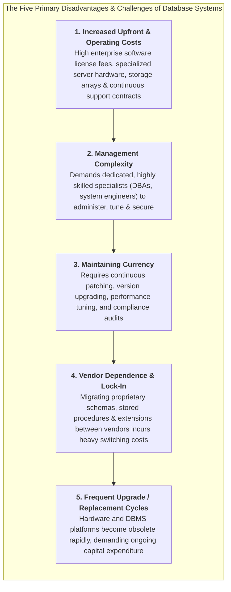

### Strategic Comparison: Advantages vs. Inherent Trade-Offs

| Advantages of Database Systems | Inherent Trade-Offs & Disadvantages |
| :--- | :--- |
| **Comprehensive Data Sharing:** Centralized access across diverse enterprise applications without siloing. | **Increased Costs:** Expensive enterprise DBMS licenses, high-spec host hardware, and ongoing vendor maintenance contracts. |
| **Enforced Data Integrity & Consistency:** Automatic constraints prevent orphaned records, contradictory entries, and anomalies. | **Management Complexity:** Demands dedicated, highly skilled Database Administrators (DBAs) and systems engineers. |
| **Declarative Ad-Hoc SQL Querying:** Instantaneous data filtering and aggregation without authoring custom 3GL code. | **Maintaining Currency:** Continuous overhead applying critical security patches, performance tuning, and schema refactoring. |
| **Structural & Data Independence:** Application programs remain stable when physical storage schemas or indexes evolve. | **Vendor Dependence:** Proprietary SQL extensions, stored procedures, and clustering features lock enterprises into specific vendor ecosystems. |
| **Centralized Security Governance:** Unified role-based access control, encrypted storage, and immutable audit logs. | **Frequent Upgrade Cycles:** Rapid technological obsolescence necessitates periodic hardware replacements and disruptive DBMS migrations. |

---

# Chapter 2: Data Models, Business Rules & Levels of Data Abstraction

## 2.1 Fundamentals of Data Modeling & The Importance of Blueprints

### 2.1.1 What is a Data Model?
A **data model** is a simple, typically graphical, abstract representation of complex real-world data structures, entity characteristics, relationships, operational constraints, and transformation rules within a specified problem domain.

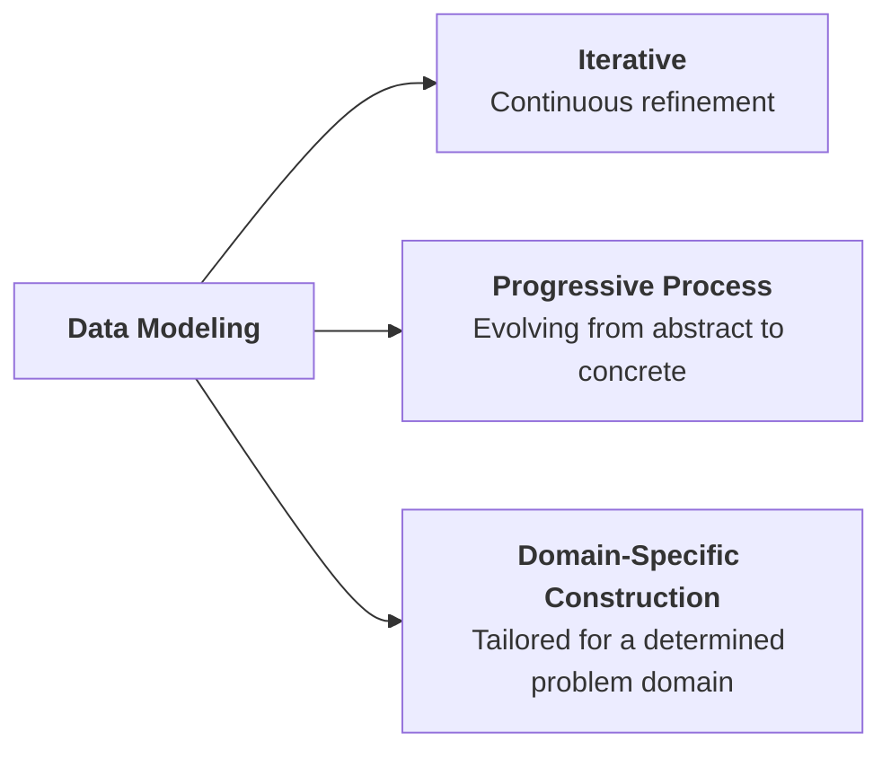

> [!info] Data Model as an Architectural Blueprint
> Just as a civil architect produces detailed architectural blueprints before laying the foundation of a modern skyscraper, a database designer authors a data model to establish a verified blueprint before creating physical tables or executing SQL DDL scripts. The data model serves as a shared communication bridge uniting non-technical business stakeholders with technical software engineers and database administrators.

### 2.1.2 The Spectrum of Semantic Data Models
Over the evolution of computing, multiple semantic data models have been developed to capture organizational reality:
1. **Relational Data Model:** Represents data in two-dimensional tabular form consisting of intersecting rows and columns.
2. **Entity-Relationship (ER) Data Model:** A visual, graphical modeling paradigm depicting entities and associations; by far the most widely adopted standard for conceptual communication during database development.
3. **Object-Based Data Model:** Integrates object-oriented programming paradigms (classes, encapsulation, methods) with data persistence.
4. **Semi-Structured Data Model:** Uses tagged, hierarchical markup (such as Extensible Markup Language - XML and JSON) to exchange flexible, self-describing datasets without rigid tabular schemas.

### 2.1.3 The Four Strategic Pillars of Data Model Importance
A data model is essential to enterprise software engineering across four foundational pillars:

```mermaid
flowchart TD
    subgraph ImportanceRoot["The Four Strategic Pillars of Data Model Importance"]
        direction TB

        subgraph P1["1. Organize Data for Diverse Stakeholders"]
            direction TB
            U1["<b>Company President</b><br/>Needs high-level, strategic global view"]
            U2["<b>Inventory Manager</b><br/>Focuses on stock levels & reorder alerts"]
            U3["<b>Purchasing Manager</b><br/>Tracks item acquisition costs & vendor pricing"]
        end

        subgraph P2["2. Serve as Universal Communication Tool"]
            direction TB
            C1["<b>Database Designer</b><br/>Translates business requirements into schemas"]
            C2["<b>Application Programmer</b><br/>Writes queries & integrates software services"]
            C3["<b>End User</b><br/>Validates operational rules & business accuracy"]
        end

        P3["<b>3. Provide Holistic Global View</b><br/>Unifies disjointed departmental data into an integrated enterprise schema"]
        P4["<b>4. Essential Abstraction for Good Design</b><br/>Acts as the verified conceptual foundation preventing costly downstream schema rework"]

        P1 --- P2 --- P3 --- P4
    end
```

---

## 2.2 Core Data Modeling Building Blocks

Every data model, regardless of its underlying paradigm, is constructed from **four foundational building blocks**:

```mermaid
flowchart TD
    subgraph BuildingBlocks["The Four Basic Building Blocks of All Data Models"]
        direction TB

        subgraph B1["1. Entities"]
            direction LR
            E_Def["<b>Unique, distinguishable object</b> used to collect & persist data"]
            E_Ex["• <b>Physical Objects:</b> CUSTOMER, PRODUCT, STUDENT, AGENT<br/>• <b>Conceptual Abstractions:</b> FLIGHT_ROUTE, CONCERT, INVOICE"]
            E_Def --- E_Ex
        end

        subgraph B2["2. Attributes"]
            direction LR
            A_Def["<b>Distinguishing characteristic</b> or property of an entity<br/>(Equivalent to fields in file systems)"]
            A_Ex["• <b>AGENT Entity Attributes:</b><br/>Agent_Code, Agent_Name, Agent_Phone, Agent_Address, Commission_Rate"]
            A_Def --- A_Ex
        end

        subgraph B3["3. Relationships"]
            direction LR
            R_Def["<b>Bidirectional associations</b> linking entities together"]
            R_Ex["• <b>One-to-Many (1:M or 1..*):</b> CUSTOMER generates INVOICE<br/>• <b>Many-to-Many (M:N or *:*):</b> STUDENT takes CLASS<br/>• <b>One-to-One (1:1 or 1..1):</b> EMPLOYEE manages STORE"]
            R_Def --- R_Ex
        end

        subgraph B4["4. Constraints"]
            direction LR
            C_Def["<b>Explicit rules and restrictions</b> ensuring data integrity"]
            C_Ex["• <b>CGPA Boundary:</b> Student CGPA must be between 0.00 and 4.00<br/>• <b>Work Hours Boundary:</b> Employee working hours must be &ge; 0.00"]
            C_Def --- C_Ex
        end

        B1 --> B2 --> B3 --> B4
    end
```

1. **Entity:** A distinct real-world physical object (e.g., `CUSTOMER`, `PRODUCT`, `STUDENT`) or conceptual event/abstraction (e.g., `FLIGHT_ROUTE`, `CONCERT`, `INVOICE`) about which an enterprise gathers and stores data.
2. **Attribute:** A specific characteristic, property, or descriptor that qualifies an entity. Directly corresponds to fields in traditional file processing.
3. **Relationship:** An active or passive association linking entities. In relational modeling, relationships are strictly **bidirectional** and are classified by their connectivity (cardinality):
   - **One-to-Many ($1:M$ or $1..\text{*}$):** One customer generates many invoices; each invoice belongs to exactly one customer.
   - **Many-to-Many ($M:N$ or $\text{*}..\text{*}$):** One student takes many classes; each class is taken by many students.
   - **One-to-One ($1:1$ or $1..1$):** One employee manages at most one store; each store is managed by exactly one employee.
4. **Constraint:** An explicit logical assertion, boundary condition, or business policy limiting allowed data values or operational associations, systematically preventing invalid entries.

---

## 2.3 Business Rules: Formulation, Governance & Structural Translation

### 2.3.1 What is a Business Rule?
A **business rule** is a brief, precise, and unambiguous statement of an organizational policy, operational procedure, or principle. It describes the main and distinguishing characteristics of the organizational data and serves as the primary mechanism for deriving the data model's building blocks.

> [!info] Operational Examples of Business Rules
> - **Relationship Rules:**
>   - *"A customer may generate many invoices; an invoice is generated by only one customer."* ($1:M$)
>   - *"A customer may rent many bicycles; each bicycle is rented by only one customer at any given time."* ($1:M$)
> - **Constraint Rules:**
>   - *"A student may register for a maximum of four academic subjects in a semester."* (Participation limit)
>   - *"A corporate training session cannot be scheduled for fewer than 10 employees or more than 20 employees."* (Capacity constraint)
>   - *"A student's CGPA must fall within the range of 0.00 to 4.00."* (Domain validation)

### 2.3.2 Sources of Business Rules
To discover and formulate comprehensive business rules, database designers examine five distinct organizational sources:

```mermaid
flowchart TD
    subgraph Sources["The Five Primary Sources of Business Rules"]
        direction TB
        S1["<b>1. Company Managers</b><br/>Strategic operational guidelines & enterprise policies"]
        S2["<b>2. Policy Makers</b><br/>Regulatory, compliance, and corporate governance standards"]
        S3["<b>3. Department Managers</b><br/>Specific day-to-day divisional workflows and accounting procedures"]
        S4["<b>4. Written Documentation</b><br/>Company handbooks, training manuals, forms, and audit checklists"]
        S5["<b>5. Direct User Interviews</b><br/>Firsthand operational insights from frontline end users"]
        
        S1 --- S2 --- S3 --- S4 --- S5
    end
```

### 2.3.3 Why Identifying Business Rules is Vital
Systematically discovering and documenting business rules achieves three critical objectives:
1. **Standardizes the Corporate View of Data:** Establishes a shared, standardized vocabulary and organizational consensus regarding what data elements mean.
2. **Serves as a Communication Bridge:** Provides an understandable, natural-language communication medium between non-technical business users and technical database engineers.
3. **Empowers the Database Designer to:**
   - Deeply understand the nature, role, scope, and operational flow of corporate data.
   - Formulate accurate relationship participation rules and cardinality bounds.
   - Construct a robust, normalized data model that mirrors real-world business activities.

### 2.3.4 Translating Natural-Language Rules into Schema Components
A database engineer translates informal business rules into formal data model structures via linguistic decomposition:

```mermaid
flowchart TD
    subgraph LinguisticTranslation["Linguistic Decomposition of Business Rules"]
        direction TB
        
        Rule["<b>Natural Language Business Rule:</b><br/>'A student may register for many subjects. Each subject may be registered by many students.'"]
        
        subgraph TranslationMechanics["Structural Mapping"]
            direction LR
            Nouns["<b>Nouns</b><br/>('Student', 'Subject')<br/>➜ <b>Entities</b>"]
            Verbs["<b>Verbs</b><br/>('Registers for', 'Registered by')<br/>➜ <b>Relationships</b>"]
            Adj["<b>Adjectives / Attributes</b><br/>('Student Name', 'Subject Code')<br/>➜ <b>Attributes</b>"]
        end

        Bidir["<b>Bidirectional Invariant:</b><br/>Every relationship must be defined in both directions (Student ➔ Subject, Subject ➔ Student)"]

        Rule --> TranslationMechanics
        TranslationMechanics --> Bidir
    end
```

### 2.3.5 Naming Conventions & Self-Documentation
Consistent, disciplined naming conventions are crucial for long-term database maintainability:
- **Entity Names:** Must use descriptive, familiar terminology in uppercase singular nouns (e.g., `STUDENT`, `STAFF`, `BOOK`, `CUSTOMER`).
- **Attribute Names:** Must clearly describe the data element, prefixed or qualified by the entity context (e.g., `STUDENT_FNAME`, `STUDENT_CGPA`, `BOOK_ISBN`, `STAFF_HIREDATE`).
- **Benefits of Rigorous Naming:**
  1. *Facilitates Cross-Team Communication:* Developers, DBAs, and analysts instantly recognize table purposes.
  2. *Promotes Self-Documentation:* Eliminates ambiguity in complex SQL queries and programmatic joins without requiring external data dictionaries.

### 2.3.6 Determining Relationship Connectivity: The Two-Question Diagnostic
To establish relationship connectivity without ambiguity, the designer poses two bidirectional questions:
1. *How many instances of Entity B relate to exactly one instance of Entity A?*
2. *How many instances of Entity A relate to exactly one instance of Entity B?*

> [!example] Diagnostic Walkthrough: Student and Class
> - **Question 1:** *How many classes can one student enroll in?*
>   - **Answer:** Many classes.
> - **Question 2:** *How many students can enroll in one class?*
>   - **Answer:** Many students.
> - **Conclusion:** The relationship between `STUDENT` and `CLASS` is **Many-to-Many ($M:N$)**. (In relational database implementations, this is realized by decomposing into two $1:M$ relationships via a composite associative entity).

---

## 2.4 Chronological Evolution of Data Models: Early Navigational Models

The evolution of data models reflects a continuous architectural journey from low-level, hardware-bound navigational systems toward high-level declarative abstractions:

```mermaid
timeline
    title Chronological Progression of Data Models
    1960s : File Systems & Early Tape Storage : Sequential records & custom 3GL processing
    Late 1960s : Hierarchical & Network Models : Segment trees & CODASYL DBTG pointer graphs
    1970s : Relational Model (E.F. Codd) : Tables, tuples, attributes & declarative SQL
    1976 : Entity-Relationship (ER) Model (Peter Chen) : Visual conceptual modeling & cardinality notations
    1985-1990s : Object-Oriented (OODM) & O/R DBMS : Encapsulated objects, inheritance & XML hybrid DBMS
    2009-Present : Big Data & NoSQL Movement : High volume, velocity & variety; schema-less distributed stores
```

---

### 2.4.1 The Hierarchical Model (Late 1960s)
Pioneered by North American Rockwell and IBM during the Apollo space program (manifested in IBM's Information Management System - IMS).
- **Structure:** Data is organized as an inverted tree consisting of **levels** or **segments** (the equivalent of a file system's record type).
- **Relational Connectivity:** Strictly models **One-to-Many ($1:M$)** relationships. Every child segment can have **exactly one parent segment**, but a parent can have multiple children.

```mermaid
flowchart TD
    subgraph HierarchicalTree["Hierarchical Tree Architecture: Pavement Management Case Study"]
        direction TB

        Parent["<b>Parent Segment:</b><br/>Pavement Improvement"]

        Child1["<b>Child Segment 1:</b><br/>Reconstruction"]
        Child2["<b>Child Segment 2:</b><br/>Maintenance"]
        Child3["<b>Child Segment 3:</b><br/>Rehabilitation"]

        SubChild1["Routine Maintenance"]
        SubChild2["Corrective Maintenance"]
        SubChild3["Preventive Maintenance"]

        Parent --> Child1 & Child2 & Child3
        Child2 --> SubChild1 & SubChild2 & SubChild3
    end
```

#### Advantages and Disadvantages of the Hierarchical Model

| Strategic Advantages | Inherent Disadvantages & Critical Flaws |
| :--- | :--- |
| **Promotes Data Sharing:** Centralized data access under a single mainframe engine. | **Physical Storage Coupling:** Requires programmers to possess deep knowledge of physical disk layouts and byte offsets. |
| **Conceptual Simplicity for 1:M:** Clear parent/child hierarchy promotes immediate data integrity for pure tree structures. | **Navigational Traversal Required:** Data retrieval relies on hardcoded pointer paths; finding a child requires traversing all ancestor segments. |
| **Centralized Database Security:** Provided and enforced directly by the DBMS layer. | **Structural Dependence:** Altering tree levels or adding segments requires modifying and recompiling every accessing 3GL program. |
| **High Efficiency for Rigid 1:M Hierarchies:** Direct physical disk pointers deliver rapid retrieval along predefined hierarchical spines. | **Severe Implementation Limitations:** Incapable of naturally representing Many-to-Many ($M:N$) associations. |
| | **Lack of Standards:** No standard Data Definition Language (DDL); implementation was strictly proprietary to vendor hardware. |

---

### 2.4.2 The Network Model (Late 1960s – 1970s)
Created by the **Conference on Data Systems Languages (CODASYL)** Database Task Group (**DBTG**) to overcome the rigid single-parent limitation of hierarchical systems.
- **Structure:** Modeled as a **directed graph** where a record type (called a **member**) can have **multiple parent record types** (called **owners**).
- **Relational Connectivity:** Directly represents both **One-to-Many ($1:M$)** and **Many-to-Many ($M:N$)** relationships.

```mermaid
flowchart TD
    subgraph NetworkGraph["Network Graph Architecture: Multi-Parent Maintenance Case Study"]
        direction TB

        Root["<b>Owner Segment:</b><br/>Preventive Maintenance"]

        Rigid["Rigid Pavement"]
        Flexible["Flexible Pavement"]

        Spall["Spall Repair"]
        Joint["Joint Seal"]
        Crack["Crack Seal"]
        Patch["Patching"]

        Silicone["<b>Member: Silicone Sealant</b><br/>(Owner: Joint Seal)"]
        Asphalt["<b>Member: Asphalt Sealant</b><br/>(Multiple Owners: Joint Seal, Crack Seal, Patching)"]

        Root --> Rigid & Flexible
        Rigid --> Spall & Joint
        Flexible --> Crack & Patch

        Joint --> Silicone
        Joint --> Asphalt
        Crack --> Asphalt
        Patch --> Asphalt
    end
```

#### Foundational Standards Introduced by the DBTG
While the network model's complex pointer graphs are rarely implemented today, the CODASYL DBTG committee established architectural concepts that remain foundational to modern database engineering:

```mermaid
flowchart TD
    subgraph StandardsArchitecture["DBTG Standard Database Concepts"]
        direction TB

        SchemaBox["<b>1. Global Schema (Sales Database System)</b><br/>Conceptual organization and structural blueprint of the entire database<br/>as viewed and managed by the Database Administrator (DBA)"]

        subgraph Subschemas["2. Subschemas (User & Application Views)"]
            direction LR
            SubA["<b>Subschema A</b><br/>(Finance Department)"]
            SubB["<b>Subschema B</b><br/>(Customer Service)"]
            SubC["<b>Subschema C</b><br/>(Employee Records)"]
        end

        SchemaBox ==>|Interacts & derives| Subschemas
    end
```

1. **Schema:** The complete conceptual organization of the entire database as viewed and administered by the Database Administrator (DBA).
2. **Subschema:** The specific portion of the database seen by a particular application program or user group (equivalent to modern views/external schemas).
3. **Data Definition Language (DDL):** Enables the DBA to define schema components, record layouts, and storage residency rules (e.g., `CREATE`, `ALTER`, `DROP`).
4. **Data Manipulation Language (DML):** Provides commands to query, insert, update, and navigate records within the database environment (e.g., `SELECT`, `INSERT`, `UPDATE`, `DELETE`).

#### Advantages and Disadvantages of the Network Model

| Strategic Advantages | Inherent Disadvantages & Limitations |
| :--- | :--- |
| **Conceptual Familiarity:** Graph structure models complex real-world interconnections. | **Physical Storage Coupling:** Requires exhaustive technical knowledge of pointer chains and physical disk addresses. |
| **Handles Complex Relationships:** Naturally accommodates $M:N$ and multi-parent structures. | **Navigational Traversal Complexity:** Writing queries requires manual navigation of linked pointer chains (record-at-a-time). |
| **Flexible Data Access:** Members can be reached from multiple owner pathways. | **High Structural Dependence:** Changing record structures requires updating all dependent application programs. |
| **Conformance to Standards:** Formalized under the CODASYL DBTG specification. | **Implementation Overhead:** Complex pointer management degrades performance as data volume expands. |
| **Formal DDL and DML Separation:** Decoupled schema definition from program manipulation. | |

---

## 2.5 The Relational Database Model & SQL Architecture

### 2.5.1 Conceptualization & Core Tenets
Pioneered by **Dr. Edgar F. Codd** of IBM in his landmark 1970 paper, the relational model revolutionized data management by establishing absolute mathematical rigor:
- Based on the formal mathematical concept of a **relation**.
- A **relation (or table)** is a two-dimensional logical structure formed by intersecting rows and columns:
  - Each horizontal row is termed a **tuple** (representing a single entity occurrence).
  - Each vertical column is termed an **attribute** (representing a specific property of the entity).
- Tables are physically independent from one another; data is not connected via physical disk pointers.

```mermaid
flowchart TD
    subgraph RelationalAnatomy["Anatomy of a Relational Table"]
        direction LR
        Rel["<b>Relation / Table</b><br/>(Two-dimensional logical structure)"]
        Rel --> Tuples["<b>Tuples / Rows</b><br/>Individual entity records"]
        Rel --> Attrs["<b>Attributes / Columns</b><br/>Specific typed properties"]
    end
```

### 2.5.2 Relational Database Management Systems (RDBMS)
An **RDBMS** is a software suite that performs all foundational database functions while hiding the physical storage and pointer complexities from end users and programmers.
- **Key Commercial & Open-Source Engines:** Oracle Database, Microsoft SQL Server, MySQL, PostgreSQL.
- **Relational Links via Common Attributes:** Tables are linked logically through shared common values rather than hardwired physical pointers.

```mermaid
erDiagram
    AGENT ||--o{ CUSTOMER : "services"

    AGENT {
        varchar AGENT_CODE PK "Primary Key (Unique Agent Identifier)"
        varchar AGENT_LNAME "Last Name"
        varchar AGENT_FNAME "First Name"
        char AGENT_INITIAL "Middle Initial"
        char AGENT_AREACODE "Area Code"
        varchar AGENT_PHONE "Phone Number"
        varchar AGENT_ADDRESS "Street Address"
        varchar AGENT_CITY "City"
        char AGENT_STATE "State"
        char AGENT_ZIP "Postal Zip Code"
        date AGENT_DATE_HIRED "Date Hired"
        decimal AGENT_YTD_PAY "Year-To-Date Pay"
        decimal AGENT_YTD_FIT "Year-To-Date Federal Tax"
        decimal AGENT_YTD_FICA "Year-To-Date Social Security"
        decimal AGENT_YTD_SLS "Year-To-Date Sales Volume"
        int AGENT_DEP "Dependents Count"
    }

    CUSTOMER {
        varchar CUS_CODE PK "Primary Key (Unique Customer Code)"
        varchar CUS_LNAME "Customer Last Name"
        varchar CUS_FNAME "Customer First Name"
        char CUS_INITIAL "Middle Initial"
        char CUS_AREACODE "Area Code"
        varchar CUS_PHONE "Customer Phone"
        char CUS_INSURE_TYPE "Insurance Policy Type"
        decimal CUS_INSURE_AMT "Policy Coverage Amount"
        date CUS_RENEW_DATE "Policy Renewal Date"
        varchar AGENT_CODE FK "Foreign Key referencing AGENT.AGENT_CODE"
    }
```

> [!info] Operational Mechanics of Figure 2.2: A Relational Diagram
> - In table `AGENT`, `AGENT_CODE` is designated as the **Primary Key (PK)**, guaranteeing that every sales agent is uniquely identified.
> - In table `CUSTOMER`, `AGENT_CODE` appears as a **Foreign Key (FK)**.
> - By matching the common attribute value in `CUSTOMER.AGENT_CODE` with `AGENT.AGENT_CODE`, the RDBMS dynamically links each customer to their assigned agent without maintaining physical disk pointers, creating a clean $1:M$ relationship.

### 2.5.3 Three-Tier Architecture of SQL-Based Relational Applications
An SQL-based database environment operates through three integrated tiers:

```mermaid
flowchart TD
    subgraph ThreeTierSQL["Architecture of an SQL-Based Relational Application"]
        direction TB
        T1["<b>1. End-User Interface</b><br/>Graphical user interfaces, web applications & BI dashboards allowing users to interact with data"]
        T2["<b>2. Collection of Independent Tables</b><br/>Independent relational tables stored in persistent media; rows are related dynamically via common values in common attributes"]
        T3["<b>3. Declarative SQL Engine</b><br/>Parses, optimizes, and executes incoming queries; returns structured tabular result sets"]

        T1 ==>|Submits SQL Request| T3
        T3 <==>|Reads/Writes Tuples| T2
        T3 ==>|Returns Formatted Results| T1
    end
```

#### Advantages and Disadvantages of the Relational Model

| Strategic Advantages | Inherent Disadvantages & Challenges |
| :--- | :--- |
| **Structural Independence:** Independent tables permit schema alterations without breaking existing queries. | **Substantial Hardware Overhead:** Demands powerful multi-core CPUs and large RAM buffer pools to process relational joins. |
| **Conceptual Simplicity:** Tabular layout (rows and columns) is intuitive and universally understood. | **Poor Implementation by Untrained Users:** Conceptual simplicity can lead naive users to build unnormalized, flawed schemas. |
| **Declarative Ad-Hoc SQL Querying:** Eliminates procedural navigation code; users specify *what* data is needed. | **"Islands of Information" Risk:** Desktop tools (MS Access) make it easy for individual departments to spin up isolated databases. |
| **Isolates Physical Details:** Users and programmers are completely shielded from disk sectors, hashing, and indexing trees. | |
| **Management Simplicity:** Simplified schema migration and maintenance workflows. | |

---

## 2.6 The Entity-Relationship (ER) Model & Notation Systems

### 2.6.1 Foundations & Purpose
Introduced by **Peter Chen** in 1976, the **Entity-Relationship (ER) Model** serves as a graphical standard for conceptual database modeling, complementing the relational model:
- **Entity:** Represented visually as a labeled rectangle.
- **Attributes:** Properties describing the entity.
- **Relationships / Connectivity:** Visual connectors specifying associations and cardinality ($1:1$, $1:M$, $M:N$).

### 2.6.2 Master Three-Way Notation Comparison
Database engineering relies on three standardized notation dialects: **Chen Notation**, **Crow's Foot Notation**, and **UML Class Diagram Notation**.

```mermaid
flowchart TD
    subgraph NotationComparison["Master Three-Way ER Notation Comparison"]
        direction TB

        subgraph Case1["Case 1: One-to-Many (1:M) Relationship<br/>'A PAINTER can paint many PAINTINGS; each PAINTING is painted by one PAINTER.'"]
            direction LR
            Chen1["<b>Chen Notation:</b><br/>[PAINTER] --- (1) --- &lt;paints&gt; --- (M) --- [PAINTING]"]
            Crow1["<b>Crow's Foot Notation:</b><br/>PAINTER ||-------|&lt; PAINTING (paints)"]
            UML1["<b>UML Class Diagram:</b><br/>PAINTER [1..1] ---------------- [1..*] PAINTING<br/>(paints ➔ / ⬅ painted by)"]
            Chen1 --- Crow1 --- UML1
        end

        subgraph Case2["Case 2: Many-to-Many (M:N) Relationship<br/>'An EMPLOYEE can learn many SKILLS; each SKILL can be learned by many EMPLOYEES.'"]
            direction LR
            Chen2["<b>Chen Notation:</b><br/>[EMPLOYEE] --- (M) --- &lt;learns&gt; --- (N) --- [SKILL]"]
            Crow2["<b>Crow's Foot Notation:</b><br/>EMPLOYEE }|-------|{ SKILL (learns)"]
            UML2["<b>UML Class Diagram:</b><br/>EMPLOYEE [1..*] ---------------- [1..*] SKILL<br/>(learns ➔ / ⬅ learned by)"]
            Chen2 --- Crow2 --- UML2
        end

        subgraph Case3["Case 3: One-to-One (1:1) Relationship<br/>'An EMPLOYEE manages one STORE; each STORE is managed by one EMPLOYEE.'"]
            direction LR
            Chen3["<b>Chen Notation:</b><br/>[EMPLOYEE] --- (1) --- &lt;manages&gt; --- (1) --- [STORE]"]
            Crow3["<b>Crow's Foot Notation:</b><br/>EMPLOYEE ||-------|| STORE (manages)"]
            UML3["<b>UML Class Diagram:</b><br/>EMPLOYEE [1..1] ---------------- [1..1] STORE<br/>(manages ➔ / ⬅ managed by)"]
            Chen3 --- Crow3 --- UML3
        end

        Case1 --> Case2 --> Case3
    end
```

#### Detailed Visual Representation of Notations

| Relationship Connectivity | Chen Notation (Diamond & Ratios) | Crow's Foot Notation (Cardinality Ticks) | UML Class Notation (Multiplicity Bounds) |
| :--- | :--- | :--- | :--- |
| **One-to-Many ($1:M$)** | `[PAINTER]` — $1$ — `<paints>` — $M$ — `[PAINTING]` | `PAINTER` $\parallel$——$\in$ `PAINTING` | `PAINTER` $1..1$ ————— $1..\text{*}$ `PAINTING` |
| **Many-to-Many ($M:N$)** | `[EMPLOYEE]` — $M$ — `<learns>` — $N$ — `[SKILL]` | `EMPLOYEE` $\ni$——$\in$ `SKILL` | `EMPLOYEE` $1..\text{*}$ ————— $1..\text{*}$ `SKILL` |
| **One-to-One ($1:1$)** | `[EMPLOYEE]` — $1$ — `<manages>` — $1$ — `[STORE]` | `EMPLOYEE` $\parallel$——$\parallel$ `STORE` | `EMPLOYEE` $1..1$ ————— $1..1$ `STORE` |

#### Advantages and Disadvantages of the Entity-Relationship Model

| Strategic Advantages | Inherent Disadvantages & Modeling Limits |
| :--- | :--- |
| **Visual Conceptual Simplicity:** Intuitive graphical representation abstracts complex schemas. | **Limited Constraint Representation:** Cannot easily depict complex arithmetic or temporal validation constraints. |
| **Effective Communication Tool:** Bridging vehicle uniting business clients with software architects. | **Limited Relationship Nuance:** Complex multi-party (ternary/n-ary) relationships can become ambiguous. |
| **Direct Integration with Relational Schemas:** Readily translated into physical SQL tables, keys, and foreign keys. | **Loss of Information Content:** Attributes are frequently omitted from visual ERDs to prevent display crowding, masking details. |

---

## 2.7 Object-Oriented (OODM) & Extended Relational (ORDBMS) Models

### 2.7.1 The Object-Oriented Data Model (OODM)
Developed in response to increasing demands for complex data types (multimedia, CAD/CAM engineering, GIS geographic objects). OODM serves as the foundation for **Object-Oriented Database Management Systems (OODBMS)**:
- Consists of **objects** combining attributes (state), relationships, and operations/**methods** (behavior).
- Regarded as a **semantic data model** because it captures real-world meaning (**semantics**) alongside raw state.

```mermaid
classDiagram
    class Employee {
        +String name
        +String employee_num
        +String department
        +hire()
        +fire()
        +assignProject()
    }
    class Project {
        +String project_id
        +String project_name
    }
    Employee "1..*" --> "1..*" Project : works on
```

#### Key OODM Terminology
- **Class:** A collection of similar objects with shared structure (attributes) and behavior (methods) organized into a **class hierarchy**.
- **Class Hierarchy:** An inverted tree in which each subclass inherits from a single parent superclass.
- **Inheritance:** An object instance automatically inherits all methods and attributes belonging to its parent class.
- **Object Instance:** A concrete instance of a class (e.g., `Fred_Bloggs:Employee` with `name: Fred Bloggs`, `Employee #: 234609234`, `Department: Marketing`).
- **Object Identity:** Two distinct objects may possess identical attribute values while remaining distinct unique entities via system-assigned Object Identifiers (OID).

### 2.7.2 Multiplicity & Association Modeling (Slide 38)
When modeling associations in UML, designers pose diagnostic questions to establish multiplicity bounds:
- *Can a campaign exist without a member of staff to manage it?*
  - If yes, association is **optional** at the Staff end: zero or more (`0..*`).
  - If no, association is **mandatory**: one or more (`1..*`).
  - If exactly one staff member must manage it: exactly one (`1` or `1..1`).
- *Does every member of staff manage a campaign?*
  - No, so multiplicity at Campaign end is zero or more (`0..*`).

#### Multiplicity Range Syntax
- **`0..1`**: Optional (zero or one).
- **`1` or `1..1`**: Exactly one (mandatory single).
- **`0..*` or `*`**: Zero or more (optional many).
- **`1..*`**: One or more (mandatory many).
- **`2..6`**: Bounded numerical range.

### 2.7.3 Structural Comparison: OO, UML, and ER Models (Slide 39)
The three paradigms represent the same operational reality (`CUSTOMER` generates `INVOICE` with `LINE` items) using distinct structural mechanisms:

```mermaid
flowchart TD
    subgraph ThreeWayComparison["Comparison of OO, UML, and ER Models (Slide 39)"]
        direction TB

        subgraph OO_View["1. Object Representation"]
            direction TB
            OO_Inv["<b>INVOICE Object</b><br/>• Attributes: INV_DATE, INV_NUMBER, INV_SHIP_DATE, INV_TOTAL<br/>• Embedded References:<br/>  - CUSTOMER: 1 (Single Object Reference)<br/>  - LINE: M (Collection of Embedded Line Objects)"]
        end

        subgraph UML_View["2. UML Class Diagram"]
            direction LR
            UML_C["CUSTOMER"] -->|"+generates (1..1) / (0..*)"| UML_I["INVOICE<br/>+INV_NUMBER: Integer<br/>+INV_DATE: Date<br/>+INV_SHIP_DATE: Date<br/>+INV_TOTAL: Double"]
            UML_I -->|"+has (1..1) / (1..*)"| UML_L["LINE"]
        end

        subgraph ER_View["3. Crow's Foot ER Model"]
            direction LR
            ER_C["CUSTOMER"] ||----o{ ER_I["INVOICE<br/><u>INV_NUMBER</u><br/>INV_DATE<br/>INV_SHIP_DATE<br/>INV_TOTAL"]
            ER_I ||----|{ ER_L["LINE"]
        end

        OO_View --- UML_View --- ER_View
    end
```

#### Advantages and Disadvantages of OODM

| Strategic Advantages | Inherent Disadvantages & Roadblocks |
| :--- | :--- |
| **Rich Semantic Content:** Encapsulates business behavior directly within data objects. | **Slow Development of Standards:** Lack of a unified standard led vendors to implement proprietary engines, compromising adoption. |
| **Visual Expressiveness:** UML class diagrams convey rich inheritance and multiplicity semantics. | **Complex Navigational Retrieval:** Navigating deep object graphs creates heavy pointer-chasing overhead. |
| **Inheritance Promotes Integrity:** Eliminates duplicated attribute/method declarations across related entities. | **High System Overhead:** Complex runtime serialization severely slows high-frequency transaction throughput. |

---

### 2.7.4 The Object/Relational Model (ORDBMS) & XML
Rather than abandoning the relational standard for pure OODBMS, the database industry converged on the **Extended Relational Data Model (ERDM)**, giving rise to **Object/Relational Database Management Systems (O/R DBMS)**:
- **Core Principle:** Extends established relational engines (such as Oracle, PostgreSQL, and IBM Db2) by adding object-oriented capabilities (user-defined complex data types, inheritance, geospatial extensions) while preserving declarative SQL querying.
- **Integration with XML (Extensible Markup Language):** O/R DBMS engines natively support parsing, indexing, and querying semi-structured XML documents for data exchange across distributed web environments:

```xml
<studentsList>
  <student id="1">
    <firstName>Greg</firstName>
    <lastName>Dean</lastName>
    <certificate>True</certificate>
    <scores>
      <module1>70</module1>
      <module2>80</module2>
      <module3>90</module3>
    </scores>
  </student>
  <student id="2">
    <firstName>Wirt</firstName>
    <lastName>Wood</lastName>
    <certificate>True</certificate>
    <scores>
      <module1>80</module1>
      <module2>80.2</module2>
      <module3>80</module3>
    </scores>
  </student>
</studentsList>
```

---

## 2.8 The Big Data Era & NoSQL Database Architectures

### 2.8.1 The Big Data Phenomenon & The Three Vs
The exponential explosion of internet services, social networks, mobile devices, and IoT sensors created datasets that exceeded the operational capacity of traditional relational architectures. Big Data is characterized by **the Three Vs**:

```mermaid
flowchart LR
    BD["<b>Big Data</b>"] --> V1["<b>1. Volume</b><br/>Unprecedented quantities measuring petabytes to exabytes"]
    BD --> V2["<b>2. Velocity</b><br/>High-frequency real-time generation requiring millisecond ingestion"]
    BD --> V3["<b>3. Variety</b><br/>Multiple evolving formats: structured, semi-structured, and unstructured"]
```

#### Big Data Challenges for Conventional Systems (Slide 45)
1. **Volume Overwhelms Conventional Structures:** Relational table structures cannot scale vertically on a single server without exponential hardware costs.
2. **Extreme Financial Cost:** Scaling enterprise relational clusters across specialized hardware is cost-prohibitive.
3. **OLAP Tool Failure:** Traditional Online Analytical Processing engines proved inconsistent and brittle when processing semi-structured or unstructured sensor data.

---

### 2.8.2 Core Architectural Principles of NoSQL
**NoSQL** refers to a generation of distributed, non-relational database systems designed specifically to conquer Big Data constraints:
- **Non-Relational Storage:** Does not rely on rigid tabular relations or mathematical relational algebra.
- **Distributed Shared-Nothing Architecture:** Clusters run on low-cost commodity hardware, scaling horizontally by adding commodity nodes.
- **High Availability & Fault Tolerance:** Employs data replication across distributed nodes to guarantee zero single points of failure.
- **Sparse Data & Dynamic Schemas:** Accommodates entities with widely varying, fluctuating attributes without requiring NULL column padding.
- **Performance Over Strict Immediate Consistency:** Trades immediate ACID consistency for rapid write throughput and **eventual consistency** (the BASE model: Basically Available, Soft state, Eventual consistency).

---

### 2.8.3 Case Study: Trucks-R-Us — Relational vs. Key-Value Storage (Slide 47)
Consider a logistics trucking firm tracking driver certifications (`Driver 2732`, `Driver 2946`, `Driver 3650`).

#### 2.8.3.1 Traditional Relational Storage (Sparse Null Wastage)
| DID | CERT1 | CERT2 | CERT3 | DOB | LICTYPE |
| :---: | :---: | :---: | :---: | :---: | :---: |
| **2732** | 80 | *NULL* | 95 | 1/24/1962 | P |
| **2946** | *NULL* | 92 | *NULL* | 4/11/1970 | *NULL* |
| **3650** | 86 | *NULL* | *NULL* | 11/27/1963 | R |

- *Relational Invariants:* Each row represents one entity instance; every column represents a single declared attribute; values in a column must strictly match the declared datatype.
- *Problem:* Drivers hold different numbers and types of certifications, forcing sparse *NULL* padding that wastes physical disk storage and slows table scan speeds.

#### 2.8.3.2 NoSQL Key-Value Store Representation
In a key-value store, each row represents exactly **one attribute-value pair** for an entity instance:

| DID (Entity Key) | KEY (Attribute Descriptor) | VALUE (String Payload) |
| :---: | :--- | :--- |
| **2732** | CERT1 | 80 |
| **2732** | CERT3 | 95 |
| **2732** | DOB | 1/24/1962 |
| **2732** | LICTYPE | P |
| **2946** | CERT2 | 92 |
| **2946** | DOB | 4/11/1970 |
| **3650** | CERT1 | 86 |
| **3650** | DOB | 11/27/1963 |
| **3650** | LICTYPE | R |

- *Key-Value Mechanics:*
  1. Each row stores a single property for an entity.
  2. The `KEY` column can represent *any* arbitrary attribute name dynamically.
  3. The `VALUE` column is assigned an elastic string data type, absorbing any format.
  4. **Zero Nulls:** Missing attributes simply have no row, maximizing storage density and write throughput!

---

### 2.8.4 The Big Data Technology Ecosystem (Slide 48)
NoSQL databases operate within a wider ecosystem of distributed big data processing frameworks:

```mermaid
flowchart TD
    subgraph BigDataStack["The Big Data Distributed Processing Stack"]
        direction TB

        Core["<b>Big Data Technologies Core</b>"]
        
        HDFS["<b>Hadoop Distributed File System (HDFS)</b><br/>Distributes huge file blocks across commodity server clusters with automated replication"]
        MR["<b>MapReduce Engine</b><br/>Divides analytical computation into parallel Map and Reduce tasks across worker nodes"]
        Hadoop["<b>Apache Hadoop Ecosystem</b><br/>Open-source framework coordinating clustered distributed storage & batch processing"]
        NoSQL["<b>NoSQL Storage Engines</b><br/>Key-Value, Document, Column-Family, and Graph databases"]

        Core --- HDFS
        Core --- MR
        Core --- Hadoop
        Core --- NoSQL
    end
```

#### Advantages and Disadvantages of NoSQL

| Strategic Advantages | Inherent Disadvantages & Trade-Offs |
| :--- | :--- |
| **Extreme Scalability & Availability:** Seamless horizontal scale-out across commodity clusters. | **Complex Application Programming:** Developers must manually handle consistency, data formatting, and join logic in application code. |
| **Low-Cost Commodity Hardware:** Eliminates expensive proprietary storage area networks (SAN). | **No Native Relationship Support:** Lacks automatic foreign key cascading and relational join optimizations. |
| **Optimized for Big Data:** Handles massive volumes of unstructured sensor/web logs effortlessly. | **No ACID Transaction Integrity:** Lacks immediate ACID guarantees, introducing temporary stale reads under eventual consistency. |
| **High Storage Density:** Key-value schema-less layout eliminates sparse null padding. | |

---

## 2.9 Master Comparative Synthesis of Data Models

### 2.9.1 Chronological Evolution Matrix (Slide 50)
The evolutionary trajectory of data models tracks the expansion of **semantic expressiveness** up to the mid-1990s, followed by the pragmatic performance-driven shift of Big Data:

```mermaid
flowchart TD
    subgraph EvolutionSemantics["Evolution of Data Models vs. Semantic Expressiveness"]
        direction TB

        M1["<b>1960–1969: Hierarchical & Network (Least Semantics)</b><br/>• Structural-level dependency; record-at-a-time access<br/>• Navigational access paths predefined in physical code<br/>• Difficult to represent M:N relationships (Hierarchical)"]

        M2["<b>1970: Relational Model (E.F. Codd)</b><br/>• Conceptual simplicity & full structural independence<br/>• Set-oriented access; declarative ad-hoc SQL querying"]

        M3["<b>1976: Entity-Relationship Model (Peter Chen)</b><br/>• Easy to understand; introduces rich visual modeling semantics<br/>• Limited to conceptual design (no native physical implementation engine)"]

        M4["<b>1978–1990s: Semantic Models (OODM & Extended Relational O/R)</b><br/>• <i>1983: Internet & WWW Born</i><br/>• Maximum semantic richness: complex objects, encapsulation, inheritance, behavior<br/>• Integrated semi-structured XML for distributed data exchanges"]

        M5["<b>2009–Present: Big Data & NoSQL (Pragmatic Performance)</b><br/>• Deliberately sacrifices complex semantics to solve petabyte-scale volume/velocity<br/>• Schema-less key-value / document models optimized for large sparse distributed stores"]

        M1 ==> M2 ==> M3 ==> M4 ==> M5
    end
```

### 2.9.2 Master Terminology Comparison Across Data Models (Slide 51)
To translate concepts across database paradigms, refer to the master terminology cross-reference table below:

| Real-World Domain | Concrete Example | Traditional File Processing | Hierarchical Model | Network Model | Relational Model | Entity-Relationship (ER) | Object-Oriented (OO) Model |
| :--- | :--- | :--- | :--- | :--- | :--- | :--- | :--- |
| **A group of vendors** | Vendor filing cabinet | **File** | Segment type | Record type | **Table** | Entity set | **Class** |
| **A single vendor** | Global Supplies Inc. | **Record** | Segment occurrence | Current record | **Row (Tuple)** | Entity occurrence | **Object instance** |
| **The contact name** | Johnny Ventura | **Field** | Segment field | Record field | **Table attribute** | Entity attribute | **Object attribute** |
| **The vendor identifier** | `G12987` | **Index** | Sequence field | Record key | **Primary Key** | Entity identifier | **Object identifier (OID)** |

---

## 2.10 The ANSI/SPARC Four Levels of Data Abstraction

To manage database complexity, ensure system maintainability, and achieve data independence, database design is partitioned into four distinct levels of data abstraction, formally established by the **ANSI/SPARC (American National Standards Institute / Standards Planning and Requirements Committee)** framework:

```mermaid
flowchart TD
    subgraph ExternalLevel["1. External Model (End-User Views)"]
        direction LR
        V1["Student Registration View<br/>(Subschema / ERD)"]
        V2["Class Scheduling View<br/>(Subschema / ERD)"]
        V3["Accounting / Finance View<br/>(Subschema / ERD)"]
    end

    subgraph ConceptualLevel["2. Conceptual Model (Designer's Global View)"]
        GlobalERD["Global Conceptual Schema<br/>• Hardware-Independent<br/>• Software-Independent (DBMS-Independent)<br/>• Comprehensive Organizational Blueprint"]
    end

    subgraph InternalLevel["3. Internal Model (DBMS View)"]
        InternalSchema["Internal Relational Schema<br/>• Specific DBMS Implementation (e.g., Oracle, PostgreSQL)<br/>• Tables, Primary & Foreign Keys, Datatypes, Check Constraints<br/>• Hardware-Independent, Software-Dependent"]
    end

    subgraph PhysicalLevel["4. Physical Model (Storage Media View)"]
        PhysicalLayout["Physical Storage Layout<br/>• Disks, Tapes, NVMe SSDs<br/>• Sectors, Disk Blocks, B-Trees, Record Clustering, Access Paths<br/>• Hardware-Dependent, Software-Dependent"]
    end

    ExternalLevel -->|Integration / Synthesis| ConceptualLevel
    ConceptualLevel -->|Logical Design| InternalLevel
    InternalLevel -->|Physical Design| PhysicalLevel

    ConceptualLevel -.->|"Logical Data Independence"| InternalLevel
    InternalLevel -.->|"Physical Data Independence"| PhysicalLevel
```

---

### 2.10.1 Foundational Framework & Degrees of Abstraction Hierarchy (Slides 52–53)

Database modeling translates complex real-world enterprises into digital storage structures through four hierarchical tiers:
1. **External Model** (End-user perspective)
2. **Conceptual Model** (System designer/architect perspective)
3. **Internal Model** (Database management system / DBMS perspective)
4. **Physical Model** (Storage hardware and operating system perspective)

#### Degrees of Abstraction and Model Classifications (Slide 53)
Different database paradigms operate at varying inherent levels of abstraction:

```mermaid
flowchart TD
    subgraph AbstractionHierarchy["Degrees of Data Abstraction"]
        direction TB
        HighAbs["HIGH ABSTRACTION<br/><b>Object-Oriented Model (OODM)</b><br/>• Hardware-Independent<br/>• Software-Independent<br/>• Captures rich semantic meaning directly"]
        MedAbs["MEDIUM ABSTRACTION<br/><b>Relational Model (RDBMS)</b><br/>• Hardware-Independent<br/>• Software-Dependent<br/>• Tabular logical structure decoupled from physical pointers"]
        LowAbs["LOW ABSTRACTION<br/><b>Network & Hierarchical Models</b><br/>• Hardware-Dependent<br/>• Software-Dependent<br/>• Bound to explicit physical storage paths & disk pointers"]
        HighAbs --> MedAbs
        MedAbs --> LowAbs
    end
```

| Degree of Abstraction | Paradigm / Model | Independence Characteristics | Architectural Nature |
| :--- | :--- | :--- | :--- |
| **High** | **Object-Oriented (OODM)** | **Hardware-Independent**<br/>**Software-Independent** | Models real-world entities, attributes, methods, and class inheritance hierarchies without referencing DBMS internals or physical storage. |
| **Medium** | **Relational Model** | **Hardware-Independent**<br/>**Software-Dependent** | Isolates end-users from storage layouts through tables; dependent on relational engine capabilities (SQL dialect, table constraints). |
| **Low** | **Network & Hierarchical** | **Hardware-Dependent**<br/>**Software-Dependent** | Explicit record-at-a-time navigation; tightly coupled to specific disk structures, record pointers, and physical file locations. |

#### Architectural Data Independence Principles
- **Logical Data Independence:** The capacity to modify the internal schema (such as altering table structures, adding foreign key constraints, or changing data types) without requiring changes to the conceptual model or external user views.
- **Physical Data Independence:** The capacity to alter the physical storage structures (e.g., changing storage devices from magnetic disks to NVMe SSD arrays, re-indexing tables, or reorganizing block allocations) without impacting the internal schema, logical queries, or application logic.

---

### 2.10.2 The External Model: Tailored End-User Perspectives (Slides 54–55)

The **External Model** represents the data environment from the perspective of specific end-user groups or operational departments:
- **External Schema (Subschema):** A specific, customized representation of an external view tailored to the workflow requirements of a specific group of users.
- **Visual Representation:** Modeled using focused Entity-Relationship Diagrams (ERDs) that display only relevant entities, relationships, and business constraints while filtering out extraneous enterprise data.

#### Departmental Case Studies (Slide 55)

```mermaid
erDiagram
    %% Student Registration External View
    STUDENT ||--o{ ENROLL : "enrolls in (max 6 classes)"
    CLASS ||--o{ ENROLL : "is taken by (capped at 35)"
    COURSE ||--o{ CLASS : "generates"

    STUDENT {
        string STU_NUM PK
        string STU_NAME
    }
    ENROLL {
        string CLASS_CODE FK
        string STU_NUM FK
        string ENROLL_GRADE
    }
    CLASS {
        string CLASS_CODE PK
        string CRS_CODE FK
        int CLASS_SEATS
    }
    COURSE {
        string CRS_CODE PK
        string CRS_TITLE
    }
```

```mermaid
erDiagram
    %% Class Scheduling External View
    ROOM ||--o{ CLASS : "is used for (many classes)"
    PROFESSOR ||--o{ CLASS : "teaches (max 3 classes)"
    COURSE ||--o{ CLASS : "generates"

    ROOM {
        string ROOM_CODE PK
        string ROOM_TYPE
    }
    PROFESSOR {
        int PROF_NUM PK
        string PROF_NAME
    }
    CLASS {
        string CLASS_CODE PK
        string ROOM_CODE FK
        int PROF_NUM FK
    }
    COURSE {
        string CRS_CODE PK
        string CRS_TITLE
    }
```

1. **Student Registration View:**
   - **Business Rules:**
     - A student may take up to six classes per registration period ($0..6$).
     - A class is limited to a maximum capacity of 35 students ($0..35$).
     - Each course generates multiple class sections.
   - **Entity Relationships:**
     - `STUDENT` $\parallel$——o{ `ENROLL` (A student enrolls in many classes via the bridge entity `ENROLL`).
     - `CLASS` $\parallel$——o{ `ENROLL` (A class enrollment contains many student records).
     - `COURSE` $\parallel$——o{ `CLASS` (A course generates one or more scheduled classes).

2. **Class Scheduling View:**
   - **Business Rules:**
     - A physical room may be used to teach many classes across different time slots.
     - Each class is taught in only one room.
     - Each class is taught by exactly one professor.
     - A professor may teach up to three classes per academic term ($0..3$).
   - **Entity Relationships:**
     - `ROOM` $\parallel$——o{ `CLASS` (A room is used for multiple scheduled classes).
     - `PROFESSOR` $\parallel$——o{ `CLASS` (A professor teaches up to three classes).
     - `COURSE` $\parallel$——o{ `CLASS` (A course generates scheduled class offerings).

---

### 2.10.3 The Conceptual Model: Global Organizational Blueprint & Logical Design (Slides 56–57)

The **Conceptual Model** represents a single, unified, global view of the entire database as seen by the entire organization:
- **Conceptual Schema:** The enterprise-wide specification integrating all disparate external views into a single consistent data architecture.
- **Characteristics:**
  - **Hardware-Independent and Software-Independent:** The conceptual model is completely decoupled from DBMS engine selection (Oracle, SQL Server, MySQL, PostgreSQL) and physical hardware infrastructure.
  - **Semantic Completeness:** Documents all enterprise entities, attributes, relationships, cardinality limits, and business constraints.
- **Logical Design:** The critical engineering process of discovering requirements, synthesizing departmental external schemas, resolving structural discrepancies, and assembling the unified global conceptual data model.

#### Unified Global Conceptual ERD (Slide 57)
The two separate external schemas (Student Registration and Class Scheduling) are synthesized into the enterprise conceptual model:

```mermaid
erDiagram
    STUDENT ||--o{ ENROLL : "enrolls in"
    CLASS ||--o{ ENROLL : "is taken by"
    PROFESSOR ||--o{ CLASS : "teaches"
    ROOM ||--o{ CLASS : "is used for"
    COURSE ||--o{ CLASS : "generates"

    STUDENT {
        number STU_ID PK
        string STU_LNAME
        string STU_FNAME
    }
    ENROLL {
        number CLASS_ID FK
        number STU_ID FK
        string ENROLL_GRADE
    }
    CLASS {
        number CLASS_ID PK
        string CRS_ID FK
        number PROF_ID FK
        string ROOM_ID FK
    }
    PROFESSOR {
        number PROF_ID PK
        string PROF_LNAME
        string PROF_FNAME
        string PROF_INITIAL
    }
    ROOM {
        string ROOM_ID PK
        string ROOM_TYPE
    }
    COURSE {
        string CRS_ID PK
        string CRS_NAME
        number CRS_CREDITS
    }
```

---

### 2.10.4 The Internal Model: DBMS Mapping & Logical Independence (Slides 58–59)

The **Internal Model** is the concrete implementation of the conceptual model mapped directly to a specific Database Management System (DBMS):
- **Internal Schema:** The database specification defined using the native structural constructs, data definition languages, and constraint syntax supported by the chosen DBMS software (e.g., Relational SQL DDL).
- **Software-Dependent:** Tightly bound to the selected DBMS software platform; switching DBMS vendors requires migrating and rewriting the internal schema.
- **Hardware-Independent:** Remains decoupled from underlying disk hardware, storage architectures, and block structures.
- **Logical Independence:** The capability to alter the internal schema (such as reorganizing tables, adding non-key columns, or defining secondary indexes) without modifying the high-level conceptual model or disrupting end-user external views.

#### SQL DDL Implementation of the Conceptual Schema (Slide 59)

The global conceptual ERD is directly translated into relational table definitions using SQL Data Definition Language (DDL):

```sql
-- 1. PROFESSOR Table Definition
CREATE TABLE PROFESSOR (
    PROF_ID       NUMBER         PRIMARY KEY,
    PROF_LNAME    CHAR(15)       NOT NULL,
    PROF_INITIAL  CHAR(1),
    PROF_FNAME    CHAR(15)       NOT NULL
);

-- 2. ROOM Table Definition
CREATE TABLE ROOM (
    ROOM_ID       CHAR(8)        PRIMARY KEY,
    ROOM_TYPE     CHAR(3)        NOT NULL
);

-- 3. COURSE Table Definition
CREATE TABLE COURSE (
    CRS_ID        CHAR(8)        PRIMARY KEY,
    CRS_NAME      CHAR(25)       NOT NULL,
    CRS_CREDITS   NUMBER         NOT NULL
);

-- 4. CLASS Table Definition with Referential Integrity Foreign Keys
CREATE TABLE CLASS (
    CLASS_ID      NUMBER         PRIMARY KEY,
    CRS_ID        CHAR(8)        REFERENCES COURSE(CRS_ID),
    PROF_ID       NUMBER         REFERENCES PROFESSOR(PROF_ID),
    ROOM_ID       CHAR(8)        REFERENCES ROOM(ROOM_ID)
);
```

```mermaid
flowchart LR
    subgraph ConceptualMapping["Conceptual-to-Internal Translation"]
        direction TB
        CERD["Conceptual Entity: PROFESSOR"] -->|DDL Translation| ISQL1["CREATE TABLE PROFESSOR (PROF_ID, ...)"]
        CERD2["Conceptual Entity: ROOM"] -->|DDL Translation| ISQL2["CREATE TABLE ROOM (ROOM_ID, ...)"]
        CERD3["Conceptual Entity: COURSE"] -->|DDL Translation| ISQL3["CREATE TABLE COURSE (CRS_ID, ...)"]
        CERD4["Conceptual Entity: CLASS<br/>+ Foreign Keys"] -->|DDL Translation| ISQL4["CREATE TABLE CLASS (CLASS_ID, CRS_ID FK, PROF_ID FK, ROOM_ID FK)"]
    end
```

---

### 2.10.5 The Physical Model: Low-Level Storage Media & Physical Independence (Slide 60)

The **Physical Model** operates at the lowest level of data abstraction:
- **Perspective:** Governs how binary data bits, records, and index structures are physically written, structured, and retrieved on persistent storage media (hard disk drives, magnetic tapes, NVMe solid-state flash memory).
- **Key Responsibilities:**
  - Defining physical storage allocations, disk blocks, sector geometry, and page file clusters.
  - Designing low-level data access methods (B+ tree indexes, hash clusters, sequential block scans).
  - Optimizing data buffer cache pools, transaction write-ahead logs (WAL), and file striping configurations.
- **Physical Independence:** Changes to physical storage media, disk controller hardware, block allocation sizing, or low-level indexing algorithms have zero impact on the internal relational schema, logical SQL queries, or end-user applications.

---

### 2.10.6 Master Summary Matrix: Levels of Data Abstraction (Slide 61)

The following master reference synthesizes the four ANSI/SPARC abstraction tiers across degree of abstraction, focus, and independence boundaries:

| Model Tier | Degree of Abstraction | Focus / Stakeholder View | Independent Of | Dependent On |
| :--- | :--- | :--- | :--- | :--- |
| **External Model** | **High** | Tailored end-user and departmental workflows | **Hardware and Software** | Specific user group operational requirements |
| **Conceptual Model** | **High** | Global enterprise view (database model independent) | **Hardware and Software** | Entire organizational business rules |
| **Internal Model** | **Medium** | Specific database model implementation (e.g., Relational SQL) | **Hardware** | **Software (DBMS Vendor)** |
| **Physical Model** | **Low** | Physical storage allocation, disk blocks, and access paths | **Neither hardware nor software** | **Both Hardware and Software** (OS & storage architecture) |

```mermaid
flowchart TD
    subgraph AbstractionSummaryFlow["ANSI/SPARC Abstraction & Independence Spectrum"]
        direction TB
        Ext["EXTERNAL MODEL<br/>• End-user departmental views<br/>• Hardware & Software Independent"]
        Con["CONCEPTUAL MODEL<br/>• Enterprise global schema<br/>• Hardware & Software Independent"]
        Int["INTERNAL MODEL<br/>• DBMS schema (SQL DDL)<br/>• Hardware Independent | Software Dependent"]
        Phy["PHYSICAL MODEL<br/>• Storage media & access methods<br/>• Hardware & Software Dependent"]

        Ext -->|Synthesis| Con
        Con -->|Logical Design| Int
        Int -->|Physical Design| Phy

        Con -.- LI["Logical Independence:<br/>Altering Internal Schema does not affect Conceptual Model"] -.- Int
        Int -.- PI["Physical Independence:<br/>Altering Storage Layout does not affect Internal Schema"] -.- Phy
    end
```

---

# Chapter 3: The Relational Database Model: Structure, Operators, and Integrity

## 3.1 Logical View of Data and Relational Table Anatomy

### 3.1.1 Relations, Tuples, and Attributes
The **Relational Database Model** represents data logically as two-dimensional tables termed **Relations**. Conceptualized by Dr. Edgar F. Codd in 1970, the relational model decouples logical data structures from low-level physical disk layouts.

```mermaid
flowchart TD
    subgraph RelationAnatomy["Anatomy of a Relational Table (Relation)"]
        direction TB
        R_Heading["Relation Heading (Attributes / Columns)"]
        subgraph Tuples["Relation Body (Tuples / Rows / Records)"]
            T1["Tuple 1: (1001, 'Smith', 'John', 3.85)"]
            T2["Tuple 2: (1002, 'Ortega', 'Maria', 3.92)"]
            T3["Tuple 3: (1003, 'Tan', 'Wei', 3.40)"]
        end
        R_Heading --> Tuples
    end
```

- **Relation (Table):** A two-dimensional grid of rows and columns containing data describing an entity set.
- **Tuple (Row / Record):** A single horizontal row describing an individual real-world entity occurrence within the entity set.
- **Attribute (Column / Field):** A named vertical column describing a specific property, characteristic, or measurement of the entity.
- **Domain:** The set of all legal, permissible atomic values an attribute can hold (e.g., $\text{Domain}(\text{STU\_GPA}) = [0.00, 4.00]$, $\text{Domain}(\text{GENDER}) = \{'M', 'F'\}$).

#### Entity Terminology Distinctions
- **Entity:** An individual, real-world object or occurrence possessing an independent existence (corresponds to a single **tuple/row** in a table).
- **Entity Type:** A category or definition of an entity (corresponds to the **relation schema/table name**).
- **Entity Set:** The collection of all entities of a given entity type currently stored in the database (corresponds to the **entire set of rows** in a table).

---

### 3.1.2 Foundational Characteristics of a Relational Table
A properly constructed relational table satisfies eight rigorous mathematical properties:
1. **Two-Dimensional Structure:** Composed of rows (tuples) and columns (attributes).
2. **Entity Occurrence per Row:** Each row represents a single distinct entity instance within the entity set.
3. **Distinct Attribute Names:** Each column possesses a distinct, unambiguous attribute name within the relation.
4. **Data Type Uniformity:** All values in a column conform strictly to the same attribute characteristics and domain constraints.
5. **Atomic Values:** Multi-valued attributes or repeating groups are disallowed; every cell contains exactly one atomic value.
6. **Order Independence of Rows:** The sequence of rows is completely immaterial to the database engine.
7. **Order Independence of Columns:** The sequence of columns does not impact retrieval or logic.
8. **Primary Key Identification:** Every table must possess an identifying attribute or combination of attributes that uniquely identifies each row.

---

### 3.1.3 Relation vs. Relvar (C.J. Date Formulation)
In formal database theory, C.J. Date made the crucial theoretical distinction between a **Relation** and a **Relvar (Relation Variable)**:

```mermaid
flowchart LR
    Relvar["Relvar (Container / Variable)<br/>• Heading: Set of (Attribute Name, Type) pairs<br/>• Body: The current state / relation assigned"]
    RelationVal["Relation (Data Content / Value)<br/>• An immutable mathematical set of tuples<br/>• Changes dynamically whenever INSERT, UPDATE, DELETE executes"]
    Relvar <-->|Holds / Bound To| RelationVal
```

- **Relvar (Relation Variable):** A named container or variable whose value is a relation. The relvar schema remains constant while its contents change.
- **Relation:** The mathematical state or value (the actual set of tuples) residing inside the relvar at any given nanosecond.

---

## 3.2 Relational Keys, Determination, and Functional Dependencies

### 3.2.1 Determination and Functional Dependency
The mathematical foundation of relational keys is **Determination**:

> [!info] Principle of Determination
> Determination is the state in which knowing the value of one attribute makes it possible to uniquely determine the value of another attribute. 
> 
> Notation:
> $$A \to B \quad (\text{"A functionally determines B"})$$
> - $A$ is the **Determinant**.
> - $B$ is the **Dependent**.

- **Functional Dependence:** The value of attribute $B$ is functionally dependent on attribute $A$ if each value of $A$ in the table is associated with exactly one value of $B$.
  - *Example:* $\text{STU\_NUM} \to \text{STU\_LNAME}$ (Knowing student ID 1001 unambiguously determines that their last name is "Smith").
- **Full Functional Dependence:** In a composite determinant $(A, B)$, attribute $C$ is *fully functionally dependent* on $(A, B)$ if $C$ depends on the combination $(A, B)$ but is **not** dependent on any individual subset of the determinant:
  $$(\text{ProjectNum}, \text{EmployeeNum}) \to \text{WorkingHours}$$
  Neither $\text{ProjectNum} \to \text{WorkingHours}$ nor $\text{EmployeeNum} \to \text{WorkingHours}$ holds independently; only the joint pair determines hours worked.

---

### 3.2.2 Taxonomy of Relational Database Keys

```mermaid
flowchart TD
    subgraph KeysHierarchy["Relational Database Key Classifications"]
        direction TB
        SK["<b>1. Superkey:</b> Any attribute or combination that uniquely identifies every tuple in a relation.<br/>Determines all attributes in the row; may contain redundant attributes."]
        CK["<b>2. Candidate Key:</b> A minimal superkey without unnecessary or redundant attributes.<br/>Based on full functional dependency."]
        PK["<b>3. Primary Key (PK):</b> The chosen candidate key selected by the designer to uniquely identify tuples.<br/>Enforces Entity Integrity (strictly unique, non-null)."]
        FK["<b>4. Foreign Key (FK):</b> An attribute in one table whose values match the Primary Key in another table.<br/>Enforces Referential Integrity."]
        SecK["<b>5. Secondary Key:</b> An attribute or combination used strictly for indexing and fast data retrieval.<br/>(e.g., Customer Last Name + Phone)."]
    end
    SK -->|Minimal Subset| CK
    CK -->|Selected by Designer| PK
    PK -.->|Referenced By| FK
```

| Key Type | Formal Mathematical Definition | Real-World Database Example |
| :--- | :--- | :--- |
| **Composite Key** | A key composed of two or more attributes (multi-attribute key). | $(\text{COURSE\_CODE}, \text{SECTION\_ID})$ |
| **Superkey** | Any set of attributes $K$ such that for any two distinct tuples $t_1, t_2$, $t_1[K] \ne t_2[K]$. | $(\text{STU\_NUM})$, $(\text{STU\_NUM}, \text{STU\_LNAME})$, $(\text{STU\_NUM}, \text{EMAIL})$ |
| **Candidate Key** | A superkey $K$ such that no proper subset of $K$ is a superkey. | $\text{STU\_NUM}$, or $(\text{IC\_NUMBER})$ |
| **Primary Key (PK)**| The candidate key designated as the primary row identifier. | $\underline{\text{STU\_NUM}}$ |
| **Foreign Key (FK)** | An attribute set in relation $R_1$ that references the PK of relation $R_2$. | $\text{DEPT\_CODE}$ in $\text{STUDENT}$ referencing $\text{DEPARTMENT}$ |
| **Secondary Key** | Attributes utilized for search indexing; uniqueness is not required. | $(\text{CUS\_LNAME}, \text{CUS\_PHONE})$ |

---

## 3.3 Relational Integrity Rules: Entity and Referential Integrity

Relational database reliability rests upon two non-negotiable integrity constraints:

```mermaid
flowchart TD
    subgraph IntegrityRules["The Two Inviolable Relational Integrity Rules"]
        direction TB
        subgraph EntityIntegrity["1. Entity Integrity (Primary Key Constraint)"]
            EI1["Every table must possess an identifying Primary Key."]
            EI2["All Primary Key values must be strictly UNIQUE."]
            EI3["NO component of a Primary Key can ever be NULL."]
            EI4["Ensures every entity has a distinct identity in reality."]
        end
        subgraph ReferentialIntegrity["2. Referential Integrity (Foreign Key Constraint)"]
            RI1["Foreign Key values must either match an existing Primary Key value in the parent table..."]
            RI2["...OR be explicitly NULL (if the relationship is optional)."]
            RI3["Prevents orphan child records referencing phantom entities."]
        end
    end
    EntityIntegrity <==> ReferentialIntegrity
```

### The Concept of Controlled Redundancy
Relationships in relational databases are created through **common attributes** (Foreign Keys). Although a Foreign Key repeats values across multiple rows in a child table, this is **controlled redundancy**—the intentional, mathematically required mechanism that makes relational table joining possible.

### Proper Handling of Null Values
A **Null** signifies the absence of a value. It represents:
1. An unknown attribute value (e.g., student GPA not yet calculated).
2. A known but missing attribute value (e.g., customer mobile phone omitted during sign-up).
3. A "not applicable" condition (e.g., spouse name for an unmarried employee).

- **Handling Nulls:** Designers use database flags (e.g., assigning a dummy code `-99` for an unassigned agent), and enforce `NOT NULL` and `UNIQUE` constraints to prevent data corruption.

---

## 3.4 Relational Algebra and Set Operators

Relational algebra is a theoretical formal system for manipulating relation contents using specialized operators. Relational operators exhibit the fundamental mathematical property of **Closure**:

> [!info] The Property of Closure
> The execution of any relational algebra operator (or combination of operators) on existing relations always produces a **new relation** as its output.

```mermaid
flowchart TD
    subgraph RelationalOperators["The Eight Core Relational Algebra Operators"]
        direction TB
        subgraph UnaryOps["Unary Operators (Single Relation Input)"]
            Op1["SELECT / RESTRICT (sigma - σ): Horizontal row subsetting."]
            Op2["PROJECT (pi - π): Vertical column subsetting."]
        end
        subgraph BinarySetOps["Binary Set Operators (Requires Union-Compatibility)"]
            Op3["UNION (∪): Combines rows from two tables, excluding duplicates."]
            Op4["INTERSECT (∩): Yields only rows appearing in both tables."]
            Op5["DIFFERENCE (-): Yields rows in Table A that are not in Table B."]
        end
        subgraph ProductAndJoinOps["Multi-Table Joining & Division"]
            Op6["PRODUCT (x): Cartesian product yielding all possible row pairs."]
            Op7["JOIN (⋈): Combines relations based on matching common attributes."]
            Op8["DIVIDE (÷): Identifies dividend entities associated with all divisor rows."]
        end
    end
```

---

### 3.4.1 Detailed Breakdown of Operators

#### 3.4.1.1 SELECT (or RESTRICT) (Sigma)
- **Mathematical Symbol:** $\sigma$
- **Nature:** Unary horizontal filtering operator.
- **Syntax:** $\sigma_{\text{Condition}}(\text{Relation})$
- **Example:** Select all customers residing in Penang with balance $> 1000$:
  $$\sigma_{\text{CITY = 'Penang' } \land \text{ BALANCE > 1000}}(\text{CUSTOMER})$$

#### 3.4.1.2 PROJECT (Pi)
- **Mathematical Symbol:** $\pi$
- **Nature:** Unary vertical attribute projection operator.
- **Syntax:** $\pi_{\text{AttributeList}}(\text{Relation})$
- **Example:** Extract only customer names and phone numbers for customer 10010:
  $$\pi_{\text{CUS\_FNAME, CUS\_LNAME, CUS\_PHONE}}(\sigma_{\text{CUS\_CODE = 10010}}(\text{CUSTOMER}))$$

#### 3.4.1.3 UNION, INTERSECT, and DIFFERENCE
- **Mathematical Symbols:** $\cup, \quad \cap, \quad -$
- **Mandatory Prerequisite: Union-Compatibility:** Two tables are **Union-Compatible** if and only if:
  1. They possess the exact same number of columns ($n$).
  2. Corresponding columns share compatible data types and domains ($\text{Domain}(A_i) = \text{Domain}(B_i)$ for all $1 \le i \le n$).
- **UNION ($\cup$):** Combines tuples from both relations, discarding duplicate rows ($\text{SUPPLIER} \cup \text{VENDOR}$).
- **INTERSECT ($\cap$):** Yields only tuples that exist in *both* relations simultaneously ($\text{SUPPLIER} \cap \text{VENDOR}$).
- **DIFFERENCE ($-$):** Yields all tuples residing in the first relation that do not exist in the second ($\text{SUPPLIER} - \text{VENDOR}$).

#### 3.4.1.4 PRODUCT (Cartesian Product)
- **Mathematical Symbol:** $\times$
- **Nature:** Cartesian product. Pairs every tuple of Relation $R$ (cardinality $m$) with every tuple of Relation $S$ (cardinality $n$), producing a relation with $m \times n$ tuples and $\text{deg}(R) + \text{deg}(S)$ columns.

---

### 3.4.2 The Family of JOIN Operators (Bowtie / Join)
The **JOIN** operator ($\bowtie$) combines related data across multiple tables.

```mermaid
flowchart TD
    subgraph JoinTaxonomy["The Relational JOIN Hierarchy"]
        direction TB
        subgraph InnerJoins["1. Inner Joins (Returns Only Matched Records)"]
            direction LR
            NJ["Natural Join (Bowtie)<br/>3 Steps: Product -> Select common attrs -> Project out duplicate column"]
            EJ["Equijoin (=)<br/>Equality condition; preserves duplicate columns in output"]
            TJ["Theta Join (Theta Condition)<br/>Inequality condition (<, <=, >, >=, !=)"]
        end
        subgraph OuterJoins["2. Outer Joins (Preserves Unmatched Tuples with NULLs)"]
            direction LR
            LOJ["Left Outer Join<br/>Keeps all left table rows; unmatched right cells = NULL"]
            ROJ["Right Outer Join<br/>Keeps all right table rows; unmatched left cells = NULL"]
            FOJ["Full Outer Join<br/>Keeps all rows from both tables; fills gaps with NULL"]
        end
    end
```

#### The 3-Step Mechanics of a Natural Join
A **Natural Join** ($\text{CUSTOMER} \bowtie \text{AGENT}$) is mathematically derived from primitive operators:
1. **Step 1 (Cartesian Product):** Form the full product $\text{CUSTOMER} \times \text{AGENT}$.
2. **Step 2 (Selection on Common Key):** Execute $\sigma_{\text{CUSTOMER.AGENT\_CODE = AGENT.AGENT\_CODE}}(\text{CUSTOMER} \times \text{AGENT})$.
3. **Step 3 (Projection):** Project out the duplicate join column, keeping only a single copy of `AGENT_CODE`.

#### Outer Joins for Diagnosing Referential Integrity
While an Inner Join silently discards unmatched rows, a **Left Outer Join** retains every row from the left table. If a customer tuple displays `NULL` across all agent fields, it immediately alerts the database administrator to a broken relationship or missing foreign key reference.

---

### 3.4.3 The DIVIDE Operator (Division)
- **Mathematical Symbol:** $\div$
- **Nature:** Binary operator operating on a 2-column dividend relation $R(A, B)$ and a 1-column divisor relation $S(B)$.
- **Output:** A single-column relation containing all values of attribute $A$ that are paired with **every single value** of attribute $B$ in $S$.
- **Real-World Application:** Answering "all" queries: *"Find all students who have taken EVERY course required for the Computer Science major."*

---

## 3.5 The Data Dictionary, Controlled Redundancy, and Indexing

### 3.5.1 The Data Dictionary and System Catalog
- **Data Dictionary:** A specialized metadata repository containing detailed structural definitions of all tables, columns, data types, constraints, default values, and foreign key relationships created by database designers. Known as *"the database designer's database"*.
- **System Catalog:** An internal system data dictionary automatically managed by the DBMS, containing environmental metadata (table owners, creation timestamps, index statistics, user access permissions).

#### Resolving Homonyms and Synonyms
The data dictionary serves as the central authority to eliminate semantic naming bugs:
- **Homonym:** The same attribute name used to represent different concepts (e.g., using `NAME` for customer names and consultant names). *Resolution:* Qualify attribute names (`CUS_NAME`, `CONS_NAME`).
- **Synonym:** Different attribute names used to describe the exact same real-world characteristic (e.g., `AUTO_NO` and `CAR_ID`). *Resolution:* Standardize onto a single enterprise attribute name.

---

### 3.5.2 Controlled Redundancy: Historical Accuracy Preservation
While normalization generally eliminates redundant columns, **controlled redundancy** is deliberately introduced to preserve **Historical Accuracy**:

> [!important] The Invoice Price Case Study
> An order invoice line item table (`LINE`) stores `LINE_PRICE` alongside `PROD_CODE`, even though `PRODUCT` already contains `PROD_PRICE`.
> 
> *Why?* If the product catalog price increases tomorrow from RM 100 to RM 150, queries recalculating past revenue must read the historical price charged on the invoice date (`LINE_PRICE`), not the current volatile catalog price (`PROD_PRICE`). Omitting this controlled redundancy would retroactively and illegally corrupt past financial records.

---

### 3.5.3 Database Indexing Mechanics
An **Index** is an auxiliary data structure engineered to enable high-speed data retrieval without scanning every page of a table sequentially:
- **Anatomy:** An index consists of an **Index Key** (the ordered attribute value) and a set of **Pointers** (physical storage disk block/record IDs).
- **Complexity:** Shifts table search complexity from $O(N)$ linear scans down to $O(\log N)$ or $O(1)$ logarithmic/hash searches using balanced B+ Trees.
- **Unique Index:** An index where every index key maps to exactly one physical pointer, commonly created automatically on Primary Key columns.

---

## 3.6 Dr. E.F. Codd's Twelve Relational Database Rules (1985)

In 1985, Dr. Edgar F. Codd published 12 foundational rules (plus Rule 0) to benchmark commercial systems claiming relational conformance:

```mermaid
flowchart TD
    subgraph CoddRules["Core Highlights of Dr. Codd's 12 Rules"]
        direction TB
        R0["<b>Rule 0: Foundation Rule</b><br/>The system must manage data entirely through its relational capabilities."]
        R1["<b>Rule 1: Information Rule</b><br/>All information is represented explicitly at the logical level in exactly one way: as values in tables."]
        R2["<b>Rule 2: Guaranteed Access</b><br/>Every individual datum is guaranteed accessible via: (Table Name, Primary Key Value, Column Name)."]
        R3["<b>Rule 3: Systematic Treatment of NULLs</b><br/>Null values must be supported systematically for representing missing/unapplicable data, independent of data type."]
        R4["<b>Rule 4: Dynamic Online Catalog</b><br/>The database description is represented at the logical level just like ordinary data, queryable via SQL."]
        R5["<b>Rule 5: Comprehensive Data Sublanguage</b><br/>Must support at least one linear language supporting DDL, DML, transaction boundaries, and integrity constraints (SQL)."]
        R6["<b>Rule 6: View Updating Rule</b><br/>All views that are theoretically updatable must be updatable by the system."]
    end
```

---

# Chapter 4: Entity-Relationship (ER) Modeling: Concepts, Cardinality, and Schema Design

## 4.1 Foundations of the Entity-Relationship (ER) Model

### 4.1.1 ER Modeling vs. The Relational Model
While the relational model focuses on logical tables, data types, and SQL execution, the **Entity-Relationship (ER) Model** operates at the **conceptual design phase**:

```mermaid
flowchart LR
    subgraph ER_Phase["1. Conceptual Design: ER Model (Chen / Crow's Foot)"]
        direction TB
        ER1["Captures user requirements visually."]
        ER2["Models real-world entities, attributes, and business relationships."]
        ER3["Completely software and hardware independent."]
    end

    subgraph Rel_Phase["2. Logical Implementation: Relational Model"]
        direction TB
        RM1["Converts entities into relational tables."]
        RM2["Implements relationships via Foreign Keys."]
        RM3["Enforces ACID constraints via SQL DDL."]
    end

    ER_Phase ==>|Schema Translation| Rel_Phase
```

- **The Entity Distinction in ER Modeling:** In ER modeling, the word **Entity** refers to the **Entity Set** (the entire table), whereas a single instance is called an **Entity Occurrence** or **Instance**.

---

## 4.2 Attributes Classification in ER Models

Attributes describe the properties of entities, categorized across five structural dimensions:

```mermaid
flowchart TD
    subgraph AttributeTaxonomy["Taxonomy of Entity Attributes in ER Modeling"]
        direction TB
        ReqOpt["<b>1. Value Requirement:</b><br/>• <i>Required Attribute:</i> Must contain a non-null value.<br/>• <i>Optional Attribute:</i> Value may be left blank/null."]
        CompSimp["<b>2. Structural Decomposition:</b><br/>• <i>Composite Attribute:</i> Can be subdivided (e.g., Address -> Street, City, Zip).<br/>• <i>Simple Attribute:</i> Atomic, cannot be subdivided (e.g., Gender, Age)."]
        SingleMulti["<b>3. Value Cardinality:</b><br/>• <i>Single-Valued Attribute:</i> Only one value per entity (e.g., IC Number).<br/>• <i>Multi-Valued Attribute:</i> Multiple values per entity (e.g., Degrees, Certifications)."]
        StoredDerived["<b>4. Derivation:</b><br/>• <i>Stored Attribute:</i> Saved directly in database media (e.g., Date of Birth).<br/>• <i>Derived (Computed) Attribute:</i> Calculated on the fly (e.g., Age = CurrentDate - DOB)."]
        Identifiers["<b>5. Entity Identification:</b><br/>• <i>Identifier (PK):</i> Underlined attribute uniquely identifying entity instances.<br/>• <i>Composite Identifier:</i> Multi-attribute primary key."]
    end
```

### Resolving Multi-Valued Attributes
Multi-valued attributes violate 1st Normal Form and cannot be implemented directly in a relational table cell. Database designers evaluate two architectural solutions:
- **Flawed Option 1 (Adding Multiple Columns):** Creating `DEGREE_1`, `DEGREE_2`, `DEGREE_3`. This introduces structural rigidity, wasted storage nulls for individuals with one degree, and arbitrary limits.
- **Recommended Option 2 (Creating a Related Entity):** Spawn a new entity (`EMPLOYEE_DEGREE`) linked to `EMPLOYEE` via a $1:M$ identifying relationship.

---

## 4.3 Relationships: Connectivity, Cardinality, and Existence

### 4.3.1 Connectivity vs. Cardinality
- **Connectivity:** Describes the structural classification of the relationship ($1:1$, $1:M$, $M:N$).
- **Cardinality:** Quantifies the **minimum and maximum** entity occurrences that can be associated with one occurrence of the related entity, formatted as $(min, max)$:
  $$\text{PROFESSOR teaches CLASS } (1, 4)$$
  *(A professor teaches a minimum of 1 class and a maximum of 4 classes).*

```mermaid
flowchart LR
    subgraph CrowsFootSymbols["Crow's Foot Cardinality Notation Symbols"]
        direction TB
        ZeroOne["Zero or One: Optional (0, 1)"]
        OneOnly["Exactly One: Mandatory (1, 1)"]
        ZeroMany["Zero or Many: Optional Many (0, N)"]
        OneMany["One or Many: Mandatory Many (1, N)"]
    end
```

---

### 4.3.2 Relationship Strength: Weak vs. Strong Relationships
The strength of a relationship depends on how the primary key of the related child entity is constructed:

```mermaid
flowchart TD
    subgraph RelationshipStrength["Relationship Strength Categorization"]
        direction TB
        subgraph NonIdentifying["Weak (Non-Identifying) Relationship"]
            NI1["Child entity's PK does NOT contain the parent's PK."]
            NI2["Drawn as a <b>dashed line</b> in Crow's Foot ER diagrams."]
            NI3["Example: COURSE (<u>CRS_CODE</u>) and CLASS (<u>CLASS_CODE</u>, CRS_CODE)"]
        end
        subgraph Identifying["Strong (Identifying) Relationship"]
            I1["Child entity's PK CONTAINS the parent's PK as a composite component."]
            I2["Drawn as a <b>solid line</b> in Crow's Foot ER diagrams."]
            I3["Example: COURSE (<u>CRS_CODE</u>) and CLASS (<u>CRS_CODE, CLASS_SECTION</u>)"]
        end
    end
```

---

### 4.3.3 Weak Entities
A **Weak Entity** is an entity that meets two mandatory conditions:
1. **Existence Dependence:** It cannot exist in the database without being associated with a parent entity.
2. **Derived Primary Key:** Its primary key is partially or totally derived from the parent entity (its PK contains the parent's PK).

> [!tip] Case Study: Building and Room
> A `ROOM` cannot exist without a `BUILDING`. In a university, room number `101` exists in multiple buildings. Therefore, `ROOM` is a **Weak Entity** whose composite PK is $(\underline{\text{BLDG\_CODE, ROOM\_NUM}})$, linked to `BUILDING` via a **Strong (Identifying) Relationship**.

---

### 4.3.4 Relationship Participation: Optional vs. Mandatory
- **Optional Participation:** An entity occurrence does not require a corresponding entity occurrence in the relationship (minimum cardinality = $0$). Represented by a small circle ($O$) on the Crow's Foot line.
- **Mandatory Participation:** An entity occurrence strictly requires at least one corresponding entity occurrence (minimum cardinality $\ge 1$). Represented by a vertical bar ($|$) on the Crow's Foot line.

---

## 4.4 Relationship Degrees and Recursive Topologies

The **Degree** of a relationship indicates the number of participating entity sets:

```mermaid
flowchart LR
    subgraph Degrees["Relationship Degrees"]
        direction TB
        subgraph Unary["1. Unary (Degree 1)"]
            U1["Association within a single entity set."]
            U2["Also called a <b>Recursive Relationship</b>."]
        end
        subgraph Binary["2. Binary (Degree 2)"]
            B1["Association between two distinct entity sets."]
            B2["The most common relationship type in databases."]
        end
        subgraph Ternary["3. Ternary (Degree 3)"]
            T1["Simultaneous association among three entity sets."]
            T2["e.g., DOCTOR prescribes DRUG to PATIENT."]
        end
    end
```

### Recursive Relationships
A recursive relationship occurs when an entity is associated with occurrences of itself:
- **1:1 Unary:** An `EMPLOYEE` is married to zero or one `EMPLOYEE`.
- **1:M Unary:** An `EMPLOYEE` manages many `EMPLOYEE`s; each employee is managed by one manager.
- **M:N Unary:** A `COURSE` has many `COURSE`s as prerequisites, and a `COURSE` can be a prerequisite to many `COURSE`s.

---

## 4.5 Resolving M:N Relationships with Associative Entities

Relational database tables cannot implement $M:N$ relationships directly. An $M:N$ relationship is systematically decomposed into two $1:M$ relationships using an **Associative Entity** (also termed a **Composite Entity** or **Bridge Entity**):

```mermaid
flowchart LR
    subgraph DirectMN["Direct Conceptual M:N Relationship (Unsupported in RDBMS)"]
        STUDENT["STUDENT"] <===>|M:N| CLASS["CLASS"]
    end

    subgraph ResolvedMN["Decomposed Relational Architecture (Bridge Entity)"]
        direction LR
        S["STUDENT<br/><u>STU_NUM</u>"] -->|1:M| ENROLL["ENROLL (Bridge Entity)<br/><u>STU_NUM, CLASS_CODE</u><br/>ENROLL_GRADE, ENROLL_DATE"]
        CLASS_T["CLASS<br/><u>CLASS_CODE</u>"] -->|1:M| ENROLL
    end

    DirectMN ==>|Decompose via Bridge| ResolvedMN
```

- **Anatomy of a Bridge Entity:**
  1. Primary Key is composite, composed of the Foreign Keys referencing the two parent entities.
  2. Inherits a $1:M$ relationship from *both* parent entities.
  3. Can store independent payload attributes describing the transaction (e.g., `ENROLL_GRADE`, `ENROLL_DATE`).

---

## 4.6 Developing an Enterprise ER Diagram: The Six-Step Methodology

Real-world database engineering translates informal business operations into formal schemas through a systematic six-step methodology:

```mermaid
flowchart TD
    subgraph ERD_Methodology["The Six-Step Enterprise ERD Design Process"]
        direction TB
        S1["<b>Step 1: Operational Narrative</b><br/>Author a comprehensive description of the organization's business activities."]
        S2["<b>Step 2: Business Rules Extraction</b><br/>Isolate concise, unambiguous policy statements defining entities and constraints."]
        S3["<b>Step 3: Entity & Relationship Identification</b><br/>Extract candidate nouns (entities) and candidate verbs (relationships)."]
        S4["<b>Step 4: Initial ERD Drafting</b><br/>Map connectivities, cardinalities, and relationship strengths."]
        S5["<b>Step 5: Attribute Assignment & PK Selection</b><br/>Allocate attributes, identify primary keys, and resolve multi-valued attributes."]
        S6["<b>Step 6: Review, Normalization, & Refinement</b><br/>Verify schema against user needs, resolve fan traps, and verify Boyce-Codd normal forms."]
        S1 --> S2 --> S3 --> S4 --> S5 --> S6
    end
```
