# Chapter 1: Introduction to Software Architecture, Structures & Views

## 1.1 The Discipline and Foundations of Software Architecture

The study of **software architecture** is the study of how complex software systems are conceived, structured, partitioned, and assembled.

### 1.1.1 The Building Architecture Analogy
To understand software architecture, engineering disciplines draw a direct analogy to civil engineering and building construction:

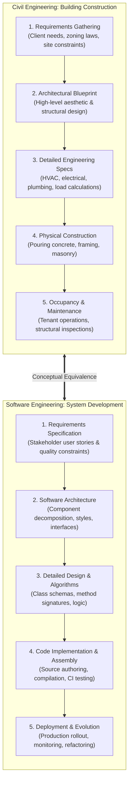

In the building domain, an architect does not begin by laying bricks; they first model spatial layouts, load-bearing frames, and utility conduits to satisfy client requirements and safety codes. Similarly, software architects do not write low-level code immediately; they establish high-level structural blueprints that govern all downstream development.

### 1.1.2 Formal Definition of Software Architecture
Software architecture forms the foundational element of software design.

> [!info] Definition: Software Architecture
> The **software architecture** of a computing system is the set of structures needed to reason about the system, comprising software elements, relations among them, and properties of both.
> 
> It involves understanding and organizing a system, all of its components, their interactions, the operational environment, and the fundamental design principles that govern its evolution.

### 1.1.3 The Four Foundational Tenets
The definition is anchored in four crucial insights:

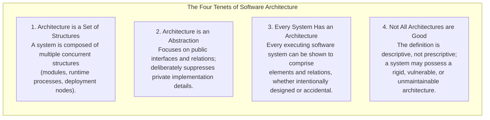

1. **Architecture is a Set of Structures:** Modern systems cannot be captured in a single diagram. They comprise static compile-time structures, runtime interaction structures, and hardware allocation structures.
2. **Architecture is an Abstraction:** Architectural modeling selects high-impact structural details and deliberately suppresses private implementation details (e.g., local variables, internal algorithms, private helper methods). The public interface is architectural; the private method body is not.
3. **Every System Has an Architecture:** Regardless of whether an engineering team drafted formal documentation, any running software system inherently consists of components and relations.
4. **Not All Architectures Are Good Architectures:** An architecture can be poorly conceived, highly coupled, unscalable, or incapable of meeting user needs, yet it remains the architecture of that system.

---

## 1.2 Functions and Strategic Value of Software Architecture

Software architecture delivers immense strategic value across the software lifecycle:
1. **Stakeholder Visualization & Analysis:** Enables non-technical clients, project sponsors, developers, and QA engineers to visualize and reason about system behavior and quality attributes.
2. **Early Anticipation of Expensive Decisions:** Architectural modifications become exponentially more expensive as development proceeds. Architecture allows teams to simulate trade-offs and evaluate risks before concrete implementation begins.
3. **Focus on Component Assembly:** Shifts the engineering focus from writing primitive code from scratch toward assembling, configuring, and orchestrating robust, reusable components and commercial off-the-shelf (COTS) frameworks.
4. **Reusable Transferable Model:** A mature software architecture serves as the foundation for **Software Product Lines (SPL)**, enabling organizations to instantiate multiple related software products from a common architectural base.

---

## 1.3 Architectural Structures vs. Architectural Views

A common source of confusion in software design is the distinction between a **structure** and a **view**:

> [!info] Structure vs. View
> - **Structure:** The actual set of physical or logical elements as they exist in software or hardware in reality.
> - **View:** A documented representation of a coherent set of architectural elements and relations, authored by and presented to system stakeholders.
> 
> *Core Principle: "Architects design structures. They document views of those structures."*

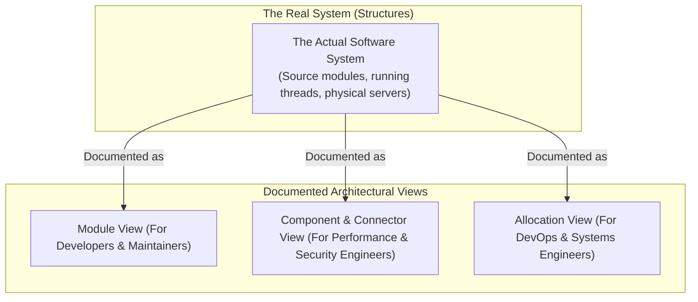

### 1.3.1 The Human Body Analogy
Consider the human body as an anatomical architecture:
- An **X-ray view** reveals the skeletal structure of bones and joints.
- A **vascular view** visualizes the circulatory network of arteries, veins, and blood flow.
- A **neurological view** maps the brain, spinal cord, and neural pathways.

Each view looks completely different, serves a distinct diagnostic purpose, and suppresses irrelevant organs, yet all describe the **same unified biological entity**. To communicate meaningfully about software architecture, engineers must always make clear which specific structure and view they are discussing.

---

## 1.4 The Three Primary Categories of Architectural Structures

Architectural structures are classified into three major orthogonal categories:

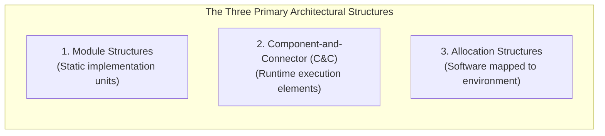

### 1.4.1 1. Module Structures (Static Code Units)
- **Nature:** Static, compile-time partitioning of the software codebase into implementation units (packages, classes, libraries, source files).
- **Core Questions Answered:**
  - *What is the primary functional responsibility assigned to each module?*
  - *What other software elements is a module allowed to use?*
  - *What modules are related by generalization/inheritance (`is-a`) or composition (`part-of`)?*
- **Key Relationships:** `is-part-of`, `depends-on`, `is-a` (inheritance), `allowed-to-use`.
- **Primary Quality Attribute:** **Modifiability**. Module structures allow engineers to isolate changes, preventing ripple effects across the codebase.
- **UML Notations:** UML Package Diagrams, Class Diagrams.

### 1.4.2 2. Component-and-Connector (C&C) Structures (Runtime Dynamics)
- **Nature:** Dynamic runtime execution elements that possess active runtime behavior and pathways of interaction.
- **Constituents:**
  - **Components:** Encapsulated, replaceable computational entities that execute at runtime (e.g., active server processes, database connection pools, clients, filters, GUI managers). Components expose **ports** representing interfaces.
  - **Connectors:** Pathways of interaction mediating communication between components (e.g., Remote Procedure Calls [RPC], message queues, TCP/IP sockets, Unix pipes, shared memory buffers). Connectors bind to component ports via **roles**.
- **Core Questions Answered:**
  - *What are the major executing components and how do they interact at runtime?*
  - *What are the shared data stores and communication bottlenecks?*
  - *Which parts of the system execute in parallel across concurrent threads?*
- **Primary Quality Attributes:** **Performance**, **Security**, **Availability**, and **Concurrency**.
- **UML Notations:** UML Component Diagrams, Composite Structure Diagrams, Communication Diagrams.

### 1.4.3 3. Allocation Structures (Software-to-Environment Mappings)
- **Nature:** Maps software elements (from Module and C&C structures) to the external non-software environment (hardware, file directories, organizational teams).
- **Three Core Allocation Substructures:**

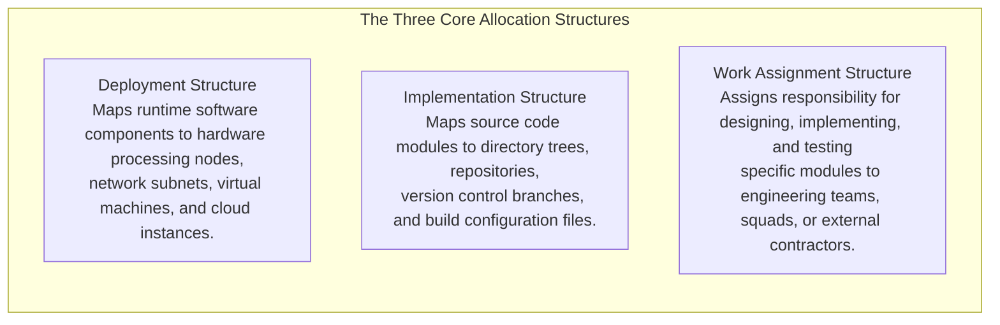

---

## 1.5 Architecture Design Activities: The CS-One-Stop Portal Case Study

Architecture design is an iterative synthesis activity that balances structural perspectives:
1. **Contextual Analysis:** Examining how the system interacts with external users, legacy databases, and third-party APIs.
2. **Multi-Perspective Synthesis (Web Architecture Example):**
   - *Document View:* Web viewed as a hypertext graph of interrelated HTML/MIME documents navigable via URLs and HTTP.
   - *Client-Server Network View:* Web viewed as physical client machines running web browsers connecting over TCP/IP to remote web servers and load balancers.
   - *Service Architecture View:* Web viewed as microservices exposing RESTful JSON endpoints communicating asynchronously via distributed message brokers.

---

# Chapter 2: Quality Attributes, Architectural Documentation & Kruchten's 4+1 View Model

## 2.1 The Strategic Importance of Software Architecture

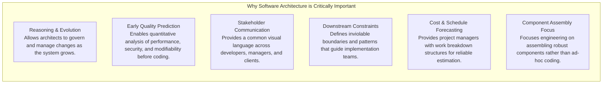

---

## 2.2 Quality Attributes (Non-Functional Requirements)

A software system may execute its core functions correctly, but if it is painfully slow, easily hacked, or impossible to modify, it is a catastrophic engineering failure.

> [!important] Architecture Determines Quality Attributes
> **Architecture is largely about the achievement of quality attributes.** While individual algorithms determine localized correctness, the overall system architecture substantially determines non-functional qualities such as throughput, latency, fault tolerance, security, and maintainability.

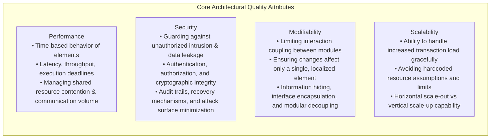

---

## 2.3 The Rationale and Practice of Architecture Documentation

Documenting a software architecture is an indispensable engineering obligation:

> [!quote] The Britt Principle of Documentation
> *"Designing an architecture without documenting it is like winking at a girl in the dark. You know what you're doing, but nobody else does."*
> — Steuart Henderson Britt

Documentation represents the physical or electronic crystallization of an architectural design into formal artifacts (whiteboard snapshots, architecture description documents, interactive models, and living wiki repositories).

### 2.3.1 The Three Fundamental Uses of Architecture Documentation
Architecture documentation serves three vital organizational functions:

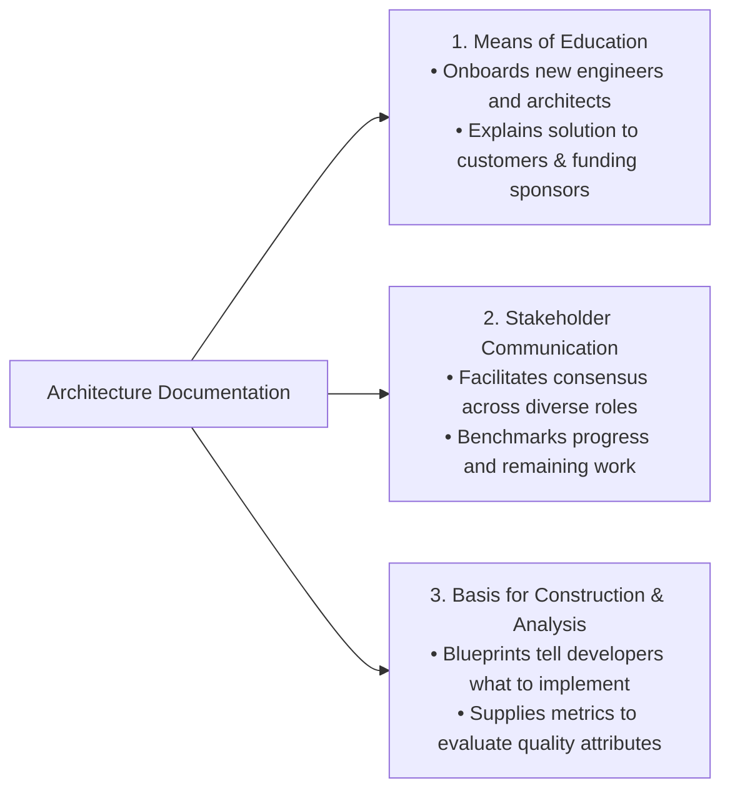

1. **Means of Education:** Introduces new team members, external security auditors, incoming architects, and client sponsors to the system topology, accelerating onboarding and regulatory approvals.
2. **Primary Vehicle for Stakeholder Communication:** Serves as the central negotiation artifact, reconciling conflicting priorities (e.g., product management desiring immediate features vs. security teams demanding strict authentication).
3. **Basis for System Construction and Analysis:** Dictates contracts, interfaces, and constraints to construction teams, while providing evaluators with the architectural data needed to assess performance and security models.

---

## 2.4 Philippe Kruchten's "4+1" Architectural View Model

Published in 1995 by **Philippe Kruchten** (Rational Software / IEEE Software), the **"4+1" View Model** addresses the fundamental reality that **no single visual diagram can satisfy all stakeholders simultaneously**.

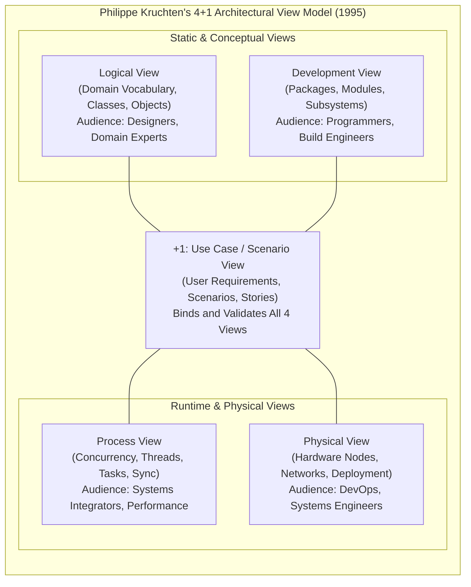

### 2.4.1 1. The Logical View
- **Focus:** Captures the vocabulary and conceptual model of the problem domain.
- **Constituents:** Classes, objects, attributes, methods, and relationships (`inheritance`, `aggregation`, `association`).
- **Primary Audience:** System architects, designers, business analysts, and domain experts.
- **Representative UML Diagrams:** Class Diagrams, Object Diagrams, State Machine Diagrams, Sequence Diagrams.

### 2.4.2 2. The Process View
- **Focus:** Addresses the runtime behavior, concurrency, and communication of the executing system.
- **Constituents:** Independent processes, execution threads, message passing, synchronization mechanisms, deadlock avoidance, and event handling.
- **Primary Audience:** Systems integrators, performance analysts, and concurrency engineers.
- **Representative Notations:** Control Flowcharts, Data Flow Diagrams (DFDs), Activity Diagrams, Concurrency Task Sequence Diagrams.

### 2.4.3 3. The Development View (Implementation View)
- **Focus:** Organizes the actual software codebase and physical module hierarchy.
- **Constituents:** Software modules, source packages, build targets, libraries, third-party frameworks, and sub-systems.
- **Primary Audience:** Software engineers, programmers, build managers, and configuration controllers.
- **Representative UML Diagrams:** Component Diagrams, Package Diagrams, Artifact Diagrams.

### 2.4.4 4. The Physical View (Deployment View)
- **Focus:** Maps the software elements onto the physical hardware infrastructure and execution environment.
- **Constituents:** Physical servers, CPU cores, virtual machines, storage networks, networking routers, communication protocols (TCP/IP, Fibre Channel), and topology.
- **Primary Audience:** Deployment engineers, infrastructure architects, cloud/DevOps specialists, and network administrators.
- **Representative UML Diagrams:** Deployment Diagrams, Network Topology Charts.

### 2.4.5 +1. The Use Case View (Scenario View)
- **Focus:** Bridges and validates the four architectural views using concrete user requirements, scenarios, and operational workflows.
- **Constituents:** Actors, use cases, given-when-then scenarios, and system sequences.
- **The Central "+1" Function:**
  - Serves as the unifying core that binds the four orthogonal views together.
  - Used during architectural reviews (e.g., ATAM) to validate whether the structures defined in the Logical, Process, Development, and Physical views correctly realize stakeholder functional and non-functional requirements.
- **Representative UML Diagrams:** Use Case Diagrams, System Context Diagrams.

---

## 2.5 Summary Comparison of Kruchten's 4+1 Views

| View Name | Primary Perspective | Core Artifacts & Elements | Primary Stakeholder Audience | Standard UML Diagrams |
| :--- | :--- | :--- | :--- | :--- |
| **Logical View** | Domain functionality & abstractions | Classes, objects, domain entities | System Designers, Business Analysts | Class, Object, State Diagrams |
| **Process View** | Runtime concurrency & communication | Threads, processes, sync, IPC | Integrators, Performance Engineers | Activity, Control/Data Flow Charts |
| **Development View** | Codebase architecture & packaging | Packages, modules, COTS libraries | Programmers, Release Engineers | Package, Component Diagrams |
| **Physical View** | Hardware topography & hosting | Servers, VMs, networks, cloud nodes | DevOps, Infrastructure Specialists | Deployment Diagrams |
| **Use Case (+1) View**| User requirements validation | System use cases, actors, scenarios | End Users, Customers, Evaluators | Use Case Diagrams, Scenarios |

---

# Chapter 3: Architectural Styles and Design Patterns

## 3.1 Foundations of Architectural Styles

> [!quote] G.K. Chesterton
> *"There is at the back of every artist’s mind, a pattern or type of architecture."*

As software engineers have constructed thousands of systems across diverse application domains, they have observed that certain structural design choices regularly produce solutions with superior, predictable properties. These recurring architectural patterns are formalized as **Architectural Styles**.

### 3.1.1 Formal Definition of an Architectural Style
An **architectural style** is a specialization of element and relation types, together with a set of constraints on how they can be configured and combined.

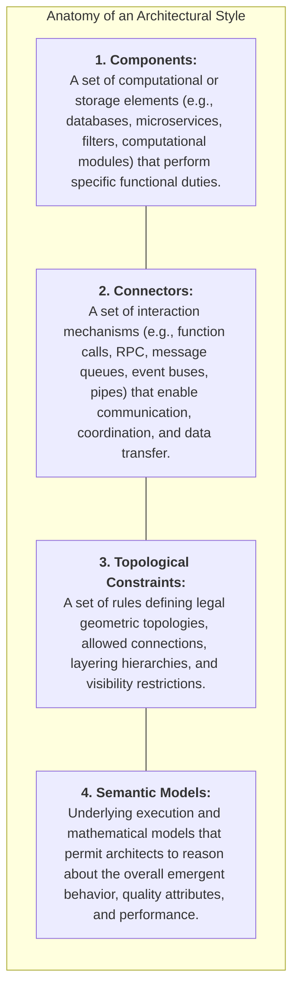

---

## 3.2 Survey of Nine Foundational Architectural Styles

### 3.2.1 1. Client-Server Architecture
The **Client-Server** style partitions a distributed system into two primary cooperating entities: service requestors (**Clients**) and service providers (**Servers**), communicating across a network protocol.

```mermaid
flowchart LR
    subgraph ClientServer["Client-Server Architectural Style"]
        direction TB
        subgraph Clients["Client Tier (User Interface & Presentation)"]
            C1["Desktop App / Thick Client"]
            C2["Mobile App / Native Client"]
            C3["Web Browser / Thin Client"]
        end
        subgraph Server["Server Tier (Services & Data Storage)"]
            S1["Application / Web Server"]
            DB[("Central Database")]
            S1 <--> DB
        end
        Clients <==>|Network Protocols (HTTP/REST, gRPC, TCP/IP)| Server
    end
```

- **Topological Variants:**
  - *2-Tier:* Client directly communicates with the database server or application host.
  - *3-Tier:* Presentation Layer $\leftrightarrow$ Business Application Logic Layer $\leftrightarrow$ Database Storage Layer.
  - *N-Tier & Cloud Computing:* Scalable micro-tier topologies distributed across auto-scaling clusters, load balancers, and cloud data stores.
- **Architectural Benefits:**
  - **Centralized Data Management & Security:** Critical business rules and data stores reside in secure server environments.
  - **Separation of Concerns:** User interface evolution is decoupled from back-end transactional processing.
  - **Flexibility in Client Types:** Multiple heterogeneous clients (web, iOS, Android, IoT) consume identical back-end API contracts.
- **Representative Applications:** E-commerce portals, core banking transaction engines, multiplayer network games.

---

### 3.2.2 2. Peer-to-Peer (P2P) Architecture
In contrast to the centralized hierarchy of client-server systems, the **Peer-to-Peer (P2P)** style structures a network where every participating node (**peer**) possesses symmetrical capabilities and responsibilities.

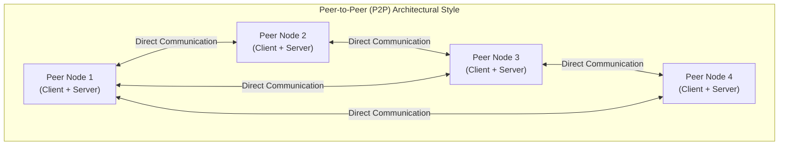

- **Core Architectural Mechanism:** Every computer functions concurrently as a *servent* (server + client), consuming services from others while actively contributing bandwidth, computational power, or storage to the network.
- **Architectural Benefits:**
  - **Extreme Decentralization:** Eliminates single points of failure; the network persists even if numerous nodes disconnect.
  - **High Fault Tolerance & Resilience:** Dynamic routing around unavailable nodes.
  - **Scalable Distributed Processing:** Total network bandwidth and processing capacity scale linearly with each joining peer.
- **Representative Applications:** Distributed file sharing (BitTorrent, IPFS), decentralized ledgers (Blockchain/Bitcoin), peer-to-peer real-time communication (WebRTC).

#### Client-Server vs. Peer-to-Peer Comparison
| Dimension | Client-Server Architecture | Peer-to-Peer Architecture |
| :--- | :--- | :--- |
| **Control & Governance** | Centralized authority on server hosts | Completely decentralized among autonomous nodes |
| **Node Roles** | Asymmetric (Clients request, Servers serve) | Symmetrical (Every peer is both consumer and provider) |
| **Bottlenecks** | Server and database capacity define limits | Bandwidth is distributed across all participating peers |
| **Cost & Infrastructure**| High server hosting and maintenance expenses | Infrastructure costs distributed across end-users |

---

### 3.2.3 3. Data-Centered Architecture (Repository / Blackboard)
The **Data-Centered** (or Repository) architectural style belongs to the Component-and-Connector (C&C) category. It positions a centralized persistent data store at the core of the system, accessed continuously by autonomous client components.

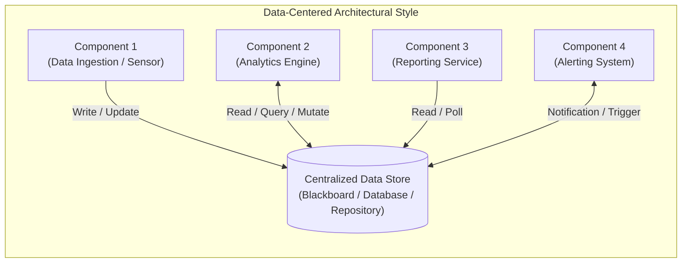

- **Core Architectural Mechanism:** Components communicate indirectly by mutating the shared data store rather than directly calling each other's APIs.
- **Architectural Benefits:**
  - **High Integrability:** New client components can be added to the ecosystem without modifying or notifying existing components.
  - **Data Independence:** Storage representations and consistency schemes are managed uniformly at the central store.
- **Representative Applications:** Compiler symbol-table architectures, Integrated Development Environments (IDEs sharing syntax trees), blackboard systems for artificial intelligence speech recognition.

---

### 3.2.4 4. Event-Driven Architecture (EDA)
**Event-Driven Architecture (EDA)** centers around the detection, production, transmission, and reaction to state changes termed **Events**. Components communicate asynchronously by emitting and consuming events rather than through synchronous, blocking request-response cycles.

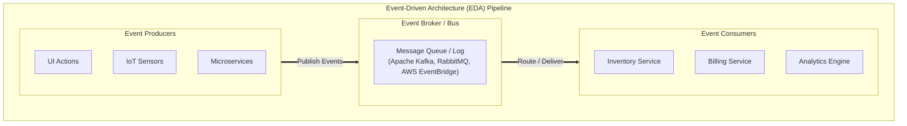

#### The Four Core Components of EDA
1. **Event:** A significant, time-stamped record of a state change or historical occurrence (e.g., `OrderPlaced`, `TemperatureExceededThreshold`).
2. **Event Producer:** The component that detects a domain occurrence, serializes it into an event message, and publishes it to the infrastructure.
3. **Event Broker:** The intermediary message-oriented middleware (MOM) that ingests, persists, filters, and routes events to subscribers (e.g., Apache Kafka, RabbitMQ, AWS SNS/SQS).
4. **Event Consumer:** The service, function, or worker that subscribes to specific event channels, parses incoming messages, and executes business logic.

#### Retail and E-Commerce Case Study
When a customer clicks "Place Order" on an e-commerce platform:
1. The Web UI emits an `OrderPlaced` event into the event broker.
2. The **Inventory Service** consumes the event to decrement warehouse stock.
3. The **Payment Service** consumes the event to charge the customer's credit card.
4. The **Notification Service** consumes the event to dispatch an SMS confirmation.
5. All consumers operate in parallel and completely independently without synchronous blocking.

---

### 3.2.5 5. Layered Pattern Architecture
The **Layered Architecture** belongs to the Module type pattern family. It partitions system modules into stacked horizontal layers, where each layer provides a cohesive set of services through a well-defined public interface.

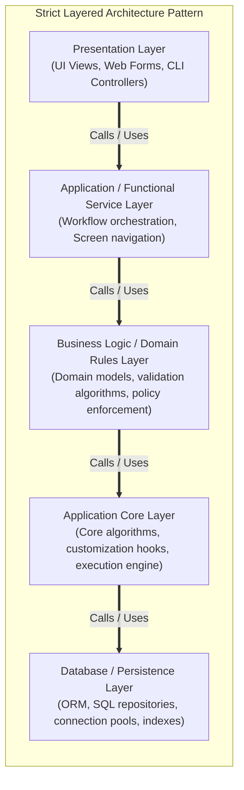

- **Governing Constraint:** A layer is only allowed to access services provided by the layer immediately below it (in *strict* layering) or any lower layer (in *relaxed* layering). Higher layers never depend on implementation details of lower layers.
- **Enterprise Resource Planning (ERP) Case Study:**
  - *User Interaction Layer:* Screens, forms, dynamic menus, accounting reports.
  - *Functionality Layer:* Module navigation, screen sequencing, data input capture.
  - *Business Rules Layer:* Domain policies (e.g., *"If an employee is registered into HR and Payroll, inject an introductory safety course into their training dashboard"*).
  - *Application Core Layer:* Core framework code, extension hooks, custom plugin interfaces.
  - *Database Layer:* Relational tables, transaction logs, indexes.

---

### 3.2.6 6. Service-Oriented Architecture (SOA)
**Service-Oriented Architecture (SOA)** is an enterprise Component-and-Connector (C&C) style where business capabilities are encapsulated as discrete, self-contained, loosely coupled software components called **Services**.

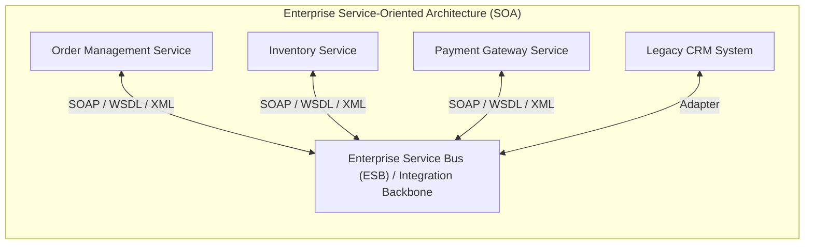

- **Core Architectural Mechanism:** Services communicate over a centralized communication platform termed the **Enterprise Service Bus (ESB)**, which performs protocol translation, message transformation, and routing.
- **Architectural Benefits:** High service reusability across disparate enterprise applications, allowing heterogeneous legacy systems to interface seamlessly.

---

### 3.2.7 7. Microservice Architecture
**Microservice Architecture** refines and evolves SOA by decomposing an application into a suite of small, autonomous, independently deployable services organized strictly around business capabilities.

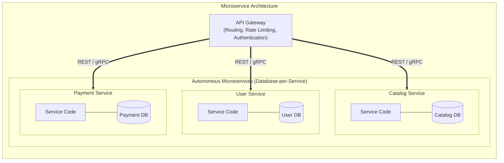

- **Key Differentiator:** Unlike monolithic systems or traditional SOA with shared databases, each microservice owns its private database (**Database-per-Service** pattern), preventing shared database coupling.
- **Architectural Properties:**
  - **Decoupled Deployment:** Services can be upgraded, deployed, or rolled back independently without touching the rest of the application.
  - **Polyglot Engineering:** Each microservice can be authored in the programming language, framework, and data store best suited to its domain problem.

#### Comparative Analysis: Layered Pattern vs. SOA vs. Microservices
| Dimension | Layered Pattern | Service-Oriented Architecture (SOA) | Microservice Architecture |
| :--- | :--- | :--- | :--- |
| **Architecture Scope** | Single application / Monolith | Enterprise-wide multi-system integration | Fine-grained single application decomposition |
| **Data Storage** | Centralized single database | Shared database or legacy repositories | **Database-per-Service** (strict isolation) |
| **Communication** | In-memory function/method calls | Enterprise Service Bus (ESB), SOAP/XML | Lightweight APIs (HTTP/REST, gRPC), Kafka |
| **Deployment Unit** | Single monolithic build package | Coarse-grained enterprise services | Independently containerized microservices (Docker/K8s) |

---

### 3.2.8 8. Data Flow Architecture (Pipe-and-Filter)
In the **Data Flow** architectural style, the system treats processing as a progressive transformation of a data stream through a sequence of discrete computational components.

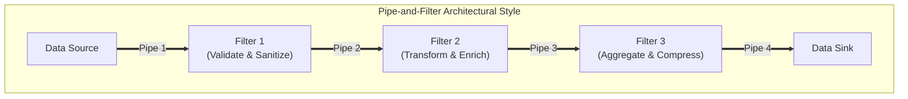

- **Filters:** Independent processing components that consume input data streams, perform mathematical or string manipulations, and emit transformed output data streams. Filters share no state with other filters.
- **Pipes:** Unidirectional conduits that buffer and transmit data streams from the output port of one filter to the input port of the next.
- **Representative Applications:** UNIX command line pipelines (`cat log.txt | grep ERROR | awk '{print $2}' | sort | uniq -c`), media transcoding engines, big data ETL (Extract-Transform-Load) pipelines.

---

### 3.2.9 9. Main Program and Subprogram Architecture
The **Main Program and Subprogram** style is the classical, hierarchical call-and-return structure that dominated early procedural software development.

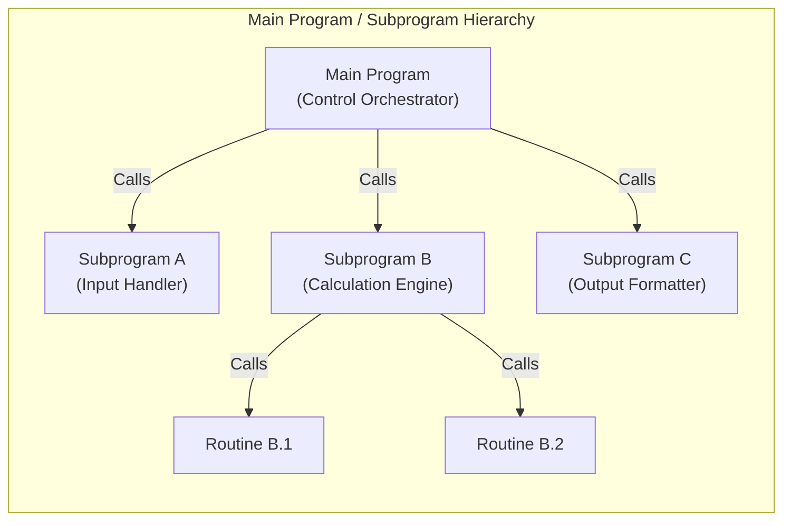

- **Control Hierarchy:** A single root program ("Main") orchestrates execution by sequentially invoking subprograms, passing data through parameters, and receiving returned values upon completion. Subprograms in turn call lower-level subroutines.

---

## 3.3 Synthesis: Structures, Views, and Styles

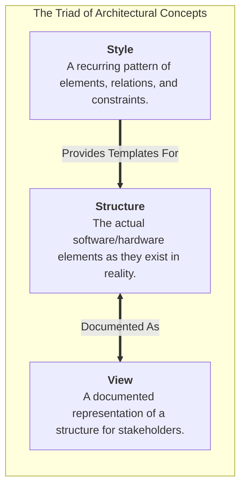

1. **Architects Design Structures:** The tangible software architecture consists of concrete code units, executing processes, and network topologies.
2. **Architects Document Views:** Because no single diagram can represent all facets of a system, architects create specialized views (e.g., Kruchten's 4+1) targeting specific stakeholder questions.
3. **Architectural Styles Provide Proven Templates:** When designing structures, architects apply established styles (Client-Server, Layered, EDA, Microservices) to systematically achieve desired quality attributes.

---

# Chapter 4: Module Views and Module Styles

## 4.1 Foundations of Module Views

### 4.1.1 Overview and Elements of Module Views
In software architecture documentation, it is virtually impossible to complete the architectural description of any non-trivial system without at least one **Module View**.

> [!info] Definition: Module
> A **module** is an implementation unit of software that provides a coherent, well-defined set of responsibilities. It is a static, compile-time construct (e.g., a package, class, source file, namespace, or subsystem).

```mermaid
flowchart TD
    subgraph ModuleViewAnatomy["The Four Pillars of Module Views"]
        direction TB
        M1["<b>Elements:</b><br/>Modules and Subsystems exhibiting coherent responsibilities."]
        M2["<b>Properties:</b><br/>Documented attributes: responsibilities, visibility, interfaces, revision histories."]
        M3["<b>Relations:</b><br/>Static associations: <i>is-part-of</i>, <i>depends-on</i>, <i>is-a</i>, <i>allowed-to-use</i>."]
        M4["<b>Constraints:</b><br/>Topological and structural rules: acyclic graphs, single-parent rules, layer boundaries."]
    end
```

#### Modules vs. Subsystems
When documenting module structures, architects distinguish between standard modules and larger aggregated units termed **Subsystems**:
- **A Subsystem:**
  1. Carries out a functionally cohesive subset of the overall system's mission.
  2. Possesses the architectural capability to be executed independently.
  3. Can be developed, tested, and deployed incrementally by a dedicated team.

> [!tip] Case Study: The Mars Exploratory Robot
> In the architecture of a Mars Exploratory Robot:
> - **Navigation, Motion, Power Management, and Communication** are classified as **Subsystems** because they perform autonomous, cohesive missions essential to the robot's exploration goals.
> - **Utility Math Libraries** are an aggregation of modules with cohesive functionality, but they are **not** classified as a subsystem because they lack the ability to operate independently to achieve an overarching system mission.

---

### 4.1.2 Relations in Module Views
Module views depict three foundational static relations:

```mermaid
flowchart TD
    subgraph ModuleRelations["The Three Foundational Module Relations"]
        direction TB
        R1["<b>1. Is-Part-Of:</b><br/>Defines a part-whole aggregation relationship between a submodule (the part) and an aggregate module (the whole).<br/><i>Primary relation in the Decomposition Style.</i>"]
        R2["<b>2. Depends-On:</b><br/>Defines an operational dependency where Module A requires the presence of a correctly functioning Module B to fulfill its contract.<br/><i>Primary relation in the Uses and Layered Styles.</i>"]
        R3["<b>3. Is-A:</b><br/>Defines a generalization/specialization relationship where a child module specializes or inherits from a general parent module.<br/><i>Primary relation in the Generalization Style.</i>"]
    end
```

---

### 4.1.3 Usages of Module Views
Module views serve multiple critical engineering functions across the system lifecycle:
1. **Blueprint for Source Code Construction:** Provides programmers with the direct organizational blueprint for codebases, directories, and package structures.
2. **Work Assignment and Project Scheduling:** Serves as the primary unit of work breakdown, allowing managers to assign distinct modules to development squads without cross-team collisions.
3. **Impact and Change Analysis:** Enables architects to trace ripple effects when an interface or responsibility undergoes modification.
4. **Requirements Traceability:** Maps functional requirements directly to implementing code packages.
5. **Explaining Codebase Architecture:** Accelerates onboarding of new engineers by providing a high-level cognitive map of system responsibilities.

> [!warning] The Critical Limitation of Module Views
> Module views **CANNOT** be used to evaluate runtime quality attributes such as latency, throughput, concurrency, or hardware deadlock. Because module views are static partitions of code, reasoning about runtime behavior requires mapping module views onto **Component-and-Connector (C&C)** and **Allocation** views.

---

### 4.1.4 Notations for Documenting Module Views
Module views are documented using three standard notations:
- **Informal Box Notations:** Boxes depicting modules nested inside larger boxes, or connected with labeled association arrows.
- **Unified Modeling Language (UML):** Representing modules as UML Packages, Classes, or Components, with dependency arrows (`<<use>>`), composition diamonds (`is-part-of`), and generalization arrows (`is-a`).
- **Dependency Structure Matrix (DSM):** A square matrix whose rows and columns represent modules; a non-empty cell $(i, j)$ signifies that Module $i$ depends on Module $j$, enabling algorithmic detection of cyclic dependencies.

---

## 4.2 The Six Important Module Styles

Software architecture formalizes six distinct styles within the module category:

```mermaid
flowchart TD
    subgraph SixModuleStyles["The Six Module Architectural Styles"]
        direction TB
        MS1["1. Decomposition Style (is-part-of)"]
        MS2["2. Uses Style (depends-on / uses)"]
        MS3["3. Generalization Style (is-a / inheritance)"]
        MS4["4. Layered Style (allowed-to-use)"]
        MS5["5. Aspects Style (cross-cutting concerns)"]
        MS6["6. Data Model Style (static entity schemas)"]
    end
```

---

### 4.2.1 1. The Decomposition Style
The **Decomposition Style** partitions a software system into hierarchical units of implementation, detailing how overall system responsibilities are divided among submodules.

```mermaid
flowchart TD
    subgraph DecompStyle["Decomposition Style: E-Learning System Hierarchy"]
        direction TB
        EL["E-Learning System (Root Package)"]
        CM["Course Management Subsystem"]
        LD["Lesson Delivery Subsystem"]
        QZ["Quiz Subsystem"]
        UM["User Management Subsystem"]
        PT["Progress Tracking Subsystem"]

        EL --> CM
        EL --> LD
        EL --> QZ
        EL --> UM
        EL --> PT

        CM --> CM1["Course Catalog"]
        CM --> CM2["Enrollment Manager"]
        LD --> LD1["Video Streaming Engine"]
        LD --> LD2["Document/Slide Viewer"]
    end
```

| Element | Specification |
| :--- | :--- |
| **Elements** | Modules and Submodules. |
| **Relations** | **Decomposition Relation** (a strict form of the `is-part-of` relation). |
| **Constraints** | 1. **Strictly Acyclic:** No loops or circular decompositions permitted.<br/>2. **Single-Parent Rule:** Every submodule belongs to exactly one parent module. |
| **Usage** | Reasoning about code organization, planning team work assignments, and localizing modifications. |

---

### 4.2.2 2. The Uses Style
The **Uses Style** models functional dependencies between modules, tracking which modules require the correct operation of other modules.

> [!info] The "Uses" Relation
> Module $A$ **uses** Module $B$ if and only if the correct functioning of $A$ depends on the presence of a correct implementation of $B$ to satisfy its specified requirements.

```mermaid
flowchart TD
    subgraph UsesTopology["The Uses Style: Incremental Subset Planning"]
        direction TB
        subgraph Subset0["Subset 0 (Base Kernel)"]
            M_Kernel["Security & Logging Kernel"]
        end
        subgraph Subset1["Subset 1 (Core Utilities)"]
            M_Data["Data Storage Accessor"]
        end
        subgraph Subset2["Subset 2 (Business Logic)"]
            M_Biz["Transaction Engine"]
        end
        M_Biz ==>|<<use>>| M_Data
        M_Data ==>|<<use>>| M_Kernel
    end
```

- **Topological Constraints:** The Uses style imposes no hard topological limits; however, architectural anti-patterns such as cyclic dependencies ($A \text{ uses } B \text{ uses } A$), high fan-out, or deeply nested chains severely degrade the architecture's capacity for incremental delivery and test isolation.
- **Architectural Value:**
  - **Incremental Subset Delivery:** Enables engineering teams to define minimal viable subsets (Subsets 0, 1, 2) that can be compiled, tested, and shipped independently.
  - **Testing and Debugging:** High-confidence unit testing requires isolating modules that have zero dependencies on uncompleted modules.
- **Case Study: The ATIA-M System:** The US Army Training Information Architecture - Migrated (ATIA-M) system utilized the Uses style to decouple heavy Windows C# desktop thick clients from server-side Java EE Web services, allowing server business logic to be tested and deployed months before GUI completion.

---

### 4.2.3 3. The Generalization Style
The **Generalization Style** organizes modules according to their shared commonalities and domain variations using the `is-a` relationship.

```mermaid
classDiagram
    class PetStoreComponent {
        <<Abstract>>
        +String componentId
        +initialize()
    }
    class CatalogModule {
        +searchProducts()
        +displayCategories()
    }
    class ShoppingCartModule {
        +addItem()
        +calculateTax()
    }
    class SecureCheckoutModule {
        +processCreditCard()
        +generateReceipt()
    }
    PetStoreComponent <|-- CatalogModule : is-a
    PetStoreComponent <|-- ShoppingCartModule : is-a
    ShoppingCartModule <|-- SecureCheckoutModule : specializes
```

- **Elements:** Modules, specialized into abstract modules (containing interface definitions or incomplete implementations) and concrete modules.
- **Relations:** Generalization (`is-a`), specializing into class inheritance, interface inheritance, or implementation realization.
- **Constraints:** A module may have multiple parents (multiple inheritance), though multiple inheritance introduces well-known structural ambiguities (the Diamond Problem).
- **Architectural Value:** Captures domain commonalities at high levels of abstraction, supporting software reuse, framework extensibility, and polymorphic evolution.

---

### 4.2.4 4. The Layered Style
The **Layered Style** is one of the most widely adopted module patterns in software engineering. Modules are grouped into a set of ordered layers, where each layer exposes a cohesive public interface.

```mermaid
flowchart TD
    subgraph LayeredConstraints["The Layered Style: Strict Allowed-to-Use Rules"]
        direction TB
        L4["Layer 4: Application User Interface"]
        L3["Layer 3: Business Workflow Services"]
        L2["Layer 2: Core Domain Logic"]
        L1["Layer 1: Platform & OS Abstraction"]

        L4 ==>|allowed-to-use| L3
        L3 ==>|allowed-to-use| L2
        L2 ==>|allowed-to-use| L1
    end
```

#### Fundamental Constraints of the Layered Style
1. **Complete Partitioning:** Every single piece of software in the system is assigned to exactly one layer.
2. **Minimum Layers:** The architecture must contain at least two layers.
3. **Unidirectional `Allowed-to-Use` Relation:** A layer may only use services in lower layers; **circular dependencies are strictly prohibited** (a lower layer can never call or depend upon a higher layer).

#### Architectural Benefits
- **Modifiability & Portability:** Swapping or refactoring an internal layer (e.g., replacing a SQL database with a NoSQL store in Layer 1) does not impact upper application layers as long as the public interface contract remains invariant.
- **Separation of Concerns:** Developers specialize within distinct layers (UI specialists in Layer 4, database engineers in Layer 1).

---

### 4.2.5 Notational Variations and Geometry in Layered Architecture
Architects utilize five visual paradigms to convey distinct topological nuances in layered views:

```mermaid
flowchart LR
    subgraph LayeredNotations["Five Notational Variations for Layered Views"]
        direction TB
        N1["<b>1. Stack:</b> Standard horizontal boxes stacked vertically; downward geometric adjacency implies allowed-to-use."]
        N2["<b>2. Segmented Layers:</b> Horizontal layers subdivided into segments; clarifies whether sub-modules within the same layer can access each other."]
        N3["<b>3. Concentric Rings:</b> Innermost circle represents the lowest layer (Kernel); outermost ring represents the highest layer (UI/Clients)."]
        N4["<b>4. Layers with a Sidecar:</b> Specialized vertical box alongside the stack representing cross-cutting platform utilities (OS, Logging) accessible by all layers."]
        N5["<b>5. Size and Color:</b> Box dimensions convey relative code volume; colors identify team ownership or third-party imported dependencies."]
    end
```

#### Detailed Comparison: Stack vs. Concentric Rings vs. Sidecars
1. **The Stack Paradigm:** Simplest and most common representation. Read strictly from top to bottom.
2. **Segmented Layers:** When a layer is partitioned into multiple sub-packages, ambiguity arises regarding whether adjacent segments can call each other. The documentation key must explicitly state whether intra-layer calls are permissible.
3. **Concentric Rings Paradigm:**
   - Innermost ring = lowest foundational layer (e.g., Operating System Kernel).
   - Outermost ring = highest application layer.
   - *Geometric Advantage:* A concentric ring can naturally depict multi-way adjacency that cannot be drawn in a simple 2D rectangular stack without crossing lines.
4. **Layers with a Sidecar:** Platform-wide infrastructure services (e.g., Logging, Telemetry, Security Frameworks) are utilized across all vertical layers. Drawing connections from every layer to a bottom box clutters diagrams; placing them as a **Sidecar** visually conveys their universal availability.

---

### 4.2.6 5. Aspects Style & 6. Data Model Style
The remaining two module styles address specialized structural perspectives:
- **Aspects Style:** Encapsulates cross-cutting concerns (e.g., authentication, transaction management, performance logging) that weave across standard module boundaries, utilizing Aspect-Oriented Programming (AOP) pointcuts and advice.
- **Data Model Style:** Captures static data entities, attributes, and relational cardinalities (one-to-one, one-to-many, many-to-many) in a static conceptual schema, governing the structure of relational and object databases.

---

## 4.3 Summary Synthesis of CKS221 Curriculum: Structures, Views, Styles

```mermaid
flowchart TD
    subgraph CKS221_Synthesis["CKS221 Comprehensive Curriculum Framework"]
        direction TB
        subgraph Foundations["Foundations (Chapters 1 & 2)"]
            F1["Software Architecture Definition & Tenets"]
            F2["Structures vs. Views (Britt's Principle)"]
            F3["Quality Attributes (Performance, Security, Modifiability)"]
            F4["Philippe Kruchten's 4+1 View Model"]
        end
        subgraph StylesCategory["Architectural Styles (Chapter 3)"]
            S1["Client-Server, P2P & Data-Centered"]
            S2["Event-Driven Architecture (EDA) & Pipes-and-Filters"]
            S3["Layered, SOA & Microservices"]
        end
        subgraph ModuleCategory["Module Views & Styles (Chapter 4)"]
            M1["Modules vs. Subsystems (Mars Rover Case)"]
            M2["Decomposition & Uses Styles (ATIA-M)"]
            M3["Generalization (PetStore) & Layered Styles (UNIX)"]
            M4["Five Visual Notations (Stack, Rings, Sidecars)"]
        end
        Foundations ==> StylesCategory
        StylesCategory ==> ModuleCategory
    end
```
