# Topic 1: Software Architecture

## 1.1 The Discipline and Foundations of Software Architecture

The study of **software architecture** is the study of how complex software systems are conceived, structured, partitioned, and assembled.

### 1.1.1 The Building Architecture Analogy
To understand software architecture, engineering disciplines draw a direct analogy to civil engineering and building construction:

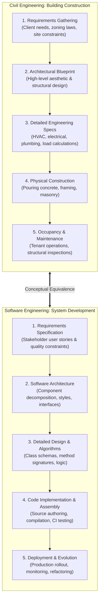

In the building domain, an architect does not begin by laying bricks; they first model spatial layouts, load-bearing frames, and utility conduits to satisfy client requirements and safety codes. Similarly, software architects do not write low-level code immediately; they establish high-level structural blueprints that govern all downstream development.

### 1.1.2 Formal Definition of Software Architecture
Software architecture forms the foundational element of software design.

> [!info] Definition: Software Architecture
> The **software architecture** of a computing system is the set of structures needed to reason about the system, comprising software elements, relations among them, and properties of both.
> 
> It involves understanding and organizing a system, all of its components, their interactions, the operational environment, and the fundamental design principles that govern its evolution.

### 1.1.3 The Four Foundational Tenets
The definition is anchored in four crucial insights:

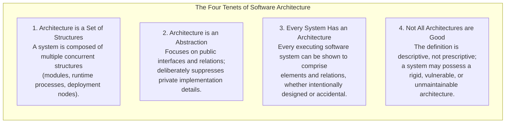

1. **Architecture is a Set of Structures:** Modern systems cannot be captured in a single diagram. They comprise static compile-time structures, runtime interaction structures, and hardware allocation structures.
2. **Architecture is an Abstraction:** Architectural modeling selects high-impact structural details and deliberately suppresses private implementation details (e.g., local variables, internal algorithms, private helper methods). The public interface is architectural; the private method body is not.
3. **Every System Has an Architecture:** Regardless of whether an engineering team drafted formal documentation, any running software system inherently consists of components and relations.
4. **Not All Architectures Are Good Architectures:** An architecture can be poorly conceived, highly coupled, unscalable, or incapable of meeting user needs, yet it remains the architecture of that system.

---

## 1.2 Functions of Software Architecture (Lecture 1, Slide 12)

According to Lecture 1 (Slide 12), software architecture fulfills four primary functions:
1. **Visualisation & Quality Analysis:** Helps stakeholders to visualise, understand, and analyse a system’s qualities.
2. **Focus on Structure:** Focuses on the system's high-level structure (rather than implementation).
3. **Anticipating Expensive Choices:** Can be used to anticipate expensive choices in a project before they are made.
4. **Basis for Core Decisions:** Used as the foundational basis for making core decisions to ensure high-quality work.

---

## 1.3 Architectural Structures vs. Architectural Views

A common source of confusion in software design is the distinction between a **structure** and a **view**:

> [!info] Structure vs. View
> - **Structure:** The actual set of physical or logical elements as they exist in software or hardware in reality.
> - **View:** A documented representation of a coherent set of architectural elements and relations, authored by and presented to system stakeholders.
> 
> *Core Principle: "Architects design structures. They document views of those structures."*

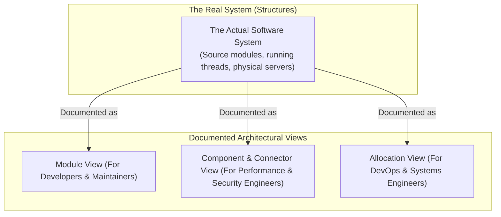

### 1.3.1 The Human Body Analogy
Consider the human body as an anatomical architecture:
- An **X-ray view** reveals the skeletal structure of bones and joints.
- A **vascular view** visualizes the circulatory network of arteries, veins, and blood flow.
- A **neurological view** maps the brain, spinal cord, and neural pathways.

Each view looks completely different, serves a distinct diagnostic purpose, and suppresses irrelevant organs, yet all describe the **same unified biological entity**. To communicate meaningfully about software architecture, engineers must always make clear which specific structure and view they are discussing.

### 1.3.2 One System, Multiple Structures: Decomposition View vs. Client-Server View
Slide 23 of Lecture 1 demonstrates that a single software system inevitably possesses multiple distinct, orthogonal structures simultaneously. Consider a standard networked client-server application:

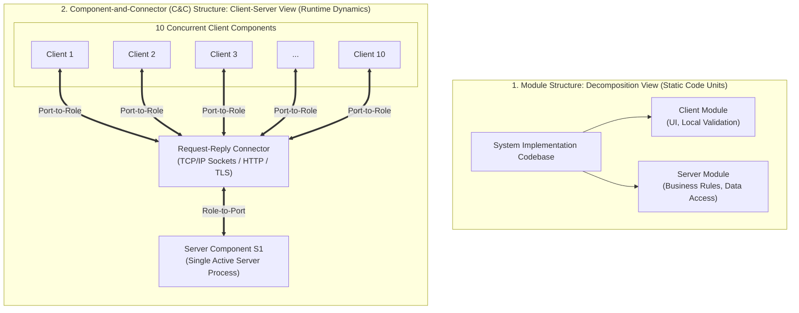

| Structural Dimension | Decomposition View (Module Structure) | Client-Server View (C&C Structure) |
| :--- | :--- | :--- |
| **Nature of Elements** | Static software units of implementation (modules, source files, packages). | Dynamic runtime entities (executing processes, threads, server daemons). |
| **Element Count** | **2 static modules:** The Client module and the Server module. | **11 runtime components:** 10 active client processes + 1 server daemon ($S1$). |
| **Relations** | `is-part-of` decomposition hierarchy. | Runtime attachment between component **ports** and connector **roles**. |
| **Primary Audience** | Programmers, build release engineers, configuration managers. | Network architects, performance engineers, capacity planners. |
| **Architectural Insight** | Informs how source code is organized, compiled, and modularized. | Analyzes network throughput, server bottleneck saturation, and concurrency. |

---

## 1.4 The Three Primary Categories of Architectural Structures

Architectural structures are classified into three major orthogonal categories:

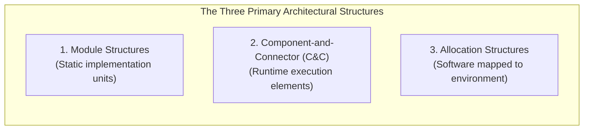

### 1.4.1 1. Module Structures (Static Code Units)
- **Nature:** Static, compile-time partitioning of the software codebase into implementation units (packages, classes, libraries, source files).
- **Core Questions Answered:**
  - *What is the primary functional responsibility assigned to each module?*
  - *What other software elements is a module allowed to use?*
  - *What modules are related by generalization/inheritance (`is-a`) or composition (`part-of`)?*
- **Key Relationships:** `is-part-of`, `depends-on`, `is-a` (inheritance), `allowed-to-use`.
- **Primary Quality Attribute:** **Modifiability**. Module structures allow engineers to isolate changes, preventing ripple effects across the codebase.
- **UML Notations:** UML Package Diagrams, Class Diagrams.

### 1.4.2 2. Component-and-Connector (C&C) Structures (Runtime Dynamics)
- **Nature:** Dynamic runtime execution elements that possess active runtime behavior and pathways of interaction.
- **Constituents:**
  - **Components:** Encapsulated, replaceable computational entities that execute at runtime (e.g., active server processes, database connection pools, clients, filters, GUI managers). Components expose **ports** representing interfaces.
  - **Connectors:** Pathways of interaction mediating communication between components (e.g., Remote Procedure Calls [RPC], message queues, TCP/IP sockets, Unix pipes, shared memory buffers). Connectors bind to component ports via **roles**.
- **Core Questions Answered:**
  - *What are the major executing components and how do they interact at runtime?*
  - *What are the shared data stores and communication bottlenecks?*
  - *Which parts of the system execute in parallel across concurrent threads?*
- **Primary Quality Attributes:** **Performance**, **Security**, **Availability**, and **Concurrency**.
- **UML Notations:** UML Component Diagrams, Composite Structure Diagrams, Communication Diagrams.

### 1.4.3 3. Allocation Structures (Software-to-Environment Mappings)
- **Nature:** Maps software elements (from Module and C&C structures) to the external non-software environment (hardware, file directories, organizational teams).
- **Three Core Allocation Substructures:**

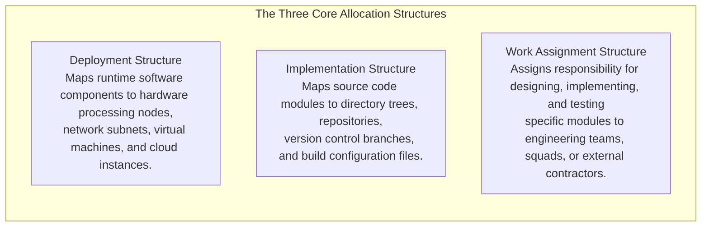

---

## 1.5 Architecture Design Activities: The CS-One-Stop Portal Case Study

Architecture design is an iterative synthesis activity that transforms business and quality drivers into concrete architectural structures.

### 1.5.1 The Architecture Design Activity Framework
Slide 28 of Lecture 1 formalizes the architectural design lifecycle. The software architect operates as the central synthesiser bridging drivers and structures:

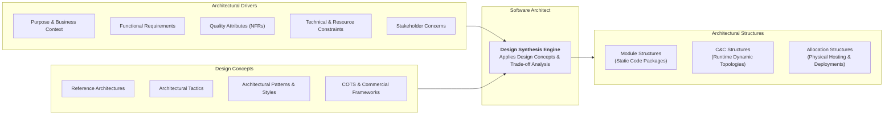

### 1.5.2 Enterprise Case Study: The CS-One-Stop Portal System
Slides 29–31 of Lecture 1 present the architectural blueprint of the **CS-One-Stop Portal** (an enterprise university portal for computer science students and faculty) represented across the three primary architectural views:

#### 1.5.2.1 CS-One-Stop Module View (Package Hierarchy)
The static code structure organizes system capabilities into two distinct vertical layers:

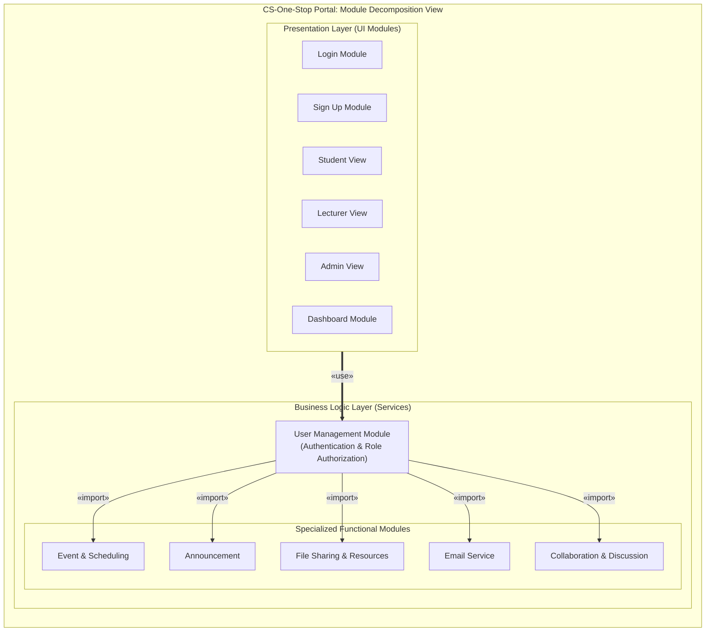

#### 1.5.2.2 CS-One-Stop C&C View (5-Tier Runtime Network Architecture)
The runtime view visualizes concurrent processes, network communication boundaries, and cloud middle-tier integrations:

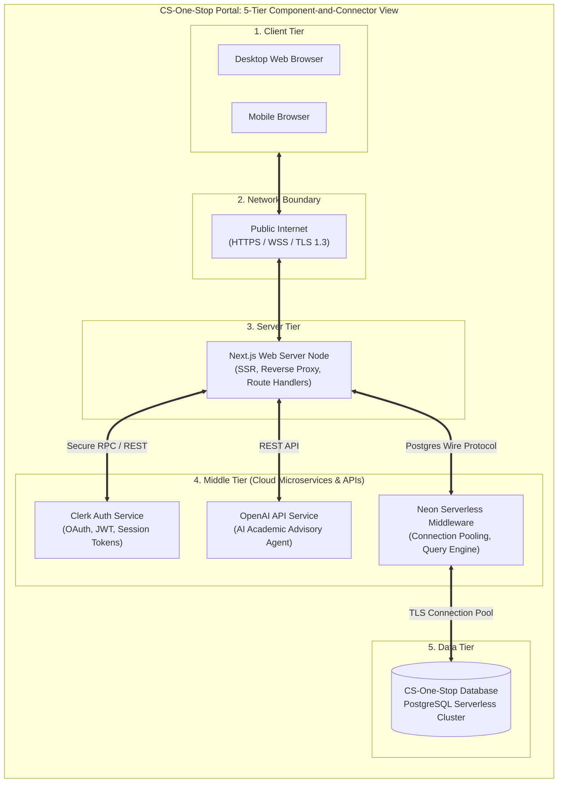

#### 1.5.2.3 CS-One-Stop Allocation View (Cloud Deployment Architecture)
The allocation view maps software execution units to physical hardware and serverless cloud infrastructure:

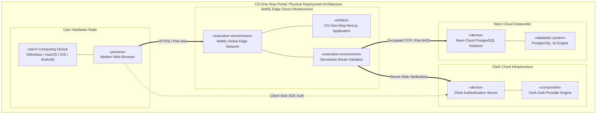


## 1.6 The Strategic Importance of Software Architecture

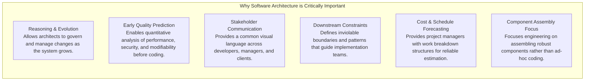

---

## 1.7 Quality Attributes (Non-Functional Requirements)

A software system may execute its core functions correctly, but if it is painfully slow, easily hacked, or impossible to modify, it is a catastrophic engineering failure.

> [!important] Architecture Determines Quality Attributes
> **Architecture is largely about the achievement of quality attributes.** While individual algorithms determine localized correctness, the overall system architecture substantially determines non-functional qualities such as throughput, latency, fault tolerance, security, and maintainability.

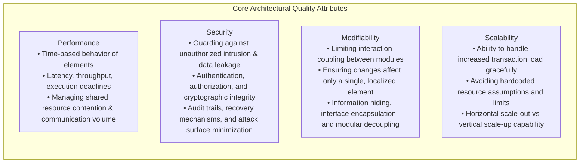

---

## 1.8 The Rationale and Practice of Architecture Documentation

Documenting a software architecture is an indispensable engineering obligation:

> [!quote] The Britt Principle of Documentation
> *"Designing an architecture without documenting it is like winking at a girl in the dark. You know what you're doing, but nobody else does."*
> — Steuart Henderson Britt

Documentation represents the physical or electronic crystallization of an architectural design into formal artifacts (whiteboard snapshots, architecture description documents, interactive models, and living wiki repositories).

### 1.8.1 The Three Fundamental Uses of Architecture Documentation
Architecture documentation serves three vital organizational functions:

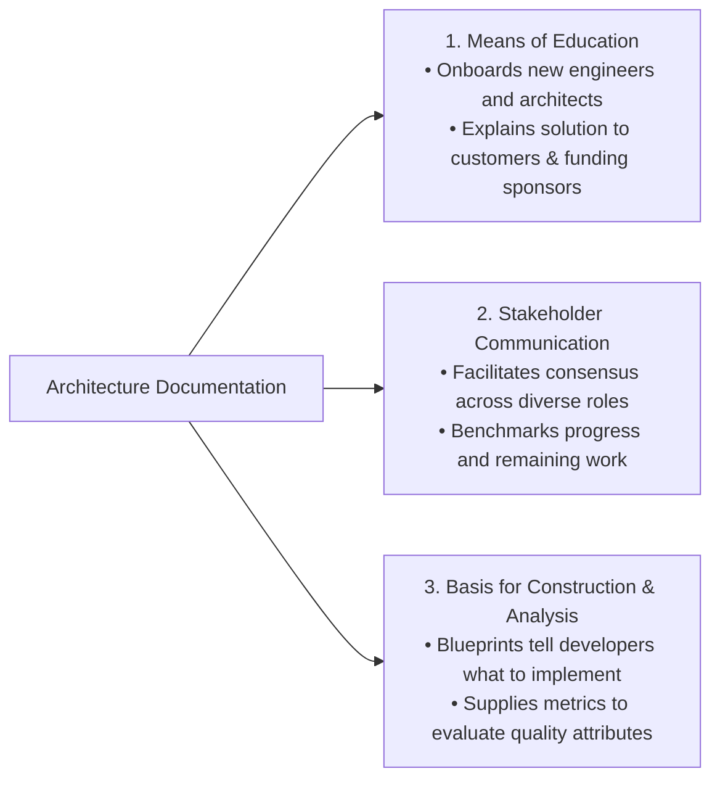

1. **Means of Education:** Introduces new team members, external security auditors, incoming architects, and client sponsors to the system topology, accelerating onboarding and regulatory approvals.
2. **Primary Vehicle for Stakeholder Communication:** Serves as the central negotiation artifact, reconciling conflicting priorities (e.g., product management desiring immediate features vs. security teams demanding strict authentication).
3. **Basis for System Construction and Analysis:** Dictates contracts, interfaces, and constraints to construction teams, while providing evaluators with the architectural data needed to assess performance and security models.

---

## 1.9 Philippe Kruchten's "4+1" Architectural View Model

Published in 1995 by **Philippe Kruchten** (Rational Software / IEEE Software), the **"4+1" View Model** addresses the fundamental reality that **no single visual diagram can satisfy all stakeholders simultaneously**.

> [!note] Theoretical Extension: Hofmeister, Nord & Soni (2000)
> Slide 15 of Lecture 2 notes that alongside Kruchten's 4+1 Model, software architecture literature includes the four-view model proposed by **Hofmeister, Nord, and Soni (2000)**:
> 1. **Conceptual View:** Characterizes domain entities and relationships purely at the problem level, independent of implementation platforms.
> 2. **Module View:** Structures the codebase into subsystems, modules, and layers.
> 3. **Execution View:** Depicts runtime dynamic processes, threads, and interprocess communication.
> 4. **Code Architecture View:** Organizes source files, binaries, build libraries, and physical packaging.

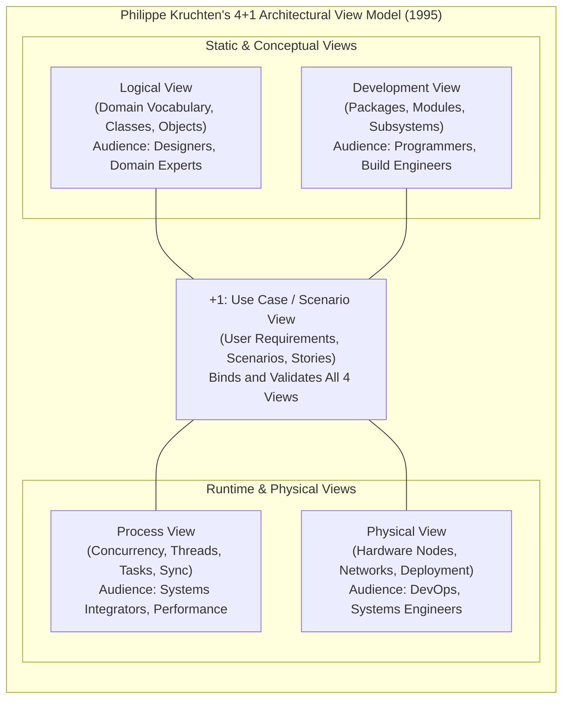

---

### 1.9.1 1. The Logical View
- **Focus:** Captures the vocabulary, entities, and conceptual services of the problem domain.
- **Constituents:** Classes, objects, interfaces, operations, and relationships (`generalization`, `association`, `dependency`).
- **Primary Audience:** System architects, designers, business analysts, and domain experts.
- **Concrete Slide Example (Slide 19 of Lecture 2):** A **UML Sequence Diagram** tracing dynamic message exchange between actors and system objects:

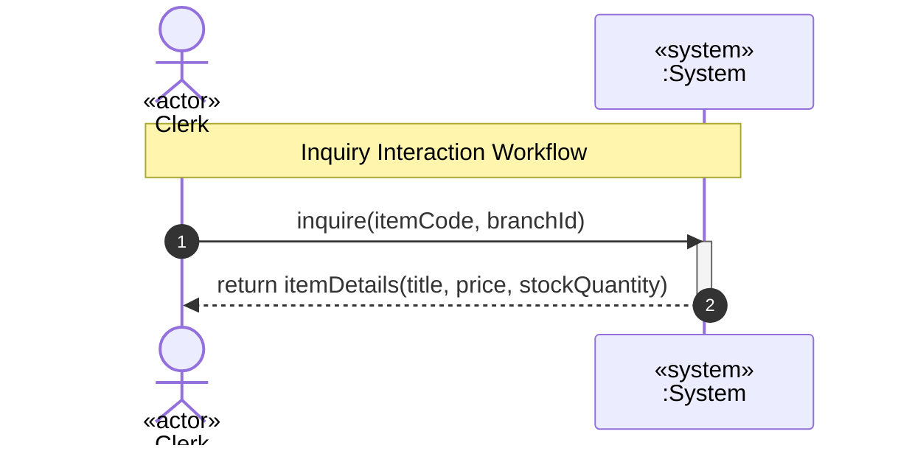

---

### 1.9.2 2. The Process View
- **Focus:** Addresses the runtime concurrency, execution threads, communication mechanisms, and synchronization of the running system.
- **Constituents:** Independent processes, execution threads, synchronization semaphores, deadlock avoidance, and event queues.
- **Primary Audience:** Systems integrators, performance analysts, and concurrency engineers.
- **Concrete Slide Example (Slide 20 of Lecture 2):** A **UML Activity Diagram** formalizing the execution workflow of the `Rental::setRental` operation:

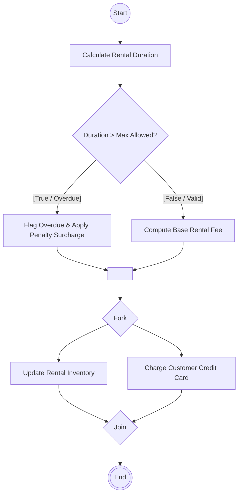

---

### 1.9.3 3. The Development View (Implementation View)
- **Focus:** Organizes the actual software codebase, compilation packages, and physical artifact manifests.
- **Constituents:** Software modules, JAR/WAR/EAR packages, source directories, libraries, and third-party frameworks.
- **Primary Audience:** Software engineers, programmers, build managers, and configuration controllers.
- **Concrete Slide Example (Slide 21 of Lecture 2):** A **UML Manifestation Diagram** showing a compiled Java archive manifesting a runtime component:

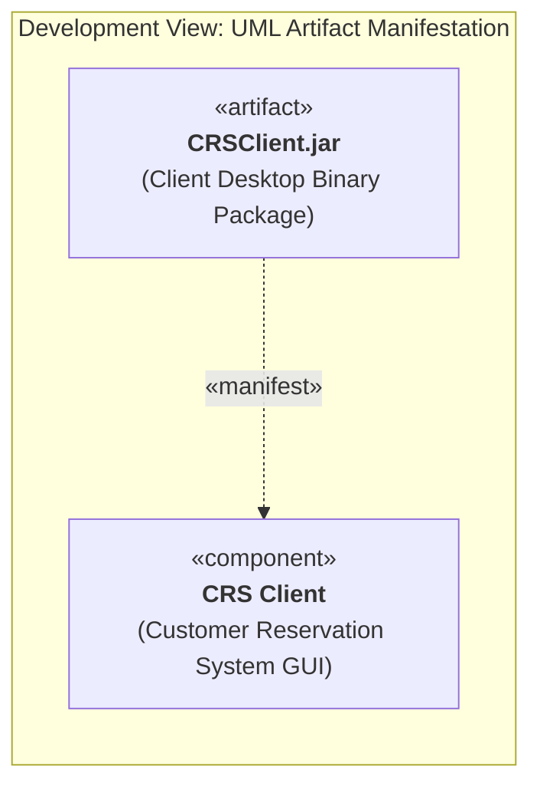

---

### 1.9.4 4. The Physical View (Deployment View)
- **Focus:** Maps the software elements onto the physical hardware infrastructure, computing nodes, and execution networks.
- **Constituents:** Physical servers, network routers, communication links (TCP/IP, HTTP), virtual machines, and cloud containers.
- **Primary Audience:** Deployment engineers, infrastructure architects, cloud/DevOps specialists, and network administrators.
- **Concrete Slide Example (Slide 22 of Lecture 2):** A **UML Deployment Diagram** illustrating multi-tier hardware hosting:

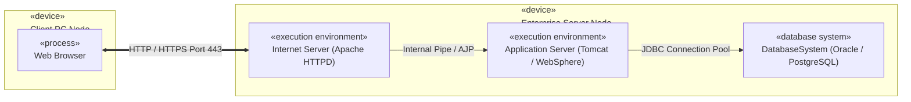

---

### 1.9.5 +1. The Use Case View (Scenario View)
- **Focus:** Bridges, harmonizes, and validates the four architectural views using concrete user requirements, scenarios, and operational workflows.
- **Constituents:** Actors, use cases, scenarios, and preconditions.
- **The Central "+1" Function:**
  - Serves as the unifying core that binds the four orthogonal views together.
  - Used during architectural reviews to validate whether the structures defined in the Logical, Process, Development, and Physical views correctly realize stakeholder functional and non-functional requirements.
- **Concrete Slide Example (Slide 23 of Lecture 2):** A **UML Use Case Diagram** of a Library Management System:

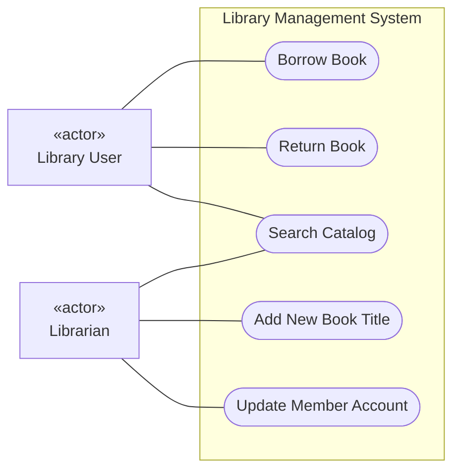

---

## 1.10 Summary Comparison of Kruchten's 4+1 Views

| View Name | Primary Perspective | Core Artifacts & Elements | Primary Stakeholder Audience | Standard UML Diagrams |
| :--- | :--- | :--- | :--- | :--- |
| **Logical View** | Domain functionality & abstractions | Classes, objects, domain entities | System Designers, Business Analysts | Class, Object, State Diagrams |
| **Process View** | Runtime concurrency & communication | Threads, processes, sync, IPC | Integrators, Performance Engineers | Activity, Control/Data Flow Charts |
| **Development View** | Codebase architecture & packaging | Packages, modules, COTS libraries | Programmers, Release Engineers | Package, Component Diagrams |
| **Physical View** | Hardware topography & hosting | Servers, VMs, networks, cloud nodes | DevOps, Infrastructure Specialists | Deployment Diagrams |
| **Use Case (+1) View**| User requirements validation | System use cases, actors, scenarios | End Users, Customers, Evaluators | Use Case Diagrams, Scenarios |


## 1.11 Foundations of Architectural Styles

> [!quote] G.K. Chesterton
> *"There is at the back of every artist’s mind, a pattern or type of architecture."*

As software engineers have constructed thousands of systems across diverse application domains, they have observed that certain structural design choices regularly produce solutions with superior, predictable properties. These recurring architectural patterns are formalized as **Architectural Styles**.

### 1.11.1 Formal Definition of an Architectural Style
An **architectural style** is a specialization of element and relation types, together with a set of constraints on how they can be configured and combined.

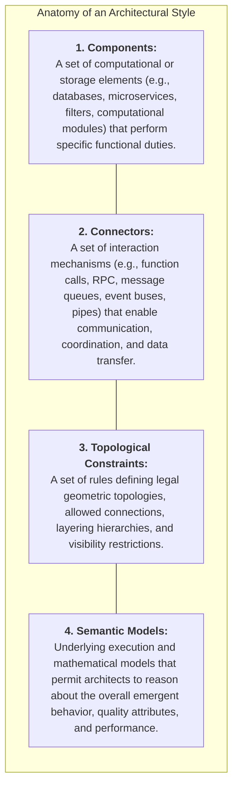

---

## 1.12 Survey of Nine Foundational Architectural Styles

### 1.12.1 1. Client-Server Architecture
The **Client-Server** style partitions a distributed system into two primary cooperating entities: service requestors (**Clients**) and service providers (**Servers**), communicating across a network protocol.

```mermaid
flowchart LR
    subgraph ClientServer["Client-Server Architectural Style"]
        direction TB
        subgraph Clients["Client Tier (User Interface & Presentation)"]
            C1["Desktop App / Thick Client"]
            C2["Mobile App / Native Client"]
            C3["Web Browser / Thin Client"]
        end
        subgraph Server["Server Tier (Services & Data Storage)"]
            S1["Application / Web Server"]
            DB[("Central Database")]
            S1 <--> DB
        end
        Clients <==>|Network Protocols (HTTP/REST, gRPC, TCP/IP)| Server
    end
```

- **Topological Variants:**
  - *2-Tier:* Client directly communicates with the database server or application host.
  - *3-Tier:* Presentation Layer $\leftrightarrow$ Business Application Logic Layer $\leftrightarrow$ Database Storage Layer.
  - *N-Tier & Cloud Computing:* Scalable micro-tier topologies distributed across auto-scaling clusters, load balancers, and cloud data stores.
- **Architectural Benefits:**
  - **Centralized Data Management & Security:** Critical business rules and data stores reside in secure server environments.
  - **Separation of Concerns:** User interface evolution is decoupled from back-end transactional processing.
  - **Flexibility in Client Types:** Multiple heterogeneous clients (web, iOS, Android, IoT) consume identical back-end API contracts.
- **Representative Applications:** E-commerce portals, core banking transaction engines, multiplayer network games.

---

### 1.12.2 2. Peer-to-Peer (P2P) Architecture
In contrast to the centralized hierarchy of client-server systems, the **Peer-to-Peer (P2P)** style structures a network where every participating node (**peer**) possesses symmetrical capabilities and responsibilities.

```mermaid
flowchart TD
    subgraph P2PTopology["Peer-to-Peer (P2P) Architectural Style"]
        direction LR
        P1["Peer Node 1<br/>(Client + Server)"] <-->|Direct Communication| P2["Peer Node 2<br/>(Client + Server)"]
        P2 <-->|Direct Communication| P3["Peer Node 3<br/>(Client + Server)"]
        P3 <-->|Direct Communication| P4["Peer Node 4<br/>(Client + Server)"]
        P4 <-->|Direct Communication| P1
        P1 <-->|Direct Communication| P3
    end
```

- **Core Architectural Mechanism:** Every computer functions concurrently as a *servent* (server + client), consuming services from others while actively contributing bandwidth, computational power, or storage to the network.
- **Architectural Benefits:**
  - **Extreme Decentralization:** Eliminates single points of failure; the network persists even if numerous nodes disconnect.
  - **High Fault Tolerance & Resilience:** Dynamic routing around unavailable nodes.
  - **Scalable Distributed Processing:** Total network bandwidth and processing capacity scale linearly with each joining peer.
- **Representative Applications:** Distributed file sharing (BitTorrent, IPFS), decentralized ledgers (Blockchain/Bitcoin), peer-to-peer real-time communication (WebRTC).

#### Client-Server vs. Peer-to-Peer Comparison
| Dimension | Client-Server Architecture | Peer-to-Peer Architecture |
| :--- | :--- | :--- |
| **Control & Governance** | Centralized authority on server hosts | Completely decentralized among autonomous nodes |
| **Node Roles** | Asymmetric (Clients request, Servers serve) | Symmetrical (Every peer is both consumer and provider) |
| **Bottlenecks** | Server and database capacity define limits | Bandwidth is distributed across all participating peers |
| **Cost & Infrastructure**| High server hosting and maintenance expenses | Infrastructure costs distributed across end-users |

---

### 1.12.3 3. Data-Centered Architecture (Repository / Blackboard)
The **Data-Centered** (or Repository) architectural style belongs to the Component-and-Connector (C&C) category. It positions a centralized persistent data store at the core of the system, accessed continuously by autonomous client components.

```mermaid
flowchart TD
    subgraph DataCentered["Data-Centered Architectural Style"]
        direction TB
        Store[("Centralized Data Store<br/>(Blackboard / Database / Repository)")]
        C1["Component 1<br/>(Data Ingestion / Sensor)"] -->|Write / Update| Store
        C2["Component 2<br/>(Analytics Engine)"] <-->|Read / Query / Mutate| Store
        C3["Component 3<br/>(Reporting Service)"] -->|Read / Poll| Store
        C4["Component 4<br/>(Alerting System)"] <-->|Notification / Trigger| Store
    end
```

- **Core Architectural Mechanism:** Components communicate indirectly by mutating the shared data store rather than directly calling each other's APIs.
- **Architectural Benefits:**
  - **High Integrability:** New client components can be added to the ecosystem without modifying or notifying existing components.
  - **Data Independence:** Storage representations and consistency schemes are managed uniformly at the central store.
- **Representative Applications:** Compiler symbol-table architectures, Integrated Development Environments (IDEs sharing syntax trees), blackboard systems for artificial intelligence speech recognition.

---

### 1.12.4 4. Event-Driven Architecture (EDA)
**Event-Driven Architecture (EDA)** centers around the detection, production, transmission, and reaction to state changes termed **Events**. Components communicate asynchronously by emitting and consuming events rather than through synchronous, blocking request-response cycles.

```mermaid
flowchart LR
    subgraph EDATopology["Event-Driven Architecture (EDA) Pipeline"]
        direction LR
        subgraph Producers["Event Producers"]
            P1["UI Actions"]
            P2["IoT Sensors"]
            P3["Microservices"]
        end
        subgraph Broker["Event Broker / Bus"]
            B["Message Queue / Log<br/>(Apache Kafka, RabbitMQ, AWS Lambda)"]
        end
        subgraph Consumers["Event Consumers"]
            C1["Inventory Service"]
            C2["Billing Service"]
            C3["Analytics Engine"]
        end
        Producers ==>|Publish Events| Broker
        Broker ==>|Route / Deliver| Consumers
    end
```

#### The Four Core Components of EDA
1. **Event:** A significant, time-stamped record of a state change or historical occurrence (e.g., `OrderPlaced`, `TemperatureExceededThreshold`).
2. **Event Producer:** The component that detects a domain occurrence, serializes it into an event message, and publishes it to the infrastructure.
3. **Event Broker:** The intermediary message-oriented middleware (MOM) that ingests, persists, filters, and routes events to subscribers (e.g., Apache Kafka, RabbitMQ, AWS SNS/SQS).
4. **Event Consumer:** The service, function, or worker that subscribes to specific event channels, parses incoming messages, and executes business logic.

#### Retail and E-Commerce Case Study
When a customer clicks "Place Order" on an e-commerce platform:
1. The Web UI emits an `OrderPlaced` event into the event broker.
2. The **Inventory Service** consumes the event to decrement warehouse stock.
3. The **Payment Service** consumes the event to charge the customer's credit card.
4. The **Notification Service** consumes the event to dispatch an SMS confirmation.
5. All consumers operate in parallel and completely independently without synchronous blocking.

---

### 1.12.5 5. Layered Pattern Architecture
The **Layered Architecture** belongs to the Module type pattern family. It partitions system modules into stacked horizontal layers, where each layer provides a cohesive set of services through a well-defined public interface.

```mermaid
flowchart TD
    subgraph LayeredPattern["Strict Layered Architecture Pattern"]
        direction TB
        L1["Presentation Layer<br/>(UI Views, Web Forms, CLI Controllers)"]
        L2["Application / Functional Service Layer<br/>(Workflow orchestration, Screen navigation)"]
        L3["Business Logic / Domain Rules Layer<br/>(Domain models, validation algorithms, policy enforcement)"]
        L4["Application Core Layer<br/>(Core algorithms, customization hooks, execution engine)"]
        L5["Database / Persistence Layer<br/>(ORM, SQL repositories, connection pools, indexes)"]
        L1 ==>|Calls / Uses| L2
        L2 ==>|Calls / Uses| L3
        L3 ==>|Calls / Uses| L4
        L4 ==>|Calls / Uses| L5
    end
```

- **Governing Constraint:** A layer is only allowed to access services provided by the layer immediately below it (in *strict* layering) or any lower layer (in *relaxed* layering). Higher layers never depend on implementation details of lower layers.
- **Enterprise Resource Planning (ERP) Case Study:**
  - *User Interaction Layer:* Screens, forms, dynamic menus, accounting reports.
  - *Functionality Layer:* Module navigation, screen sequencing, data input capture.
  - *Business Rules Layer:* Domain policies (e.g., *"If an employee is registered into HR and Payroll, inject an introductory safety course into their training dashboard"*).
  - *Application Core Layer:* Core framework code, extension hooks, custom plugin interfaces.
  - *Database Layer:* Relational tables, transaction logs, indexes.

---

### 1.12.6 6. Service-Oriented Architecture (SOA)
**Service-Oriented Architecture (SOA)** is an enterprise Component-and-Connector (C&C) style where business capabilities are encapsulated as discrete, self-contained, loosely coupled software components called **Services**.

```mermaid
flowchart TD
    subgraph SOATopology["Enterprise Service-Oriented Architecture (SOA)"]
        direction TB
        ESB["Enterprise Service Bus (ESB) / Integration Backbone"]
        S_Order["Order Management Service"] <-->|SOAP / WSDL / XML| ESB
        S_Inv["Inventory Service"] <-->|SOAP / WSDL / XML| ESB
        S_Pay["Payment Gateway Service"] <-->|SOAP / WSDL / XML| ESB
        S_CRM["Legacy CRM System"] <-->|Adapter| ESB
    end
```

- **Core Architectural Mechanism:** Services communicate over a centralized communication platform termed the **Enterprise Service Bus (ESB)**, which performs protocol translation, message transformation, and routing.
- **Architectural Benefits:** High service reusability across disparate enterprise applications, allowing heterogeneous legacy systems to interface seamlessly.

#### Enterprise Architectural Transformation: Before SOA vs. After SOA
Slide 14 of Lecture 3 demonstrates the structural revolution brought by SOA across enterprise IT landscapes:

```mermaid
flowchart TD
    subgraph BeforeSOA["Before SOA: Closed - Monolithic - Brittle"]
        direction TB
        subgraph MonolithApps["Application-Dependent Business Functions"]
            direction LR
            AF1["<b>Service Scheduling</b><br/>• Check Customer Status<br/>• Determine Availability"]
            AF2["<b>Order Processing</b><br/>• Check Customer Status<br/>• Verify Customer Credit<br/>• Order Status Tracking"]
            AF3["<b>Account Management</b><br/>• Calculate Shipping Charges<br/>• Order Status Tracking<br/>• Check Credit"]
        end
        
        subgraph DataSilos["Siloed Data Repositories"]
            direction LR
            D_Mkt["Marketing"]
            D_Sales["Sales"]
            D_CRM["CRM"]
            D_Fin["Finance"]
            D_DW["Data Warehouse"]
            D_Ext["External Partner"]
        end

        AF1 -.->|Tangled Point-to-Point Links| DataSilos
        AF2 -.->|Tangled Point-to-Point Links| DataSilos
        AF3 -.->|Tangled Point-to-Point Links| DataSilos
    end
```

```mermaid
flowchart TD
    subgraph AfterSOA["After SOA: Shared Services - Collaborative - Interoperable - Integrated"]
        direction TB
        
        subgraph CompositeApps["Composite Applications (Composed Business Processes)"]
            direction LR
            CA_Order["Order Processing Workflow"]
            CA_Acct["Account Management Portal"]
            CA_Sched["Service Scheduling System"]
        end

        subgraph ReusableServices["Reusable Business Services Layer"]
            direction LR
            S_Inv["Create Invoice"]
            S_Cust["Check Customer Status"]
            S_Ord["Check Order Status"]
            S_Cred["Check Credit"]
            S_Stock["Check Inventory"]
            S_Gen["Shared Utility Services"]
        end

        subgraph SharedData["Unified Enterprise Data Repositories"]
            direction LR
            R_Mkt["Marketing"]
            R_Sales["Sales"]
            R_CRM["CRM"]
            R_Fin["Finance"]
            R_DW["Data Warehouse"]
            R_Ext["External Partner"]
        end

        CompositeApps ==>|Service Orchestration| ReusableServices
        ReusableServices ==>|Standard Data Access Connectors| SharedData
    end
```

---

### 1.12.7 7. Microservice Architecture
**Microservice Architecture** refines and evolves SOA by decomposing an application into a suite of small, autonomous, independently deployable services organized strictly around business capabilities.

```mermaid
flowchart TD
    subgraph MicroserviceTopology["Microservice Architecture"]
        direction TB
        API_GW["API Gateway<br/>(Routing, Rate Limiting, Authentication)"]
        subgraph Services["Autonomous Microservices (Database-per-Service)"]
            direction LR
            subgraph MS1["User Service"]
                U_Code["Service Code"]
                U_DB[("User DB")]
                U_Code --- U_DB
            end
            subgraph MS2["Catalog Service"]
                C_Code["Service Code"]
                C_DB[("Catalog DB")]
                C_Code --- C_DB
            end
            subgraph MS3["Payment Service"]
                P_Code["Service Code"]
                P_DB[("Payment DB")]
                P_Code --- P_DB
            end
        end
        API_GW ==>|REST / gRPC| MS1
        API_GW ==>|REST / gRPC| MS2
        API_GW ==>|REST / gRPC| MS3
    end
```

- **Key Differentiator:** Unlike monolithic systems or traditional SOA with shared databases, each microservice owns its private database (**Database-per-Service** pattern), preventing shared database coupling.
- **Architectural Properties:**
  - **Decoupled Deployment:** Services can be upgraded, deployed, or rolled back independently without touching the rest of the application.
  - **Polyglot Engineering:** Each microservice can be authored in the programming language, framework, and data store best suited to its domain problem.

#### Architectural Evolution: Monolithic vs. Service-Oriented vs. Microservices
Slide 16 of Lecture 3 illustrates the historical progression across the three primary application architectures:

```mermaid
flowchart LR
    subgraph Mono["1. Monolithic Architecture"]
        direction TB
        M_UI["User Interface"]
        M_AC["Access Control"]
        M_BL["Business Logic"]
        M_DL["Data Layer"]
        M_DB[("Single Central Database")]
        M_UI --> M_AC --> M_BL --> M_DL --> M_DB
    end

    subgraph SOA_Arch["2. Service-Oriented Architecture"]
        direction TB
        SOA_UI["Clients<br/>(Web / Mobile / App)"]
        subgraph ESB_Bus["Enterprise Service Bus (ESB)"]
            ESB_Msg["Messaging & Transport"]
            ESB_Sec["Security & Transform"]
        end
        SOA_S1["Order Service"]
        SOA_S2["Payment Service"]
        SOA_DB[("Shared DB Cluster")]
        SOA_UI --> ESB_Bus
        ESB_Bus --> SOA_S1
        ESB_Bus --> SOA_S2
        SOA_S1 --> SOA_DB
        SOA_S2 --> SOA_DB
    end

    subgraph Micro_Arch["3. Microservice Architecture"]
        direction TB
        MS_UI["Client Applications"]
        MS_GW["API Gateway"]
        subgraph MS_Cluster["Autonomous Microservices"]
            direction LR
            subgraph uS1["μS 1"]
                S1_C["Logic"]
                S1_D[("DB 1")]
                S1_C --- S1_D
            end
            subgraph uS2["μS 2"]
                S2_C["Logic"]
                S2_D[("DB 2")]
                S2_C --- S2_D
            end
            subgraph uS3["μS 3"]
                S3_C["Logic"]
                S3_D[("DB 3")]
                S3_C --- S3_D
            end
        end
        MS_UI --> MS_GW
        MS_GW --> uS1
        MS_GW --> uS2
        MS_GW --> uS3
    end

    Mono ==>|Evolution| SOA_Arch ==>|Evolution| Micro_Arch
```

#### Comparative Analysis: Layered Pattern vs. SOA vs. Microservices
| Dimension | Layered Pattern | Service-Oriented Architecture (SOA) | Microservice Architecture |
| :--- | :--- | :--- | :--- |
| **Architecture Scope** | Single application / Monolith | Enterprise-wide multi-system integration | Fine-grained single application decomposition |
| **Data Storage** | Centralized single database | Shared database or legacy repositories | **Database-per-Service** (strict isolation) |
| **Communication** | In-memory function/method calls | Enterprise Service Bus (ESB), SOAP/XML | Lightweight APIs (HTTP/REST, gRPC), Kafka |
| **Deployment Unit** | Single monolithic build package | Coarse-grained enterprise services | Independently deployable microservices |

---

### 1.12.8 8. Data Flow Architecture (Pipe-and-Filter)
In the **Data Flow** architectural style, the system treats processing as a progressive transformation of a data stream through a sequence of discrete computational components.

```mermaid
flowchart LR
    subgraph PipeAndFilter["Pipe-and-Filter Architectural Style"]
        direction LR
        Source["Data Source"] ==>|Pipe 1| F1["Filter 1<br/>(Validate & Sanitize)"]
        F1 ==>|Pipe 2| F2["Filter 2<br/>(Transform & Enrich)"]
        F2 ==>|Pipe 3| F3["Filter 3<br/>(Aggregate & Compress)"]
        F3 ==>|Pipe 4| Sink["Data Sink"]
    end
```

- **Filters:** Independent processing components that consume input data streams, perform mathematical or string manipulations, and emit transformed output data streams. Filters share no state with other filters.
- **Pipes:** Unidirectional conduits that buffer and transmit data streams from the output port of one filter to the input port of the next.
- **Representative Applications:** UNIX command line pipelines (`cat log.txt | grep ERROR | awk '{print $2}' | sort | uniq -c`), media transcoding engines, big data ETL (Extract-Transform-Load) pipelines.

---

### 1.12.9 9. Main Program and Subprogram Architecture
The **Main Program and Subprogram** style is the classical, hierarchical call-and-return structure that dominated early procedural software development.

```mermaid
flowchart TD
    subgraph CallAndReturn["Main Program / Subprogram Hierarchy"]
        direction TB
        Main["Main Program<br/>(Control Orchestrator)"]
        Sub1["Subprogram A<br/>(Input Handler)"]
        Sub2["Subprogram B<br/>(Calculation Engine)"]
        Sub3["Subprogram C<br/>(Output Formatter)"]
        Sub21["Routine B.1"]
        Sub22["Routine B.2"]
        Main -->|Calls| Sub1
        Main -->|Calls| Sub2
        Main -->|Calls| Sub3
        Sub2 -->|Calls| Sub21
        Sub2 -->|Calls| Sub22
    end
```

- **Control Hierarchy:** A single root program ("Main") orchestrates execution by sequentially invoking subprograms, passing data through parameters, and receiving returned values upon completion. Subprograms in turn call lower-level subroutines.

---

## 1.13 Synthesis: Structures, Views, and Styles

```mermaid
flowchart TD
    subgraph ArchSummary["The Triad of Architectural Concepts"]
        direction TB
        S["<b>Structure</b><br/>The actual software/hardware elements as they exist in reality."]
        V["<b>View</b><br/>A documented representation of a structure for stakeholders."]
        ST["<b>Style</b><br/>A recurring pattern of elements, relations, and constraints."]
        S <==>|Documented As| V
        ST ==>|Provides Templates For| S
    end
```

1. **Architects Design Structures:** The tangible software architecture consists of concrete code units, executing processes, and network topologies.
2. **Architects Document Views:** Because no single diagram can represent all facets of a system, architects create specialized views (e.g., Kruchten's 4+1) targeting specific stakeholder questions.
3. **Architectural Styles Provide Proven Templates:** When designing structures, architects apply established styles (Client-Server, Layered, EDA, Microservices) to systematically achieve desired quality attributes.

---

# Topic 2: Software Architecture Styles

## 2.1 Foundations of Module Views

### 2.1.1 Overview and Elements of Module Views
In software architecture documentation, it is virtually impossible to complete the architectural description of any non-trivial system without at least one **Module View**.

> [!info] Definition: Module
> A **module** is an implementation unit of software that provides a coherent, well-defined set of responsibilities. It is a static, compile-time construct (e.g., a package, class, source file, namespace, or subsystem).

```mermaid
flowchart TD
    subgraph ModuleViewAnatomy["The Four Pillars of Module Views"]
        direction TB
        M1["<b>Elements:</b><br/>Modules and Subsystems exhibiting coherent responsibilities."]
        M2["<b>Properties:</b><br/>Documented attributes: responsibilities, visibility, interfaces, revision histories."]
        M3["<b>Relations:</b><br/>Static associations: <i>is-part-of</i>, <i>depends-on</i>, <i>is-a</i>, <i>allowed-to-use</i>."]
        M4["<b>Constraints:</b><br/>Topological and structural rules: acyclic graphs, single-parent rules, layer boundaries."]
    end
```

#### Modules vs. Subsystems
When documenting module structures, architects distinguish between standard modules and larger aggregated units termed **Subsystems**:
- **A Subsystem:**
  1. Carries out a functionally cohesive subset of the overall system's mission.
  2. Possesses the architectural capability to be executed independently.
  3. Can be developed, tested, and deployed incrementally by a dedicated team.

> [!tip] Case Study: The Mars Exploratory Robot
> In the architecture of a Mars Exploratory Robot:
> - **Navigation, Motion, Power Management, and Communication** are classified as **Subsystems** because they perform autonomous, cohesive missions essential to the robot's exploration goals.
> - **Utility Math Libraries** are an aggregation of modules with cohesive functionality, but they are **not** classified as a subsystem because they lack the ability to operate independently to achieve an overarching system mission.

---

### 2.1.2 Relations in Module Views
Module views depict three foundational static relations:

```mermaid
flowchart TD
    subgraph ModuleRelations["The Three Foundational Module Relations"]
        direction TB
        R1["<b>1. Is-Part-Of:</b><br/>Defines a part-whole aggregation relationship between a submodule (the part) and an aggregate module (the whole).<br/><i>Primary relation in the Decomposition Style.</i>"]
        R2["<b>2. Depends-On:</b><br/>Defines an operational dependency where Module A requires the presence of a correctly functioning Module B to fulfill its contract.<br/><i>Primary relation in the Uses and Layered Styles.</i>"]
        R3["<b>3. Is-A:</b><br/>Defines a generalization/specialization relationship where a child module specializes or inherits from a general parent module.<br/><i>Primary relation in the Generalization Style.</i>"]
    end
```

#### Module Interface Encapsulation and Visibility Constraints
Slide 10 of Lecture 4 illustrates **Figure 1.1**, formalizing the two primary mechanisms by which an aggregate parent module controls interface exposure and information hiding:

```mermaid
flowchart TD
    subgraph Figure1_1["Figure 1.1: Module Interface Encapsulation Mechanisms"]
        direction LR
        
        subgraph Opaque["(a) Opaque Interface Encapsulation"]
            direction TB
            Int_C1["Interface C.1 (Public)"]
            Int_C2["Interface C.2 (Public)"]
            subgraph ModC_A["Aggregate Module C"]
                direction LR
                subgraph ModA["Submodule A"]
                    Int_A1["Interface A.1 (Hidden)"]
                    Int_A2["Interface A.2 (Hidden)"]
                end
                subgraph ModB["Submodule B"]
                    Int_B1["Interface B.1 (Hidden)"]
                    Int_B2["Interface B.2 (Hidden)"]
                    Int_B3["Interface B.3 (Hidden)"]
                end
            end
            Int_C1 --- ModC_A
            Int_C2 --- ModC_A
        end

        subgraph Transparent["(b) Interface Pass-Through / Delegation"]
            direction TB
            subgraph ModC_B["Aggregate Module C"]
                direction LR
                subgraph ModA_T["Submodule A"]
                    Int_A_Exposed["Interface A.1 (Exposed to Parent)"]
                end
                subgraph ModB_T["Submodule B"]
                    Int_B_Exposed["Interface B.1 (Exposed to Parent)"]
                    Int_B_Hidden["Interface B.2 (Hidden)"]
                end
            end
            Int_PubA["Exposed Public Interface (from A)"] --- Int_A_Exposed
            Int_PubB["Exposed Public Interface (from B)"] --- Int_B_Exposed
        end
    end
```

- **Pattern (a) - Opaque Interface Encapsulation:** Aggregate Module $C$ exposes its own distinct public interface contracts, completely concealing the internal interfaces of submodules $A$ and $B$. Callers interact purely with $C$, achieving complete information hiding.
- **Pattern (b) - Interface Pass-Through (Delegation):** Aggregate Module $C$ selectively promotes and exposes a subset of the internal interfaces of submodules $A$ and $B$ as its own public interface, allowing external callers direct access to specified submodule services while keeping others encapsulated.

---

### 2.1.3 Usages of Module Views
Module views serve multiple critical engineering functions across the system lifecycle:
1. **Blueprint for Source Code Construction:** Provides programmers with the direct organizational blueprint for codebases, directories, and package structures.
2. **Work Assignment and Project Scheduling:** Serves as the primary unit of work breakdown, allowing managers to assign distinct modules to development squads without cross-team collisions.
3. **Impact and Change Analysis:** Enables architects to trace ripple effects when an interface or responsibility undergoes modification.
4. **Requirements Traceability:** Maps functional requirements directly to implementing code packages.
5. **Explaining Codebase Architecture:** Accelerates onboarding of new engineers by providing a high-level cognitive map of system responsibilities.

> [!warning] The Critical Limitation of Module Views
> Module views **CANNOT** be used to evaluate runtime quality attributes such as latency, throughput, concurrency, or hardware deadlock. Because module views are static partitions of code, reasoning about runtime behavior requires mapping module views onto **Component-and-Connector (C&C)** and **Allocation** views.

---

### 2.1.4 Notations for Documenting Module Views
Module views are documented using three standard notations:
- **Informal Box Notations:** Boxes depicting modules nested inside larger boxes, or connected with labeled association arrows.
- **Unified Modeling Language (UML):** Representing modules as UML Packages, Classes, or Components, with dependency arrows (`<<use>>`), composition diamonds (`is-part-of`), and generalization arrows (`is-a`).
- **Dependency Structure Matrix (DSM):** A square matrix whose rows and columns represent modules; a non-empty cell $(i, j)$ signifies that Module $i$ depends on Module $j$, enabling algorithmic detection of cyclic dependencies.

---

## 2.2 The Six Important Module Styles

Software architecture formalizes six distinct styles within the module category:

```mermaid
flowchart TD
    subgraph SixModuleStyles["The Six Module Architectural Styles"]
        direction TB
        MS1["1. Decomposition Style (is-part-of)"]
        MS2["2. Uses Style (depends-on / uses)"]
        MS3["3. Generalization Style (is-a / inheritance)"]
        MS4["4. Layered Style (allowed-to-use)"]
        MS5["5. Aspects Style (cross-cutting concerns)"]
        MS6["6. Data Model Style (static entity schemas)"]
    end
```

---

### 2.2.1 1. The Decomposition Style
The **Decomposition Style** partitions a software system into hierarchical units of implementation, detailing how overall system responsibilities are divided among submodules.

```mermaid
flowchart TD
    subgraph DecompStyle["Decomposition Style: E-Learning System Hierarchy"]
        direction TB
        EL["E-Learning System (Root Package)"]
        CM["Course Management Subsystem"]
        LD["Lesson Delivery Subsystem"]
        QZ["Quiz Subsystem"]
        UM["User Management Subsystem"]
        PT["Progress Tracking Subsystem"]

        EL --> CM
        EL --> LD
        EL --> QZ
        EL --> UM
        EL --> PT

        CM --> CM1["Course Catalog"]
        CM --> CM2["Enrollment Manager"]
        LD --> LD1["Video Streaming Engine"]
        LD --> LD2["Document/Slide Viewer"]
        QZ --> QZ1["Quiz Evaluation Engine"]
        QZ --> QZ2["Question Bank Repository"]
        UM --> UM1["Profile & Identity Manager"]
        UM --> UM2["Role & Access Controller"]
        PT --> PT1["Gradebook Analytics"]
        PT --> PT2["Milestone Tracker"]
    end
```

| Element | Specification |
| :--- | :--- |
| **Elements** | Modules and Submodules. |
| **Relations** | **Decomposition Relation** (a strict form of the `is-part-of` relation). |
| **Constraints** | 1. **Strictly Acyclic:** No loops or circular decompositions permitted.<br/>2. **Single-Parent Rule:** Every submodule belongs to exactly one parent module. |
| **Usage** | Reasoning about code organization, planning team work assignments, and localizing modifications. |

#### Case Study: The ATIA-M System Decomposition View
Slides 18 and 25 of Lecture 4 document the enterprise decomposition hierarchy of the US Army Training Information Architecture - Migrated (ATIA-M) system (**Figures 2.2 & 2.3**):

```mermaid
flowchart TD
    subgraph ATIA_Top["Figure 2.2: Top-Level ATIA-M Decomposition View"]
        direction TB
        ATIA["«package»<br/><b>ATIA-M System</b>"]
        
        subgraph WinApps["«package» Windows apps (Thick Clients)"]
            direction LR
            CommonCode["Common code for thick clients"]
            TDDC["TDDC Windows app"]
            UTMC["UTMC Windows app"]
        end
        
        WebMods["«package»<br/>ATIA server-side Web modules"]
        JavaMods["«package»<br/>ATIA server-side Java modules"]
        
        ATIA --> WinApps
        ATIA --> WebMods
        ATIA --> JavaMods
    end
```

```mermaid
flowchart TD
    subgraph ATIA_Refined["Figure 2.3: Refinement of ATIA Server-Side Java Modules"]
        direction TB
        
        subgraph Subsystems["Core Enterprise Subsystems"]
            direction LR
            S_ADLSC["«subsystem»<br/>adlsc"]
            S_ITC["«subsystem»<br/>itc"]
            S_TDC["«subsystem»<br/>tdc"]
            S_CCS["«subsystem»<br/>CCS"]
        end

        subgraph JavaPackages["Functional Java Implementation Packages"]
            direction LR
            P_Ctrl["controller"]
            P_Biz["business"]
            P_Serv["servlet"]
            P_Util["utils"]
            P_Client["client"]
            P_Fac["facades"]
            P_Ent["entity"]
            P_Obj["objects"]
            P_Test["test"]
            P_Tag["taglibs"]
        end

        subgraph CCSSubmodules["Refinement of Subsystem CCS"]
            direction LR
            CCS_WS["webservice"]
            CCS_Port["portal"]
            CCS_Sec["security"]
            CCS_Com["common"]
        end

        S_CCS --> CCSSubmodules
    end
```

---

### 2.2.2 2. The Uses Style
The **Uses Style** models functional dependencies between modules, tracking which modules require the correct operation of other modules.

> [!info] The "Uses" Relation
> Module $A$ **uses** Module $B$ if and only if the correct functioning of $A$ depends on the presence of a correct implementation of $B$ to satisfy its specified requirements.

```mermaid
flowchart TD
    subgraph UsesTopology["The Uses Style: Incremental Subset Planning"]
        direction TB
        subgraph Subset0["Subset 0 (Base Kernel)"]
            M_Kernel["Security & Logging Kernel"]
        end
        subgraph Subset1["Subset 1 (Core Utilities)"]
            M_Data["Data Storage Accessor"]
        end
        subgraph Subset2["Subset 2 (Business Logic)"]
            M_Biz["Transaction Engine"]
        end
        M_Biz ==>|«use»| M_Data
        M_Data ==>|«use»| M_Kernel
    end
```

- **Topological Constraints:** The Uses style imposes no hard topological limits; however, architectural anti-patterns such as cyclic dependencies ($A 	ext{ uses } B 	ext{ uses } A$), broad fan-out, or long dependency chains severely degrade the architecture's capacity for incremental delivery and test isolation.

#### Notations for Documenting the Uses Style (Figure 2.7)
Slide 24 of Lecture 4 illustrates **Figure 2.7**, showing the progression from coarse-grained to fine-grained UML representations of uses relations:

```mermaid
flowchart TD
    subgraph Fig2_7["Figure 2.7: UML Representation Levels for the Uses Style"]
        direction LR
        
        subgraph LevelA["(a) Aggregate Package Uses"]
            direction LR
            Pkg_UI["User Interface"]
            Pkg_DA["Data Access"]
            Pkg_UI -.->|«use»| Pkg_DA
        end

        subgraph LevelB["(b) Submodule Internal Dependency"]
            direction LR
            subgraph Pkg_UI_B["User Interface"]
                SubA["Submodule A"]
                SubB["Submodule B"]
                SubC["Submodule C"]
                SubB -.->|«use»| SubC
            end
            Pkg_DA_B["Data Access"]
            SubB -.->|«use»| Pkg_DA_B
        end

        subgraph LevelC["(c) Explicit Interface Socket Binding"]
            direction LR
            subgraph Pkg_UI_C["User Interface"]
                C_ModB["Submodule B"]
                C_ModC["Submodule C"]
            end
            subgraph Pkg_DA_C["Data Access Module"]
                direction TB
                Int_Queries(("data queries"))
                Int_Admin(("admin"))
            end
            C_ModC -.->|«use»| Int_Queries
            C_ModB -.->|«use»| Int_Admin
        end
    end
```

#### The Dependency Structure Matrix (DSM)
Alongside UML, architects employ a square **Dependency Structure Matrix (DSM)** to rigorously analyze dependency structures and detect circular loops. A value of `1` in row $i$, column $j$ indicates that the module in column $j$ **uses** the module in row $i$:

| Used Module (Row) \ Using Module (Col) | `client` | `ejb` | `cc` | `god` | `restart` | `common` | `vo` |
| :--- | :---: | :---: | :---: | :---: | :---: | :---: | :---: |
| **`client`** | 0 | 0 | 0 | 0 | 0 | 0 | 0 |
| **`ejb`** | **1** | 0 | 0 | **1** | 0 | 0 | 0 |
| **`cc`** | 0 | **1** | 0 | 0 | 0 | 0 | 0 |
| **`god`** | **1** | 0 | 0 | 0 | 0 | 0 | 0 |
| **`restart`** | 0 | 0 | 0 | **1** | 0 | 0 | 0 |
| **`common`** | **1** | **1** | 0 | 0 | 0 | 0 | 0 |
| **`vo`** | **1** | **1** | **1** | 0 | 0 | **1** | 0 |

> [!tip] DSM Architectural Analysis
> - Column `client` has `1`s in rows `ejb`, `god`, `common`, and `vo`, indicating that the client module depends directly on all four.
> - Row `vo` (Value Objects) is used by `client`, `ejb`, `cc`, and `common`, demonstrating that `vo` is a foundational shared data module at the base of the dependency tree.

#### Enterprise Case Study: ATIA-M Uses View (Figure 2.10)
Slide 25 of Lecture 4 presents **Figure 2.10**, showing the top-level uses dependencies of the ATIA-M system:

```mermaid
flowchart TD
    subgraph ATIA_Uses["Figure 2.10: ATIA-M Top-Level Uses View"]
        direction TB
        
        subgraph WinAppsBox["Windows apps (C# Thick Clients)"]
            direction TB
            CommonThick["Common code for thick clients"]
            TDDCApp["TDDC Windows app"]
            UTMCApp["UTMC Windows app"]
            TDDCApp -.->|«use»| CommonThick
            UTMCApp -.->|«use»| CommonThick
        end

        WebMod["ATIA server-side Web modules"]
        JavaMod["ATIA server-side Java modules"]

        WinAppsBox -.->|«use»| WebMod
        WinAppsBox -.->|«use»| JavaMod
        WebMod -.->|«use»| JavaMod
    end
```

#### Incremental Development Planning Using the Uses View (Figure 2.6)
Slide 26 of Lecture 4 illustrates **Figure 2.6**, demonstrating how the Uses style enables engineering leaders to calculate the exact subset of code required for an incremental release:

```mermaid
flowchart TD
    subgraph IncrementalPlan["Figure 2.6: Incremental Release Planning for admin.client"]
        direction TB
        
        AdminClient["<b>admin.client</b><br/>(Target Release Module)"]
        
        subgraph RequiredSubset["Required Prerequisite Modules (Must Be Present & Verified)"]
            direction LR
            AdminCore["admin.core"]
            DAO["dao"]
            Util["util"]
        end

        subgraph OtherModules["Other Unrelated System Modules"]
            direction LR
            EStoreWeb["estore.webapp"]
            EStoreCore["estore.core"]
            WebShared["web::shared"]
            WebAccess["web::accessControl"]
        end

        AdminClient ==>|«use»| AdminCore
        AdminClient ==>|«use»| WebAccess
        AdminCore ==>|«use»| DAO
        AdminCore ==>|«use»| Util
        DAO ==>|«use»| Util

        EStoreWeb -.->|«use»| EStoreCore
        EStoreWeb -.->|«use»| WebShared
    end
```

> [!important] Release Rule Derived from Figure 2.6
> If the incremental project plan calls for delivering **`admin.client`** in the next sprint, the diagram proves that the deployment package **MUST** include:
> 1. `admin.client`
> 2. `admin.core` (directly used by `admin.client`)
> 3. `dao` (used by `admin.core`)
> 4. `util` (used by `admin.core` and `dao`)
> 
> Modules `estore.webapp` and `estore.core` are completely omitted from the build, dramatically reducing verification scope and testing overhead.

---

### 2.2.3 3. The Generalization Style
The **Generalization Style** organizes modules according to their shared commonalities and domain variations using the `is-a` relationship.

#### UML Notations for the Generalization Style (Figures 2.12 & 2.13)
Slide 29 of Lecture 4 formalizes the two standard UML notations:
1. **Class Inheritance (Figure 2.12):** Depicted as a solid line with a closed, hollow arrowhead pointing toward the general parent. UML allows an ellipsis (`...`) in place of a submodule to indicate that a module has additional specialized descendants not shown.
2. **Interface Realization (Figure 2.13):** Depicted either as:
   - A dashed line with a closed hollow arrowhead directed from the implementing module to the `«interface»`.
   - A lollipop (ball-and-socket) symbol connected to the implementing module.

```mermaid
classDiagram
    class Shape {
        <<Abstract>>
        +draw()
        +getArea()
    }
    class Polygon {
        +int numberOfSides
    }
    class Circle {
        +float radius
    }
    class Spline {
        +Point controlPoints
    }
    Shape <|-- Polygon
    Shape <|-- Circle
    Shape <|-- Spline

    class Printable {
        <<Interface>>
        +printDocument()
    }
    class OrderConfirmation {
        +String orderId
        +printDocument()
    }
    Printable <|.. OrderConfirmation : realizes
```

#### Enterprise Case Study: The PetStore Application Generalization View (Figure 2.15)
Slide 30 of Lecture 4 presents **Figure 2.15**, illustrating how the PetStore enterprise web application organizes web controller events:

```mermaid
classDiagram
    class EventSupport {
        <<Package: waf::event>>
        +processEvent()
        +dispatch()
    }
    class EventResponse {
        <<Interface>>
        +getResponseStatus()
    }
    
    class CartEvent {
        +addItem()
        +removeItem()
    }
    class SignOnEvent {
        +username
        +credentials
    }
    class CustomerEvent {
        +customerId
    }
    class CreateUserEvent {
        +email
        +password
    }
    class OrderEvent {
        +orderTotal
    }
    class OrderEventResponse {
        +confirmationNumber
        +getResponseStatus()
    }

    EventSupport <|-- CartEvent
    EventSupport <|-- SignOnEvent
    EventSupport <|-- CustomerEvent
    EventSupport <|-- CreateUserEvent
    EventSupport <|-- OrderEvent
    EventResponse <|.. OrderEventResponse : realizes
```

#### Generalization Refactoring Exercise: LinenRegistrationForm (Slide 31)
Slide 31 of Lecture 4 presents an architectural exercise refactoring duplicate domain models into a clean Generalization hierarchy:

```mermaid
classDiagram
    note "BEFORE REFACTORING: Duplicate Attributes & High Coupling"
    class LinenRegistrationForm {
        +registerItems()
    }
    class BadInvoice {
        +UniqueID
        +Price
        +IssueDate
        +PaymentDate
        +Create()
        +Issue()
        +Pay()
    }
    class BadReceipt {
        +UniqueID
        +DueDate
        +Price
        -Weight
        +IssueDate
        +Create()
        +Issue()
        +ProvideToClerk()
    }
    class OrdersList {
        +orderRecords
    }

    LinenRegistrationForm --> BadInvoice
    LinenRegistrationForm --> BadReceipt
    BadReceipt --> OrdersList
```

```mermaid
classDiagram
    note "AFTER REFACTORING: Factored Document Superclass (Generalization Style)"
    class Document {
        <<Generalization Parent>>
        +UniqueID
        +Price
        +IssueDate
        +Create()
        +Issue()
    }
    class Invoice {
        +PaymentDate
        +Pay()
    }
    class Receipt {
        +DueDate
        -Weight
        +ProvideToClerk()
    }
    class LinenRegistrationForm {
        +registerItems()
    }
    class OrdersList {
        +orderRecords
    }

    Document <|-- Invoice : is-a
    Document <|-- Receipt : is-a
    LinenRegistrationForm --> Document : topological relation
    Receipt --> OrdersList : topological relation
```

> [!tip] Refactoring Analysis
> Attributes `UniqueID`, `Price`, `IssueDate` and operations `Create()`, `Issue()` are shared identically across `Invoice` and `Receipt`. Factoring them into the general `Document` superclass eliminates redundancy, isolates changes, and allows `LinenRegistrationForm` to bind generically to `Document`.

---

### 2.2.4 4. The Layered Style
The **Layered Style** is one of the most widely adopted module patterns in software engineering. Modules are grouped into a set of ordered layers, where each layer exposes a cohesive public interface.

```mermaid
flowchart TD
    subgraph LayeredConstraints["The Layered Style: Strict Allowed-to-Use Rules"]
        direction TB
        L4["Layer 4: Application User Interface"]
        L3["Layer 3: Business Workflow Services"]
        L2["Layer 2: Core Domain Logic"]
        L1["Layer 1: Platform & OS Abstraction"]

        L4 ==>|allowed-to-use| L3
        L3 ==>|allowed-to-use| L2
        L2 ==>|allowed-to-use| L1
    end
```

#### Fundamental Constraints of the Layered Style
1. **Complete Partitioning:** Every single piece of software in the system is assigned to exactly one layer.
2. **Minimum Layers:** The architecture must contain at least two layers.
3. **Unidirectional `Allowed-to-Use` Relation:** A layer may only use services in lower layers; **circular dependencies are strictly prohibited** (a lower layer can never call or depend upon a higher layer).

#### Architectural Benefits
- **Modifiability & Portability:** Swapping or refactoring an internal layer (e.g., replacing a SQL database with a NoSQL store in Layer 1) does not impact upper application layers as long as the public interface contract remains invariant.
- **Separation of Concerns:** Developers specialize within distinct layers (UI specialists in Layer 4, database engineers in Layer 1).

#### Case Study: Layer Structure of the UNIX System V Operating System
Slide 34 of Lecture 4 documents the classic two-realm layered architecture of **UNIX System V**:

```mermaid
flowchart TD
    subgraph UnixLayerArch["UNIX System V Layered Architecture"]
        direction TB
        
        subgraph UserLevel["User-Level Layer"]
            UserProg["User Programs"]
            Libraries["Standard System Libraries (libc)"]
            UserProg --> Libraries
        end

        subgraph SysCallBoundary["System Call Interface Layer"]
            SysCall["System Call Interface (open, read, fork, exec)"]
        end

        subgraph KernelLevel["Kernel-Level Layer"]
            direction LR
            
            subgraph FileSubsys["File Subsystem"]
                Buffer["Buffering Mechanism"]
                CharDev["Character Device Drivers"]
                BlockDev["Block I/O Device Drivers"]
                Buffer --> BlockDev
                Buffer --> CharDev
            end
            
            subgraph ProcSubsys["Process Control Subsystem"]
                IPC["Interprocess Communication (IPC)"]
                Sched["Scheduler"]
                MemMgmt["Memory Management"]
            end
        end

        subgraph HardwareLevel["Hardware Control Layer"]
            HW["Hardware Control & CPU Execution"]
        end

        UserProg ==> SysCall
        Libraries ==> SysCall
        SysCall ==> FileSubsys
        SysCall ==> ProcSubsys
        ProcSubsys <-->|Synchronization & Page Swapping| FileSubsys
        FileSubsys ==> HW
        ProcSubsys ==> HW
    end
```

#### UML Stereotyped Packages for Layered Designs (Figure 2.24)
Slide 36 of Lecture 4 presents **Figure 2.24**, illustrating how UML documents segmented layers:

```mermaid
flowchart TD
    subgraph Fig2_24["Figure 2.24: Documenting Segmented Layers in UML"]
        direction TB
        
        subgraph LayerA["«layer» A"]
            ModA_Dummy["Submodules of A"]
        end

        subgraph LayerB["«layer» B"]
            direction LR
            B1["«segment» B1"]
            B2["«segment» B2"]
            B3["«segment» B3"]
            B2 -.->|«allowed to use»| B3
        end

        subgraph LayerC["«layer» C"]
            ModC_Dummy["Submodules of C"]
        end

        LayerA -.->|«allowed to use»| LayerB
        LayerB -.->|«allowed to use»| LayerC
    end
```

> [!important] Segment Usage Rules
> In segmented layers, modules in Layer $A$ are allowed to use Layer $B$. Within Layer $B$, segment $B2$ is explicitly allowed to use segment $B3$, while segments $B1$ and $B2$ are prohibited from using each other unless explicitly declared in the architecture key.

---

### 2.2.5 Notational Variations and Geometry in Layered Architecture
Architects utilize five visual paradigms to convey distinct topological nuances in layered views:

```mermaid
flowchart LR
    subgraph LayeredNotations["Five Notational Variations for Layered Views"]
        direction TB
        N1["<b>1. Stack:</b> Standard horizontal boxes stacked vertically; downward geometric adjacency implies allowed-to-use."]
        N2["<b>2. Segmented Layers:</b> Horizontal layers subdivided into segments; clarifies whether sub-modules within the same layer can access each other."]
        N3["<b>3. Concentric Rings:</b> Innermost circle represents the lowest layer (Kernel); outermost ring represents the highest layer (UI/Clients)."]
        N4["<b>4. Layers with a Sidecar:</b> Specialized vertical box alongside the stack representing cross-cutting platform utilities (OS, Logging) accessible by all layers."]
        N5["<b>5. Size and Color:</b> Box dimensions convey relative code volume; colors identify team ownership or third-party imported dependencies."]
    end
```

#### Detailed Comparison: Stack vs. Concentric Rings vs. Sidecars
1. **The Stack Paradigm:** Simplest and most common representation. Read strictly from top to bottom.
2. **Segmented Layers:** When a layer is partitioned into multiple sub-packages, ambiguity arises regarding whether adjacent segments can call each other. The documentation key must explicitly state whether intra-layer calls are permissible.
3. **Concentric Rings Paradigm:**
   - Innermost ring = lowest foundational layer (e.g., Operating System Kernel).
   - Outermost ring = highest application layer.
   - *Geometric Advantage:* A concentric ring can naturally depict multi-way adjacency that cannot be drawn in a simple 2D rectangular stack without crossing lines.
4. **Layers with a Sidecar:** Platform-wide infrastructure services (e.g., Logging, Telemetry, Security Frameworks) are utilized across all vertical layers. Drawing connections from every layer to a bottom box clutters diagrams; placing them as a **Sidecar** visually conveys their universal availability.

---

### 2.2.6 5. The Aspects Style
The **Aspects Style** models modules that encapsulate **cross-cutting concerns**—system requirements and functionalities that span across standard architectural boundaries—and defines how they bind to functional modules across the codebase.

```mermaid
flowchart TD
    subgraph TangledScattered["Traditional OOP: Code Tangling & Code Scattering"]
        direction TB
        subgraph Classes["Classes with Intermixed Concerns"]
            direction LR
            C_Acc["<b>Account</b><br/>• Business Logic<br/><i>• Access Control</i><br/><i>• Logging</i><br/><i>• Transaction Mgmt</i>"]
            C_Cust["<b>Customer</b><br/>• Business Logic<br/><i>• Access Control</i><br/><i>• Logging</i>"]
            C_ATM["<b>ATM</b><br/>• Business Logic<br/><i>• Access Control</i><br/><i>• Logging</i><br/><i>• Transaction Mgmt</i>"]
        end
    end

    subgraph AOP_Architecture["Aspect-Oriented Architecture (AOP)"]
        direction TB
        subgraph PureClasses["Pure Business Logic Classes"]
            direction LR
            P_Acc["Account (Business Only)"]
            P_Cust["Customer (Business Only)"]
            P_ATM["ATM (Business Only)"]
        end
        subgraph AspectModules["Modularized Aspect Modules"]
            direction LR
            A_Sec["«aspect»<br/><b>AccessControl</b>"]
            A_Log["«aspect»<br/><b>Logging</b>"]
            A_Tx["«aspect»<br/><b>TransactionManagement</b>"]
        end
        AspectModules -.->|Weaving Process (Compile/Load/Runtime)| PureClasses
    end

    TangledScattered ==>|Refactored via Aspects Style| AOP_Architecture
```

#### Specification Table of the Aspects Style
| Dimension | Specification |
| :--- | :--- |
| **Overview** | Depicts aspect modules that implement cross-cutting concerns and specifies how they are bound to other modules in the software system. |
| **Elements** | **Aspect:** A specialized module that encapsulates the implementation of a cross-cutting concern (e.g., security, logging, caching, transaction boundaries). |
| **Relations** | **Crosscuts:** A binding relation that links an aspect module to the target modules affected by the cross-cutting logic. |
| **Constraints** | 1. An aspect can crosscut one or more regular modules as well as other aspect modules.<br/>2. An aspect that crosscuts itself may trigger **infinite recursion**, depending on the target runtime implementation. |
| **What It's For** | 1. Modeling cross-cutting concerns in Object-Oriented Design (OOD).<br/>2. Substantially enhancing **modifiability** and maintainability by isolating orthogonal policies. |

#### Code Tangling vs. Code Scattering
In standard Object-Oriented Programming (OOP), modules designed to represent cohesive domain entities inevitably become contaminated by non-functional requirements:
- **Code Tangling:** Occurs when a single class or module contains code addressing multiple distinct concerns simultaneously (e.g., an `Account` class interleaves deposit/withdrawal math with database transaction rollbacks and security audit trails).
- **Code Scattering:** Occurs when the implementation of a single concern is duplicated and dispersed across numerous independent modules (e.g., access control verification checks copy-pasted across `Account`, `Customer`, and `ATM`).

**Aspect-Oriented Programming (AOP)** directly complements OOP. The cross-cutting logic is factored out of domain classes and isolated into dedicated **aspects**. The language compiler or runtime engine executes a **weaving process** that transparently injects the aspect's advice into the target execution join-points.

#### Documenting Aspects in UML
Documenting aspects using standard UML poses visual challenges because drawing explicit `crosscuts` dependency arrows from one aspect to dozens of target classes produces unreadable "spaghetti" diagrams. Architects resolve this using two standard conventions:
1. **Stereotyped Classes:** Aspects are modeled as UML classes adorned with the stereotype `«aspect»` (e.g., `«aspect» TransactionManagement`).
2. **Comment-Based Binding Specifications:** Instead of connecting dependency lines to every target class, architects attach a UML note/comment box to the aspect specifying pattern-matching predicates (pointcut expressions) that characterize which modules are crosscut:
   - *Example 1:* Attached to `«aspect» TransactionManagement`: `"Crosscuts calls to any operation within an EJB that contains the @transactional annotation"`.
   - *Example 2:* Attached to `«aspect» Internationalization`: `"Crosscuts any calls to the Locale library"`.

#### Enterprise Case Study: The IkeWiki System Architecture
**IkeWiki** is a semantic wiki application implemented in Java EE using the Spring Framework and Google Web Toolkit (GWT). Its architecture employs the Aspects style to enforce separation of concerns across four mission-critical aspects:

```mermaid
flowchart TD
    subgraph IkeWikiAspects["IkeWiki Semantic Wiki: Aspects Architecture View"]
        direction TB
        
        subgraph AspectPkg["com.ikaru.ikewiki.aspects"]
            A_Tx["«aspect»<br/><b>TransactionManagement</b><br/>+checkStatusAndCloseTransaction()"]
            A_Ex["«aspect»<br/><b>ExceptionHandling</b>"]
            A_Auth["«aspect»<br/><b>AuthorizationCheck</b>"]
            A_Enf["«aspect»<br/><b>Enforcement</b>"]
        end

        subgraph Note_Tx["Binding Rule: TransactionManagement"]
            N_Tx["Crosscuts all public methods of all classes<br/>with suffix 'ServiceImpl' AND any method<br/>annotated with @transactional"]
        end

        subgraph Note_Ex["Binding Rule: ExceptionHandling"]
            N_Ex["Crosscuts:<br/>• All public methods of classes with suffix 'ServiceImpl'<br/>• handleRequest() of Spring Controller classes<br/>• run() method of all threads"]
        end

        subgraph Note_Auth["Binding Rule: AuthorizationCheck"]
            N_Auth["Crosscuts any method annotated with<br/>@privilegedAccess"]
        end

        subgraph Note_Enf["Binding Rule: Enforcement"]
            N_Enf["Compile-time declarations to detect points in<br/>code that violate layered design or coding policies"]
        end

        subgraph Helpers["Utility & Infrastructure Dependencies"]
            H_Ex["com.ikaru.ikewiki.util<br/><b>IkewikiExceptionHandler</b><br/>+handleExceptionInService()<br/>+handleExceptionInThread()"]
            H_GWT["org.gwtwidgets.server.spring<br/><b>ServletUtils</b>"]
            E_User["com.ikaru.ikewiki.user<br/>«entity» <b>User</b>"]
        end

        A_Tx --- N_Tx
        A_Ex --- N_Ex
        A_Auth --- N_Auth
        A_Enf --- N_Enf

        A_Ex ==>|«use»| H_Ex
        A_Auth ==>|«use»| H_GWT
        A_Auth ==>|«use»| E_User
    end
```

1. **TransactionManagement:** Automatically intercepts incoming requests, verifies transaction status, commits valid operations, and initiates rollbacks upon exceptions, releasing database resources cleanly.
2. **ExceptionHandling:** Traps unhandled runtime errors across service implementations, UI controllers, and worker threads; logs incidents to persistent storage, dispatches emergency emails to operators, and delivers user-friendly error dialogs.
3. **AuthorizationCheck:** Intercepts invocations targeting methods annotated with `@privilegedAccess`, inspecting the active `User` session against access control lists via `ServletUtils`.
4. **Enforcement:** A specialized architectural aspect that does not provide runtime functional logic; rather, it performs compile-time static inspections to detect illegal imports or calls that violate strict layered boundaries.

---

### 2.2.7 6. The Data Model Style
The **Data Model Style** describes the static structure of persistent and runtime information in terms of **data entities**, their internal attributes, and the **logical relationships** that govern them.

#### Specification Table of the Data Model Style
| Dimension | Specification |
| :--- | :--- |
| **Overview** | Formalizes the organization of data entities, attributes, primary keys, and relational associations across system data stores. |
| **Elements** | **Data Entity:** An abstraction representing a persistent or business-relevant informational entity (e.g., `Customer`, `Order`, `Inventory`). Properties include Entity Name, Data Attributes, Primary Key (`id`), and Access Control Rules. |
| **Relations** | 1. **Cardinality Associations:** One-to-One ($1:1$), One-to-Many ($1:N$), and Many-to-Many ($M:N$) relationships.<br/>2. **Generalization / Specialization:** `is-a` hierarchies among data entities.<br/>3. **Aggregation:** Converts a relationship into a composite aggregate entity. |
| **Constraints** | **Elimination of Functional Dependencies:** Uncontrolled transitive dependencies must be eliminated through relational database normalization (e.g., 3NF, BCNF) to prevent update anomalies. |
| **What It's For** | 1. Defining the authoritative structure of data across applications and databases.<br/>2. Performing change-impact analysis when schemas evolve.<br/>3. Enforcing data integrity, avoiding data redundancy, and eliminating update anomalies. |

#### Notation Comparison: Crow's Foot ERD vs. UML Class Diagrams
Architects express data models using two predominant graphical notations:

```mermaid
erDiagram
    EMPLOYEE ||--o{ DEPENDENT : "has identifying"
    EMPLOYEE }|--o| DEPARTMENT : "assigned to non-identifying"
    
    EMPLOYEE {
        string emp_id PK
        string name
        string ssn
        string dept_id FK
    }
    DEPARTMENT {
        string dept_id PK
        string dept_name
    }
    DEPENDENT {
        string dependent_id PK
        string emp_id FK
        string relation
    }
```

```mermaid
classDiagram
    class Employee {
        <<entity>>
        +String empId [PK]
        +String name
        +String ssn
    }
    class Department {
        <<entity>>
        +String deptId [PK]
        +String deptName
    }
    class Dependent {
        <<entity>>
        +String dependentId [PK]
        +String relation
    }

    Employee "1..*" --> "0..1" Department : belongs to
    Employee "1" *--> "0..*" Dependent : has
```

| Dimension | Crow's Foot ERD Notation | UML Class Diagram Notation |
| :--- | :--- | :--- |
| **Entity Representation** | Rectangular boxes (standard entity); rounded boxes (weak entity). | Stereotyped class boxes (`«entity»`). |
| **Primary Keys** | Explicitly marked in the top compartment (or prefixed with `PK`). | Formatted with stereotype tags (`{id}` or `[PK]`). |
| **Cardinality Symbols** | Graphic symbols at line endpoints: `||` (Exactly 1), `o|` (Zero or 1), `>|` (One or more), `>o` (Zero or more). | Textual multiplicity bounds at association ends: `1`, `0..1`, `1..*`, `0..*`. |
| **Identifying Relations** | Solid line = Identifying (child entity is existence-dependent and shares PK); Dashed line = Non-identifying. | Composition diamond (`*--`) denotes identifying lifecycle dependence; simple association arrow denotes non-identifying. |

#### Case Studies: PetShop Application & Library Domain Model
1. **The PetShop Application Data Model:**
   - Designed around commercial e-commerce entities: `Supplier`, `Product`, `Category`, `Item`, `Inventory`, `CartItem`, `User`, `Order`, `LineItem`, and `OrderStatus`.
   - Core functional transactions consist almost entirely of creating, retrieving, updating, and deleting (CRUD) instances of these entities.
2. **The Library Domain Model:**
   - Organizes abstract `Book` descriptions (ISBN, Title, Author) separate from physical circulating copies (`BookItem` with barcode, RFID, shelf location, and loan period).
   - Models relationships between `Patron`, `Account`, `Librarian`, and service interfaces (`Search`, `Manage`), governing borrowing rules and reservation queues.

---

### 2.2.8 Architectural Critique: Flowcharts vs. Architectural Views
Slide 13 of the curriculum presents a critical diagnostic exercise: *"What is wrong with this flowchart?"*

```mermaid
flowchart TD
    Start(["Start"]) --> L1[/"Log Sources (Network devices, cloud services, applications)"/]
    L1 --> L2[/"Data Preprocessing (Logstash, AWS Lambda)"/]
    L2 --> L3[/"Input to Machine Learning"/]
    L3 --> L4[/"Threat Detection"/]
    L4 -->|Yes| L5[/"Rule-Based Validation"/]
    L5 --> L6[/"Alert Generation"/]
    L6 --> L7[/"Visualization"/]
    L4 -.->|No (Omitted Branch)| L7
    L7 --> L8[/"Continuous Learning"/]
    L8 --> End(["End"])
```

#### Diagnostic Breakdown of Architectural Errors:
1. **Conflating Algorithms with Architecture:** A flowchart depicts sequential procedural control flow and programmatic execution steps. It is **NOT** a software architecture view. Software architecture specifies elements, relations, public interfaces, and properties—not step-by-step conditional scripts.
2. **Misuse of Flowchart Geometric Notations:** The diagram depicts processing components (e.g., Logstash, AWS Lambda, Machine Learning models) inside **parallelograms** (which standard flowchart syntax reserves strictly for User Input / Output operations), rather than process rectangles or component nodes.
3. **Broken Decision Semantics:** The decision step `"Threat Detection"` has a `"Yes"` branch proceeding to `"Rule-Based Validation"`, but the `"No"` branch is completely omitted or merges ambiguously downstream, leaving execution semantics undefined.
4. **Failure to Depict Architectural Connectors and Views:** The diagram fails to state whether communication is synchronous RPC, asynchronous message queuing (Kafka), or shared storage; nor does it indicate whether it represents a Module, Component-and-Connector, or Allocation structure.

---

### 2.2.9 Comprehensive Summary Matrix of the Six Module Styles

The six module styles address complementary static structural concerns across software systems:

| Module Style | Primary Element | Primary Relation | Core Topological Constraints | Primary Architectural Quality / Purpose |
| :--- | :--- | :--- | :--- | :--- |
| **Decomposition** | Modules & Submodules | **`is-part-of`** (hierarchical decomposition) | Strictly acyclic; single-parent rule (each submodule belongs to exactly one parent). | Work breakdown structures, project management, code repository organization, modifiability. |
| **Uses** | Modules | **`depends-on`** / **`uses`** (correctness dependency) | Acyclic preferred; cyclic dependencies impede subsetting and unit testing. | Incremental development subsets, high-assurance unit testing, change-impact analysis. |
| **Generalization** | Modules (Abstract & Concrete) | **`is-a`** (generalization / inheritance) | Directed acyclic graphs; single or multiple inheritance (managing diamond inheritance). | Software reuse, domain commonality exploitation, polymorphic extensibility. |
| **Layered** | Layers (groups of cohesive modules) | **`allowed-to-use`** (unidirectional downward) | Strict partitioning; minimum 2 layers; circular dependencies strictly forbidden. | Portability, modifiability, technology swapping, separation of concerns. |
| **Aspects** | Aspects & Functional Modules | **`crosscuts`** (join-point binding) | Aspects can crosscut regular and aspect modules; self-crosscutting can cause infinite loops. | Encapsulating cross-cutting concerns, eliminating code tangling and scattering, maintainability. |
| **Data Model** | Data Entities & Attributes | **Associations** ($1:1, 1:N, M:N$), **`is-a`**, **Aggregation** | Normalization required (eliminating functional dependencies and update anomalies). | Database schema design, data integrity, avoiding redundancy, data change-impact analysis. |

---


## 2.3 Foundations of Component-and-Connector (C&C) Views

### 2.3.1 Overview and Nature of C&C Views
While module views capture the static compile-time organization of code into packages and classes, they cannot represent the system in motion. A **Component-and-Connector (C&C) View** depicts the runtime execution architecture—the dynamic behavior, active components, and interaction pathways of an executing software system.

```mermaid
flowchart TD
    subgraph CC_Fundamentals["Foundations of Component-and-Connector Views"]
        direction TB
        E1["<b>1. Components:</b><br/>Principal runtime execution units & data stores.<br/>Expose <b>ports</b> to the outside world."]
        E2["<b>2. Connectors:</b><br/>Interaction pathways mediating communication & control.<br/>Expose <b>roles</b> that components fulfill."]
        R1["<b>3. The Single Relation: Attachment</b><br/>Binds a component's <b>port</b> to a connector's <b>role</b>.<br/>Defines the runtime execution topology."]
        P1["<b>4. Runtime Properties:</b><br/>Throughput, latency, concurrency, connection limits,<br/>local vs. remote protocols, cryptographic security."]
        E1 --- R1
        E2 --- R1
        R1 --- P1
    end
```

### 2.3.2 The Constituent Elements: Components and Connectors
1. **Components:**
   - Units of runtime software behavior and persistent storage.
   - A component's architectural description defines its computational responsibilities, the services it provides, and the external dependencies it requires to execute.
   - *Representative Examples:* Active OS processes, running daemon threads, client applications, web application servers, message brokers, and database engines.
   - *Interaction Boundary:* Components expose **ports**. A port represents a discrete point of interaction (an interface) through which data and control flow into and out of the component.
2. **Connectors:**
   - Architectural mechanisms that coordinate, mediate, and facilitate interaction between components.
   - Connectors govern data flow, control transfer, communication protocols, information streaming, and shared storage access.
   - *Representative Examples:* Remote Procedure Calls (RPC), synchronous REST/HTTP invocations, TCP/IP sockets, Unix pipes, asynchronous message queues (JMS, AMQP), and database connection pools (JDBC/ODBC).
   - *Interaction Boundary:* Connectors expose **roles**. A role defines the expected interface and behavioral protocol that a connected component port must fulfill (e.g., a *request* role, a *reply* role, a *data-in* role, a *listen* role).

---

### 2.3.3 The Single Foundational Relation: Attachment
In C&C views, there is **only one foundational structural relation**: the **Attachment Relation**.

> [!info] The Attachment Relation
> The **attachment relation** specifies how the **ports** of components are hooked to the **roles** of connectors.
> 
> $$\text{Component Port} \xleftrightarrow{\quad\text{Attachment}\quad} \text{Connector Role}$$
> 
> Attachment lays out the exact computational topology of the executing software system. Components never attach directly to other components; all interactions are mediated through connectors.

---

### 2.3.4 Properties of C&C Views
Every architectural element in a C&C view must be documented with explicit properties to support downstream engineering analysis:
- **Element Identity & Type:** Every component and connector has a unique identifier and an architectural category.
- **Port Capacity & Multiplicity:** Specifies how many concurrent clients or connections a server port can accommodate simultaneously.
- **Performance Characteristics:** Maximum invocation rates, throughput parameters, and latency thresholds.
- **Dynamic Introduction Rules:** Documents whether clients and servers can be registered dynamically at runtime (e.g., service discovery) or must be statically configured.
- **Connector Protocol Properties:** Specifies whether invocations are local in-memory calls or remote network hops, and whether payload streams require cryptographic encryption (e.g., TLS 1.3).

---

### 2.3.5 Usages and Core Questions Answered by C&C Views
C&C views provide system architects and developers with the primary vehicle for reasoning about runtime qualities:

> [!tip] Core Architectural Questions Answered by C&C Views:
> 1. *What are the major executing components and how do they interact at runtime?*
> 2. *What are the major shared data stores and where do communication bottlenecks exist?*
> 3. *Which parts of the system are replicated for high availability or load balancing?*
> 4. *How does data progress through the pipeline from inputs to outputs?*
> 5. *Which components execute concurrently across independent threads or processing nodes?*
> 6. *Can the system's runtime topology change dynamically during execution, and if so, under what constraints?*

---

### 2.3.6 UML Notations for Component-and-Connector Views
Documenting C&C views in UML 2.0 relies on **UML Component Diagrams** and **Composite Structure Diagrams**:

```mermaid
flowchart LR
    subgraph UML_CC_Notation["UML 2.0 Component-and-Connector Notations"]
        direction LR
        subgraph Comp1["Component A"]
            P1["Port<br/>(Square)"]
            Prov["Provided Interface<br/>(Lollipop / Ball)"]
            P1 --- Prov
        end

        subgraph Comp2["Component B"]
            P2["Port<br/>(Square)"]
            Req["Required Interface<br/>(Socket / Cup)"]
            P2 --- Req
        end

        Prov <==>|Assembly Connector<br/>(Ball-and-Socket)| Req
    end
```

- **Ports:** Small square boxes drawn on the component boundary representing distinct interaction points.
- **Provided Interfaces:** Depicted as "lollipops" (balls) indicating services the component supplies to the environment.
- **Required Interfaces:** Depicted as "sockets" (half-circles/cups) indicating external services the component demands from peers.
- **Connectors:**
  - **Assembly Connectors:** Wire a provided lollipop directly into a required socket between two components at the same abstraction level.
  - **Delegation Connectors:** Directed arrows routing internal component ports up to the enclosing subsystem's external port boundary.

#### Enterprise Case Study: WebStore, Warehouses, and Accounting Subsystems (Slide 12)
Slide 12 of Lecture 6 presents a comprehensive UML Component Diagram featuring internal structure compartments, ports, delegation connectors, and ball-and-socket assembly connectors across three major subsystems:

```mermaid
flowchart TD
    subgraph WebStoreSubsys["«subsystem» WebStore"]
        direction TB
        Port_PS["Port: ProductSearch"]
        Port_OS["Port: OnlineShopping"]
        Port_US["Port: UserSession"]
        
        subgraph WS_Internal["Internal Structure Compartment"]
            C_Search[":SearchEngine"]
            C_Cart[":Shopping Cart"]
            C_Auth[":Authentication"]
        end

        Port_PS -->|Delegation Connector| C_Search
        Port_OS -->|Delegation Connector| C_Cart
        Port_US -->|Delegation Connector| C_Auth
        C_Cart <==>|Assembly Connector: UserSession| C_Auth
    end

    subgraph WarehousesSubsys["«subsystem» Warehouses"]
        direction TB
        Port_SI["Port: SearchInventory"]
        Port_MI["Port: ManageInventory"]
        
        subgraph WH_Internal["Internal Structure Compartment"]
            C_Inv[":Inventory"]
        end

        Port_SI -->|Delegation Connector| C_Inv
        Port_MI -->|Delegation Connector| C_Inv
    end

    subgraph AccountingSubsys["«subsystem» Accounting"]
        direction TB
        Port_MO["Port: ManageOrders"]
        Port_MC["Port: ManageCustomers"]
        
        subgraph AC_Internal["Internal Structure Compartment"]
            C_Orders[":Orders"]
            C_Cust[":Customers"]
        end

        Port_MO -->|Delegation Connector| C_Orders
        Port_MC -->|Delegation Connector| C_Cust
        C_Orders <==>|Assembly Connector: ManageCustomers| C_Cust
    end

    C_Search <==>|Assembly Connector: Search Inventory| Port_SI
    C_Cart <==>|Assembly Connector: Manage Orders| Port_MO
    C_Orders -.->|Required Interface Dependency| Port_MI

```

---

### 2.3.7 Primary Presentation Case Study: Banking Runtime Architecture
Slide 7 of the curriculum illustrates a classic C&C primary presentation for a high-availability banking transaction system:

```mermaid
flowchart TD
    subgraph BankingRuntime["Banking System Runtime C&C View"]
        direction TB
        
        subgraph ClientTier["Client Layer"]
            C_Teller["Client Teller 1<br/>(Windows Application)"]
        end

        subgraph ServerTier["Server Layer"]
            S_Main["Account Server - Main<br/>(FTX Server Daemon)"]
            S_Backup["Account Server - Backup<br/>(FTX Server Daemon)"]
        end

        subgraph StorageAdmin["Data & Administration"]
            DB[("Account Database<br/>(Data Store)")]
            Admin["Administrative Component<br/>(Database Application)"]
        end

        C_Teller ==>|Client-Server Connector (Request/Reply)| S_Main
        C_Teller -.->|Client-Server Connector (Failover)| S_Backup
        S_Main <==>|Publish-Subscribe Connector (State Sync)| S_Backup
        S_Main ==>|Database Access Connector (Transactional Read/Write)| DB
        S_Backup ==>|Database Access Connector (Transactional Read/Write)| DB
        Admin ==>|Database Access Connector (Schema/Audit Access)| DB
    end
```

- **Components:** `Client Teller 1`, `Account Server-Main`, `Account Server-Backup`, `Account Database`, and `Administrative Component`.
- **Three Distinct Connectors:**
  1. **Client-Server Connectors:** Mediate synchronous request/reply calls over TCP sockets, allowing concurrent teller clients to query account balances.
  2. **Publish-Subscribe Connectors:** Distribute asynchronous state changes and transaction logs between the active main server and standby backup server.
  3. **Database Access Connectors:** Enforce authenticated, ACID-compliant transactional reading, writing, and locking against the persistent relational store.

---

## 2.4 Taxonomy and The Four Major C&C Style Families

Software architecture formalizes four major style families within the Component-and-Connector category:

```mermaid
flowchart TD
    Generic["Generic C&C Style"]
    
    Generic --> CR["1. Call-Return Family"]
    Generic --> DF["2. Data Flow Family"]
    Generic --> EB["3. Event-Based Family"]
    Generic --> Rep["4. Repository Family"]

    CR --> CS["Client-Server Style"]
    CR --> P2P["Peer-to-Peer Style"]
    CR --> SOA["Service-Oriented Architecture (SOA)"]
    CS --> MultiTier["Multi-Tier Client-Server"]

    DF --> Batch["Batch Sequential"]
    DF --> PF["Pipe-and-Filter Style"]
    PF --> Pipeline["Pipeline"]
    PF --> UnixPF["UNIX Pipe-and-Filter"]

    EB --> PubSub["Publish-Subscribe Style"]
    EB --> P2P_Msg["Point-to-Point Messaging"]

    Rep --> SharedData["Shared Data Style"]
    Rep --> Blackboard["Blackboard Style"]
```

---

## 2.5 1. Call-Return Styles

### 2.5.1 Architectural Principles of Call-Return
In the **Call-Return** family of styles:
1. Components interact through **synchronous invocation** provided by target components.
2. The invoking component passes execution control and data parameters across a connector.
3. The calling component blocks (waits) while the recipient executes; upon completion, control and return values flow back to the caller.

---

### 2.5.2 The Client-Server Style
The **Client-Server Style** is a specialized call-return style representing a computational model where server components provide services invoked by client components.

#### Specification Table of the Client-Server Style
| Dimension | Specification |
| :--- | :--- |
| **Overview** | Asymmetric computational model where clients request services and servers fulfill them. |
| **Elements** | 1. **Client Component:** Invokes services exposed by servers.<br/>2. **Server Component:** Listens for and fulfills service requests.<br/>3. **Request/Reply Connector:** Mediates interactions; possesses two distinct roles: a **request role** and a **reply role**. |
| **Relations** | **Attachment Relation:** Associates client service-request ports with the connector's request role, and server-reply ports with the connector's reply role. |
| **Constraints** | 1. Clients initiate communication; servers respond.<br/>2. Components are organized into tiers (2-tier, 3-tier, multi-tier). |
| **Properties** | Server port concurrency limits, maximum invocation rates, dynamic client registration, local vs. remote transport, and TLS encryption. |
| **What It's For** | 1. Promoting **modifiability and reuse** by factoring common business logic into centralized server components.<br/>2. Improving **scalability and availability** through server replication and load balancing.<br/>3. Rigorous analysis of system dependability, throughput, and network security. |

---

### 2.5.3 Enterprise Case Study: ATM Banking Network
Slide 19 details an industrial ATM banking architecture organized according to the Client-Server style:

```mermaid
flowchart TD
    subgraph ATM_Architecture["ATM Banking System Client-Server C&C View"]
        direction TB

        subgraph Servers["Server Tier (FTX Server Daemons)"]
            S_Auth["Bank Transaction Authorizer Server"]
            S_Mon["ATM Monitoring Server"]
            S_Rec["ATM Reconfiguration Server"]
        end

        subgraph Clients["Client Tier (ATM OS/2 & Windows Processes)"]
            C_Main["ATM Main Process<br/>(OS/2 Client)"]
            C_Upd["Reconfigure & Update Process<br/>(OS/2 Client)"]
            C_Stat["Monitoring Station Program<br/>(Windows App)"]
        end

        C_Main ==>|TCP Socket Connector (Request/Reply)| S_Auth
        C_Main ==>|TCP Socket Connector (Request/Reply)| S_Mon
        C_Upd ==>|TCP Socket Connector (Request/Reply)| S_Mon
        C_Upd ==>|TCP Socket Connector (Request/Reply)| S_Rec
        C_Stat ==>|TCP Socket Connector (Request/Reply)| S_Mon
        C_Stat ==>|TCP Socket Connector (Request/Reply)| S_Rec
    end
```

- Each client process maintains distinct service-request ports attached via TCP socket connectors to specialized server daemon ports.
- Transaction authorization is separated from telemetry monitoring and remote software updates, isolating failures in monitoring from affecting cash dispensing.

---

### 2.5.4 Service-Oriented Architecture (SOA) Style
The **Service-Oriented Architecture (SOA) Style** bridges both Call-Return and Event-Based paradigms, enabling service users to discover and invoke service providers across heterogeneous networks through standardized, published interfaces.

#### Specification Table of the SOA Style
| Dimension | Specification |
| :--- | :--- |
| **Overview** | Distributed components expose coarse-grained business capabilities via standardized network contracts, enabling seamless cross-platform interoperability. |
| **Elements** | 1. **Component Types:** Service Consumers, Service Providers, and Infrastructure Components (Enterprise Service Bus [ESB], Service Registries, Orchestration Servers).<br/>2. **Connector Types:** Synchronous call-return connectors (SOAP over HTTP, REST over HTTPS) and asynchronous messaging connectors (JMS, WS-Addressing). |
| **Relations** | Attachment of a service call port to a published service endpoint role. |
| **Constraints** | **Bidirectional Roles:** A service provider may concurrently act as a service consumer toward upstream services. |
| **Properties** | Service latency, availability SLAs, transaction costs, and protocol bindings (WSDL, OpenAPI). |
| **What It's For** | Unifying distributed enterprise systems across disparate operating platforms and internet domains, enabling dynamic reconfiguration and workflow orchestration. |

---

### 2.5.5 Enterprise Case Study: The Adventure Builder Travel System
Slides 22–23 detail the **Adventure Builder** travel reservation platform, demonstrating an enterprise SOA implementation:

```mermaid
flowchart TD
    subgraph AdventureBuilder["Adventure Builder SOA & Messaging Architecture"]
        direction TB

        subgraph ClientTier["Client Applications"]
            Browser["Web Browser"]
            MailClient["User Email Client"]
        end

        subgraph ConsumerSite["Consumer Website (Java EE)"]
            CW["Consumer Website Front-End"]
            CatDB[("Adventure Catalog DB")]
            CW --- CatDB
        end

        subgraph CoreOPC["Order Processing Center (OPC)"]
            OPC_Core["OPC Engine"]
            Broker["Web Service Broker"]
            Reg["Service Registry"]
            OPC_DB[("Adventure OPC DB")]
            OPC_Core --- OPC_DB
            OPC_Core --- Reg
            OPC_Core --- Broker
        end

        subgraph ExternalPartners["External Web Service Providers"]
            Bank["Bank<br/>(CreditCardService)"]
            Air["Airline Provider<br/>(AirlinePO Service)"]
            Lodg["Lodging Provider<br/>(LodgingPO Service)"]
            Act["Activity Provider<br/>(ActivityPO Service)"]
        end

        Browser ==>|HTTPS| CW
        CW ==>|OpcPurchaseOrderService (SOAP Call)| OPC_Core
        CW ==>|OpcOrderTrackingService (SOAP Call)| OPC_Core
        Broker ==>|CreditCardService (SOAP)| Bank
        Broker ==>|AirlinePO Service (SOAP)| Air
        Broker ==>|LodgingPO Service (SOAP)| Lodg
        Broker ==>|ActivityPO Service (SOAP)| Act
        OPC_Core -.->|SMTP Email Confirmation| MailClient
    end
```

- **Internal Processing Mechanics (Slide 23):** Within the EJB container, incoming purchase orders are ingested by stateless session beans (`PoEndpointBean`), transferred onto JMS message queues (`WorkflowMgrQueue`, `OrderFillerQueue`), and processed asynchronously by message-driven beans (`WorkflowManagerBean`, `OrderFillerBean`).
- The system gracefully combines **synchronous SOAP call-return connectors** (for credit card checkout and inventory confirmation) with **asynchronous message-driven queues** (for background booking orchestration).

---

## 2.6 2. Data Flow Styles (Pipe-and-Filter)

### 2.6.1 Architectural Principles and Mathematical Form
The **Data Flow (Pipe-and-Filter)** style treats computation as a progressive stream transformation:
- Data flows serially from external input sources to external output sinks through an ordered sequence of discrete processing filters.
- If a pipeline consists of filters $A$, $B$, and $C$, the overall transformation of input stream $x$ into output $y$ is mathematically expressed as functional composition:

$$y = C\Big(B\big(A(x)\big)\Big)$$

```mermaid
flowchart LR
    subgraph DataFlowModel["Mathematical Composition of Pipe-and-Filter"]
        direction LR
        In(("Input Stream x")) ==>|Pipe 1| A["Filter A"]
        A ==>|Pipe 2: A(x)| B["Filter B"]
        B ==>|Pipe 3: B(A(x))| C["Filter C"]
        C ==>|Pipe 4: y| Out(("Output Stream y"))
    end
```

---

### 2.6.2 Specification Table of the Pipe-and-Filter Style
| Dimension | Specification |
| :--- | :--- |
| **Overview** | Stream-oriented computation where stateless filters consume input streams and emit transformed output streams through unidirectional pipe channels. |
| **Elements** | 1. **Filter Component:** An independent, stateless computational element that reads data from input ports, performs transformations, and writes results to output ports.<br/>2. **Pipe Connector:** A unidirectional conduit that conveys data streams from one filter's output port to another filter's input port, strictly preserving data order and integrity. |
| **Relations** | **Attachment Relation:** Links filter output ports to pipe `data-in` roles, and pipe `data-out` roles to downstream filter input ports. |
| **Constraints** | Connected filters must agree on the format and data types transmitted across the intermediary pipe. |
| **Properties** | End-of-data signaling protocols, pipe buffer capacity, backpressure rules, and independent OS process isolation. |
| **What It's For** | Maximizing component reusability, supporting clean functional composition, and optimizing pipeline throughput across concurrent processes. |

---

### 2.6.3 Runtime Properties, Constraints, and Usages (Slide 26)
Slide 26 of Lecture 6 outlines the runtime properties, constraints, and purposes of the pipe-and-filter style:
- **Properties:**
  1. **End-of-Data Signaling:** How end-of-data is signaled (so filters recognize stream termination).
  2. **Capacity of the Pipes:** Governs pipe buffer capacity, throughput, and performance parameters.
  3. **Process Isolation:** Whether or not each filter is executed as a separate operating system process.
- **Constraints:**
  - Pipes connect filters. Therefore, connected filters must agree on the type of data being passed along the connecting pipe.
- **What It's For:**
  - Improving reuse (each filter is independent).
  - Supporting functional composition data analysis ($y = C(B(A(x)))$).
  - Improving throughput in systems in which data is transformed serially.

> [!note] Extra Notes / Implementation Context: Pipe Buffer Mechanics (Not tested on core slides)
> In operating system implementations, pipes have finite buffer capacities: when full, upstream filters block until space frees; when empty, downstream filters wait for incoming data.

---

### 2.6.4 Enterprise Case Study: Direct Deposit and Payment Pipeline
Slide 27 presents a UML Component Diagram of an industrial payroll processing pipeline:

```mermaid
flowchart LR
    subgraph PayrollPipeline["Payroll & Direct Deposit Processing Pipeline"]
        direction LR
        F1["«filter»<br/><b>XmlToObject</b>"]
        F2["«filter»<br/><b>ProcessPayment</b>"]
        F3["«filter»<br/><b>CalculateDirectDeposit</b>"]
        F4["«filter»<br/><b>FormatDirectDeposit</b>"]
        F5["«filter»<br/><b>FormatRejectedRecords</b>"]

        F1 ==>|Pipe 1<br/>cap=50, EOT, block 2s| F2
        F2 ==>|Pipe 2<br/>cap=40, empty rec, block 2s| F3
        F2 ==>|Pipe 3<br/>cap=10, empty rec, block 2s| F5
        F3 ==>|Pipe 4<br/>cap=40, empty rec, block 2s| F4
    end
```

- `XmlToObject` ingests raw transaction files and parses XML streams into in-memory payment records.
- `ProcessPayment` validates accounts and splits output: valid payments route to `CalculateDirectDeposit`, while invalid transactions divert into `FormatRejectedRecords`.
- Each pipe documents buffer limits (`capacity = 40`), end-of-data rules (`empty record`), and retry policies.

---

## 2.7 3. Event-Based Styles (Publish-Subscribe)

### 2.7.1 Architectural Principles of Publish-Subscribe
The **Publish-Subscribe (Pub-Sub)** style decouples system components completely in time and space:
- Components interact not through explicit functional invocations or known destination addresses, but through the **announcement and receipt of events**.
- Event producers (**Publishers**) broadcast state changes without knowing who or how many consumers exist.
- Event consumers (**Subscribers**) register their interest with an intermediary event broker and receive matching events asynchronously.

```mermaid
flowchart LR
    subgraph PubSubModel["Publish-Subscribe C&C Interaction Model"]
        direction LR
        P["Publisher Component<br/>(Announces Events)"]
        B["Publish-Subscribe<br/>Event Distributor / Bus"]
        S1["Subscriber Component 1<br/>(Listens to Events)"]
        S2["Subscriber Component 2<br/>(Listens to Events)"]

        P ==>|Port: publish| Role_A["Role: announce"]
        Role_A --- B
        B --- Role_L["Role: listen"]
        Role_L ==>|Port: subscribe| S1
        Role_L ==>|Port: subscribe| S2
    end
```

---

### 2.7.2 Specification Table of the Publish-Subscribe Style
| Dimension | Specification |
| :--- | :--- |
| **Overview** | Asynchronous communication paradigm where event announcers are decoupled from event handlers by an event broker. |
| **Elements** | 1. **Component:** Any runtime element exposing at least one publish port or subscribe port.<br/>2. **Event Distributor Connector:** Specialized connector (e.g., Event Bus, Message Broker) exposing **announce roles** and **listen roles**. |
| **Relations** | **Attachment Relation:** Associates component publish ports with distributor announce roles, and component subscribe ports with distributor listen roles. |
| **Constraints** | A component may concurrently act as both a publisher and a subscriber by exposing ports of both types. |
| **Properties** | Catalog of announced and subscribed event types, event filtering predicates, and blocking/non-blocking delivery guarantees. |
| **What It's For** | Broadcasting updates to an unknown, dynamic set of recipients; insulating event producers from consumer failures; foundation for GUI frameworks, IoT sensor networks, and stock feeds. |

---

## 2.8 4. Repository & Shared Data Styles

### 2.8.1 Architectural Principles of Shared Data
In the **Shared Data (Repository)** style:
- Multiple autonomous computational components communicate indirectly by reading from and writing to a **centralized persistent data store**.
- Data accessor components do not hold direct references to one another; the shared repository serves as the universal mediation medium.

---

### 2.8.2 Specification Table of the Shared Data Style
| Dimension | Specification |
| :--- | :--- |
| **Overview** | Mediates communication across independent components through shared access to a centralized persistent repository. |
| **Elements** | 1. **Data Store Component:** Persistent central repository managing system data (relational DBMS, blackboard, shared memory).<br/>2. **Data Accessor Component:** Independent computational module that reads, mutates, or polls data in the repository.<br/>3. **Data Access Connector:** Connectors supporting authenticated data reading and writing operations. |
| **Relations** | Attachment relation linking data accessor ports to repository ports. |
| **Constraints** | All inter-component communication is mediated through the data store; direct peer-to-peer data links are prohibited. |
| **Properties** | Data schema formats, access concurrency limits, transaction locking schemes, and distribution across disk clusters. |
| **What It's For** | Enabling multiple independent components to share large volumes of persistent state; enhancing modifiability by completely decoupling data producers from consumers. |

---

### 2.8.3 Enterprise Case Study: Centralized Security Realm
Slide 33 presents a comprehensive Shared Data architecture governing enterprise identity and authentication:

```mermaid
flowchart TD
    subgraph SecRealm["Enterprise Centralized Security Realm Architecture"]
        direction TB

        Store[("<b>Centralized Security Realm</b><br/>(Core Shared Data Repository)")]

        subgraph Accessors_Auth["Authentication & User Management Accessors"]
            A1["Web Sign-In<br/>(Web App)"]
            A2["Windows Active Directory"]
            A3["MS Exchange Server"]
            A4["Authentication Service"]
            A5["Password Reset"]
            A6["Self Registration"]
        end

        subgraph Accessors_Admin["Administration & Auditing Accessors"]
            A7["Password Synchronizer"]
            A8["Account Provisioning"]
            A9["Rights Enablement"]
            A10["Entitlement Management"]
            A11["Delegated Administration"]
            A12["Audit and Monitoring"]
            A13["Request Tracking"]
            HR_DB[("HR Database")]
        end

        A1 <==>|read / write| Store
        A2 <==>|read / write| Store
        A3 <==>|read / write| Store
        A4 <==>|read / write| Store
        A5 <==>|read / write| Store
        A6 <==>|read / write| Store
        A7 <==>|read / write| Store
        A8 <==>|read / write| Store
        A9 <==>|read / write| Store
        A10 <==>|read / write| Store
        A11 <==>|read / write| Store
        A12 ==>|read only| Store
        A13 ==>|read only| Store
        A8 --- HR_DB
    end
```

- The **Centralized Security Realm** repository serves as the single source of truth for identities, credential hashes, and role entitlements.
- Autonomous accessors (Active Directory synchronizers, Web sign-in portals, HR provisioning pipelines, and audit watchers) operate concurrently without direct coupling.

---

## 2.9 Formative Assessment: C&C Architectural Principles Evaluated

Slide 35 presents seven True/False review questions assessing foundational C&C principles:

| # | Curriculum Evaluation Question | Key | In-Depth Architectural Rationale |
| :---: | :--- | :---: | :--- |
| **1** | *The attachment relation in C&C views specifies how ports on components are connected to roles on connectors.* | **TRUE** | Attachment is the sole structural relation in C&C views. Ports represent component interfaces, while roles represent connector interfaces. Attachment binds them together to form runtime topologies. |
| **2** | *In a Client-Server architectural style, the server component can dynamically introduce new clients without any constraints.* | **FALSE** | Client-server topologies impose strict capacity constraints on server ports (maximum concurrent client connections, resource saturation). Furthermore, dynamic introduction depends on whether dynamic reconfiguration protocols are implemented. |
| **3** | *Event-based styles allow components to interact through synchronous invocations, meaning that control is transferred explicitly from one component to another.* | **FALSE** | Event-based styles are inherently **asynchronous**. Control transfer occurs indirectly through the generation and distribution of events, never through explicit, blocking point-to-point invocations. |
| **4** | *The Publish-Subscribe style is characterized by components that directly communicate with each other without any intermediary.* | **FALSE** | Publish-Subscribe mandates an **event distributor (event bus / message broker)** as an intermediary. Publishers and subscribers are completely decoupled and unaware of each other's identities. |
| **5** | *The Pipe-and-Filter style enhances modularity by allowing each filter to operate independently on data streams.* | **TRUE** | Filters are autonomous, stateless computational units that depend only on their input streams, enabling arbitrary reordering, pipeline recombination, and high reuse. |
| **6** | *A shared data style architecture is primarily used for real-time data processing applications where immediate feedback is required.* | **FALSE** | Shared data repositories are engineered for centralized state persistence and broad integration across decoupled accessors. Real-time sub-millisecond feedback is hindered by central repository locking and contention. |
| **7** | *In a Service-Oriented Architecture (SOA), service consumers and service providers must always be located on different platforms.* | **FALSE** | SOA guarantees cross-platform interoperability, but it does **not mandate** physical platform separation. Consumers and providers can reside co-located within the same operating environment. |


## 2.10 Foundations of Allocation Views

### 2.10.1 Overview and Nature of Allocation Views
Software does not execute in an abstract void. It requires physical processors, network cables, operating system directories, and human development teams. An **Allocation View** documents the mapping between software elements (from Module and C&C structures) and non-software environmental elements:

```mermaid
flowchart LR
    subgraph SoftwareWorld["Software Architecture Elements"]
        Mod["Module Structures<br/>(Packages, Classes, Subsystems)"]
        CC["C&C Structures<br/>(Processes, Threads, Components)"]
    end

    subgraph EnvironmentWorld["Non-Software Environments"]
        H["Hardware Platform<br/>(CPUs, RAM, Disks, Networks)"]
        FS["File System & Storage<br/>(Directories, Build Artifacts)"]
        Org["Development Organization<br/>(Engineers, Squads, Contractors)"]
    end

    CC ==>|Deployment Style| H
    CC ==>|Install Style| FS
    Mod ==>|Work Assignment Style| Org
```

---

### 2.10.2 The Triad of Allocation Styles
The curriculum formalizes three foundational allocation styles:
1. **Deployment Style:** Maps runtime C&C components and connectors onto the hardware and execution environments of the computing platform.
2. **Install Style:** Maps software components and artifacts onto the file systems and directory structures of production, testing, or development environments.
3. **Work Assignment Style:** Maps source code modules onto development personnel, teams, or external contracting organizations.

---

## 2.11 1. The Deployment Style

### 2.11.1 Architectural Elements of the Deployment Style
| Element Category | Description & Concrete Constituents |
| :--- | :--- |
| **Software Elements** | Active runtime execution units, usually **processes and threads** derived from C&C views. Documented properties include CPU requirements, RAM footprints, disk bandwidth, and fault tolerance needs. |
| **Environmental Elements** | Computing hardware nodes: physical servers, multiprocessors, storage arrays, virtual machines, hypervisors, network switches, routers, firewalls, and gateways. |

### 2.11.2 Relations in the Deployment Style
Slide 40 of Lecture 6 formalizes the three relations governing deployment views:
1. **`allocated-to`:** Maps a software execution element directly onto the physical computing element where it resides and runs.
2. **`migrates-to`:** Defines dynamic re-allocation where a software execution element moves entirely from one physical processor to another during runtime (e.g., failover migration, virtual machine live migration).
3. **`copy-migrates-to`:** Similar to `migrates-to`, except that the software element spawns an active replica of itself onto the destination processor while retaining the original instance on the host processor (e.g., auto-scaling elasticity, cloud replica spawning).

### 2.11.3 Usages and Strategic Value of Deployment Views
Deployment views allow engineers and stakeholders to:
- Perform rigorous capacity planning and quantitative analysis of **performance**, **availability**, **network latency**, and **physical security**.
- Allow testers to design integration test suites based on real network topologies and firewall configurations.
- Provide procurement and operations teams with precise hardware requirement specifications and cost estimations.

### 2.11.4 UML Deployment Diagrams
UML represents physical hardware nodes as 3D rectangular cuboids (`«device»` or `«execution environment»`), connected by physical communication paths annotated with network protocols (e.g., HTTP, TCP/IP, Intranet, T1 line).

#### Enterprise Case Study: Mainframe Deployment Architecture (Slide 42)
Slide 42 of Lecture 6 documents a legacy enterprise deployment architecture featuring a central mainframe and partitioned network channels:

```mermaid
flowchart TD
    subgraph MainframeDeployment["Enterprise Mainframe Deployment Topology"]
        direction TB
        
        InternetCloud["Public Internet"]
        T1["T1 Leased Line"]
        RouterNode["«device»<br/>Enterprise Router / Gateway"]

        subgraph TrustedZone["Demilitarized / Trusted Server Realm"]
            direction LR
            DNS_Web["«device»<br/>DNS & Web Server"]
            FTP_Mail["«device»<br/>FTP / SSL / SQL / Mail Server"]
        end

        subgraph MainframeNode["«device» Enterprise Mainframe"]
            CMDB[("Configuration Management<br/>Database (CMDB)")]
        end

        subgraph InternalWorkstations["Internal Office Clients"]
            direction LR
            UnixTerm["«device»<br/>UNIX / Java Terminal"]
            OfficePC["«device»<br/>Office Suite PC"]
        end

        InternetCloud --- T1
        T1 --- RouterNode
        RouterNode --- DNS_Web
        RouterNode --- FTP_Mail
        RouterNode --- MainframeNode
        RouterNode --- UnixTerm
        RouterNode --- OfficePC
    end
```

#### Enterprise Case Study: The Adventure Builder SOA Deployment Architecture (Slide 43)
Slide 43 of Lecture 6 presents the multi-server hardware deployment view of the Adventure Builder travel system:

```mermaid
flowchart TD
    subgraph AdvBuilderDeployment["Adventure Builder Enterprise Cloud Deployment View"]
        direction TB
        
        subgraph ExternalClients["End User & External Partner Machines"]
            direction LR
            EndUsers["«device»<br/>End User Client Machines"]
            BankMachine["«device»<br/>Bank Server Machine"]
            AirlineMachine["«device»<br/>Airline Provider Machine"]
            LodgingMachine["«device»<br/>Lodging Provider Machine"]
            ActivityMachine["«device»<br/>Activity Provider Machine"]
        end

        ExtNet["Public Internet / T1 Links"]
        FirewallNode["«device»<br/>Enterprise Firewall"]
        LocalNet["Adventure Builder Local Gigabit Network Backbone"]

        subgraph IntranodeServers["Internal Clustered Server Racks"]
            direction TB
            
            subgraph WebCluster["Clustered Web Tier (srv-web1 & srv-web2)"]
                direction LR
                Web1["srv-web1<br/>• web1a<br/>• web1b"]
                Web2["srv-web2<br/>• web2a<br/>• web2b"]
            end

            subgraph DBCluster["Catalog Database Tier (srv-db1 & srv-db2)"]
                DB_Cat[("srv-db1 / srv-db2<br/>Adventure Catalog DB")]
            end

            subgraph OPCCluster["Order Processing Tier (srv-opc)"]
                OPC_GF["srv-opc<br/>GlassFish Instance (OpcGF)"]
            end

            subgraph OPCDBTier["OPC Data Tier (srv-dbopc)"]
                OPC_DB[("Adventure OPC DB")]
                Svc_Reg["Service Registry"]
            end

            AdminNode["«device»<br/>Admin User Machine"]
            MailerNode["«device»<br/>srv-mailer"]
        end

        ExternalClients <==> ExtNet
        ExtNet <==> FirewallNode
        FirewallNode <==> LocalNet
        LocalNet <==> WebCluster
        LocalNet <==> DBCluster
        LocalNet <==> OPCCluster
        LocalNet <==> OPCDBTier
        LocalNet <==> AdminNode
        LocalNet <==> MailerNode
    end
```

---

## 2.12 2. The Install Style

### 2.12.1 Architectural Principles and Elements
The **Install Style** bridges software components and the physical storage media where they are packaged, deployed, and executed:
- **Software Elements:** C&C components, executable binaries, libraries, and packaged modules.
- **Environmental Elements:** Configuration items within target file systems: folders, directory trees, configuration scripts, and packaged archives (`.ear`, `.war`, `.jar`).
- **Relations:**
  - `allocated-to`: A software component is allocated to a configuration item or directory path.
  - `containment`: One directory or packaged archive contains another file or configuration item in a hierarchical tree structure.

### 2.12.2 What the Install Style is For (Slide 46)
Lecture 6 (Slide 46) defines six concrete uses for the install style:
1. **Understanding File and Folder Organization:** Clarifies the organization and directory tree of the files and folders of the installed software.
2. **Creating Build-and-Deploy Procedures:** Outlines the file layouts needed to construct build-and-deploy procedures.
3. **Navigating Large File Hierarchies:** Enables engineers and operators to navigate through a large number of files and folders efficiently.
4. **Locating Critical Files:** Helps administrators quickly locate specific files requiring attention (e.g., log files and configuration files).
5. **Configuring and Versioning:** Facilitates selecting and updating configuration files, as well as managing multiple installed versions of the same system.
6. **Troubleshooting File Integrity:** Identifies the expected content of missing or damaged files during diagnostics and system recovery.

### 2.12.3 Enterprise Case Study: Adventure Builder Install View (Slide 47)
Slide 47 of Lecture 6 presents the comprehensive artifact deployment tree of the Adventure Builder system, showing how enterprise Java archives package WARs, EJBs, WSDLs, and XML descriptors:

```mermaid
flowchart TD
    subgraph AdvBuilderInstall["Adventure Builder Production Install View"]
        direction TB
        
        subgraph EarWeb["«artifact» consumerwebsite.ear"]
            direction TB
            WarAdv["«artifact» adventure.war"]
            AppXml1["«artifact» application.xml"]
            EjbWeb["«artifact» consumerwebsite-ejb.jar"]

            subgraph WarContents["adventure.war Contents"]
                direction LR
                Filt["«Filter» SignOnFilter"]
                MServ["«Servlet» MainServlet"]
                TServ["«Servlet» TemplateServlet"]
                ConfXml["web.xml, sign-on-config.xml"]
                JspFiles["index.jsp, mappings.xml, screendefinitions.xml"]
            end

            subgraph EjbWebContents["consumerwebsite-ejb.jar Contents"]
                direction LR
                OFacade["«SLSB» OrderFacade"]
                CFacade["«SLSB» CatalogFacade"]
                UFacade["«SLSB» UserMgmtFacade"]
                EjbDesc1["EJB deployment descriptor files"]
            end

            WarAdv --> WarContents
            EjbWeb --> EjbWebContents
        end

        subgraph EarOPC["«artifact» opc.ear"]
            direction TB
            SvcLoc["«artifact» servicelocator.jar"]
            OpcEjb["«artifact» opc-ejb.jar"]
            AppXml2["«artifact» application.xml"]
            ProcMgr["«artifact» processmanager-ejb.jar"]

            subgraph OpcEjbContents["opc-ejb.jar Contents"]
                direction LR
                POBean["«entity» PurchaseOrderBean"]
                OFBean["«MDB» OrderFillerBean"]
                WFBean["«MDB» WorkflowManagerBean"]
                WsdlFiles["WSDLs: OpcPurchaseOrderService, OpcOrderTrackingService"]
            end

            subgraph ProcMgrContents["processmanager-ejb.jar Contents"]
                direction LR
                PMBean["«SLSB» ProcessManagerBean"]
                MgrBean["«entity» ManagerBean"]
            end

            OpcEjb --> OpcEjbContents
            ProcMgr --> ProcMgrContents
        end

        EarWeb -.->|«manifest»| WarAdv
        EarWeb -.->|«manifest»| EjbWeb
        EarOPC -.->|«manifest»| OpcEjb
        EarOPC -.->|«manifest»| ProcMgr
    end
```

### 2.12.4 Enterprise Case Study: DukesBankApp.ear Manifest (Slide 48)
Slide 48 of Lecture 6 presents the second comprehensive install style case study, documenting the enterprise archive breakdown of the **DukesBankApp.ear** banking application using UML 2.0 artifact stereotypes:

```mermaid
flowchart TD
    subgraph DukesBankEAR["«artifact» DukesBankApp.ear (Enterprise Banking Package)"]
        direction TB
        
        EarRoot["«artifact»<br/><b>DukesBankApp.ear</b>"]
        
        subgraph EJBArchives["Enterprise Java Bean (EJB) JAR Archives"]
            direction LR
            AccountJAR["«artifact»<br/><b>account-ejb.jar</b>"]
            CustomerJAR["«artifact»<br/><b>customer-ejb.jar</b>"]
            TxJAR["«artifact»<br/><b>tx-ejb.jar</b>"]
        end

        subgraph ClientAndWebArchives["Client & Web Deployment Archives"]
            direction LR
            AppClientJAR["«artifact»<br/><b>app-client.jar</b>"]
            WebClientWAR["«artifact»<br/><b>web-client.war</b>"]
        end

        EarRoot ..->|«manifest»| AccountJAR
        EarRoot ..->|«manifest»| CustomerJAR
        EarRoot ..->|«manifest»| TxJAR
        EarRoot ..->|«manifest»| AppClientJAR
        EarRoot ..->|«manifest»| WebClientWAR

        subgraph AccountInternal["account-ejb.jar Manifests"]
            direction TB
            AccCtrl["«session bean»<br/>AccountControllerEJB"]
            AccEntity["«entity bean»<br/>AccountEJB"]
        end
        AccountJAR ..->|«manifest»| AccCtrl
        AccountJAR ..->|«manifest»| AccEntity

        subgraph CustomerInternal["customer-ejb.jar Manifests"]
            direction TB
            CustCtrl["«session bean»<br/>CustomerControllerEJB"]
            CustEntity["«entity bean»<br/>CustomerEJB"]
        end
        CustomerJAR ..->|«manifest»| CustCtrl
        CustomerJAR ..->|«manifest»| CustEntity

        subgraph TxInternal["tx-ejb.jar Manifests"]
            direction TB
            TxCtrl["«session bean»<br/>TxControllerEJB"]
            TxEntity["«entity bean»<br/>TxEJB"]
        end
        TxJAR ..->|«manifest»| TxCtrl
        TxJAR ..->|«manifest»| TxEntity

        subgraph AppClientInternal["app-client.jar Manifests"]
            direction TB
            BankAdmin["«J2EE app.client»<br/>BankAdmin"]
            AdminProps["«artifact»<br/>AdminMessages.properties"]
        end
        AppClientJAR ..->|«manifest»| BankAdmin
        AppClientJAR ..->|«manifest»| AdminProps

        subgraph WebClientInternal["web-client.war Manifests"]
            direction LR
            WebDisp["«servlet»<br/>Dispatcher"]
            JspFiles["«JSP»<br/>*.jsp"]
            StaticArt["«artifact»<br/>*.tld, *.gif, *.html"]
            WebProps["«artifact»<br/>WebMessages.properties"]
            StrutsJAR["«artifact»<br/>struts.jar"]
        end
        WebClientWAR ..->|«manifest»| WebDisp
        WebClientWAR ..->|«manifest»| JspFiles
        WebClientWAR ..->|«manifest»| StaticArt
        WebClientWAR ..->|«manifest»| WebProps
        WebClientWAR ..->|«manifest»| StrutsJAR
    end
```

> [!important] UML 2.0 Install Stereotypes Formalized
> - **`«artifact»`**: Denotes a physical file on disk (e.g., `.ear`, `.war`, `.jar`, `.xml`, `.properties`).
> - **`«manifest»`**: Denotes containment and manifestation: either that an artifact is packaged inside another artifact (e.g., a WAR nested within an EAR) or that a logical runtime component is manifested by a physical artifact on disk.

---

## 2.13 3. The Work Assignment Style

### 2.13.1 Architectural Elements and Principles
The **Work Assignment Style** maps software architecture directly onto the human organizational structure responsible for realizing it:
- **Software Elements:** Modules and Subsystems derived from **Module Views**.
- **Environmental Elements:** Human organizational entities: individual software engineers, development squads, departments, and external contractors.
- **Single Relation:** **`allocated-to`** (or `assigned-to`), mapping an implementation module to the team responsible for designing, coding, testing, and maintaining it.

---

### 2.13.2 Strategic Value and Usages of the Work Assignment Style (Slide 49)
Slide 49 of Lecture 6 defines the primary usages and strategic value of the work assignment style:
1. **Major Units & Production Ownership:** Shows the major units of software that must be present to form a working system and **who will produce them**.
2. **Development Environments & Toolchains:** Identifies the specific tools and environments in which the software is developed.
3. **Managing Team Resource Allocations:** Well-suited for managing team resource allocations and division of labor across departments or subcontractors.
4. **Onboarding New Hires:** Explains the organizational structure and module ownership of a project to a new hire.
5. **WBS, Budget, and Schedule Estimates:** Serves as the direct basis for work breakdown structures (WBS) and for detailed budget and schedule estimates.

> [!note] Extra Notes / Industry Context: Conway's Law (Not directly tested on core slides)
> The work assignment style reflects Conway's Law (*"organizations design systems that mirror their own communication structures"*), highlighting how organizational divisions map to architectural modularity.

---

### 2.13.3 Enterprise Case Study: NASA Earth Observing System (EOS)
Slide 51 details the Work Assignment View for the **Science Data Processing Segment (SDPS)**:

| Segment | Subsystem (Module) | Responsible Organizational Unit | Communication Channel |
| :--- | :--- | :--- | :--- |
| **SDPS (Science Data Processing Segment)** | Client Subsystem | **Science Team** | Bi-weekly science panel sync |
| SDPS | Interoperability Subsystem | **Prime Contractor Team 1** | Daily standup & JIRA board |
| SDPS | Ingest Subsystem | **Prime Contractor Team 2** | Shared repository PR reviews |
| SDPS | Data Management Subsystem | **Data Team** | Technical architecture wiki |
| SDPS | Data Processing Subsystem | **Data Team** | Technical architecture wiki |
| SDPS | Data Server Subsystem | **Data Team** | Technical architecture wiki |
| SDPS | Planning Subsystem | **Orbital Vehicle Team** | Systems telemetry reviews |
| **CSMS (Communications & System Management)** | System Management Subsystem | **Infrastructure Team** | Weekly DevOps operations sync |
| CSMS | Communications Subsystem | **Infrastructure Team** | Weekly DevOps operations sync |
| CSMS | Internetworking Subsystem | **Infrastructure Team** | Weekly DevOps operations sync |
| **FOS (Flight Operations Segment)** | Planning and Scheduling | **Orbital Vehicle Team** | Systems telemetry reviews |
| FOS | Telemetry Subsystem | **Orbital Vehicle Team** | Systems telemetry reviews |
| FOS | Commanding Subsystem | **Orbital Vehicle Team** | Systems telemetry reviews |
| FOS | Resource Management | **Prime Contractor Team 3** | JIRA board & contract milestones |
| FOS | User Interface Subsystem | **User Interface Team** | Sprint demo & UX reviews |

---

## 2.14 Supplemental Case Study Catalog: Concrete UML Architectural Blueprints

> [!note] Source Reference: Supplementary material-views.pdf
> The following blueprints are the exact architectural diagrams provided in the official course supplementary slides (`Supplementary material-views.pdf`) illustrating concrete implementations of Module, Component-and-Connector, and Allocation views.

### 2.14.1 Blueprint 1: Subversion Client-Server C&C Architecture (Supplementary Slide 7)
Illustrates a complete client-server runtime view mediating between remote developer clients and a central Subversion version control server:

```mermaid
flowchart TD
    subgraph SVN_Client["Remote Client Environment (Remote Repository Access)"]
        direction TB
        RemoteLib["Remote Repository Library"]
        LocalLib["Local Repository Library"]
        SubvAccess["Subversion Repository Access Library"]
        
        RemoteLib -.->|DAV Protocol| WebDAV_Conn["WebDAV Connector"]
        SubvAccess -.->|SVN Protocol| SVN_Conn["Subversion Protocol Connector"]
        LocalLib -.->|fs access| FS_Conn["Local Filesystem Connector"]
    end

    subgraph SVN_Server["Server Environment (Apache HTTPD & SVN Daemons)"]
        direction TB
        subgraph ApacheHost["«webserver» Apache"]
            ApacheCore["Apache Core"]
            ModDAV["mod_dav"]
            ModSVN["mod_svn_dav"]
            ApacheCore --- ModDAV
            ModDAV --- ModSVN
        end

        SVNDaemon["Subversion Server (svnserve)"]
        SVN_FS["Subversion FileSystem Library"]
        LocalDisk[("Subversion FSFS Repository Storage")]

        WebDAV_Conn ==> ModDAV
        SVN_Conn ==> SVNDaemon
        ModSVN ==>|dav request| SVN_FS
        SVNDaemon ==>|svn request| SVN_FS
        FS_Conn ==> SVN_FS
        SVN_FS ==>|Disk I/O| LocalDisk
    end
```

---

### 2.14.2 Blueprint 2: Mission-Critical Embedded Control System C&C Architecture (Supplementary Slide 9)
Visualizes a real-time, fault-tolerant embedded control system for an autonomous rover or spacecraft:

```mermaid
flowchart TD
    subgraph RoverArchitecture["Autonomous Rover Embedded Control C&C Architecture"]
        direction TB

        subgraph IngestSubsys["Sensors Virtual Machine (SVM)"]
            direction LR
            Cam["Cameras Virtual Machine"]
            GPS["GPS Receivers VM"]
            Star["Star Tracker VM"]
            Gyro["Rate Gyros VM"]
        end

        subgraph CS_Core["Control System (CS) Core"]
            direction TB
            subgraph GnC_Top["Guidance, Navigation & Control (Gn&C)"]
                MissionLoad["Gn&C Mission Data Loader"]
                CmdProc["Gn&C Ground Command-Data Processing"]
                Sequencer["Gn&C Task Sequencer & Dispatcher"]
            end
            
            subgraph GnC_Execution["Executive & Trajectory"]
                GnC_Exec["Gn&C Executive"]
                GnC_Nav["Gn&C Navigation Domain"]
                GnC_Guid["Gn&C Guidance Domain"]
                GnC_Ctrl["Gn&C Control Domain"]
            end
        end

        subgraph IVHM["Integrated Vehicle Health Management (IVHM)"]
            direction LR
            IVHM_Sensor["Sensor Selection"]
            IVHM_Sim["Simulation & Diagnosis Engine"]
            IVHM_Redund["Redundancy Management System"]
            IVHM_Log["IVHM Data Logger"]
        end

        subgraph ActuatorSubsys["Actuator Virtual Machine (AVM)"]
            direction LR
            PowerCtrl["Power Controller"]
            MotorAct["Wheel Actuators VM"]
            RoverEng["Rover Engine Controller"]
        end

        IngestSubsys ==>|Sensors Bus Port| CS_Core
        IngestSubsys ==>|Sensors Bus Port| IVHM
        CS_Core ==>|Command Bus Port| ActuatorSubsys
        IVHM ==>|Health Status & Robust Regulators| ActuatorSubsys
        CS_Core <==>|Telemetry & Health| IVHM
    end
```

---

### 2.14.3 Blueprint 3: Web Application Deployment View - Sun Fire & SPARC Cluster (Supplementary Slide 10)
Documents the physical deployment of an enterprise web application onto clustered Sun Microsystems server hardware:

```mermaid
flowchart LR
    subgraph WebTier["«device» Sun Fire X4150 Server"]
        direction TB
        subgraph JSP_Server["«JSP server» Apache Tomcat 7"]
            subgraph CatalinaContainer["«executionEnvironment» Catalina Servlet Container"]
                WarArtifact["«artifact»<br/><b>book_club_app.war</b>"]
                CompOrders["«component»<br/>OnlineOrders"]
                DepSpec["«deployment spec»<br/>web.xml"]
                UserLib["«artifact»<br/>user_services.jar"]
                WebTools["«artifact»<br/>web-tools-lib.jar"]
                
                WarArtifact ..->|«manifest»| CompOrders
                DepSpec --> WarArtifact
                UserLib --> WarArtifact
                WebTools --> WarArtifact
            end
        end
    end

    subgraph DBTier["«device» Sun SPARC Enterprise Server"]
        direction TB
        subgraph OracleInstance["«database system» Oracle 10g Enterprise"]
            SchemaUsers["«schema»<br/>Users"]
            SchemaOrders["«schema»<br/>Orders"]
            SchemaInv["«schema»<br/>Inventory"]
        end
    end

    WebTier <==>|«protocol»<br/>TCP/IP (JDBC Port 1521)| DBTier
```

---

### 2.14.4 Blueprint 4: Web Application Install / Implementation Directory Tree (Supplementary Slide 11)
Maps the internal logical components of the Book Club web application directly into a standard J2EE WAR file system directory tree:

```
book_club_app.war
│
├── META-INF/
│   └── manifest.mf                        <-- Manifest file defining package dependencies
│
├── WEB-INF/
│   ├── web.xml                            <-- Primary J2EE deployment descriptor
│   │
│   ├── classes/                           <-- Compiled servlet bytecode & domain models
│   │   ├── BookClubServlet.class
│   │   └── OrderController.class
│   │
│   └── lib/                               <-- Packaged reusable JAR library dependencies
│       ├── shp-cart.jar                   <-- Manifests «component» Shopping Cart
│       ├── orders.jar                     <-- Manifests «component» Orders
│       ├── customers.jar                  <-- Manifests «component» Customers
│       └── web-tools-lib.jar              <-- Shared web utility routines & helpers
│
└── pages/                                 <-- Public web presentation resources
    ├── index.jsp
    ├── checkout.jsp
    └── styles/
        └── global.css
```

---

### 2.14.5 Blueprint 5: Multi-Tier Layered Application UML Module Diagram (Supplementary Slide 2)
Documents an enterprise multi-tier web application structured across Presentation, Business, and Data Layer module models:

```mermaid
flowchart TD
    subgraph LayeredApp["«model» Layered Application"]
        direction TB
        
        subgraph PresLayer["«model» Presentation Layer"]
            direction LR
            Pkg_UI["«package»<br/>User Interface"]
            Pkg_PresLog["«package»<br/>Presentation Logic"]
            Pkg_UI -.->|«dependency»| Pkg_PresLog
        end

        subgraph BizLayer["«model» Business Layer"]
            direction TB
            Pkg_Facade["«package»<br/>Application Facade"]
            subgraph BizSubPackages["Business Sub-packages"]
                direction LR
                Pkg_Workflow["«package»<br/>Business Workflow"]
                Pkg_BizComp["«package»<br/>Business Components"]
                Pkg_BizEnt["«package»<br/>Business Entities"]
            end
            Pkg_Facade -.->|«dependency»| Pkg_Workflow
            Pkg_Facade -.->|«dependency»| Pkg_BizComp
            Pkg_Facade -.->|«dependency»| Pkg_BizEnt
        end

        subgraph DataLayer["«model» Data Layer"]
            direction LR
            Pkg_DataAcc["«package»<br/>Data Access"]
            Pkg_SvcAgents["«package»<br/>Service Agents"]
        end

        PresLayer ==>|«dependency between models»| BizLayer
        BizLayer ==>|«dependency between models»| DataLayer
    end
```

---

### 2.14.6 Blueprint 6: Customer Services & Order Processing Subsystem Architecture (Supplementary Slide 3)
Illustrates subsystem partitioning, import relations, domain package access, and relational database abstraction interfaces:

```mermaid
flowchart TD
    subgraph CustOrderArch["Customer Services & Order Processing Subsystem Architecture"]
        direction TB
        
        subgraph Subsys_Cust["«subsystem» Customer Services"]
            CustProb["Customer Problem Tracking"]
        end

        subgraph Subsys_Order["«subsystem» Order Processing System"]
            Invoicing["Invoicing"]
            OrderTrack["Order Tracking"]
            Shipping["Shipping"]
            Invoicing -.->|«import»| OrderTrack
            OrderTrack --> Shipping
        end

        subgraph Pkg_Domain["«package» Domain"]
            direction LR
            CustDomain["Customers"]
            OrderDomain["Orders"]
            CustDomain --> OrderDomain
        end

        subgraph DBInterfaces["Database Abstraction Interfaces"]
            direction LR
            RelationalDB["Relational DB Interface"]
            OracleDB["Oracle Interface"]
            InformixDB["Informix Interface"]
            OracleDB -->|independent| RelationalDB
            InformixDB -->|independent| RelationalDB
        end

        Subsys_Cust -.->|«access» dependency| Pkg_Domain
        Subsys_Cust -.->|«access» dependency| RelationalDB
        Subsys_Order -.->|«access» dependency| Pkg_Domain
        Subsys_Order -.->|dependent| RelationalDB
    end
```

---

### 2.14.7 Blueprint 7: University Seminar Domain Model UML Class Diagram (Supplementary Slide 5)
Slide 5 of Supplementary Material presents the formal **Scott W. Ambler (2002-2006)** university domain model capturing seminar enrollment, professor faculty assignments, course offerings, and student residence addresses:

```mermaid
classDiagram
    class Student {
        +String name
        +String phoneNumber
        +String emailAddress
        +int studentNumber
        +float averageMark
        +isEligible(name, studentNumber) bool
        +getSeminarsTaken() List
        +purchaseParkingPass() void
    }

    class SeminarEnrollment {
        +float marksReceived
        +getAverageToDate() float
        +getFinalMark() float
    }

    class Seminar {
        +String seminarNumber
        +List waitingList
        +addStudent(student) void
        +dropStudent(student) void
    }

    class Course {
        +String name
        +String courseNumber
        +float fees
        +getFullName() String
    }

    class Professor {
        +String name
        +String phoneNumber
        +String emailAddress
        +float salary
        +getInformation() String
        +purchaseParkingPass() void
    }

    class Address {
        +String street
        +String city
        +String state
        +String postalCode
        +String country
        +validate() bool
        +outputAsLabel() String
    }

    Student "1" --> "1..*" SeminarEnrollment : enrolled in
    SeminarEnrollment "1..*" --> "1" Seminar : enrolled in
    Student "0..*" --> "0..*" Seminar : {ordered, FIFO} on waiting list
    Seminar "0..*" --> "1" Course : offering of
    Professor "0..1" --> "0..*" Seminar : instructs
    Professor "0..1" --> "0..*" Student : advisor to
    Professor "0..1" --> "0..*" Professor : mentors associate
    Student "0..1" --> "1" Address : lives at
    Professor "0..1" --> "1" Address : lives at
```

---

### 2.14.8 Blueprint 8: Academic Seminar Scheduling Runtime C&C Architecture (Supplementary Slide 8)
Slide 8 of Supplementary Material details the runtime Component-and-Connector architecture of the Seminar Management system, showing client UI components, domain service components, infrastructure persistence, and JDBC database access:

```mermaid
flowchart TD
    subgraph SeminarCCArch["Academic Seminar Scheduling: Runtime C&C Architecture"]
        direction TB

        subgraph UIClients["Runtime Client Components"]
            direction LR
            UI_Sem["«UI»<br/>Seminar Management"]
            UI_Stu["«UI»<br/>Student Administration"]
        end

        subgraph DomainComponents["Domain Service Components"]
            direction LR
            C_Fac["Facilities"]
            C_Stu["Student"]
            C_Sem["Seminar"]
            C_Sched["«component»<br/>Schedule"]
        end

        subgraph InfraServices["Infrastructure Services"]
            direction LR
            C_Sec["«infrastructure»<br/>Security<br/>(Encryption & Access Control)"]
            C_Persist["«infrastructure»<br/>Persistence<br/>(Persistence Interface)"]
        end

        subgraph DatabaseNode["Enterprise Database System"]
            DB_Univ[("«database»<br/>University DB")]
        end

        UI_Sem ==>|DataAccess & Facilities| C_Fac
        UI_Sem ==>|DataAccess & Student| C_Stu
        UI_Sem ==>|DataAccess & Seminar| C_Sem
        UI_Sem ==>|DataAccess & Schedule| C_Sched

        UI_Stu ==>|DataAccess & Facilities| C_Fac
        UI_Stu ==>|DataAccess & Student| C_Stu
        UI_Stu ==>|DataAccess & Seminar| C_Sem
        UI_Stu ==>|DataAccess & Schedule| C_Sched

        C_Fac ==> C_Sec
        C_Stu ==> C_Sec
        C_Sem ==> C_Sec
        C_Sched ==> C_Sec

        C_Fac ==> C_Persist
        C_Stu ==> C_Persist
        C_Sem ==> C_Persist
        C_Sched ==> C_Persist

        C_Persist ==>|«requires» JDBC| DB_Univ
    end
```

---

## 2.15 The Master Triad: Structures, Views, and Styles

> [!note] Course Synthesis & Review Summary (Consolidates Lectures 1 to 6)
> This section unifies the core concepts taught across Lectures 1 to 6. It serves as an executive review connecting Structures (Reality), Views (Representations), and Styles (Proven Templates) to aid final revision.

Across the entire CKS221 curriculum, software architecture is unified by three orthogonal concepts:

```mermaid
flowchart TD
    subgraph TheTriad["The Foundational Triad of Software Architecture"]
        direction TB
        S["<b>1. Structures (Reality)</b><br/>The actual physical and logical elements as they exist in software and hardware.<br/>Divided into <b>Module</b>, <b>Component-and-Connector</b>, and <b>Allocation</b> structures."]
        V["<b>2. Views (Representations)</b><br/>Documented architectural descriptions authored for specific stakeholders.<br/>Kruchten's 4+1 View Model (Logical, Process, Development, Physical + Use Cases)."]
        ST["<b>3. Styles (Proven Patterns)</b><br/>Recurring architectural templates with formalized elements, relations, and topological constraints.<br/>Applied to achieve predictable quality attributes (performance, modifiability, security)."]

        S <==>|Documented As| V
        ST ==>|Provides Templates For| S
    end
```

---

## 2.16 Cross-Structure Mapping: Modules, C&C, and Allocations

> [!note] Course Synthesis & Review Summary (Consolidates Lectures 1 to 6)
> This summary diagram maps the relationships across the three primary structure families (Static Module Space, Dynamic C&C Space, and Physical Allocation Space) to reinforce architectural synthesis.

The three architectural structure families are not isolated islands; they represent complementary projections of the same system:

```mermaid
flowchart LR
    subgraph StaticSpace["Static Implementation Space"]
        M["<b>Module View</b><br/>• Packages & Classes<br/>• Decomposition (is-part-of)<br/>• Uses (depends-on)<br/>• Generalization (is-a)<br/>• Layered (allowed-to-use)<br/>• Aspects (crosscuts)<br/>• Data Model (schemas)"]
    end

    subgraph DynamicSpace["Dynamic Runtime Space"]
        CC["<b>C&C View</b><br/>• Processes & Threads<br/>• Connectors (RPC, MQ, Pipes)<br/>• Attachment (Ports to Roles)<br/>• Call-Return (Client-Server, SOA)<br/>• Data Flow (Pipe-and-Filter)<br/>• Event-Based (Pub-Sub)<br/>• Repository (Shared Data)"]
    end

    subgraph PhysicalSpace["Environmental Allocation Space"]
        AL["<b>Allocation View</b><br/>• Deployment (Hardware Nodes)<br/>• Install (File Directory Trees)<br/>• Work Assignment (Teams/WBS)"]
    end

    M ==>|Compiles & Packages into| CC
    CC ==>|Deploys & Executes on| AL
    M ==>|Assigned to Teams in| AL
```

1. **A module is not a component:** A single module (e.g., a shared logging utility) may execute across dozens of concurrent runtime components. Conversely, a single component (e.g., an application server process) typically executes code compiled from hundreds of separate modules.
2. **Architecture drives quality attributes:** 
   - **Modifiability & Reusability** are governed by **Module Structures**.
   - **Performance, Availability, and Concurrency** are governed by **Component-and-Connector Structures**.
   - **Deployability, Cost, and Governance** are governed by **Allocation Structures**.
