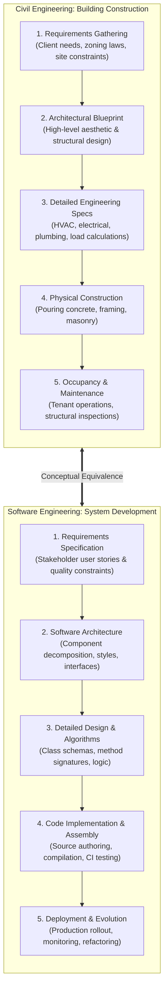
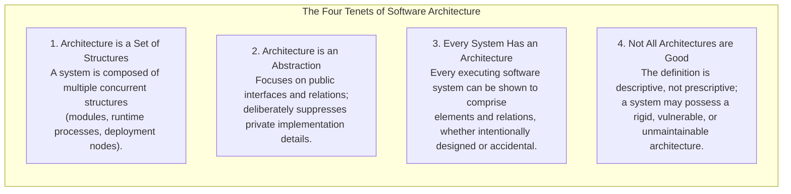
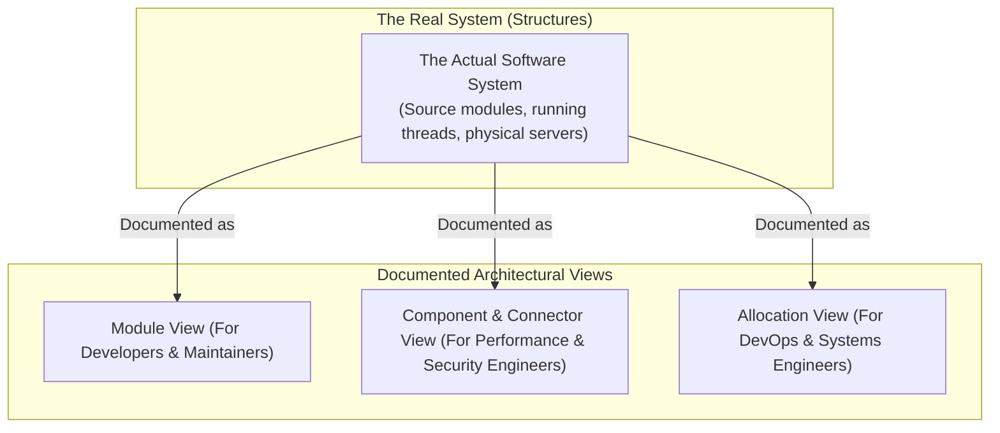
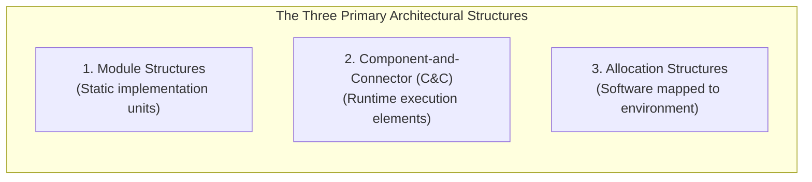
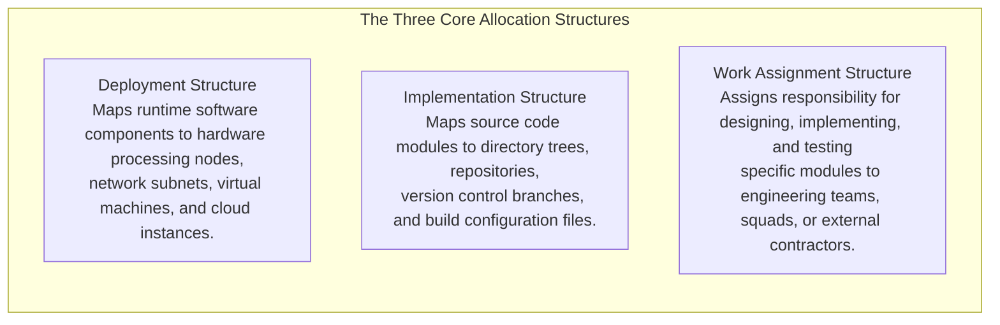
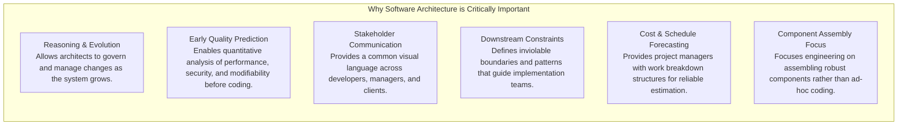
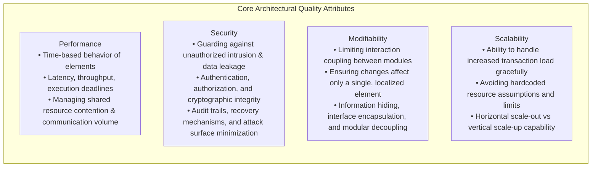
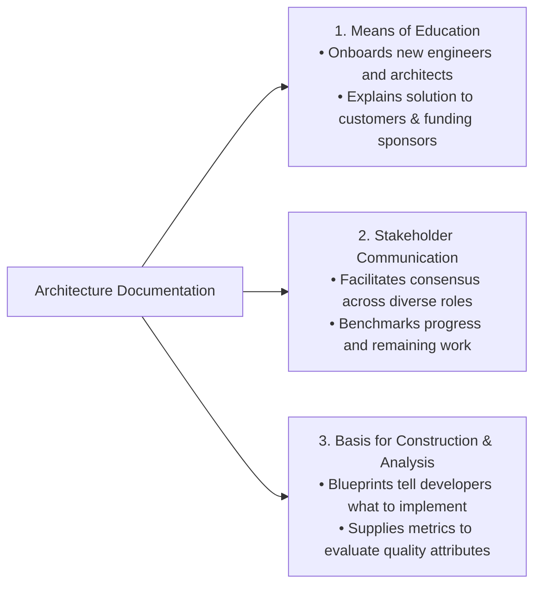
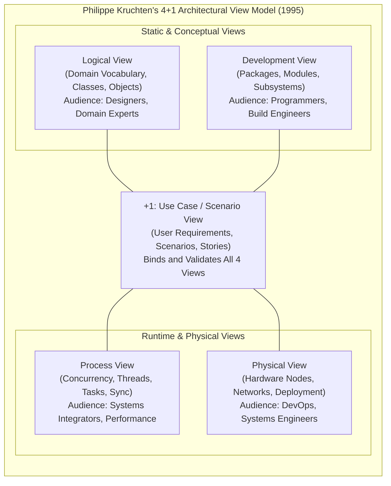

# Chapter 1: Introduction to Software Architecture, Structures & Views

## 1.1 The Discipline and Foundations of Software Architecture

The study of **software architecture** is the study of how complex software systems are conceived, structured, partitioned, and assembled.

### 1.1.1 The Building Architecture Analogy
To understand software architecture, engineering disciplines draw a direct analogy to civil engineering and building construction:

In the building domain, an architect does not begin by laying bricks; they first model spatial layouts, load-bearing frames, and utility conduits to satisfy client requirements and safety codes. Similarly, software architects do not write low-level code immediately; they establish high-level structural blueprints that govern all downstream development.

### 1.1.2 Formal Definition of Software Architecture
Software architecture forms the foundational element of software design.

> [!info] Definition: Software Architecture
> The **software architecture** of a computing system is the set of structures needed to reason about the system, comprising software elements, relations among them, and properties of both.
> 
> It involves understanding and organizing a system, all of its components, their interactions, the operational environment, and the fundamental design principles that govern its evolution.

### 1.1.3 The Four Foundational Tenets
The definition is anchored in four crucial insights:

1. **Architecture is a Set of Structures:** Modern systems cannot be captured in a single diagram. They comprise static compile-time structures, runtime interaction structures, and hardware allocation structures.
2. **Architecture is an Abstraction:** Architectural modeling selects high-impact structural details and deliberately suppresses private implementation details (e.g., local variables, internal algorithms, private helper methods). The public interface is architectural; the private method body is not.
3. **Every System Has an Architecture:** Regardless of whether an engineering team drafted formal documentation, any running software system inherently consists of components and relations.
4. **Not All Architectures Are Good Architectures:** An architecture can be poorly conceived, highly coupled, unscalable, or incapable of meeting user needs, yet it remains the architecture of that system.

---

## 1.2 Functions and Strategic Value of Software Architecture

Software architecture delivers immense strategic value across the software lifecycle:
1. **Stakeholder Visualization & Analysis:** Enables non-technical clients, project sponsors, developers, and QA engineers to visualize and reason about system behavior and quality attributes.
2. **Early Anticipation of Expensive Decisions:** Architectural modifications become exponentially more expensive as development proceeds. Architecture allows teams to simulate trade-offs and evaluate risks before concrete implementation begins.
3. **Focus on Component Assembly:** Shifts the engineering focus from writing primitive code from scratch toward assembling, configuring, and orchestrating robust, reusable components and commercial off-the-shelf (COTS) frameworks.
4. **Reusable Transferable Model:** A mature software architecture serves as the foundation for **Software Product Lines (SPL)**, enabling organizations to instantiate multiple related software products from a common architectural base.

---

## 1.3 Architectural Structures vs. Architectural Views

A common source of confusion in software design is the distinction between a **structure** and a **view**:

> [!info] Structure vs. View
> - **Structure:** The actual set of physical or logical elements as they exist in software or hardware in reality.
> - **View:** A documented representation of a coherent set of architectural elements and relations, authored by and presented to system stakeholders.
> 
> *Core Principle: "Architects design structures. They document views of those structures."*

### 1.3.1 The Human Body Analogy
Consider the human body as an anatomical architecture:
- An **X-ray view** reveals the skeletal structure of bones and joints.
- A **vascular view** visualizes the circulatory network of arteries, veins, and blood flow.
- A **neurological view** maps the brain, spinal cord, and neural pathways.

Each view looks completely different, serves a distinct diagnostic purpose, and suppresses irrelevant organs, yet all describe the **same unified biological entity**. To communicate meaningfully about software architecture, engineers must always make clear which specific structure and view they are discussing.

---

## 1.4 The Three Primary Categories of Architectural Structures

Architectural structures are classified into three major orthogonal categories:

### 1.4.1 1. Module Structures (Static Code Units)
- **Nature:** Static, compile-time partitioning of the software codebase into implementation units (packages, classes, libraries, source files).
- **Core Questions Answered:**
  - *What is the primary functional responsibility assigned to each module?*
  - *What other software elements is a module allowed to use?*
  - *What modules are related by generalization/inheritance (`is-a`) or composition (`part-of`)?*
- **Key Relationships:** `is-part-of`, `depends-on`, `is-a` (inheritance), `allowed-to-use`.
- **Primary Quality Attribute:** **Modifiability**. Module structures allow engineers to isolate changes, preventing ripple effects across the codebase.
- **UML Notations:** UML Package Diagrams, Class Diagrams.

### 1.4.2 2. Component-and-Connector (C&C) Structures (Runtime Dynamics)
- **Nature:** Dynamic runtime execution elements that possess active runtime behavior and pathways of interaction.
- **Constituents:**
  - **Components:** Encapsulated, replaceable computational entities that execute at runtime (e.g., active server processes, database connection pools, clients, filters, GUI managers). Components expose **ports** representing interfaces.
  - **Connectors:** Pathways of interaction mediating communication between components (e.g., Remote Procedure Calls [RPC], message queues, TCP/IP sockets, Unix pipes, shared memory buffers). Connectors bind to component ports via **roles**.
- **Core Questions Answered:**
  - *What are the major executing components and how do they interact at runtime?*
  - *What are the shared data stores and communication bottlenecks?*
  - *Which parts of the system execute in parallel across concurrent threads?*
- **Primary Quality Attributes:** **Performance**, **Security**, **Availability**, and **Concurrency**.
- **UML Notations:** UML Component Diagrams, Composite Structure Diagrams, Communication Diagrams.

### 1.4.3 3. Allocation Structures (Software-to-Environment Mappings)
- **Nature:** Maps software elements (from Module and C&C structures) to the external non-software environment (hardware, file directories, organizational teams).
- **Three Core Allocation Substructures:**

---

## 1.5 Architecture Design Activities: The CS-One-Stop Portal Case Study

Architecture design is an iterative synthesis activity that balances structural perspectives:
1. **Contextual Analysis:** Examining how the system interacts with external users, legacy databases, and third-party APIs.
2. **Multi-Perspective Synthesis (Web Architecture Example):**
   - *Document View:* Web viewed as a hypertext graph of interrelated HTML/MIME documents navigable via URLs and HTTP.
   - *Client-Server Network View:* Web viewed as physical client machines running web browsers connecting over TCP/IP to remote web servers and load balancers.
   - *Service Architecture View:* Web viewed as microservices exposing RESTful JSON endpoints communicating asynchronously via distributed message brokers.

---

# Chapter 2: Quality Attributes, Architectural Documentation & Kruchten's 4+1 View Model

## 2.1 The Strategic Importance of Software Architecture

---

## 2.2 Quality Attributes (Non-Functional Requirements)

A software system may execute its core functions correctly, but if it is painfully slow, easily hacked, or impossible to modify, it is a catastrophic engineering failure.

> [!important] Architecture Determines Quality Attributes
> **Architecture is largely about the achievement of quality attributes.** While individual algorithms determine localized correctness, the overall system architecture substantially determines non-functional qualities such as throughput, latency, fault tolerance, security, and maintainability.

---

## 2.3 The Rationale and Practice of Architecture Documentation

Documenting a software architecture is an indispensable engineering obligation:

> [!quote] The Britt Principle of Documentation
> *"Designing an architecture without documenting it is like winking at a girl in the dark. You know what you're doing, but nobody else does."*
> — Steuart Henderson Britt

Documentation represents the physical or electronic crystallization of an architectural design into formal artifacts (whiteboard snapshots, architecture description documents, interactive models, and living wiki repositories).

### 2.3.1 The Three Fundamental Uses of Architecture Documentation
Architecture documentation serves three vital organizational functions:

1. **Means of Education:** Introduces new team members, external security auditors, incoming architects, and client sponsors to the system topology, accelerating onboarding and regulatory approvals.
2. **Primary Vehicle for Stakeholder Communication:** Serves as the central negotiation artifact, reconciling conflicting priorities (e.g., product management desiring immediate features vs. security teams demanding strict authentication).
3. **Basis for System Construction and Analysis:** Dictates contracts, interfaces, and constraints to construction teams, while providing evaluators with the architectural data needed to assess performance and security models.

---

## 2.4 Philippe Kruchten's "4+1" Architectural View Model

Published in 1995 by **Philippe Kruchten** (Rational Software / IEEE Software), the **"4+1" View Model** addresses the fundamental reality that **no single visual diagram can satisfy all stakeholders simultaneously**.

### 2.4.1 1. The Logical View
- **Focus:** Captures the vocabulary and conceptual model of the problem domain.
- **Constituents:** Classes, objects, attributes, methods, and relationships (`inheritance`, `aggregation`, `association`).
- **Primary Audience:** System architects, designers, business analysts, and domain experts.
- **Representative UML Diagrams:** Class Diagrams, Object Diagrams, State Machine Diagrams, Sequence Diagrams.

### 2.4.2 2. The Process View
- **Focus:** Addresses the runtime behavior, concurrency, and communication of the executing system.
- **Constituents:** Independent processes, execution threads, message passing, synchronization mechanisms, deadlock avoidance, and event handling.
- **Primary Audience:** Systems integrators, performance analysts, and concurrency engineers.
- **Representative Notations:** Control Flowcharts, Data Flow Diagrams (DFDs), Activity Diagrams, Concurrency Task Sequence Diagrams.

### 2.4.3 3. The Development View (Implementation View)
- **Focus:** Organizes the actual software codebase and physical module hierarchy.
- **Constituents:** Software modules, source packages, build targets, libraries, third-party frameworks, and sub-systems.
- **Primary Audience:** Software engineers, programmers, build managers, and configuration controllers.
- **Representative UML Diagrams:** Component Diagrams, Package Diagrams, Artifact Diagrams.

### 2.4.4 4. The Physical View (Deployment View)
- **Focus:** Maps the software elements onto the physical hardware infrastructure and execution environment.
- **Constituents:** Physical servers, CPU cores, virtual machines, storage networks, networking routers, communication protocols (TCP/IP, Fibre Channel), and topology.
- **Primary Audience:** Deployment engineers, infrastructure architects, cloud/DevOps specialists, and network administrators.
- **Representative UML Diagrams:** Deployment Diagrams, Network Topology Charts.

### 2.4.5 +1. The Use Case View (Scenario View)
- **Focus:** Bridges and validates the four architectural views using concrete user requirements, scenarios, and operational workflows.
- **Constituents:** Actors, use cases, given-when-then scenarios, and system sequences.
- **The Central "+1" Function:**
  - Serves as the unifying core that binds the four orthogonal views together.
  - Used during architectural reviews (e.g., ATAM) to validate whether the structures defined in the Logical, Process, Development, and Physical views correctly realize stakeholder functional and non-functional requirements.
- **Representative UML Diagrams:** Use Case Diagrams, System Context Diagrams.

---

## 2.5 Summary Comparison of Kruchten's 4+1 Views

| View Name | Primary Perspective | Core Artifacts & Elements | Primary Stakeholder Audience | Standard UML Diagrams |
| :--- | :--- | :--- | :--- | :--- |
| **Logical View** | Domain functionality & abstractions | Classes, objects, domain entities | System Designers, Business Analysts | Class, Object, State Diagrams |
| **Process View** | Runtime concurrency & communication | Threads, processes, sync, IPC | Integrators, Performance Engineers | Activity, Control/Data Flow Charts |
| **Development View** | Codebase architecture & packaging | Packages, modules, COTS libraries | Programmers, Release Engineers | Package, Component Diagrams |
| **Physical View** | Hardware topography & hosting | Servers, VMs, networks, cloud nodes | DevOps, Infrastructure Specialists | Deployment Diagrams |
| **Use Case (+1) View**| User requirements validation | System use cases, actors, scenarios | End Users, Customers, Evaluators | Use Case Diagrams, Scenarios |
