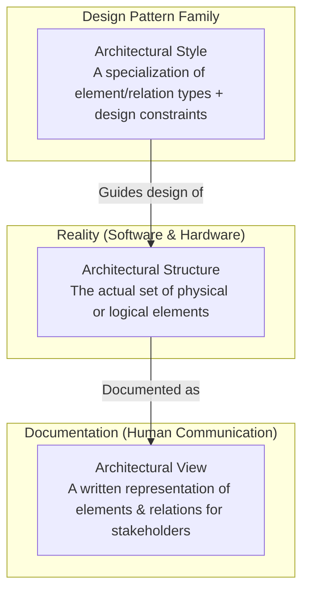
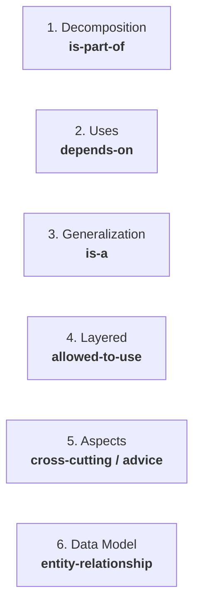
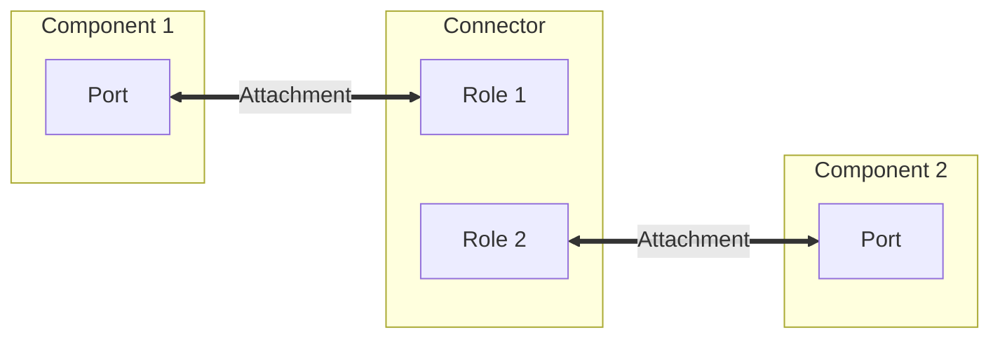

# CKS221 Test 1 MCQ High-Yield Revision Guide

> [!important] Exam Quick-Glance
> - **Format:** 100% Multiple Choice Questions (MCQs).
> - **Scope:** Lectures 1 through 6 (Topic 1: Software Architecture Foundations & Styles; Topic 2: Module, C&C, and Allocation Views & Styles).
> - **MCQ Strategy:** MCQs heavily test **definitions**, **structural distinctions** (Module vs. C&C vs. Allocation), **relations** (`is-part-of` vs. `depends-on` vs. `is-a` vs. `allowed-to-use`), **Kruchten's 4+1 views**, and **dead giveaways / keywords**.

---

## 1. Master Formula: Structures, Views, and Styles

| Concept | Golden Definition for MCQs | Exam Trap / Keyword Alert |
| :--- | :--- | :--- |
| **Software Architecture** | The set of structures needed to reason about the system, comprising software elements, relations among them, and properties of both. | It is **NOT** just "source code" or "one diagram". |
| **Structure** | The **real** elements as they exist in software or hardware. | *"Architects design structures."* |
| **View** | A **documented representation** of a coherent set of elements and relations for stakeholders. | *"Architects document views."* |
| **Style** | A pattern/family of systems defining element types, connector types, and structural constraints. | E.g., Pipe-and-Filter, Client-Server, Layered. |

### The Four Tenets of Architecture (High MCQ Probability)
1. **Architecture is a Set of Structures:** No single diagram captures a system. Multiple concurrent, orthogonal structures exist simultaneously.
2. **Architecture is an Abstraction:** Focuses on **public interfaces** and interactions; deliberately **suppresses private implementation details** (algorithms, local variables).
3. **Every System Has an Architecture:** Even poorly designed legacy spaghetti code has an architecture.
4. **Not All Architectures Are Good:** Architecture is descriptive, not prescriptive.

> [!danger] Classic MCQ Trap: 1 System, Multiple Structures
> A system with 10 clients and 1 server has:
> - **Decomposition View (Module Structure):** Exactly **2 static modules** (Client module, Server module).
> - **Client-Server View (C&C Structure):** Exactly **11 runtime components** (10 active client processes + 1 server process) + 1 request-reply connector!

---

## 2. The Three Primary Architectural View Categories

| View Category | Core Question Answered | Nature of Elements | Primary Quality Attribute | UML Diagrams |
| :--- | :--- | :--- | :--- | :--- |
| **Module Views** (Topic 2 / Lec 4) | *What is the code structure? Who builds what?* | **Static code units** (packages, classes, libraries, layers) | **Modifiability**, Reusability | Package Diagram, Class Diagram |
| **Component & Connector (C&C) Views** (Topic 2 / Lec 5) | *What executes at runtime? How do data/control flow?* | **Dynamic runtime entities** (processes, threads, objects, sockets, buses) | **Performance**, Security, Availability | Component Diagram, Sequence Diagram |
| **Allocation Views** (Topic 2 / Lec 6) | *Where does software live in hardware, disks, or teams?* | **Software mapped to non-software** environment | Hardware utilization, Deployability | Deployment Diagram, Directory Manifest |

---

## 3. Kruchten's "4+1" View Model Cheat Sheet

MCQs frequently ask: *"Which view is targeted at [Stakeholder] to address [Quality/Concern]?"*

| View | Primary Stakeholder | Primary Concern / Purpose | Key UML Diagrams |
| :--- | :--- | :--- | :--- |
| **Logical View** | End-Users | **Functional requirements**, domain services, business logic | Class Diagram, Object Diagram, State Machine |
| **Process View** | System Integrators | **Non-functional runtime behavior**, concurrency, threads, synchronization, performance | Activity Diagram, Sequence Diagram |
| **Development View** (Implementation View) | Programmers & Software Managers | **Static code organization**, packages, build dependencies, subsystem boundaries | Package Diagram, Component Diagram |
| **Physical View** (Deployment View) | System Engineers & DevOps | **Hardware execution environment**, server nodes, network links, distribution | Deployment Diagram |
| **+1: Use Case View** (Scenario View) | Architects & All Stakeholders | **Binds and validates the 4 views**, drives architectural design and verification | Use Case Diagram |

---

## 4. Topic 1 (Lecture 3): The 9 Architectural Styles Survey

| Style | Structural Elements | Connectors / Relations | Key Benefits | Key Weaknesses / Tradeoffs |
| :--- | :--- | :--- | :--- | :--- |
| **Client-Server** | Central Server, Multiple Clients | Request-Reply (Network RPC/HTTP) | Centralized data management, security | Server is a single point of failure (SPOF) & bottleneck |
| **Peer-to-Peer (P2P)** | Symmetrical Peers (*servents*) | Peer connections (direct bidirectional) | High fault tolerance, no central SPOF | Complex decentralized routing, security challenges |
| **Data-Centered (Repository)** | Central Data Store, Data Accessors | Data read/write queries | Decoupled clients, shared state | Bottleneck at repository; schema changes affect all clients |
| **Data-Centered (Blackboard)** | Knowledge Sources, Blackboard, Controller | State inspection & triggering | Solves complex, opportunistic AI/speech problems | Hard to debug, non-deterministic execution order |
| **Event-Driven (EDA)** | Event Producers, Event Consumers | Event Broker / Event Bus | High scalability, loose spatial/temporal coupling | Non-deterministic ordering, complex tracing |
| **Layered** | Ordered horizontal layers | Unidirectional downward `allowed-to-use` | Portability, modifiability, separation of concerns | Performance overhead from multi-layer bridging |
| **Service-Oriented (SOA)** | Service Provider, Consumer, Registry | Enterprise Service Bus (ESB), SOAP/WSDL | Enterprise system integration, high reusability | High protocol overhead, XML parsing latency, complex ESB |
| **Microservices** | Fine-grained autonomous services | Lightweight REST / gRPC, independent DBs | Independent deployment, polyglot persistence | Network latency, distributed data consistency (CAP theorem) |
| **Pipe-and-Filter** | Filters (data transformers), Pipes (buffers) | Data stream passing | Concurrency, reusability, simple filter swap | High data transformation overhead; filters must not share state |
| **Main Program & Subprogram** | Main controller, subroutines | Hierarchical call-return | Simple procedural execution, easy to trace | Tight coupling, rigid hierarchy, difficult to scale |

---

## 5. Topic 2 (Lecture 4): The Six Module Styles

> [!tip] Golden Rule for Module Styles in MCQs
> Look at the **Relationship Type**! The relation immediately gives away the style.

### 1. Decomposition Style
- **Relation:** `is-part-of` / submodule.
- **Constituents:** Modules and Subsystems.
  - *Module:* Static unit of implementation (class, file, package).
  - *Subsystem:* Cohesive module that can be developed and executed independently.
- **MCQ Use:** Work allocation, project planning, resource tracking.

### 2. Uses Style
- **Relation:** `depends-on` / `requires`.
- **Definition:** Module A *uses* Module B if the **correct functioning of A depends on the presence of a correct implementation of B**.
- **MCQ Tool:** **Dependency Structure Matrix (DSM)** or directed dependency arrows.
- **MCQ Purpose:** Designing subsets, planning incremental releases, and isolating unit testing.

### 3. Generalization Style
- **Relation:** `is-a` (inheritance / specialization).
- **Definition:** Captures commonalities in parent modules; child modules inherit and specialize behavior.
- **MCQ Keywords:** Polymorphism, object-oriented subclassing, code reuse.

### 4. Layered Style
- **Relation:** `allowed-to-use` (unidirectional, downward).
- **Two Layering Variations:**
  - **Strict Layering:** Layer $N$ may ONLY use Layer $N-1$.
  - **Relaxed (Open) Layering:** Layer $N$ may use Layer $N-1$, Layer $N-2$, etc.
- **Topologies:** Vertical Stack, Concentric Rings (inner = core OS/kernel, outer = user applications), Sidecars (utility layers usable by multiple layers).
- **MCQ Advantage:** Portability (swap out bottom layer) and Modifiability (isolate changes).

### 5. Aspects Style
- **Core Problem Solved:** Eliminates **Cross-Cutting Concerns** that cause:
  - **Code Tangling:** Multiple unrelated concerns intertwined inside a single class/method.
  - **Code Scattering:** A single concern (e.g., logging, security, transactions) repeated across many classes.
- **Elements:**
  - *Join Point:* A specific execution point in a program (e.g., method call).
  - *Pointcut:* A predicate/expression that matches a set of join points.
  - *Advice:* The actual code executed at a join point (before, after, around).
  - *Aspect:* The modular unit combining pointcuts and advice.

### 6. Data Model Style
- **Core Entities:** Entities, Attributes, Relationships.
- **Cardinalities:** $1:1$, $1:N$, $M:N$.
- **Notations:** Crow's Foot ERD, UML Class Diagrams.
- **MCQ Purpose:** Designing database schemas and persistent storage structures.

---

## 6. Topic 2 (Lecture 5): Component-and-Connector (C&C) Views and Styles

### Fundamental Elements & The Single Relation

1. **Components:** Runtime computation or data storage units. They interact through **Ports**.
2. **Connectors:** First-class architectural interaction mechanisms (buses, RPC channels, pipes, SQL links). They interact through **Roles**.
3. **Relation:** **Attachment** (Port-to-Role binding).

### The Four Major C&C Style Families

| C&C Style Family | Key Components & Connectors | Critical Architectural Rules & MCQ Flags |
| :--- | :--- | :--- |
| **Call-Return Styles** (Client-Server, SOA) | Components: Clients, Servers, Services. Connectors: RPC, HTTP/REST, SOAP. | Synchronous/asynchronous request-reply; caller typically waits or receives callback. |
| **Data Flow Styles** (Pipe-and-Filter) | Components: **Filters** (data processors). Connectors: **Pipes** (unidirectional data buffers). | - **Filters are completely independent and stateless**. - Filters have NO knowledge of upstream/downstream filters. - **No shared global state** between filters. - Supports concurrency and stream backpressure. |
| **Event-Based Styles** (Publish-Subscribe) | Components: Publishers (announcers), Subscribers (listeners). Connectors: Event Bus / Message Broker. | - **Completely decoupled in space and time**. - Publishers don't know who subscribers are. - Subscribers don't know who published the event. - Drawback: Non-deterministic order of execution. |
| **Repository & Shared Data** | Components: Central Store, Independent Accessors. Connectors: Data Read/Write SQL/APIs. | - **Passive Repository:** Clients query the database when needed. - **Active Blackboard:** The central store actively monitors state and **triggers** knowledge sources when data changes. |

---

## 7. Topic 2 (Lecture 6): Allocation Views and Styles

> [!important] The Allocation Triad: Software Mapped to Non-Software
> Allocation views always map software elements to an **environmental / non-software entity**.

| Allocation Style | Software Element | Environmental Element | Key Questions Answered |
| :--- | :--- | :--- | :--- |
| **Deployment Style** | Runtime components, executables, processes | **Hardware nodes, virtual machines, CPUs, network links** | - What hardware hosts which process? - Are network links fast enough? - How is server failover handled? |
| **Install Style** | Binaries, jar/war/ear files, config files, libraries | **File systems, directory hierarchies, disk volumes** | - In which folder is the binary installed? - How are DLLs and configuration files stored on disk? |
| **Work Assignment Style** | Static modules, subsystems, code packages | **Human teams, contractors, individual developers** | - Which team implements which module? - How to avoid inter-team communication bottlenecks? |

### Conway's Law (Guaranteed MCQ Question!)
> *"Organizations which design systems are constrained to produce designs which are copies of the communication structures of these organizations."*  
> — Melvin Conway (Directly associated with the **Work Assignment Style**).

---

## 8. Ultimate MCQ Trap Busters & Dead Giveaways

| When the MCQ Question Asks... | The Correct Answer Is... | The Trap / Distractor to Avoid |
| :--- | :--- | :--- |
| *"Which style solves Code Tangling and Code Scattering?"* | **Aspects Style** | Layered Style or Generalization |
| *"Which relation defines Module A needing Module B to work correctly?"* | **Uses Style** (`depends-on`) | Decomposition (`is-part-of`) |
| *"Which view maps software files to directory folders and file systems?"* | **Install View** | Deployment View (Deployment is for *hardware nodes/servers*!) |
| *"In Kruchten's 4+1, which view addresses concurrency and threads?"* | **Process View** | Development View or Logical View |
| *"In Kruchten's 4+1, which view addresses packaging and static code units?"* | **Development View** | Logical View |
| *"What element connects a component's Port in C&C?"* | A connector's **Role** | Another component's port directly (must use connector role) |
| *"Do filters in Pipe-and-Filter share global database state?"* | **NO** (Filters are independent stream transformers) | True (Sharing state violates pipe-and-filter principles) |
| *"Can an architecture be evaluated before writing code?"* | **YES** (Early trade-off analysis) | No (False belief that code is required) |
| *"Does an unorganized legacy system have an architecture?"* | **YES** (Every system has an architecture) | No |
| *"Which view binds and validates all four views in Kruchten's model?"* | **Use Case View (+1)** | Logical View |
| *"In strict layering, can Layer 3 call Layer 1 directly?"* | **NO** (Must only call Layer 2) | Yes (That is relaxed/open layering) |
| *"Conway's Law is primarily associated with which architectural style?"* | **Work Assignment Style** | Deployment Style |

---

## 9. 15 Rapid-Fire Self-Test MCQs (Practice Exam)

> [!question] Q1: Software architecture is best defined as:
> A) The source code implementation of algorithms  
> B) A single high-level diagram illustrating the entire system  
> C) The set of structures needed to reason about the system, comprising software elements, relations, and properties  
> D) The user interface wireframe and database entity model  
> 
> *Answer: **C*** (Tenet 1 & Formal definition).

> [!question] Q2: Which statement about software architecture is FALSE?
> A) Every running software system has an architecture  
> B) Architecture suppresses private implementation details to focus on public interfaces  
> C) All software architectures are good architectures  
> D) Modern systems require multiple distinct structures to be fully described  
> 
> *Answer: **C*** (Tenet 4: Architecture is descriptive; a system can have a poor architecture).

> [!question] Q3: A system consists of 10 running client instances and 1 central database server. In the Decomposition View (Module Structure) and Client-Server View (C&C Structure), the number of primary elements is:
> A) 11 in Decomposition, 11 in C&C  
> B) 2 in Decomposition, 11 in C&C  
> C) 11 in Decomposition, 2 in C&C  
> D) 2 in Decomposition, 2 in C&C  
> 
> *Answer: **B*** (2 static modules: Client & Server codebase; 11 runtime components: 10 clients + 1 server).

> [!question] Q4: In Kruchten's "4+1" View Model, which view is targeted at software programmers to show static package hierarchy and build dependencies?
> A) Logical View  
> B) Process View  
> C) Development View  
> D) Physical View  
> 
> *Answer: **C*** (Development / Implementation View).

> [!question] Q5: Which Kruchten view addresses concurrency, performance, scalability, and system throughput for system integrators?
> A) Process View  
> B) Development View  
> C) Logical View  
> D) Use Case View  
> 
> *Answer: **A*** (Process View handles runtime threads, tasks, and concurrency).

> [!question] Q6: In the Uses module style, Module A "uses" Module B if:
> A) Module A is a subclass of Module B  
> B) Module A physically contains Module B inside its package  
> C) The correctness of Module A depends on the correct implementation of Module B  
> D) Module A is deployed to the same server node as Module B  
> 
> *Answer: **C*** (Formal definition of the Uses relationship).

> [!question] Q7: Which tool is commonly used to visualize and analyze dependencies in the Uses style?
> A) Deployment Manifest  
> B) Dependency Structure Matrix (DSM)  
> C) Crow's Foot ERD  
> D) Use Case Diagram  
> 
> *Answer: **B*** (DSM).

> [!question] Q8: Which architectural style specifically tackles "code tangling" and "code scattering" caused by cross-cutting concerns?
> A) Layered Style  
> B) Generalization Style  
> C) Aspects Style  
> D) Data Model Style  
> 
> *Answer: **C*** (Aspects Style / AOP).

> [!question] Q9: In a strictly layered architectural style:
> A) Layer $N$ may call any layer below it ($N-1, N-2, \dots$)  
> B) Layer $N$ can only call Layer $N-1$  
> C) Layer $N$ can make bidirectional calls to Layer $N+1$  
> D) Layers can freely call any utility sidecar  
> 
> *Answer: **B*** (Strict layering restricts calls exclusively to the immediate layer below).

> [!question] Q10: In Component-and-Connector (C&C) architecture, the basic relation that binds a component to a connector is:
> A) Inheritance  
> B) Attachment (Port-to-Role)  
> C) Generalization  
> D) Aggregation  
> 
> *Answer: **B*** (Components expose Ports; Connectors expose Roles; they connect via Attachment).

> [!question] Q11: Which statement about the Pipe-and-Filter style is TRUE?
> A) Filters share common global database tables for speed  
> B) Downstream filters control the execution logic of upstream filters  
> C) Filters are independent, stateless transformers that process data streams without sharing state  
> D) Pipes execute complex business logic transformations on the data  
> 
> *Answer: **C*** (Filters transform streams independently without shared state; pipes are conduits/buffers).

> [!question] Q12: How does an Active Blackboard differ from a Passive Repository?
> A) An active blackboard uses SOAP while a repository uses REST  
> B) An active blackboard monitors state and automatically triggers knowledge sources, whereas a passive repository waits for client queries  
> C) An active blackboard has no centralized storage  
> D) A passive repository does not allow concurrent access  
> 
> *Answer: **B*** (Active notification vs. passive request-response).

> [!question] Q13: Mapping compiled `.war` archives and configuration files to directories on a physical storage drive is an example of which allocation style?
> A) Deployment Style  
> B) Install Style  
> C) Work Assignment Style  
> D) Process View  
> 
> *Answer: **B*** (Install style maps software to file systems and directory hierarchies; Deployment maps to hardware nodes/CPUs).

> [!question] Q14: "Organizations which design systems are constrained to produce designs which are copies of the communication structures of these organizations" is known as:
> A) Amdahl's Law  
> B) Brooks' Law  
> C) Conway's Law  
> D) Kruchten's Law  
> 
> *Answer: **C*** (Conway's Law, fundamental to Work Assignment Style).

> [!question] Q15: In a Publish-Subscribe (Event-Based) style, components are:
> A) Tightly coupled via synchronous RPC interfaces  
> B) Loosely coupled in both space (identity) and time (asynchrony)  
> C) Required to know the exact IP address of every listener  
> D) Guaranteed to process events in strict deterministic alphabetical order  
> 
> *Answer: **B*** (Decoupled in space, time, and synchronization).
