# CKS221 Test 1 Conceptual Mastery & MCQ Revision Guide
**Course:** CKS221 / CSE 341 Software Architecture & Design  
**Exam Target:** Test 1 (100% Objective / Multiple-Choice Questions)  
**Curriculum Scope:** Lectures 1 through 6 (Topic 1: Foundations & Styles; Topic 2: Module, C&C, & Allocation Views)

> [!important] How to Use This Guide for MCQ Success
> Multiple-choice exams in software architecture do not test rote memorization of slide bullet points; they test **mechanics, structural boundaries, and classification**. When reading each section:
> 1. Understand **how the architecture behaves at execution or compile time** (the mechanism).
> 2. Pay close attention to the **Element-Connector-Relation triad** (e.g., does it use `is-part-of`, `depends-on`, `allowed-to-use`, or `attachment`?).
> 3. Review the **Objective Question Radar** under each concept to spot common traps, distractor phrasing, and dead giveaway keywords.
> 4. Use the embedded lecture slide references (`![[...#page=X]]`) alongside the Mermaid architecture diagrams to inspect visual layouts directly from the lecturer's slides.

---

# Part 1: Topic 1 — Foundations & The Architecture Core (Lectures 1–3)

## 1.1 The Definition & The Building Analogy (Lecture 1)

### The Building Architecture Analogy
In civil engineering, constructing a skyscraper does not begin with pouring concrete or ordering bricks. An architect first models spatial layouts, structural loads, utility shafts, and safety egresses to balance client needs with zoning laws and structural physics.

![[cks221_lec1_slide5_building_analogy.png|750]]

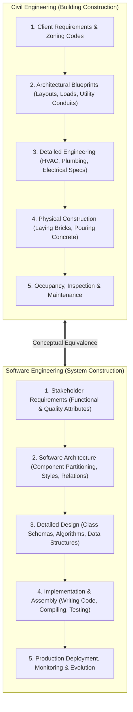

### The SEI Formal Definition
> [!info] Software Architecture Definition (Bass, Clements, Kazman)
> The **software architecture** of a computing system is the **set of structures** needed to reason about the system, comprising **software elements**, **relations among them**, and **properties of both**.

### How It Works & The Four Foundational Tenets
1. **Architecture is a Set of Structures:** A complex software system cannot be represented by a single "box-and-line" diagram. A system consists of multiple orthogonal structures (compile-time code organization, runtime process networks, hardware deployment hosts) that exist at the exact same time.
2. **Architecture is an Abstraction:** Architectural reasoning explicitly focuses on **publicly visible properties and interfaces**, while **deliberately suppressing private implementation details** (e.g., internal variable names, private helper methods, specific algorithm loop logic).
3. **Every System Has an Architecture:** Whether an engineering team explicitly documented their system on Day 1 or haphazardly threw together spaghetti code, every executing system can be mapped to elements and relations.
4. **Not All Architectures Are Good Architectures:** Architecture is a *descriptive* engineering concept, not an accolade. A system can possess an architecture that is fragile, insecure, and unscalable—yet that remains its architecture.

![[cks221_lec1_slide10_four_tenets.png|750]]

> [!tip] MCQ Exam Radar: Definitions & Tenets
> - **Trap Question:** *"Which of the following systems does NOT possess a software architecture?"*  
>   **Correct Deduction:** Eliminate all options claiming a system has no architecture. **Every** executing system has an architecture, even undocumented or poorly designed ones!
> - **Trap Question:** *"Software architecture encompasses private method algorithms and local variable declarations."*  
>   **Correct Deduction:** **FALSE**. Architecture is an **abstraction** that suppresses private implementation details.
> - **Keyword Clue:** Whenever an option mentions *"reason about the system"*, *"set of structures"*, or *"elements, relations, and properties"*, it is the formal SEI definition.

---

## 1.2 Structures vs. Views (The Human Body Analogy & Slide 23)

### The Fundamental Distinction
* **Structure:** The **real-world physical or logical entity** as it exists in code or execution reality (e.g., source files on disk, threads running in CPU memory, physical servers in a rack).
* **View:** A **written, human-readable documented representation** of a coherent set of architectural elements and relations, authored for specific stakeholders.
* **Core Rule:** *"Architects design structures. They document views of those structures."*

![[cks221_lec1_slide16_structure_vs_view.png|750]]

### The Human Body Analogy
Consider the human body as an anatomical architecture:
- An **X-ray view** reveals the skeletal structure of bones and joints for an orthopedic surgeon.
- An **Angiogram / Vascular view** visualizes the circulatory network of arteries, veins, and blood pressure for a cardiologist.
- A **Neurological view** maps the brain, spinal cord, and neural synapses for a neurologist.

None of these views shows the entire person, yet all three represent the **same underlying human body**. Each view suppresses irrelevant organs to help a specialist answer specific diagnostic questions.

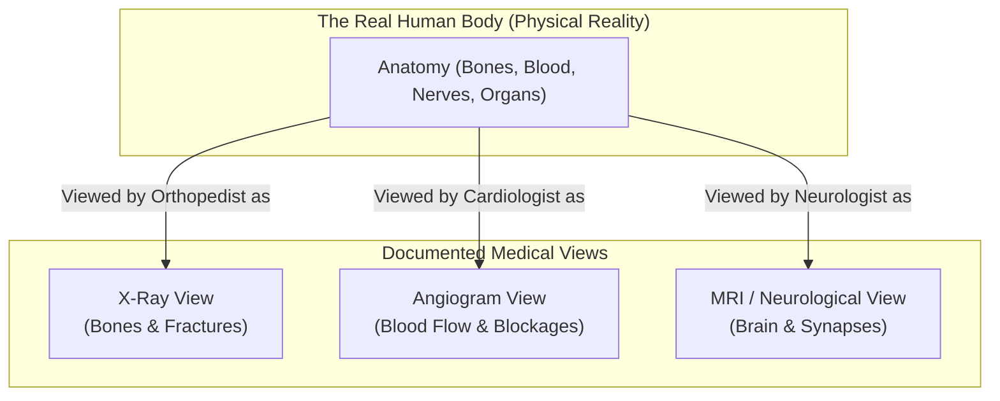

---

### The Slide 23 Classic Dilemma: One System, Multiple Structures
Lecture 1 Slide 23 presents a classic software architecture scenario that is frequently adapted into objective exam questions.

![[cks221_lec1_slide23_one_system_multiple_structures.png|750]]

Consider a networked Client-Server application where **10 concurrent users** access a central database server:

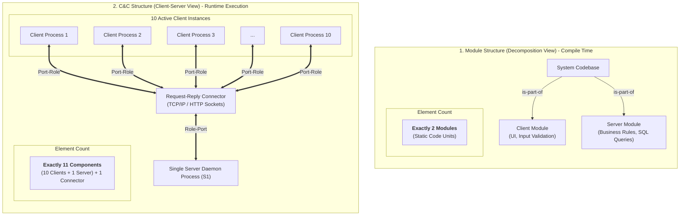

| Structural Dimension | Module Decomposition View | Component-and-Connector (C&C) View |
| :--- | :--- | :--- |
| **Nature of Elements** | Static software units of code (packages, classes, files). | Dynamic runtime entities (running processes, active threads). |
| **Exact Element Count** | **2 Modules** (The Client codebase and the Server codebase). | **11 Components** (10 running client processes + 1 server daemon process). |
| **Underlying Relation** | `is-part-of` (hierarchical structural decomposition). | `attachment` (component **ports** bound to connector **roles**). |
| **Primary Audience** | Programmers, build engineers, project managers. | Network architects, performance analysts, capacity planners. |
| **Core Question Answered** | *How is the code partitioned and packaged?* | *What is the network bottleneck and concurrency load?* |

> [!danger] MCQ Exam Radar: Slide 23 Element Counts
> - **The Classic Question:** *"A system consists of 15 web browsers concurrently querying a single backend database server. How many elements exist in the Module Decomposition View versus the Runtime C&C View?"*  
>   - Decomposition View: **2 modules** (Browser code module + Server code module).  
>   - Runtime C&C View: **16 components** (15 client processes + 1 server daemon) + 1 connector.  
> - **Dead Giveaway:** When you see words like *modules, classes, packages, code units*, you are counting **static source files**. When you see words like *processes, threads, instances, clients, servers*, you are counting **runtime components**.

---

## 1.3 The Three Master Categories of Architectural Structures (Lecture 1)

All architectural structures fall into one of three orthogonal categories:

![[cks221_lec1_slide27_three_categories.png|750]]

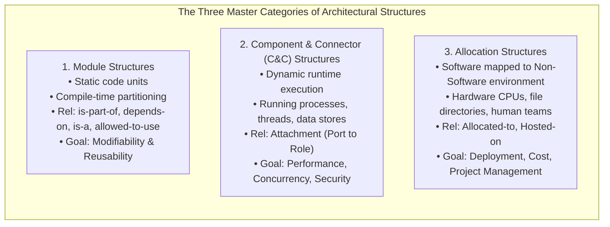

### Deep Comparative Matrix

| Category | Element Nature | Primary Relations | Key Quality Attribute | Typical UML Notations |
| :--- | :--- | :--- | :--- | :--- |
| **Module Category** | Static implementation units (classes, packages, source files, layers). | `is-part-of`, `depends-on`, `is-a`, `allowed-to-use`. | **Modifiability**, Portability, Reusability. | UML Package Diagrams, Class Diagrams. |
| **C&C Category** | Runtime execution elements (active processes, threads, objects, message buses). | `attachment` (binds a component's Port to a connector's Role). | **Performance**, Security, Availability, Scalability. | UML Component Diagrams, Composite Structure, Sequence Diagrams. |
| **Allocation Category** | Software elements mapped to external environmental entities (hardware, disk, teams). | `allocated-to`, `deployed-on`, `assigned-to`. | Sizing, Hardware cost, Team productivity. | UML Deployment Diagrams, Directory Manifests, Org Charts. |

> [!tip] MCQ Exam Radar: Category Identification
> - If the question mentions **"source code organization"**, **"who builds what"**, or **"preventing ripple effects during code changes"**, the answer is **Module Structure**.
> - If the question mentions **"network throughput"**, **"runtime bottlenecks"**, **"threads"**, or **"data flowing across sockets"**, the answer is **C&C Structure**.
> - If the question mentions **"mapping executables to server nodes"**, **"directory paths on a hard drive"**, or **"assigning tasks to engineering squads"**, the answer is **Allocation Structure**.

---

## 1.4 Strategic Importance & Quality Attributes (Lecture 2)

### Why Architecture Matters
1. **Inhibiting / Facilitating Communication Among Stakeholders:** Non-technical clients, financial sponsors, developers, and QA engineers cannot read raw source code; architecture provides the common vocabulary to negotiate trade-offs.
2. **Early Design Decisions (The Cost of Change Curve):** The earliest decisions are the most difficult to change and have the most profound ripple effects. Fixing a architectural flaw during requirements/design costs \$1; fixing it after deployment costs \$100+.
3. **Transferable Abstraction of a System:** A robust architecture can be reused across an entire product family, forming the foundation for **Software Product Lines (SPL)**.
4. **Focus on Component Assembly:** Shifts the engineering burden away from coding primitive functions from scratch toward assembling and configuring commercial off-the-shelf (COTS) components and frameworks.

### The Three Fundamental Uses of Architecture Documentation
1. **Education:** Training and onboarding new team members and external contractors rapidly.
2. **Communication Vehicle:** Facilitating negotiation between competing stakeholders (e.g., performance vs. cost).
3. **Basis for Construction & System Analysis:** Providing the blueprints that guide coding, integration testing, and formal quality attribute analysis (e.g., ATAM evaluation).

### Functionality vs. Quality Attributes (Orthogonality)
* **Functionality:** *What* the system does (the ability to calculate an invoice, authenticate a user, or generate a PDF report). Functionality can be achieved through virtually any design, even a messy monolithic script.
* **Quality Attributes (Non-Functional Requirements / NFRs):** *How well* the system executes its functions (performance, security, availability, modifiability, testability, scalability).
* **Core Tenet:** **Architecture is the primary determinant of quality attributes.** You cannot achieve high availability or extreme modifiability merely through clean coding if the underlying architectural partitioning is flawed!

![[cks221_lec2_slide9_quality_attributes.png|750]]

> [!tip] MCQ Exam Radar: Quality Attributes
> - **MCQ Question:** *"Can quality attributes be salvaged during implementation if the architecture is flawed?"*  
>   **Answer:** **NO**. Code optimization cannot compensate for an unscalable or brittle architecture.
> - **MCQ Question:** *"What is the relationship between functionality and architecture?"*  
>   **Answer:** They are orthogonal; functionality alone does not dictate architecture, but architecture dictates the quality attributes of that functionality.

---

## 1.5 Philippe Kruchten's "4+1" View Model (Lecture 2)

Philippe Kruchten (1995) recognized that different stakeholders require completely different perspectives of a software system. The "4+1" model organizes architectural descriptions into four specialized views, unified by a central scenario view.

![[cks221_lec2_slide14_kruchten_4plus1.png|750]]

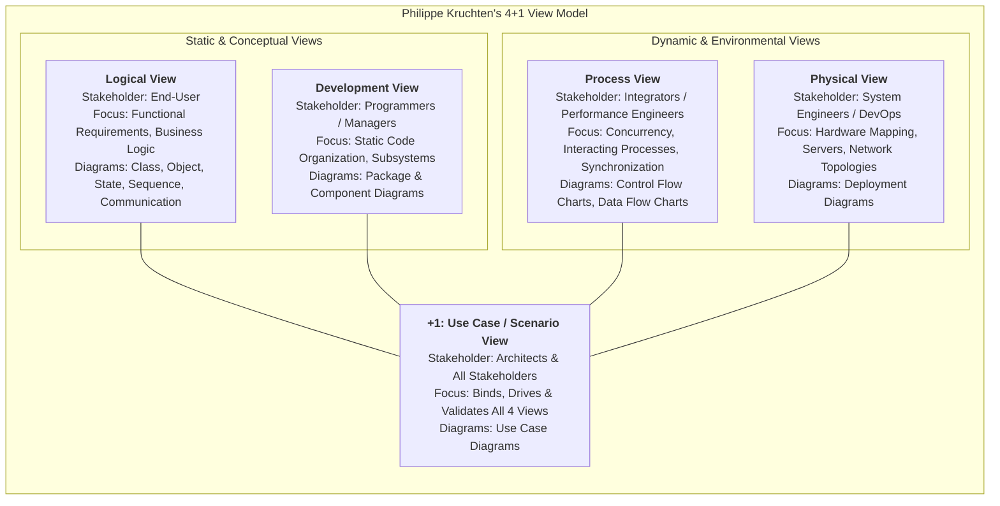

### High-Yield MCQ View Decoupling Matrix

| View Name | Primary Stakeholder | Core Concerns Addressed | Key Diagrams (Lecture 2 Slides 19–23) | Exam Keyword Clues |
| :--- | :--- | :--- | :--- | :--- |
| **Logical View** | **End-Users** | **Functional requirements**, domain vocabulary, business logic, interactions between classes/objects. | **Class diagrams**, **Object diagrams**, **State diagrams**, **Sequence diagrams**, **Communication diagrams** | *"Domain entities"*, *"Business concepts"*, *"Sequence/Communication between objects"*. |
| **Process View** | **System Integrators** | **Runtime dynamics**, interacting processes, concurrency, threads, synchronization, throughput. | **Control Flow Charts**, **Data Flow Charts** (Activity diagrams for concurrency) | *"Concurrency"*, *"Multithreading"*, *"Deadlocks"*, *"Control flow"*, *"Data flow"*. |
| **Development View** *(Implementation View)* | **Programmers & Software Managers** | **Static code organization**, physical codebase, packages, libraries, subsystems. | **Component diagrams**, **Package diagrams** | *"Software modules"*, *"Build hierarchy"*, *"Package structure"*. |
| **Physical View** *(Deployment View)* | **System Engineers & IT Operations** | **Hardware infrastructure**, network topologies, physical server nodes, execution environments. | **Deployment diagrams** (`«device»`, `«executionEnvironment»`) | *"Hardware nodes"*, *"CPUs"*, *"Network links"*, *"System engineers"*. |
| **+1 Use Case View** *(Scenario View)* | **Architects & All Stakeholders** | **Unifies and validates** the other four views; proves that the architecture satisfies requirements. | **Use Case diagrams**, Scenarios | *"Redundant if all 4 views exist? NO! It binds and validates them"*. |

> [!danger] MCQ Exam Radar: Kruchten Traps
> - **Trap Question 1:** *"Which view in Kruchten's 4+1 model is aimed at programmers to manage code development and build environments?"*  
>   - A) Logical View  
>   - B) Process View  
>   - C) Development View  
>   - D) Physical View  
>   $\rightarrow$ **Correct: C (Development View)**.
> - **Trap Question 2:** *"A performance engineer analyzing multi-threaded deadlock conditions and system throughput relies on which view?"*  
>   $\rightarrow$ **Correct: Process View** (Integrators + Concurrency).
> - **Trap Question 3:** *"Why is the Use Case view called '+1'?"*  
>   $\rightarrow$ Because it is not an orthogonal structural view itself; it is the **unifying scenario layer** that exercises and validates the other four views.

---

## 1.6 Survey of Foundational Architectural Styles (Lecture 3)

### What is an Architectural Style?
> An **architectural style** is a specialization of element and relation types, together with a set of constraints on how they can be used. It defines a whole family of systems that share a common structural pattern.

![[cks221_lec3_slide3_architectural_styles.png|750]]

```mermaid
flowchart TD
    subgraph NineStyles["The 9 Foundational Styles"]
        direction TB
        S1["1. Client-Server<br/>(Centralized service provider)"]
        S2["2. Peer-to-Peer<br/>(Symmetric decentralized servents)"]
        S3["3. Data-Centered<br/>(Repository vs Blackboard)"]
        S4["4. Event-Driven<br/>(Asynchronous broker / Pub-Sub)"]
        S5["5. Layered<br/>(Unidirectional downward allowed-to-use)"]
        S6["6. Service-Oriented (SOA)<br/>(Coarse-grained ESB integration)"]
        S7["7. Microservices<br/>(Fine-grained independent services + private DBs)"]
        S8["8. Pipe-and-Filter<br/>(Stateless stream processing)"]
        S9["9. Main & Subprogram<br/>(Hierarchical procedural call-return)"]
    end
```

### Deep Dive: Mechanisms & Exam Radar

#### 1. Client-Server Style
* **Mechanism:** Asymmetric request-reply. Clients initiate requests; a central server passively listens on a port, processes requests, and returns replies.
* **Tradeoffs:** High data integrity and centralized administration, but the server is a **Single Point of Failure (SPOF)** and a performance bottleneck.
* **MCQ Keyword:** *"Asymmetric request-response"*, *"Centralized control"*.

#### 2. Peer-to-Peer (P2P) Style
* **Mechanism:** Symmetrical network nodes called **servents** (simultaneously acting as both Client and Server). No central controller.
* **Tradeoffs:** Extreme fault tolerance and self-healing resilience; highly complex decentralized discovery, search latency, and security verification.
* **MCQ Keyword:** *"Symmetric capabilities"*, *"No single point of failure"*, *"Servent"*.

#### 3. Data-Centered Style: Passive Repository vs. Active Blackboard
* **Passive Repository:** Central database + independent accessor clients. Clients **poll or query** the database when they need data. The database is passive; it never triggers clients.
* **Active Blackboard:** Central Blackboard + **Knowledge Sources (KS)** + Control Shell. The blackboard actively monitors its own state changes and **opportunistically triggers** the appropriate knowledge sources when new partial solutions or hypotheses appear.
* **Use Case:** AI inference, speech/pattern recognition, compiler optimization.
* **MCQ Giveaway:** If the central store **triggers** components upon state change $\rightarrow$ **Active Blackboard**. If clients pull data on demand $\rightarrow$ **Passive Repository**.

#### 4. Event-Driven Architecture (EDA)
* **Mechanism:** Event Producers emit notifications of state changes (events) to an Event Broker/Bus. Event Consumers subscribe to specific event types and react asynchronously.
* **Decoupling:** Completely decoupled in space (producers don't know consumers) and time (asynchronous message queuing).
* **Tradeoff:** High scalability and flexibility, but **non-deterministic execution order** and difficult distributed debugging.

#### 5. Layered Pattern
* **Mechanism:** Stack of ordered horizontal layers. Layer $N$ provides services to Layer $N+1$ and consumes services of Layer $N-1$.
* **Strict Layering:** Layer $N$ can **only** call Layer $N-1$.
* **Relaxed (Open) Layering:** Layer $N$ can call Layer $N-1$, Layer $N-2$, etc.
* **Tradeoffs:** High portability (can swap out database/OS layer) and modifiability, but introduces **performance latency** due to layer bridging (data passing through intermediate layers).

#### 6. Service-Oriented Architecture (SOA)
* **Mechanism:** Enterprise-wide integration of coarse-grained business services communicating over an **Enterprise Service Bus (ESB)** via standard XML, SOAP, and WSDL contracts.
* **Tradeoffs:** Excellent legacy enterprise application integration, but heavy protocol overhead and ESB operational complexity.

#### 7. Microservices Architecture
* **Mechanism:** Fine-grained, independently deployable services organized strictly around business capabilities. Each microservice **owns its own private database (polyglot persistence)**—shared databases across services are strictly prohibited!
* **Communication:** Lightweight protocols (REST over HTTP, gRPC).
* **Tradeoffs:** Independent scaling and CI/CD deployment, but introduces distributed systems complexity (network latency, distributed transactions, eventual consistency).

#### 8. Pipe-and-Filter (Data Flow)
* **Mechanism:** Data streams flow through a pipeline of processing nodes (**Filters**) connected by communication channels (**Pipes**).
* **Crucial Rule:** **Filters are completely independent and stateless.** Filters have NO knowledge of upstream or downstream filters and share **NO global state**.
* **Tradeoffs:** High concurrency and filter reusability, but high data parsing/transformation overhead.

#### 9. Main Program and Subprogram
* **Mechanism:** Classical procedural call-return hierarchy. Single thread of control governed by a central main subroutine.
* **Tradeoffs:** Easy to trace sequentially, but tightly coupled, rigid, and poor concurrency.

---

# Part 2: Topic 2 — The Six Important Module Styles (Lectures 4–5)

## 2.1 Foundations of Module Views (Lecture 4)

### What is a Module View?
A **Module View** documents the **static structure** of the system's implementation units (source code files, packages, classes, subsystems). It answers compile-time and development questions.

![[cks221_lec4_slide4_module_views_overview.png|750]]

### Modules vs. Subsystems
* **Module:** A general static software unit of implementation providing a coherent set of responsibilities (e.g., a class, package, or library).
* **Subsystem:** An aggregated module that:
  1. Carries out a functionally cohesive subset of the overall system's mission.
  2. Can be **executed independently**.
  3. Can be **developed and tested incrementally**.

> [!important] The Rule of Module Styles
> In multiple-choice questions, **the relationship type immediately reveals the module style!** Memorize the exact relation keyword for each style.

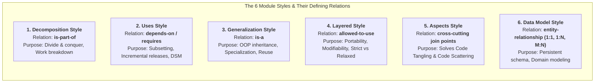

---

## 2.2 Style 1: The Decomposition Style (Lecture 4)

![[cks221_lec4_slide16_decomposition_style.png|750]]

* **Defining Relation:** `is-part-of` / submodule.
* **Mechanism:** A large system is recursively decomposed into smaller, more manageable submodules. Submodules are completely encapsulated within their parent module.
* **UML Notation:** UML Package hierarchy (folders nested within folders) or nested class rectangles.
* **Strategic Uses:**
  - **Divide and Conquer:** Breaking an overwhelmingly complex problem into manageable pieces.
  - **Work Allocation & Budgeting:** Assigning subsystems to development divisions or contractors.
  - **Resource Tracking:** Estimating cost and development schedule per module.
* **MCQ Giveaway:** Any diagram showing a hierarchy of subpackages or tree of `is-part-of` relationships is a **Decomposition View**.

---

## 2.3 Style 2: The Uses Style & The DSM (Lecture 4)

![[cks221_lec4_slide23_uses_style.png|750]]

* **Defining Relation:** `depends-on` / `requires` / `uses`.
* **Formal Definition:** Module A **uses** Module B if the **correct functioning of Module A depends on the presence of a correct implementation of Module B**.
* **Distinction from Call:** A function call does not always mean a "uses" relation. If Module A calls Module B but can catch errors or execute fine without B, A does not strictly "use" B. "Uses" strictly denotes an **operational correctness dependency**.

### The Dependency Structure Matrix (DSM)
A square $N \times N$ matrix used to analyze dependencies across modules:
- An entry at Row $i$, Column $j$ indicates that **Module $i$ depends on (uses) Module $j$**.
- Used by architects to detect **circular dependencies** (e.g., A uses B, and B uses A) which destroy testability.

![[cks221_lec4_slide25_dsm_matrix.png|750]]

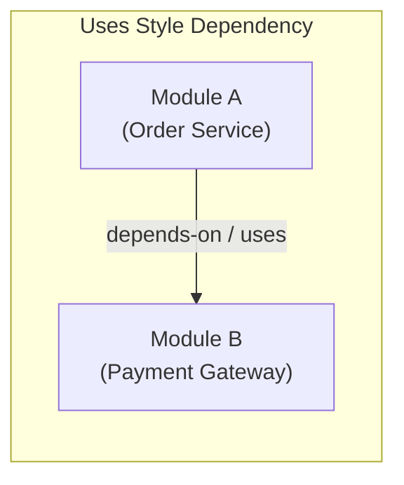

### Strategic Uses for MCQs:
1. **Designing Subsets:** What is the absolute minimum subset of modules needed to release a working "Beta" version? Follow the `uses` arrows backwards!
2. **Planning Incremental Releases:** Release modules with zero dependencies first (independent leaves), then layer modules that depend on them.
3. **Isolating Unit Testing:** Building test harnesses and mock stubs for modules that are heavily depended upon.

> [!tip] MCQ Exam Radar: Uses Style
> - **Question:** *"If an engineering team needs to deliver a minimal working prototype of a system for demonstration, which architectural view should they consult to identify independent subsets?"*  
>   $\rightarrow$ **The Uses View** (Tracks correctness dependencies).
> - **Tool Question:** *"What matrix is used to identify circular dependencies in the Uses style?"*  
>   $\rightarrow$ **Dependency Structure Matrix (DSM)**.

---

## 2.4 Style 3: The Generalization Style (Lecture 4)

![[cks221_lec4_slide28_generalization_style.png|750]]

* **Defining Relation:** `is-a` (inheritance / specialization).
* **Mechanism:** Common features, interfaces, and methods are extracted into a parent supermodule. Child submodules inherit these attributes and specialize or override behaviors.
* **UML Notation:** Solid arrow with an **unfilled hollow triangle** pointing to the superclass.
* **Strategic Uses:**
  - **Polymorphism:** Allowing client code to interact with abstract interfaces without depending on concrete implementations.
  - **Framework Extension:** Software developers extend framework base classes to customize application behavior.
* **MCQ Giveaway:** A class hierarchy featuring `is-a`, abstract classes, and inheritance triangles is a **Generalization Style**.

---

## 2.5 Style 4: The Layered Style (Lecture 4)

![[cks221_lec4_slide33_layered_style.png|750]]

* **Defining Relation:** `allowed-to-use` (strictly unidirectional, downward).
* **Mechanism:** Modules are partitioned into an ordered stack of horizontal layers. Each layer provides a cohesive set of services to the layer above it.
* **Fundamental Constraint:** Lower layers are completely oblivious to higher layers. A lower layer can **NEVER** initiate calls upward.

### Strict vs. Relaxed (Open) Layering

![[cks221_lec4_slide35_strict_vs_relaxed_layering.png|750]]

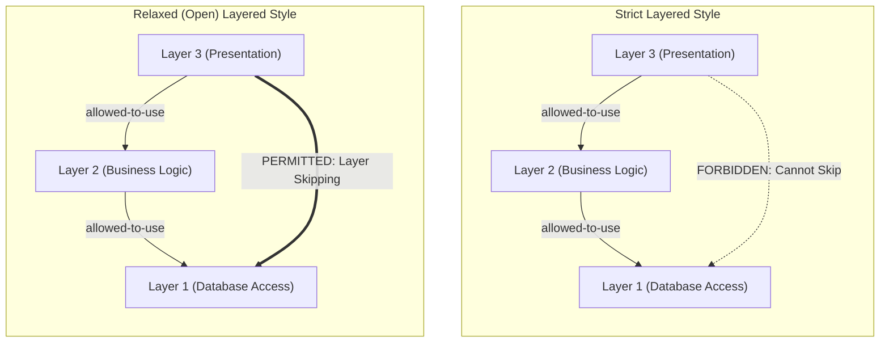

| Layering Variation | Execution Rule | Trade-off / MCQ Feature |
| :--- | :--- | :--- |
| **Strict Layering** | Layer $N$ may **ONLY** use Layer $N-1$. | Maximum isolation; change in Layer 1 never affects Layer 3. Higher performance overhead (must pass through all intermediate layers). |
| **Relaxed Layering** | Layer $N$ may use Layer $N-1$, Layer $N-2$, etc. | Better performance (can skip intermediate layers for simple reads); weaker isolation (changes in Layer 1 can ripple directly to Layer 3). |

### Geometric Topologies: Stack vs. Concentric Rings vs. Sidecars

![[cks221_lec4_slide38_stack_concentric_sidecars.png|750]]

1. **Vertical Stack:** Standard horizontal bands (UI $\rightarrow$ Business $\rightarrow$ Data).
2. **Concentric Rings:** The innermost ring represents the core kernel / hardware abstraction; outer rings represent higher-level applications and utilities. Outer rings are allowed to use inner rings, but inner rings cannot use outer rings.
3. **Sidecars (Cross-Layer Utilities):** Utility libraries (e.g., math utilities, string formatters, error loggers) placed to the side of the stack that are `allowed-to-use` by multiple layers simultaneously.

> [!tip] MCQ Exam Radar: Layered Style
> - **MCQ Question:** *"In a strict layered architecture with 4 layers (1 = lowest, 4 = highest), can Layer 4 call Layer 2 directly?"*  
>   $\rightarrow$ **NO**. Strict layering allows calls only to Layer $N-1$ (Layer 3).
> - **Primary Architectural Benefits:** **Portability** (swap out database or OS layer with zero change to business logic) and **Modifiability**.

---

## 2.6 Style 5: The Aspects Style (Lecture 5)

![[cks221_lec5_slide2_aspects_style_overview.png|750]]

### The Core Problem Solved: Cross-Cutting Concerns
In traditional Object-Oriented design, certain system requirements cannot be cleanly encapsulated inside a single class. For example, **logging**, **user authentication**, **transaction management**, and **error handling** cut across dozens of unrelated modules. This creates two catastrophic code smells:

![[cks221_lec5_slide4_code_tangling_scattering.png|750]]

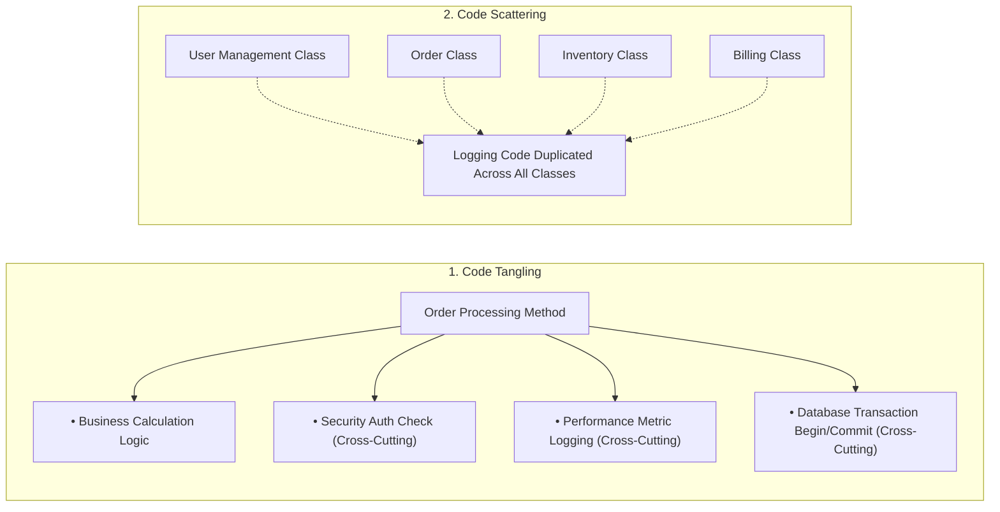

* **Code Tangling:** Multiple unrelated concerns intertwined inside a single class or method (the developer can barely find the real business logic amidst logging and transaction lines).
* **Code Scattering:** A single concern duplicated and spread across dozens of separate source files.

### The Mechanism of Aspect-Oriented Programming (AOP)

![[cks221_lec5_slide5_pointcut_joinpoint_advice.png|750]]

Aspects extract cross-cutting concerns into a dedicated module called an **Aspect**. It uses four fundamental mechanics:

| AOP Mechanic | Definition | Real-World Analogy |
| :--- | :--- | :--- |
| **Join Point** | A specific point in the program's execution flow (e.g., entering a method, exiting a method, throwing an exception). | A specific door in a building. |
| **Pointcut** | A predicate or pattern expression that **matches and selects** a set of join points (e.g., `execution(* com.bank.service.*.*(..))`). | A security rule: "Inspect all doors on the 2nd floor." |
| **Advice** | The actual code executed at a join point matched by a pointcut. Types: **Before**, **After**, or **Around** the join point. | The security guard checking ID cards at the door. |
| **Aspect** | The modular unit that bundles pointcuts and advice together. | The entire security protocol handbook. |

> [!danger] MCQ Exam Radar: Aspects Style Dead Giveaways
> - Whenever a question mentions **"Code Tangling"**, **"Code Scattering"**, or **"Cross-Cutting Concerns"**, the answer is 100% **Aspects Style**.
> - If an option asks: *"What construct defines the specific execution points where an aspect's logic should execute?"* $\rightarrow$ **Pointcut** (matches Join Points).

---

## 2.7 Style 6: The Data Model Style (Lecture 5)

![[cks221_lec5_slide10_data_model_style.png|750]]

* **Constituents:** Entities, Attributes, Relationships.
* **Cardinalities / Multiplicities:** $1:1$, $1:N$, $M:N$ (mandatory vs. optional).
* **Notations:** Crow's Foot Entity-Relationship Diagrams (ERD) or UML Class Diagrams with entity stereotypes.
* **Purpose:** Modeling persistent database schemas, domain models, and relational data constraints.

---

# Part 3: Topic 2 — Component & Connector (C&C) Views (Lecture 6)

## 3.1 C&C Foundations: Components, Connectors, Ports, and Roles

A **Component-and-Connector (C&C) View** documents the runtime behavior of executing software. It answers questions about **performance, concurrency, security, and network bottlenecks**.

![[cks221_lec6_slide4_cc_views_overview.png|750]]

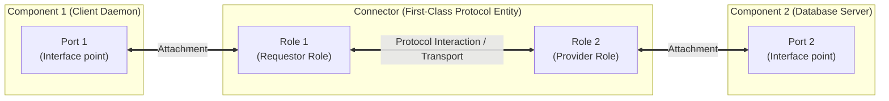

### The Three Constituent Elements of C&C
1. **Components:** Runtime computational units or data stores (e.g., running processes, active threads, database servers). Components expose **Ports** (points of interaction on the component's boundary).
2. **Connectors:** First-class architectural mechanisms that mediate runtime interactions between components (e.g., TCP sockets, RPC channels, message buses, SQL pipelines). Connectors expose **Roles** (the protocol expectations and contracts that connecting components must satisfy).
3. **The Single Foundational Relation: Attachment:** The binding between a component's **Port** and a connector's **Role**.

> [!important] MCQ Exam Radar: Ports & Roles
> - Components have **Ports**. Connectors have **Roles**.
> - They connect via **Attachment** (Port-to-Role).
> - A connector is **NOT** just a simple line; it is a first-class architectural entity that models complex protocols, buffering, synchronization, and encryption!

---

## 3.2 The Four Major C&C Style Families (Lecture 6)

### 1. Call-Return Family (Client-Server & SOA)
* **Client-Server C&C:** Components (Client, Server); Connectors (RPC, HTTP). Asymmetric request-reply. Clients initiate; server responds.
* **SOA C&C:** Enterprise services communicating over an Enterprise Service Bus (ESB). Supports protocol transformation, message routing, and service choreography.

![[cks221_lec6_slide16_client_server_cc.png|750]]

---

### 2. Data Flow Family: The Pipe-and-Filter Style

![[cks221_lec6_slide25_pipe_and_filter_cc.png|750]]

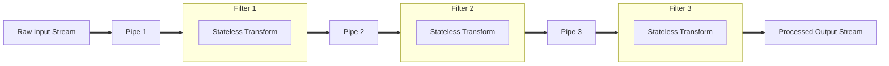

#### Detailed Mechanical Rules (High MCQ Probability)
1. **Filters are Independent & Stateless:** A filter transforms its input stream into an output stream incrementally. A filter **never shares global memory or database state** with any other filter!
2. **Ignorance of Upstream/Downstream:** Filter 2 has no idea who wrote to Pipe 2, nor does it care who reads from Pipe 3. It only cares that incoming data adheres to its input stream format.
3. **Pipes are First-Class Conduits:** Pipes act as FIFO buffers and handle flow control and **backpressure** (if downstream Filter 2 is slower than upstream Filter 1, Pipe 2 buffers data or throttles Filter 1).
4. **Concurrency:** All filters can execute concurrently in separate OS threads or processes!

> [!danger] MCQ Exam Radar: Pipe-and-Filter Traps
> - **False Statement Trap:** *"Filters in a Pipe-and-Filter architecture share a central caching database to synchronize intermediate calculation states."*  
>   $\rightarrow$ **FALSE!** Filters must never share state; sharing state breaks the pipe-and-filter style.
> - **True Statement:** Filters can run in parallel on separate processor cores processing continuous data streams.

---

### 3. Event-Based Family: The Publish-Subscribe Style

![[cks221_lec6_slide29_publish_subscribe_cc.png|750]]

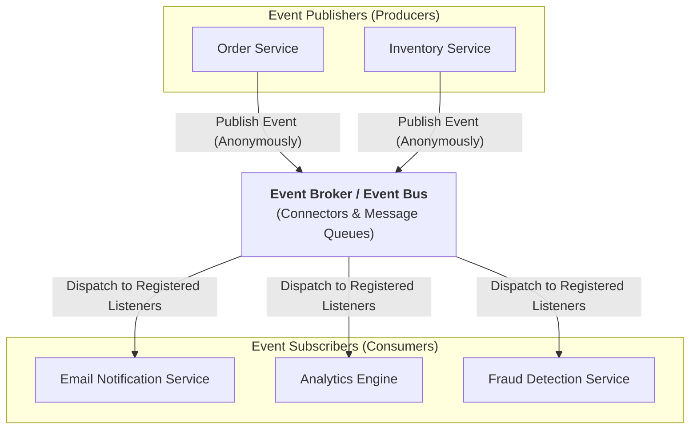

#### The Mechanics of Decoupling
* **Spatial Decoupling:** Publishers have zero knowledge of who receives their events; subscribers have zero knowledge of who generated the event.
* **Temporal Decoupling:** Publishers and subscribers do not need to be active simultaneously. Events can wait in message broker queues.
* **Synchronization Decoupling:** Publishers emit an event and immediately resume execution without waiting for subscribers to finish processing (asynchronous).
* **The Critical Weakness:** **Non-deterministic execution ordering** (cannot guarantee which subscriber runs first) and lack of transaction atomicity.

---

### 4. Shared Data Family: Passive Repository vs. Active Blackboard

![[cks221_lec6_slide32_shared_data_blackboard.png|750]]

| Feature | Passive Repository Style | Active Blackboard Style |
| :--- | :--- | :--- |
| **Central Element** | Central Database / Data Warehouse. | Central Blackboard (shared hypothesis store). |
| **Interacting Components** | Independent Accessor Clients (Web servers, Reporting scripts). | **Knowledge Sources (KS)** + Control Shell. |
| **Control Flow** | **Client-Driven:** Clients query or update the repository on their own initiative. The database sits passively. | **Event/State-Driven:** The blackboard monitors its own state changes and **actively triggers** knowledge sources when new solutions are detected. |
| **Typical Problem Domain** | Enterprise transactions, inventory systems, payroll. | Artificial Intelligence, speech recognition, sonar signal analysis. |

---

# Part 4: Topic 2 — Allocation Views & Styles (Lecture 6)

## 4.1 Foundations of Allocation Views

> [!important] Definition: Allocation Views
> An **Allocation View** maps **software elements** onto **non-software / environmental elements** (hardware servers, network switches, disk directory hierarchies, or human organizational teams).

![[cks221_lec6_slide36_allocation_styles_overview.png|750]]

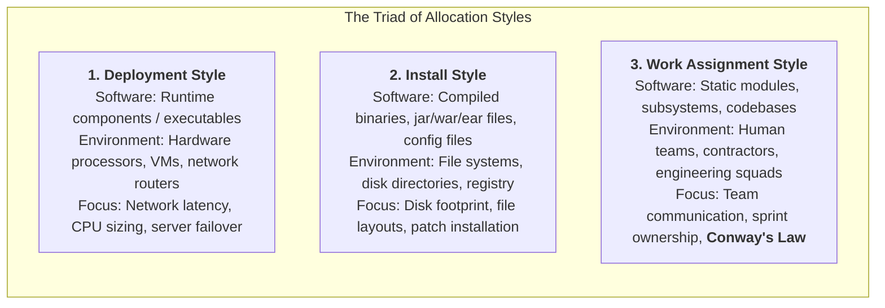

---

## 4.2 Style 1: The Deployment Style (Lecture 6)

![[cks221_lec6_slide38_deployment_style.png|750]]

* **Software Elements:** Executable runtime processes, threads, component instances.
* **Environmental Elements:** **Hardware nodes, physical servers, virtual machines, CPUs, network routers, and physical communication links**.
* **UML Notation:** UML Deployment Diagram with 3D cube nodes stereotyped as `«device»` or `«executionEnvironment»` connected by communication paths.
* **Questions Answered:**
  - *Which server hosts which process?*
  - *Is the network bandwidth between Node A and Node B sufficient to handle peak traffic?*
  - *If Physical Server 1 crashes, how does the load balancer reroute traffic to Server 2?*

---

## 4.3 Style 2: The Install Style (Lecture 6)

![[cks221_lec6_slide44_install_style.png|750]]

* **Software Elements:** Compiled binary artifacts, `.jar`/`.war`/`.ear` packages, DLL files, configuration `.yaml` files, database initialization scripts.
* **Environmental Elements:** **File systems, directory hierarchies, disk partitions, flash memory blocks, and installer manifests**.
* **Questions Answered:**
  - *In which directory path is the binary installed (e.g., `/usr/local/bin` or `C:\Program Files`)?*
  - *How are dependent libraries, DLLs, and configuration files organized on the hard drive?*
  - *How much physical disk storage is consumed during installation?*

> [!danger] MCQ Exam Radar: Deployment vs. Install Trap
> - If an option involves **processors, hardware nodes, network topologies, or VMs** $\rightarrow$ **Deployment Style**.
> - If an option involves **folders, directory paths, file systems, disk drives, or installer manifests** $\rightarrow$ **Install Style**.

---

## 4.4 Style 3: The Work Assignment Style & Conway's Law (Lecture 6)

![[cks221_lec6_slide49_work_assignment_style.png|750]]

* **Software Elements:** Static modules, subsystems, and code repositories.
* **Environmental Elements:** **Human organizational entities, engineering teams, external contractors, or individual programmers**.
* **Questions Answered:**
  - *Which development team is responsible for implementing and maintaining Subsystem X?*
  - *Do team boundaries match module boundaries to minimize inter-team communication friction?*

### Conway's Law (Guaranteed MCQ Target)

![[cks221_lec6_slide52_conways_law.png|750]]

> [!important] Melvin Conway's Law (1968)
> *"Organizations which design systems are constrained to produce designs which are copies of the communication structures of these organizations."*

* **What It Means Mechanically:** If you have four separate engineering teams working on a compiler, you will inevitably end up with a 4-pass compiler. If your UI team and Database team never speak to each other, your architecture will have a rigid, clumsy interface between the UI and the Database.
* **Architectural Action:** Architects must consciously design **Work Assignment Views** so that team communication pathways mirror the desired software module interactions.

---

# Part 5: Master Comparison Matrices & Dead Giveaway Keywords

## 5.1 The "Which Style Is It?" Master Diagnostic Matrix

| Style Name | Category | Primary Element Type | Primary Relation | Dead Giveaway Keyword / Problem Solved |
| :--- | :--- | :--- | :--- | :--- |
| **Decomposition** | Module | Submodules, Subsystems | `is-part-of` | Nested packages, divide-and-conquer, work breakdown structure. |
| **Uses** | Module | Static code modules | `depends-on` / `requires` | **DSM matrix**, subsetting, incremental development, correctness dependency. |
| **Generalization** | Module | Classes, Interfaces | `is-a` | OOP inheritance, specialization, polymorphism. |
| **Layered** | Module | Horizontal layers | `allowed-to-use` | Unidirectional downward, strict (N-1) vs relaxed, stack/concentric/sidecars. |
| **Aspects** | Module | Aspects, Classes | *Cross-cutting join points* | **Code tangling**, **Code scattering**, pointcut, advice, logging/security. |
| **Data Model** | Module | Entities, Attributes | *Entity relationships* | Crow's Foot ERD, cardinalities ($1:1, 1:N, M:N$). |
| **Client-Server** | C&C | Clients, Servers | Attachment (Port-Role) | Asymmetric request-reply, central server bottleneck/SPOF. |
| **Pipe-and-Filter** | C&C | Filters, Pipes | Attachment | **Stateless**, **no shared state**, stream buffers, backpressure. |
| **Publish-Subscribe**| C&C | Publishers, Subscribers | Attachment via Event Bus | Complete spatial/temporal decoupling, non-deterministic order. |
| **Active Blackboard**| C&C | Blackboard, Knowledge Sources | Attachment | Central store **actively triggers** knowledge sources upon state change. |
| **Deployment** | Allocation | Runtime executables | `deployed-on` | Mapped to **hardware nodes, CPUs, VMs, network links**. |
| **Install** | Allocation | Binaries, packages | `installed-in` | Mapped to **file systems, directory trees, disk paths, manifests**. |
| **Work Assignment** | Allocation | Code modules | `assigned-to` | Mapped to **human teams, contractors**, **Conway's Law**. |

---

## 5.2 Top 10 MCQ Trap Busters

1. **"Does every system have an architecture?"**  
   $\rightarrow$ **YES.** Even legacy spaghetti code has an architecture.
2. **"Can an architecture be evaluated before writing code?"**  
   $\rightarrow$ **YES.** Architectural tradeoff analyses (e.g., ATAM) evaluate quality attributes before implementation begins.
3. **"Does Pipe-and-Filter allow filters to share a global SQL database?"**  
   $\rightarrow$ **NO.** Filters must be completely independent and stateless; sharing global state violates the style.
4. **"In strict layering, can Layer 3 call Layer 1 directly?"**  
   $\rightarrow$ **NO.** In strict layering, Layer $N$ may only call Layer $N-1$ (Layer 2). Calling Layer 1 directly is only allowed in *relaxed* layering.
5. **"What is the difference between a Structure and a View?"**  
   $\rightarrow$ A **structure** is the real system (reality); a **view** is a documented representation for stakeholders. *"Architects design structures; they document views."*
6. **"What is the difference between Deployment View and Install View?"**  
   $\rightarrow$ Deployment maps software to **hardware nodes/CPUs**; Install maps software to **file systems/directory hierarchies**.
7. **"What view binds and validates all four views in Kruchten's 4+1 model?"**  
   $\rightarrow$ The **+1 Use Case / Scenario View**.
8. **"Which Kruchten view addresses concurrency, threads, and tasks?"**  
   $\rightarrow$ The **Process View** (targeted at system integrators).
9. **"Which Kruchten view addresses package hierarchy and build dependencies?"**  
   $\rightarrow$ The **Development View** (targeted at programmers).
10. **"What is a Connector in C&C architecture?"**  
    $\rightarrow$ A **first-class architectural entity** that mediates interaction with its own **roles**, not just a simple line.

---

# Part 6: 25 High-Yield Scenario-Based Practice MCQs

> [!question] Q1: An architect models a system that processes gigabytes of telemetry data in streaming chunks. The processing involves decompression, format normalization, and anomaly detection. Each stage must run independently on separate CPU cores without sharing memory or database state. Which architectural style MUST be selected?
> - A) Shared Data Blackboard Style  
> - B) Pipe-and-Filter Style  
> - C) Layered Style  
> - D) Client-Server Style  
> 
> **Answer: B**  
> *Reasoning:* Streaming data processed in independent, stateless, sequential stages without shared memory is the exact definition and mechanical hallmark of the Pipe-and-Filter style.

> [!question] Q2: In an e-commerce platform, the OrderProcessing module requires user authentication, transaction demarcation, and performance logging. In the current implementation, authentication and logging statements are duplicated across 40 different methods, intertwining with core business rules. What two architectural code smells are present, and which style resolves them?
> - A) Code Duplication and Feature Envy; resolved by Generalization Style  
> - B) Code Tangling and Code Scattering; resolved by Aspects Style  
> - C) Ripple Effect and High Coupling; resolved by Layered Style  
> - D) Tight Coupling and Data Bloat; resolved by Data Model Style  
> 
> **Answer: B**  
> *Reasoning:* Intertwining multiple concerns within a single method is **Code Tangling**; spreading the same concern across many classes is **Code Scattering**. The **Aspects Style** encapsulates cross-cutting concerns to resolve both.

> [!question] Q3: A software company plans to release an early "Alpha" prototype of their application containing only the bare minimum core features. Which architectural view must the engineering lead consult to determine the minimal viable subset of dependent code modules?
> - A) Decomposition View  
> - B) Uses View  
> - C) Deployment View  
> - D) Process View  
> 
> **Answer: B**  
> *Reasoning:* The Uses View tracks operational correctness dependencies (`depends-on`), making it the primary architectural tool for subset identification and incremental build planning.

> [!question] Q4: A cloud architecture team documents the placement of containerized microservices across Amazon EC2 instances, specifying the CPU capacities, RAM allocations, and VPC subnet links. Which allocation style is being documented?
> - A) Install Style  
> - B) Deployment Style  
> - C) Work Assignment Style  
> - D) C&C Client-Server Style  
> 
> **Answer: B**  
> *Reasoning:* Mapping software units onto physical or virtual hardware nodes, processors, and network paths is the definition of the **Deployment Style**.

> [!question] Q5: Which statement regarding Melvin Conway's Law is TRUE?
> - A) Systems become more efficient as more developers are added to a late project  
> - B) System architecture inevitably mirrors the communication boundaries of the organization that built it  
> - C) Memory consumption doubles every eighteen months unless layered styles are enforced  
> - D) Software architecture suppresses public interfaces and exposes private implementation details  
> 
> **Answer: B**  
> *Reasoning:* Conway's Law states that organizations produce software designs that copy their internal communication structures. It is associated with the **Work Assignment Style**.

> [!question] Q6: In Kruchten's "4+1" View Model, which view is specifically authored for system integrators to analyze runtime concurrency, thread deadlocks, and performance throughput?
> - A) Logical View  
> - B) Process View  
> - C) Development View  
> - D) Physical View  
> 
> **Answer: B**  
> *Reasoning:* The Process View is explicitly dedicated to runtime execution, concurrency, synchronization, and system integrators.

> [!question] Q7: Consider a web application with 20 concurrent client browsers and 1 central application server. In the Module Decomposition View and the Runtime C&C View, how many primary software elements exist?
> - A) 21 in Decomposition; 21 in C&C  
> - B) 2 in Decomposition; 21 in C&C  
> - C) 21 in Decomposition; 2 in C&C  
> - D) 2 in Decomposition; 2 in C&C  
> 
> **Answer: B**  
> *Reasoning:* Decomposition counts static codebases (Client module codebase + Server module codebase = **2 modules**). C&C counts runtime instances (20 client processes + 1 server daemon = **21 components**).

> [!question] Q8: What is the relationship between component Ports and connector Roles in Component-and-Connector (C&C) architecture?
> - A) Ports inherit from Roles via Generalization  
> - B) Ports connect directly to other Ports without connectors  
> - C) Ports attach to Roles to bind components to interaction protocols  
> - D) Roles contain multiple Ports inside a Decomposition hierarchy  
> 
> **Answer: C**  
> *Reasoning:* Components expose Ports; Connectors expose Roles; they connect via the **Attachment** relation.

> [!question] Q9: An AI speech recognition engine uses a central repository where multiple specialized acoustic and grammatical knowledge sources continuously inspect state changes and asynchronously post partial hypotheses when new phonemes appear. Which style is this?
> - A) Passive Repository Style  
> - B) Active Blackboard Style  
> - C) Main Program and Subprogram Style  
> - D) Generalization Style  
> 
> **Answer: B**  
> *Reasoning:* A central store that actively inspects state changes and **triggers** independent knowledge sources to solve opportunistic problems is an **Active Blackboard**.

> [!question] Q10: In a strictly layered architecture, which of the following interactions is STRICTLY FORBIDDEN?
> - A) Layer 3 calling Layer 2  
> - B) Layer 2 calling Layer 1  
> - C) Layer 4 calling Layer 2 directly  
> - D) Layer 1 returning execution data back to Layer 2  
> 
> **Answer: C**  
> *Reasoning:* In strict layering, Layer $N$ may ONLY use Layer $N-1$. Skipping layers (Layer 4 directly calling Layer 2) is strictly forbidden in strict layering (permitted only in relaxed layering).

> [!question] Q11: An installer script creates `/etc/myapp/config.yaml`, places compiled shared libraries into `/usr/lib64/`, and sets execution permissions on `/usr/bin/myapp`. Which architectural style is this documenting?
> - A) Deployment Style  
> - B) Install Style  
> - C) Uses Style  
> - D) Development View  
> 
> **Answer: B**  
> *Reasoning:* Mapping compiled units and configuration files to file systems, directory paths, and disk layouts is the **Install Style**.

> [!question] Q12: Why is the "+1" Scenario / Use Case view necessary in Kruchten's 4+1 model if the other four views already exist?
> - A) It replaces the Development View during coding  
> - B) It binds, exercises, and validates that the four separate views work harmoniously together  
> - C) It is the only view that documents the hardware server nodes  
> - D) It provides the formal database schema for end-users  
> 
> **Answer: B**  
> *Reasoning:* Scenarios illustrate system behavior across all four views, verifying their coherence.

> [!question] Q13: In Aspect-Oriented Programming, what is a "Pointcut"?
> - A) The physical line of code where logging takes place  
> - B) An expression or predicate that matches and selects one or more Join Points  
> - C) A subclass that extends a generic superclass  
> - D) A connector role in a C&C diagram  
> 
> **Answer: B**  
> *Reasoning:* A Pointcut is an expression that filters/selects a set of Join Points where Advice is applied.

> [!question] Q14: Which of the following is an example of an ALLOCATION structure?
> - A) Inheritance hierarchy among bank account classes  
> - B) The attachment of client ports to HTTP connector roles  
> - C) The assignment of subsystem modules to offshore development squads  
> - D) A dependency matrix indicating module uses relations  
> 
> **Answer: C**  
> *Reasoning:* Mapping code modules to human teams is the **Work Assignment Style** (an Allocation structure).

> [!question] Q15: Which statement about Software Architecture is FALSE?
> - A) Architecture is an abstraction that suppresses private implementation details  
> - B) Every executing software system has an architecture  
> - C) A software architecture can be evaluated before a single line of code is written  
> - D) All executing software systems possess a good architecture  
> 
> **Answer: D**  
> *Reasoning:* Tenet 4: Architecture is descriptive; many systems possess poor, fragile architectures.

> [!question] Q16: In the Uses module style, if Module A calls Module B, does Module A always "use" Module B?
> - A) Yes, every function call represents a uses relation  
> - B) No, A only "uses" B if the correctness of A depends on the presence and correctness of B  
> - C) No, A only uses B if B is a subclass of A  
> - D) Yes, provided they share the same physical directory  
> 
> **Answer: B**  
> *Reasoning:* Formal definition: "Uses" requires that the operational correctness of A depends on B.

> [!question] Q17: What is the primary quality attribute addressed by Module structures?
> - A) Concurrency  
> - B) Network throughput  
> - C) Modifiability  
> - D) Hardware utilization  
> 
> **Answer: C**  
> *Reasoning:* Module views organize static code units to isolate changes and prevent ripple effects (**Modifiability**).

> [!question] Q18: A software engineer documents that a banking system uses asynchronous Publish-Subscribe over a message broker. What is a major architectural TRADE-OFF of this decision?
> - A) Components become tightly coupled in physical memory  
> - B) Execution order of subscribers is non-deterministic  
> - C) Publishers must wait synchronously for all subscribers to finish  
> - D) The system cannot support more than two subscribers  
> 
> **Answer: B**  
> *Reasoning:* Publish-Subscribe decouples publishers and subscribers, but introduces non-deterministic execution ordering.

> [!question] Q19: Which architectural tool represents dependencies between modules in an $N \times N$ matrix to detect circular dependencies?
> - A) Entity Relationship Diagram (ERD)  
> - B) Dependency Structure Matrix (DSM)  
> - C) Use Case Matrix  
> - D) Deployment Manifest  
> 
> **Answer: B**  
> *Reasoning:* The **Dependency Structure Matrix (DSM)** tracks module dependencies.

> [!question] Q20: What defines a "Subsystem" in contrast to a simple "Module"?
> - A) A subsystem contains no public interfaces  
> - B) A subsystem is an aggregated module that can be executed independently and developed incrementally  
> - C) A subsystem cannot be assigned to human teams  
> - D) A subsystem only exists in the C&C view  
> 
> **Answer: B**  
> *Reasoning:* Subsystems carry out a cohesive mission, can execute independently, and support incremental development.

> [!question] Q21: Which Kruchten view is targeted at end-users to capture functional requirements and domain services?
> - A) Logical View  
> - B) Process View  
> - C) Development View  
> - D) Physical View  
> 
> **Answer: A**  
> *Reasoning:* The **Logical View** addresses end-user functional requirements.

> [!question] Q22: In a Pipe-and-Filter architecture, what handles flow control when an upstream filter outputs data faster than a downstream filter can consume it?
> - A) The operating system killing the upstream filter  
> - B) The pipe buffering data and applying backpressure  
> - C) The blackboard controller  
> - D) The logical view class diagram  
> 
> **Answer: B**  
> *Reasoning:* Pipes buffer stream data and apply **backpressure** flow control.

> [!question] Q23: Which geometric variation of the layered style places general utilities to the side of the main stack, allowing them to be used across multiple layers?
> - A) Concentric Rings  
> - B) Sidecars  
> - C) Vertical Stack  
> - D) Blackboards  
> 
> **Answer: B**  
> *Reasoning:* Sidecars are cross-cutting utility layers accessible by multiple layers.

> [!question] Q24: What is the relationship between functionality and quality attributes?
> - A) Functionality determines quality attributes completely  
> - B) Functionality and quality attributes are orthogonal; architecture is the primary determinant of quality attributes  
> - C) Quality attributes can be ignored if functional testing passes  
> - D) They are identical concepts in the SEI definition  
> 
> **Answer: B**  
> *Reasoning:* Functionality and quality attributes are orthogonal; architecture governs quality attributes.

> [!question] Q25: An architect designs an enterprise application where independent business services communicate across an Enterprise Service Bus using standard WSDL and SOAP protocols. Which architectural style is this?
> - A) Service-Oriented Architecture (SOA)  
> - B) Main Program and Subprogram  
> - C) Pipe-and-Filter  
> - D) Peer-to-Peer  
> 
> **Answer: A**  
> *Reasoning:* Coarse-grained enterprise services communicating over an ESB via SOAP/WSDL is **Service-Oriented Architecture (SOA)**.
