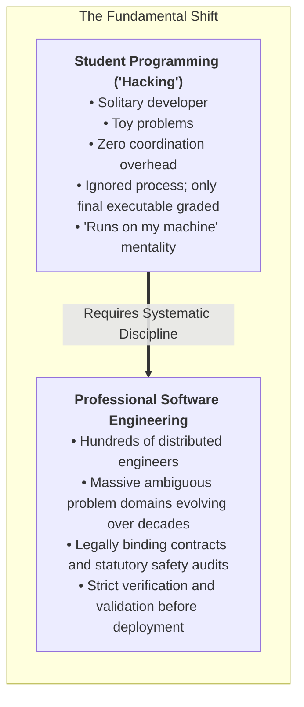
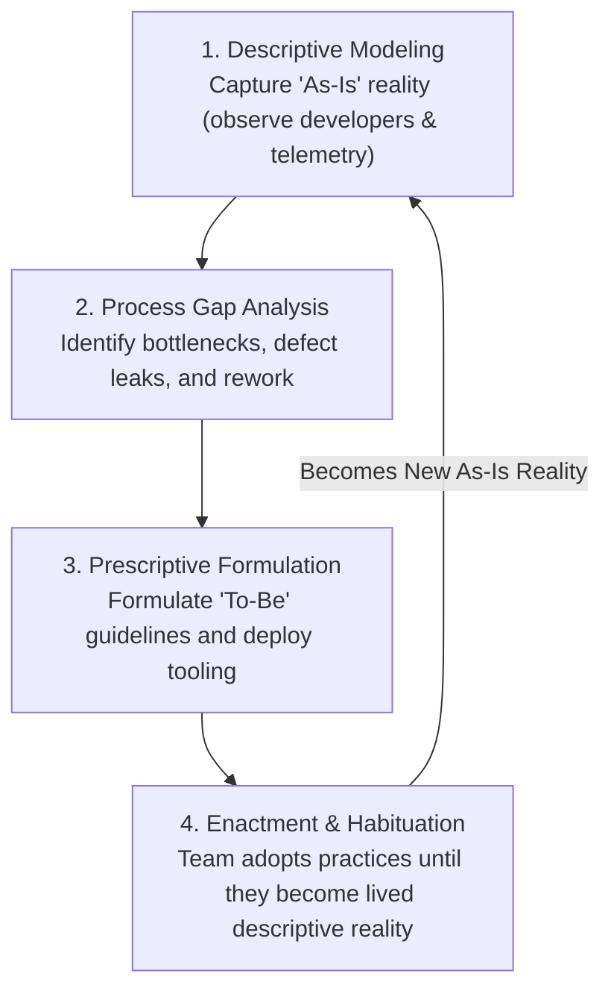
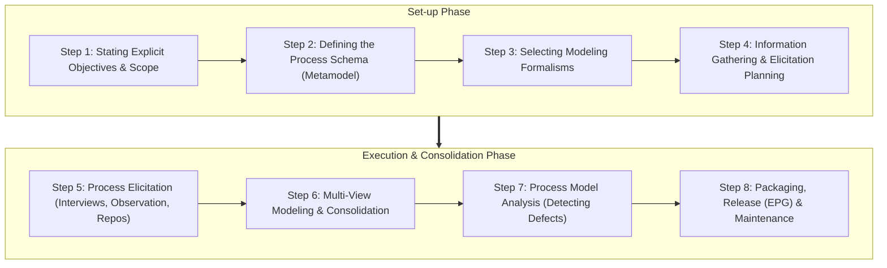
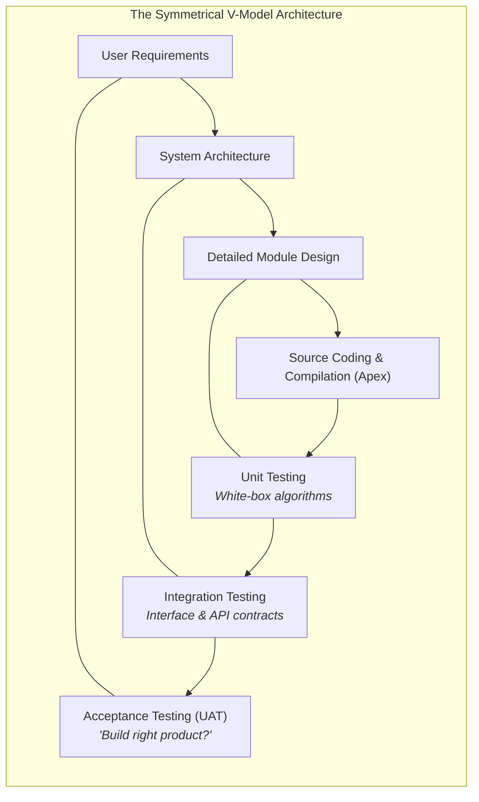

# CKS222 Short Notes: Complete Beginner-to-Mastery Objective Exam Guide

> [!abstract] Fast Navigation & Document Architecture
> This guide is crafted for students who are **completely new to Software Process and Life Cycle**. It starts from first principles to help you intuitively grasp why processes exist, then systematically equips you with every definition, date, formula, comparison, and trick required to achieve full marks on the **Test 1 Objective Examination** (covering Weeks 1 to 5 and the early foundations of Week 6).
> 
> - **[[#Part 0: The Absolute Beginner's Primer — What is CKS222 and Why Does It Exist?|Part 0: The Absolute Beginner's Primer — What is CKS222 & Why Does It Exist?]]**
> - **[[#Part 1: The Master Exam Cram Matrices (At-a-Glance Facts to Memorize)|Part 1: The Master Exam Cram Matrices (At-a-Glance Facts to Memorize)]]**
>   - [[#1.1 Complete Chronological Timeline & Pioneer Roster (1965–2020)|1.1 Complete Chronological Timeline & Pioneer Roster (1965–2020)]]
>   - [[#1.2 Statutory Safety Standards & Industrial Disasters|1.2 Statutory Safety Standards & Industrial Disasters]]
>   - [[#1.3 Exact Numbers, Percentages, Timeboxes & Cadences|1.3 Exact Numbers, Percentages, Timeboxes & Cadences]]
>   - [[#1.4 Mathematical Formulas & Calculation Cheat Sheet|1.4 Mathematical Formulas & Calculation Cheat Sheet]]
> - **[[#Part 2: Comprehensive Chapter-by-Chapter Conceptual Mastery|Part 2: Comprehensive Chapter-by-Chapter Conceptual Mastery]]**
>   - [[#2.1 Week 1: Software Process Foundations, SDLC & Early Models|2.1 Week 1: Software Process Foundations, SDLC & Early Models]]
>   - [[#2.2 Week 2: Descriptive Process Definition, Modeling & Metamodels|2.2 Week 2: Descriptive Process Definition, Modeling & Metamodels (8 Steps, MVP-L, SPEM 2.0)]]
>   - [[#2.3 Week 3: Lifecycle Controls, EVM, RACI & Scope Governance|2.3 Week 3: Lifecycle Controls, EVM, RACI & Scope Governance]]
>   - [[#2.4 Week 4: Agile, Scrum, XP, Lean & Security Integration|2.4 Week 4: Agile, Scrum, XP, Lean & Security Integration (SDL-Agile, SAMM)]]
>   - [[#2.5 Week 5: Prescriptive Lifecycles, V-Model, Prototyping, Tailoring & Defect Economics|2.5 Week 5: Prescriptive Lifecycles, V-Model, Prototyping, Tailoring & Defect Economics]]
>   - [[#2.6 Week 6 (Initial High-Yield Scope): Spiral Model, ICSM, Cleanroom & Unified Process|2.6 Week 6 (Initial High-Yield Scope): Spiral Model, ICSM, Cleanroom & Unified Process]]
> - **[[#Part 3: The Master "Versus" Discrimination Matrix (MCQ Traps)|Part 3: The Master "Versus" Discrimination Matrix (MCQ Traps)]]**
> - **[[#Part 4: Top 25 Objective Test "Trap & Trick" Alerts|Part 4: Top 25 Objective Test "Trap & Trick" Alerts]]**
> - **[[#Part 5: 40 High-Yield Rapid-Fire Objective Practice Questions with Explanations|Part 5: 40 High-Yield Rapid-Fire Objective Practice Questions with Explanations]]**

---

# Part 0: The Absolute Beginner's Primer — What is CKS222 and Why Does It Exist?

### 0.1 The Core Problem: Why Can't We Just Write Code?
When you write a program for a class assignment, you read the prompt, open your code editor, write code for a few hours, run it, fix syntax errors, and submit it. If it crashes after grading, nobody gets hurt. That is **casual programming** or **hacking**.

Now imagine you are building:
- The autopilot software for a commercial passenger airplane (e.g., Boeing or Airbus).
- The radiation dosage calculator for a cancer therapy machine.
- The core banking ledger processing billions of ringgit in financial transactions daily.

If an individual developer hacks that software without documentation, without verified specifications, and without formal testing:
- Airplanes crash.
- Patients receive lethal radiation overdoses.
- Millions of dollars vanish due to database concurrency deadlocks.

### 0.2 What is a Software Process? The "Baking" Analogy
To understand this entire subject, keep this simple analogy in mind:
- **The Software Product:** The finished chocolate cake.
- **The Source Code:** The physical flour, sugar, and cocoa mixed together.
- **The Software Process:** The **baking recipe, kitchen rules, hygiene checks, and oven temperatures**.

> [!tip] The "Recipe" Analogy
> A software process model is to real-world development what a **recipe** is to baking a cake in a commercial kitchen:
> - The recipe tells you **what steps to take, in what order, using what ingredients, and what safety checks to run**.
> - The actual baking is done by humans using real tools.
> - If your recipe and hygiene rules are chaotic, your cake will be inconsistent, defective, or poisoned.

### 0.3 The Invariant Law of Software Engineering: Process-Product Causality
The entire philosophical foundation of CKS222 is captured by one formula:

$$\text{Goal / Product Quality} \approx f(\text{Process}, \text{Context})$$

- **The Meaning:** The quality of the final software system (its reliability, security, speed, and defect rate) is a **direct mathematical function of the quality of the process** used to engineer it, conditioned on the project's **context**.
- **Heroic Programming is a Myth:** You cannot achieve sustainable, repeatable high-quality software through late-night coding heroics. When heroic developers quit or burn out, the company collapses. Only **institutionalized, repeatable engineering processes** guarantee predictable quality.

---

# Part 1: The Master Exam Cram Matrices (At-a-Glance Facts to Memorize)

## 1.1 Complete Chronological Timeline & Pioneer Roster (1965–2020)

In objective tests, questions frequently match an author, year, and breakthrough concept. Memorize this chronological table:

| Year | Pioneer / Organization | Breakthrough Contribution | Core Objective / Defining Concept | Quick Jump (In This Note) | Deep Dive (Master Note) |
| :---: | :--- | :--- | :--- | :--- | :--- |
| **1965** | **Bruce Tuckman** | Group Development Model | 5 Psychological Stages: Forming $\to$ Storming $\to$ Norming $\to$ Performing $\to$ Adjourning. | [[#2.3.5 Bruce Tuckman's Model of Group Development (1965)\|2.3.5 Tuckman Model]] | [[CKS222 Software Process and Life Cycle#3.3.2 Tuckman's Model of Group Development\|Master 3.3.2]] |
| **1970** | **Dr. Winston W. Royce** | Waterfall Model (with Feedback) | Staged linear progression; **warned single-pass is flawed**; mandated **preliminary design prototype**. | [[#2.5.1 Winston Royce's Waterfall Model (1970)\|2.5.1 Royce Waterfall]] | [[CKS222 Software Process and Life Cycle#1.5.2 Winston Royce's Waterfall Model (1970)\|Master 1.5.2]] |
| **1972** | **David Parnas** | Information Hiding Principle | Encapsulating internal implementation; adapted by MVP-L (Process Interface vs. Process Body). | [[#2.2.3 Process Modeling Formalisms: MVP-L and SPEM 2.0\|2.2.3 MVP-L Info Hiding]] | [[CKS222 Software Process and Life Cycle#2.3.2 Multi-View Process Language (MVP-L)\|Master 2.3.2]] |
| **1975** | **Victor Basili & Albert Turner** | Iterative Enhancement Model | Identify **architectural kernel** first; local waterfalls; mandatory **architectural consolidation**. | [[#2.5.4 Evolutionary & Modular Models\|2.5.4 Iterative Enhancement]] | [[CKS222 Software Process and Life Cycle#5.5.1 Basili and Turner's 1975 Iterative Enhancement Model\|Master 5.5.1]] |
| **1981** | **Barry Boehm** | Defect Cost Multiplier Curve | Cost to fix defects grows exponentially across SDLC ($1\times \to 1000\times$). | [[#2.5.5 Process Tailoring & Defect Economics\|2.5.5 Defect Multiplier]] | [[CKS222 Software Process and Life Cycle#5.7.3 The Exponential Defect Cost Multiplier Curve across the SDLC\|Master 5.7.3]] |
| **1986** | **Barry Boehm** | Spiral Model | **Risk-driven** meta-model; 4 quadrants; radial expansion dictates engineering intensity. | [[#2.6.1 Boehm's Risk-Driven Spiral Model & Theory W Negotiation\|2.6.1 Spiral Model]] | [[CKS222 Software Process and Life Cycle#6.1.1 The Risk-Driven Philosophy and Four Iterative Quadrants\|Master 6.1.1]] |
| **1987** | **Harlan Mills et al. (IBM)** | Cleanroom Software Engineering | Zero defect prevention; Box Structures; **strictly no compiler debugging**; independent statistical certification (MTTF). | [[#2.6.3 Cleanroom Software Engineering (Mills et al., 1987, IBM)\|2.6.3 Cleanroom Engineering]] | [[CKS222 Software Process and Life Cycle#6.3.1 Mathematical Correctness Proofs Over Traditional Debugging\|Master 6.3.1]] |
| **1989** | **Barry Boehm** | Theory W ("Make Everyone a Winner") | Win-Win Spiral Model; reconciles conflicting stakeholder win conditions through collaborative trade-offs. | [[#2.6.1 Boehm's Risk-Driven Spiral Model & Theory W Negotiation\|2.6.1 Theory W]] | [[CKS222 Software Process and Life Cycle#6.1.3 The Win-Win Spiral Model and Barry Boehm's Theory W\|Master 6.1.3]] |
| **1991** | **James Martin** | Rapid Application Development (RAD) | 4-Phase compressed lifecycle (60–90 days); Joint Application Design (JAD); CASE tools & visual code generation. | [[#2.5.3 Rapid Prototyping & RAD\|2.5.3 RAD Lifecycle]] | [[CKS222 Software Process and Life Cycle#5.4.4 Rapid Application Development: The 4-Phase Timeboxed Lifecycle\|Master 5.4.4]] |
| **1992** | **Bill Curtis, Marc Kellner & Jerry Over** | 5 Core Objectives of Process Modeling | Understand/Communicate, Improve/Optimize, Manage/Plan/Control, Guide/Instruct (EPG), Automate/Execute. | [[#2.2.1 Why Model Processes? The Curtis 5 Objectives (1992)\|2.2.1 Curtis 5 Objectives]] | [[CKS222 Software Process and Life Cycle#2.1.2 The Five Core Objectives of Process Modeling (Curtis et al., 1992)\|Master 2.1.2]] |
| **1996** | **Barry Boehm** | Three Anchor Milestones | LCO (Life-Cycle Objectives) $\to$ LCA (Life-Cycle Architecture) $\to$ IOC (Initial Operational Capability). | [[#2.6.1 Boehm's Risk-Driven Spiral Model & Theory W Negotiation\|2.6.1 Anchor Milestones]] | [[CKS222 Software Process and Life Cycle#6.1.4 The Three Anchor Milestones: LCO, LCA, and IOC\|Master 6.1.4]] |
| **1999** | **Jacobson, Booch & Rumbaugh** | Unified Process (UP) | Architecture-centric, use-case driven, iterative/incremental. 4 phases: Inception, Elaboration, Construction, Transition. | [[#2.6.4 The Unified Process (UP - Jacobson, Booch, Rumbaugh 1999)\|2.6.4 Unified Process]] | [[CKS222 Software Process and Life Cycle#6.4.1 Architectural Foundations: Use-Case Driven, Architecture-Centric, Iterative and Incremental\|Master 6.4.1]] |
| **2001** | **Agile Manifesto (17 Authors)** | Manifesto for Agile Software Development | 4 Core Values; individuals, working software, customer collaboration, responding to change. | [[#2.4.1 The Agile Manifesto (2001)\|2.4.1 Agile Manifesto]] | [[CKS222 Software Process and Life Cycle#4.1.1 The Agile Philosophy and Core Values\|Master 4.1.1]] |
| **2003** | **Walt Lipke** | Earned Schedule (ES) | Time-based extension fixing traditional EVM late-stage metric collapse ($SV_t = ES - AT$). | [[#2.3.7 Earned Value Management (EVM), Metric Collapse & Earned Schedule\|2.3.7 Earned Schedule]] | [[CKS222 Software Process and Life Cycle#3.4.3 The Late-Stage Metric Collapse & The Earned Schedule (ES) Remedy\|Master 3.4.3]] |
| **2003** | **Mary & Tom Poppendieck** | Lean Software Development | Adapted Toyota Production System (TPS); eliminate 3 Wastes (*Muda*); root cause analysis (5 Whys). | [[#2.4.5 Lean Software Development (Poppendieck)\|2.4.5 Lean Development]] | [[CKS222 Software Process and Life Cycle#4.5 Lean Software Development: Capabilities, Wastes, and Continuous Flow\|Master 4.5]] |
| **2004** | **Kent Beck** | Extreme Programming (XP) | Twin-track feedback (Quarterly/Weekly); TDD; Pair Programming; Continuous Integration ($\le 10$-min build). | [[#2.4.4 Extreme Programming (XP - Kent Beck)\|2.4.4 Extreme Programming]] | [[CKS222 Software Process and Life Cycle#4.4 Extreme Programming (XP): Values, Twin-Track Cycles, and Practices\|Master 4.4]] |
| **2005+** | **Barry Boehm et al.** | Incremental Commitment Spiral Model (ICSM) | Concurrent engineering; evidence-based reviews; 4 dynamic exit gates (Green, Fast-Track, Yellow, Red); Blackjack analogy. | [[#2.6.2 The Incremental Commitment Spiral Model (ICSM)\|2.6.2 ICSM]] | [[CKS222 Software Process and Life Cycle#6.2.1 Principles of Concurrent Engineering and Evidence-Based Reviews\|Master 6.2.1]] |
| **2008** | **Object Management Group (OMG)**| SPEM 2.0 Standard | UML Profile; separates reusable Method Content from dynamic Process Workflows; EPF Composer. | [[#2.2.3 Process Modeling Formalisms: MVP-L and SPEM 2.0\|2.2.3 SPEM 2.0]] | [[CKS222 Software Process and Life Cycle#2.4 OMG SPEM 2.0 & Tooling (EPF Composer)\|Master 2.4]] |
| **2012** | **Jürgen Münch & Oliver Armbrust** | 4 Ps Process Tailoring Framework | Systematic process adaptation across **Problem, Project, People, Product**. | [[#2.5.5 Process Tailoring & Defect Economics\|2.5.5 Münch 4 Ps]] | [[CKS222 Software Process and Life Cycle#5.7.2 Münch's 4 Ps Tailoring Framework: Problem, Project, People, Product\|Master 5.7.2]] |
| **2015** | **The Standish Group** | CHAOS Report (25,000+ Projects) | Empirical failure stats: General 17–22% fail, 40–50% challenged. Large Waterfall fails 42% vs. Agile 23%. | [[#2.1.2 The Software Crisis & Standish Group CHAOS Report\|2.1.2 CHAOS Report]] | [[CKS222 Software Process and Life Cycle#1.1.2 The Software Crisis & Failure Rates: CHAOS Report Findings\|Master 1.1.2]] |
| **2020** | **Schwaber & Sutherland** | The Scrum Guide | 3 Roles (PO, SM, Devs), 5 Events (Sprint, Planning, Daily, Review, Retro), 3 Artifacts (PB, SB, Increment). | [[#2.4.2 The Scrum Framework\|2.4.2 Scrum Guide]] | [[CKS222 Software Process and Life Cycle#4.2 The Scrum Framework: Roles, Events, and Artifacts\|Master 4.2]] |
| **2020** | **OWASP Foundation** | SAMM 2.0 | 5 Business Functions, 15 Practices, 30 Streams, 3 Maturity Levels for software security assurance. | [[#2.4.6 Continuous Security: SDL-Agile & OWASP SAMM\|2.4.6 SAMM 2.0]] | [[CKS222 Software Process and Life Cycle#4.6.3 OWASP SAMM: Software Assurance Maturity Model\|Master 4.6.3]] |

---

## 1.2 Statutory Safety Standards & Industrial Disasters

| Standard / Incident | Full Scope / Context | Mandatory Regulatory Domain / Key Lesson | Core Exam Keyword | Quick Jump (In This Note) | Deep Dive (Master Note) |
| :--- | :--- | :--- | :--- | :--- | :--- |
| **ISO/IEC/IEEE 24765** | Systems and Software Engineering Vocabulary | Defines Software Engineering: systematic application of scientific knowledge to design, implementation, testing, docs. | Formal SE Definition | [[#2.1.1 What is Software Engineering? (ISO/IEC/IEEE 24765)\|2.1.1 Formal SE Definition]] | [[CKS222 Software Process and Life Cycle#1.1.1 The Discipline of Software Engineering\|Master 1.1.1]] |
| **IEC 61508** | Functional Safety Umbrella Standard | Governs electrical, electronic, and programmable electronic safety-related systems across all industries. | Umbrella Safety | [[#2.1.7 Statutory Safety Standards & Industrial Regulations\|2.1.7 Umbrella Safety]] | [[CKS222 Software Process and Life Cycle#1.2.3 Industrial Regulations & Safety-Critical Standards\|Master 1.2.3]] |
| **ISO 26262** | Road Vehicles — Functional Safety | Automotive adaptation of IEC 61508; defines Automotive Safety Integrity Levels (**ASIL A to D**). | Automotive Safety | [[#2.1.7 Statutory Safety Standards & Industrial Regulations\|2.1.7 Automotive Safety]] | [[CKS222 Software Process and Life Cycle#1.2.3 Industrial Regulations & Safety-Critical Standards\|Master 1.2.3]] |
| **IEC 62304** | Medical Device Software | Mandates software lifecycle processes and post-market safety surveillance for medical software. | Medical Devices | [[#2.1.7 Statutory Safety Standards & Industrial Regulations\|2.1.7 Medical Devices]] | [[CKS222 Software Process and Life Cycle#1.2.3 Industrial Regulations & Safety-Critical Standards\|Master 1.2.3]] |
| **DO-178C** | Airborne Systems & Equipment | Mandates software safety certification for avionics flight systems (Design Assurance Levels DAL A to E). | Avionics Software | [[#2.1.7 Statutory Safety Standards & Industrial Regulations\|2.1.7 Avionics Software]] | [[CKS222 Software Process and Life Cycle#1.2.3 Industrial Regulations & Safety-Critical Standards\|Master 1.2.3]] |
| **EN 50128** | Railway Applications | Communications, signaling, and processing systems software safety integrity levels (SIL 0 to 4). | Railway Systems | [[#2.1.7 Statutory Safety Standards & Industrial Regulations\|2.1.7 Railway Systems]] | [[CKS222 Software Process and Life Cycle#1.2.3 Industrial Regulations & Safety-Critical Standards\|Master 1.2.3]] |
| **ECSS** | European Cooperation for Space Standardization | Mandated by the European Space Agency (ESA) for spacecraft and satellite software engineering. | Space Systems | [[#2.1.7 Statutory Safety Standards & Industrial Regulations\|2.1.7 Space Systems]] | [[CKS222 Software Process and Life Cycle#1.2.3 Industrial Regulations & Safety-Critical Standards\|Master 1.2.3]] |
| **SPEM 2.0** | Systems Process Engineering Metamodel (OMG) | International standard metamodel decoupling static Method Content from dynamic Execution Processes. | Process Metamodel | [[#2.2.3 Process Modeling Formalisms: MVP-L and SPEM 2.0\|2.2.3 SPEM Metamodel]] | [[CKS222 Software Process and Life Cycle#2.4 OMG SPEM 2.0 & Tooling (EPF Composer)\|Master 2.4]] |
| **NASA Mars Climate Orbiter ($125M Loss, 1999)** | Destroyed at 57 km instead of safe 226 km | **Interface Mismatch:** Lockheed Martin ground file used **English Imperial ($\text{lbf}\cdot\text{s}$)**; NASA JPL software expected **Metric SI ($\text{N}\cdot\text{s}$)** ($1\text{ lbf}\cdot\text{s} \approx 4.45\text{ N}\cdot\text{s}$). Failure of constructive interface review. | Units Mismatch Disaster | [[#2.5.5 Process Tailoring & Defect Economics\|2.5.5 Mars Climate Orbiter]] | [[CKS222 Software Process and Life Cycle#5.7.4 Constructive vs. Analytical Quality Assurance: The Mars Climate Orbiter Case\|Master 5.7.4]] |

---

## 1.3 Exact Numbers, Percentages, Timeboxes & Cadences

- **Standish Group CHAOS Report Findings:**
  - Overall Projects: **17% to 22%** total failure (canceled), **40% to 50%** challenged (over-budget, late, feature-impaired).
  - Small Projects: Agile fails **4%** vs. Waterfall fails **11%**.
  - Large Projects: Agile fails **23%** vs. Waterfall fails **42%** (due to requirements volatility).
- **HP Industrial Adoption Survey (N = 601):**
  - **51%** Leaning Agile, **24%** Hybrid, **16%** Pure Agile, **7%** Leaning Waterfall, **2%** Pure Waterfall.
  - Top benefits: **54%** cross-team collaboration, **52%** software quality, **43%** time-to-market, **42%** development cost reduction.
- **Rework Economics:** Rework discovered in live customer production costs up to **80% more** (Lean) and **100$\times$ to 1000$\times$ more** (Boehm Defect Multiplier) than early defect prevention during requirements.
- **Fist of Five Voting Cutoff:** Any score **below 3 (Fist [0], 1, or 2)** acts as an immediate **process halt trigger** requiring debate and compromise until universal consensus ($\ge 3$) is achieved.
- **Code Smell Thresholds:** Bloated functions $>10$ lines; excessive parameter lists $>4$ arguments.
- **A-SPSRI Scope Rating:** Evaluates **22 elements** across **3 buckets** (Bucket 1: 8 User Story/Req, Bucket 2: 7 Architecture, Bucket 3: 7 Verification).
- **OWASP SAMM Architecture:** **5 Business Functions**, **15 Security Practices** (3 per function), **30 Practice Streams** (Streams A & B), **3 Progressive Maturity Levels** (1: Ad-hoc, 2: Structured, 3: Automated/Optimizing).
- **Cleanroom Thresholds:** Defect densities under **0.5 defects per KLOC** (often $\approx 0.1$ defects/KLOC); industrial scalability proven exclusively on small/medium codebases of **100k to 400k lines of code**.
- **Unified Process (UP) Allocations:** Approximately **20% of core use cases** identified in Inception; **80% of use cases** detailed in Elaboration alongside an **executable architectural baseline**.
- **ICSM Capital Commitment (Blackjack Analogy):** Commits small initial ante (**~5% of total development budget**) to inspect prototypes before increasing bets.

---

## 1.4 Mathematical Formulas & Calculation Cheat Sheet

| Metric / Indicator | Formula | Interpretation / Exam Decision Rules | Quick Jump (In This Note) | Deep Dive (Master Note) |
| :--- | :--- | :--- | :--- | :--- |
| **Process-Product Causality** | $\text{Goal} \approx f(\text{Process}, \text{Context})$ | Product quality is non-deterministic; driven by process rigor conditioned on context. | [[#0.3 The Invariant Law of Software Engineering: Process-Product Causality\|0.3 Causality Law]] | [[CKS222 Software Process and Life Cycle#1.1.4 Definition: Software Process\|Master 1.1.4]] |
| **Cost Variance (CV)** | $CV = EV - AC$ | $CV > 0 \implies$ Under budget (Good) $CV < 0 \implies$ **Over budget** (Bad) $CV = 0 \implies$ Exactly on budget | [[#2.3.7 Earned Value Management (EVM), Metric Collapse & Earned Schedule\|2.3.7 EVM Formulas]] | [[CKS222 Software Process and Life Cycle#3.4.1 Traditional Earned Value Management (EVM) Foundations\|Master 3.4.1]] |
| **Schedule Variance (SV)** | $SV = EV - PV$ | $SV > 0 \implies$ Ahead of schedule (Good) $SV < 0 \implies$ **Behind schedule** (Bad) $SV = 0 \implies$ Exactly on planned physical volume | [[#2.3.7 Earned Value Management (EVM), Metric Collapse & Earned Schedule\|2.3.7 EVM Formulas]] | [[CKS222 Software Process and Life Cycle#3.4.1 Traditional Earned Value Management (EVM) Foundations\|Master 3.4.1]] |
| **Cost Performance Index (CPI)** | $CPI = \frac{EV}{AC}$ | $CPI > 1.0 \implies$ Cost efficient ($>\text{RM } 1$ value per RM 1 spent) $CPI < 1.0 \implies$ **Cost inefficient** ($<\text{RM } 1$ value per RM 1 spent) | [[#2.3.7 Earned Value Management (EVM), Metric Collapse & Earned Schedule\|2.3.7 EVM Formulas]] | [[CKS222 Software Process and Life Cycle#3.4.1 Traditional Earned Value Management (EVM) Foundations\|Master 3.4.1]] |
| **Schedule Performance Index (SPI)**| $SPI = \frac{EV}{PV}$ | $SPI > 1.0 \implies$ Progressing faster than planned $SPI < 1.0 \implies$ **Progressing slower than planned** *(Warning: Collapses to $1.00$ at project end!)* | [[#2.3.7 Earned Value Management (EVM), Metric Collapse & Earned Schedule\|2.3.7 EVM Formulas]] | [[CKS222 Software Process and Life Cycle#3.4.1 Traditional Earned Value Management (EVM) Foundations\|Master 3.4.1]] |
| **Earned Schedule Variance ($SV_t$)**| $SV_t = ES - AT$ | In time units (months/weeks). $SV_t < 0 \implies$ **Calendar delay** ($AT > ES$). | [[#2.3.7 Earned Value Management (EVM), Metric Collapse & Earned Schedule\|2.3.7 Earned Schedule]] | [[CKS222 Software Process and Life Cycle#3.4.3 The Late-Stage Metric Collapse & The Earned Schedule (ES) Remedy\|Master 3.4.3]] |
| **Earned Schedule Index ($SPI_t$)** | $SPI_t = \frac{ES}{AT}$ | In time units. Does NOT collapse at project end. True velocity indicator. | [[#2.3.7 Earned Value Management (EVM), Metric Collapse & Earned Schedule\|2.3.7 Earned Schedule]] | [[CKS222 Software Process and Life Cycle#3.4.3 The Late-Stage Metric Collapse & The Earned Schedule (ES) Remedy\|Master 3.4.3]] |
| **EVM Milestone Triad** | $\left( x\%, S_{xj}, C_{xj} \right)$ | $x\%$: Milestone progress, $S_{xj}$: Scope score ($0-100$), $C_{xj}$: Accumulated cost. | [[#2.3.7 Earned Value Management (EVM), Metric Collapse & Earned Schedule\|2.3.7 EVM Triads]] | [[CKS222 Software Process and Life Cycle#3.4.5 EVM Triads & Agile Scope Rating (A-SPSRI)\|Master 3.4.5]] |
| **Boehm Defect Multiplier** | $C(t) \propto k^t$ | Requirements ($1\times$) $\to$ Coding ($10-15\times$) $\to$ Integration ($30-50\times$) $\to$ Production ($100-1000\times$). | [[#2.5.5 Process Tailoring & Defect Economics\|2.5.5 Defect Multiplier]] | [[CKS222 Software Process and Life Cycle#5.7.3 The Exponential Defect Cost Multiplier Curve across the SDLC\|Master 5.7.3]] |
| **SRE Error Budget** | $\text{Error Budget} = 100\% - \text{SLO}$ | Remaining budget $>0 \implies$ push features. Budget $\le 0 \implies$ **freeze features**, fix bugs. | [[#2.4.6 Continuous Security: SDL-Agile & OWASP SAMM\|2.4.6 Error Budget]] | [[CKS222 Software Process and Life Cycle#6.6.4 Regulating Releases via SLIs, SLOs, and Error Budgets\|Master 6.6.4]] |
| **Cleanroom Markov Sum** | $\sum_{j} p_{ij} = 1.0$ | Sum of outward transition probabilities from any operational state must equal 1.0. | [[#2.6.3 Cleanroom Software Engineering (Mills et al., 1987, IBM)\|2.6.3 Cleanroom Markov]] | [[CKS222 Software Process and Life Cycle#6.3.2 Symmetrical Organizational Split: Development Team vs. Certification Team\|Master 6.3.2]] |
| **Impulse Unit Conversion** | $1\text{ lbf}\cdot\text{s} \approx 4.44822\text{ N}\cdot\text{s}$ | Mars Climate Orbiter mismatch: Lockheed Imperial vs. NASA Metric. | [[#2.5.5 Process Tailoring & Defect Economics\|2.5.5 Mars Orbiter Conversion]] | [[CKS222 Software Process and Life Cycle#5.7.4 Constructive vs. Analytical Quality Assurance: The Mars Climate Orbiter Case\|Master 5.7.4]] |

---

# Part 2: Comprehensive Chapter-by-Chapter Conceptual Mastery

## 2.1 Week 1: Software Process Foundations, SDLC & Early Models

### 2.1.1 What is Software Engineering? (ISO/IEC/IEEE 24765)
The formal international definition you must recognize in an MCQ:
> *"The systematic application of scientific and technological knowledge, methods, and experience to the design, implementation, testing, and documentation of software."*

Professional software engineering is anchored on **Four Pillars**:
1. **Systematic & Disciplined Execution:** Standardized, repeatable engineering workflows instead of chaotic personal habits.
2. **Quantitative Foundations:** Management and technical decisions are based on measurable data, estimation models, and empirical metrics.
3. **Documented Traceability:** Every line of executable code traces backwards through architecture to a stakeholder requirement and forward to a verification test case.
4. **Team Coordination:** Explicit protocols managing communication across hierarchies, disciplines, and time zones.

### 2.1.2 The Software Crisis & Standish Group CHAOS Report
Software projects historically fail at alarming rates. The landmark **Standish Group CHAOS Report** examined over 25,000 industrial projects:
- **17% to 22%** fail completely (canceled, total loss of capital).
- **40% to 50%** are challenged (significantly over budget, delayed, or delivered with gutted features).
- **Scale multiplies failure:** For small projects, Waterfall fails 11% vs. Agile 4%. For large projects, Waterfall suffers a catastrophic **42% failure rate** (due to changing requirements), whereas Agile fails at 23%.
- **Root Cause:** Projects fail primarily due to **human coordination, flawed requirements, and organizational communication breakdowns**, rarely due to compiler or syntax bugs.

### 2.1.3 Prescriptive vs. Descriptive Models
This is one of the most tested distinctions on exams:
- **Prescriptive Models ("SHOULD"):** Dictate how a process **ought** to be performed. Formulated by standard bodies and experts (e.g., Waterfall, Scrum, CMMI). They represent an idealized guideline.
- **Descriptive Models ("IS ACTUALLY"):** Document how a team **actually develops software in reality**, uncovered by observing developers, analyzing Git commits, and recording actual shortcuts and workarounds.

### 2.1.4 The 4 Prerequisites for Process Tailoring
Before imposing any process model onto an organization, four criteria must be checked:
1. **Scope of Validity:** Where does the model work? (e.g., small web team vs. aerospace defense contractor).
2. **Process Impact:** What measurable improvements will it produce? (e.g., $-25\%$ defect leakage).
3. **Degree of Confidence:** Is it backed by rigorous multi-company empirical evidence or just hype?
4. **Tailorability:** Can the process be easily adapted, simplified, or extended for project constraints?

### 2.1.5 Lifecycle Process Models vs. Engineering Process Models
- **Lifecycle Process Models:** High abstraction; broad scope spanning the entire product lifespan (concept to retirement); focuses on **WHAT** activities to do and their sequence (e.g., Waterfall, Spiral Model, Unified Process).
- **Engineering Process Models:** Low abstraction; narrow operational focus on a specific task; focuses on **HOW** to execute work with tools and rules (e.g., Cleanroom code proving, CoBRA cost estimation).

### 2.1.6 The Five Standard SDLC Stages
Every software system progresses through five stages:
1. **Requirements:** Figuring out *what* to build, for whom, and under what constraints (Produces SRS, user stories).
2. **Design:** Figuring out *how* to build it (Produces architecture diagrams, database schemas, API specs).
3. **Implementation (Coding):** Translating designs into executable source code units.
4. **Testing (V&V):** Ensuring correctness and user fulfillment.
5. **Maintenance & Evolution:** Long-term upkeep post-deployment (corrective bug fixes, adaptive OS upgrades, perfective refactoring).

### 2.1.7 Statutory Safety Standards & Industrial Regulations
In safety-critical domains, software failure can lead to catastrophic loss of human life or massive environmental and financial devastation. Consequently, regulatory bodies mandate strict compliance with domain-specific statutory standards:
- **IEC 61508:** The foundational international "umbrella" standard for Functional Safety across all electrical, electronic, and programmable electronic safety-related systems.
- **ISO 26262:** The automotive adaptation of IEC 61508. Classifies hazards using **Automotive Safety Integrity Levels (ASIL A to D)**, where **ASIL D** represents the most stringent safety integrity level with the most rigorous verification mandates.
- **IEC 62304:** Mandates software lifecycle processes, risk management, and post-market safety surveillance for **Medical Device Software**.
- **DO-178C (ED-12C):** Airborne Systems & Equipment. The mandatory standard for commercial **avionics flight software**, evaluated across Design Assurance Levels (**DAL A to E**, where DAL A failure causes catastrophic aircraft loss).
- **EN 50128:** Governs communications, signaling, and processing software for **Railway Systems**, defining Safety Integrity Levels (**SIL 0 to 4**).
- **ECSS (European Cooperation for Space Standardization):** Space engineering standards mandated by the European Space Agency (**ESA**) for spacecraft, satellites, and launcher ground segments.
- **CMMI (Capability Maturity Model Integration):** Appraises organizational process maturity across 5 levels (Initial, Managed, Defined, Quantitatively Managed, Optimizing).

---

## 2.2 Week 2: Descriptive Process Definition, Modeling & Metamodels

### 2.2.1 Why Model Processes? The Curtis 5 Objectives (1992)
Bill Curtis, Marc Kellner, and Jerry Over established the 5 reasons why software engineering organizations model their processes:
1. **Facilitate Human Understanding and Communication:** Create visual workflows and a shared vocabulary so developers, testers, and clients understand each other.
2. **Support Process Improvement & Optimization:** Pinpoint bottlenecks, unnecessary approvals, and defect loops.
3. **Support Process Management, Planning & Control:** Connect tasks, assign roles, estimate schedules, and monitor milestone progress.
4. **Provide Automated Guidance & Human Instruction:** Generate **Electronic Process Guides (EPGs)**, interactive checklists, and onboarding handbooks.
5. **Enable Automated Execution Support:** Drive automated CI/CD pipelines, issue tracker status changes, and automated test triggers.

### 2.2.2 The 8-Step Descriptive Process Modeling Methodology
When process engineers document how an organization actually develops software, they follow an 8-step methodology divided into two phases:

- **Step 1 Scoping Profiles (Lecture Case Studies):**
  - *DocVault:* Narrow scope; focuses solely on automating the Defect Management workflow.
  - *Selene:* Extremely wide scope; full lifecycle onboarding handbook for all employees.
  - *Soster:* Mid-range scope; focuses on software customization with quantitative metric hooks for SPI.
- **Step 2 Metamodel Entities:** `Role` (WHO), `Activity` (WHAT), `Work Product` (OUTCOME), `Resource` (TOOL/ASSET).
- **Step 5 Elicitation Risks:**
  - *Interviews:* Labor-intensive; risk of **Process Embellishment** (interviewees describe what management wants to hear rather than reality).
  - *Direct Observation:* High objectivity, but risks the **Hawthorne Effect** (developers change their normal behavior when they know they are being watched).
  - *Artifact/Repository Mining:* Ground-truth evidence of commits and PRs, but reveals zero context on *why* decisions were made.
- **Step 7 Process Model Defects:**
  - *Dangling Reference:* A task consumes an artifact that no task ever produces.
  - *Inconsistent Precondition:* An entry rule that is logically impossible to satisfy.
  - *Orphan Entity:* A declared role or artifact that is never used in any workflow.
  - *Dependency Deadlock:* Task A waits for Task B, while Task B waits for Task A.
- **Three Critical Risks in Process Modeling Investments (Lecture Slide 14):**
  1. *Inaccurate Reporting / Process Embellishment:* Performers describe an idealized "what management wants to hear" process rather than their real shortcuts, resulting in ungrounded models.
  2. *Budget & Time Overruns (Underestimating Cost):* Modeling consumes massive developer time; without strict bounding, elicitation drains project capital.
  3. *Model Over-Engineering / Excessive Complexity:* Creating hyper-detailed, bureaucratic models that are unreadable, impossible to maintain, and actively ignored.

### 2.2.3 Process Modeling Formalisms: MVP-L and SPEM 2.0
- **Multi-View Process Language (MVP-L):**
  - Developed for Software Process Improvement (SPI) and GQM.
  - Applies **David Parnas' Information Hiding (1972)** to processes: The **Process Interface** (visible inputs, outputs, attributes, entry/exit criteria) is strictly separated from the **Process Body** (hidden task steps). If internal steps change, external processes interacting with the interface remain unaffected.
  - Control flow is **implicit**, driven by Boolean preconditions and state transitions (`Enabled` $\to$ `Active` $\to$ `Disabled`).
  - **Four Basic Typed Object-Oriented Constructs (Slide 17):**
    1. `Product_model`: Defines artifact structures, states (e.g., Draft, Inspected, Released), and document attributes.
    2. `Process_model`: Defines executable task behaviors, consumed/produced products, and implicit entry/exit criteria.
    3. `Resource_model`: Defines active human roles (developers, reviewers) and passive tooling assets (compilers, test harnesses).
    4. `Attribute_model`: Defines quantitative measures, formal GQM metric bindings, and quality evaluations.
- **OMG SPEM 2.0 Standard:**
  - Defined as a UML 2.0 profile.
  - Core Metamodel Triad: **`RoleDefinition`**, **`TaskDefinition`**, and **`WorkProductDefinition`**, plus **`Guidance`**.
  - **Decoupling Innovation:** Separates static **Method Content** (reusable corporate library of roles, tasks, and artifacts) from dynamic **Context-Specific Processes** (instantiated workflows mapped to calendar phases and delivery dates).
  - **EPF Composer Variability Mechanisms:**
    1. *Contribute:* Seamlessly attaches guidelines or checklists to a base element **without touching the original library**.
    2. *Replace:* Substitutes an existing element with a tailored variant.
    3. *Extend:* Inherits properties from a base element and allows specialization (like OOP inheritance).
    4. *Extend and Replace:* Inherits, specializes, and hides the base element from publication.

### 2.2.4 Process Notation Characteristics & The 8 Notation Requirements (R1–R8)
In objective tests, questions frequently test these foundational modeling dimensions (Week 2 Slide 15):
- **Four Key Notation Characteristics:**
  1. *Process Programming vs. Process Improvement:* Is the notation engineered for automated execution by software engines (programming/enactment) or for human comprehension and organizational learning (improvement)?
  2. *Hidden vs. Guiding:* Is the process hidden inside tools (e.g., automated CI script), or does the model explicitly guide human developers through complex workflows?
  3. *Prescriptive vs. Proscriptive:* 
     - **Prescriptive ("Must-Do"):** Rigidly dictates the exact sequence of steps a developer **must** follow.
     - **Proscriptive ("Must-Not-Do"):** Establishes hard safety boundaries and defines **forbidden actions**, giving developers autonomous discretion within those constraints.
  4. *Single Person vs. Multiperson:* Focuses on an individual's cognitive tasks vs. multi-role team coordination and artifact handoffs.
- **The Eight Rigorous Notation Requirements (R1 to R8):**
  - **R1. Natural Representation:** Captures real-world software engineering concepts intuitively without awkward cognitive translations.
  - **R2. Support of Measurement:** Natively embeds process and product metrics (e.g., GQM hooks, defect rates, effort tracking).
  - **R3. Tailorability of Models:** Enables easy adaptation, extension, and variability across diverse project contexts.
  - **R4. Formality:** Provides mathematically precise syntax and execution semantics to prevent ambiguous interpretations.
  - **R5. Understandability:** Easily read, interpreted, and validated by non-specialist human stakeholders (managers, developers, clients).
  - **R6. Executability:** Capable of being directly interpreted and enacted by software tools or automated workflow engines.
  - **R7. Flexibility:** Accommodates dynamic runtime deviations, exception handling, and human problem-solving discretion.
  - **R8. Traceability:** Enforces explicit bidirectional linkages between tasks, artifacts, roles, and rationale.

---

## 2.3 Week 3: Lifecycle Controls, EVM, RACI & Scope Governance

### 2.3.1 Verification vs. Validation (V&V)
This is an absolute guarantee on any objective exam:
- **Verification:** *"Did we build the system right?"* Conformance to engineering specifications and design blueprints (Checked via peer inspections, static analysis, unit testing).
- **Validation:** *"Did we build the right system?"* Fulfillment of genuine end-user operational needs and business utility (Checked via User Acceptance Testing [UAT], beta trials, customer focus groups).

### 2.3.2 Technical Debt, Code Decay & Refactoring
- **Technical Debt:** Quick-and-dirty shortcuts taken during coding that must be paid back with interest later.
- **Code Decay:** Gradual degradation of code maintainability over time caused by unmanaged technical debt.
- **Refactoring:** The disciplined practice of altering internal software structures to enhance readability, reduce complexity, and eliminate code smells **without altering external observable behavior**.
- **10 Code Smells:** Obsolete comments, commented-out dead code, duplicate copy-paste code, vague identifiers, multi-responsibility classes, bloated routines ($>10$ lines), excessive parameters ($>4$ arguments), divergent change/shotgun surgery, feature envy, and primitive obsession.

### 2.3.3 Requirements Engineering Qualities, Failures & Scope Governance
- **Three Stakeholder Elicitation Challenges (Week 3 Slide 4):**
  1. *Lack of Experience:* Stakeholders often lack technical depth and cannot visualize what modern systems can realistically deliver.
  2. *Fleeting Desires:* Stakeholders frequently alter opinions based on temporary trends or market hype.
  3. *Imperfect Translation:* Misalignment between domain business terminology and technical software engineering specifications.
- **Three Project Failure Drivers Eliminated by Explicit Requirements (Slide 9):**
  1. *Developer Bias:* Developers building what is intellectually interesting or technically comfortable rather than what solves the business problem.
  2. *Team De-synchronization:* Independent engineering teams (frontend, backend, QA) making conflicting architectural assumptions.
  3. *Stakeholder Volatility:* Preventing continuous uncontrolled scope creep by establishing a clear, baseline contract.
- **The Eight Requirements Qualities (Texas DIR, 2008 Checklist - Slide 10):**
  Requirements must be: (1) **Correct**, (2) **Unambiguous** (only one interpretation), (3) **Complete**, (4) **Consistent** (zero internal contradictions), (5) **Ranked for Priority**, (6) **Verifiable / Testable** (must have measurable numeric thresholds, e.g., $\le 2	ext{s}$ latency), (7) **Modifiable**, and (8) **Traceable**.
- **Two Pillars of Nonfunctional Scope (Slide 11):**
  - *Quality Attributes (Chosen Internally):* Properties chosen by engineering to guarantee technical excellence (e.g., maintainability, scalability, test coverage $>85\%$, 99.99% uptime).
  - *Constraints (Mandated Externally):* Rigid, non-negotiable boundaries imposed by external stakeholders, laws, or physical realities (e.g., GDPR data privacy, IEC 62304 medical compliance, legacy hardware memory limits).
- **The Triple Constraint Trade-off Matrix (Slide 12):**
  Balances **Time** (Duration), **Scope** (Features & Quality), and **Cost** (Budget & Personnel) across 3 management strategies:
  1. *Constrain (Fixed):* Non-negotiable boundary; zero slippage allowed (e.g., hard legal deadline or fixed contractual grant).
  2. *Optimize (Push):* The primary target dimension where the team seeks maximum competitive edge or performance yield.
  3. *Accept (Trade-off / Buffer):* The dimension with negotiated flexibility where concessions are accepted to protect the constrained dimension.

### 2.3.4 The RACI Matrix: Governance & Authority
- **R (Responsible):** The "doer" who completes the task. Can be multiple people.
- **A (Accountable):** The **single decision-maker with ultimate veto and sign-off authority**. **Rule: Strictly ONE 'A' per deliverable** to avoid diffusion of responsibility.
- **C (Consulted):** Two-way collaborative advisory input from subject matter experts.
- **I (Informed):** One-way status update communication.
- **Official Lecture RACI Allocation (Week 3 Slide 14):**
  - *Requirements Specification:* Frontend Lead (**A/I**), Frontend Dev (**R**), Backend Dev (**R**), Team Lead (**C/I**).
  - *Interface / API Design:* Backend Dev (**A**), Frontend Dev (**R**), Frontend Lead (**I**), Team Lead (**I**).
  - *Backend Coding:* Backend Dev (**R/A**), Frontend Lead (**C**), Frontend Dev (**I**), Team Lead (**I**).
  - *UAT:* Frontend Lead (**R/A**), Frontend Dev (**R**), Backend Dev (**R**), Team Lead (**C/I**).

### 2.3.5 Bruce Tuckman's Model of Group Development (1965)
Engineering teams are complex social entities that cannot collaborate effectively on Day 1 without moving through distinct psychological stages. Bruce Tuckman defined five developmental stages:
1. **Forming (Orientation):** Members are polite, guarded, and anxious. They look to leadership for clear direction, rules, and scope boundaries.
2. **Storming (Conflict):** Interpersonal friction, power struggles, and disagreements over architectural choices, tooling, and authority emerge. **Exam Truth:** Storming is a natural and necessary stage; attempting to bypass or suppress it leads to passive resistance and toxic workarounds later.
3. **Norming (Cohesion):** Team members resolve conflicts, establish mutual trust, define ground rules (coding standards, DoD), and clarify role boundaries.
4. **Performing (Synergy):** Highly autonomous, cross-functional collaboration with minimal managerial intervention. The team reaches maximum sustained delivery velocity.
5. **Adjourning (Mourning/Dissolution):** Final wrap-up after project delivery, task handover, celebration of achievements, and team dissolution.

### 2.3.6 Decision Tools: Eisenhower Matrix & Fist of Five
- **Eisenhower Prioritization Matrix:**
  - *Do (Urgent & Important):* Production hotfixes, writing onboarding documentation for blocked teammates.
  - *Delegate (Urgent & Not Important):* Filing administrative tickets, updating software licenses.
  - *Decide (Not Urgent & Important):* Strategic refactoring, paying down technical debt, architectural reviews.
  - *Delete (Not Urgent & Not Important):* Unused speculative mock-ups, vanity features.
- **Fist of Five Voting Protocol:** Fist ($0$) = Strong block/reject; $1-2$ = Reject requiring discussion; $3$ = Weak acceptance; $4$ = Solid agreement; $5$ = Total endorsement. **Rule: Any score below 3 halts the process.**

### 2.3.7 Earned Value Management (EVM), Metric Collapse & Earned Schedule
Traditional EVM measures project health against budget and schedule baselines (Week 3 Slides 18–25):
- **Traditional DoD / CMMI Metric Synonyms (Slide 18):**
  - Planned Value: $PV = BCWS$ (**Budgeted Cost of Work Scheduled**)
  - Earned Value: $EV = BCWP$ (**Budgeted Cost of Work Performed**)
  - Actual Cost: $AC = ACWP$ (**Actual Cost of Work Performed**)
- **Core Formulas & Decision Rules:**
  - $CV = EV - AC \implies (<0 \text{ is Over Budget}, >0 \text{ is Under Budget})$
  - $SV = EV - PV \implies (<0 \text{ is Behind Schedule in currency}, >0 \text{ is Ahead of Schedule})$
  - $CPI = \frac{EV}{AC} \implies (<1.0 \text{ is Cost Inefficient}, >1.0 \text{ is Cost Efficient})$
  - $SPI = \frac{EV}{PV} \implies (<1.0 \text{ is Slower than Planned}, >1.0 \text{ is Faster than Planned})$
- **Lecture Worked Scenario 1: Behind Schedule & Over Budget (Slide 19):**
  - Baseline: 10-month schedule, $BAC = \text{RM } 500,000$ (planned RM 50,000/month).
  - At Month 6 ($AT = 6$): $PV = \text{RM } 300,000$ (60%), $EV = \text{RM } 200,000$ (40%), $AC = \text{RM } 250,000$, $ES = 4.0\text{ months}$ (RM 200k earned was scheduled at Month 4).
  - Traditional: $CV = 200,000 - 250,000 = -\text{RM } 50,000$ (Over Budget); $SV = 200,000 - 300,000 = -\text{RM } 100,000$ (Behind Schedule); $CPI = 0.80$; $SPI = 0.67$.
  - Earned Schedule: $SV_t = ES - AT = 4.0 - 6.0 = -2.0\text{ months}$ (**Exposes 2 months calendar delay!**); $SPI_t = \frac{4.0}{6.0} = 0.67$.
- **Lecture Worked Scenario 2: The Late-Stage Metric Collapse (Slide 20):**
  - Core banking portal, 12-month schedule, $BAC = \text{RM } 1,200,000$. Finished late at Month 15 ($AT = 15$).
  - $PV = \text{RM } 1,200,000$ (capped at $BAC$), $EV = \text{RM } 1,200,000$ ($EV = BAC$), $AC = \text{RM } 1,500,000$, $ES = 12.0\text{ months}$.
  - Traditional: $CV = -\text{RM } 300,000$; $SV = 1.2M - 1.2M = \text{RM } 0$ (**Deceptive: looks on schedule!**); $SPI = 1.00$ (**Deceptive: looks perfect!**).
  - Earned Schedule Remedy (Walt Lipke 2003): $SV_t = ES - AT = 12.0 - 15.0 = -3.0\text{ months}$ (**Accurately exposes 3-month calendar delay!**); $SPI_t = \frac{12.0}{15.0} = 0.80$ (**True velocity index that does not collapse to 1.00**).
- **EVM Triads & A-SPSRI Scope Rating (Slides 22–25):**
  - Format: $\left( x\%, S_{xj}, C_{xj} \right)$ where $x\%$ is physical completion, $S_{xj}$ is scope health score ($0-100$), and $C_{xj}$ is accumulated cost.
  - *Project A vs. Project B Case (Slide 24):* Both report identical EVM at 50% ($EV = 250\text{k}, AC = 250\text{k}, CPI = 1.0$). EVM Triads expose reality: Project A is $(50\%, 88/100, \text{RM } 250,000)$ (stable frozen scope, low risk); Project B is $(50\%, 32/100, \text{RM } 250,000)$ (over 68% stories lack acceptance criteria, volatile schemas; catastrophic rework impending).
  - *22 A-SPSRI Critical Scope Elements in 3 Buckets (Slide 25):*
    1. **User Story & Requirements Definition (8 Elements):** INVEST criteria, nonfunctional metrics quantified ($\le 2\text{s}$ latency).
    2. **Design & Architectural Completeness (7 Elements):** UML sequence diagrams, external constraints/compliance.
    3. **Verification & Environmental Readiness (7 Elements):** Given-When-Then defined for every story, automated CI pipelines active.
    - Worked Example: IoT Smart Grid at $30\%$ completion (11 satisfied, 6 partial, 5 unaddressed) yields $S_{xj} = 55/100$. Triad: $(30\%, 55/100, \text{RM } 120,000)$.

---

## 2.4 Week 4: Agile, Scrum, XP, Lean & Security Integration

### 2.4.1 The Agile Manifesto (2001)
Formulated by 17 software leaders, establishing four foundational values:
1. **Individuals and interactions** over processes and tools.
2. **Working software** over comprehensive documentation.
3. **Customer collaboration** over contract negotiation.
4. **Responding to change** over following a plan.

- **HP Industrial Agile Adoption Survey ($N = 601$ Organizations - Week 4 Slide 4):**
  - **Distribution:** **51%** leaning toward Agile, **24%** hybrid, **16%** pure Agile (**91% total Agile engagement**), **7%** leaning toward Waterfall, and **only 2%** pure Waterfall.
  - **Top Measured Benefits:**
    1. **54%** enhanced cross-team collaboration.
    2. **52%** significant increase in overall software quality.
    3. **49%** increased customer satisfaction.
    4. **43%** shortened time-to-market.
    5. **42%** reduced cost of development.

### 2.4.2 The Scrum Framework
Scrum operates on **Empiricism** (knowledge comes from experience and observing reality):
- **Three Pillars:** **Transparency**, **Inspection**, **Adaptation**.
- **Three Roles:**
  - *Product Owner (PO):* Maximizes product value; sole owner of Product Backlog; decides **WHAT** gets built and in what **PRIORITY**.
  - *Scrum Master (SM):* Process coach; servant-leader; removes developer impediments; enforces Scrum rules.
  - *Developers:* Self-managing and cross-functional; build usable Increments; decide **HOW** to build and **HOW MUCH** work fits in a Sprint.
- **Five Structured Events:**
  - *The Sprint:* Container event; 2 to 4 weeks ($\le 1$ month); continuous cadence.
  - *Sprint Planning:* Max 8 hours (for 1-month sprint); defines Why (Sprint Goal), What (PBIs), and How (Tasks $\le 1$ day).
  - *Daily Scrum:* Strictly 15 minutes; developers inspect progress toward the Sprint Goal.
  - *Sprint Review:* Max 4 hours; live working software demonstration to stakeholders.
  - *Sprint Retrospective:* Max 3 hours; inspects people, relationships, processes, tools, and the DoD.
- **Three Artifacts & Commitments:**
  - *Product Backlog* $\to$ Committed to the **Product Goal**.
  - *Sprint Backlog* $\to$ Committed to the **Sprint Goal**.
  - *Product Increment* $\to$ Committed to the **Definition of Done (DoD)**.

### 2.4.3 Agile Requirements: User Stories, Decomposition Hierarchy, INVEST, GWT & DoD
- **Why Agile User Stories?** Discards 200–500 page monolithic SRS specs. Plain-English format bridges the **developer-client communication gap**, allowing non-technical business stakeholders to understand, prioritize, and co-create features.
- **Canonical Template & Anatomy:**
  $$\text{As a } \langle \text{ROLE} \rangle, \text{ I want } \langle \text{FUNCTIONALITY} \rangle \text{ so that } \langle \text{BUSINESS BENEFIT} \rangle$$
  - *$\langle \text{ROLE} \rangle$ (Who):* Specific persona consuming the feature (e.g., *Student*, *Admin*). Avoid generic terms like "user" or "the system".
  - *$\langle \text{FUNCTIONALITY} \rangle$ (What):* Desired business behavior or capability, NOT technical database/code mechanics.
  - *$\langle \text{BUSINESS BENEFIT} \rangle$ (Why):* Critical economic/functional justification. Prevents building unneeded "vanity features".
- **The 3-Tier Requirements Sizing Hierarchy (Week 4 Slide 9 & 10):**
  1. **Epic (Macro Level):** Broad, high-level business feature themes spanning across **multiple Sprints or releases** (e.g., *Shopping Cart*, *User Profile*). Cannot fit in a single Sprint; captured as an overarching placeholder on an index card.
  2. **User Story (Deliverable Level):** Discrete, conversational slices of functionality sized to be designed, coded, and verified within a **single Sprint** (typically **1 to 3 days** of active engineering effort).
  3. **Task (Execution Level):** Atomic, technical engineering work items decomposed by developers during Sprint Planning (sized in **hours to $\le 1$ day**; e.g., *Build SQL table, write REST endpoint, design CSS button*).
- **Ron Jeffries' "Three Cs" Framework (Social Interaction & Workflow):**
  - **1. Card:** Physical index card or digital ticket (Jira) carrying the brief narrative. Serves as a **token representing an invitation to talk**, NOT an exhaustive specification.
  - **2. Conversation:** Continuous verbal dialogue between developers, Product Owner, and stakeholders to uncover edge cases, assumptions, and constraints.
  - **3. Confirmation:** Concrete acceptance criteria and verification tests proving the story is functionally complete.
  *(Slide 9 vs. Slide 10 nuance: Slide 9 maps Card $\to$ Epic placeholder, Conversation $\to$ User story dialogue, Confirmation $\to$ Tasks/acceptance criteria).*
- **The INVEST Quality Validation Framework (Bill Wake - Slide 11):**
  A user story must satisfy all 6 criteria before being accepted into the Sprint Backlog:
  - **I - Independent:** Stories are decoupled; can be scheduled, developed, and released in any order. *Objective Trap:* Avoid **horizontal/architectural splitting** (e.g., Story 1: Database, Story 2: API, Story 3: UI), which creates hard serial dependencies. Agile mandates **vertical slices**.
  - **N - Negotiable:** Not a rigid legal contract; details are co-created with developers during sprint planning. *Objective Trap:* Avoid micro-specifying technical implementation (e.g., exact SQL column data types, UI pixel offsets) on the card.
  - **V - Valuable:** Delivers clear, recognizable value to an **end-user or customer**, never just internal developer convenience (e.g., pure technical refactoring chores do not belong as standalone user stories).
  - **E - Estimable:** Scope and technical uncertainty are bounded enough for developers to assign Story Points or sizing. (Vague, unbounded stories require a time-boxed technical *Spike* first).
  - **S - Small:** Typically decomposed into **1 to 3 days** of engineering effort to comfortably finish within a 2-week Sprint without risk of spillover.
  - **T - Testable:** Must have objective, verifiable acceptance criteria. *Objective Trap:* Subjective adjectives (*"fast, modern, beautiful, user-friendly"*) cannot be objectively tested or automated.
- **Given-When-Then (GWT) Syntax (Behavior-Driven Development - Slide 12):**
  Formalizes acceptance criteria on the back of the card:
  - **Given (Context / Precondition):** Sets up initial system state (e.g., `Given the user is logged in as an administrator`).
  - **When (Action / Trigger):** Specifies the behavior or event initiated by user (e.g., `When they attempt to deactivate comments`).
  - **Then (Outcome / Postcondition):** Declares observable postcondition or state change (e.g., `Then the comments section is disabled and a success alert displays`).
- **Acceptance Criteria vs. Definition of Done (DoD) — High-Yield Exam Distinction:**
  - **Acceptance Criteria (Story-Specific):** Unique to each individual story; verifies that specific feature behavior passes functional requirements.
  - **Definition of Done (DoD - Global Standard):** An invariant, non-negotiable quality gate applied universally to **ALL** backlog items across the organization.
  - **The 3 Mandatory DoD Layers (Slide 12):**
    1. *Layer 1: Core Story Acceptance Criteria:* 100% of story-specific Given-When-Then criteria pass functional validation with PO sign-off.
    2. *Layer 2: Process Compliance Guidelines:* Source code refactored to eliminate technical debt, peer code review completed and approved, and **zero** static analysis (SAST/linters) high/critical warnings.
    3. *Layer 3: Absolute Integration Verification:* Code merged into mainline trunk, automated regression tests pass **100%**, and a deployable build container is verified.
  - **Inviolability Rule:** Scrum work is binary ($0$ or $1$). There is no "90% done". If an item fails even one DoD item (e.g., unreviewed code or skipped regression test), it **cannot** be released or presented at the Sprint Review; it returns to the Product Backlog.

### 2.4.4 Extreme Programming (XP - Kent Beck)
- **Nested Planning Loops:** Quarterly Theme Cycle (strategic release themes, project slack) and Weekly Story Cycle (tactical execution).
- **Social & Workspace Practices:** *Sit Together* (open-room osmotic communication), *Whole Team* (on-site customer sitting in room), *Project Slack* (low-priority tasks dropped under crunch), *Energized Work* (strict overtime limits to prevent cognitive fatigue and bugs).
- **Core Technical Practices:**
  - *Test-Driven Development (TDD):* **Red** (failing test) $\to$ **Green** (minimal code) $\to$ **Refactor** (clean design without altering behavior).
  - *Pair Programming:* **Driver** (types code, manages syntax) and **Navigator** (reviews code, catches edge cases, guides architecture); collective code ownership.
  - *Continuous Integration & The 10-Minute Build:* Code integrated into trunk multiple times daily; automated build and entire regression suite must finish in **$\le 10$ minutes**.
  - *Continuous Refactoring & YAGNI:* Rejects Big Upfront Design (BUFD); architecture emerges incrementally.

### 2.4.5 Lean Software Development (Poppendieck)
- Adapted from the Toyota Production System (TPS).
- **Three Major Wastes (*Muda*):**
  1. *Defects & Rework:* Escaped bugs (production fixes cost up to **80% more**).
  2. *Overproduction (Gold Plating):* Speculative features nobody requested; violates YAGNI.
  3. *Waiting & Handoffs:* Delays waiting for approvals or QA environments; causes context loss.
- **Standard Work:** Establishing baseline SOPs to enable continuous *Kaizen* (improvement).

### 2.4.6 Continuous Security: SDL-Agile & OWASP SAMM
- **Microsoft SDL-Agile Timelines:**
  - *One-Time Kickoff:* Security contacts, attack surface boundary, baseline threat model.
  - *Every-Sprint Mandatory:* Daily SAST in CI, lightweight threat modeling for new stories, context-aware input filtering, approved crypto (no MD5/SHA1).
  - *Bucket Tasks (Rotating):* Planning, Design Review, Verification.
  - *Security Champions:* Developers trained in security embedded directly in squads.
- **OWASP SAMM 2.0:** 5 Business Functions (Governance, Design, Implementation, Verification, Operations), 15 Practices, 30 Streams (A & B), 3 Maturity Levels (1: Ad-hoc, 2: Structured, 3: Automated/Optimizing).

---

## 2.5 Week 5: Prescriptive Lifecycles, V-Model, Prototyping, Tailoring & Defect Economics

### 2.5.1 Winston Royce's Waterfall Model (1970)
- **The Single-Pass Myth Debunked:** Winston Royce did not propose single-pass Waterfall as an ideal method! He presented it to demonstrate that pure sequential development is risky and flawed.
- **Adjacent Feedback Loops:** Royce advocated for continuous feedback arrows between adjacent stages.
- **The Upfront Prototyping Mandate:** Royce explicitly mandated building a preliminary disposable pilot prototype to resolve architectural risks before committing full development capital (running the cycle twice).
- **The Big Bang Integration Fallacy:** Deferring system integration to late stages causes latent interface bugs to erupt simultaneously, destroying schedules.

### 2.5.2 Symmetrical V-Model & Parallel Test Engineering
The V-Model pairs constructive design stages on the descending left branch with analytical verification stages on the ascending right branch:

- **Parallel Test Engineering:** The test plan is authored **concurrently** with the corresponding design stage (e.g., UAT plan drafted during requirements, NOT after coding).

### 2.5.3 Rapid Prototyping & RAD
- **Fidelity Continuum:** Low (paper sketches), Medium (clickable mock-ups/Figma), High (operational code with stubs).
- **3-Step Loop:** Rapid Construction $\to$ User Evaluation (**Think-Aloud Protocols**) $\to$ Refine or Rebuild.
- **Throwaway vs. Evolutionary:** Throwaway mock-ups are discarded after requirements clarification; Evolutionary prototypes are incrementally refactored into production code.
- **The Prototyping Illusion ("Ship It!" Pathology):** Polished UI tricks non-technical executives into believing the app is 90% finished, causing them to push throwaway code into production, ingesting massive technical debt while neglecting nonfunctional qualities (exceptions, security, performance).
- **Rapid Application Development (RAD - James Martin 1991):** Strict **60 to 90-day timebox**; 4 phases: Requirements Planning (JAD), User Design (CASE tools), Construction (code generation), Cutover.

### 2.5.4 Evolutionary & Modular Models
- **Basili & Turner Iterative Enhancement (1975):** Selects an **architectural kernel** first $\to$ local waterfall iterations $\to$ mandatory **Architectural Consolidation** (refactoring to prevent decay). Risk: The Costly Redesign Trap if late requirements invalidate the kernel.
- **Incremental Delivery:** Full specification completed upfront; partitioned into independent modules built sequentially and released in staged increments.
- **Component-Based Development (CBD):** Assembling pre-engineered commercial off-the-shelf (COTS) components via standardized interface contracts.

### 2.5.5 Process Tailoring & Defect Economics
- **The Process Selection Matrix (Comparing Foundational Lifecycles - Week 5 Slide 15):**

| Lifecycle Model | Core Engineering Philosophy | Ideal Requirements Context | Stakeholder Involvement Mode | Primary Process Risk Managed |
| :--- | :--- | :--- | :--- | :--- |
| **Waterfall** | Linear, sequential creation across abstract design levels. | Highly stable, fully understood upfront; invariant user needs. | Limited to upfront elicitation & final operations delivery. | Configuration drift and early architectural misalignment. |
| **V-Model** | Symmetrical V&V mapping at every constructive design stage. | Stable, simple, low expected requirements volatility. | Participates in parallel validation test specification. | Late-stage testing disasters via early parallel test planning. |
| **Rapid Prototyping** | Rapid throwaway mock-up construction to test assumptions. | Highly volatile, poorly understood, exploratory domains. | High direct interaction evaluating executable mock-ups. | Requirements ambiguity and user expectation distortion. |
| **Iterative Enhancement** | Modular kernel expansion via successive planned waterfall loops. | Partially understood, evolutionary problem domains. | Continuous feedback at the conclusion of each iteration. | Schedule slip via early design refactoring drag. |

- **Standard SQA Conformance Audit Checklist (Week 5 Slide 17):**
  High-maturity engineering organizations mandate formal process audits at least **once every 3 months** against the Electronic Process Guide (EPG) to prevent process drift:
  1. *Requirements Traceability:* Functional requirements mapped 1:1 to source code units and test cases.
  2. *Peer Review Logs:* Documented evidence of peer inspections conducted for all modified code.
  3. *Configuration Baselining:* All work products formally identified, tagged, and version-controlled.
  4. *Tool Version Tracking:* Compilers, build scripts, and test harnesses documented as configuration items.
  5. *Exit Criteria Fulfillment:* All milestone exit postconditions verified using objective quantitative metrics.
- **Münch's 4 Ps Tailoring Framework:** Tailor processes based on **Problem** (novelty/volatility), **Project** (budget/team size/distribution), **People** (skills/experience/culture), and **Product** (safety/reliability/lifespan).
- **Boehm's Exponential Defect Cost Multiplier:** Cost escalates exponentially the later a defect is found: Inception ($1\times$) $\to$ Coding ($10-15\times$) $\to$ Integration ($30-50\times$) $\to$ Live Production ($100-1000\times$).
- **Constructive vs. Analytical QA:** Constructive prevents defects upfront (reviews, architecture, standards); Analytical detects defects post-creation (dynamic testing).
- **Mars Climate Orbiter Disaster ($125M Loss, 1999):** Software interface mismatch between Lockheed Martin ground software (**English Imperial $\text{lbf}\cdot\text{s}$**) and NASA JPL navigation software (**Metric SI $\text{N}\cdot\text{s}$**; $1\text{ lbf}\cdot\text{s} \approx 4.45\text{ N}\cdot\text{s}$). Failure of constructive interface review.
- **DocVault Case Study:** Transitioned from ad-hoc chaos to Hybrid V-Model with parallel test engineering and quarterly SQA audits, cutting production defect slippage by **20%**.

---

## 2.6 Week 6 (Initial High-Yield Scope): Spiral Model, ICSM, Cleanroom & Unified Process

### 2.6.1 Boehm's Risk-Driven Spiral Model & Theory W Negotiation
- **The Risk-Driven Meta-Model:** Formulated by Barry Boehm (1986). Progress expands outward radially (cost and elapsed time accumulate). The assessment of project risks dynamically governs the choice of subsequent engineering activities.
- **The Four Quadrants:**
  1. **Quadrant 1 (Top-Left) Plan:** Determine objectives, alternative approaches, and operational constraints.
  2. **Quadrant 2 (Top-Right) Analyze:** Evaluate alternatives against constraints; **identify and resolve project risks** (via throwaway prototypes, benchmarks, simulation).
  3. **Quadrant 3 (Bottom-Right) Engineering:** Develop, verify, and test the next-level product increment. Dynamically adopts subordinate models: Waterfall (if risks are solved), Prototyping (if requirements are unclear), or Simulation (if performance is critical).
  4. **Quadrant 4 (Bottom-Left) Next Phase:** Review progress with stakeholders; plan activities and commitments for the next spiral cycle.
- **High Expertise Requirement:** The Spiral Model collapses if the team lacks **expert risk analysts**. If risks are missed in Quadrant 2, inappropriate engineering paradigms will be selected in Quadrant 3.
- **Theory W ("Make Everyone a Winner" - 1989):** Reconciles stakeholder conflict through collaborative negotiation. Software projects succeed if and only if all key stakeholders achieve their win conditions:
  - *Customer Win Conditions:* Low cost, high features, rapid delivery.
  - *Developer Win Conditions:* Stable tech stack, feasible schedules, healthy profit margins.
- **The Three Anchor Milestones (Boehm):** Objective decision checkpoints preventing endless circular prototyping:
  1. **Life-Cycle Objectives (LCO):** Stakeholder agreement on project scope, business case, and core feasibility.
  2. **Life-Cycle Architecture (LCA):** Validated **executable architecture baseline**; all high-risk technical unknowns and interface barriers eliminated.
  3. **Initial Operational Capability (IOC):** Complete deployment state; configuration baselines, user manuals, and site readiness verified; successful beta trials.

### 2.6.2 The Incremental Commitment Spiral Model (ICSM)
- **Concurrent Engineering & Evidence-Based Reviews:** Concurrently evaluates Hardware, Software, Human Factors, and Business Economics in every spiral. Gate decisions are based on **verifiable engineering evidence** (benchmarks, prototypes), not declarative PowerPoint slides.
- **The Four Dynamic Exit Pathways:**
  1. **Exit 1: Proceed (Green Gate):** Risks acceptable and mitigated $\to$ Authorizes capital for next spiral.
  2. **Exit 2: Skip (Fast-Track Gate):** Risks negligible/non-existent $\to$ Skips spirals directly to deployment (e.g., COTS tailoring satisfies all requirements).
  3. **Exit 3: Re-evaluate (Yellow Gate):** Risks high but addressable $\to$ Holds project in current spiral to fix missing plans or stabilize architectures.
  4. **Exit 4: Terminate (Red Gate):** Risks fatal and irresolvable $\to$ Cancels project or fundamentally rescopes to preserve capital.
- **The Roulette vs. Blackjack Analogy:**
  - *Roulette Strategy (Plan-Driven Waterfall):* Placing the entire development budget on the table on Day 1 on an unproven architecture; waiting passively for 12–24 months; all-or-nothing outcome.
  - *Blackjack Strategy (ICSM):* Committing a small initial ante (~5% of budget); inspecting the empirical cards (prototypes, benchmarks); deciding whether to hit, stand, or bail out early while preserving capital. Requires cultural willingness to stop failing projects.

### 2.6.3 Cleanroom Software Engineering (Mills et al., 1987, IBM)
- **Mathematical Correctness Proofs Over Traditional Debugging:** Borrows philosophy from semiconductor cleanrooms: **prevent defects from ever entering the code** through formal mathematical specifications (Finite Program Functions: Sequence, Alternation, Iteration).
- **Strict Prohibition of Developer Debugging:** Developers **never compile or execute their own code to debug**. Debugging is viewed as an undisciplined crutch. Correctness is proven mathematically.
- **Symmetrical Organizational Split:**
  - *Development Team:* Authors formal specs, writes mathematical correctness proofs. **Forbidden from running code.**
  - *Certification Team:* **Sole group authorized to execute code.** Formulates **Usage Specifications** (Markov Chain operational profiles); runs statistical tests matching production usage density; certifies **Mean Time To Failure (MTTF)** from empirical interfail times.
- **Industrial Trade-Offs:** Unmatched quality ($<0.5$ defects/KLOC; near-zero) and elimination of code-debug-retest cycles VS. extreme discrete math skill scarcity, requirements specification explosion, and unproven scalability on codebases $>400\text{k}$ LOC.

### 2.6.4 The Unified Process (UP - Jacobson, Booch, Rumbaugh 1999)
- **Three Core Pillars:**
  1. **Use-Case Driven (Function):** Use cases replace monolithic SRS, driving analysis, design, implementation, and test cases.
  2. **Architecture-Centric (Form):** Architecture baseline engineered in parallel with use cases to satisfy non-functional goals early.
  3. **Iterative & Incremental:** Timeboxed iterations (2 to 6 weeks) yielding executable, tested software increments.
- **The Four Sequential Phases & Anchors:**
  1. **Inception:** Establishes business vision and financial feasibility ($\approx 20\%$ core use cases). Concludes with **LCO Milestone**.
  2. **Elaboration:** Details $\approx 80\%$ of use cases; eliminates major technical risks; builds executable architecture baseline. Concludes with **LCA Milestone**.
  3. **Construction:** Heavy production coding, component integration, and regression testing. Concludes with **IOC Milestone**.
  4. **Transition:** Beta testing, UAT, site deployment, and defect fixing. Concludes with **Full Product Release**.
- **Continuous Workflows Across All Phases:** The 5 core workflows (**Requirements**, **Analysis**, **Design**, **Implementation**, **Test**) are active concurrently in every iteration across all phases. Effort dynamically shifts over time. Immediate workflow re-enactment within an iteration prevents defect creep.

---

# Part 3: The Master "Versus" Discrimination Matrix (MCQ Traps)

Examiners love asking questions that test the difference between two related concepts. Study this table carefully:

| Dimension / Topic | Entity A | Entity B | Crucial MCQ Distinguishing Feature |
| :--- | :--- | :--- | :--- |
| **Process Models** | **Prescriptive** | **Descriptive** | Prescriptive = **"SHOULD"** be done (idealized standard). Descriptive = **"IS ACTUALLY"** done (empirical reality). |
| **Model Scope** | **Lifecycle Process Model** | **Engineering Process Model** | Lifecycle = High abstraction, macro **WHAT** across full lifecycle. Engineering = Low abstraction, micro **HOW** for a specific phase. |
| **Quality Assurance** | **Verification** | **Validation** | Verification = *"Building the system right?"* (Conformance to specs). Validation = *"Building the right system?"* (Customer utility/fit). |
| **Evolutionary Models** | **Iterative Enhancement** | **Incremental Delivery** | Iterative = Cyclic organic refinement and refactoring of a kernel. Incremental = Staged functional slicing from fixed upfront specs. |
| **Prototyping** | **Throwaway Prototyping** | **Evolutionary Prototyping** | Throwaway = Mock-up discarded after requirements validated. Evolutionary = Initial prototype hardened into production system. |
| **Agile Estimation** | **Story Points** | **Ideal Days** | Story Points = Relative effort/complexity (Fibonacci). Ideal Days = Absolute calendar days assuming 100% uninterrupted focus. |
| **Scope Governance** | **Traditional SOW** | **Agile Backlog** | SOW = Contractually frozen upfront specification. Backlog = Emergent, adaptable, prioritized list of customer value. |
| **EVM Indices** | **Traditional EVM ($SV, SPI$)** | **Earned Schedule ($SV_t, SPI_t$)** | Traditional EVM collapses to $SV=0, SPI=1.0$ when late. Earned Schedule reports true calendar delays in time units. |
| **QA Strategy** | **Constructive QA** | **Analytical QA** | Constructive = Defect **prevention** upfront (reviews, standards). Analytical = Defect **detection** post-creation (testing, execution). |
| **SPEM 2.0 Architecture**| **Method Content** | **Context-Specific Process** | Method Content = Static library of roles/tasks/products (independent of time). Process = Dynamic workflow mapped to calendar phases. |
| **RACI Matrix** | **Responsible (R)** | **Accountable (A)** | R = The "doer" (can be shared). A = Sole decision-maker with veto authority (**strictly one 'A' per deliverable**). |
| **Scrum Accountabilities**| **Product Owner (PO)** | **Scrum Master (SM)** | PO owns Product Backlog (**WHAT/Priority**). SM coaches framework and removes blockers (**PROCESS**). |
| **XP Pairing Roles** | **Driver** | **Navigator** | Driver operates keyboard/syntax. Navigator conducts continuous review, architectural alignment, and edge-case checks. |
| **Lean Waste** | **Overproduction** | **Defects & Rework** | Overproduction = Building unused features (gold plating). Defects = Rework of escaped bugs ($80\%$ more costly). |
| **Cleanroom Split** | **Development Team** | **Certification Team** | Development = Formal proofs, **forbidden from executing code**. Certification = **Sole code execution authority**, Markov statistical tests, MTTF. |
| **ICSM Commitments** | **Roulette Strategy** | **Blackjack Strategy** | Roulette = Total upfront capital bet on unproven architecture. Blackjack = Small ante (~5%), inspects empirical cards, early bailout. |
| **UP Foundations** | **Phase (Horizontal Axis)** | **Workflow (Vertical Axis)** | Phase = Management timebox period (Inception, Elaboration, etc.). Workflow = Technical discipline active across all phases. |
| **Anchor Milestones** | **Life-Cycle Objectives (LCO)**| **Life-Cycle Architecture (LCA)**| LCO = Concurrence on scope and business viability. LCA = Validated **executable architecture baseline** with zero critical risks. |
| **Notation Orientation** | **Prescriptive Notations** | **Proscriptive Notations** | Prescriptive = Dictates mandatory steps ("What you MUST do"). Proscriptive = Establishes safety boundaries & forbidden actions ("What you MUST NOT do"). |
| **Notation Purpose** | **Process Programming** | **Process Improvement** | Programming = Automated machine execution & tool compilation. Improvement = Human understanding, communication, & optimization. |
| **Nonfunctional Scope**| **Quality Attributes** | **Constraints** | Quality Attributes = Internally chosen by engineering (speed, modularity). Constraints = Externally mandated by regulations/hardware (laws, memory limits). |
| **Triple Constraint** | **Constrain** | **Accept** | Constrain = Non-negotiable boundary (zero slippage). Accept = Negotiated buffer where schedule/budget concessions are accepted. |
| **EVM Cost Terms** | **Planned Value ($PV$)** | **Earned Value ($EV$)** | $PV = BCWS$ (Budgeted Cost of Work Scheduled). $EV = BCWP$ (Budgeted Cost of Work Performed). |
| **MVP-L Model Types** | **`Process_model`** | **`Attribute_model`** | `Process_model` = Defines task behaviors & entry/exit rules. `Attribute_model` = Defines quantitative measures & GQM metric bindings. |
| **Requirements Sizing** | **Epic** | **User Story** | Epic = High-level broad feature theme (spans multiple Sprints). User Story = 1-to-3 day slice deliverable within a single Sprint. |
| **Requirements Execution**| **User Story** | **Task** | User Story = Expresses user/business value for the PO. Task = Sub-day technical engineering step decomposed by developers. |
| **Three Cs vs. Hierarchy**| **Three Cs (Card, Conversation, Confirmation)** | **3-Tier Hierarchy (Epic, Story, Task)** | Three Cs = The social collaboration lifecycle of a story. Hierarchy = Sizing granularity from macro theme to micro implementation code. |

---

# Part 4: Top 25 Objective Test "Trap & Trick" Alerts

> [!danger] Exam Trap 1: Winston Royce & Waterfall
> **TRAP:** *"Winston Royce invented the rigid, single-pass linear Waterfall model."*
> **TRUTH:** **FALSE.** Royce introduced the linear model to illustrate its severe flaws, explicitly advocating for adjacent feedback loops and mandating an upfront preliminary prototype!

> [!danger] Exam Trap 2: Traditional SPI at Project Completion
> **TRAP:** *"If a project finishes with an $SPI = 1.00$, it was completed on schedule."*
> **TRUTH:** **FALSE.** In traditional EVM, when all work is finished, $EV = BAC$ and $PV = BAC$, so $SPI = \frac{EV}{PV} = 1.00$ mathematically, even if the project finished 2 years late! Earned Schedule ($SPI_t$) must be used to detect the delay.

> [!danger] Exam Trap 3: Task Assignment in Scrum
> **TRAP:** *"The Scrum Master assigns daily backlog tasks to developers."*
> **TRUTH:** **FALSE.** Developers are self-managing. Developers select PBIs during Sprint Planning and decompose their own Sprint Backlog tasks. The Scrum Master owns the process, not task allocation.

> [!danger] Exam Trap 4: Refactoring and Functionality
> **TRAP:** *"Refactoring improves performance and adds new user capabilities."*
> **TRUTH:** **FALSE.** By definition, refactoring modifies internal code structure **WITHOUT changing external observable behavior**. Adding features is functional enhancement, not refactoring.

> [!danger] Exam Trap 5: IBM Cleanroom Developer Debugging
> **TRAP:** *"In Cleanroom Software Engineering, developers use automated unit tests and compiler debuggers to find bugs."*
> **TRUTH:** **FALSE.** Developers are **strictly forbidden** from compiling or executing code to debug. Correctness is proven mathematically (box structures). Dynamic testing is performed exclusively by an independent certification team using statistical operational profiles.

> [!danger] Exam Trap 6: V&V Verification vs. Validation Definitions
> **TRAP:** *"Verification asks: 'Did we build the right system?'"*
> **TRUTH:** **FALSE.** That is **Validation**. Verification asks: *"Did we build the system right?"* (conformance to engineering specifications).

> [!danger] Exam Trap 7: Shared Accountability in RACI
> **TRAP:** *"A RACI matrix can assign accountability (A) to multiple leads to ensure shared responsibility."*
> **TRUTH:** **FALSE.** A fundamental rule of RACI governance is that **strictly ONE role is marked Accountable (A)** per deliverable. Shared accountability creates diffusion of responsibility.

> [!danger] Exam Trap 8: MVP-L Control Flow
> **TRAP:** *"MVP-L defines control flow using explicit sequential sequence arrows."*
> **TRUTH:** **FALSE.** Control flow in MVP-L is **implicit**, governed strictly by Boolean entry and exit criteria on product states.

> [!danger] Exam Trap 9: EPF Composer 'Contribute' Pattern
> **TRAP:** *"The 'Contribute' variability pattern overwrites the base corporate method library."*
> **TRUTH:** **FALSE.** 'Contribute' virtually attaches new elements, guidelines, or checklists **without altering the original source library**.

> [!danger] Exam Trap 10: Fist of Five Voting Gate
> **TRAP:** *"In Fist of Five consensus voting, a vote of 2 represents acceptable minor dissent."*
> **TRUTH:** **FALSE.** Any vote **below 3 (Fist, 1, or 2)** acts as a process halt trigger, blocking consensus and requiring immediate discussion and revoting.

> [!danger] Exam Trap 11: User Story Investment Criterion "Small"
> **TRAP:** *"A small user story under INVEST is one that can be completed within a 6-month release."*
> **TRUTH:** **FALSE.** A story must be small enough to be designed, coded, and tested within a single Sprint, typically requiring **1 to 3 days** of engineering effort.

> [!danger] Exam Trap 11b: The "Three Cs" vs. The 3-Tier Requirements Hierarchy (Week 4 Slides 9 & 10)
> **TRAP:** *"The Three Cs of User Stories are Epic, User Stories, and Tasks."*
> **TRUTH:** **CRITICAL DISTINCTION:** In Agile software engineering:
> - **The 3-Tier Decomposition Hierarchy** is **Epic $\to$ User Story $\to$ Task** (Slide 9 & 10: sizing from multi-sprint broad themes down to sub-day code tasks).
> - **The Three Cs Concept** (formalized by Ron Jeffries on Slide 10) are **Card** (token representation on an index card), **Conversation** (co-creating details with developers), and **Confirmation** (acceptance criteria / verification tests).
> - **Why this confusion exists:** On Week 4 Slide 9, the lecturer mapped the 3 hierarchy levels directly across the Three Cs: (1) Card corresponds to the written *Epic* level, (2) Conversation corresponds to the *User Story* collaborative dialogue, and (3) Confirmation corresponds to the *Task* / acceptance criteria verification level.

> [!danger] Exam Trap 12: Agile Documentation Stance
> **TRAP:** *"The Agile Manifesto declares that documentation should never be produced."*
> **TRUTH:** **FALSE.** The value states: *"Working software over comprehensive documentation"*. Documentation is valued, but working software is the primary measure of progress.

> [!danger] Exam Trap 13: XP Architecture Phase
> **TRAP:** *"Extreme Programming begins with a 3-month upfront architectural design phase."*
> **TRUTH:** **FALSE.** XP rejects separate upfront design phases. Architecture **emerges** organically through continuous refactoring, guided by simplicity and YAGNI (*You Aren't Gonna Need It*).

> [!danger] Exam Trap 14: Daily Scrum Audience
> **TRAP:** *"The Daily Scrum is a status report meeting conducted for the Product Owner and project sponsors."*
> **TRUTH:** **FALSE.** The Daily Scrum is strictly **for the Developers**, by the Developers, to inspect progress toward the Sprint Goal and adapt the Sprint Backlog.

> [!danger] Exam Trap 15: Sprint Backlog Ownership
> **TRAP:** *"The Product Owner owns and modifies the Sprint Backlog."*
> **TRUTH:** **FALSE.** The PO owns the **Product Backlog**. The **Developers** own the Sprint Backlog.

> [!danger] Exam Trap 16: Mars Climate Orbiter Cause
> **TRAP:** *"The Mars Climate Orbiter crashed due to a hardware thruster mechanical blowout."*
> **TRUTH:** **FALSE.** It was destroyed by an unhandled **software unit interface mismatch**: Lockheed Martin ground software output $\text{lbf}\cdot\text{s}$ (Imperial), while NASA JPL expected $\text{N}\cdot\text{s}$ (Metric).

> [!danger] Exam Trap 17: V-Model Test Execution Timing
> **TRAP:** *"In the V-Model, acceptance testing is executed during the requirements phase."*
> **TRUTH:** **FALSE.** Acceptance test **PLANNING** occurs during the requirements phase; acceptance test **EXECUTION** occurs at the end of the lifecycle on the ascending right branch.

> [!danger] Exam Trap 18: Lean Waste Definition
> **TRAP:** *"Writing unit tests is considered waste (Muda) in Lean Software Development."*
> **TRUTH:** **FALSE.** Unit tests prevent defects. Waste is non-value-adding activity: Defects & Rework, Overproduction (Gold Plating), and Waiting/Handoffs.

> [!danger] Exam Trap 19: Definition of Done vs. Acceptance Criteria
> **TRAP:** *"The Definition of Done is unique to each individual user story."*
> **TRUTH:** **FALSE.** **Acceptance criteria** are unique to each story. The **Definition of Done (DoD)** is a global, invariant quality standard applied across **ALL** backlog items.

> [!danger] Exam Trap 20: SQA Conformance Audit Frequency
> **TRAP:** *"SQA process conformance audits are conducted only after system deployment."*
> **TRUTH:** **FALSE.** Formal SQA conformance audits are conducted periodically during active development, typically **once every 3 months**, to detect process drift early.

> [!danger] Exam Trap 21: Cleanroom Verification Method
> **TRAP:** *"Cleanroom certification teams perform white-box statement and branch coverage testing."*
> **TRUTH:** **FALSE.** Cleanroom certification uses **black-box statistical testing** based on Markov **operational usage profiles**, measuring elapsed interfail times to certify **MTTF**. Coverage percentages are rejected.

> [!danger] Exam Trap 22: UP Testing Phase Timing
> **TRAP:** *"In the Unified Process, testing workflow only takes place during the Transition phase."*
> **TRUTH:** **FALSE.** In UP, testing is a **continuous workflow active in every single iteration** across Inception, Elaboration, Construction, and Transition, though its effort intensity peaks in Transition.

> [!danger] Exam Trap 23: ICSM Fast-Track Gate Purpose
> **TRAP:** *"In the Incremental Commitment Spiral Model (ICSM), the Fast-Track (Skip) gate is chosen when project risks are extremely high and require emergency skipping."*
> **TRUTH:** **FALSE.** The Fast-Track gate is chosen when risks are **negligible or non-existent** (e.g., an existing COTS software package completely satisfies stakeholder needs).

> [!danger] Exam Trap 24: Theory W Win-Win Philosophy
> **TRAP:** *"Theory W states that developers must sacrifice profit margins and work unpaid overtime to ensure the customer wins."*
> **TRUTH:** **FALSE.** Theory W mandates *"Make Everyone a Winner"*. A project fails if any key stakeholder loses. Sustainable success requires collaborative negotiation where both customer and developers meet win conditions.

> [!danger] Exam Trap 25: LCO vs. LCA Exit Criteria
> **TRAP:** *"The Life-Cycle Objectives (LCO) milestone requires a verified, executable architecture baseline."*
> **TRUTH:** **FALSE.** That is the **Life-Cycle Architecture (LCA)** milestone. LCO requires stakeholder concurrence on high-level scope, business goals, and economic viability.

---

# Part 5: 40 High-Yield Rapid-Fire Objective Practice Questions with Explanations

### Q1 [Single Choice]
**Which standard provides the foundational functional safety umbrella requirements from which industry-specific standards like ISO 26262 and IEC 62304 are derived?**
- A) ISO/IEC/IEEE 24765
- B) IEC 61508
- C) DO-178C
- D) CMMI Level 3
> **Answer: B** | *Explanation:* IEC 61508 is the generic umbrella functional safety standard for electronic safety-related systems. ISO 26262 adapts it for automotive road vehicles, and IEC 62304 adapts it for medical devices.

---

### Q2 [True / False]
**In Winston Royce’s original 1970 paper, the author presented the pure single-pass sequential Waterfall model as an optimal and recommended development practice.**
- A) True
- B) False
> **Answer: B (False)** | *Explanation:* Royce introduced the single-pass linear progression to illustrate that it is "flawed, inviting failure" on large systems, explicitly arguing for adjacent feedback loops and an upfront preliminary prototype.

---

### Q3 [Single Choice]
**According to the Standish Group CHAOS Report, what was the recorded project cancellation/failure rate for large-scale software projects utilizing the linear Waterfall lifecycle?**
- A) 4%
- B) 11%
- C) 23%
- D) 42%
> **Answer: D** | *Explanation:* Large Waterfall projects suffered a 42% cancellation rate due to requirements volatility, contrasted with 23% for large Agile projects.

---

### Q4 [Calculation / Single Choice]
**An EVM audit at Month 6 reveals: Planned Value (PV) = RM 300,000, Earned Value (EV) = RM 200,000, and Actual Cost (AC) = RM 250,000. What are the Cost Variance (CV) and Schedule Performance Index (SPI)?**
- A) $CV = +\text{RM } 50{,}000; SPI = 1.25$
- B) $CV = -\text{RM } 50{,}000; SPI = 0.67$
- C) $CV = -\text{RM } 100{,}000; SPI = 0.80$
- D) $CV = -\text{RM } 50{,}000; SPI = 1.50$
> **Answer: B** | *Explanation:* $CV = EV - AC = 200{,}000 - 250{,}000 = -\text{RM } 50{,}000$ (over budget). $SPI = \frac{EV}{PV} = \frac{200{,}000}{300{,}000} = 0.67$ (progressing slower than planned).

---

### Q5 [Single Choice]
**Why does traditional EVM produce misleading Schedule Performance Index ($SPI$) values during the late stages of a severely delayed project?**
- A) Actual Cost grows to infinity.
- B) Earned Value eventually reaches BAC, and Planned Value is capped at BAC, forcing $SPI \to 1.00$.
- C) Cost Variance cancels out Schedule Variance.
- D) Earned Schedule drops to zero.
> **Answer: B** | *Explanation:* When all physical scope is completed late, $EV = BAC$ and $PV = BAC$, resulting in $SV = 0$ and $SPI = 1.00$, masking the calendar delay.

---

### Q6 [Single Choice]
**Which software development methodology strictly prohibits developers from compiling or executing their code to find defects, relying instead on mathematical box structures and independent statistical testing?**
- A) Extreme Programming
- B) Rapid Application Development
- C) IBM Cleanroom Software Engineering
- D) Symmetrical V-Model
> **Answer: C** | *Explanation:* IBM's Cleanroom Software Engineering (Mills et al.) forbids compiler debugging, replacing it with formal proofs and independent certification based on Mean Time To Failure (MTTF).

---

### Q7 [True / False]
**In a RACI responsibility matrix, it is permissible and recommended to mark both the Lead Architect and the Technical Director as Accountable (A) for the System Architecture Document to promote shared ownership.**
- A) True
- B) False
> **Answer: B (False)** | *Explanation:* A fundamental rule of RACI governance is that **strictly ONE** person can be Accountable (A) per deliverable to prevent diffusion of responsibility.

---

### Q8 [Single Choice]
**In the Symmetrical V-Model, which analytical verification activity directly corresponds to and validates the high-level System Architecture design?**
- A) Unit Testing
- B) User Acceptance Testing (UAT)
- C) System and Integration Testing
- D) Static SAST Code Analysis
> **Answer: C** | *Explanation:* System & Integration Testing validates high-level system architecture and component interfaces. User Acceptance Testing validates User Requirements, and Unit Testing validates Detailed Module Design.

---

### Q9 [Single Choice]
**In SPEM 2.0 and EPF Composer, which process variability mechanism should be used to append a specialized security review checklist to a base corporate task without modifying the underlying corporate method library?**
- A) Replace
- B) Contribute
- C) Extend and Replace
- D) Delete
> **Answer: B** | *Explanation:* The **Contribute** pattern virtually adds content, checklists, or guidelines to an element without modifying the base library.

---

### Q10 [Single Choice]
**What is the defining structural difference between Basili & Turner’s Iterative Enhancement Model and the Classical Incremental Delivery Model?**
- A) Iterative enhancement builds the entire system in a single pass; incremental delivery does not.
- B) Iterative enhancement refactors an evolving architectural kernel cyclically; incremental delivery builds sequentially partitioned modules from fixed upfront specifications.
- C) Incremental delivery uses throwaway prototypes; iterative enhancement does not.
- D) Iterative enhancement eliminates testing until the final release.
> **Answer: B** | *Explanation:* Iterative enhancement organically grows and refactors a central kernel through local waterfalls and architectural consolidation. Incremental delivery decomposes a fixed upfront specification into distinct modules delivered in staged releases.

---

### Q11 [Single Choice]
**During a Fist of Five consensus vote on an architectural refactoring proposal, the votes are: 4, 5, 4, 2, 5. According to standard agile governance, what must happen next?**
- A) The proposal passes by majority vote ($>80\%$).
- B) The vote of 2 is ignored as a minor reservation.
- C) The process halts immediately; the team discusses the concerns of the voter who gave a 2 and revotes.
- D) The Scrum Master casts a tie-breaker vote.
> **Answer: C** | *Explanation:* Any vote **below 3 (Fist, 1, or 2)** acts as an automatic process halt trigger, blocking consensus until the issue is addressed.

---

### Q12 [True / False]
**In the Scrum framework, if an item in the Sprint Backlog does not meet 100% of the Definition of Done (DoD) by the end of the Sprint, but is 95% complete, it may be demonstrated and claimed as completed at the Sprint Review.**
- A) True
- B) False
> **Answer: B (False)** | *Explanation:* Scrum work is binary. If an increment does not satisfy the Definition of Done, it cannot be released, nor presented as complete at the Sprint Review. It returns to the Product Backlog.

---

### Q13 [Single Choice]
**Which core technical practice of Extreme Programming (XP) mandates that the automated build, packaging, and entire regression test suite must execute within a strict time threshold?**
- A) Whole Team
- B) The Ten-Minute Build
- C) Project Slack
- D) Pair Programming
> **Answer: B** | *Explanation:* XP's Continuous Integration practice mandates the "Ten-Minute Build" rule ($\le 10$ minutes) to provide immediate developer feedback.

---

### Q14 [Single Choice]
**Under Mary and Tom Poppendieck's Lean Software Development framework, building elaborate, speculative features that the customer never requested is categorized as which type of waste (*Muda*)?**
- A) Defects & Rework
- B) Overproduction (Gold Plating)
- C) Waiting & Handoffs
- D) Task Switching
> **Answer: B** | *Explanation:* Overproduction (Gold Plating) involves writing code or building capabilities that provide no immediate customer value, violating YAGNI and consuming maintenance effort.

---

### Q15 [Single Choice]
**Which of the following represents an externally mandated Constraint rather than an internally chosen Quality Attribute?**
- A) Maintainability (low cyclomatic complexity)
- B) Portability (containerized execution)
- C) Regulatory compliance with GDPR data residency laws
- D) Performance efficiency (sub-second query latency)
> **Answer: C** | *Explanation:* GDPR statutory compliance is an externally imposed legal boundary (Constraint). Maintainability, portability, and performance are internally selected Quality Attributes.

---

### Q16 [Calculation / Single Choice]
**According to Barry Boehm’s Defect Cost Multiplier Curve, if fixing a requirements defect during the early requirements elicitation phase costs \$500, approximately how much would it cost to repair that same defect if it slips into live customer production?**
- A) \$1,000 to \$2,500
- B) \$5,000 to \$7,500
- C) \$15,000 to \$25,000
- D) \$50,000 to \$500,000
> **Answer: D** | *Explanation:* Boehm's multiplier indicates production fixes cost $100\times$ to $1000\times$ the initial requirements repair cost ($500 \times 100 = \$50{,}000$; $500 \times 1000 = \$500{,}000$).

---

### Q17 [Single Choice]
**What was the fundamental technical root cause of the NASA Mars Climate Orbiter disaster in 1999?**
- A) Memory corruption in the flight navigation computer.
- B) Ground software by Lockheed Martin output thruster impulse in English Imperial units ($\text{lbf}\cdot\text{s}$) while NASA expected Metric SI units ($\text{N}\cdot\text{s}$).
- C) Parachute deployment hardware timing failure.
- D) A denial-of-service attack on ground telemetry links.
> **Answer: B** | *Explanation:* Lockheed Martin ground software output data in pound-force seconds, whereas NASA JPL navigation algorithms expected Newton-seconds. The lack of constructive interface reviews caused the \$125M loss.

---

### Q18 [Single Choice]
**In Microsoft SDL-Agile, into which category does the daily execution of automated Static Application Security Testing (SAST) in the CI pipeline fall?**
- A) One-Time Kickoff Requirements
- B) Every-Sprint Mandatory Requirements
- C) Bucket Requirements (Planning)
- D) Post-Deployment Regulatory Audits
> **Answer: B** | *Explanation:* Daily automated SAST, lightweight threat modeling for new stories, and input filtering are executed during **Every Sprint**.

---

### Q19 [True / False]
**In Lean process modeling, David Parnas' principle of Information Hiding is applied by exposing the internal step-by-step human instructions of an activity while hiding its input and output product parameters.**
- A) True
- B) False
> **Answer: B (False)** | *Explanation:* It is the exact opposite! The Process Interface exposes product parameters and entry/exit criteria, while hiding the internal step-by-step task execution instructions within the Process Body.

---

### Q20 [Single Choice]
**Which Agile user story validation mnemonic ensures that a requirement is not an immutable legal contract, but rather an open invitation for collaborative technical discussion?**
- A) Independent
- B) Negotiable
- C) Estimable
- D) Testable
> **Answer: B** | *Explanation:* **N - Negotiable** indicates the user story card captures *what* and *why*, leaving *how* open to developer-PO collaboration.

---

### Q21 [Single Choice]
**In the Eisenhower Matrix used for software project coordination, how should a senior team handle strategic code refactoring and paying down technical debt?**
- A) Do (Urgent & Important)
- B) Delegate (Urgent & Not Important)
- C) Decide (Not Urgent & Important)
- D) Delete (Not Urgent & Not Important)
> **Answer: C** | *Explanation:* Strategic refactoring and debt reduction are **Important but Not Urgent**. They must be deliberately scheduled (Decide) before they degenerate into emergency crises.

---

### Q22 [Single Choice]
**What is the maximum timebox permitted for a Sprint Planning meeting in a standard one-month Sprint?**
- A) 2 Hours
- B) 4 Hours
- C) 8 Hours
- D) 16 Hours
> **Answer: C** | *Explanation:* Sprint Planning is timeboxed to a maximum of 8 hours for a one-month Sprint (shorter for shorter Sprints).

---

### Q23 [True / False]
**The "Hawthorne Effect" is an elicitation risk where developers describe an embellished, idealized process during interviews instead of their actual daily habits.**
- A) True
- B) False
> **Answer: B (False)** | *Explanation:* That is **Process Embellishment**. The **Hawthorne Effect** occurs during *direct observation*, where subjects temporarily alter their normal behavior because they are aware of being actively watched.

---

### Q24 [Single Choice]
**Which dimension of Jürgen Münch’s 4 Ps Tailoring Framework addresses statutory safety regulations, expected operational lifespan, and system reliability thresholds?**
- A) Problem Context
- B) Project Parameters
- C) People & Culture
- D) Product Attributes
> **Answer: D** | *Explanation:* Product Attributes encompass safety-criticality, target reliability, regulatory oversight, and decadal maintenance lifespans.

---

### Q25 [Single Choice]
**In OWASP SAMM 2.0, what characterizes Maturity Level 1 across any security practice stream?**
- A) Automated verification embedded in CI/CD pipelines with real-time telemetry.
- B) Ad-hoc, unstructured execution of basic security tasks dependent on individual heroic effort.
- C) Documented, centralized guidelines and consistent cross-team checklists.
- D) Formal mathematical proof of correctness.
> **Answer: B** | *Explanation:* Level 1 is Initial / Ad-hoc (heroic developer effort, high variance). Level 2 is Defined / Structured. Level 3 is Optimizing / Automated.

---

### Q26 [Single Choice - Week 6]
**In Barry Boehm's Spiral Model, in which quadrant are throwaway prototypes, benchmarks, and risk simulations formally executed to resolve technical unknowns?**
- A) Quadrant 1 (Plan / Determine Objectives)
- B) Quadrant 2 (Analyze / Evaluate Alternatives & Resolve Risks)
- C) Quadrant 3 (Engineering / Develop Next-Level Product)
- D) Quadrant 4 (Next Phase / Review & Plan)
> **Answer: B** | *Explanation:* Quadrant 2 focuses explicitly on identifying and resolving project risks through prototypes, analytical modeling, and simulations before engineering commitments are made.

---

### Q27 [True / False - Week 6]
**Barry Boehm's Theory W asserts that in commercial software development, developers must accept unfavorable win conditions to guarantee customer satisfaction.**
- A) True
- B) False
> **Answer: B (False)** | *Explanation:* Theory W mandates **"Make Everyone a Winner"**. A software project succeeds if and only if all key stakeholders (including developers) achieve their negotiated win conditions.

---

### Q28 [Single Choice - Week 6]
**Which anchor milestone in Boehm's Spiral Model and the Unified Process verifies that all major technical risks are resolved and an executable architecture baseline is established?**
- A) Life-Cycle Objectives (LCO)
- B) Life-Cycle Architecture (LCA)
- C) Initial Operational Capability (IOC)
- D) Full Operational Release
> **Answer: B** | *Explanation:* The LCA milestone requires a verified, stable executable architecture baseline with zero unresolved critical risks. LCO establishes business scope, and IOC establishes deployment readiness.

---

### Q29 [Single Choice - Week 6]
**In the Incremental Commitment Spiral Model (ICSM), which exit pathway is triggered when an existing Commercial-Off-The-Shelf (COTS) package completely satisfies project requirements, rendering custom design spirals redundant?**
- A) Exit 1: Proceed (Green Gate)
- B) Exit 2: Skip / Fast-Track Gate
- C) Exit 3: Re-evaluate (Yellow Gate)
- D) Exit 4: Terminate (Red Gate)
> **Answer: B** | *Explanation:* The Fast-Track (Skip) gate is activated when identified risks are negligible or non-existent, skipping intermediate spiral phases directly to integration/deployment.

---

### Q30 [Single Choice - Week 6]
**How does the "Blackjack Strategy" in ICSM mitigate catastrophic financial risk compared to the traditional "Roulette Strategy"?**
- A) It guarantees that developers work unpaid overtime to protect project budgets.
- B) It commits the entire project budget upfront on an unproven architectural baseline.
- C) It commits small incremental funds (~5%), inspects empirical prototypes, and exercises early bailout options if failure risks are irrecoverable.
- D) It eliminates requirements engineering entirely.
> **Answer: C** | *Explanation:* Under the Blackjack analogy, stakeholders commit small ante increments, inspect emerging evidence, and bail out early if the odds turn fatally poor, preserving corporate capital.

---

### Q31 [True / False - Week 6]
**In Cleanroom Software Engineering, dynamic execution and testing of the software are strictly forbidden for developers, being performed exclusively by an independent Certification Team.**
- A) True
- B) False
> **Answer: A (True)** | *Explanation:* Cleanroom strictly forbids developers from compiling or executing code to debug. Only the independent Certification Team executes the software, utilizing statistical Markov usage models.

---

### Q32 [Single Choice - Week 6]
**Cleanroom statistical testing derives its test cases from an operational profile modeled using which mathematical construct?**
- A) Petri Nets
- B) Markov Chains
- C) Karnaugh Maps
- D) Truth Tables
> **Answer: B** | *Explanation:* Cleanroom models production usage patterns as Markov chains with state transition probabilities, generating random walks that mirror actual operational density.

---

### Q33 [Single Choice - Week 6]
**In the Unified Process (UP), what major milestone concludes the Elaboration phase?**
- A) Life-Cycle Objectives (LCO)
- B) Life-Cycle Architecture (LCA)
- C) Initial Operational Capability (IOC)
- D) Final Production Cutover
> **Answer: B** | *Explanation:* Inception concludes with LCO; Elaboration concludes with **LCA** (executable architecture baseline and ~80% of use cases specified); Construction concludes with IOC.

---

### Q34 [True / False - Week 6]
**In the Unified Process, the Test workflow is inactive during the Inception and Elaboration phases, only commencing once the Construction phase begins.**
- A) True
- B) False
> **Answer: B (False)** | *Explanation:* A core UP principle is that **all five core workflows (including Test) are active in every iteration across all phases**, though their relative effort intensity varies.

---

### Q35 [Single Choice - Week 6]
**Under Google's Site Reliability Engineering (SRE) release governance, what automated action occurs when a service exhausts its Error Budget ($100\% - \text{SLO}$)?**
- A) The operations team is disbanded and developers take over manual deployments.
- B) All new feature deployments are automatically frozen; engineering capacity shifts 100% to reliability and bug fixing.
- C) The SLO target is lowered to make the service appear healthy.
- D) The team switches from SRE to pure Waterfall governance.
> **Answer: B** | *Explanation:* When the error budget is exhausted ($\le 0$), automated feature freezes are triggered. All engineering resources must focus on stabilizing the system until reliability is restored within SLO targets.

---

### Q36 [Single Choice]
**Under the eight formal Process Notation Requirements (R1 to R8), which requirement mandates that a process notation must natively integrate quantitative process and product metrics (such as GQM hooks and defect rates)?**
- A) R1: Natural Representation
- B) R2: Support of Measurement
- C) R4: Formality
- D) R8: Traceability
> **Answer: B** | *Explanation:* **R2: Support of Measurement** dictates that the notation must natively bind quantitative metrics to process tasks, roles, and artifacts. R1 is Natural Representation, R4 is Formality, and R8 is Traceability.

---

### Q37 [Single Choice]
**A software process modeling language that defines strict boundaries and specifies what developers "MUST NOT DO" (forbidden unsafe actions) while permitting flexible discretion within those constraints is classified as:**
- A) Prescriptive Notation
- B) Proscriptive Notation
- C) Descriptive Notation
- D) Deterministic Notation
> **Answer: B** | *Explanation:* **Proscriptive notations** define boundaries and restrictions ("What you MUST NOT do"), allowing human autonomy within constraints. In contrast, **Prescriptive notations** dictate the exact sequence of steps that "MUST be done".

---

### Q38 [Single Choice]
**In project governance using the Triple Constraint Trade-off Matrix (Time, Scope, Cost), how is a project parameter classified when it represents a hard, non-negotiable legal or regulatory deadline where zero schedule slippage is permitted?**
- A) Accept
- B) Optimize
- C) Constrain
- D) Float
> **Answer: C** | *Explanation:* **Constrain** signifies an inflexible boundary that cannot slip under any circumstance. **Optimize** is the target dimension pushed for maximum gains, and **Accept** is the negotiated buffer dimension where trade-offs are tolerated.

---

### Q39 [Single Choice]
**An e-commerce payment gateway project has a 10-month baseline schedule and a Total Budget at Completion ($BAC$) of RM 500,000. At Month 6, the audit reveals: $PV = \text{RM } 300,000$, $EV = \text{RM } 200,000$, and $AC = \text{RM } 250,000$. What are the project's Cost Performance Index ($CPI$) and Schedule Performance Index ($SPI$)?**
- A) $CPI = 1.25, SPI = 1.50$
- B) $CPI = 0.80, SPI = 0.67$
- C) $CPI = 0.67, SPI = 0.80$
- D) $CPI = 1.00, SPI = 1.00$
> **Answer: B** | *Explanation:* 
> $$CPI = \frac{EV}{AC} = \frac{200,000}{250,000} = 0.80$$
> $$SPI = \frac{EV}{PV} = \frac{200,000}{300,000} \approx 0.67$$
> The project is obtaining RM 0.80 of value per RM 1.00 spent (Cost Inefficient) and progressing at 67% of planned speed (Behind Schedule).

---

### Q40 [Single Choice]
**In traditional Earned Value Management (EVM) literature and US Department of Defense / CMMI standards, what is the alternative acronym for Earned Value ($EV$)?**
- A) BCWS (Budgeted Cost of Work Scheduled)
- B) BCWP (Budgeted Cost of Work Performed)
- C) ACWP (Actual Cost of Work Performed)
- D) EAC (Estimate at Completion)
> **Answer: B** | *Explanation:* **$EV = BCWP$** (Budgeted Cost of Work Performed). $PV = BCWS$ (Budgeted Cost of Work Scheduled), and $AC = ACWP$ (Actual Cost of Work Performed).

---

> [!tip] Final Test Day Recommendation
> Prior to entering the objective examination:
> 1. Read **[[#Part 0: The Absolute Beginner's Primer — What is CKS222 and Why Does It Exist?|Part 0]]** to anchor your mindset.
> 2. Memorize the tables in **[[#Part 1: The Master Exam Cram Matrices (At-a-Glance Facts to Memorize)|Part 1]]** (Pioneers, Standards, Numbers, Formulas).
> 3. Verify you can eliminate every distractor in **[[#Part 3: The Master "Versus" Discrimination Matrix (MCQ Traps)|Part 3]]** and identify all false statements in **[[#Part 4: Top 25 Objective Test "Trap & Trick" Alerts|Part 4]]**.
> 4. Test yourself with all **[[#Part 5: 40 High-Yield Rapid-Fire Objective Practice Questions with Explanations|40 practice questions in Part 5]]**.
