# CKS222: Software Process and Life Cycle

---

# Chapter 1: Introduction to Software Process & the Product Lifecycle

## 1.1 Fundamentals of Software Engineering & Process

### 1.1.1 The Discipline of Software Engineering
Software engineering represents the evolution of software development from an uncoordinated, individual craft into a disciplined, scientific, and repeatable engineering field. 

> [!info] Definition: Software Engineering (ISO/IEC/IEEE 24765:2017)
> *"The systematic application of scientific and technological knowledge, methods, and experience to the design, implementation, testing, and documentation of software."*
> 
> *(Source: Systems and Software Engineering — Vocabulary, ISO/IEC/IEEE Standard No. 24765:2017)*

Professional software engineering is characterized by four foundational pillars:
- **Systematic and Disciplined Execution:** Moves past individual craftsmanship to establish predictable, measurable, and repeatable engineering workflows.
- **Quantitative Foundations:** Architectural and management choices are underpinned by quantitative estimation baselines, formal metrics, and empirical data.
- **Documented Traceability:** Every line of executable source code maps backwards through design architectures directly to originating stakeholder requirements and forward to verification test cases.
- **Team Coordination:** Manages engineering activities across organizational hierarchies, cross-functional disciplines, and distributed geographical/temporal boundaries.

### 1.1.2 The Software Crisis & Failure Rates: CHAOS Report Findings
Historical and contemporary analyses of software engineering projects demonstrate that choosing inappropriate software processes or failing to account for organizational scale leads to severe project failure.

> [!warning] Standish Group CHAOS Report Findings
> In a landmark study examining more than 25,000 commercial and industrial software engineering projects, **The Standish Group** revealed that general software project failure rates range between **17% and 22%**, while an additional **40% to 50%** are challenged (over-budget, late, or feature-impaired).

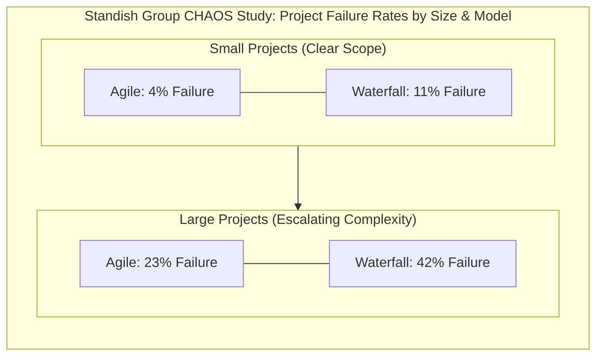

Key empirical takeaways from the CHAOS research include:
1. **Scope and Scale Escalation:** For small, well-bounded software systems, failure rates remain comparatively low. However, linear sequential approaches still fail at almost three times the rate of agile/iterative approaches (11% vs. 4%).
2. **Exponential Risk in Large Waterfall Projects:** As software scale expands, requirements volatility and coordination overhead multiply exponentially. Large-scale Waterfall projects suffer a **42% total cancellation/failure rate**, underscoring the extreme financial risk of rigid, upfront predictive planning in volatile environments.
3. **Root Causes of Project Ruin:** Failures stem predominantly from flawed project management, communication breakdowns, and organizational mismatches rather than low-level technical or compiler deficiencies.

### 1.1.3 The Human and Social Dimension of Software Development
Software development is primarily a complex, collaborative, and team-centric social activity. Technical excellence is necessary but entirely insufficient without addressing human factors:

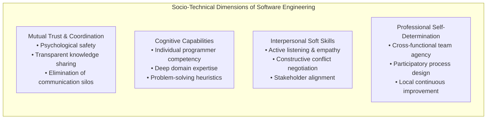

- **The Primacy of Trust:** Without psychological safety and mutual trust, software teams develop defensive documentation cultures, hide emerging project slippages, and erect organizational silos that derail delivery schedules.
- **Cognitive Bounds:** Individual skill sets, cognitive load limits, and domain familiarities represent context-specific boundary constraints on any chosen process.
- **Soft Skills Over Raw Coding:** An engineer's capacity to clarify ambiguous requirements, collaborate during design reviews, and resolve peer discrepancies often exerts greater leverage over product outcomes than raw syntactic proficiency.
- **Empowerment and Ownership:** High-performing cross-functional software teams demand agency in establishing and tailoring their localized process definitions.

### 1.1.4 Definition: Software Process
A **software process** is defined as a structured set of goal-oriented activities enacted in the real world to build, deploy, verify, or maintain a software system.

> [!info] Core Properties of a Software Process
> 1. **Real-World Enactment:** Processes are performed by humans ("enactment") and automated toolchains ("execution") within physical or organizational environments.
> 2. **Product Transformation:** Systematically transforms specified input artifacts (e.g., business needs, user stories, architecture models) into concrete output deliverables (e.g., tested binaries, release packages, test logs).
> 3. **Hierarchical Decomposition:** Processes can be recursively subdivided from overarching lifecycle phases into discrete subprocesses, activities, tasks, down to atomic engineering actions.

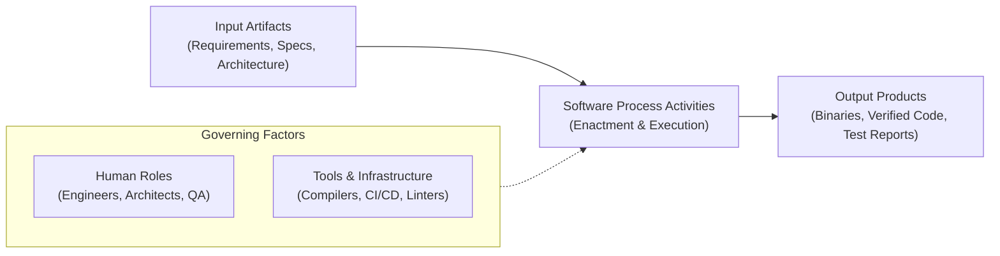

#### Categories of Concrete Software Process Activities
- **Technical Execution:** Architecting component structures, authoring source code, compiling modules, refactoring algorithms, and scripting deployment containers.
- **Verification & Quality Assurance:** Conducting formal peer code inspections, executing unit/integration/system test suites, performing requirements traceability audits, and verifying compliance with security standards.
- **Management & Governance:** Estimating effort and costs, modeling schedule risks, allocating work packages, tracking milestones, and packaging retrospective lessons learned.

### 1.1.5 Definition: Software Process Model
A **software process model** is an abstract, simplified conceptual representation of an actual or desired software process.

> [!note] Extra Knowledge: The "Recipe" Analogy for Process Models
> A software process model is to real-world process enactment what a **baking recipe** is to baking a cake in a kitchen. The recipe specifies ingredients, sequential steps, temperature constraints, and expected outcomes, but the actual execution involves human judgment, variations in equipment, and unexpected physical conditions.

#### Essential Building Blocks of a Process Model
1. **Activities:** Distinct work packages and tasks with explicit entry and exit criteria.
2. **Product Flow:** Input and output work products, artifacts, intermediate documents, and access modes (read/write/update).
3. **Control Flow:** Temporal sequencing, preconditions, branch logic, concurrency, and termination conditions.
4. **Refinement Hierarchy:** Multi-level decomposition from macro-phases down to fine-grained work instructions.
5. **Roles:** Defined responsibilities and skill profiles assigned to actors (e.g., Software Architect, Requirements Analyst, Test Lead).
6. **Tools & Infrastructure:** Supporting computing platforms, IDEs, issue trackers, and static analysis tools required for enactment.

---

## 1.2 Process-Product Causality & Industrial Obligations

### 1.2.1 The Causal Relationship: Goal ≈ f(Process, Context)
The bedrock philosophy of software process engineering asserts that software product quality is a direct consequence of the quality of the process utilized to engineer it.

$$\text{Goal} \approx f(\text{Process}, \text{Context})$$

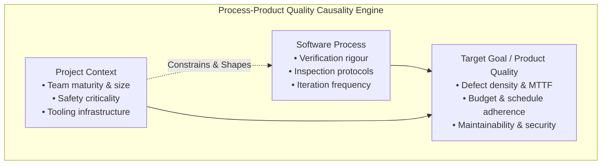

- **Fundamental Premise:** Predictable, high product quality cannot be sustained through ad-hoc, chaotic processes relying on unsustainable individual heroics. Heroic achievements are inherently fragile and non-repeatable.
- **Contextual Dependency:** No single process fits all endeavors universally. A rigorous, formal process essential for a flight-control system will bankrupt a fast-paced commercial web application. The parameters of the environment dictate success.
- **Empirical Nondeterminism:** Because software engineering fundamentally involves human cognitive processes, the relationship $f$ is non-deterministic and must be calibrated through empirical data and continuous measurement.

### 1.2.2 Student Programming vs. Professional Software Engineering
Transitioning from amateur programming to enterprise-scale software engineering requires profound operational shifts across several dimensions:

| Dimension | Student Programming ("Hacking") | Professional Software Engineering |
| :--- | :--- | :--- |
| **Problem Scope** | Toy problems, well-defined specifications, throwaway programs discarded after grading. | Massive, complex systems operating in ambiguous domains, evolving over decades. |
| **Coordination** | Solitary developer working in isolation; zero coordination overhead or merge friction. | Hundreds of globally distributed engineers synchronizing codebases across time zones. |
| **Customer & Budget** | Academic grade is the sole metric; zero commercial liability or financial budget. | Binding legal contracts, tight budgets, hard business deadlines, and revenue impacts. |
| **Verification** | "Runs on my machine"; debugged after crashing with negligible consequence. | Strict verification and validation; undetected flaws can lead to financial catastrophe or loss of life. |
| **Process Obligation** | Process is completely ignored; only the final submitted executable matters. | Legal obligation to comply with external standards, pass audits, and document full traceability. |

### 1.2.3 Industrial Regulations & Safety-Critical Standards
In mission-critical, life-critical, and safety-critical domains, process compliance is not optional—it is mandated by international statutory bodies. Software quality attributes (safety, security, reliability) cannot be tested in at the end; they must be engineered into every process step.

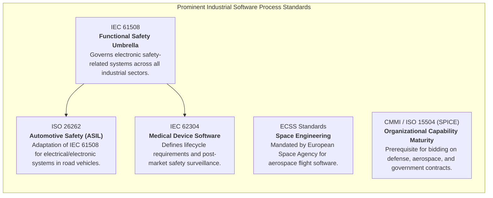

> [!note] Extra Knowledge: Why Process Compliance is Legally Enforced in Safety-Critical Domains
> If an autonomous vehicle or safety-critical system experiences a software-induced failure, regulatory authorities audit the organization's development process logs. Demonstrating that developers followed recognized standards (e.g., ISO 26262 ASIL-D, IEC 61508, or IEC 62304) establishes due diligence and shields organizations from catastrophic legal liability.

### 1.2.4 Pathologies of Insufficient Process Control
Organizations operating without mature, documented software processes suffer from well-documented systemic failures:
1. **Unnecessary and Avoidable Rework:** Teams spend 40% to 60% of their engineering capacity fixing architecture and requirement flaws that could have been eliminated during early reviews.
2. **Late Deviation Detection ("The 90% Done Syndrome"):** Schedule slippages, integration bugs, and budget overruns are uncovered on the eve of release rather than weeks prior.
3. **Role Confusion & Boundary Disputes:** Lack of defined role definitions leads to overlapping responsibilities, duplicate work, or vital security tasks falling through administrative cracks.
4. **Lost and Untraceable Work Products:** Crucial test setups, requirement rationales, and architectural constraints vanish when key personnel depart because assets were never institutionalized.

---

## 1.3 Prescriptive vs. Descriptive Process Models

### 1.3.1 Defining the Duality: Prescriptive vs. Descriptive
The software process discipline balances two distinct operational perspectives:

> [!info] Prescriptive Process Models
> **Prescriptive models dictate how a process SHOULD be executed.** They represent idealized or optimized workflows formulated by experts and standard bodies (e.g., Scrum, Waterfall, CMMI) designed to guide teams toward quality and efficiency.

> [!info] Descriptive Process Models
> **Descriptive models document how a process IS ACTUALLY executed in reality.** They are derived empirically by observing developers, analyzing version control telemetry, interviewing team members, and capturing lived practices—including all workarounds, shortcuts, and informal communication channels.

### 1.3.2 The Continuous Process Improvement Cycle
Prescriptive and descriptive models form an ongoing, evolutionary feedback loop:

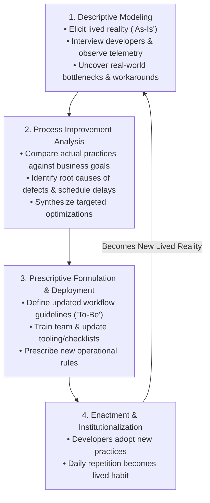

- **The Deployment Clash:** Imposing an overly rigid prescriptive model often triggers fierce resistance from software teams if the processes feel bureaucratic, disconnected from daily coding realities, or cumbersome.
- **The Maturation Cycle:** Successful organizational engineering starts with **descriptive modeling** to understand current reality, moves through **gap analysis**, introduces calibrated **prescriptive guidelines**, and monitors adoption until the new procedures become the team's lived daily descriptive habit.

### 1.3.3 The Four Prerequisites for Process Tailoring
Before imposing any prescriptive process model onto a software team, four fundamental criteria must be rigorously verified:

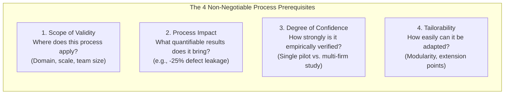

1. **Scope of Validity:** The operational boundaries and conditions under which the model is valid must be explicitly defined. Applying an aerospace model (strict formal proofs) to a 3-person web agency causes administrative collapse.
2. **Process Impact:** The expected quantitative effects must be known in advance. Decision-makers must understand what specific benefits (e.g., reduced defect density, shortened cycle time) are gained in exchange for the added process overhead.
3. **Degree of Confidence:** The empirical grounding supporting the process must be evaluated. Has the model been validated across dozens of industrial settings, or is it an unverified claim derived from a single isolated experiment?
4. **Tailorability:** The process must offer built-in adjustment levers, enabling engineers to omit superfluous tasks or intensify reviews based on project criticality, developer experience, and changing constraints.

---

## 1.4 Core Stages of the Software Development Life Cycle (SDLC)

Every software product traverses five core sequential/iterative lifecycle stages:

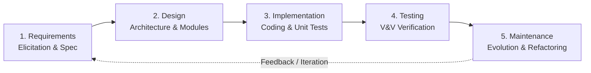

### 1.4.1 Detailed Breakdown of SDLC Stages
1. **Requirements Engineering:**
   - **Focus:** Determining *what* the system must do, for whom, and under what operational boundaries.
   - **Key Artifacts:** Software Requirements Specification (SRS), user stories, acceptance criteria, non-functional requirements (NFRs), and compliance constraints.
2. **Software Design:**
   - **Focus:** Deciding *how* the system will be structured and organized.
   - **Key Artifacts:** High-level system architecture, subsystem decomposition, database schemas, UML component/sequence diagrams, and interface contracts.
3. **Implementation (Construction):**
   - **Focus:** Translating architectural designs and technical specifications into executable source code units.
   - **Key Artifacts:** Source code files, build scripts, configuration manifests, and passing unit test suites.
4. **Testing (Verification and Validation):**
   - **Focus:** Ensuring software correctness, defect elimination, and customer fulfillment.
   - **Verification vs. Validation:**
     - **Verification:** *"Did we build the system right?"* Ensures the software strictly adheres to its engineering specifications.
     - **Validation:** *"Did we build the right system?"* Ensures the software fulfills the genuine operational needs and expectations of the user.
5. **Maintenance & Evolution:**
   - **Focus:** Long-term software stewardship post-deployment.
   - **Activities:** Corrective maintenance (patching faults), adaptive maintenance (operating system/hardware updates), perfective maintenance (performance improvements and refactoring), and preventive maintenance.

---

## 1.5 Prescriptive Process Model Classes & Lifecycles

### 1.5.1 Taxonomy: Lifecycle vs. Engineering Process Models
Prescriptive software processes are divided into two complementary classes based on scope and granularity:

| Attribute | Lifecycle Process Models | Engineering Process Models |
| :--- | :--- | :--- |
| **Operational Scope** | End-to-end lifecycle coverage (concept through decommissioning). | Granular, targeted focus on a single phase or specific technique. |
| **Abstraction Level** | High abstraction; strategic, structural overview. | Low abstraction; detailed operational instructions. |
| **Primary Focus** | Focuses on **WHAT** activities must be performed and their sequence. | Focuses on **HOW** to perform specific activities with tools and methods. |
| **Method Flexibility** | Mandates high-level goals but allows teams to choose specific techniques. | Strict, highly prescriptive step-by-step rules to minimize deviation. |
| **Classic Examples** | Waterfall, Spiral Model, Unified Process, Iterative Enhancement. | Model-based Statistical Testing, CoBRA Cost Estimation, Cleanroom Code Proving. |

---

### 1.5.2 Winston Royce's Waterfall Model (1970)
First formally articulated by Dr. Winston W. Royce in 1970, the Waterfall model structures development into a strictly sequential series of cascading phases.

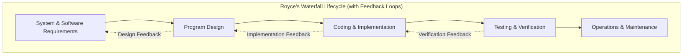

#### Structural Philosophy & Practical Realities
- **Linear Phased Abstraction:** Progress flows downwards from high levels of conceptual abstraction (requirements) down to concrete physical artifacts (source code and binary deployments).
- **Royce's Original Insight (Feedback Loops):** While popular culture views Waterfall as completely rigid and one-way, Royce's 1970 paper explicitly warned that pure single-pass progression is risky and prone to failure, advocating for iterative feedback loops between adjacent steps.
- **When Waterfall Succeeds:**
  - The problem domain is completely understood and historically stabilized.
  - Requirements are thoroughly fixed, verified, and legally frozen upfront.
  - The technology stack, APIs, and platforms are mature with zero volatility.
- **Fundamental Pitfalls in Modern Software:**
  - **Late Integration & Defect Discovery:** System integration and full testing occur at the tail end, revealing deep architectural flaws when budgets and schedules are exhausted.
  - **Requirement Volatility Blindness:** In modern fast-paced markets, user requirements shift dynamically during development; Waterfall cannot absorb mid-project scope adjustments without costly change orders.

---

### 1.5.3 Basili & Turner's Iterative Enhancement (1975)
Introduced by Victor Basili and Albert Turner in 1975, this model pioneered modern iterative development by rejecting monolithic single-shot delivery.

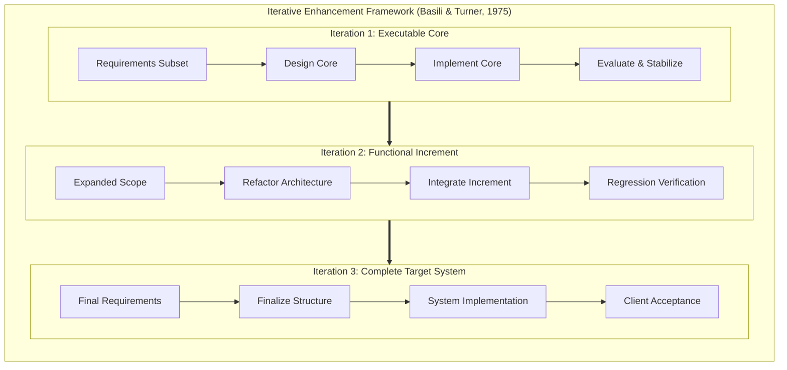

#### Core Mechanisms
- **Early Executable Core:** Rather than attempting to build the entire system simultaneously, the team implements a carefully chosen, high-priority functional subset first.
- **Mini-Waterfalls Within Iterations:** Each cycle executes an internal mini-waterfall (Requirements $\to$ Design $\to$ Coding $\to$ Analysis).
- **Architectural Consolidation:** Each iteration serves two equal purposes: delivering new user-facing functionality and refactoring/stabilizing existing internal code architectures.
- **Fast Feedback Loop:** Customers interact with a working, executable system early in the calendar schedule, drastically reducing the gap between user expectations and engineered reality.

---

### 1.5.4 Barry Boehm's Spiral Model (1986)
Barry Boehm synthesized elements of top-down Waterfall, bottom-up prototyping, and iterative enhancement into a revolutionary **risk-driven meta-model**.

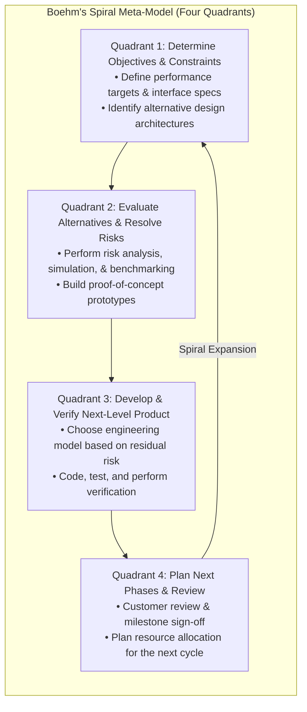

#### Distinctive Characteristics
- **Risk-Driven Progression:** Risk assessment directly dictates the intensity, scope, and specific engineering approach for the subsequent spiral iteration. If technical risk is high, rapid throwaway prototyping is mandated; if risks are resolved and clear, strict formal design is applied.
- **The Four Quadrants:** Every cycle across the spiral's radial expansion traverses:
  1. *Determine Objectives, Alternatives, and Constraints.*
  2. *Evaluate Alternatives, Identify Risks, and Resolve Risks.*
  3. *Develop and Verify the Next-Level Product.*
  4. *Review Outcomes and Plan Next Phases.*
- **Crucial Dependency on Risk Assessment Skills:** The primary vulnerability of the Spiral model is that it relies heavily on world-class risk analysts. Failing to detect subtle architectural, financial, or human risks invalidates the model's governing assumptions.

---

### 1.5.5 The Unified Process (UP)
Formulated by Ivar Jacobson, Grady Booch, and James Rumbaugh (1999), the Unified Process is an architecture-centric, use-case driven, iterative, and incremental process framework aligned with UML (Unified Modeling Language).

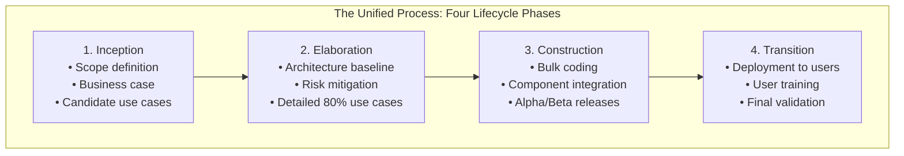

#### Triad of Core Principles
1. **Use-Case Driven:** The functional scope is defined and tracked through formal Use Cases, capturing system interactions from the perspective of external actors.
2. **Architecture-Centric:** Software architecture serves as the primary backbone. High-risk use cases are prioritized early to build, validate, and stabilize an architectural baseline before committing capital to full-scale construction.
3. **Iterative and Incremental:** Development proceeds across distinct vertical iterations that intersect horizontal engineering workflows (Business Modeling, Requirements, Analysis & Design, Implementation, Test, Deployment).

---

### 1.5.6 IBM's Cleanroom Software Engineering (1987)
Developed by Harlan Mills, Michael Dyer, and Richard Linger at IBM, the Cleanroom approach established a radical defect-prevention paradigm derived from semiconductor cleanroom manufacturing.

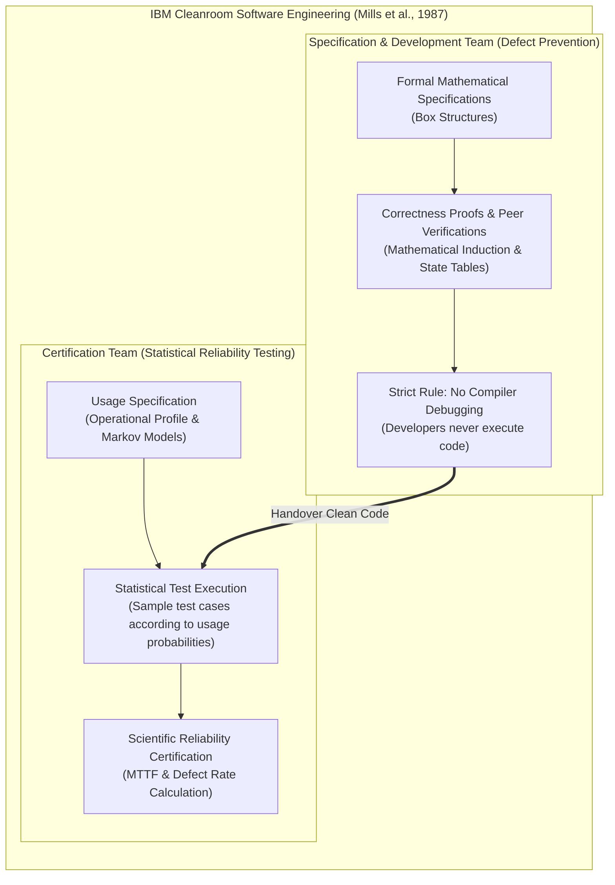

#### Dual Organizational Teams & Operational Rules
- **Mathematical Specification and Verification:** Programs are treated as mathematical functions mapping input domains to output states. Developers utilize box structures (black box, state box, clear box) and prove correctness mathematically.
- **Prohibition of Developer Debugging:** Software developers **never** compile or execute their own code to find bugs. Debugging via compiler trial-and-error is viewed as an undisciplined crutch that obscures underlying design defects.
- **Independent Certification via Statistical Testing:** Software code is handed over directly to an independent certification team. Instead of heuristic white-box unit tests, the certification team generates tests according to an empirical **Usage Specification** (reflecting true operational frequency distribution), calculating objective **Mean Time To Failure (MTTF)**.


---

# Chapter 2: Software Process Definition & Modeling

## 2.1 Motivations and Core Objectives of Process Modeling

### 2.1.1 The Industrial Imperative for Process Management
While software development tools, frameworks, and compilers have reached exceptional levels of technological maturity, the organizational discipline of software processes remains emerging, research-active, and highly variable. 

> [!note] Extra Knowledge: The Industrial Economic Imperative for Formal Process Modeling
> 1. **Organizational Scale & Global Distribution:** Coordinating hundreds of developers distributed across multiple continents, time zones, and corporate cultures cannot succeed on informal, tribal knowledge. Explicit, standardized process definitions are mandatory.
> 2. **Emergence of Process Engineering Roles:** The creation of specialized organizational positions—such as Process Engineers, Agile Coaches, Scrum Masters, and Quality Assurance Specialists—highlights industry's demand for repeatable process management capabilities.
> 3. **Beyond Textbook Prescriptions:** Generic models (pure Scrum or linear Waterfall) rarely fit enterprise realities out-of-the-box. Organizations must possess the analytical capability to elicit, define, tailor, and evolve custom processes for their specific business contexts.

### 2.1.2 The Five Core Objectives of Process Modeling (Curtis et al., 1992)
In their seminal 1992 work, Bill Curtis, Marc Kellner, and Jerry Over established the foundational taxonomy defining why software processes must be formally modeled:

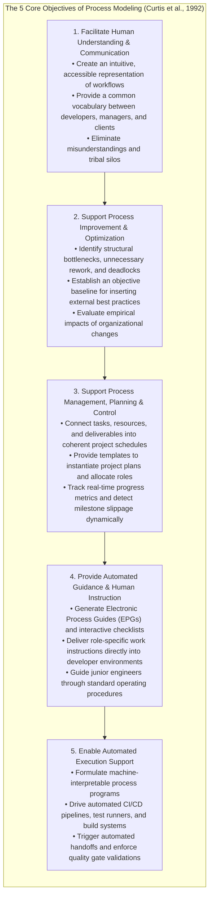

### 2.1.3 Strategic Business & Organizational Benefits
Beyond immediate developer guidance, systematic process modeling yields profound structural advantages:
- **Execution Stability & Repeatability:** Documented operating workflows prevent critical verification, security checks, and code reviews from being skipped during panic-driven schedule crunches.
- **Cognitive Transparency & Complexity Reduction:** Large software undertakings involve overwhelming cognitive complexity. Visual process architectures delineate clear role-specific boundaries, reducing ambiguity.
- **Prerequisite for Quantitative Measurement:** Metrics cannot exist in a vacuum. A defined process model is the absolute prerequisite to identify measurable objects, define Goal-Question-Metric (GQM) indicators, and collect clean baseline metrics.
- **Predictability in Cost, Schedule, and Defect Rates:** Predictive management requires historical performance baselines. Modeling enables variance analysis, allowing organizations to reliably estimate future project budgets and release dates.
- **Organizational Process Propagation:** Modeling enables an enterprise to capture high-performing workflows discovered in one division and systematically propagate them across other product units.
- **Auditable Statutory & Legal Compliance:** Passing functional safety and cybersecurity audits (e.g., ISO 26262, IEC 62304) requires verifiable process documentation and documented adherence records.
- **Standardized Tool Integration Requirements:** High-fidelity process models provide the precise operational requirements needed to configure Jira workflows, GitHub Actions, and custom CI/CD automation tools.

---

## 2.2 The 8-Step Descriptive Process Modeling Methodology

Descriptive process modeling is the disciplined empirical science of capturing, formulating, analyzing, and standardizing the actual ("As-Is") workflows enacted by software engineering teams.

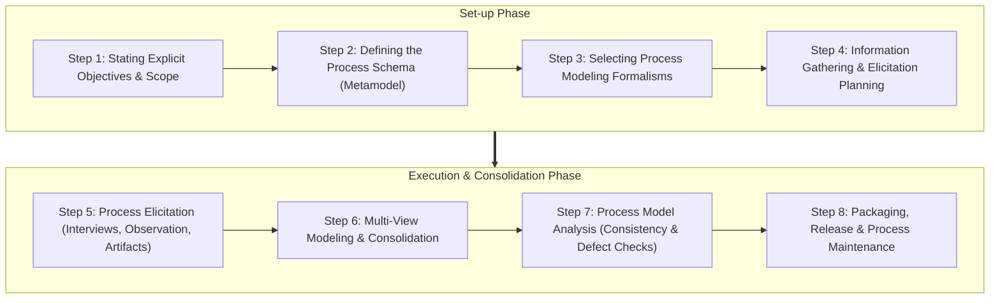

---

### 2.2.1 Step 1: Stating Explicit Objectives and Scope
Process modeling requires substantial expenditure of engineering hours. Clear boundary definition prevents runaway scoping and determines the required depth of abstraction.

> [!tip] Extra Knowledge: Scoping Checklist for Industrial Process Engineers
> - **Why are we modeling?** (Regulatory compliance audit, tool automation, junior developer onboarding, or bottleneck optimization?)
> - **Who are the primary users?** (Software Engineering Process Group [SEPG], external contractors, project managers, or frontline developers?)
> - **What level of detail is required?** (Coarse lifecycle milestones vs. atomic, low-level technical work instructions?)
> - **What are the organizational boundaries?** (A single feature team, a specific business vertical, or the entire corporate enterprise?)

#### Industrial Case Studies: Diverse Scoping Scenarios
The required modeling strategy varies drastically based on business objectives:

| Dimension | DocVault (Tool Automation) | Selene (Training & Guidance) | Soster (SPI & Optimization) |
| :--- | :--- | :--- | :--- |
| **Objective** | Automate a single targeted workflow: Defect Management. | Provide daily onboarding training and operational guidance. | Support continuous process improvement (SPI) and schedule predictability. |
| **Scope Width** | Extremely Narrow. | Exceptionally Wide (Entire lifecycle). | Mid-Range & Complex. |
| **Primary Users** | Subcontractors building the defect tracking toolchain. | All developers, testers, analysts, and project managers. | Software Engineering Process Group (SEPG) & Project Leads. |
| **User Expectations** | Unambiguous, formal state transitions with pre- and postconditions. | Highly readable process handbook with rich checklists and templates. | Formal models with quantitative metric hooks for defect leakage. |
| **Excluded Scope** | Source code implementation, architecture, and module testing. | None. Comprehensive coverage across all development disciplines. | Core software engineering (focuses purely on customization processes). |

---

### 2.2.2 Step 2: Defining the Process Schema (Metamodel)
A **process schema** (or process metamodel) is the formal conceptual framework defining the allowable entity types, attributes, and relationship semantics used to describe any process.

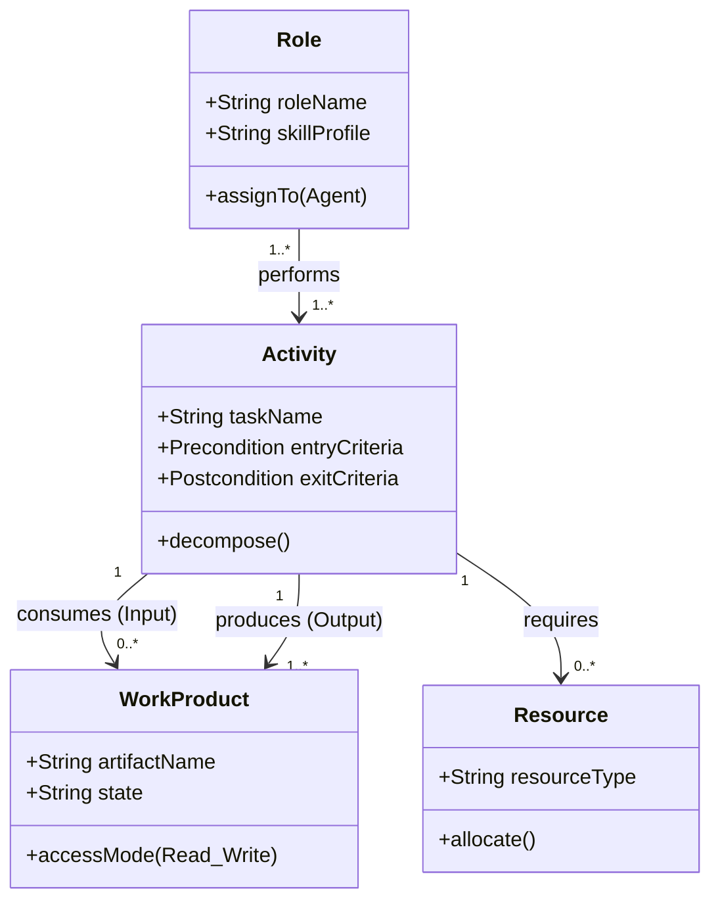

- **Core Abstract Entities:**
  - **Activity:** The structural unit of work (e.g., Architecture Design, Code Review, Unit Testing). Can be recursively decomposed into subtasks and atomic steps.
  - **Work Product:** The concrete information artifacts consumed, modified, or produced by activities (e.g., Requirements Spec, UML Model, Source File, Test Log).
  - **Role:** An abstract profile encapsulating functional responsibilities, skills, and competencies (e.g., Software Architect, Security Lead, Test Engineer).
  - **Resource:** Physical, human, or automated assets necessary to enact the work (e.g., compilers, test benches, licensed servers).
- **Standardize Before Modeling:** Adhering strictly to established schemas (such as SPEM 2.0 or MVP-L) prevents logical flaws, such as erroneously modeling a lifecycle phase as an input artifact.

---

### 2.2.3 Step 3: Selecting Process Modeling Formalisms
Process engineers must evaluate four major spectrums of formalisms:

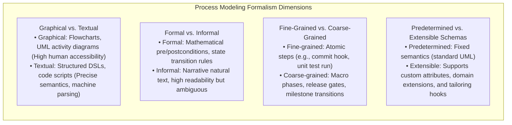

---

### 2.2.4 Step 4: Information Gathering & Elicitation Planning
Before engaging developers, process engineers formulate an elicitation schedule:
- Identifying authoritative role representatives across all participating project disciplines.
- Gathering existing project documentation, code repositories, issue tracker tickets, and past retrospectives.
- Formulating structured interview guides and workshop agendas.

---

### 2.2.5 Step 5: Process Elicitation Techniques & Developer Engagement
Capturing the truth of how software is actually developed requires diverse empirical methods:

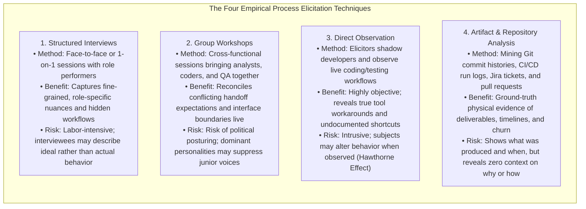

#### Elicitor Behavioral Rules & Engaging Developers
- **Maintain a Non-Judgmental Stance:** Process performers dread criticism or micromanagement. If an elicitor acts like an auditor, developers will describe an embellished, idealized process rather than reality.
- **Focus on Work Products First:** Activities are abstract and difficult to recall accurately. Artifacts (code commits, design diagrams, test reports) are tangible; tracing what is produced makes associated tasks easy to reconstruct.
- **Capture Process Variants:** Document conditional branch paths (e.g., *"If the project is under extreme deadline pressure, code reviews are bypassed in favor of retrospective audits"*).
- **Demonstrate Personal Benefits:** Show developers that clear process definitions eliminate weekend crunch time, reduce ambiguous task handoffs, and clarify accountability.
- **Perform Live Validation:** Draft visual workflows live during interviews to verify immediate mutual understanding.

---

### 2.2.6 Step 6: Multi-View Modeling & Integration
Because software systems are large and compartmentalized, no single individual possesses complete intellectual visibility over the entire lifecycle.

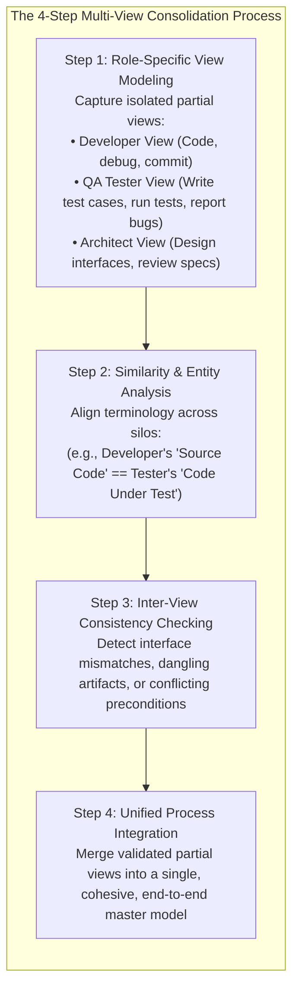

---

### 2.2.7 Step 7: Process Model Analysis & Quality Assurance
Once drafted, the process model must undergo rigorous static and dynamic verification:

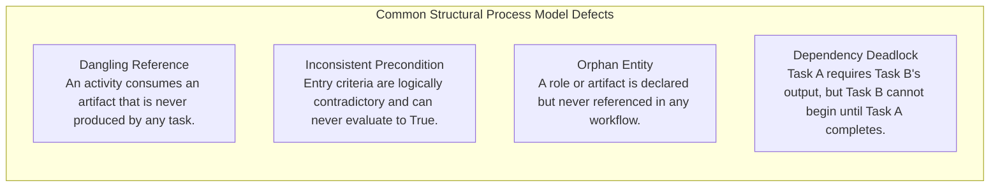

#### Analytical Verification Techniques
1. **Consistency Analysis:** Ensures textual task descriptions match modeled input/output artifact definitions, and nomenclature is unified.
2. **Completeness Analysis:** Verifies that all macro-phases are fully decomposed into actionable, atomic human instructions.
3. **Dynamic Simulation Analysis:** Analyzes simulated process execution to identify resource starvation, scheduling bottlenecks, and concurrency deadlocks.
4. **Automated Syntactic Checking:** For formal domain-specific languages (e.g., MVP-L), automated compilers verify semantic typing and precondition completeness.

---

### 2.2.8 Step 8: Packaging, Release & Process Maintenance
The finalized process model is synthesized into actionable organizational artifacts:
- Compiling models into browsable **Electronic Process Guides (EPGs)**.
- Establishing formal feedback channels for developers to submit change proposals and defect reports against process descriptions.
- Reviewing process metrics periodically to drive continuous process improvement (QIP / CMMI cycles).

### 2.2.9 Critical Investment Risks in Process Modeling
1. **Process Embellishment (Inaccurate Reporting):** Performers document what management wants to hear rather than what actually happens, rendering the model useless for improvement.
2. **Budget & Schedule Overruns:** Process elicitation consumes hundreds of high-value engineering hours. Without dedicated time budgets, the initiative collapses under development pressure.
3. **Model Complexity (Over-Engineering):** Models balloon into unmanageable monstrosities with thousands of interconnected entities that nobody reads or maintains.

---

## 2.3 Process Modeling Notations & Languages

### 2.3.1 Key Notation Characteristics & The Eight Formal Requirements (R1–R8)

#### Four Key Dimensions of Process Notations
Before choosing a modeling formalism, process engineers classify notations along four foundational architectural dimensions (Münch & Armbrust, 2012):

```mermaid
flowchart TD
    subgraph NotationDimensions["The 4 Foundational Dimensions of Process Notations"]
        direction TB
        D1["<b>1. Process Programming vs. Process Improvement</b><br/>• <i>Programming:</i> Formal, machine-interpretable code designed for automated engine execution.<br/>• <i>Improvement:</i> Conceptual, communicative models designed for human understanding and optimization."]
        D2["<b>2. Hidden vs. Guiding Notations</b><br/>• <i>Hidden:</i> Process rules are implicitly baked inside automated tools (e.g., Jira transitions).<br/>• <i>Guiding:</i> The model explicitly advises and steers human developers through daily tasks."]
        D3["<b>3. Prescriptive vs. Proscriptive Notations</b><br/>• <i>Prescriptive:</i> Rigidly dictates exact allowable sequences ('Do A, then B').<br/>• <i>Proscriptive:</i> Defines external boundary constraints and forbidden states, granting autonomy within guardrails."]
        D4["<b>4. Single-Person vs. Multi-Person Notations</b><br/>• <i>Single-Person:</i> Focuses on atomic, individual task execution at the workstation level.<br/>• <i>Multi-Person:</i> Coordinates cross-functional workflows, role handoffs, and distributed team synchronization."]
    end
```

#### The Eight Formal Requirements for Process Notations (R1–R8)
To serve as an effective standard in professional software engineering, a modeling notation must satisfy eight criteria:

| Requirement | Designation | Operational Mandate |
| :--- | :--- | :--- |
| **R1** | **Natural Representation** | Captures real-world software engineering concepts (activities, artifacts, roles) intuitively without artificial contortions. |
| **R2** | **Support of Measurement** | Natively integrates quantitative process and product metrics directly into structural definitions (GQM alignment). |
| **R3** | **Tailorability of Models** | Allows modular adaptation, extension, and customization for diverse project scopes and team sizes. |
| **R4** | **Formality** | Establishes unambiguous syntax and execution semantics enabling automated analysis, consistency checking, and simulation. |
| **R5** | **Understandability** | Easily comprehended, validated, and enacted by human practitioners across roles (engineers, managers, auditors). |
| **R6** | **Executability** | Machine-interpretable by workflow management systems, continuous integration toolchains, and process engines. |
| **R7** | **Flexibility** | Accommodates human cognitive discretion, non-linear creativity, exploratory tinkering, and dynamic exceptions. |
| **R8** | **Traceability** | Natively links activities to artifacts, roles, tools, and business objectives across the lifecycle. |

---

### 2.3.2 Multi-View Process Language (MVP-L)
Developed at the University of Maryland and the University of Kaiserslautern, **MVP-L** was designed specifically to support Software Process Improvement (SPI), the Quality Improvement Paradigm (QIP), and the Goal-Question-Metric (GQM) approach.

#### David Parnas' Concept of Information Hiding in Processes (1972)
MVP-L pioneered the application of classic software engineering encapsulation principles to process architectures:

```mermaid
flowchart TD
    subgraph MVPL_Model["MVP-L Process Model Architecture"]
        subgraph Interface["Process Model Interface (Externally Visible)"]
            Params["Formal Product Parameters<br/>• Consumes (Input Artifacts)<br/>• Produces (Output Artifacts)"]
            Attrs["Exported Process Attributes<br/>• Spent Effort<br/>• Defect Count"]
            Criteria["Explicit Logic Gates<br/>• Entry Criteria (Preconditions)<br/>• Exit Criteria (Postconditions)"]
        end
        
        subgraph Body["Process Model Body (Hidden Implementation)"]
            Impl["Task Execution Details<br/>• Step-by-step human instructions<br/>• Automated compiler / tool invocations<br/>• Local sub-process orchestrations"]
        end
        
        Interface --> Body
    end
    
    OtherProcess["External Process"] -.->|Interacts ONLY via| Interface
```

- **Information Hiding:** The internal operational steps of a process are encapsulated entirely within the **Process Body**. External collaborating processes can only interact through the **Process Interface** via formal product parameters.
- **Localizing Process Evolution:** When a development team updates their internal coding guidelines or switches compilers, only the body of the coding process changes. Because the interface (inputs, outputs, entry/exit criteria) remains stable, the rest of the enterprise process architecture is unaffected.

#### The Four Core Typed Object-Oriented Models in MVP-L
1. **`product_model`:** Defines the internal structure and lifecycle attributes of an artifact class (e.g., `Design_Document`, `Source_Code`, exporting attributes like `status = {incomplete, complete}`).
2. **`resource_model`:** Represents active personnel (teams, developers) or passive software tools (linters, compilers), declaring skill profiles and available capacity.
3. **`process_model`:** The core work unit that imports products and resources, defines formal preconditions, and executes tasks.
4. **`attribute_model`:** Represents quantitative measurement indicators (effort, defect density, complexity). Directly binds GQM metrics into the process framework.

#### Implicit Control Flow via State Transitions
Unlike traditional flowchart languages, MVP-L does not rely on rigid sequential control arrows. Control flow is **implicit**, governed strictly by Boolean constraints:

```mermaid
stateDiagram-v2
    direction LR
    [*] --> NonExistent : Project Start
    NonExistent --> Incomplete : Process Starts (Write)
    Incomplete --> Complete : Exit Criteria Met (Pass Review)
    Complete --> Incomplete : Rework Required (Defect Found)
    Complete --> [*] : Delivery
```

- **Process States:**
  - `Enabled`: All Boolean Entry Criteria evaluate to `True`.
  - `Active`: An actor triggers enactment; work is actively being performed.
  - `Disabled`: Task completion occurs and Exit Criteria evaluate to `True`.
- **Local Invariants:** Mathematical expressions that must evaluate to `True` throughout enactment (e.g., `spent_effort <= max_allocated_budget`), triggering alerts upon overrun.

---

## 2.4 OMG SPEM 2.0 & Tooling (EPF Composer)

### 2.4.1 The SPEM 2.0 Metamodel Standard
The **Software and Systems Process Engineering Metamodel (SPEM 2.0)** is an international formal standard released by the Object Management Group (OMG).

```mermaid
flowchart TD
    subgraph SPEM_Triad["SPEM 2.0 Core Metamodel Triad"]
        direction TB
        RoleDef["Role Definition ('WHO')<br/>Encapsulates competencies, skill sets, and responsibilities<br/>(e.g., Test Engineer, System Architect)"]
        TaskDef["Task Definition ('WHAT')<br/>A typed unit of work broken down into distinct steps<br/>(e.g., Execute Integration Test, Inspect Architecture)"]
        WorkProductDef["Work Product Definition ('OUTCOME')<br/>Tangible artifacts consumed, updated, or delivered<br/>(e.g., Test Plan, Component Binary, Defect Log)"]
        Guidance["Guidance<br/>Supporting templates, checklists, whitepapers, and best practices"]
        
        RoleDef -->|Performs / Is Primary Owner| TaskDef
        TaskDef -->|Consumes (Mandatory / Optional)| WorkProductDef
        TaskDef -->|Produces / Updates| WorkProductDef
        Guidance -.->|Enriches & Guides| RoleDef
        Guidance -.->|Enriches & Guides| TaskDef
        Guidance -.->|Enriches & Guides| WorkProductDef
    end
```

- **UML 2.0 Profile Alignment:** SPEM 2.0 is defined as a UML profile. Process engineers can utilize standard UML modeling environments, leveraging Activity Diagrams and State Machine Diagrams to visualize complex workflows.
- **Unified Domain Vocabulary:** SPEM resolved decades of terminological chaos across software methodologies, unifying disparate concepts under a shared semantic metamodel.

---

### 2.4.2 Decoupling Method Content from Context-Specific Processes
A defining architectural innovation of SPEM 2.0 is the complete structural separation between static organizational knowledge and dynamic project schedules:

```mermaid
flowchart LR
    subgraph MethodContent["1. Reusable Method Content (Static Library)"]
        direction TB
        R_Lib["Role Definitions<br/>(Architect, Coder)"]
        T_Lib["Task Definitions<br/>(Refactor Code, Unit Test)"]
        W_Lib["Work Product Definitions<br/>(Design Model, Binary)"]
        R_Lib --- T_Lib --- W_Lib
    end
    
    subgraph ProcessWorkflow["2. Context-Specific Process (Dynamic Workflow)"]
        direction TB
        Phase1["Phase 1: Inception<br/>• Role Use: Lead Architect<br/>• Task Use: Draft Concept<br/>• Work Product Use: Vision Doc"]
        Phase2["Phase 2: Construction<br/>• Role Use: Senior Developer<br/>• Task Use: Implement Module<br/>• Work Product Use: Tested Code"]
        Phase1 --> Phase2
    end
    
    MethodContent ==>|Instantiated & Configured into| ProcessWorkflow
```

| Dimension | Reusable Method Content | Context-Specific Process |
| :--- | :--- | :--- |
| **Core Nature** | Static repository of enterprise best practices and engineering standards. | Dynamic workflow configured for a specific project execution. |
| **Perspective** | Describes **WHO, WHAT, and HOW** independently of time or calendar deadlines. | Describes **WHEN** tasks are scheduled, mapping increments onto project phases. |
| **Elements** | Abstract `RoleDefinition`, `TaskDefinition`, `WorkProductDefinition`. | Instantiated references: `RoleUse`, `TaskUse`, `WorkProductUse`. |
| **Lifecycle** | Highly stable across years; captures cumulative corporate intellectual capital. | Volatile and customized per project based on budget, team size, and risk. |

---

### 2.4.3 Eclipse Process Framework (EPF) Composer
**EPF Composer** is the premier open-source toolchain implementing the SPEM 2.0 standard, widely utilized for authoring, configuring, tailoring, and publishing enterprise process models.

#### Key Functional Capabilities
- **OpenUP Pre-Populated Content:** Includes the open-source OpenUP methodology library, serving as a ready-to-use template incorporating Agile and Unified Process best practices.
- **Method vs. Process Authoring Split:** Features dual workspaces:
  - *Method Authoring Tab:* Build roles, tasks, guidance templates, and artifact libraries.
  - *Process Configuration Tab:* Assemble capability patterns and delivery processes mapped to Gantt-like lifecycle phases.
- **Electronic Process Guide (EPG) Generation:** Automatically compiles the underlying model repository into responsive, hyperlinked HTML websites (EPGs) deployed on corporate intranets for developer guidance.

#### Process Variability Mechanisms (Inheritance in Process Engineering)
To support seamless reuse without modifying base corporate libraries, EPF Composer introduces four object-oriented variability patterns:

```mermaid
flowchart TD
    subgraph VariabilityMechanisms["EPF Composer Process Variability Patterns"]
        direction TB
        Contribute["1. Contribute<br/>Seamlessly appends new checklists, guidelines, or steps to a base element<br/>without modifying the original source library."]
        Replace["2. Replace<br/>Completely substitutes a base element with a tailored variant specific to the project context."]
        Extend["3. Extend<br/>Inherits all properties and associations of a base element, allowing local specialization<br/>(analogous to object-oriented class inheritance)."]
        ExtendReplace["4. Extend and Replace<br/>Inherits properties, specializes them locally, and suppresses the original base element from publication."]
    end
```

> [!example] Extra Knowledge: Practical Application of SPEM 2.0 Variability Mechanisms
> If a high-security defense project requires additional cryptographic validation during code review, the team uses **Contribute** to attach a "Cryptographic Audit Checklist" to the standard corporate "Peer Code Review" task. The base corporate method library remains untouched, yet the published project EPG reflects the specialized security requirements.


---

# Chapter 3: Software Processes in the Product Life Cycle & Advanced Controls

## 3.1 The Product Lifecycle Stages & Engineering Qualities

### 3.1.1 Product Lifecycle vs. Management Phase View
A software product life cycle encompasses the evolving technical states of the product, traversing five core engineering stages from initial conception to eventual decommissioning.

```mermaid
flowchart LR
    Req["1. Requirements<br/>• Eliciting & analyzing<br/>• Documenting constraints<br/>• Defining acceptance gates"]
    Des["2. Design<br/>• High-level architecture<br/>• Detailed module interfaces<br/>• UML interaction models"]
    Impl["3. Implementation<br/>• Coding & CBD reuse<br/>• Unit test integration<br/>• Refactoring code smells"]
    Test["4. Testing<br/>• Constructive QA<br/>• V&V execution<br/>• Defect elimination"]
    Maint["5. Maintenance<br/>• Adaptive evolution<br/>• Paying down technical debt<br/>• Zero code decay"]
    
    Req --> Des --> Impl --> Test --> Maint
    Maint -.->|Evolutionary Loop| Req
```

### 3.1.2 Requirements Elicitation: The Three Stakeholder Dimensions
Requirements engineers must bridge three human disconnects when translating business intent into software specifications:

```mermaid
flowchart TD
    subgraph StakeholderDimensions["Three Stakeholder Elicitation Challenges"]
        direction TB
        D1["1. Lack of Technical Experience<br/>• Problem: Stakeholders cannot express needs in algorithmic or technical terms.<br/>• Solution: Developers act as guides, translating business goals into cost-bounded functional options."]
        D2["2. Fleeting & Volatile Desires<br/>• Problem: User wants are erratic, contradictory, or change upon seeing competitor features.<br/>• Solution: Deploy Minimum Viable Products (MVPs), usability prototypes, and focus groups to test true utility."]
        D3["3. Imperfect Communication & Translation<br/>• Problem: Natural language ambiguities lead to divergent mental models.<br/>• Solution: Standardize requirements using plain-English User Stories with explicit acceptance criteria."]
    end
```

### 3.1.3 Architectural Modeling with UML: Avoiding Detail Bloat
When modeling software architectures using Unified Modeling Language (UML), engineering teams must balance completeness against human cognitive limits:
- **Structural Mapping (Class Diagrams):** Maps the static Object-Oriented layout, defining attributes, methods, visibility, and relational associations (`is-a` inheritance, `has-a` composition).
- **Behavioral Execution (Sequence Diagrams):** Visualizes temporal message flows between collaborating objects and boundary actors during the execution of a concrete use case.

> [!warning] UML Principle: Combat Detail Bloat
> UML diagrams must emphasize high-level communication rather than exhaustive code generation. Modeling every single private getter, setter, and primitive variable produces unreadable diagrams that nobody maintains. Keep UML visual representations lean, intuitive, and focused strictly on high-impact structural decisions.

### 3.1.4 Code Implementation Paradigms
Modern software construction relies on three core tenets:
1. **Component-Based Development (CBD) & Reuse:** Maximizing the integration of verified commercial off-the-shelf (COTS) components, libraries, and microservices reduces baseline cycle times.
2. **Object-Oriented & Modular Decomposition:** Encapsulation and modular decoupling keep large, complex codebases intellectually manageable and maintainable over decades.
3. **Cognitive Accommodation (Tinkerer Support):** Engineering guidelines must provide clear architectural guardrails while allowing developers the exploratory autonomy ("mindful tinkering") necessary for creative optimization.

### 3.1.5 Verification vs. Validation (V&V)
Testing is structured into two complementary quality assurance dimensions:

```mermaid
flowchart TD
    subgraph VV_Framework["Verification & Validation Quality Framework"]
        direction LR
        subgraph Verification["Verification ('Build the System Right')"]
            direction TB
            VerDef["Definition: Confirming conformance to engineering specifications."]
            VerAct["Activities: Static code analysis, formal peer inspections, unit testing, CI build checks."]
            VerFocus["Focus: Catching internal logic defects, interface errors, and specification drift early."]
        end
        subgraph Validation["Validation ('Build the Right System')"]
            direction TB
            ValDef["Definition: Confirming fulfillment of user expectations and business utility."]
            ValAct["Activities: User Acceptance Testing (UAT), customer focus groups, beta canary deployments."]
            ValFocus["Focus: Ensuring usability, fitness-for-purpose, market fit, and end-user adoption."]
        end
    end
```

### 3.1.6 Technical Debt, Code Decay & The Refactoring Discipline
Taking shortcuts during construction provides temporary velocity but incurs **technical debt**. Neglecting this debt leads to progressive **code decay**, driving up defect rates and inflating maintenance costs.

> [!info] The Refactoring Discipline
> **Refactoring** is the disciplined practice of modifying internal code structures to enhance readability, reduce complexity, and eliminate technical debt **without altering the observable external functional behavior** of the software.

#### Core Code Smells to Eliminate (Week 3 Slide 8)
As specified in the lecture slide, developers must keep code clean and pay down technical debt by eliminating:
1. **Obsolete & Misleading Comments:** Narrative text that contradicts updated code implementations.
2. **Commented-Out Dead Code:** Blocks of dormant code cluttering files rather than relying on Git version history.
3. **Duplicate Code ("Copy-Paste Programming"):** Identical logic repeated across multiple routines.
4. **Vague & Ambiguous Identifiers:** Cryptic variable or function names (e.g., `temp1`, `doProcess()`).
5. **Functions with Too Many Jobs:** Routines performing multiple tasks, violating the Single Responsibility Principle (SRP).
6. **Bloated Routines (>10 Lines):** Overly long functions exceeding 10 lines of executable code.
7. **Excessive Parameter Lists (>4 Arguments):** Parameter signatures exceeding 4 arguments, indicating a missing abstraction or object encapsulation.

> [!tip] Extra Knowledge: Completing Fowler's 10 Canonical Code Smells
> While Week 3 Slide 8 focuses on the 7 primary code smells above, Martin Fowler and Kent Beck's seminal refactoring catalog establishes the remaining 3 classic smells to complete the "10 Code Smells" referenced in the slide title:
> - **8. Divergent Change:** A single class is repeatedly modified in different ways for different reasons, indicating poor cohesion and violating the Single Responsibility Principle.
> - **9. Shotgun Surgery:** A single logical change forces small edits across many scattered classes simultaneously, causing high maintenance friction.
> - **10. Data Clumps:** Multiple data items that always appear together across parameter lists (e.g., street, city, postal code or start_date, end_date) but are never encapsulated into an authoritative class.

---

## 3.2 Requirements Engineering & Nonfunctional Scope

### 3.2.1 Mitigating Drivers of Project Failure
Rigorously defining explicit requirements eliminates three catastrophic failure drivers:
- **Developer Bias:** In the absence of documented specifications, developers build features they personally find interesting or technically fun, ignoring commercial utility.
- **Team Desynchronization:** Developers working without unified specifications build conflicting, incompatible subsystems that explode during system integration.
- **Stakeholder Volatility & Scope Creep:** Vague requirement baselines invite continuous, uncontrolled feature additions that exhaust budgets and destroy schedules.

### 3.2.2 The Eight Engineering Qualities of Requirements (Texas DIR, 2008)
To serve as an authoritative contract, software requirements must exhibit eight formal characteristics:

```mermaid
flowchart TD
    subgraph ReqQualities["The 8 Essential Requirements Qualities (Texas DIR, 2008)"]
        direction TB
        Q1["1. Correct: Accurately represents true stakeholder and business intent."]
        Q2["2. Unambiguous: Subject to only one single, clear interpretation by all parties."]
        Q3["3. Complete: Contains all necessary functional criteria, constraints, and error states."]
        Q4["4. Consistent: Contains zero internal contradictions or conflicting statements."]
        Q5["5. Ranked for Priority: Explicitly categorized by criticality (e.g., MoSCoW scale)."]
        Q6["6. Verifiable / Testable: Formulated so testers can design a concrete pass/fail verification test."]
        Q7["7. Modifiable: Structured modularly so edits can be applied without cascading disruption."]
        Q8["8. Traceable: Explicitly linked backwards to business needs and forwards to code/tests."]
    end
    Q1 --- Q2 --- Q3 --- Q4
    Q5 --- Q6 --- Q7 --- Q8
```

> [!note] Extra Knowledge: The Imperative of Verifiability in Contractual Requirements
> A requirement that cannot be verified is completely useless. Vague nonfunctional statements such as *"The system shall be fast and responsive"* must be replaced with quantitatively testable thresholds: *"Under peak loads of 10,000 concurrent users, 95% of database queries must return within $\le 500\text{ ms}$."*

### 3.2.3 Two Pillars of Nonfunctional Scope: Quality Attributes vs. Constraints
Nonfunctional requirements fall into two structurally distinct categories:

```mermaid
flowchart LR
    subgraph Pillar1["Pillar 1: Quality Attributes (Internally Chosen)"]
        direction TB
        QA1["Maintainability: Low effort required to refactor and patch code."]
        QA2["Reliability: Statistical probability of failure-free execution (MTBF, MTTF)."]
        QA3["Portability: Effort required to migrate to alternate environments."]
        QA4["Efficiency: Memory footprint and CPU consumption per transaction."]
    end
    
    subgraph Pillar2["Pillar 2: Constraints (Externally Mandated)"]
        direction TB
        C1["Technology Limits: Mandated programming languages, DBMS, or framework APIs."]
        C2["Platform Boundaries: Mandated deployment OS (e.g., iOS 17+, Linux kernel 6.x)."]
        C3["Regulatory Compliance: Statutory mandates (e.g., GDPR, HIPAA, IEC 62304)."]
        C4["Geographic Data Laws: Physical residency rules for cloud database servers."]
    end
```

---

## 3.3 Project Governance & Human Coordination Controls

### 3.3.1 Optimizing the Triple Constraint Matrix
Project managers balance three interdependent boundaries: **Time**, **Scope**, and **Cost**. Each boundary can be configured according to three strategic postures:

| Boundary Option | Time (Duration / Schedule) | Scope (Features & Quality) | Cost (Budget & Resources) |
| :--- | :--- | :--- | :--- |
| **Constrain (Fixed)** | Delivery deadline is strictly unmovable (e.g., statutory compliance deadline). | Scope and safety specifications are 100% non-negotiable. | Financial budget and personnel headcount are strictly capped. |
| **Enhance (Optimize)** | Accelerate delivery to release ahead of market competitors. | Maximize secondary feature inclusion and user satisfaction. | Minimize operational expenditures; achieve maximum resource efficiency. |
| **Accept (Negotiable)** | Schedule slippage is acceptable if required to secure quality. | Non-critical features may be dropped to protect delivery date. | Cost overruns or overtime budget authorized to meet targets. |

### 3.3.2 Tuckman's Model of Group Development
Software engineering teams evolve through five psychological phases of cooperation (Tuckman, 1965):

```mermaid
flowchart LR
    F["1. Forming<br/>Orientation, polite interactions,<br/>establishing ground rules."] --> St["2. Storming<br/>Conflict, interpersonal friction,<br/>competing technical views."]
    St --> N["3. Norming<br/>Consensus, stabilized roles,<br/>shared team conventions."]
    N --> P["4. Performing<br/>High synergy, autonomous problem solving,<br/>frictionless velocity."]
    P --> A["5. Adjourning<br/>Project conclusion, archiving assets,<br/>retrospective debrief."]
```

### 3.3.3 The RACI Responsibility Assignment Matrix
To eliminate role ambiguity, overlapping efforts, and task neglect across engineering teams, projects utilize the **RACI Responsibility Assignment Matrix**:
- **Responsible (R):** The "doer" assigned to complete the task or deliverable.
- **Accountable (A):** The sole decision-maker with ultimate veto and delivery sign-off authority. *(Rule: Exactly one 'A' per deliverable).*
- **Consulted (C):** Subject matter experts who provide bidirectional advice and input.
- **Informed (I):** Stakeholders kept updated unidirectionally on progress and milestones.

#### Official Lecture RACI Allocation (Week 3 Slide 14)
The authoritative RACI allocation matrix presented in the CKS222 curriculum maps four core software deliverables across four cross-functional engineering roles:

| Project Deliverable | Team Lead | Frontend Lead | Frontend Developer | Backend Developer |
| :--- | :---: | :---: | :---: | :---: |
| **Requirements Specification** | Consulted / Informed | Accountable / Informed | Responsible | Responsible |
| **Interface / API Design** | Informed | Informed | Responsible | Accountable |
| **Backend Coding** | Informed | Consulted | Informed | Responsible / Accountable |
| **User Acceptance Testing (UAT)** | Consulted / Informed | Responsible / Accountable | Responsible | Responsible |

> [!note] Extra Knowledge: Deep Governance Analysis of the Lecture RACI Architecture
> 1. **Shared Technical Responsibility:** Both `Frontend Developer` and `Backend Developer` are co-Responsible (`R`) for Requirements Specification and UAT, ensuring developers validate functionality against requirements end-to-end.
> 2. **Accountability Separation:** Accountability (`A`) is split by architectural expertise: the `Backend Developer` owns API Design and Backend Coding, while the `Frontend Lead` owns Requirements Specification signoff and final UAT approval.
> 3. **Governance & Anti-Pattern Defense:** In industry coursework audits, examiners enforce strict RACI constraints: each deliverable must have **at least one 'R'** and **strictly one 'A'** to avoid decision gridlock. Dual designations (e.g., `R/A`) signify that the lead both authors the technical core and carries final legal accountability.

---

### 3.3.4 Structured Decision-Making: Eisenhower Matrix & Fist of Five

#### 3.3.4.1 Eisenhower Prioritization Matrix
Balances development workloads by categorizing incoming tasks across urgency and importance:

```mermaid
flowchart TD
    subgraph EisenhowerGrid["The Eisenhower Decision Matrix in Software Projects"]
        direction TB
        subgraph TopRow["High Urgency"]
            direction LR
            Do["<b>Do (Urgent & Important)</b><br/>Perform immediately and correctly.<br/><i>Lecture Example:</i> Documenting complex code so a newly onboarded engineer can begin work; hotfixing production outages."]
            Del["<b>Delegate (Urgent & Not Important)</b><br/>Assign to junior roles or automation scripts.<br/><i>Lecture Example:</i> Routine admin ticket filing, updating environment licenses."]
        end
        subgraph BottomRow["Low Urgency"]
            direction LR
            Dec["<b>Decide (Not Urgent & Important)</b><br/>Schedule dedicated calendar time deliberately.<br/><i>Lecture Example:</i> Strategic code refactoring, paying down technical debt, architecture reviews."]
            Drop["<b>Delete (Not Urgent & Not Important)</b><br/>Eliminate completely from backlog.<br/><i>Lecture Example:</i> Unused speculative prototypes, vanity features with zero user demand."]
        end
    end
    TopRow --- BottomRow
```

#### 3.3.4.2 Fist of Five Consensus Method
A rapid, transparent voting protocol used during sprint planning, architectural reviews, and process tailoring sessions to gauge team consensus and identify hidden reservations:

```mermaid
flowchart LR
    subgraph FistOfFive["Fist of Five Consensus Scale (Week 3 Slide 15)"]
        direction TB
        Fist["<b>Fist (0 Fingers): Strong Reject</b><br/>• Blocks consensus entirely.<br/>• Major blocking issue halts progress until resolved."]
        OneTwo["<b>1 to 2 Fingers: Reject</b><br/>• Serious reservations or major/minor issues.<br/>• Requires immediate plenary group discussion & resolution."]
        ThreeFive["<b>3 to 5 Fingers: Accept</b><br/>• 3: Weak acceptance (minor issues resolved later).<br/>• 4: Solid agreement.<br/>• 5: Total endorsement & strong leadership/championing."]
    end
    Fist --> OneTwo --> ThreeFive
```

> [!note] Extra Knowledge: The "Below Three" Governance Gate in A-SPSRI Auditing
> In professional agile governance (and USM CKS222 coursework gate assessments), **any vote below a 'Three' (Fist, 1, or 2)** acts as a process halt trigger. The team must pause, document the specific blocking concern, negotiate architectural or process compromises, and re-vote until universal agreement ($\ge 3$) is attained.

---

### 3.3.5 Agile Estimation Paradigms & Planning Poker
To overcome the **planning fallacy** and cognitive optimism bias, agile software processes deploy relative estimation:
- **Story Points vs. Ideal Days:**
  - **Story Points:** Relative abstraction representing effort, complexity, and technical risk (typically using modified Fibonacci: $1, 2, 3, 5, 8$). Scale is calibrated internally by the team.
  - **Ideal Days:** Absolute calendar duration assuming a developer works with 100% focus and zero interruptions. Fails to account for typical workplace distractions, context switches, and coordination meetings.
- **Planning Poker:** Team members privately select point cards simultaneously, exposing discrepancies. Outliers (highest and lowest bidders) explain their reasoning, revealing hidden technical complexities and establishing consensus.

---

### 3.3.6 Scope Management: Traditional Statement of Work (SOW) vs. Agile Backlog

A pivotal governance transition in software engineering is the shift from contractually frozen statements of work to backlog-driven dynamic scope:

```mermaid
flowchart LR
    subgraph TraditionalScope["Traditional Scope: Statement of Work (SOW)"]
        direction TB
        T1["<b>Rigid Upfront Baseline</b><br/>Scope defined exhaustively in a formal, heavily-documented legal contract."]
        T2["<b>High Project Failure Risk</b><br/>Unmanaged requirement changes cause massive schedule slips and budget overruns.<br/><i>'Swimming up a waterfall is prohibited.'</i>"]
        T1 --> T2
    end
    
    subgraph AgileScope["Agile Scope: Backlog-Driven Management"]
        direction TB
        A1["<b>Emergent Scope Definition</b><br/>Scope is represented as an adaptable, prioritized list of items (Product & Sprint Backlogs)."]
        A2["<b>Adaptive Value Commitment</b><br/>Requirements emerge continuously, enabling teams to pivot and address volatile market needs."]
        A1 --> A2
    end
    
    TraditionalScope -.->|Replaced By| AgileScope
```

| Scope Dimension | Traditional Statement of Work (SOW) | Agile Backlog-Driven Scope |
| :--- | :--- | :--- |
| **Baseline Definition** | Heavily documented, rigid upfront specification legally signed before coding begins. | Emergent, lightweight, ordered list of user stories refined continuously across sprints. |
| **Change Tolerance** | Inflexible. Mid-project modifications require costly formal contract change orders. | Welcomed. Backlog re-ordering allows new priorities to replace low-value items dynamically. |
| **Risk Posture** | Extreme risk when market assumptions shift (*"swimming up a waterfall is prohibited"*). | Continuous risk mitigation through 2-to-4 week incremental deliveries and empirical feedback. |

---

## 3.4 Quantitative Project Auditing: EVM, Earned Schedule & EVM Triads

### 3.4.1 Traditional Earned Value Management (EVM) Foundations
Earned Value Management (EVM) is the gold standard for measuring project performance against the triple constraint baseline:

```mermaid
flowchart TD
    subgraph EVM_Metrics["Core EVM Baseline Indicators"]
        PV["Planned Value (PV / BCWS)<br/>Budgeted cost of work scheduled to be completed by date t."]
        EV["Earned Value (EV / BCWP)<br/>Budgeted cost of physical work actually performed by date t."]
        AC["Actual Cost (AC / ACWP)<br/>Total monetary expenditures incurred in executing work to date t."]
        BAC["Budget at Completion (BAC)<br/>Total allocated financial budget for the entire project."]
    end
```

#### Core Mathematical Formulas & Variance Indicators
$$\text{Cost Variance (CV)} = EV - AC \quad (\text{CV} < 0 \implies \text{Over Budget})$$

$$\text{Schedule Variance (SV)} = EV - PV \quad (\text{SV} < 0 \implies \text{Behind Schedule})$$

$$\text{Cost Performance Index (CPI)} = \frac{EV}{AC} \quad (\text{CPI} < 1.0 \implies \text{Cost Inefficient})$$

$$\text{Schedule Performance Index (SPI)} = \frac{EV}{PV} \quad (\text{SPI} < 1.0 \implies \text{Progressing Slower Than Planned})$$

---

### 3.4.2 EVM Worked Example 1: Behind Schedule & Over Budget
> [!example] Scenario 1 Setup: E-Commerce Payment Gateway
> - **Total Schedule:** 10 Months
> - **Total Budget at Completion (BAC):** $\text{RM } 500{,}000$ (Planned linear burn: $\text{RM } 50{,}000/\text{month}$)
> - **Audit Time (Actual Time, AT):** Month 6 ($AT = 6.0\text{ months}$)
> - **Planned Value (PV):** $\text{RM } 300{,}000$ (Planned 60% completion by Month 6)
> - **Earned Value (EV):** $\text{RM } 200{,}000$ (Only 40% physical work completed)
> - **Actual Cost (AC):** $\text{RM } 250{,}000$ (Actual funds spent)
> - **Earned Schedule (ES):** $4.0\text{ Months}$ (An EV of $\text{RM } 200{,}000$ was scheduled to be achieved at Month 4)

#### Calculations & Interpretations
1. **Traditional EVM Indices:**
   - $CV = EV - AC = 200{,}000 - 250{,}000 = -\text{RM } 50{,}000$ *(Unfavorable: Over budget by RM 50,000)*
   - $SV = EV - PV = 200{,}000 - 300{,}000 = -\text{RM } 100{,}000$ *(Unfavorable: Behind schedule by RM 100,000 worth of work)*
   - $CPI = \frac{EV}{AC} = \frac{200{,}000}{250{,}000} = 0.80$ *(Yielding only RM 0.80 of value for every RM 1.00 spent)*
   - $SPI = \frac{EV}{PV} = \frac{200{,}000}{300{,}000} = 0.67$ *(Progressing at only 67% of planned velocity)*
2. **Time-Based Earned Schedule Metrics:**
   - $SV_t = ES - AT = 4.0 - 6.0 = -2.0\text{ Months}$ *(The project is exactly 2.0 calendar months delayed)*
   - $SPI_t = \frac{ES}{AT} = \frac{4.0}{6.0} = 0.67$

---

### 3.4.3 The Late-Stage Metric Collapse & The Earned Schedule (ES) Remedy
Traditional EVM possesses a dangerous mathematical flaw during the late stages of a troubled project:

```mermaid
flowchart TD
    subgraph EVM_Flaw["The Late-Stage SPI Distortion Mechanism"]
        Late["Project runs severely past deadline (AT > Planned Duration)"]
        WorkDone["Team eventually finishes all work: EV reaches BAC"]
        PVFixed["Baseline Planned Value capped: PV = BAC"]
        Collapse["Mathematical Result: SV = EV - PV = 0<br/>SPI = EV / PV = 1.00!"]
        Delusion["False Management Illusion: Metrics report 'On Schedule' despite being months late!"]
        
        Late --> WorkDone --> PVFixed --> Collapse --> Delusion
    end
```

To resolve this defect, Lipke (2003) developed **Earned Schedule (ES)**, converting performance into time units:
$$\text{Time-Based Schedule Variance: } SV_t = ES - AT$$

$$\text{Time-Based Schedule Performance Index: } SPI_t = \frac{ES}{AT}$$

---

### 3.4.4 EVM Worked Example 2: Metric Collapse Demonstration
> [!example] Scenario 2 Setup: Core Banking Portal Project
> - **Baseline Schedule:** 12 Months
> - **Budget at Completion (BAC):** $\text{RM } 1{,}200{,}000$
> - **Actual Time (AT):** Completed late at Month 15 ($AT = 15.0\text{ months}$)
> - **Planned Value (PV):** $\text{RM } 1{,}200{,}000$ (Capped at BAC)
> - **Earned Value (EV):** $\text{RM } 1{,}200{,}000$ (100% of physical scope delivered)
> - **Actual Cost (AC):** $\text{RM } 1{,}500{,}000$
> - **Earned Schedule (ES):** $12.0\text{ Months}$ (Scope was scheduled to be completed by Month 12)

#### Calculations: Traditional EVM vs. Earned Schedule
| Metric | Traditional EVM | Time-Based Earned Schedule (ES) | Operational Interpretation |
| :--- | :--- | :--- | :--- |
| **Cost Variance** | $CV = 1.2M - 1.5M = -\text{RM } 300{,}000$ | $CV = -\text{RM } 300{,}000$ | Over budget by RM 300,000. |
| **Cost Performance** | $CPI = \frac{1.2M}{1.5M} = 0.80$ | $CPI = 0.80$ | Poor cost efficiency. |
| **Schedule Variance** | $SV = 1.2M - 1.2M = \mathbf{0.0}$ | $SV_t = 12.0 - 15.0 = \mathbf{-3.0\text{ Months}}$ | **Traditional EVM reports zero variance! ES exposes 3 months delay.** |
| **Schedule Index** | $SPI = \frac{1.2M}{1.2M} = \mathbf{1.00}$ | $SPI_t = \frac{12.0}{15.0} = \mathbf{0.80}$ | **Traditional EVM reports 'perfect performance'! ES reveals true 0.80 velocity.** |

---

### 3.4.5 EVM Triads & Agile Scope Rating (A-SPSRI)
Traditional EVM measures financial burn and task volume, but remains blind to whether the underlying requirements scope is stable or disintegrating under unmanaged scope creep. **EVM Triads** solve this by measuring performance across three joint dimensions:

$$\text{EVM Triad} = \left( x\%, S_{xj}, C_{xj} \right)$$

- $x\%$ **(Physical Progress Milestone):** Calendar completion percentage (e.g., 25%, 50%, 75%, 100%).
- $S_{xj}$ **(Scope Completeness Score):** Measured using the **Agile Software Project Scope Rating Index (A-SPSRI)** across 22 critical elements (scaled from 0 to 100).
- $C_{xj}$ **(Accumulated Cost):** Actual financial expenditure accumulated at milestone $j$.

```mermaid
flowchart LR
    subgraph ASPSRI_Buckets["The 22 A-SPSRI Critical Scope Elements"]
        direction TB
        B1["Bucket 1: User Story & Requirements Definition (8 Elements)<br/>• Nonfunctional criteria quantified (e.g., latency <= 2s)<br/>• User stories satisfy INVEST criteria<br/>• Edge case error handling specified"]
        B2["Bucket 2: Architectural & Design Completeness (7 Elements)<br/>• Interface contracts modeled with UML sequence diagrams<br/>• External regulatory boundaries identified (IEC 62304 / GDPR)<br/>• Database entity relational schemas stabilized"]
        B3["Bucket 3: Verification & Environmental Readiness (7 Elements)<br/>• Given-When-Then (GWT) acceptance criteria defined<br/>• Automated CI test harness and staging pipelines operational<br/>• Defect classification taxonomies established"]
    end
```

#### Joint Probability Forecasting via Monte Carlo Simulations
By evaluating triads across historical projects, auditors run **Monte Carlo simulations** to generate joint probability density distributions, mapping cost percentiles ($P_{c10}$ to $P_{c90}$) against scope percentiles ($P_{s10}$ to $P_{s90}$) to detect cost overruns before they materialize.

---

### 3.4.6 EVM Triad Worked Case Studies

#### Case Study 1: The Illusion of Concurrent Health
Two projects report identical traditional EVM metrics at the 50% physical completion mark ($x\% = 50\%$):
- **Project A (Mobile Banking App):** Budget $\text{RM } 500{,}000$, Spent $C_{xj} = \text{RM } 250{,}000$.
- **Project B (E-Hospital Portal):** Budget $\text{RM } 500{,}000$, Spent $C_{xj} = \text{RM } 250{,}000$.
- **Traditional EVM Blackboard:** Both report $EV = \text{RM } 250{,}000$, $AC = \text{RM } 250{,}000$, $CPI = 1.00$. Traditional managers conclude both are perfectly healthy.

```mermaid
flowchart TD
    subgraph TriadComparison["Auditing with EVM Triads (x%, S_xj, C_xj)"]
        direction LR
        subgraph ProjA["Project A: Mobile Banking"]
            TA["Triad: (50%, 88/100, RM 250k)"]
            InterpA["High Scope Score (88/100):<br/>Acceptance criteria, data models, and APIs are locked.<br/>Monte Carlo Forecast: Project finishes on budget at RM 500k."]
        end
        subgraph ProjB["Project B: E-Hospital Portal"]
            TB["Triad: (50%, 32/100, RM 250k)"]
            InterpB["Catastrophic Scope Score (32/100):<br/>68% of user stories lack acceptance criteria; schemas volatile.<br/>Monte Carlo Forecast: Massive rework ahead, 80% cost overrun."]
        end
    end
    ProjA --- ProjB
```

#### Case Study 2: Quantifying an IoT Smart Grid Project
An auditor evaluates an IoT Smart Grid project at milestone $x\% = 30\%$ with expenditures $C_{xj} = \text{RM } 120{,}000$:
- **A-SPSRI Audit across 22 Elements:**
  - 11 elements fully satisfied (Score contribution: 50.0 points)
  - 6 elements partially satisfied (Score contribution: 5.0 points)
  - 5 elements completely unaddressed (Score contribution: 0.0 points)
  - **Final Scope Rating Score ($S_{xj}$):** $55 / 100$
- **Resulting Milestone Triad:**
  $$\left( 30\%, 55/100, \text{RM } 120{,}000 \right)$$
- **Auditor Verdict:** The scope score of 55 indicates severe exposure in verification readiness. While current budget burn is on track, failure to specify acceptance test criteria will generate exponential defect cascades during construction.

---

# Chapter 4: Agile and Lean Development Processes

## 4.1 The Agile Mindset & Industrial Adoption

### 4.1.1 The Agile Philosophy and Core Values
The Agile philosophy represents a fundamental paradigm shift away from heavyweight, predictive, plan-driven methodologies toward lightweight, empirical, and adaptive software development. Rather than attempting to freeze volatile requirements into massive upfront specification documents, Agile acknowledges that software development operates in environments of high uncertainty where business domains, user needs, and technologies change continuously.

In February 2001, seventeen software practitioners formulated the **Agile Manifesto** (*Manifesto for Agile Software Development*), which established four foundational values that redefine project success:

```mermaid
flowchart TD
    subgraph AgileManifesto["The Four Foundational Values of the Agile Manifesto"]
        direction TB
        V1["1. People Over Tools<br/><b>Individuals and interactions</b> over processes and tools"]
        V2["2. Working Code Over Documentation<br/><b>Working software</b> over comprehensive documentation"]
        V3["3. Collaboration Over Contract<br/><b>Customer collaboration</b> over contract negotiation"]
        V4["4. Adaptability Over Plan<br/><b>Responding to change</b> over following a plan"]
    end
    
    subgraph PracticalImplications["Engineering & Process Implications"]
        direction TB
        I1["Short, Timeboxed Iterations (2–4 Weeks)"]
        I2["Continuous Incremental Delivery of Functional Slices"]
        I3["Direct Customer Alignment & Shared Ownership"]
        I4["Tight Feedback Loops & Continuous Course Correction"]
    end
    
    AgileManifesto ==> PracticalImplications
```

#### Detailed Breakdown of the Four Values
1. **Individuals and Interactions over Processes and Tools:** While mature development tools and defined processes provide support, software is fundamentally authored and coordinated by human minds. Rigid adherence to bureaucratic process models suffocates developer creativity and cross-functional problem-solving. Prioritizing open dialogue, mutual trust, and immediate interpersonal communication prevents siloed misunderstandings.
2. **Working Software over Comprehensive Documentation:** Heavyweight software requirements specifications (SRS) and extensive design blueprints quickly become obsolete as systems evolve. While architectural documentation remains valuable, the only undeniable measure of true progress is functional, compiled, tested, and deployable software.
3. **Customer Collaboration over Contract Negotiation:** Traditional contracts establish adversarial relationships focused on blame allocation, fixed scope, and change-order penalties. Agile replaces rigid legalistic boundaries with daily or weekly customer collaboration, treating clients as active partners who co-create system requirements throughout the lifecycle.
4. **Responding to Change over Following a Plan:** A detailed five-year plan creates the illusion of certainty while ignoring market, technological, and competitive volatility. Agile processes actively welcome changing requirements—even late in development—harnessing change as a competitive advantage for the client rather than an administrative disruption.

---

### 4.1.2 Empirical Industrial Adoption Metrics: The HP Survey
Empirical research consistently proves that transition to agile practices yields profound measurable improvements across project delivery, product quality, and organizational culture. A comprehensive industrial survey conducted by **Hewlett-Packard (HP)** across 601 commercial development organizations demonstrated widespread adoption and quantifiable benefits:

```mermaid
flowchart LR
    subgraph HP_Adoption["HP Industrial Survey: Industry Adoption Distribution (N = 601)"]
        direction TB
        P_Lean["51% Leaning Toward Agile"]
        P_Pure["16% Pure Agile"]
        P_Hyb["24% Hybrid (Agile + Plan-Driven)"]
        P_WLean["7% Leaning Toward Waterfall"]
        P_WPure["2% Pure Waterfall"]
    end

    subgraph HP_Benefits["Quantified Organizational Performance Improvements"]
        direction TB
        B1["54% Enhanced Cross-Team Collaboration"]
        B2["52% Measurable Increase in Software Quality"]
        B3["49% Increased End-Customer Satisfaction"]
        B4["43% Shortened Time-to-Market"]
        B5["42% Reduced Total Cost of Development"]
    end

    HP_Adoption --> HP_Benefits
```

#### Key Findings from Industrial Practice
- **Decisive Migration away from Pure Waterfall:** Only **2%** of modern development organizations maintain pure Waterfall lifecycles, and a mere 7% lean toward Waterfall. Over **91%** of surveyed organizations have adopted Agile, Hybrid, or Agile-leaning delivery frameworks.
- **Collaboration as the Primary Driver:** 54% of respondents cite enhanced cross-functional team collaboration as their primary operational breakthrough, dismantling historical friction between developers, QA testers, and business executives.
- **Productivity & Financial Gains:** Shortened release cycles (43%) directly translate into rapid feedback loops, enabling organizations to eliminate non-value-adding features early, driving a **42% net reduction in development expenditure**.

---

## 4.2 The Scrum Framework: Roles, Events, and Artifacts

### 4.2.1 Empirical Process Control and the Sprint Engine
Scrum is an iterative, incremental agile process framework designed for developing, delivering, and sustaining complex software systems. Scrum operates entirely on **Empirical Process Control theory (Empiricism)**, asserting that knowledge develops from experience and making decisions based on observed reality rather than predictive speculation.

```mermaid
flowchart TD
    subgraph Empiricism["The Three Pillars of Scrum Empiricism"]
        direction TB
        P1["1. Transparency<br/>Significant aspects of the process must be visible to those responsible for the outcome.<br/>• Shared Definition of Done<br/>• Unified Product Backlog visible to all"]
        P2["2. Inspection<br/>Artifacts and progress toward goals must be inspected frequently to detect undesirable variances.<br/>• Daily Scrums, Sprint Reviews, and Retrospectives"]
        P3["3. Adaptation<br/>If an inspection reveals deviations outside acceptable tolerances, adjustments must be made immediately.<br/>• Sprint Backlog adjustments, process re-engineering"]
    end
```

#### The Sprint as a Timeboxed Engine
- **Timeboxed Execution:** Scrum structures all engineering work into recurring, timeboxed cycles termed **Sprints**, typically lasting between **two to four weeks**.
- **Continuous Cadence:** A new Sprint commences immediately upon the conclusion of the preceding Sprint. There are no hiatus periods, buffer phases, or unassigned design windows between Sprints.
- **Preventing the Planning Fallacy:** By limiting the planning horizon strictly to the current Sprint's timebox, teams eliminate the psychological bias known as the *planning fallacy*—the systematic tendency to underestimate the duration, costs, and risks of future actions when forecasting over multi-month or multi-year spans.

---

### 4.2.2 The Three Core Scrum Roles
Scrum defines three specific, cross-functional roles within a Scrum Team. A Scrum Team contains no internal hierarchies or sub-teams; it is a single cohesive unit of professionals focused on one objective at a time: the Product Goal.

```mermaid
flowchart LR
    subgraph ScrumRoles["The Three Scrum Roles and Core Accountabilities"]
        direction TB
        PO["<b>Product Owner (PO)</b><br/>• Accountable for maximizing product value<br/>• Sole owner of the Product Backlog<br/>• Clearly defines & orders backlog items<br/>• Voice of customer & business stakeholders"]
        SM["<b>Scrum Master (SM)</b><br/>• Accountable for Scrum adoption & effectiveness<br/>• Servant-leader & organizational process coach<br/>• Identifies & removes developer impediments<br/>• Facilitates ceremonies & shields team from churn"]
        DEV["<b>Developers (Dev Team)</b><br/>• Accountable for delivering a usable Increment<br/>• Self-managing & cross-functional<br/>• Estimate effort & size backlog items<br/>• Own technical architecture & Sprint Backlog plan"]
    end
```

| Role | Core Accountabilities | Key Artifact Owned | Authority Boundary |
| :--- | :--- | :--- | :--- |
| **Product Owner (PO)** | Maximizing the return on investment (ROI) and value delivered by the team's work; gathering customer needs; defining acceptance criteria. | **Product Backlog** | Sole decision-maker regarding *what* gets built and *in what priority order*. Nobody can force developers to work on non-backlog tasks. |
| **Scrum Master (SM)** | Enforcing the Scrum framework as defined in the Scrum Guide; coaching the team in self-management; removing organizational blockers. | **Process Health & Velocity Metrics** | Authority over the *process and environment*, not over people or product architecture. |
| **Developers** | Technical execution, testing, design, and continuous integration; authoring code that conforms strictly to the Definition of Done. | **Sprint Backlog** | Sole authority over *how* to build the selected items and *how much work* can realistically fit into a Sprint. |

---

### 4.2.3 The Five Structured Scrum Events
Every Scrum event is a formal opportunity to inspect and adapt Scrum artifacts, specifically designed to enable critical transparency and eliminate the overhead of unstructured meetings:

```mermaid
sequenceDiagram
    autonumber
    actor Stakeholder as Stakeholders & Clients
    participant PO as Product Owner
    participant SM as Scrum Master
    participant DEV as Developers

    Note over PO,DEV: Sprint Planning (Max 8h for 1-month sprint)
    PO->>DEV: Present Product Goal & Ordered Backlog
    DEV->>DEV: Formulate Sprint Goal, select PBIs & decompose tasks
    DEV-->>PO: Deliver committed Sprint Backlog

    loop Every 24 Hours during the Sprint (Timebox: <= 4 Weeks)
        Note over SM,DEV: Daily Scrum (Strictly 15 Minutes)
        DEV->>DEV: Inspect progress toward Sprint Goal & identify impediments
        SM->>SM: Record & initiate impediment removal
    end

    Note over Stakeholder,DEV: Sprint Review (Max 4h for 1-month sprint)
    DEV->>Stakeholder: Live demonstration of working Product Increment
    Stakeholder-->>PO: Provide immediate feedback & market updates
    PO->>PO: Adapt and re-order Product Backlog

    Note over PO,DEV: Sprint Retrospective (Max 3h for 1-month sprint)
    DEV->>DEV: Inspect team dynamics, processes, tools & DoD
    DEV->>SM: Identify top process improvements for next Sprint
```

1. **The Sprint (Container Event):** A timebox of one month or less during which a usable, potentially releasable Increment of product is created. Sprints consist of Sprint Planning, Daily Scrums, Sprint Review, and Sprint Retrospective. No changes are made during a Sprint that would endanger the Sprint Goal.
2. **Sprint Planning:** Initiates the Sprint by laying out the work to be performed. Addresses three topics:
   - *Topic One: Why is this Sprint valuable?* (The PO proposes how the product could increase its value; the entire Scrum team drafts the **Sprint Goal**).
   - *Topic Two: What can be Done this Sprint?* (Developers select items from the Product Backlog to include in the current Sprint).
   - *Topic Three: How will the chosen work get done?* (Developers decompose each chosen Product Backlog item into granular tasks, typically requiring one day or less).
3. **Daily Scrum (Stand-up):** A 15-minute timeboxed event held every working day at the same time and place for the developers. Developers inspect progress toward the Sprint Goal and adapt the Sprint Backlog as necessary, identifying immediate blockers:
   - What did I accomplish yesterday that helped the team meet the Sprint Goal?
   - What will I do today to help the team meet the Sprint Goal?
   - Do I see any impediments that prevent me or the team from meeting the Sprint Goal?
4. **Sprint Review:** Held at the conclusion of the Sprint to inspect the outcome of the Sprint and determine future adaptations. The Scrum Team presents the results of their work to key stakeholders in the form of a live working software demonstration. The Product Backlog is adjusted to reflect newly emergent opportunities.
5. **Sprint Retrospective:** The final event of the Sprint. The Scrum Team inspects how the last Sprint went with regards to individuals, interactions, processes, tools, and their Definition of Done. The team identifies the most helpful changes to improve its quality, efficiency, and happiness, selecting actionable process enhancements to execute in the upcoming Sprint.

---

### 4.2.4 The Three Core Scrum Artifacts
Scrum’s artifacts represent work or value, explicitly designed to maximize transparency of key information:

```mermaid
flowchart TD
    subgraph ScrumArtifacts["Scrum Artifacts & Their Integrated Commitments"]
        direction TB
        A1["<b>1. Product Backlog</b><br/>An emergent, ordered list of what is needed to improve the product.<br/>Single source of requirements.<br/><i>Commitment: Product Goal</i>"]
        A2["<b>2. Sprint Backlog</b><br/>Composed of:<br/>• Sprint Goal (Why)<br/>• Selected Product Backlog Items (What)<br/>• Actionable plan for delivery (How)<br/><i>Commitment: Sprint Goal</i>"]
        A3["<b>3. Product Increment</b><br/>A concrete stepping stone toward the Product Goal.<br/>Must be fully usable, verified, and integrated with all prior increments.<br/><i>Commitment: Definition of Done (DoD)</i>"]
    end
    A1 --> A2 --> A3
```

- **Product Backlog:** An emergent, ordered list of everything that is known to be needed in the product. It is never static; as the business environment, technical constraints, or user feedback evolve, the Product Owner continuously refines, re-estimates, and re-orders items.
- **Sprint Backlog:** The set of Product Backlog items selected for the Sprint, plus an actionable plan for delivering the Increment. It is created *by* the developers *for* the developers, providing a real-time, highly visible picture of the work remaining.
- **Product Increment:** Each Increment is additive to all prior Increments and thoroughly tested, ensuring that all Increments work together. To provide value, the Increment must be usable. Multiple Increments may be created within a Sprint; the sum of the Increments is presented at the Sprint Review.

---

## 4.3 Agile Requirements Engineering: User Stories & Definition of Done

### 4.3.1 User Story Format, Decomposition Hierarchy & The "Three Cs"
Traditional waterfall software requirements rely on exhaustive, multi-hundred-page Software Requirements Specifications (SRS) filled with formal, passive-voice "The system shall..." declarations. Agile replaces these disconnected documents with lightweight, conversational artifacts called **User Stories**.

#### The Canonical User Story Template
$$\text{As a } \langle \text{ROLE} \rangle, \text{ I want } \langle \text{FUNCTIONALITY} \rangle \text{ so that } \langle \text{BUSINESS BENEFIT / VALUE} \rangle$$

- **$\langle \text{ROLE} \rangle$:** Defines the specific end-user, persona, or consumer interacting with the feature (e.g., *Registered Customer*, *Store Administrator*, *Billing Auditor*).
- **$\langle \text{FUNCTIONALITY} \rangle$:** Describes the discrete technical behavior or capability desired.
- **$\langle \text{BUSINESS BENEFIT} \rangle$:** Articulates the quantifiable underlying business justification, preventing the construction of vanity features that add no measurable value.

#### The 4-Tier Agile Decomposition Hierarchy (Week 4 Slide 10)
Agile requirements cascade from overarching product backlogs down to daily atomic engineering tasks:

```mermaid
flowchart TD
    subgraph DecompositionHierarchy["Agile Requirement Decomposition Hierarchy (Slide 10)"]
        direction TB
        PB["<b>Product Backlog</b><br/>High-level, comprehensive repository of all desired system capabilities."]
        
        subgraph EpicLevel["Epic Layer (Broad Feature Themes)"]
            E1["Epic 1: User Profile"]
            E2["Epic 2: Shopping Cart"]
        end
        
        subgraph StoryLevel["User Story Layer (Conversational Slices)"]
            S1["User Story 1:<br/><i>'As a registered user, I want to be able to view my order history,<br/>so that I can track my purchases and ensure that all orders have been delivered.'</i>"]
            S2["User Story 2:<br/><i>'As a customer, I want to be able to add items to my shopping cart and checkout easily,<br/>so that I can quickly purchase the products I need and complete my transaction.'</i>"]
        end
        
        subgraph TaskLevel["Task Layer (Actionable 1-to-3 Day Technical Work)"]
            T1["Tasks 1, 2, ... n<br/>(e.g., Build GET /orders API, design UI table, write DB query)"]
            T2["Tasks 1, 2, ... n<br/>(e.g., Redis cart session store, Stripe payment hook, checkout validation)"]
        end
        
        PB --> E1 & E2
        E1 --> S1 --> T1
        E2 --> S2 --> T2
    end
```

#### Ron Jeffries' "Three Cs" Framework
A user story is not merely a written specification; it is an ongoing social interaction. Ron Jeffries formalized this through the **Three Cs**:

```mermaid
flowchart LR
    subgraph ThreeCs["Ron Jeffries' Three Cs Concept"]
        direction TB
        C1["<b>1. Card</b><br/>A physical index card or digital ticket capturing the core narrative.<br/>Enforces conciseness; serves as a token representing requirement intent."]
        C2["<b>2. Conversation</b><br/>Collaborative dialogue between developers, testers, and the Product Owner.<br/>Uncovers hidden assumptions, edge cases, and architectural constraints."]
        C3["<b>3. Confirmation</b><br/>The acceptance criteria and verification tests.<br/>Provides explicit conditions under which the story is proven functionally complete."]
    end
    C1 --> C2 --> C3
```

---

### 4.3.2 The INVEST Quality Validation Framework
Created by Bill Wake, the **INVEST mnemonic** provides six objective quality criteria that a well-formed user story must satisfy before being committed to a Sprint Backlog:

```mermaid
flowchart TD
    subgraph INVEST_Model["The INVEST Quality Criteria for Agile User Stories"]
        direction TB
        I["<b>I - Independent:</b> Free of cross-story dependencies; can be prioritized, scheduled, and released in any sequence."]
        N["<b>N - Negotiable:</b> Not an immutable contract; details are co-created through discussion between developers and PO."]
        V["<b>V - Valuable:</b> Delivers clear, tangible value to the end-user or business stakeholder, never just internal technical chores."]
        E["<b>E - Estimable:</b> Sufficiently clear and bounded so developers can assign relative effort points or sizing."]
        S["<b>S - Small:</b> Sized small enough to be designed, coded, and verified comfortably within a single 2-week Sprint."]
        T["<b>T - Testable:</b> Possesses unambiguous, verifiable acceptance criteria enabling automated or manual QA pass/fail execution."]
    end
```

| INVEST Criterion | Structural Requirement | Failure Mode / Anti-Pattern |
| :--- | :--- | :--- |
| **Independent** | Stories should be decoupled so that scheduling Story A does not require simultaneous delivery of Story B. | Architecture-layer splitting (e.g., "Build Database" vs "Build Frontend") creating strict serial dependencies. |
| **Negotiable** | Captures *what* and *why*, leaving *how* open to developer technical ingenuity during Sprint execution. | Micro-specifying database column types or UI pixel offsets on the card, preventing refactoring. |
| **Valuable** | Must yield direct value to a user persona or client organization. | Internal engineering stories (e.g., "Refactor auth class") that provide zero visible benefit to business stakeholders. |
| **Estimable** | The scope and technical uncertainty must be small enough for developers to reach consensus on sizing. | Vague, sprawling statements (e.g., "Implement search engine") where developers cannot forecast work effort. |
| **Small** | Typically decomposed to require between 1 to 3 days of development effort. | "Epic" stories requiring multi-sprint completion, causing incomplete increments and carry-overs. |
| **Testable** | Must define concrete inputs and expected postconditions that can be verified objectively. | Subjective acceptance criteria such as "The user interface must be fast, modern, and user-friendly." |

---

### 4.3.3 The Definition of Done (DoD) & Given-When-Then Criteria
In traditional projects, teams frequently declare tasks "90% done" for months, masking unperformed integration, documentation, and regression testing. In Scrum, work is binary: an item is either **Done** or **Not Done**.

#### Given-When-Then (GWT) Acceptance Syntax
Originating from Behavior-Driven Development (BDD), individual user story acceptance criteria are expressed using strict **Given-When-Then** triples:
- **Given (Context):** Establishes the initial state, preconditions, or system boundary context.
- **When (Action):** Specifies the behavior, command, or event triggered by the user or external API.
- **Then (Outcome):** Declares the expected postconditions, observable state transitions, or verification results.

> [!example] Authoritative Lecture Example (Week 4 Slide 12)
> - **Given (Context):** `Given the user is logged in as an administrator`
> - **When (Action):** `When they attempt to deactivate comments`
> - **Then (Outcome):** `Then the comments section is disabled and a success alert displays`

> [!example] Extra Knowledge: Secondary Commercial DoD Example (E-Commerce Platform)
> - **Given (Context):** `Given an authenticated customer with RM 150 in their shopping cart`
> - **When (Action):** `When the customer enters a valid promotional discount code 'SAVE20' and clicks apply`
> - **Then (Outcome):** `Then the cart total updates to RM 120, a '20% Applied' badge renders, and the discount is logged to the transaction ledger`

#### The Three Structural Layers of the Definition of Done (DoD)
While acceptance criteria vary per user story, the **Definition of Done (DoD)** is a formal agreement applied globally across *all* Product Backlog items within the organization:

```mermaid
flowchart TD
    subgraph DoD_Layers["The Three Mandatory Layers of the Definition of Done (DoD)"]
        direction TB
        L1["<b>Layer 1: Core Story Acceptance Criteria</b><br/>• 100% of user story-specific Given-When-Then acceptance criteria pass.<br/>• Functional validation signed off by the Product Owner."]
        L2["<b>Layer 2: Process Compliance & Quality Standards</b><br/>• Source code refactored to eliminate code smells and architectural debt.<br/>• Peer code review completed and approved by at least one senior engineer.<br/>• Static code analysis (SAST/Linters) reports zero high/critical warnings.<br/>• Inline code documentation and API schemas (OpenAPI/Swagger) updated."]
        L3["<b>Layer 3: Absolute Integration Verification</b><br/>• Code merged into the primary integration trunk.<br/>• Automated unit, component, and regression test suites executed with 100% pass rate.<br/>• End-to-end integration and User Acceptance Testing (UAT) completed.<br/>• Automated CI/CD pipeline builds a deployable container ready for staging/production."]
    end
    L1 --> L2 --> L3
```

> [!note] Extra Knowledge: The Inviolability of the Definition of Done in Agile Governance
> If a Product Backlog item does not meet the Definition of Done, it cannot be released, nor can it be presented as complete at the Sprint Review. Instead, it returns immediately to the Product Backlog for future re-estimation and scheduling.

---

## 4.4 Extreme Programming (XP): Values, Twin-Track Cycles, and Practices

### 4.4.1 Extreme Programming Philosophy and Twin-Track Feedback
Formulated by Kent Beck, **Extreme Programming (XP)** is a disciplined, code-centric agile methodology that pushes beneficial software engineering practices to "extreme" levels. If unit testing is beneficial, XP mandates that *everyone* test constantly (TDD); if code review is good, XP mandates that review occur *continuously* (Pair Programming); if integration is beneficial, XP mandates integrating *multiple times per day* (Continuous Integration).

```mermaid
flowchart TD
    subgraph XPTwinTrack["XP Twin-Track Feedback Cadence"]
        direction TB
        subgraph QuarterlyCycle["Quarterly Theme Cycle (Strategic Alignment)"]
            Q1["Define High-Level Business Themes & Strategic Release Goals"]
            Q2["Establish Project Slack (Low-priority tasks dropped under schedule stress)"]
        end
        subgraph WeeklyCycle["Weekly User Story Cycle (Tactical Execution)"]
            W1["Select User Stories for the Current Week"]
            W2["Decompose Stories into 1-to-3 Day Granular Coding Tasks"]
            W3["Execute Test-Driven Development (TDD) and Pair Programming"]
            W4["Deploy Tested, Working Functional Features at Week's End"]
        end
        QuarterlyCycle ==> WeeklyCycle
    end
```

#### The Principle of Continuous Refactoring
Unlike Waterfall methods which front-load extensive architectural design into early phases, XP asserts that architectural design emerges through continuous execution:
- **No Separate Design Phase:** Developers design directly in code and refactor continuously.
- **Architectural Emergence:** The system architecture is incrementally adapted and refactored whenever a new user story demands architectural changes, eliminating speculative, unused infrastructure (*You Aren't Gonna Need It - YAGNI*).
- **Lowering the Cost of Change:** By backing all code with comprehensive automated unit test suites, XP prevents the exponential increase in the cost of late-stage software changes historically observed in Waterfall lifecycles.

---

### 4.4.2 Core Social Behaviors in Co-Located XP Teams
XP recognizes that technical engineering practices fail without an enabling social and cultural team structure:

```mermaid
flowchart LR
    subgraph XPSocial["XP Core Collaborative & Social Practices"]
        direction TB
        S1["<b>Sit Together (Team Co-location)</b><br/>• Entire team works in a single, open shared workspace.<br/>• Eliminates asynchronous communication delays (slack, email).<br/>• High osmotic communication: overhearing solutions passively."]
        S2["<b>Whole Team (Cross-Functional Inclusion)</b><br/>• Developers, dedicated customer experts, and QA testers sit together.<br/>• Customer representative is physically present to answer questions instantly.<br/>• Eliminates formal ticketing handoff queues."]
        S3["<b>Informative Workspace & Project Slack</b><br/>• Physical walls display real-time burndown charts and build monitors.<br/>• Weekly iterations deliberately include 'slack' (optional non-critical tasks).<br/>• If unforeseen complexity emerges, slack tasks are dropped to protect release deadlines."]
    end
```

---

### 4.4.3 Advanced Technical XP Practices for Defect Prevention
XP enforces five tightly coupled engineering practices that together eliminate the vast majority of software defects before code reaches staging environments:

```mermaid
flowchart TD
    subgraph XPTechnical["The Triad of Technical XP Engineering Practices"]
        direction TB
        TDD["<b>Test-Driven Development (TDD)</b><br/>1. Red: Write an automated unit test that fails.<br/>2. Green: Author minimal code to pass test.<br/>3. Refactor: Clean architecture without breaking tests."]
        PAIR["<b>Pair Programming & Collective Ownership</b><br/>• Driver writes code, manages keyboard/syntax.<br/>• Navigator reviews code, checks edge cases, guides architecture.<br/>• Roles switch continuously; any pair can edit any file."]
        CI["<b>Continuous Integration & 10-Minute Build</b><br/>• Code committed and integrated into trunk every few hours.<br/>• 100% automated test suite executes.<br/>• Absolute build rule: System build & tests must finish in <= 10 minutes."]
    end
    TDD <--> PAIR
    PAIR <--> CI
    CI <--> TDD
```

#### 4.4.3.1 Test-Driven Development (TDD / Test-First Programming)
- Developers are strictly forbidden from writing production code until they have authored an automated unit test that demonstrates the missing capability.
- **Benefits:**
  - Guarantees near **100% unit test coverage** by construction.
  - Forces modular, loosely coupled software designs (code that is written to pass unit tests must be intrinsically testable and decoupled from external dependencies).
  - Serves as executable, unambiguous documentation of system behavior.

#### 4.4.3.2 Pair Programming
- Two software engineers work side-by-side on one workstation:
  - **The Driver:** Holds the keyboard, typing source code and focusing on syntactic mechanics and algorithmic flow.
  - **The Navigator:** Observes every line written, conducting real-time continuous code review, detecting edge-case bugs, verifying naming conventions, and aligning code with overarching architectural designs.
- **Empirical Results:** Studies confirm pair programming produces significantly higher code quality, lower defect rates, and rapid cross-training of institutional domain knowledge, offsetting minor short-term pairing overheads.

#### 4.4.3.3 Continuous Integration (CI) and the "Ten-Minute Build"
- Developers integrate code into the shared mainline branch multiple times a day (typically every 2 to 4 hours).
- **The Ten-Minute Build Mandate:** The automated build toolchain—compiling source code, packaging binaries, and executing 100% of the automated regression test suite—**must execute in under 10 minutes**.
- **Impact:** If a build breaks, fixing the build takes precedence over all other development activities. Rapid builds provide immediate feedback, pinpointing broken code to the exact revision committed within the last few minutes.

---

## 4.5 Lean Software Development: Capabilities, Wastes, and Continuous Flow

### 4.5.1 Lean Principles Adapted from Manufacturing
Derived from Mary and Tom Poppendieck's translation of the **Toyota Production System (TPS)**, Lean Software Development optimizes the end-to-end value delivery stream by treating software development as an ongoing learning process rather than a static manufacturing assembly line.

```mermaid
flowchart TD
    subgraph LeanCapabilities["The Four Core Lean Organizational Capabilities"]
        direction TB
        C1["<b>1. Identifying Process Waste Immediately</b><br/>Recognizing non-value-adding activities across the software value stream."]
        C2["<b>2. Conducting Immediate Root Cause Analysis</b><br/>Diagnosing underlying systematic defects using techniques like the 5 Whys."]
        C3["<b>3. Continuous Knowledge Sharing & Learning</b><br/>Institutionalizing discoveries through shared repositories, refactoring, and brown-bag sessions."]
        C4["<b>4. Organization-Wide Scaling</b><br/>Propagating lean optimization practices across all squads, management tiers, and operations."]
    end
```

#### Proactive Standardization
Lean relies on defining **standard work procedures**. By standardizing recurring engineering tasks (such as code review checklists, deployment runbooks, or onboarding sequences), organizations eliminate unwarranted process variance, establishing a stable, measurable baseline upon which continuous improvement (*Kaizen*) can be executed.

---

### 4.5.2 The Three Major Wastes in Software Development
In Lean terminology, **waste (*Muda*)** is defined as any activity, resource expenditure, or intermediate deliverable that consumes time or money without providing direct, tangible value to the customer. Software development exhibits three predominant forms of waste:

```mermaid
flowchart LR
    subgraph LeanWastes["The Three Software Development Wastes (Muda)"]
        direction TB
        W1["<b>1. Defects & Rework</b><br/>• Escaped bugs, regressions, security flaws.<br/>• Rework in production is up to <b>80% more costly</b> than early prevention.<br/>• Diverts engineer hours away from new feature innovation."]
        W2["<b>2. Overproduction (Gold Plating)</b><br/>• Implementing bloated features users never requested.<br/>• Premature technical optimization or complex abstractions.<br/>• Purchasing redundant software tooling/licenses."]
        W3["<b>3. Waiting & Handoff Friction</b><br/>• Idle developers waiting for QA staging availability.<br/>• Blocked pull requests waiting for manual management signoffs.<br/>• Context loss and delays across departmental silos."]
    end
```

| Category of Waste | Software Engineering manifestations | Economic & Engineering Impact | Lean Mitigation Technique |
| :--- | :--- | :--- | :--- |
| **Defects & Rework** | Code bugs, architectural vulnerabilities, false positive security alerts. | Production fixes cost up to **80% more**; destroys team morale and release predictability. | Test-Driven Development, Continuous Integration, Automated Regression Test Suites. |
| **Overproduction (Gold Plating)** | Building complex multi-tenant hooks for single-user apps; over-engineered design patterns. | Increases codebase maintenance overhead and cognitive burden without business return. | Minimal Viable Product (MVP), YAGNI (*You Aren't Gonna Need It*), strict PO feature prioritization. |
| **Waiting & Handoffs** | Waiting for manual QA verification, database migration approvals, or environment spinning. | Increases cycle time; context switching causes knowledge decay and multi-day bottlenecks. | Self-service CI/CD automation, cross-functional autonomous teams, Infrastructure as Code (IaC). |

---

## 4.6 Integrating Security into Agile & Lean: SDL-Agile & OWASP SAMM

### 4.6.1 The Tension Between Traditional Security and Agile Speed
Traditional security methodologies—such as the classic Microsoft Security Development Lifecycle (SDL)—were architected for heavyweight, multi-year Waterfall releases. They mandated comprehensive security audits, static threat models, and penetration testing signoffs spanning several months before software could ship.

Under modern Agile and DevOps delivery cadences where software deploys weekly or daily, traditional security gates are perceived as obstructive bottlenecks. Attempting to force multi-week manual security reviews into a two-week Sprint causes teams to bypass security entirely, resulting in critical production vulnerabilities.

```mermaid
flowchart TD
    subgraph SecurityEvolution["Reconciling Security Rigor with Agile Speed"]
        direction LR
        subgraph WaterfallSec["Traditional SDL (Heavyweight)"]
            WS1["Multi-month threat modeling"]
            WS2["End-of-project penetration tests"]
            WS3["Centralized security bureaucracy"]
            WS4["Release gate bottlenecks"]
        end
        subgraph SDLAgile["Microsoft SDL-Agile (Lean Compromise)"]
            AS1["Every-Sprint daily SAST & incremental threat models"]
            AS2["Bucket tasks rotated each iteration"]
            AS3["Embedded Security Champions in dev teams"]
            AS4[">50% vulnerability reduction with zero velocity loss"]
        end
    end
    WaterfallSec ==>|Transformed Into| SDLAgile
```

---

### 4.6.2 Microsoft SDL-Agile: The Three Structured Timelines
To resolve the conflict between security rigor and agile velocity, Microsoft developed **SDL-Agile**, which restructures mandatory security touchpoints across three distinct project timelines:

```mermaid
flowchart TD
    subgraph SDLAgileStructure["Microsoft SDL-Agile: Three Structured Requirement Timelines"]
        direction TB
        subgraph OneTime["1. One-Time Kickoff Requirements"]
            OT1["Establish Core Security & Privacy Contacts"]
            OT2["Define System Attack Surface Boundaries"]
            OT3["Construct Baseline Architectural Threat Model"]
        end
        subgraph EverySprint["2. Every-Sprint Mandatory Requirements"]
            ES1["Execute Daily Static Code Analysis (SAST) in CI Pipeline"]
            ES2["Threat Model All Newly Introduced User Stories"]
            ES3["Mandate Context-Aware Input Filtering & Escaping Libraries"]
            ES4["Enforce Modern Approved Cryptographic Primitives (No MD5/SHA1)"]
        end
        subgraph BucketTasks["3. Bucket Requirements (Rotating Every Sprint)"]
            B1["Bucket 1: Planning<br/>(Incident Response, Escalation Runbooks)"]
            B2["Bucket 2: Design Review<br/>(Deep Cryptographic Review, Privacy Audit)"]
            B3["Bucket 3: Verification<br/>(Dynamic Fuzzing, Attack Surface Scans)"]
        end
    end
    OneTime --> EverySprint
    EverySprint <--> BucketTasks
```

#### Detailed Breakdown of SDL-Agile Timelines
1. **One-Time Kickoff Requirements:** Completed once during project inception or initial architectural framing:
   - Designate security engineering contacts and escalation pathways.
   - Profile the overarching system attack surface (exposed ports, APIs, untrusted endpoints).
   - Formulate initial threat models identifying core trust boundaries.
2. **Every-Sprint Mandatory Requirements:** High-impact, automated security activities executed during *every single Sprint*:
   - Daily automated static code analysis (SAST) integrated directly into the CI pipeline; builds fail if high-severity vulnerabilities are introduced.
   - Lightweight threat modeling for all new user stories altering data schemas, authentication, or network boundaries.
   - Enforce standard parameterization and escaping frameworks to eliminate injection attacks (SQLi, XSS).
   - Enforce strong cryptographic algorithms (e.g., AES-256-GCM, TLS 1.3), banning deprecated legacy primitives.
3. **Bucket Requirements (Rotating Security Tasks):** Complex tasks that cannot fit into every Sprint are divided into three distinct "buckets": **Planning**, **Design Review**, and **Verification**. In each Sprint, the team selects and completes at least one task from each bucket, ensuring total security coverage over rolling quarterly cycles without overwhelming developer sprint capacity.

#### The Role of Embedded Security Champions
SDL-Agile decentralizes security governance by embedding designated **Security Champions** directly within cross-functional agile development teams. Rather than waiting for external security auditors, Security Champions are active software developers trained in secure coding, threat modeling, and defensive architecture. They serve as the first line of defense, ensuring security criteria are embedded into every user story's Definition of Done.

---

### 4.6.3 OWASP SAMM: Software Assurance Maturity Model
The **OWASP Software Assurance Maturity Model (SAMM 2.0)** is an open, measurable, and actionable framework designed to evaluate, formulate, and benchmark an organization's software security posture.

#### The 5 Business Functions & 15 Security Practices Architecture (Week 4 Slides 20 & 21)
SAMM decomposes software security assurance into 5 core business functions, each containing 3 security practices, which are further evaluated across **Stream A** and **Stream B**:

```mermaid
flowchart TD
    subgraph SAMMFramework["OWASP SAMM Architecture: 5 Business Functions, 15 Practices & Dual Streams"]
        direction TB
        subgraph F1["1. Governance (Strategy, Policy & Education)"]
            G1["Strategy & Metrics<br/>• Stream A: Create & Promote<br/>• Stream B: Measure & Improve"]
            G2["Policy & Compliance<br/>• Stream A: Policy & Standards<br/>• Stream B: Compliance Management"]
            G3["Education & Guidance<br/>• Stream A: Training & Awareness<br/>• Stream B: Organization & Culture"]
        end
        subgraph F2["2. Design (Threat Modeling & Architecture)"]
            D1["Threat Assessment<br/>• Stream A: Application Risk<br/>• Stream B: Threat Modeling"]
            D2["Security Requirements<br/>• Stream A: Software Requirements<br/>• Stream B: Supplier Security"]
            D3["Security Architecture<br/>• Stream A: Architecture Design<br/>• Stream B: Technology Architecture"]
        end
        subgraph F3["3. Implementation (Build, Deploy & Defects)"]
            I1["Secure Build<br/>• Stream A: Build Process<br/>• Stream B: Software Dependencies"]
            I2["Secure Deployment<br/>• Stream A: Deployment Process<br/>• Stream B: Secret Management"]
            I3["Defect Management<br/>• Stream A: Defect Tracking<br/>• Stream B: Metrics & Feedback"]
        end
        subgraph F4["4. Verification (Architecture, Test & Security)"]
            V1["Architecture Assessment<br/>• Stream A: Architecture Validation<br/>• Stream B: Architecture Mitigation"]
            V2["Requirements-Driven Testing<br/>• Stream A: Control Verification<br/>• Stream B: Misuse/Abuse Testing"]
            V3["Security Testing<br/>• Stream A: Scalable Baseline (SAST)<br/>• Stream B: Deep Understanding (DAST/PenTest)"]
        end
        subgraph F5["5. Operations (Incidents, Environment & Ops)"]
            O1["Incident Management<br/>• Stream A: Incident Detection<br/>• Stream B: Incident Response"]
            O2["Environment Management<br/>• Stream A: Configuration Hardening<br/>• Stream B: Patch & Update"]
            O3["Operational Management<br/>• Stream A: Data Protection<br/>• Stream B: Legacy Management"]
        end
    end
```

#### The Three SAMM Maturity Levels
Across each of the 30 underlying practice streams, SAMM benchmarks organizational maturity along three progressive tiers:

```mermaid
flowchart LR
    subgraph SAMMMaturity["OWASP SAMM Progressive Maturity Levels"]
        direction TB
        M1["<b>Maturity Level 1: Initial / Ad-hoc</b><br/>• Ad-hoc, unstructured execution of basic security tasks.<br/>• Dependent on individual heroic developer efforts.<br/>• High process variance and unstandardized tools."]
        M2["<b>Maturity Level 2: Defined / Structured</b><br/>• Explicitly documented processes, centralized guidelines, and standardized checklists.<br/>• Consistent execution across multiple development squads.<br/>• Structured cross-team coordination."]
        M3["<b>Maturity Level 3: Optimizing / Automated</b><br/>• Comprehensive automated verification embedded in CI/CD toolchains.<br/>• Continuous quantitative measurement and metrics-driven optimization.<br/>• Automated compliance enforcement at enterprise scale."]
    end
    M1 --> M2 --> M3
```

---

## 4.7 Academic References & Lecture Block 2 Summary

### 4.7.1 Curriculum Synthesis: Weeks 3 and 4
Across Weeks 3 and 4, the software engineering curriculum has systematically linked:
1. **Product Lifecycle States:** Navigating systems from conceptualization, feasibility, and architecture through iterative development, verification, deployment, maintenance, and ultimate retirement.
2. **Project Management Governance:** Balancing the Triple Constraints (Scope, Time, Cost) through Earned Value Management (EVM) and EVM Triad milestone auditing ($x\%, S_{xj}, C_{xj}$).
3. **Agile & Lean Methodologies:** Harnessing backlog-driven frameworks (Scrum, Extreme Programming, and Lean Software Development) to prevent the planning fallacy, eliminate operational waste (*Muda*), and deliver high-quality working software through continuous empirical feedback loops.
4. **Continuous Security Assurance:** Transitioning from heavyweight security gates to lean, automated pipelines using Microsoft SDL-Agile and OWASP SAMM, ensuring systems are intrinsically resilient by design.

### 4.7.2 Academic and Industrial References
- **Beck, K.** (2004). *Extreme Programming Explained: Embrace Change* (2nd ed.). Addison-Wesley Professional.
- **Khan, A. A., & Le, D. N.** (2022). *Evolving Software Processes: Trends and Future Directions*. John Wiley & Sons.
- **Münch, J., & Armbrust, O.** (2012). *Software Process Definition and Management*. Springer Science & Business Media.
- **OWASP Foundation.** (2020). *Software Assurance Maturity Model (SAMM) Version 2.0*. OWASP Foundation.
- **Poppendieck, M., & Poppendieck, T.** (2003). *Lean Software Development: An Agile Toolkit*. Addison-Wesley Professional.
- **Royce, W. W.** (1970). *Managing the Development of Large Software Systems*. IEEE WESCON, 1–9.
- **Schwaber, K., & Sutherland, J.** (2020). *The Scrum Guide: The Definitive Guide to Scrum: The Rules of the Game*. Scrum.org.
- **Standish Group.** (2015). *CHAOS Report 2015: Extreme Chaos*. The Standish Group International.

---

# Chapter 5: Software Process Methodologies Part 1 - Classical, Plan-Driven, and Early Evolutionary Models

## 5.1 Foundations of Traditional Prescriptive Lifecycles

### 5.1.1 Prescriptive Engineering Principles and Checkpoint Gates
Prescriptive software process models define an orderly, disciplined progression of engineering activities intended to bring predictability, repeatability, and governance to software development. Originating from classical civil, mechanical, and electrical engineering paradigms, prescriptive lifecycles treat software development as an intentional engineering endeavor governed by distinct management gates.

```mermaid
flowchart LR
    subgraph PrescriptiveGate["Prescriptive Stage-Gate Governance Architecture"]
        direction LR
        In["Defined Inputs<br/>• Approved Baselines<br/>• Specifications"] --> Act["Standard Task Set<br/>• Rigorous Execution<br/>• Standard Procedures"]
        Act --> Gate{"Quality Gate /<br/>Exit Criteria"}
        Gate -- Passed --> Out["Verified Work Products<br/>• Signed Artifacts<br/>• Traceable Code"]
        Gate -- Failed --> Rework["Formal Rework Loop<br/>• Discrepancy Resolution"]
        Rework --> Act
    end
```

Every stage in a traditional prescriptive process is constrained by formal operational boundaries:
- **Pre-defined Inputs:** Activities cannot commence on informal assumptions; they require authorized, version-controlled prerequisite artifacts (e.g., approved requirements specifications or validated architectural schematics).
- **Standardized Task Sets:** Developers and engineers execute repeatable tasks codified in the organization's Standard Operating Procedures (SOPs).
- **Formal Work Products (Deliverables):** Each activity produces tangible, auditable artifacts (e.g., interface definitions, traceability matrices, unit test suites).
- **Quality Checkpoints & Exit Criteria:** Progression across lifecycle stages is mediated by formal quality gates. Advancement to downstream activities requires verifying that all exit conditions (such as review sign-offs and zero critical severity defects) are met.

### 5.1.2 Strengths, Drivers, and Industrial Compliance Needs
Traditional prescriptive lifecycles were established to counteract the ad-hoc "code-and-fix" mentality that characterized early software crises. Their widespread adoption across enterprise and defense sectors is propelled by three primary industrial drivers:

1. **Explicit Checkpoints & Deliverable Traceability:**
   - By compartmentalizing projects into distinct phases, project managers maintain clear visibility into project status, milestone completion, and budgetary expenditure.
   - Every deliverable is bound to formal sign-offs, eliminating ambiguity regarding task ownership and delivery status.
2. **Codification of Repeatable Best Practices:**
   - Prescriptive models codify lessons learned from historic projects into standardized organizational process assets (OPAs).
   - This institutional knowledge insulates projects from high staff turnover and prevents regression into unverified development practices.
3. **Contractual and Regulatory Compliance:**
   - In safety-critical and highly regulated domains—such as medical devices (IEC 62304), automotive systems (ISO 26262), and space engineering (ECSS Standards)—process conformance is a legal prerequisite.
   - Independent certification authorities demand exhaustive, auditable documentation demonstrating that requirements were formally validated and verified prior to production deployment.

### 5.1.3 Inherent Limitations and the Risks of Volatile Scope
While prescriptive models establish high control in predictable environments, their rigid structural mechanisms introduce severe systemic risks when applied in volatile contexts:

- **Bureaucratic Bottlenecks under Volatile Requirements:**
   - When stakeholder requirements shift dynamically due to market competition or evolving domain realities, the formal change control procedures of linear models become crippling administrative bottlenecks.
   - Teams expend substantial effort updating upstream specifications and re-baselining architectural documents rather than shipping operational capabilities.
- **Heavyweight Documentation Overhead:**
   - Prescriptive paradigms risk degenerating into document-driven development, where producing intermediate specifications overshadows delivering working software.
   - Substantial engineering hours are consumed generating voluminous specifications that become obsolete before implementation concludes.
- **Silent Accumulation of Integration Risks:**
   - By deferring implementation and integration to late lifecycle phases, latent architectural mismatches, interface ambiguities, and performance bottlenecks remain hidden.
   - These latent risks compound silently, erupting during final system integration when corrective rework is economically disastrous.

---

## 5.2 Winston Royce's Waterfall Model: Architecture and Historical Reality

### 5.2.1 Sequential Progression and the Debunking of the Single-Pass Myth
In his seminal 1970 paper, *"Managing the Development of Large Software Systems"*, Dr. Winston W. Royce outlined the classical staged progression of software development. Paradoxically, while popular literature and industry folklore frequently attribute rigid, single-pass linear progression to Royce, his original publication introduced the model to illustrate its severe vulnerabilities and advocate for iterative feedback and prototyping.

```mermaid
flowchart TD
    subgraph RoyceModel["Royce's Original 1970 Staged Architecture with Dual Feedback"]
        direction TB
        R1["1. System Requirements"] --> R2["2. Software Requirements"]
        R2 --> A["3. Analysis"]
        A --> D["4. Program Design"]
        D --> C["5. Coding"]
        C --> T["6. Testing"]
        T --> O["7. Operations / Maintenance"]

        %% Immediate Adjacent Feedback Loops (Solid Lines)
        R2 -. Immediate Feedback .-> R1
        A -. Immediate Feedback .-> R2
        D -. Immediate Feedback .-> A
        C -. Immediate Feedback .-> D
        T -. Immediate Feedback .-> C

        %% Catastrophic Multi-Phase Backtracking (Warning Dotted Lines)
        T ==>|Catastrophic Testing Anomaly: Design Flaw| D
        T ==>|Fundamental Failure: Scope Misunderstanding| R2
    end
```

The linear decomposition proceeds through distinct abstraction levels:
1. **System Requirements & Software Requirements:** Capturing operational domain needs and decomposing them into formal software functional specifications.
2. **Analysis:** Structuring software capabilities and defining preliminary operational constraints.
3. **Program Design:** Formulating software architecture, component interfaces, data structures, and algorithmic specifications.
4. **Coding:** Translating program design specifications into executable source code.
5. **Testing:** Verifying executable components against requirements through analytical testing suites.
6. **Operations:** Deploying software into live customer environments and conducting maintenance.

### 5.2.2 Royce's Dual-Loop Feedback and Backtracking Mechanisms
Royce explicitly argued that a strictly forward-moving, single-pass linear progression is *"flawed, inviting failure"* on complex systems. His original formulation incorporated two layers of feedback:

- **Immediate Adjacent Feedback Loops:**
  - Continuous feedback arrows between adjacent lifecycle steps (e.g., Coding $\leftrightarrow$ Program Design, Analysis $\leftrightarrow$ Software Requirements) allowing engineers to correct localized discrepancies during execution.
- **Multi-Phase Backtracking and Testing Anomalies:**
  - Royce warned that severe testing anomalies uncovered during Phase 6 (Testing) frequently expose fundamental design blunders or requirements omissions.
  - When such anomalies occur, localized feedback to Phase 5 (Coding) is insufficient; the engineering team is forced into catastrophic, multi-phase backtracking all the way to Phase 4 (Program Design) or Phase 2 (Software Requirements).
  - This disruptive backtracking invalidates downstream artifacts, collapses project schedules, and blows budgets.

### 5.2.3 The Upfront Prototyping Mandate
To mitigate the catastrophic impact of late-stage testing anomalies, Royce proposed a concrete engineering solution that modern commentators frequently overlook: **the preliminary program design (prototype)**.

> [!note] Extra Knowledge: Historical Context on Winston Royce's Often-Misrepresented 1970 Paper
> To ensure feasibility before committing massive development budgets, Royce mandated:
> 1. Formulate the program design preliminary to committing full coding resources.
> 2. Build a pilot model or throwaway prototype to test critical architectural interfaces, compiler throughput, and storage constraints.
> 3. Discard the pilot implementation and execute the primary development lifecycle backed by empirical design data.

Royce explicitly stated that if a project is novel or technically demanding, the team must execute the development cycle twice: first as a disposable exploratory prototype, and second as the rigorous, deliverable system.

### 5.2.4 Industrial Trade-Offs and the Big Bang Integration Fallacy
When implemented in industrial contexts without Royce's cautionary feedback loops and prototyping mechanisms, the Waterfall model exhibits marked operational trade-offs:

```mermaid
flowchart LR
    subgraph BigBang["The 'Big Bang' Integration Fallacy"]
        direction TB
        M1["Module 1<br/>Developed in isolation"] --- Int{"Late-Stage Integration<br/>Month 18"}
        M2["Module 2<br/>Developed in isolation"] --- Int
        M3["Module 3<br/>Developed in isolation"] --- Int
        Int ==> Bug["Severe Interface Incompatibilities<br/>• Memory leaks & timing deadlocks<br/>• High debugging drag<br/>• Schedule collapse"]
    end
```

#### Industrial Advantages (When Waterfall Excels)
- **Stable and Well-Understood Problem Domains:** Highly effective when customer requirements are fixed, verified, and unlikely to evolve during development (e.g., standard protocol implementations or regulatory re-compilations).
- **Administrative and Tracking Simplicity:** The linear sequence of milestones provides management with predictable progress gates, straightforward schedule baselines, and clear budget burn rates.
- **Low Configuration Friction:** Sequential artifact creation reduces concurrent versioning conflicts; the entire team focuses on a single deliverable baseline per phase.
- **Comprehensive Architectural Tracing:** Produces extensive documentation supporting systems with decadal operating lifespans requiring maintenance by rotating engineering personnel.

#### Architectural Risks and Pathologies
- **Late-Stage Product Visibility:** Stakeholders do not see or interact with operational software until very late in the lifecycle. Feedback is deferred until delivery, when architectural course corrections are financially prohibitive.
- **Requirements Inflexibility:** Evolving customer needs require costly change requests, resulting in administrative gridlock.
- **The "Big Bang" Integration Fallacy:** Postponing component integration until all code is authored results in massive integration bottlenecks. Latent architectural mismatches and timing bugs surface simultaneously, resulting in protracted debugging phases.
- **Heavyweight Documentation Waste:** Thousands of hours are invested in drafting detailed specifications that may describe features rendered obsolete by market shifts before deployment.

---

## 5.3 The Symmetrical V-Model and Verification Architecture

### 5.3.1 Symmetrical Constructive-Analytical Mapping
The V-Model (originally conceptualized in German defense standards and industrialized by NASA and ISO standards) resolves Waterfall's delayed verification pathology by structuring development into a symmetrical "V" shape. It explicitly pairs **constructive design activities** descending on the left branch with corresponding **analytical verification phases** ascending on the right branch.

```mermaid
flowchart TD
    subgraph VModel["The Symmetrical V-Model Engineering Architecture"]
        direction TB
        subgraph Constructive["Constructive Design (Left Branch)"]
            R["User Requirements Specification"]
            S["System Architecture & High-Level Design"]
            D["Detailed Software Module Design"]
        end
        
        subgraph Implementation["Implementation Apex"]
            C["Source Code Authoring & Unit Compilation"]
        end
        
        subgraph Analytical["Analytical Verification (Right Branch)"]
            UT["Unit Testing (White-Box Code Verification)"]
            IT["System / Integration Testing (Interface Verification)"]
            AT["Acceptance Testing (Operational User Validation)"]
        end

        %% Left Branch Progression
        R --> S --> D --> C
        
        %% Right Branch Progression
        C --> UT --> IT --> AT

        %% Symmetrical Verification Gates (Horizontal Alignment)
        R -. Horizontal Trace: Validation Plan .-> AT
        S -. Horizontal Trace: Integration Test Plan .-> IT
        D -. Horizontal Trace: Unit Test Plan .-> UT
    end
```

### 5.3.2 Parallel Test Engineering and Multi-Level Verification Gates
The fundamental contribution of the V-Model is **Parallel Test Engineering**: testing activities do not begin when coding concludes; rather, verification planning occurs concurrently with constructive design:

1. **User Requirements $\longleftrightarrow$ Acceptance Testing:**
   - While business analysts and stakeholders define the User Requirements Specification (URS), quality assurance engineers simultaneously draft the **User Acceptance Test (UAT) Plan**.
   - Validates: *"Are we building the right product?"* (Ensuring operational workflows and business objectives are met).
2. **System Architecture $\longleftrightarrow$ Integration Testing:**
   - As systems architects formulate the high-level system decomposition and subsystem interfaces, test engineers draft the **System and Integration Test Suites**.
   - Validates: *"Are subsystems interfacing correctly?"* (Verifying API contracts, data protocols, communication latency, and fault injection).
3. **Detailed Design $\longleftrightarrow$ Unit Testing:**
   - As software engineers specify module algorithms, class structures, and database schematics, developers formulate **Automated Unit Test Suites**.
   - Validates: *"Are internal algorithmic components computing correctly?"* (Evaluating edge conditions, state transitions, and logic branches via white-box coverage).

### 5.3.3 Strengths, Contextual Bounds, and Inflexibility Risks
- **Early Defect Prevention:** By drafting test cases concurrently with specifications, ambiguity, contradictions, and omissions in requirements and design documents are detected immediately before code is authored.
- **Rigorous Bidirectional Traceability:** Every test case is bidirectionally linked to an originating requirement and architectural component, facilitating regulatory compliance and impact analysis.
- **Contextual Inflexibility:** Like the classical Waterfall model, the traditional V-Model remains fundamentally linear and continuous. It assumes the problem domain is fully knowable upfront. If requirements change substantially during coding, the symmetrical left-to-right verification matrix collapses, demanding costly re-baselining across all paired documentation tiers.

---

## 5.4 Rapid Prototyping and Rapid Application Development (RAD)

### 5.4.1 Requirements Elicitation via Executable Mock-ups and Fidelity Spectra
Prototyping is an empirical process methodology designed specifically to manage high domain ambiguity, volatile stakeholder preferences, and novel technological platforms. Instead of investing extensive effort in abstract textual specifications, engineering teams author executable mock-ups to elicit latent requirements and validate architectural assumptions.

```mermaid
flowchart LR
    subgraph Fidelity["The Prototyping Fidelity Continuum"]
        direction LR
        L["<b>Low-Fidelity (Paper & Wireframes)</b><br/>• Hand-drawn sketches & storyboards<br/>• Rapid paper walkthroughs<br/>• Validates basic mental models"] --> M["<b>Medium-Fidelity (Clickable Mock-ups)</b><br/>• Figma / digital UI frameworks<br/>• Interactive navigation flows<br/>• Validates ergonomic usability"]
        M --> H["<b>High-Fidelity (Operational Pilot)</b><br/>• Working code in GUI builders<br/>• Simulated backend stubs<br/>• Validates performance & API feasibility"]
    end
```

Prototypes span a multi-tier fidelity spectrum:
- **Low-Fidelity Prototypes:** Conceptual paper mock-ups, index cards, and storyboard sketches used in early elicitation workshops to explore user journey alternatives at near-zero financial cost.
- **Medium-Fidelity Prototypes:** Clickable interactive digital wireframes modeling navigational flow, layout hierarchies, and screen transitions without executable business logic.
- **High-Fidelity Prototypes:** Fully functional codebases authored using rapid development environments, integrating partial user interfaces with simulated service stubs to evaluate complex workflows and algorithmic viability.

### 5.4.2 The 3-Step Iterative Prototyping Loop and Think-Aloud Protocols
Prototyping executes as a rapid, empirical discovery cycle:

```mermaid
flowchart TD
    subgraph ProtoLoop["The 3-Step Iterative Prototyping Engine"]
        direction TB
        S1["<b>1. Rapid Construction</b><br/>Author quick code focused purely on interfaces<br/>or tricky architectural facets (bypass formal design)"] --> S2["<b>2. User Evaluation</b><br/>Gather direct hands-on user feedback using<br/>structured think-aloud protocols"]
        S2 --> S3["<b>3. Refine or Rebuild</b><br/>Iterate mock-up based on empirical findings,<br/>or throw away to engineer final system"]
        S3 -- Refine Mock-up --> S1
        S3 -- Discard & Construct Cleanly --> Master["Commence Production Engineering<br/>(Clean Architecture & SQA Gates)"]
    end
```

1. **Rapid Construction:** Engineers rapidly assemble a prototype focusing exclusively on ambiguous user interfaces or high-risk architectural facets. Formal UML modeling, documentation, and exhaustive automated test authoring are deliberately bypassed to minimize iteration latency.
2. **User Evaluation (Think-Aloud Protocols):** Target users interact directly with the executable mock-up while vocalizing their cognitive processes, assumptions, and points of confusion under structured observation. This surfaces unstated operational expectations that traditional interviews miss.
3. **Refine or Rebuild:** Feedback is incorporated into an improved mock-up, or the prototype is discarded according to the **Throwaway Prototyping** philosophy:
   - *Throwaway Prototyping:* The prototype is treated as an exploratory vehicle; once requirements are confirmed, the prototype is discarded and the production system is engineered cleanly from robust architectural foundations.
   - *Evolutionary Prototyping:* The initial prototype serves as an architectural core and is iteratively refactored and expanded until it becomes the final production system.

### 5.4.3 The Prototyping Illusion: Behavioral Distortions and Nonfunctional Neglect
While prototyping is an effective elicitation mechanism, it carries significant sociotechnical and architectural risks when managed poorly:

```mermaid
flowchart TD
    subgraph ProtoIllusion["The Prototyping Illusion & The 'Ship It' Pathology"]
        direction TB
        Vis["<b>Surface Completeness</b><br/>Polished GUI, slick transitions,<br/>simulated sample data"] --> Pres["<b>The 'Ship It' Pressure</b><br/>Stakeholders falsely believe software<br/>is 90% complete and demand early release"]
        Pres --> Debt["<b>Technical Debt Ingestion</b><br/>Engineers rush throwaway code into production<br/>under intense management duress"]
        Debt --> Fail["<b>Catastrophic Production Degradation</b><br/>• Unhandled race conditions<br/>• Massive memory leaks<br/>• Zero cryptographic security<br/>• System unmaintainability"]
    end
```

#### The Illusion of Completeness and Management Pressure
- **Visible but Hollow:** A polished user interface creates the false impression of an operational system. Stakeholders observe responsive screens and assume the underlying persistence layers, exception handlers, and business logic are complete.
- **The "Ship It!" Trap:** Non-technical executives or customers frequently exert pressure to deploy the prototype immediately, dismissing engineers' explanations that the code is an unmaintainable, hard-coded scaffold.
- **Accidental Technical Debt Ingestion:** Yielding to deployment pressure converts a throwaway mock-up into a production system, embedding massive structural debt, spaghetti code, and unmaintainable dependencies into the enterprise foundation.

#### The Neglect of Critical Nonfunctional Qualities
In the rush to assemble rapid user interfaces, critical architectural attributes are routinely bypassed:
- **Reliability & Exception Handling:** Prototypes assume the "happy path"; boundary condition checks, timeout routines, and fault-recovery pipelines are omitted, causing frequent crashes under real-world usage.
- **Information Security & Cryptography:** Authentication tokens, access control checks, SQL parameterization, and cryptographic handshakes are omitted, leaving the system vulnerable to exploitation.
- **Performance & Scalability:** In-memory mocks replace persistent databases; when deployed to production, database query amplification ($N+1$ problems) and thread contention cause severe latency degradation.
- **Developer Expertise Prerequisite:** Effective prototyping requires senior engineers capable of evaluating architectural trade-offs without formal specifications; junior teams often produce chaotic code that cannot be analyzed or discarded.

### 5.4.4 Rapid Application Development: The 4-Phase Timeboxed Lifecycle
Formulated by James Martin in 1991, Rapid Application Development (RAD) adapts prototyping principles into a structured, highly compressed lifecycle model. RAD emphasizes visual development environments, automated code generation, massive component reuse, and rigid operational timeboxing.

```mermaid
flowchart LR
    subgraph RADModel["The 4-Phase Rapid Application Development (RAD) Model"]
        direction LR
        P1["<b>1. Requirements Planning</b><br/>• Joint Application Design (JAD)<br/>• High-level scope definition<br/>• Executive sponsor alignment"] --> P2["<b>2. User Design</b><br/>• Iterative screen prototyping<br/>• CASE tool modeling<br/>• Continuous user feedback"]
        P2 --> P3["<b>3. Construction</b><br/>• Code generation & visual editors<br/>• Component assembly<br/>• Rapid unit/integration testing"]
        P3 --> P4["<b>4. Cutover / Deployment</b><br/>• Data conversion & migration<br/>• User acceptance testing (UAT)<br/>• Operational production rollout"]
    end
```

The RAD methodology is defined by four core phases executed within strict 60- to 90-day timeboxes:
1. **Requirements Planning:** Combines business analysis and system scoping into intensive **Joint Application Design (JAD)** workshops. System analysts, executive sponsors, and domain users align on core business objectives and system boundaries.
2. **User Design:** End users interact with system architects using Computer-Aided Software Engineering (CASE) tools and visual design utilities to model data dictionaries, screen layouts, and workflow mechanics in real time.
3. **Construction:** Developers assemble the operational system by generating code through CASE tools, integrating pre-built software libraries, and wiring pre-existing database connectors. System testing occurs concurrently with assembly.
4. **Cutover (Deployment):** Comprehensive user acceptance testing, data conversion, system hardening, and immediate transition into live production operations.

---

## 5.5 Evolutionary and Modular Lifecycles: Iterative Enhancement and Incremental Delivery

### 5.5.1 Basili and Turner's 1975 Iterative Enhancement Model
In 1975, Victor Basili and Albert Turner published a seminal framework that established the foundation of modern iterative engineering: the **Iterative Enhancement Model**. Rejecting both single-pass linear models and unguided coding, Basili and Turner proposed starting with a simple, skeletal implementation of the system's core functional kernel and expanding it systematically across planned iterations.

```mermaid
flowchart TD
    subgraph IterativeEnhance["Basili & Turner's (1975) Iterative Enhancement Lifecycle"]
        direction TB
        Init["<b>Identify Architectural Kernel</b><br/>Select core, properly chosen functional subset"] --> It1
        
        subgraph It1["Iteration 1: Core Kernel Execution"]
            direction LR
            R1["Local Requirements"] --> D1["Local Design"] --> C1["Local Code"] --> T1["Local Test & Evaluate"]
        end
        
        It1 --> Cons1["<b>Architectural Consolidation</b><br/>Refactor code, clean interfaces, tune performance"] --> It2
        
        subgraph It2["Iteration 2: Scope Expansion"]
            direction LR
            R2["Expanded Scope"] --> D2["Modified Design"] --> C2["Incremental Code"] --> T2["Local Test & Evaluate"]
        end
        
        It2 --> Cons2["<b>Architectural Consolidation</b><br/>Eliminate technical debt, optimize throughput"] --> It3
        
        subgraph It3["Iteration 3: Full Feature Realization"]
            direction LR
            R3["Final Scope"] --> D3["Final Polish"] --> C3["Complete Code"] --> T3["System Acceptance"]
        end
    end
```

The model operates along structured principles:
- **The Architectural Kernel:** The engineering team isolates a vital functional core (e.g., core compiler parsing or transactional data storage) and executes full development, testing, and operational deployment on this subset alone.
- **Progressive Functional Expansion:** Subsequent iterations introduce secondary capabilities, peripheral interfaces, and optimizations based on empirical data gained from executing earlier iterations.
- **Continuous Local Waterfall Cycles:** Each discrete iteration executes a miniature, disciplined waterfall cycle: Requirements $\rightarrow$ Design $\rightarrow$ Implementation $\rightarrow$ Verification.

### 5.5.2 Local Waterfall Cycles and Architectural Consolidation
A central tenet of Basili and Turner's model is that iterations do not merely pile new code atop old layers. Rather, iterations are split between functional expansion and **Architectural Consolidation**:

> [!note] Extra Knowledge: Architectural Consolidation as Proactive Technical Debt Payment
> Each cycle requires active refactoring of the codebase:
> 1. Analyzing structural weaknesses exposed by the latest feature additions.
> 2. Re-architecting degraded interfaces and decoupling accumulated class interdependencies.
> 3. Tuning algorithmic bottlenecks and cleaning unit test harnesses before introducing downstream features.

This consolidation phase maintains structural integrity across the system's lifespan.

### 5.5.3 Iterative Enhancement Trade-offs: Organizational Learning vs. The Costly Redesign Trap
#### Architectural and Organizational Advantages
- **Empirical Organizational Learning:** Development teams deepen their domain understanding, toolchain familiarity, and design accuracy with each deployed increment.
- **Early Operational Verification:** The functional core executes early in the project schedule, validating core infrastructure, memory baselines, and execution feasibility.
- **Continuous Customer Validation:** Stakeholders review working code at the conclusion of each iteration, identifying requirements drift early.
- **Dynamic Scope Containment:** If schedule slippage occurs against hard launch deadlines, management can defer peripheral features to subsequent releases while delivering a functional system core.

#### Structural Challenges and Risks
- **Design Myopia and Overlap:** Because the foundational architecture is designed around partial initial requirements, subsequent capabilities can clash with early design assumptions.
- **The Costly Redesign Trap:** If an unanticipated requirement emerges late in the cycle, it can invalidate the core kernel, forcing expensive architectural rework.
- **Heavyweight Configuration Management Overhead:** Managing, integrating, and versioning concurrent feature increments across evolving baselines demands disciplined configuration controls.
- **Incremental Regression Drag:** Every code addition requires extensive regression testing to ensure newly introduced features do not degrade established baselines.

### 5.5.4 The Incremental Delivery Model: Requirements-Based Scope Partitioning
While often conflated with iterative enhancement, the **Classical Incremental Model** follows a distinct operational paradigm:

```mermaid
flowchart TD
    subgraph IncrementalModel["The Incremental Delivery Lifecycle"]
        direction TB
        Upfront["<b>Upfront System Specification</b><br/>Complete requirements analysis & architectural partitioning"] --> Partition
        
        subgraph Partition["Functional Module Deconstruction"]
            direction LR
            M_A["<b>Module A (Core System)</b><br/>Waterfall: Req → Design → Code → Test<br/>↳ <i>Released to Users as Increment 1</i>"]
            M_B["<b>Module B (Extensions)</b><br/>Waterfall: Req → Design → Code → Test<br/>↳ <i>Integrated & Released as Increment 2</i>"]
            M_C["<b>Module C (Advanced Additions)</b><br/>Waterfall: Req → Design → Code → Test<br/>↳ <i>Final Integration & Full Release</i>"]
        end
        Partition --> Final["Production Complete"]
    end
```

The distinctions between Iterative and Incremental models are foundational:
- **Iterative Enhancement:** Focuses on *cyclic refinement and organic evolution*. Features are repeatedly revisited, rewritten, and refactored as understanding evolves.
- **Incremental Delivery:** Focuses on *staged functional staging*. The overall architecture is fully analyzed upfront and decomposed into discrete functional modules (Module A, Module B, Module C). Each module is built and tested sequentially, delivering a functional, deployable subset of the system to end users at scheduled milestones. Requirements for each discrete increment remain fixed during execution.

### 5.5.5 Component-Based Development (CBD) and Evolutionary Architecture
Component-Based Development (CBD) shifts the engineering focus from authoring source code line-by-line to integrating and configuring pre-engineered software components:

```mermaid
flowchart TD
    subgraph CBD["Component-Based Software Engineering Architecture"]
        direction TB
        Sys["Target Enterprise Software System"]
        subgraph ReusedAssets["Standardized Pre-Engineered Component Assets"]
            direction LR
            A1["Database Persistence Adapter<br/>(Reused Commercial Service)"]
            A2["User Authentication Module<br/>(Standard OAuth2/SAML Component)"]
            A3["Structured Logging & Audit Engine<br/>(Standard Enterprise Utility)"]
        end
        Sys <==>|Explicit Interface Contract| A1
        Sys <==>|Explicit Interface Contract| A2
        Sys <==>|Explicit Interface Contract| A3
    end
```

Key characteristics of CBD include:
- **Standard-Driven Interfacing:** Reusable components expose explicit, encapsulated interfaces (APIs, IDLs). Internal implementation details are hidden, reducing coupling across system boundaries.
- **Evolutionary Alignment:** CBD aligns with iterative paradigms (such as Boehm's Spiral Model), where developers iteratively assemble, evaluate, and integrate commercial-off-the-shelf (COTS) components into evolving application skeletons.
- **Quantifiable Business Benefits:** Decreases time-to-market, lowers development costs, and improves system reliability by leveraging battle-tested components across multiple commercial deployments.

---

## 5.6 Process Governance, Conformance Audits, and RACI Modeling

### 5.6.1 Socio-Technical Factors and Role Specialization in Plan-Driven Systems
Software engineering is inherently a sociotechnical endeavor; team dynamics, human coordination, and organizational communication exert stronger leverage over project outcomes than compiler choices or IDE tooling. Plan-driven methodologies manage human complexity by defining clear role specialization and documented boundaries.

```mermaid
flowchart TD
    subgraph Roles["Plan-Driven Specialized Engineering Profiles"]
        direction TB
        SA["<b>System Architect</b><br/>Owns architectural integrity, system partitioning, and interface definitions"]
        QA["<b>Quality Assurance (SQA) Engineer</b><br/>Audits process conformance, designs validation suites, monitors defect gates"]
        DEV["<b>Software Developer</b><br/>Translates detailed designs into clean, unit-tested source code"]
        TST["<b>Validation Tester</b><br/>Executes black-box, acceptance, and regression test suites against requirements"]
    end
```

Role specialization eliminates ambiguity regarding task ownership:
- **System Architect:** Accountable for system architecture, component decomposition, interface stability, and technical risk containment.
- **Quality Assurance (SQA) Engineer:** Operates as an independent auditor evaluating process adherence, facilitating formal inspections, and managing defect tracking.
- **Software Developer:** Authors maintainable code conforming to architectural constraints and executes developer unit tests.
- **Validation Tester:** Executes functional verification against the Software Requirements Specification, identifying edge-case failures without implementation bias.

### 5.6.2 The RACI Responsibility Assignment Matrix
To manage team coordination and eliminate ambiguity across project lifecycles, plan-driven engineering applies the **RACI Responsibility Matrix**:
- **$\mathbf{R}$ — Responsible:** The role that performs the activity to achieve the deliverable.
- **$\mathbf{A}$ — Accountable:** The single individual with ultimate decision-making authority and veto power; accountable for the deliverable's success or failure.
- **$\mathbf{C}$ — Consulted:** Subject matter experts who provide vital input, context, and review feedback bidirectionally.
- **$\mathbf{I}$ — Informed:** Stakeholders kept updated on progress, decisions, and milestones unidirectionally.

| Engineering Work Product / Deliverable | System Architect | SQA Engineer | Software Developer | Validation Tester |
| :--- | :---: | :---: | :---: | :---: |
| **Requirements Specification (SRS)** | **A** | **C** | **R** | **I** |
| **System Architecture Model (SAD)** | **R / A** | **C** | **I** | **I** |
| **Unit Source Code & Compilable Builds** | **I** | **C** | **R / A** | **I** |
| **Validation Test Log & Verification Report** | **I** | **A** | **I** | **R** |

> [!note] Extra Knowledge: Organizational Dynamics of the Single Accountable Rule
> To prevent diffusion of responsibility, a RACI matrix mandates that **exactly one role is marked Accountable ($\mathbf{A}$)** for any given work product. Shared accountability creates plausible deniability, leading to unaddressed quality defects and missed milestones.

### 5.6.3 Process Conformance Reviews and the SQA Audit Checklist
Professional software engineering differs from casual programming because engineering organizations must prove to external stakeholders (regulators, clients, ISO auditors) that quality processes were followed. High-maturity organizations mandate periodic **Process Conformance Audits** (typically every 3 months) to detect process drift.

```mermaid
flowchart LR
    subgraph AuditGate["SQA Conformance Audit Cycle (Every 3 Months)"]
        direction LR
        EPG["Electronic Process Guide<br/>(Prescribed 'As-Designed' SOPs)"] <--> Audit{"Formal SQA Audit Review"}
        Obs["Actual Enacted Behaviors<br/>(Git Logs, Jira Tickets, Reviews)"] <--> Audit
        Audit --> Findings["Audit Discrepancy Findings<br/>• Non-conformance reports<br/>• Corrective action plans<br/>• Process improvement feedback"]
    end
```

#### Standard SQA Process Conformance Checklist
An SQA audit systematically validates engineering behaviors against the organization's Electronic Process Guide (EPG):

- [ ] **Bidirectional Requirements Traceability:** Are all functional and nonfunctional requirements mapped to architectural modules, executable code units, and automated test cases?
- [ ] **Peer Review Records:** Is there documented evidence of peer code reviews, formal inspections, and defect resolution logs for all modified branches prior to merging?
- [ ] **Configuration Management Baselining:** Have all target deliverables been formally identified, labeled, version-controlled, and cryptographically signed within the configuration repository?
- [ ] **Toolchain & Compiler Version Tracking:** Are exact compiler versions, build scripts, container images, and linting configurations tracked as configuration items to guarantee reproducible builds?
- [ ] **Milestone Exit Criteria Verification:** Have all quantitative exit criteria (e.g., minimum 85% branch coverage, zero open severity-1 defects) been validated via automated telemetry?

---

## 5.7 Strategic Process Tailoring and Defect Economics

### 5.7.1 The Dangers of Over-Formalization and Scope of Validity
A frequent pathology in software engineering is **over-formalization**: blindly imposing heavyweight, bureaucratic process frameworks onto projects that do not warrant them. Forcing a small web startup to generate voluminous traceability matrices and multi-tiered review boards consumes limited capital, demoralizes engineers, and guarantees market failure.

> [!warning] Extra Knowledge: Defining the Boundaries of Process Scope of Validity
> Every software process model possesses a finite **Scope of Validity** defined by project scale, risk tolerance, and domain constraints. Deploying a model outside its operational validity zone introduces severe inefficiencies. Process engineering requires tailoring standard models to project realities.

### 5.7.2 Münch's 4 Ps Tailoring Framework: Problem, Project, People, Product
To guide systematic process adaptation, Dr. Jürgen Münch established the **4 Ps Tailoring Framework**, categorizing project constraints across four dimensions:

```mermaid
flowchart TD
    subgraph Munch4Ps["Münch's 4 Ps Process Tailoring Framework"]
        direction TB
        Prob["<b>1. Problem Context</b><br/>• Domain novelty & technical complexity<br/>• Requirements volatility & certainty<br/>• Environmental constraints"]
        Proj["<b>2. Project Parameters</b><br/>• Total budget & hard schedule deadlines<br/>• Team size & organizational structure<br/>• Geographic distribution & co-location"]
        Peo["<b>3. People & Culture</b><br/>• Developer technical competency & experience<br/>• Domain expertise & team cohesion<br/>• Turnover rates & psychological safety"]
        Prod["<b>4. Product Attributes</b><br/>• Safety-criticality & regulatory oversight<br/>• Target reliability & availability bounds<br/>• Expected operational lifespan & scalability"]
    end
    Prob --- Proj
    Proj --- Peo
    Peo --- Prod
```

1. **Problem:** The inherent nature of the software challenge. High problem novelty and volatile requirements favor lightweight, exploratory prototyping loops. Well-understood, static problem domains favor linear, structured models.
2. **Project:** Logistical and resource constraints. Large, distributed teams spanning continents require explicit, formal documentation and formal interfaces to coordinate. Small, co-located teams succeed with streamlined, low-ceremony agile approaches.
3. **People:** Human capabilities and organizational culture. Senior engineers with high domain mastery can operate autonomously with minimal documentation. Inexperienced or high-turnover teams require explicit step-by-step guidance, standardized checklists, and formal peer reviews.
4. **Product:** Software quality targets and operational context. Mission-critical systems (e.g., medical devices, nuclear control systems) require formal verification, exhaustive testing matrices, and regulatory traceability. Non-critical internal utilities can operate under rapid, lightweight deployments.

### 5.7.3 The Exponential Defect Cost Multiplier Curve across the SDLC
The financial motivation for disciplined software processes is captured by Barry Boehm's **Defect Cost Multiplier Curve**. The economic cost to detect and repair a software defect escalates exponentially the later it is uncovered across the Software Development Life Cycle (SDLC):

$$\text{Relative Cost to Fix Defect } C(t) \propto k^t \quad \text{where } t \text{ represents the progressive SDLC stage}$$

```mermaid
flowchart LR
    subgraph DefectEscalation["The Exponential Defect Cost Escalation Curve"]
        direction LR
        S_Req["<b>Inception / Requirements</b><br/>Relative Cost: <b>1x</b><br/>Corrected by updating a sentence in the SRS"] --> S_Code["<b>Construction / Coding</b><br/>Relative Cost: <b>10x - 15x</b><br/>Requires developer refactoring & unit re-testing"]
        S_Code --> S_Prod["<b>Deployment / Live Production</b><br/>Relative Cost: <b>100x - 1000x</b><br/>Catastrophic downtime, data corruption, legal liability"]
    end
```

- **Requirements Phase ($1\times$):** A requirements omission caught during early elicitation or design review is resolved by editing an SRS document or redrawing a model. Cost: negligible.
- **Coding / Unit Testing Phase ($10\times - 15\times$):** Caught during implementation, the defect requires code refactoring, recompilation, unit test updates, and peer re-inspection. Cost: moderate.
- **System Integration Phase ($30\times - 50\times$):** Uncovered during integration, the defect requires multi-system debugging, cross-team triage, regression testing, and updated interface baselines. Cost: substantial.
- **Live Production Operations ($100\times - 1000\times$):** A critical defect slipping into customer production causes catastrophic failures: service outages, data corruption, emergency patching, regulatory fines, customer lawsuits, and brand erosion.

### 5.7.4 Constructive vs. Analytical Quality Assurance: The Mars Climate Orbiter Case
Modern Software Quality Assurance (SQA) balances two complementary verification disciplines:
- **Constructive Quality Assurance (Defect Prevention):** Designing quality into the software upfront through formal architectural modeling, peer reviews, coding standards, and rigorous requirements analysis.
- **Analytical Quality Assurance (Defect Detection):** Identifying defects after creation through dynamic execution: automated unit testing, integration test suites, fuzz testing, and penetration audits.

> [!danger] Extra Knowledge: Deep Engineering Breakdown of the NASA Mars Climate Orbiter Mismatch ($125 Million Defect)
> On September 23, 1999, the **NASA Mars Climate Orbiter** spacecraft was destroyed upon reaching Mars, burning up in the Martian atmosphere due to an avoidable software calculation defect.
> 
> ```mermaid
> flowchart LR
>     subgraph MCO_Fail["The Mars Climate Orbiter Interface Mismatch"]
>         direction LR
>         LM["Lockheed Martin Ground System<br/>Outputs thruster impulse in: <b>Pound-Force Seconds (lbf·s)</b><br/><i>(English Imperial Units)</i>"] -->|Unvalidated Network Stream| NASA["NASA Jet Propulsion Laboratory (JPL)<br/>Expected thruster impulse in: <b>Newton Seconds (N·s)</b><br/><i>(Metric SI Units)</i>"]
>         NASA ==> Traj["Trajectory Trajectory Calculation Undershot Target Altitude<br/>(Spacecraft incinerated at 57 km instead of safe 226 km)"]
>     end
> ```
> 
> - **Root Cause:** A ground software file authored by Lockheed Martin generated thruster performance data in **English Imperial units** (pound-force seconds, $\text{lbf}\cdot\text{s}$), whereas NASA's JPL navigation software expected values in **Metric SI units** (Newton-seconds, $\text{N}\cdot\text{s}$). The conversion factor ($1\text{ lbf}\cdot\text{s} \approx 4.45\text{ N}\cdot\text{s}$) was never applied.
> - **The Process Breakdown:** The interface mismatch went undetected through 9 months of flight because:
>   1. No formal end-to-end interface verification or unit conversion check was executed.
>   2. Informal trajectory anomaly reports raised by navigators were dismissed by management due to lack of a formal discrepancy escalation protocol.
>   3. Total economic loss: **\$125 million spacecraft** destroyed by a unit error that would have cost negligible dollars to fix had constructive interface reviews been enforced.

---

## 5.8 Industrial Case Study: DocVault Quality Stabilization and Chapter Summary

### 5.8.1 Case Study: DocVault's Transition from Ad-hoc Chaos to a Hybrid V-Model
To demonstrate the empirical impact of structured process adoption, consider the real-world transformation of **DocVault Inc.**, a 50-person enterprise document management software provider:

```mermaid
flowchart TD
    subgraph DocVaultTransformation["DocVault Quality Transformation Workflow"]
        direction TB
        subgraph Before["Before: Ad-hoc State"]
            B1["Ad-hoc, uncoordinated coding"] --> B2["Testing treated as late afterthought"]
            B2 --> B3["Severe defect slippage to clients"]
            B3 --> B4["Zero requirements traceability"]
        end
        subgraph Intervention["Process Engineering Audit & Intervention"]
            I1["Formal descriptive modeling of as-is workflows"]
            I2["Identification of dangling code commits & zero test planning"]
            I3["Deployment of tailored Hybrid V-Model & RACI matrix"]
        end
        subgraph After["After: Structured Engineering State"]
            A1["Parallel Test Engineering: QA drafts test plans alongside design"]
            A2["Periodic SQA audits verify milestone gates (every 3 months)"]
            A3["20% immediate reduction in production defect slippage"]
            A4["Predictable release baselines & stabilized customer retention"]
        end
        Before --> Intervention --> After
    end
```

| Operational Dimension | Pre-Intervention State (Ad-hoc Chaos) | Post-Intervention State (Hybrid V-Model) |
| :--- | :--- | :--- |
| **Development Lifecycle** | Unstructured, code-and-fix iteration with informal feature commits. | Tailored Hybrid V-Model combining linear milestone gates with iterative sprints. |
| **Testing Philosophy** | Testing treated as a late, post-compilation afterthought by isolated QA. | **Parallel Test Engineering**: QA drafts test plans concurrently with requirements and architecture. |
| **Traceability & Governance** | Zero requirements traceability; dangling code commits without tracking tickets. | Bidirectional traceability matrices linking requirements to code and test cases. |
| **SQA Audit Frequency** | No formal process audits; reactive fire-fighting during customer outages. | Formal SQA process conformance audits conducted once every 3 months. |
| **Customer Impact** | Severe defect slippage to live production; threatening enterprise contracts. | **20% immediate reduction in defect slippage**, stabilizing customer retention. |

### 5.8.2 Process Selection Matrix: Comparative Synthesis of Foundational Lifecycles
Selecting an appropriate software process model requires evaluating project attributes against the structural capabilities of each paradigm:

| Lifecycle Model | Core Engineering Philosophy | Ideal Requirements Context | Stakeholder Involvement Mode | Primary Process Risk Managed |
| :--- | :--- | :--- | :--- | :--- |
| **Waterfall** | Linear, sequential progression across formal abstraction levels. | Highly stable, well-understood problem domain with fixed requirements. | Limited to upfront requirements elicitation and final operational sign-off. | Configuration drift and architectural divergence from early specifications. |
| **V-Model** | Symmetrical mapping of constructive design to analytical verification. | Stable, low-to-moderate complexity with stringent regulatory compliance. | Participates in parallel acceptance test specification and final sign-off. | Late-stage testing disasters caused by deferred verification planning. |
| **Prototyping** | Rapid construction of throwaway or evolutionary mock-ups to test ideas. | Highly volatile, ill-defined, or novel domain requirements. | High, continuous interaction evaluating executable mock-ups and screen workflows. | Requirements ambiguity, user expectation distortion, and mental model mismatch. |
| **Iterative Enhancement** | Modular kernel expansion via successive planned waterfall iterations. | Partially understood domain requiring evolutionary feature growth. | Continuous evaluation and feedback at the conclusion of each iteration cycle. | Project schedule collapse caused by architectural redesign drag. |

### 5.8.3 Chapter 5 Synthesis and Architectural Transition to Week 6
Chapter 5 has systematically unpacked the foundations of prescriptive and early evolutionary process lifecycles:
1. **The Invariant Law of Process:** Product quality is intrinsically coupled to process quality. Repeatable, high-integrity software cannot emerge from chaotic, untracked workflows.
2. **Contextual Boundaries of Linear Models:** While Waterfall and the V-Model provide rigorous governance, their effectiveness is bounded by requirements stability. Applying them in volatile domains introduces high friction.
3. **The SQA Imperative:** Verification and validation cannot be deferred to late-stage testing; Parallel Test Engineering and constructive quality gates are required to prevent exponential defect cost escalation.
4. **Prototyping as a Risk Reducer:** When facing domain ambiguity, rapid prototyping operates as an empirical tool to extract latent requirements before committing production capital.

#### Transition to Week 6
While early evolutionary models address requirements uncertainty, plan-driven paradigms face challenges when scaling to massive, high-risk systems subject to severe technological unknowns. In Chapter 6, we transition to modern evolutionary, formal, and continuous paradigms:
- **Barry Boehm's Spiral Model & ICSM:** Moving from static stages to cyclic, risk-driven decision loops.
- **Cleanroom Software Engineering:** Formal mathematical specification, Box Structure design, and zero-defect statistical usage verification.
- **Modern Continuous Toolchains:** Automated CI/CD pipelines, Site Reliability Engineering (SRE), and DevOps feedback loops.

### 5.8.4 Academic and Industrial References
- **Basili, V. R., & Turner, A. J.** (1975). *Iterative enhancement: A practical technique for software development*. IEEE Transactions on Software Engineering, 1(4), 390–396.
- **Boehm, B. W.** (1981). *Software Engineering Economics*. Prentice-Hall.
- **Martin, J.** (1991). *Rapid Application Development*. Macmillan Publishing Co.
- **Münch, J., Armbrust, O., Kowalczyk, M., & Soto, M.** (2012). *Software Process Definition and Management*. Springer Science & Business Media.
- **NASA.** (1999). *Mars Climate Orbiter Mishap Investigation Board Phase I Report*. National Aeronautics and Space Administration.
- **Royce, W. W.** (1970). *Managing the development of large software systems*. IEEE WESCON, 1–9.

---

# Chapter 6: Evolutionary, Formal, and Continuous Software Process Methodologies

## 6.1 Boehm's Risk-Driven Spiral Model and Theory W Negotiation

### 6.1.1 The Risk-Driven Philosophy and Four Iterative Quadrants
In 1986, Barry Boehm formulated the **Spiral Model**, introducing a risk-driven meta-model paradigm into software engineering. Unlike linear sequential models (such as pure Waterfall) that prescribe a rigid sequence of phase activities regardless of context, the Spiral Model establishes that **the assessment of project risks dynamically governs the choice of the next development step**.

Every iterative cycle of the spiral expands outward from the center (increasing cumulative development cost and elapsed time) and must sequentially navigate through four distinct quadrants:

```mermaid
flowchart TD
    subgraph SpiralQuadrants["Boehm's Spiral Model: Four Iterative Quadrants"]
        direction TB
        Q1["<b>Quadrant 1: Plan (Top-Left)</b><br/>• Determine objectives, alternatives, and constraints<br/>• Elicit stakeholder goals and operational boundaries"]
        Q2["<b>Quadrant 2: Analyze (Top-Right)</b><br/>• Evaluate alternatives against constraints<br/>• Identify and resolve project risks (prototyping, simulation)"]
        Q3["<b>Quadrant 3: Engineering (Bottom-Right)</b><br/>• Develop, verify, and test next-level product<br/>• Adopt appropriate paradigm (Waterfall, Prototyping)"]
        Q4["<b>Quadrant 4: Next Phase (Bottom-Left)</b><br/>• Plan next phases and review with key stakeholders<br/>• Secure commitment to transition to the next spiral cycle"]
        
        Q1 --> Q2
        Q2 --> Q3
        Q3 --> Q4
        Q4 -->|Next Outward Spiral Cycle| Q1
    end
```

The four quadrants operate as follows:
1. **Quadrant 1 (Determine Objectives, Alternatives, and Constraints):** 
   - Establishes the specific objectives for the current cycle of the software product (e.g., performance thresholds, functionality targets, interface bounds).
   - Identifies alternative approaches to achieving these objectives (e.g., custom code development, COTS reuse, third-party component acquisition).
   - Identifies constraints imposed on development (e.g., budget limits, delivery schedules, hardware specifications, architectural rules).
2. **Quadrant 2 (Evaluate Alternatives, Identify and Resolve Risks):**
   - Systematically evaluates each architectural and implementation alternative against the stated objectives and constraints.
   - Identifies critical project risks (e.g., interface ambiguity, throughput bottlenecks, platform instability, user interface confusion).
   - Formulates and executes cost-effective risk-resolution strategies (e.g., throwaway prototyping, benchmarking, analytical modeling, user survey simulation).
3. **Quadrant 3 (Develop, Verify, and Test Next-Level Product):**
   - Develops the next-level software deliverable or evolutionary increment based on the resolved risks.
   - Dynamic methodology selection: The engineering approach chosen within this quadrant is governed by the nature of the remaining risks. If requirements risks dominate, evolutionary prototyping is enacted; if performance and security are primary, formal modeling and simulation are enacted; if technical risks are eliminated and requirements are fully frozen, linear sequential development (Waterfall) is enacted.
   - Verifies and validates the generated work products against engineering baselines.
4. **Quadrant 4 (Plan Next Phases and Review):**
   - Assesses the outcomes of the current cycle with all primary stakeholders.
   - Plans the activities, resource allocation, and commitments for the next spiral cycle.
   - Evaluates whether to proceed into the next spiral, remain in the current phase to resolve open discrepancies, or terminate the project if risks are irrecoverable.

### 6.1.2 Dynamic Methodology Selection and Expertise Dependencies
The defining strength of Boehm's Spiral Model is its **meta-model capability**: it does not lock the organization into a single prescribed lifecycle, but instead serves as a governing container that selects subordinate process models dynamically:

```mermaid
flowchart TD
    subgraph MetaModelSelection["Dynamic Process Selection Based on Risk Profile"]
        direction TB
        Assess["Assess Remaining Project Risks in Quadrant 2"]
        
        Assess -->|High Requirements Uncertainty| Proto["Adopt Prototyping Paradigm<br/>Build mockups, clarify interfaces"]
        Assess -->|High Technical & Performance Risk| Sim["Adopt Simulation & Benchmarking<br/>Stress test algorithms and network latency"]
        Assess -->|Risks Resolved & Scope Stable| Water["Adopt Waterfall / Linear Paradigm<br/>Execute rigorous specification and formal coding"]
    end
```

However, this dynamic governance imposes a **High Expertise Requirement**:
- The entire integrity of the Spiral Model relies heavily on the engineering team's and management's capability to **accurately identify, quantify, and prioritize software risks**.
- If a project team lacks risk analysis expertise, major hidden risks (e.g., distributed transaction consistency, third-party API throttling) will be overlooked during Quadrant 2. Consequently, inappropriate process models will be selected in Quadrant 3, scuttling the model's safety guarantees and leading to catastrophic schedule or budget overruns.

### 6.1.3 The Win-Win Spiral Model and Barry Boehm's Theory W
In traditional project management, software development frequently devolves into an adversarial zero-sum conflict among stakeholders: customers demand maximum features at the lowest cost, users demand perfect usability and rapid responses, and developers demand stable specifications, modern technology stacks, and healthy profit margins. When one party forces its goals at the expense of others, the resulting friction leads to project failure.

To address this, Barry Boehm formulated **Theory W (Make Everyone a Winner)** and integrated it into the **Win-Win Spiral Model**:

> [!info] Core Axiom of Theory W
> *"Making every key stakeholder a winner through collaborative negotiation and trade-off analysis."*
> 
> A software project cannot succeed sustainably if any primary stakeholder feels they have lost. Theory W establishes that a project succeeds if and only if all key stakeholders achieve their win conditions.

```mermaid
flowchart LR
    subgraph TheoryWDynamics["Theory W: Win-Win Negotiation Architecture"]
        direction TB
        Cust["<b>Customer Win Conditions</b><br/>• Low development cost<br/>• High feature delivery<br/>• Rapid time-to-market"]
        Dev["<b>Developer Win Conditions</b><br/>• Stable architecture & tech stack<br/>• Feasible schedules<br/>• Solid operating margins"]
        
        Cust <==>|Collaborative Trade-Off Negotiation| Dev
        
        Negotiate["<b>Theory W Resolution: Win-Win Agreement</b><br/>• Customer accepts negotiated scope reduction<br/>• Developer commits to guaranteed delivery within technology bounds<br/>• Both parties achieve sustainable success"]
        
        Cust -.-> Negotiate
        Dev -.-> Negotiate
    end
```

The Win-Win Spiral extends the classic spiral model's first quadrant by adding explicit stakeholder negotiation activities:
1. **Identify Key Stakeholders:** Enumerate all actors whose active participation and buy-in are vital to the system's success (sponsors, end users, system maintainers, developers, regulatory auditors).
2. **Elicit Win Conditions:** Capture what each stakeholder requires from the project to consider it a personal and organizational victory.
3. **Negotiate Win-Win Agreements:** Reconcile conflicting win conditions through explicit trade-off analyses (e.g., trading off non-essential functional scope to satisfy stringent delivery deadlines or developer technical capacity).
4. **Anchor Commitments:** The negotiated agreements form the objective baseline for the subsequent risk evaluation and engineering quadrants.

### 6.1.4 The Three Anchor Milestones: LCO, LCA, and IOC
To prevent evolutionary and spiral models from degenerating into endless, undisciplined prototyping loops, Boehm established **Three Anchor Milestones**. These milestones provide objective, evidence-based decision checkpoints that govern spiral progress and prevent premature total financial commitment:

```mermaid
flowchart LR
    subgraph AnchorMilestones["Boehm's Three Anchor Milestones"]
        direction LR
        LCO["<b>1. Life-Cycle Objectives (LCO)</b><br/>• Scope boundary & business case<br/>• Top-level functional requirements<br/>• Stakeholder goal concurrence<br/><i>Exit: Stakeholder agreement on plan</i>"]
        
        LCA["<b>2. Life-Cycle Architecture (LCA)</b><br/>• Executable architecture baseline<br/>• Requirements feasibility verified<br/>• Technical risks resolved<br/><i>Exit: Validated stable architecture</i>"]
        
        IOC["<b>3. Initial Operational Capability (IOC)</b><br/>• Complete deployment-state system<br/>• Configuration baselines & manuals<br/>• Operations readiness<br/><i>Exit: Successful beta deployment</i>"]
        
        LCO --> LCA --> IOC
    end
```

The detailed specifications and exit criteria for each anchor milestone are summarized below:

| Anchor Milestone | Primary Purpose & Structural Scope | Engineering Checkpoints & Risk Resolution | Formal Exit Criteria |
| :--- | :--- | :--- | :--- |
| **1. Life-Cycle Objectives (LCO)** | Boundary definition of project scope, core system objectives, and overarching business feasibility. | • Elucidates top-level functional requirements and operational constraints.<br/>• Identifies critical business drivers and ROI metrics.<br/>• Verifies that all key stakeholders concur on the high-level system goals. | **Stakeholder agreement** on the preliminary plan, project boundaries, and economic viability. |
| **2. Life-Cycle Architecture (LCA)** | Defines the verified **executable architecture baseline** for the software system. | • Verifies that the structural design is capable of satisfying non-functional and functional requirements.<br/>• Explicitly resolves all major technical risks, performance bottlenecks, and third-party integration barriers via proof-of-concept prototypes. | **Validated, stable system architecture** with verified technical feasibility and zero unresolved high-severity architectural risks. |
| **3. Initial Operational Capability (IOC)** | Establishes the complete software system in its actual production or deployment state. | • Confirms that all software configuration baselines, data conversion routines, operational user manuals, and administrative tools are tested and verified.<br/>• Validates site readiness and support infrastructure to commence orderly system operations. | **Successful beta-test deployment** and formal acceptance by users and operations teams. |

---

## 6.2 The Incremental Commitment Spiral Model (ICSM)

### 6.2.1 Principles of Concurrent Engineering and Evidence-Based Reviews
The **Incremental Commitment Spiral Model (ICSM)** is an evolution of Boehm's Spiral Model designed for large, high-consequence systems engineering programs. ICSM addresses a fundamental flaw of traditional linear contracts: demanding full financial and legal commitment to a multi-year project before the architecture and requirements have been empirically validated.

ICSM is founded on two core engineering principles:
1. **Concurrent Engineering:** Rather than treating hardware, software, human factors, and business economics as sequential silos, ICSM integrates all four dimensions concurrently in every spiral cycle.
2. **Evidence-Based Reviews:** At every commitment checkpoint, stakeholders and independent subject-matter experts do not merely inspect declarative textual specifications or presentation slides; they evaluate **verifiable engineering evidence** of feasibility (e.g., prototype benchmark numbers, interface compatibility tests, automated test coverage metrics).

```mermaid
flowchart TD
    subgraph ICSMConcurrent["ICSM Concurrent Engineering Dimensions"]
        direction LR
        HW["Hardware Capabilities & Constraints"]
        SW["Software Architecture & Source Code"]
        HF["Human Factors & User Workflows"]
        BC["Business Case & Market Window"]
    end
    ICSMConcurrent ==> Evid["Evidence-Based Review Gate<br/>(Independent Subject-Matter Expert Evaluation)"]
```

### 6.2.2 The Four Dynamic Exit Pathways (Green, Fast-Track, Yellow, Red)
At each commitment review gate, independent experts assess the accumulated engineering evidence and remaining project risks, triggering **one of four strict decision exit pathways**:

```mermaid
flowchart TD
    subgraph ICSMExits["The Four Dynamic Exit Pathways of ICSM"]
        direction TB
        Gate["Commitment Review Gate<br/>(Assess Evidence & Remaining Risks)"]
        
        Gate -->|Risks Acceptable & Mitigated| E1["<b>Exit 1: Proceed (Green Gate)</b><br/>• Risks are acceptable and covered by robust mitigation plans<br/>• Commits capital and resources to enter the next spiral cycle"]
        Gate -->|Risks Negligible / Solved| E2["<b>Exit 2: Skip (Fast-Track Gate)</b><br/>• Risks are negligible; remaining spirals are skipped<br/>• E.g., tailoring a COTS package instead of custom coding"]
        Gate -->|Risks High but Addressable| E3["<b>Exit 3: Re-evaluate (Yellow Gate)</b><br/>• Risks are high but addressable; project remains in current spiral<br/>• Fix missing plans, re-evaluate design cases, or build new prototypes"]
        Gate -->|Risks Unacceptable & Irresolvable| E4["<b>Exit 4: Terminate (Red Gate)</b><br/>• Risks are too high and cannot be addressed<br/>• Terminate project or rescope to fit closed market windows"]
    end
```

The operational mechanics of the four exit gates are structured as follows:

| Exit Gate | Risk Condition & Operational Assessment | Action & Resource Allocation | Typical Industrial Scenario |
| :--- | :--- | :--- | :--- |
| **Exit 1: Proceed (Green Gate)** | Risks are acceptable, within defined tolerances, and covered by robust, verified mitigation plans. | Authorizes the next tranche of funding and commits resources to advance to the next spiral phase. | Core architecture prototypes demonstrate required latency and throughput; team advances to full component implementation. |
| **Exit 2: Skip (Fast-Track Gate)** | Identified risks are negligible or non-existent; subsequent intermediate spiral phases are deemed redundant. | Skips unnecessary spiral cycles and transitions immediately to deployment or production integration. | Assessment determines that an existing Commercial-Off-The-Shelf (COTS) package completely satisfies requirements, eliminating custom design cycles. |
| **Exit 3: Re-evaluate (Yellow Gate)** | Risks are elevated and exceed acceptable thresholds, but are diagnosed as fundamentally addressable. | Project pauses and remains within the current spiral; additional funding is restricted to fixing deficient plans or re-evaluating architectural design cases. | System integration tests show unacceptable memory leaks; team is held at the LCA gate until memory management is stabilized. |
| **Exit 4: Terminate (Red Gate)** | Risks are severe, fatal, and cannot be economically or technically mitigated within project constraints. | Terminates the project immediately or forces a fundamental rescoping to align with closed market windows or cancelled sponsor missions. | Underlying third-party platform is deprecated, or core computational algorithms prove mathematically impossible within power constraints; capital is preserved. |

### 6.2.3 The Roulette vs. Blackjack Analogy: Mitigating Catastrophic Financial Exposure
To illustrate the profound risk-management difference between traditional predictive development and incremental commitment, Boehm introduced the **Roulette vs. Blackjack Analogy**:

```mermaid
flowchart TD
    subgraph GamblingAnalogy["Software Commitment Models: Roulette vs. Blackjack"]
        direction TB
        subgraph Roulette["The Roulette Analogy (Total Upfront Commitment)"]
            direction LR
            R1["Place Entire Development Budget on Table at Day 1"] --> R2["Wait Passively Across 12-24 Months"] --> R3["Win or Lose All Capital at Final Delivery"]
        end
        subgraph Blackjack["The Blackjack Analogy (Incremental Commitment - ICSM)"]
            direction LR
            B1["Commit Small Initial Ante (e.g., 5% Budget)"] --> B2["Inspect Upcards (Prototypes, Feasibility Evidence)"] --> B3["Decide: Hit (Commit Next Tranche), Stand, or Bail Out Early"]
        end
    end
```

The comparative characteristics of the two commitment philosophies include:
- **The Roulette Strategy (Total Commitment):**
  - Traditional plan-driven projects bet their entire development budget on the **on-time delivery of an unproven architecture**.
  - Management establishes contracts, freezes requirements, hands capital to the development organization, and waits passively for 12 to 24 months.
  - If the architecture proves fundamentally flawed during final integration, the entire investment is lost.
- **The Blackjack Strategy (Incremental Commitment):**
  - ICSM projects commit only a **small fraction of the overall budget** to fund the preliminary exploratory spiral.
  - After seeing their initial "cards" (e.g., working software increments, executable architecture baselines, verified interface checks), stakeholders evaluate the odds before deciding whether to increase their bet (proceed to the next spiral).
  - **The Bailout Option:** If the cards (emerging risks) are fatally poor and cannot be addressed, the organization exercises its bailout option early, canceling the initiative while **preserving the vast majority of its capital**.
- **A Cultural Paradigm Shift:** The Blackjack strategy cannot succeed through process mechanics alone; it requires complete organizational transparency and an institutional **cultural willingness to stop projects** if objective risk analysis demonstrates that failure is inevitable.

---

## 6.3 Cleanroom Software Engineering

### 6.3.1 Mathematical Correctness Proofs Over Traditional Debugging
Pioneered in 1987 by **Harlan Mills, Michael Dyer, and Richard Linger** at IBM, **Cleanroom Software Engineering** represents a radical departure from conventional software development. Borrowing its name from semiconductor manufacturing cleanrooms (where the objective is to prevent atmospheric dust contaminants from touching silicon wafers), Cleanroom software engineering focuses on **preventing defects from ever entering the codebase through formal mathematical specifications**, rather than relying on testing to remove defects after they have been programmed.

> [!important] The Cleanroom Paradigm Shift: Correctness Verification Over Debugging
> In Cleanroom, the development team **never executes the code they author**. Traditional developer unit testing, interactive debugging, and code-fix thrashing are strictly forbidden. Instead, software engineers prove the logical correctness of their code mathematically against formal specifications before releasing it to certification.

Cleanroom relies on the concept of **Finite Program Functions**:
- Software programs are structured as mathematical functions mapping inputs to outputs.
- Any procedural control structure can be decomposed into a finite combination of three fundamental mathematical forms:
  1. **Sequence** ($f \circ g$)
  2. **Alternation** (If-Then-Else)
  3. **Iteration** (While-Do loops)
- Because each control structure possesses a rigorous mathematical equivalent, developers verify the total correctness of each function in a finite series of verifiable steps using formal logic assertions and correctness theorem checks.

### 6.3.2 Symmetrical Organizational Split: Development Team vs. Certification Team
Cleanroom enforces a strict, symmetrical organizational division of labor between two independent teams to maintain verification objectivity:

```mermaid
flowchart LR
    subgraph CleanroomSplit["Cleanroom Symmetrical Process Separation"]
        direction TB
        subgraph DevTeam["Development Team (Constructive Quality)"]
            D1["Author Formal System Specifications"]
            D2["Decompose Functions via Sequence / Alternation / Iteration"]
            D3["Assure Correctness via Mathematical Proofs"]
            D4["<b>Strict Rule: Never Execute or Test Code</b>"]
            D1 --> D2 --> D3 --> D4
        end
        
        subgraph CertTeam["Certification Team (Analytical Quality)"]
            C1["Formulate Operational Usage Specifications"]
            C2["Construct Markov Chain Usage Models"]
            C3["Run Statistical Testing on Executable Increments"]
            C4["<b>Certify Reliability Metrics (MTTF)</b>"]
            C1 --> C2 --> C3 --> C4
        end
        
        DevTeam ==>|Verified Code Increments| CertTeam
        CertTeam -.->|Failure Interfail Data| DevTeam
    end
```

The distinct responsibilities of the two teams are contrasted below:

| Dimension | Cleanroom Development Team | Cleanroom Certification Team |
| :--- | :--- | :--- |
| **Primary Objective** | Construct mathematically defect-free code increments. | Objectively measure and certify product reliability. |
| **Core Work Products** | Formal system designs, correctness proofs, verified source code. | Usage specifications, Markov models, statistical test suites, MTTF reports. |
| **Verification Method** | Peer correctness verification and formal mathematical theorem checking. | Dynamic statistical execution of test cases derived from operational profiles. |
| **Execution Permission** | **Forbidden from compiling or executing code.** Code execution is considered a corrupting crutch that encourages sloppy logic. | **Sole group authorized to execute the software.** Operates independently without developer intervention. |
| **Defect Resolution** | Corrects mathematical proofs and code representations upon verified test failure. | Logs exact interfail times to feed reliability growth models. |

### 6.3.3 Statistical Testing via Operational Profiles and Markov Chain Usage Models
Because traditional unit testing is absent, dynamic testing in Cleanroom is performed solely by the Certification Team using **Statistical Usage Testing**:

```mermaid
flowchart LR
    subgraph MarkovChainModel["Cleanroom Markov Chain Operational Usage Model"]
        direction LR
        Start(("Start State")) -->|p = 0.70| Browse["Operational State:<br/>Browse Catalog"]
        Start -->|p = 0.30| Search["Operational State:<br/>Keyword Search"]
        
        Browse -->|p = 0.60| Cart["Operational State:<br/>Add to Cart"]
        Browse -->|p = 0.40| ExitState(("Exit State"))
        
        Search -->|p = 0.50| Cart
        Search -->|p = 0.50| Browse
        
        Cart -->|p = 0.80| Checkout["Operational State:<br/>Payment & Order"]
        Cart -->|p = 0.20| ExitState
        
        Checkout -->|p = 1.00| ExitState
    end
```

Statistical testing operates under three key mechanisms:
1. **The Operational Profile:** Testing is guided by a formal **Usage Specification** that mathematically characterizes the probability distribution of actual user behavior in the production environment.
2. **Markov Chain Usage Models:** Software interaction is modeled as a finite state machine where transitions between operational states carry specific probabilities ($p$). Random walks through the Markov chain automatically generate realistic test case sequences. As a result, **testing effort precisely mirrors actual operational density**, ensuring that the most frequently used paths receive the highest testing scrutiny.
3. **Certifying Mean Time to Failure (MTTF):** Rather than counting defects or striving for arbitrary code coverage percentages (e.g., statement or branch coverage), Cleanroom measures the exact elapsed time between observed software failures (**interfail times**). These empirical interfail times are fed into software reliability growth models to certify an objective **Mean Time to Failure (MTTF)** with statistical confidence bounds.

### 6.3.4 Cleanroom Industrial Evaluation: Quality Guarantees vs. Scalability Barriers
Cleanroom achieves unmatched software quality, but its radical assumptions introduce severe industrial barriers:

```mermaid
flowchart TD
    subgraph CleanroomTradeoffs["Cleanroom Engineering Trade-Offs"]
        direction TB
        subgraph Achievements["Unmatched Quality Achievements"]
            A1["<b>Mathematical Guarantees:</b> Proofs verify correctness across all inputs"]
            A2["<b>Extreme Defect Reduction:</b> Defect densities near zero (0.1 defects / KLOC)"]
            A3["<b>True Independent Certification:</b> Statistical MTTF provides real confidence"]
            A4["<b>Eliminates Debugging Cycles:</b> No unpredictable code-debug-retest loops"]
        end
        subgraph Obstacles["Severe Industrial Obstacles"]
            O1["<b>Extreme Skill Scarcity:</b> Developers must master discrete math & formal logic"]
            O2["<b>Requirements Explosion Trap:</b> Formal specs explode in size and complexity"]
            O3["<b>Limited Scalability:</b> Demonstrated only on small/medium codebases (100k-400k LOC)"]
            O4["<b>Hybrid Adaptation Needed:</b> Confined strictly to safety-critical subsystems"]
        end
        Achievements <===> Obstacles
    end
```

The primary trade-offs of Cleanroom include:
- **Achievements:**
  - **Mathematical Correctness Proofs:** Verifies software against specifications with mathematical certainty, eliminating edge-case logic faults that escape conventional testing.
  - **Exceptional Defect Reduction:** Industrial Cleanroom projects consistently report near-zero defect densities (frequently under 0.5 defects per thousand lines of code).
  - **Elimination of Debugging Phase:** Removes unpredictable, budget-draining "code-and-fix" debugging churn before release.
- **Obstacles:**
  - **Extreme Skill Scarcity:** The vast majority of professional software engineers are trained in rapid imperative programming rather than formal discrete mathematics and axiomatic verification.
  - **The Requirements Explosion Trap:** Authoring formal mathematical specifications for complex, ambiguous human workflows causes specification documents to explode in size and become incomprehensible to commercial stakeholders.
  - **Limited System Scalability:** Successful industrial implementations of Cleanroom are almost exclusively limited to small and medium-scale projects (**100k to 400k lines of code**). Scalability to modern distributed, multi-million-line codebases remains unproven.
  - **Hybrid Adaptation:** Modern organizations typically isolate Cleanroom techniques strictly to small, safety-critical kernels (e.g., pacemakers, fly-by-wire flight control routines) while developing general features using standard agile or iterative lifecycles.

---

## 6.4 The Unified Process (UP)

### 6.4.1 Architectural Foundations: Use-Case Driven, Architecture-Centric, Iterative and Incremental
Formulated in 1999 by **Ivar Jacobson, Grady Booch, and James Rumbaugh** (the "Three Amigos" at Rational Software) alongside the **Unified Modeling Language (UML)**, the **Unified Process (UP)** is an object-oriented software engineering framework designed to integrate iterative agility with prescriptive management control.

The Unified Process is anchored on three foundational pillars:

```mermaid
flowchart TD
    subgraph UP_Pillars["The Three Pillars of the Unified Process"]
        direction TB
        UC["<b>1. Use-Case Driven (System Function)</b><br/>• Use cases completely replace traditional functional specs<br/>• Defines total system behavior from the end-user perspective<br/>• Directly drives analysis, design, implementation, and test suites"]
        
        AC["<b>2. Architecture-Centric (System Form)</b><br/>• Models structural static and dynamic form in parallel with use cases<br/>• Resolves platform limits, integration barriers, and non-functional goals<br/>• Establishes early executable architecture baseline"]
        
        II["<b>3. Iterative and Incremental</b><br/>• Decomposes lifecycle into timeboxed mini-projects (iterations)<br/>• Every iteration yields an executable software increment<br/>• Mitigates risks progressively rather than deferring integration"]
        
        UC <==>|Parallel Co-Design: Function Meets Form| AC
        UC --> II
        AC --> II
    end
```

- **Use-Case Driven (Function):** Traditional monolithic functional requirements specifications are replaced by use cases. A use case captures an end-to-end interaction sequence between an external actor and the system that yields an observable result of value. Use cases serve as the unifying thread across all engineering phases: they guide domain analysis, define architectural interfaces, direct implementation classes, and provide the exact acceptance criteria for test verification.
- **Architecture-Centric (Form):** Function cannot be designed in a structural vacuum. The system architecture defines the structural organization of components, subsystems, and interfaces. UP engineers the architecture in parallel with use cases, ensuring that non-functional requirements (throughput, scalability, security) and platform limitations are resolved early.
- **Iterative and Incremental:** The project lifecycle is divided into a series of timeboxed iterations (typically 2 to 6 weeks). Each iteration operates as a complete mini-project that exercises requirements, design, coding, and testing, yielding an executable, tested software increment.

### 6.4.2 The Four Discrete Phases and Objective Milestone Gates
The Unified Process organizes project management time into **four sequential phases**, each concluding with an objective, deliverable-based milestone gate:

```mermaid
flowchart LR
    subgraph UPPhases["The Four Phases of the Unified Process"]
        direction LR
        Inc["<b>1. Inception</b><br/>Business case & scope<br/><i>Milestone: LCO</i>"]
        Elab["<b>2. Elaboration</b><br/>Architecture & risks<br/><i>Milestone: LCA</i>"]
        Const["<b>3. Construction</b><br/>Coding & integration<br/><i>Milestone: IOC</i>"]
        Trans["<b>4. Transition</b><br/>Beta & deployment<br/><i>Milestone: Full Release</i>"]
        
        Inc --> Elab --> Const --> Trans
    end
```

The phase objectives, primary checkpoints, and formal milestone criteria are structured as follows:

| UP Phase | Primary Strategic Goal | Key Engineering Checkpoints | Concluding Anchor Milestone |
| :--- | :--- | :--- | :--- |
| **1. Inception** | Establish the business viability, financial case, and project vision for the software system. | • Identify all key external actors and critical use cases (approximately 20% of core system scenarios).<br/>• Conduct initial risk assessments and preliminary cost/schedule estimation.<br/>• Evaluate feasibility of proposed technology stack. | **Life-Cycle Objectives (LCO)** agreement: Stakeholders concur on business scope and economic feasibility. |
| **2. Elaboration** | Specify detailed operational use cases and engineer the baseline system architecture. | • Eliminate major technical risks and platform integration unknowns.<br/>• Author detailed specifications for roughly 80% of use cases.<br/>• Construct and validate an **executable architectural prototype**. | **Life-Cycle Architecture (LCA)**: Validated, stable executable architecture baseline capable of satisfying requirements. |
| **3. Construction** | Write production source code, integrate components, and build the complete running software. | • Evolve the architectural baseline into the full production asset.<br/>• Complete remaining minor use cases and functional edge cases.<br/>• Conduct intensive regression and system-level integration testing. | **Initial Operational Capability (IOC)**: Fully functioning software product ready for deployment trials. |
| **4. Transition** | Make the completed software available to end users via orderly, controlled deployment. | • Conduct beta testing and user acceptance testing (UAT).<br/>• Correct late-stage defects and optimize system performance.<br/>• Finalize user training manuals, conversion routines, and site support. | **Full Product Release**: Software operating reliably in the live customer production environment. |

### 6.4.3 Continuous Core Workflows and Dynamic Effort Intensity Across Phases
A foundational contribution of the Unified Process is its explicit **separation of phases (time periods) from workflows (engineering disciplines)**. In Waterfall, a discipline is equated with a phase (e.g., all requirements are completed before design starts). In UP, **every workflow is active in every iteration across all phases**, but the effort intensity dynamically shifts over time:

```mermaid
xychart-beta
    title "Dynamic Workflow Effort Intensity Across Unified Process Phases"
    x-axis ["Inception", "Elaboration", "Construction", "Transition"]
    y-axis "Relative Effort Intensity" 0 --> 100
    bar [90, 70, 30, 20]
    bar [70, 95, 50, 15]
    bar [30, 75, 95, 10]
    bar [0, 50, 95, 50]
    bar [25, 50, 75, 95]
```

The UP defines **five core engineering workflows**:
1. **Requirements:** Elicits stakeholder needs and models them into use cases.
2. **Analysis:** Refines use cases into conceptual domain models and class structures.
3. **Design:** Shapes the analysis model into a concrete technical architecture matching the implementation environment.
4. **Implementation:** Authors source code, builds modules, and conducts unit testing.
5. **Test:** Verifies that executable increments satisfy use-case acceptance criteria.

The dynamic effort intensity of these five workflows across the four phases is summarized in the matrix below:

| UP Core Workflow | Inception Phase | Elaboration Phase | Construction Phase | Transition Phase |
| :--- | :--- | :--- | :--- | :--- |
| **Requirements** | **Maximum** (Scope & vision) | **High** (Detailed use cases) | **Low** (Minor scope clarifications) | **Low** (Post-release feedback) |
| **Analysis** | **High** (Domain modeling) | **Maximum** (Class structuring) | **Medium** (Detailed component logic) | **Low** (Defect root cause analysis) |
| **Design** | **Low** (Candidate architectures) | **High** (Executable baseline) | **Maximum** (Full component design) | **Low** (Patch architecture fixes) |
| **Implementation** | **None** (or tiny throwaway SPIKE) | **Medium** (Architectural prototype) | **Maximum** (Production coding) | **Medium** (Deployment bug fixes) |
| **Test** | **Low** (Prototype verification) | **Medium** (Baseline integration tests) | **High** (Intensive system testing) | **Maximum** (Beta & UAT validation) |

> [!tip] Rework and Re-enactment Prevent Defect Creep
> Because workflows run concurrently within each iteration, if a design or implementation activity detects an ambiguity or contradiction in a requirements specification, the **Requirements workflow can be immediately re-enacted within the current iteration**. This eliminates the bureaucratic barrier of waiting for change control boards, preventing defects from creeping downstream into later phases.

---

## 6.5 Extreme Programming (XP) and Scaled Agile Engineering

### 6.5.1 Dual Nested Planning Loops: Weekly Story Cycles and Quarterly Theme Cycles
Formulated by **Kent Beck** in the late 1990s, **Extreme Programming (XP)** is a lightweight, human-centric agile methodology designed to drastically **reduce the cost of software change**. XP achieves this by abandoning exhaustive administrative documentation and predictive Gantt charts, focusing instead on rapid feedback, continuous collaboration, and relentless code-level discipline.

XP governs development planning through **two nested iterative feedback loops**:

```mermaid
flowchart TD
    subgraph XPNestedCycles["Kent Beck's XP Dual Nested Planning Loops"]
        direction TB
        subgraph OuterLoop["Quarterly Theme Cycle (Strategic Release Foresight)"]
            Q1["Customer & Team Group Related User Stories into Quarterly Themes"]
            Q2["Establish High-Value Business Capabilities & Milestone Themes"]
            Q3["Evaluate System-Level Architecture & Operating Runway"]
        end
        
        subgraph InnerLoop["Weekly User Story Cycle (Tactical Execution Loop)"]
            W1["Monday: Customer Planning Session (Customer Selects Week's Stories)"]
            W2["Decompose Concise Stories (<3 Sentences) into 1-3 Day Developer Tasks"]
            W3["Mid-Week: Pair Programming, TDD, and Continuous Integration"]
            W4["Friday: Deploy Tested, Working Increment & Review with Customer"]
            W1 --> W2 --> W3 --> W4
        end
        
        OuterLoop ==>|Establishes Strategic Context| InnerLoop
        InnerLoop -.->|Velocity & Empirical Progress Feeds| OuterLoop
    end
```

The dual planning loops operate as follows:
- **The Quarterly Theme Cycle (Outer Loop):** Plans high-value product themes across a multi-month horizon. It ensures that the development team maintains strategic release foresight rather than becoming short-sighted by weekly sprints. The customer and team align user stories with strategic business themes (e.g., "Automate Payment Gateway Integration" or "GDPR Compliance Audit Trail").
- **The Weekly Story Cycle (Inner Loop):** Executes tactical engineering across 1- to 3-week iterations. Every week begins with a collaborative customer planning session where the on-site customer selects a prioritized batch of user stories matching the team's historical velocity. 
- **Incremental Requirements Formulation:** Traditional, voluminous specification documents are replaced by **concise user stories** (typically under three sentences written on physical cards) capturing user intent and acceptance conditions. During planning, developers decompose these user stories into small, concrete engineering tasks lasting **1 to 3 developer days**.

### 6.5.2 XP Social, Workspace, and Sustainable Team Practices
XP recognizes that software engineering is inherently a social activity. It structures the physical, psychological, and team environments through three foundational organizational pillars:

```mermaid
flowchart TD
    subgraph XPSocialPractices["XP Social and Workspace Architecture"]
        direction TB
        P1["<b>1. Co-Located Workspace</b><br/>• <b>Sit Together:</b> Shared team room for spontaneous verbal dialogue<br/>• <b>Informative Workspace:</b> Big visible charts & sprint boards on walls<br/>• <b>Eliminating Silos:</b> Eradicates isolated cubicles to foster collaboration"]
        
        P2["<b>2. Cross-Functional Teams</b><br/>• <b>Whole Team:</b> All required skills (analysts, testers, devs) co-located<br/>• <b>The On-Site Customer:</b> Client representative sits physically in room<br/>• <b>Shared Responsibility:</b> Team operates as a single social organism"]
        
        P3["<b>3. Sustainable Execution</b><br/>• <b>Energized Work:</b> Developers operate at maximum focused strength<br/>• <b>Strict Overtime Limits:</b> Endless overtime rejected as defect multiplier<br/>• <b>Slack Management:</b> Low-priority tasks dropped under deadline pressure"]
        
        P1 --- P2 --- P3
    end
```

1. **Co-Located Workspace:**
   - **Sit Together:** The entire engineering team works in a single open room without physical barriers, enabling spontaneous, frictionless verbal communication.
   - **Informative Workspace:** Walls are covered with "information radiators"—large, visible charts, task burndowns, and sprint goal posters that allow anyone walking into the room to discern project status within seconds.
   - **Eliminating Silos:** Removes isolated cubicles, private offices, and separate departmental seating that foster territorialism and defensive hand-offs.
2. **Cross-Functional Teams:**
   - **Whole Team:** All disciplines necessary to produce working software (programmers, system architects, QA testers, database administrators) are integrated directly into the core team.
   - **The On-Site Customer:** A dedicated representative of the business or client sits physically in the team room full-time, readily available to clarify ambiguous requirements, resolve edge-case questions, and provide immediate acceptance feedback.
   - **Shared Responsibility:** Collective code ownership and mutual accountability ensure that code quality is an institutional responsibility rather than an individual burden.
3. **Sustainable Execution:**
   - **Energized Work:** Developers are expected to work with maximum focus and professional energy during normal operating hours.
   - **Strict Overtime Limits:** XP strictly rejects chronic overtime. Empirical research demonstrates that prolonged overtime induces cognitive fatigue, which massively **increases defect injection rates** and destroys team morale. A team working 60-hour weeks injects more bugs than it fixes.
   - **Slack Management:** Teams deliberately incorporate scheduling slack into sprint commitments. High-priority stories are prioritized so that if unexpected technical obstacles arise, low-priority "slack" tasks can be dropped without violating project delivery dates.

### 6.5.3 Technical Excellence at the Code Level: Core XP Engineering Practices
XP explicitly asserts that **agility is impossible without technical excellence at the code level**. A team cannot move fast if the codebase degenerates into an unmaintainable, brittle swamp of technical debt. XP enforces four core engineering disciplines:

```mermaid
flowchart TD
    subgraph XPEngineering["XP Four Core Engineering Disciplines"]
        direction TB
        PP["<b>Pair Programming</b><br/>Two developers at one workstation (Driver writes, Navigator reviews)<br/>Continuous real-time peer code inspection and collective ownership"]
        
        TDD["<b>Test-First Programming (TDD)</b><br/>Automated unit tests written before writing implementation source code<br/>Ensures 100% testable code and prevents regression defect injection"]
        
        CI["<b>Continuous Integration & Clean Builds</b><br/>All commits integrated into main branch multiple times daily<br/>Automated suite compiles and tests build in under 10 minutes"]
        
        IDR["<b>Incremental Design & Refactoring</b><br/>Rejects Big Upfront Design (BUFD); architecture reflects current needs<br/>Continuous refactoring simplifies design and eliminates technical debt"]
        
        PP --- TDD
        TDD --- CI
        CI --- IDR
    end
```

The operational characteristics of these four engineering practices include:
1. **Pair Programming:**
   - Two developers sit together at a single computer, sharing one keyboard, mouse, and screen.
   - **Driver-Navigator Dynamic:** One programmer (the *Driver*) focuses tactically on writing code and implementing algorithms. The second programmer (the *Navigator*) focuses strategically on the bigger picture—evaluating whether the code satisfies user stories, watching for syntax anomalies, considering edge cases, and anticipating architectural integration issues.
   - Roles alternate frequently. This practice enables continuous, real-time peer review, eliminates isolated knowledge silos, and rapidly spreads domain expertise across the team.
2. **Test-First Programming (Test-Driven Development - TDD):**
   - Developers write automated unit test cases **before authoring any production code**.
   - The TDD cycle enforces: (1) Write a failing unit test; (2) Write the minimal production code necessary to pass the test; (3) Refactor the code to adhere to clean code principles.
   - Guarantees high test coverage, produces modular, loosely-coupled architectures (since untestable designs cannot be written test-first), and provides an automated safety net against regression bugs.
3. **Continuous Integration & Clean Builds:**
   - Developers integrate their individual code modifications into the shared mainline branch multiple times per day.
   - Every integration triggers an automated build pipeline that compiles the software and executes the entire automated regression test suite **within 10 minutes**.
   - If a build fails, the entire team halts feature work to restore the clean build baseline, preventing integration divergence.
4. **Incremental Design & Refactoring:**
   - Rejects "Big Design Upfront" (BDUF). XP asserts that developers cannot accurately predict future requirements changes months in advance.
   - The software architecture **always reflects exactly what is needed right now**, without speculative complexity.
   - Through continuous refactoring, developers ruthlessly remove code duplication, clarify naming conventions, and simplify module structures without altering external behavior.

### 6.5.4 Industrial XP (IXP) and Architected Agile: Enterprise Agility Scaling
While classic XP delivers exceptional code quality and agility, it suffers from a major structural constraint: **The Agility Scaling Barrier**. Classic XP was engineered exclusively for small, co-located teams of **12 or fewer developers**. When organizations attempted to apply pure XP to large-scale enterprise systems, the lack of formal architectural coordination caused chaotic interface collisions, organizational misalignment, and severe scaling failures.

To bridge this divide, two enterprise agile evolutions emerged:

```mermaid
flowchart LR
    subgraph EnterpriseScaling["Architected Agile: Bridging Plan-Driven Design and Agile XP"]
        direction LR
        subgraph PlanDriven["Plan-Driven Architecture"]
            A1["Conduct high-level software architecting"]
            A2["Model system domains & component interfaces"]
            A3["Prevent costly late-stage architectural rework"]
        end
        
        subgraph AgileXP["Agile XP Implementation"]
            X1["Conduct XP weekly story cycles"]
            X2["Enforce Pair Programming & TDD"]
            X3["Rapid customer feedback & CI pipelines"]
        end
        
        PlanDriven <==>|Synchronized Interfaces & Contracts| AgileXP
    end
```

The enterprise scaling models incorporate the following architectural mechanisms:
- **Industrial XP (IXP):** An evolution of classic XP tailored for large, distributed enterprise environments. IXP introduces customized corporate management values, explicit business-aligned roles (such as technical directors, enterprise sponsors, and financial analysts), and structured governance mechanisms to align agile sprints with corporate compliance and portfolio goals.
- **Architected Agile:** A hybrid methodology that combines the rigorous upfront governance of plan-driven models with the tactical velocity of XP.
  - **Upfront Architectural Design:** Architects establish the high-level system decomposition, define subsystem boundaries, and specify immutable interface contracts upfront. This prevents costly late-stage refactoring of core database schemas and distributed network topologies.
  - **XP Implementation Loops:** Subordinate development teams implement individual subsystems using pure XP practices (weekly story cycles, pair programming, TDD, and clean builds).
- **Scrum-of-Scrums Coordination:** To scale beyond the 12-developer co-location barrier, enterprise agile replaces open-room osmosis with a **structured hierarchical meeting network**. Representatives from each modular team meet daily or bi-weekly in "Scrum-of-Scrums" sessions to coordinate cross-team dependencies, resolve shared interface conflicts, and align sprint velocities, enabling agility to scale to programs of **approximately 100 engineers**.

---

## 6.6 Modern Continuous Methodologies: DevOps and Site Reliability Engineering (SRE)

### 6.6.1 The DevOps Movement: Breaking Dev-Ops Friction Through Continuous Automation
Historically, commercial software organizations were plagued by a deep, institutional conflict known as the **Dev-Ops Wall of Confusion**:

```mermaid
flowchart LR
    subgraph DevOpsFriction["The Traditional Dev vs. Ops Organizational Friction"]
        direction LR
        Dev["<b>Development Team</b><br/>• Incentivized by: <b>Rapid Feature Delivery</b><br/>• Pushes rapid changes and novel features<br/>• Throws unverified code over the wall"]
        
        Wall["⚡ <b>Wall of Confusion</b><br/>Blame game, conflicting incentives, manual deployments"]
        
        Ops["<b>Operations Team</b><br/>• Incentivized by: <b>System Stability & Uptime</b><br/>• Resists changes that cause downtime<br/>• Struggles with unmaintainable releases"]
        
        Dev --- Wall --- Ops
    end
```

- **Development's Goal:** Driven to deliver rapid feature changes, new functionalities, and novel code to satisfy market demands.
- **Operations' Goal:** Driven to maintain system uptime, operational stability, and infrastructure reliability. Because change is the primary source of system downtime, operations teams developed defensive change boards and slow manual deployment procedures.
- **The Wall of Confusion:** Code was literally "thrown over the wall" to operations, leading to painful deployment failures, finger-pointing, and multi-week release delays.

**DevOps** arose as a cultural shift and engineering practice that **merges Development and Operations into a single cross-functional team with shared accountability**. In DevOps, developers share operational on-call responsibilities, while operations engineers participate in early architectural planning.

### 6.6.2 The Eight-Phase Continuous Lifecycle Loop and CI/CD Automation
DevOps structures the software lifecycle as an infinite, automated continuous feedback loop spanning **eight discrete phases**:

```mermaid
flowchart LR
    subgraph DevOpsLoop["The DevOps Eight-Phase Continuous Lifecycle Loop"]
        direction TB
        subgraph DevLoop["Development Cycle"]
            direction LR
            P1["1. Plan"] --> P2["2. Code"] --> P3["3. Build"] --> P4["4. Test"]
        end
        subgraph OpsLoop["Operations Cycle"]
            direction LR
            P5["5. Release"] --> P6["6. Deploy"] --> P7["7. Operate"] --> P8["8. Monitor"]
        end
        
        DevLoop ==> OpsLoop
        OpsLoop ==>|Continuous Telemetry & Feedback| DevLoop
    end
```

The eight automated lifecycle phases are executed as follows:
1. **1. Plan & Code:**
   - **Plan:** Collaborative requirements management, backlog prioritization, and architectural issue tracking.
   - **Code:** Developers author clean, modular source code managed under distributed version control (e.g., Git) with mandatory peer code reviews.
2. **2. Build & Test:**
   - **Build:** Automated Continuous Integration servers compile source code, resolve third-party dependencies, and package binaries into container images (e.g., Docker).
   - **Test:** Automated test execution pipelines run unit tests, integration test suites, static application security testing (SAST), and linters without human intervention.
3. **3. Release & Deploy:**
   - **Release:** Tested artifacts are signed, versioned, and stored in immutable artifact repositories.
   - **Deploy:** Automated Continuous Deployment (CD) pipelines push containerized artifacts to staging and production cloud infrastructure using Infrastructure as Code (IaC) and canary/blue-green deployment patterns.
4. **4. Operate & Monitor:**
   - **Operate:** Automated orchestration engines (e.g., Kubernetes) manage server scaling, load balancing, network routing, and self-healing cluster recovery.
   - **Monitor:** Real-time logging, telemetry dashboards, and distributed tracing track application performance, exception rates, and user transactions, feeding empirical operational telemetry directly back into Phase 1 (Plan).

> [!important] The Power of CI/CD Automation
> **Continuous Integration and Continuous Deployment (CI/CD)** automates the entire transition path from a developer's local code commit to live customer production. By eliminating manual file transfers, manual configuration scripts, and human deployment errors, CI/CD minimizes integration risks and shrinks lead time from months to minutes.

### 6.6.3 Site Reliability Engineering (SRE): Google's Quantitative Complement to DevOps
While DevOps represents an organizational philosophy and cultural movement, it intentionally remains unprescriptive regarding specific mathematical metrics or operational management mechanisms. To implement continuous operations at massive scale, Google created **Site Reliability Engineering (SRE)**.

> [!info] Ben Treynor's Definition of SRE
> *"Site Reliability Engineering is what happens when you ask a software engineer to design an operations team."*
> 
> SRE does not contradict DevOps; rather, **SRE implements DevOps philosophy** through concrete engineering practices, software automation, and rigorous statistical metrics.

The contrasting operational attributes between DevOps and SRE are summarized below:

| Process Dimension | DevOps Philosophy | SRE Engineering Role |
| :--- | :--- | :--- |
| **Primary Focus** | Effective, rapid development and continuous delivery of software solutions. | Uncompromising system reliability, availability, and optimal user experience. |
| **Operational Control** | Broad cultural ideas and pipeline principles; does not prescribe how operations are run. | Regulates daily operations using strict quantitative metrics: **SLIs** and **SLOs**. |
| **Role vs. Mindset** | A shared cultural mindset and philosophy adopted across the entire cross-functional team. | An **explicit, specialized engineering role** equipped with software engineering tooling. |
| **Attitude to Failure** | Accepts failure culturally as a natural, blame-free learning opportunity. | Establishes a formal, quantitative **Error Budget** to mathematically regulate releases. |

### 6.6.4 Regulating Releases via SLIs, SLOs, and Error Budgets
SRE replaces political disputes over release timing with objective mathematical governance using three foundational constructs:

```mermaid
flowchart TD
    subgraph SREGovernance["SRE Quantitative Operational Governance"]
        direction TB
        SLI["<b>Service Level Indicator (SLI)</b><br/>Quantitative measure of service performance (e.g., Latency < 200ms, 99.9% Successful Requests)"]
        
        SLO["<b>Service Level Objective (SLO)</b><br/>Target reliability goal committed by engineering (e.g., 99.9% Uptime over 30 Days)"]
        
        EB["<b>The Error Budget (100% - SLO)</b><br/>Allowable margin of failure (e.g., 0.1% = 43.2 minutes downtime / month)"]
        
        SLI -->|Measured Against| SLO
        SLO ==>|Defines Margin| EB
        
        subgraph DecisionLoop["Release Governance Decision"]
            direction LR
            EB_Good["<b>Budget Remaining > 0:</b><br/>Developers freely deploy new features"]
            EB_Exhausted["<b>Budget Exhausted (≤ 0):</b><br/>Feature freezes enforced; all engineering focuses on reliability"]
        end
        
        EB --> DecisionLoop
    end
```

The mathematical regulation operates as follows:
1. **Service Level Indicator (SLI):** A carefully defined quantitative metric that measures how well a service is executing in real time. Common SLIs include request latency, error rate, throughput, and system availability.
2. **Service Level Objective (SLO):** The target threshold for service reliability agreed upon by business stakeholders and engineering teams (e.g., "The payment API will achieve 99.9% successful HTTP responses over any rolling 30-day window").
3. **The Error Budget:** The mathematical headroom defined as:
   $$\text{Error Budget} = 100\% - \text{SLO}$$
   For a service with a $99.9\%$ SLO, the organization has a $0.1\%$ error budget (equivalent to approximately 43.2 minutes of total allowable downtime per month).
4. **Governing Feature Velocity via the Error Budget:**
   - The error budget represents the allowable failure budget that engineering teams can "spend" by taking risks (e.g., launching new features, updating frameworks, refactoring schemas).
   - **Budget Positive:** As long as the error budget remains positive, the development team is authorized to push feature releases rapidly into production.
   - **Budget Exhausted:** If outages or software crashes deplete the error budget, **all new feature releases are automatically blocked**. The entire engineering organization must divert 100% of its capacity to fixing bugs, optimizing infrastructure, and writing automated tests until system stability is restored within SLO bounds.

---

## 6.7 Multi-Release Software Reliability Growth Modeling

### 6.7.1 The Multi-Release Challenge in Software Evolution
In commercial software engineering, software is rarely engineered as a single, static artifact. Software systems continuously evolve across successive version releases (e.g., Release 1.0, Release 2.0, Release $i$) to deliver new features, patch security vulnerabilities, and adapt to changing environments.

However, successive releases introduce **The Multi-Release Defect Challenge**:
- Testing and debugging in Release 1 can never eliminate 100% of latent defects.
- When Release 2 is launched, it inherits **unremoved residual faults from Release 1**, while simultaneously introducing novel defects through newly authored source code.
- Traditional single-release reliability models fail to capture this cascading accumulation, leading to erroneous estimations of system stability.

```mermaid
flowchart LR
    subgraph MultiReleaseCascade["Cascading Defect Accumulation Across Releases"]
        direction LR
        subgraph Rel1["Release 1 (0 ≤ t ≤ t₁)"]
            L1["Initial Faults: Λ₁"] --> Rem1["Faults Removed: u₁(t)"]
            L1 --> Unrem1["Residual Faults: (Λ₁ - u₁(t))"]
        end
        subgraph Rel2["Release 2 (t₁ ≤ t ≤ t₂)"]
            L2["New Faults: Λ₂"]
            Unrem1 ==>|Cascades In| Inh2["Inherited Faults"]
            L2 --- Inh2 --> Rem2["Total Faults Removed: u₂(t)"]
        end
        subgraph RelI["Release i (tᵢ₋₁ ≤ t ≤ tᵢ)"]
            Rem2 -.-> CascadeI["General Cascading Accumulation"]
        end
    end
```

### 6.7.2 Non-Homogeneous Poisson Process (NHPP) and GMWD Formulation
To rigorously model reliability growth in evolving software systems, software reliability engineers apply the **Non-Homogeneous Poisson Process (NHPP)**:
- An NHPP models software failure occurrences over time as a stochastic Poisson counting process where the failure intensity rate $\lambda(t)$ is not constant, but decreases as latent faults are detected and removed.
- The **Mean Value Function (MVF)**, denoted as $u(t)$, calculates the expected cumulative number of software faults detected and removed up to execution time $t$.

To capture realistic fault removal curves—which exhibit varying initial wear-in, stable operations, and eventual fatigue—the failure distribution is modeled using the **Generalized Modified Weibull Distribution (GMWD)**:
- The GMWD cumulative distribution function $F(t)$ defines the probability that a latent defect is removed by time $t$.
- Incorporating GMWD enables the NHPP model to track complex fault removal rates across heterogeneous software components.

### 6.7.3 Cascading Mean Value Function (MVF) Equations Across Successive Releases
The mathematical formulation for multi-release software reliability growth models how unremoved faults cascade from earlier releases into subsequent ones:

#### First Release Equation
For the initial release, the expected number of removed faults $u_1(t)$ is a direct function of the initial fault content $\Lambda_1$ and the fault detection distribution $F_1(t)$:

$$u_1(t) = \Lambda_1 \cdot F_1(t)$$

- **Operating Range:** $0 \le t \le t_1$
- **Parameters:**
  - $\Lambda_1$: Total initial fault content present in Release 1 at time $t = 0$.
  - $F_1(t)$: GMWD fault removal distribution function for Release 1.
  - $u_1(t)$: Cumulative expected number of faults removed up to time $t$.

#### Second Release Equation
When Release 2 is deployed at time $t = t_1$, the active fault pool consists of newly introduced faults $\Lambda_2$ **plus the residual, unremoved faults from Release 1** $(\Lambda_1 - u_1(t))$:

$$u_2(t) = \left( \Lambda_2 + \left( \Lambda_1 - u_1(t) \right) \right) \cdot F_2(t)$$

- **Operating Range:** $t_1 \le t \le t_2$
- **Mechanics:** Unremoved defects from Release 1 do not vanish; they cascade forward, multiplying the defect pool that must be eliminated during the operational lifespan of Release 2.

#### Subsequent Releases (General Formula)
For any arbitrary subsequent release $i$ (where $i \ge 2$), the generalized mean value function accounts for the cascading accumulation of defects across successive lifecycles:

$$u_i(t) = \left( \Lambda_i + \left( \Lambda_{i-1} - u_{i-1}(t) \right) \right) \cdot F_i(t)$$

- **Operating Range:** $t_{i-1} \le t \le t_i$
- **Significance:** This general equation enables software organizations to mathematically model defect carryover, accurately forecast testing staffing requirements, and optimize release timing to guarantee target reliability levels across multi-release open-source and commercial software deployments.

> [!tip] Extra Knowledge: Mathematical & Physical Intuition behind Cascading Multi-Release NHPP Equations
> In the generalized formula $u_i(t) = \left( \Lambda_i + \left( \Lambda_{i-1} - u_{i-1}(t) \right) \right) \cdot F_i(t)$:
> - $\Lambda_i$ represents the **newly injected defects** originating from fresh code introduced in version $i$.
> - $(\Lambda_{i-1} - u_{i-1}(t))$ represents the **unremoved legacy defects** that survived testing in the preceding release and cascaded forward into the active codebase.
> - $F_i(t)$ represents the **Weibull cumulative distribution of defect discovery** over execution time $t$, modeling how quickly test engineers locate and eliminate flaws.
> - If release $i-1$ is deployed prematurely under deadline pressure, the unremoved defect pool $(\Lambda_{i-1} - u_{i-1}(t))$ balloons, overwhelming testing resources in release $i$ and degrading system reliability.

---

## 6.8 Comprehensive Bibliography and Process Standards

### 6.8.1 Academic Literature
- **Boehm, B. W.** (1986). *A spiral model of software development and enhancement*. ACM SIGSOFT Software Engineering Notes, 11(4), 14–24.
- **Boehm, B. W.** (1989). *Theory-W software project management: Principles and examples*. IEEE Transactions on Software Engineering, 15(7), 902–916.
- **Boehm, B. W., & Hansen, W. J.** (2001). *The spiral development model: Techniques and challenges*. Software Engineering Institute, Carnegie Mellon University.
- **Curtis, B., Kellner, M. I., & Over, J.** (1992). *Process modeling*. Communications of the ACM, 35(9), 75–90.
- **Jacobson, I., Booch, G., & Rumbaugh, J.** (1999). *The Unified Software Development Process*. Addison-Wesley.
- **Kaur, R., & Sengupta, J.** (2011). *Software Process Models and Analysis on Failure of Software Development Projects*. International Journal of Computer Science, 8(6), 164–172.
- **Khan, A. A., & Le, D. N. (Eds.).** (2022). *Evolving Software Processes: Trends and Future Directions*. Wiley. Chapters 1, 2, 3, 4, 5, 7, & 10.
- **Letaw, L.** (2023). *Handbook of Software Engineering Methods (2nd ed.)*. Oregon State Education. Chapters 1, 2, 3, & 6.
- **Mills, H. D., Dyer, M., & Linger, R. C.** (1987). *Cleanroom software engineering*. IEEE Software, 4(5), 19–25.
- **Münch, J., Armbrust, O., Kowalczyk, M., & Soto, M.** (2012). *Software Process Definition and Management*. Springer. Chapters 1, 2, 3, 4, & 5.

### 6.8.2 Foundational Industry Standards
- **ISO/IEC/IEEE 12207:2017:** *Systems and software engineering — Software life cycle processes*. International Organization for Standardization / Institute of Electrical and Electronics Engineers.
- **ISO/IEC/IEEE 24765:2017:** *Systems and software engineering — Vocabulary*. ISO/IEC/IEEE.
- **ISO/IEC 15504 (SPICE):** *Information technology — Process assessment*. International Organization for Standardization.
- **IEC 61508:** *Functional safety of electrical/electronic/programmable electronic safety-related systems*. International Electrotechnical Commission.
- **ISO 26262 & IEC 62304:** *Road vehicles — Functional safety & Medical device software — Software life cycle processes*. ISO/IEC.
