# CKS222: Software Process and Life Cycle

> [!abstract] Course Meta-Information & Constructive Alignment
> - **Institution:** Universiti Sains Malaysia (USM) | School of Computer Sciences
> - **Course:** CKS222 — Software Process and Life Cycle (Core Undergraduate Specialization, 3 Course Units)
> - **Academic Term:** Semester 1, 2026/2027
> - **Course Lecturers:**
>   - **Ts. Dr. Mohd Heikal Husin** (`heikal@usm.my`, Room 622)
>   - **Dr. Azleena Mohd Kassim** (`azleena.mk@usm.my`, Room 702)
> 
> ### Core Course Objectives
> 1. **Foundational Principles:** Equip students with vital concepts of the software life cycle, software engineering process models, and industrial standards.
> 2. **Quality Impact:** Expose students to the quantitative impact of software processes on product quality and software quality assurance (SQA) fundamentals.
> 3. **Process Tailoring:** Develop critical engineering abilities in choosing, evaluating, adapting, and tailoring process models for actual, diverse software project contexts.
> 
> ### Constructive Alignment & Assessment Architecture (100% Total)
> 
> | Assessment Component | Weight | Target Learning Level & Mapped Outcomes | Details & Scope |
> | :--- | :---: | :--- | :--- |
> | **Final Examination** | **50%** | **CLO1 & CLO2** (PLO1, PLO3, C3, C4) | 2-Hour comprehensive summative assessment evaluating theoretical foundations, formal models, and process analysis. |
> | **Coursework Total** | **50%** | **Continuous Evaluation** | Progressive project-based, empirical, and analytical evaluations. |
> | ↳ *Group Project (Milestones)* | 20% | **CLO3** (PLO9, A5, LL3 — 200 marks) | Practical multi-milestone process modeling, EPG construction, and empirical audit. |
> | ↳ *Tests (x 2)* | 20% | **CLO1 & CLO2** (Test 1 & Test 2) | Mid-semester assessments verifying mastery of lifecycle models, EVM, and agile principles. |
> | ↳ *Assignments* | 10% | **CLO2** (Assignment — 100 marks) | Rigorous process audit and tailoring of Malaysian software organizations (e.g., Touch 'n Go, Maybank, Grab). |
> 
> ### Semester Topic Roadmap
> - **Week 1:** Introduction to Software Process, Product Lifecycle, Process-Product Causality, Prescriptive Lifecycle Classes.
> - **Week 2:** Software Process Definition & Descriptive Modeling (8-Step Methodology, MVP-L, SPEM 2.0, EPF Composer).
> - **Week 3:** Software Processes in the Product Life Cycle, Project Management Controls (Triple Constraint, RACI, Tuckman, EVM, Earned Schedule, EVM Triads & A-SPSRI).
> - **Week 4:** Agile & Lean Development Processes (Manifesto, Scrum Framework, INVEST User Stories, Definition of Done, XP Practices, Lean Wastes, SDL-Agile & OWASP SAMM).
> - **Week 5:** Software Process Methodologies Part 1 (Waterfall, Symmetrical V-Model, Throwaway/Evolutionary Prototyping, Process Tailoring with Münch's 4 Ps).
> - **Week 6:** Software Process Methodologies Part 2 (Spiral Model, Incremental Commitment Spiral Model [ICSM], Cleanroom, DevOps, Multi-Release Reliability Modeling).
> - **Week 7:** Standards & Continuous Process Improvement (ISO/IEC 12207, CMMI, SPICE, QIP/GQM, Safety Regulations).
> 
> ---
> 
> # Chapter 1: Introduction to Software Process & the Product Lifecycle

## 1.1 Fundamentals of Software Engineering & Process

### 1.1.1 The Discipline of Software Engineering
Software engineering represents the evolution of software development from an uncoordinated, individual craft into a disciplined, scientific, and repeatable engineering field. 

> [!info] Definition: Software Engineering (ISO/IEC/IEEE 24765:2017)
> *"The systematic application of scientific and technological knowledge, methods, and experience to the design, implementation, testing, and documentation of software."*
> 
> *(Source: Systems and Software Engineering — Vocabulary, ISO/IEC/IEEE Standard No. 24765:2017)*

Professional software engineering is characterized by four foundational pillars:
- **Systematic and Disciplined Execution:** Moves past individual craftsmanship to establish predictable, measurable, and repeatable engineering workflows.
- **Quantitative Foundations:** Architectural and management choices are underpinned by quantitative estimation baselines, formal metrics, and empirical data.
- **Documented Traceability:** Every line of executable source code maps backwards through design architectures directly to originating stakeholder requirements and forward to verification test cases.
- **Team Coordination:** Manages engineering activities across organizational hierarchies, cross-functional disciplines, and distributed geographical/temporal boundaries.

### 1.1.2 The Software Crisis & Failure Rates: CHAOS Report Findings
Historical and contemporary analyses of software engineering projects demonstrate that choosing inappropriate software processes or failing to account for organizational scale leads to severe project failure.

> [!warning] Standish Group CHAOS Report Findings
> In a landmark study examining more than 25,000 commercial and industrial software engineering projects, **The Standish Group** revealed that general software project failure rates range between **17% and 22%**, while an additional **40% to 50%** are challenged (over-budget, late, or feature-impaired).

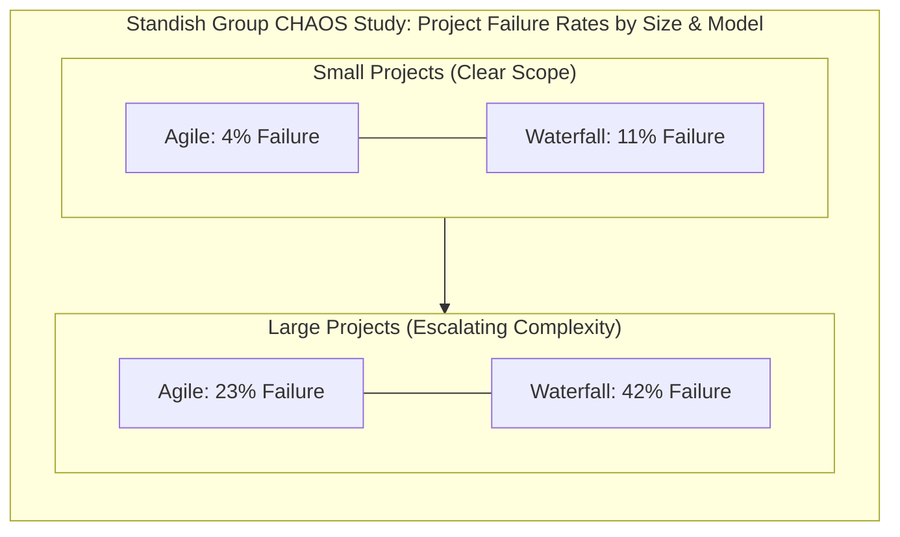

Key empirical takeaways from the CHAOS research include:
1. **Scope and Scale Escalation:** For small, well-bounded software systems, failure rates remain comparatively low. However, linear sequential approaches still fail at almost three times the rate of agile/iterative approaches (11% vs. 4%).
2. **Exponential Risk in Large Waterfall Projects:** As software scale expands, requirements volatility and coordination overhead multiply exponentially. Large-scale Waterfall projects suffer a **42% total cancellation/failure rate**, underscoring the extreme financial risk of rigid, upfront predictive planning in volatile environments.
3. **Root Causes of Project Ruin:** Failures stem predominantly from flawed project management, communication breakdowns, and organizational mismatches rather than low-level technical or compiler deficiencies.

### 1.1.3 The Human and Social Dimension of Software Development
Software development is primarily a complex, collaborative, and team-centric social activity. Technical excellence is necessary but entirely insufficient without addressing human factors:

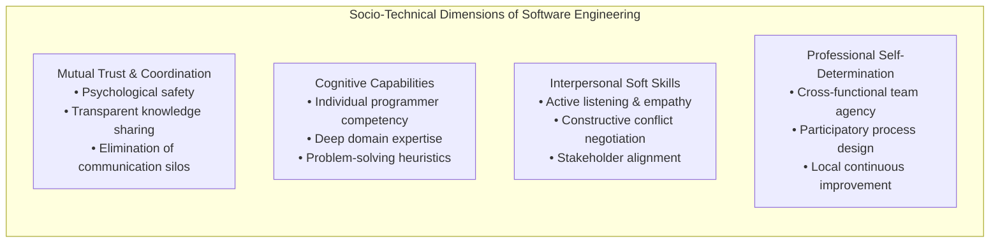

- **The Primacy of Trust:** Without psychological safety and mutual trust, software teams develop defensive documentation cultures, hide emerging project slippages, and erect organizational silos that derail delivery schedules.
- **Cognitive Bounds:** Individual skill sets, cognitive load limits, and domain familiarities represent context-specific boundary constraints on any chosen process.
- **Soft Skills Over Raw Coding:** An engineer's capacity to clarify ambiguous requirements, collaborate during design reviews, and resolve peer discrepancies often exerts greater leverage over product outcomes than raw syntactic proficiency.
- **Empowerment and Ownership:** High-performing cross-functional software teams demand agency in establishing and tailoring their localized process definitions.

### 1.1.4 Definition: Software Process
A **software process** is defined as a structured set of goal-oriented activities enacted in the real world to build, deploy, verify, or maintain a software system.

> [!info] Core Properties of a Software Process
> 1. **Real-World Enactment:** Processes are performed by humans ("enactment") and automated toolchains ("execution") within physical or organizational environments.
> 2. **Product Transformation:** Systematically transforms specified input artifacts (e.g., business needs, user stories, architecture models) into concrete output deliverables (e.g., tested binaries, release packages, test logs).
> 3. **Hierarchical Decomposition:** Processes can be recursively subdivided from overarching lifecycle phases into discrete subprocesses, activities, tasks, down to atomic engineering actions.

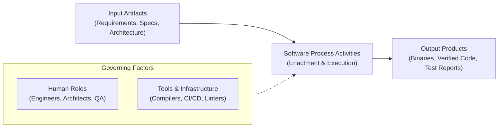

#### Categories of Concrete Software Process Activities
- **Technical Execution:** Architecting component structures, authoring source code, compiling modules, refactoring algorithms, and scripting deployment containers.
- **Verification & Quality Assurance:** Conducting formal peer code inspections, executing unit/integration/system test suites, performing requirements traceability audits, and verifying compliance with security standards.
- **Management & Governance:** Estimating effort and costs, modeling schedule risks, allocating work packages, tracking milestones, and packaging retrospective lessons learned.

### 1.1.5 Definition: Software Process Model
A **software process model** is an abstract, simplified conceptual representation of an actual or desired software process.

> [!tip] The "Recipe" Analogy
> A software process model is to real-world process enactment what a **baking recipe** is to baking a cake in a kitchen. The recipe specifies ingredients, sequential steps, temperature constraints, and expected outcomes, but the actual execution involves human judgment, variations in equipment, and unexpected physical conditions.

#### Essential Building Blocks of a Process Model
1. **Activities:** Distinct work packages and tasks with explicit entry and exit criteria.
2. **Product Flow:** Input and output work products, artifacts, intermediate documents, and access modes (read/write/update).
3. **Control Flow:** Temporal sequencing, preconditions, branch logic, concurrency, and termination conditions.
4. **Refinement Hierarchy:** Multi-level decomposition from macro-phases down to fine-grained work instructions.
5. **Roles:** Defined responsibilities and skill profiles assigned to actors (e.g., Software Architect, Requirements Analyst, Test Lead).
6. **Tools & Infrastructure:** Supporting computing platforms, IDEs, issue trackers, and static analysis tools required for enactment.

---

## 1.2 Process-Product Causality & Industrial Obligations

### 1.2.1 The Causal Relationship: Goal ≈ f(Process, Context)
The bedrock philosophy of software process engineering asserts that software product quality is a direct consequence of the quality of the process utilized to engineer it.

$$\text{Goal} \approx f(\text{Process}, \text{Context})$$

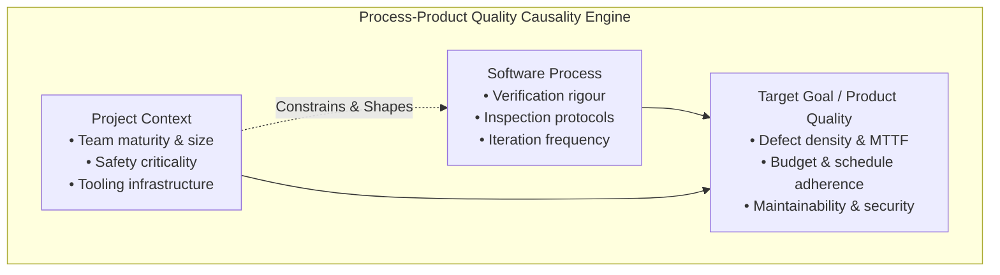

- **Fundamental Premise:** Predictable, high product quality cannot be sustained through ad-hoc, chaotic processes relying on unsustainable individual heroics. Heroic achievements are inherently fragile and non-repeatable.
- **Contextual Dependency:** No single process fits all endeavors universally. A rigorous, formal process essential for a flight-control system will bankrupt a fast-paced commercial web application. The parameters of the environment dictate success.
- **Empirical Nondeterminism:** Because software engineering fundamentally involves human cognitive processes, the relationship $f$ is non-deterministic and must be calibrated through empirical data and continuous measurement.

### 1.2.2 Student Programming vs. Professional Software Engineering
Transitioning from amateur programming to enterprise-scale software engineering requires profound operational shifts across several dimensions:

| Dimension | Student Programming ("Hacking") | Professional Software Engineering |
| :--- | :--- | :--- |
| **Problem Scope** | Toy problems, well-defined specifications, throwaway programs discarded after grading. | Massive, complex systems operating in ambiguous domains, evolving over decades. |
| **Coordination** | Solitary developer working in isolation; zero coordination overhead or merge friction. | Hundreds of globally distributed engineers synchronizing codebases across time zones. |
| **Customer & Budget** | Academic grade is the sole metric; zero commercial liability or financial budget. | Binding legal contracts, tight budgets, hard business deadlines, and revenue impacts. |
| **Verification** | "Runs on my machine"; debugged after crashing with negligible consequence. | Strict verification and validation; undetected flaws can lead to financial catastrophe or loss of life. |
| **Process Obligation** | Process is completely ignored; only the final submitted executable matters. | Legal obligation to comply with external standards, pass audits, and document full traceability. |

### 1.2.3 Industrial Regulations & Safety-Critical Standards
In mission-critical, life-critical, and safety-critical domains, process compliance is not optional—it is mandated by international statutory bodies. Software quality attributes (safety, security, reliability) cannot be tested in at the end; they must be engineered into every process step.

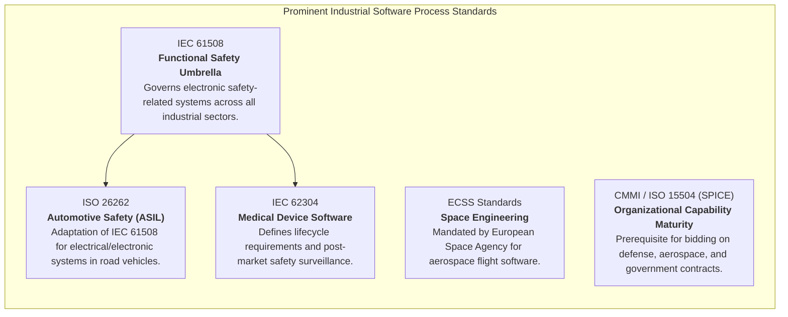

> [!important] Why Process Compliance is Legally Enforced
> If an autonomous vehicle or avionics system experiences a software-induced failure, regulatory authorities audit the organization's development process logs. Demonstrating that developers followed recognized standards (e.g., ISO 26262 ASIL-D or DO-178C) establishes due diligence and shields organizations from catastrophic legal liability.

### 1.2.4 Pathologies of Insufficient Process Control
Organizations operating without mature, documented software processes suffer from well-documented systemic failures:
1. **Unnecessary and Avoidable Rework:** Teams spend 40% to 60% of their engineering capacity fixing architecture and requirement flaws that could have been eliminated during early reviews.
2. **Late Deviation Detection ("The 90% Done Syndrome"):** Schedule slippages, integration bugs, and budget overruns are uncovered on the eve of release rather than weeks prior.
3. **Role Confusion & Boundary Disputes:** Lack of defined role definitions leads to overlapping responsibilities, duplicate work, or vital security tasks falling through administrative cracks.
4. **Lost and Untraceable Work Products:** Crucial test setups, requirement rationales, and architectural constraints vanish when key personnel depart because assets were never institutionalized.

---

## 1.3 Prescriptive vs. Descriptive Process Models

### 1.3.1 Defining the Duality: Prescriptive vs. Descriptive
The software process discipline balances two distinct operational perspectives:

> [!info] Prescriptive Process Models
> **Prescriptive models dictate how a process SHOULD be executed.** They represent idealized or optimized workflows formulated by experts and standard bodies (e.g., Scrum, Waterfall, CMMI) designed to guide teams toward quality and efficiency.

> [!info] Descriptive Process Models
> **Descriptive models document how a process IS ACTUALLY executed in reality.** They are derived empirically by observing developers, analyzing version control telemetry, interviewing team members, and capturing lived practices—including all workarounds, shortcuts, and informal communication channels.

### 1.3.2 The Continuous Process Improvement Cycle
Prescriptive and descriptive models form an ongoing, evolutionary feedback loop:

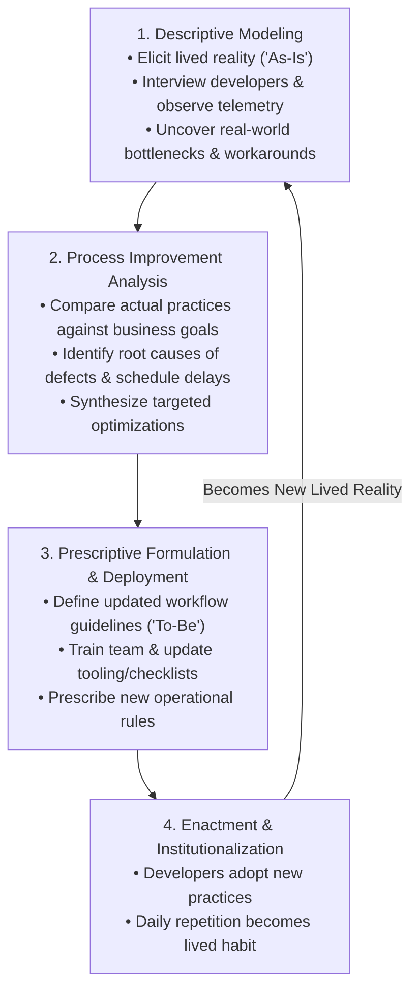

- **The Deployment Clash:** Imposing an overly rigid prescriptive model often triggers fierce resistance from software teams if the processes feel bureaucratic, disconnected from daily coding realities, or cumbersome.
- **The Maturation Cycle:** Successful organizational engineering starts with **descriptive modeling** to understand current reality, moves through **gap analysis**, introduces calibrated **prescriptive guidelines**, and monitors adoption until the new procedures become the team's lived daily descriptive habit.

### 1.3.3 The Four Prerequisites for Process Tailoring
Before imposing any prescriptive process model onto a software team, four fundamental criteria must be rigorously verified:

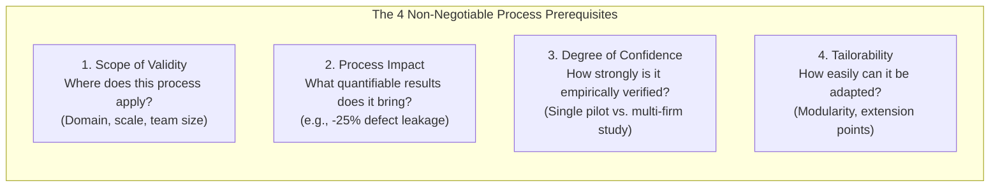

1. **Scope of Validity:** The operational boundaries and conditions under which the model is valid must be explicitly defined. Applying an aerospace model (strict formal proofs) to a 3-person web agency causes administrative collapse.
2. **Process Impact:** The expected quantitative effects must be known in advance. Decision-makers must understand what specific benefits (e.g., reduced defect density, shortened cycle time) are gained in exchange for the added process overhead.
3. **Degree of Confidence:** The empirical grounding supporting the process must be evaluated. Has the model been validated across dozens of industrial settings, or is it an unverified claim derived from a single isolated experiment?
4. **Tailorability:** The process must offer built-in adjustment levers, enabling engineers to omit superfluous tasks or intensify reviews based on project criticality, developer experience, and changing constraints.

---

## 1.4 Core Stages of the Software Development Life Cycle (SDLC)

Every software product traverses five core sequential/iterative lifecycle stages:

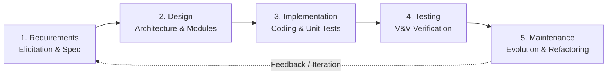

### 1.4.1 Detailed Breakdown of SDLC Stages
1. **Requirements Engineering:**
   - **Focus:** Determining *what* the system must do, for whom, and under what operational boundaries.
   - **Key Artifacts:** Software Requirements Specification (SRS), user stories, acceptance criteria, non-functional requirements (NFRs), and compliance constraints.
2. **Software Design:**
   - **Focus:** Deciding *how* the system will be structured and organized.
   - **Key Artifacts:** High-level system architecture, subsystem decomposition, database schemas, UML component/sequence diagrams, and interface contracts.
3. **Implementation (Construction):**
   - **Focus:** Translating architectural designs and technical specifications into executable source code units.
   - **Key Artifacts:** Source code files, build scripts, configuration manifests, and passing unit test suites.
4. **Testing (Verification and Validation):**
   - **Focus:** Ensuring software correctness, defect elimination, and customer fulfillment.
   - **Verification vs. Validation:**
     - **Verification:** *"Did we build the system right?"* Ensures the software strictly adheres to its engineering specifications.
     - **Validation:** *"Did we build the right system?"* Ensures the software fulfills the genuine operational needs and expectations of the user.
5. **Maintenance & Evolution:**
   - **Focus:** Long-term software stewardship post-deployment.
   - **Activities:** Corrective maintenance (patching faults), adaptive maintenance (operating system/hardware updates), perfective maintenance (performance improvements and refactoring), and preventive maintenance.

---

## 1.5 Prescriptive Process Model Classes & Lifecycles

### 1.5.1 Taxonomy: Lifecycle vs. Engineering Process Models
Prescriptive software processes are divided into two complementary classes based on scope and granularity:

| Attribute | Lifecycle Process Models | Engineering Process Models |
| :--- | :--- | :--- |
| **Operational Scope** | End-to-end lifecycle coverage (concept through decommissioning). | Granular, targeted focus on a single phase or specific technique. |
| **Abstraction Level** | High abstraction; strategic, structural overview. | Low abstraction; detailed operational instructions. |
| **Primary Focus** | Focuses on **WHAT** activities must be performed and their sequence. | Focuses on **HOW** to perform specific activities with tools and methods. |
| **Method Flexibility** | Mandates high-level goals but allows teams to choose specific techniques. | Strict, highly prescriptive step-by-step rules to minimize deviation. |
| **Classic Examples** | Waterfall, Spiral Model, Unified Process, Iterative Enhancement. | Model-based Statistical Testing, CoBRA Cost Estimation, Cleanroom Code Proving. |

---

### 1.5.2 Winston Royce's Waterfall Model (1970)
First formally articulated by Dr. Winston W. Royce in 1970, the Waterfall model structures development into a strictly sequential series of cascading phases.

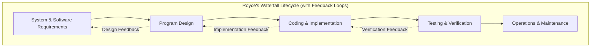

#### Structural Philosophy & Practical Realities
- **Linear Phased Abstraction:** Progress flows downwards from high levels of conceptual abstraction (requirements) down to concrete physical artifacts (source code and binary deployments).
- **Royce's Original Insight (Feedback Loops):** While popular culture views Waterfall as completely rigid and one-way, Royce's 1970 paper explicitly warned that pure single-pass progression is risky and prone to failure, advocating for iterative feedback loops between adjacent steps.
- **When Waterfall Succeeds:**
  - The problem domain is completely understood and historically stabilized.
  - Requirements are thoroughly fixed, verified, and legally frozen upfront.
  - The technology stack, APIs, and platforms are mature with zero volatility.
- **Fundamental Pitfalls in Modern Software:**
  - **Late Integration & Defect Discovery:** System integration and full testing occur at the tail end, revealing deep architectural flaws when budgets and schedules are exhausted.
  - **Requirement Volatility Blindness:** In modern fast-paced markets, user requirements shift dynamically during development; Waterfall cannot absorb mid-project scope adjustments without costly change orders.

---

### 1.5.3 Basili & Turner's Iterative Enhancement (1975)
Introduced by Victor Basili and Albert Turner in 1975, this model pioneered modern iterative development by rejecting monolithic single-shot delivery.

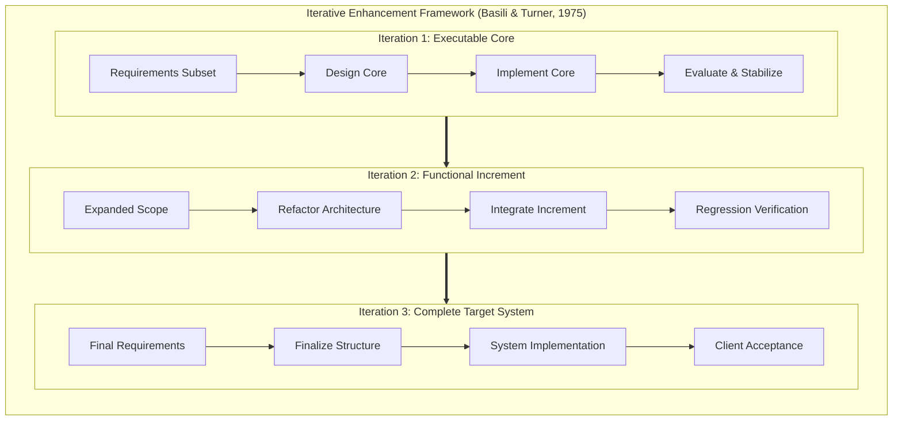

#### Core Mechanisms
- **Early Executable Core:** Rather than attempting to build the entire system simultaneously, the team implements a carefully chosen, high-priority functional subset first.
- **Mini-Waterfalls Within Iterations:** Each cycle executes an internal mini-waterfall (Requirements $\to$ Design $\to$ Coding $\to$ Analysis).
- **Architectural Consolidation:** Each iteration serves two equal purposes: delivering new user-facing functionality and refactoring/stabilizing existing internal code architectures.
- **Fast Feedback Loop:** Customers interact with a working, executable system early in the calendar schedule, drastically reducing the gap between user expectations and engineered reality.

---

### 1.5.4 Barry Boehm's Spiral Model (1986)
Barry Boehm synthesized elements of top-down Waterfall, bottom-up prototyping, and iterative enhancement into a revolutionary **risk-driven meta-model**.

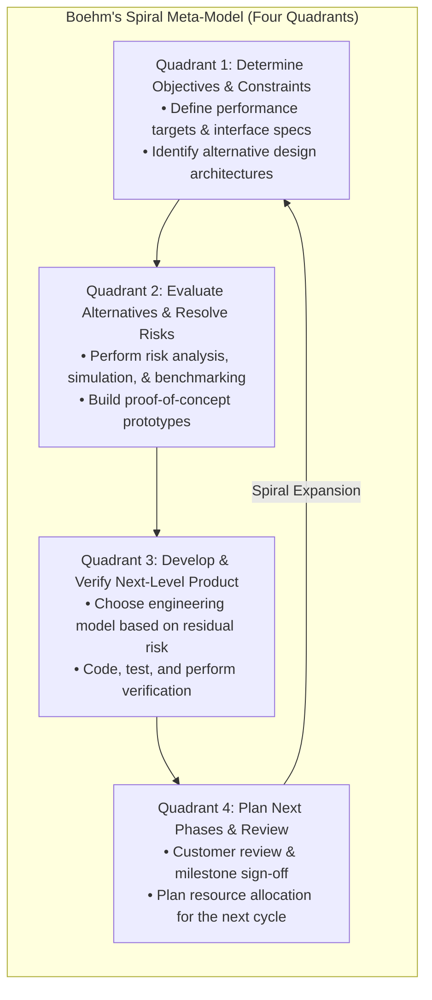

#### Distinctive Characteristics
- **Risk-Driven Progression:** Risk assessment directly dictates the intensity, scope, and specific engineering approach for the subsequent spiral iteration. If technical risk is high, rapid throwaway prototyping is mandated; if risks are resolved and clear, strict formal design is applied.
- **The Four Quadrants:** Every cycle across the spiral's radial expansion traverses:
  1. *Determine Objectives, Alternatives, and Constraints.*
  2. *Evaluate Alternatives, Identify Risks, and Resolve Risks.*
  3. *Develop and Verify the Next-Level Product.*
  4. *Review Outcomes and Plan Next Phases.*
- **Crucial Dependency on Risk Assessment Skills:** The primary vulnerability of the Spiral model is that it relies heavily on world-class risk analysts. Failing to detect subtle architectural, financial, or human risks invalidates the model's governing assumptions.

---

### 1.5.5 The Unified Process (UP)
Formulated by Ivar Jacobson, Grady Booch, and James Rumbaugh (1999), the Unified Process is an architecture-centric, use-case driven, iterative, and incremental process framework aligned with UML (Unified Modeling Language).

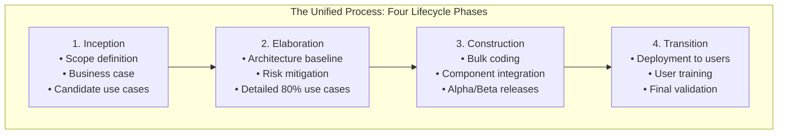

#### Triad of Core Principles
1. **Use-Case Driven:** The functional scope is defined and tracked through formal Use Cases, capturing system interactions from the perspective of external actors.
2. **Architecture-Centric:** Software architecture serves as the primary backbone. High-risk use cases are prioritized early to build, validate, and stabilize an architectural baseline before committing capital to full-scale construction.
3. **Iterative and Incremental:** Development proceeds across distinct vertical iterations that intersect horizontal engineering workflows (Business Modeling, Requirements, Analysis & Design, Implementation, Test, Deployment).

---

### 1.5.6 IBM's Cleanroom Software Engineering (1987)
Developed by Harlan Mills, Michael Dyer, and Richard Linger at IBM, the Cleanroom approach established a radical defect-prevention paradigm derived from semiconductor cleanroom manufacturing.

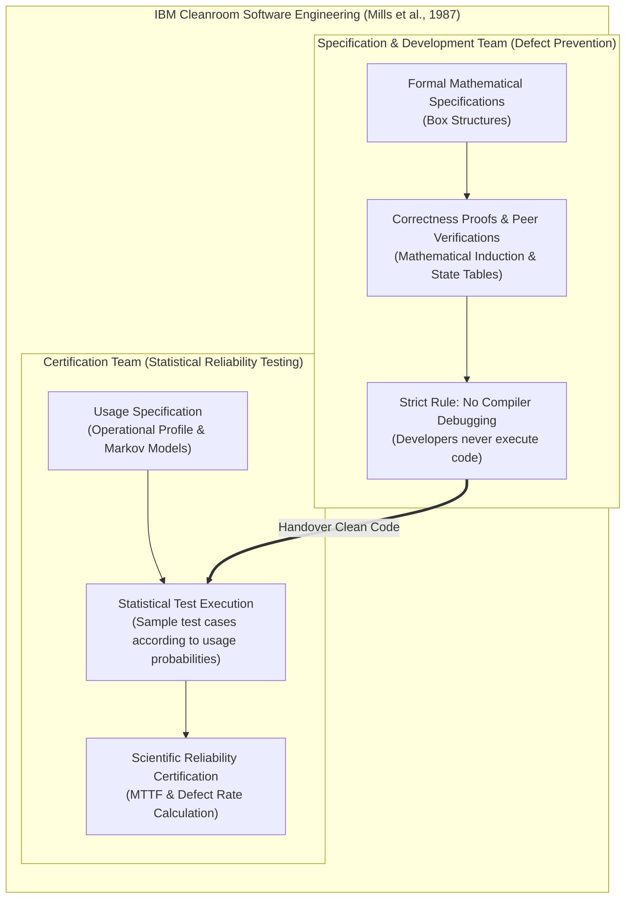

#### Dual Organizational Teams & Operational Rules
- **Mathematical Specification and Verification:** Programs are treated as mathematical functions mapping input domains to output states. Developers utilize box structures (black box, state box, clear box) and prove correctness mathematically.
- **Prohibition of Developer Debugging:** Software developers **never** compile or execute their own code to find bugs. Debugging via compiler trial-and-error is viewed as an undisciplined crutch that obscures underlying design defects.
- **Independent Certification via Statistical Testing:** Software code is handed over directly to an independent certification team. Instead of heuristic white-box unit tests, the certification team generates tests according to an empirical **Usage Specification** (reflecting true operational frequency distribution), calculating objective **Mean Time To Failure (MTTF)**.


---

# Chapter 2: Software Process Definition & Modeling

## 2.1 Motivations and Core Objectives of Process Modeling

### 2.1.1 The Industrial Imperative for Process Management
While software development tools, frameworks, and compilers have reached exceptional levels of technological maturity, the organizational discipline of software processes remains emerging, research-active, and highly variable. 

> [!note] Why Modern Industry Demands Formal Process Definition
> 1. **Organizational Scale & Global Distribution:** Coordinating hundreds of developers distributed across multiple continents, time zones, and corporate cultures cannot succeed on informal, tribal knowledge. Explicit, standardized process definitions are mandatory.
> 2. **Emergence of Process Engineering Roles:** The creation of specialized organizational positions—such as Process Engineers, Agile Coaches, Scrum Masters, and Quality Assurance Specialists—highlights industry's demand for repeatable process management capabilities.
> 3. **Beyond Textbook Prescriptions:** Generic models (pure Scrum or linear Waterfall) rarely fit enterprise realities out-of-the-box. Organizations must possess the analytical capability to elicit, define, tailor, and evolve custom processes for their specific business contexts.

### 2.1.2 The Five Core Objectives of Process Modeling (Curtis et al., 1992)
In their seminal 1992 work, Bill Curtis, Marc Kellner, and Jerry Over established the foundational taxonomy defining why software processes must be formally modeled:

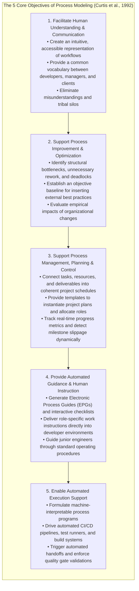

### 2.1.3 Strategic Business & Organizational Benefits
Beyond immediate developer guidance, systematic process modeling yields profound structural advantages:
- **Execution Stability & Repeatability:** Documented operating workflows prevent critical verification, security checks, and code reviews from being skipped during panic-driven schedule crunches.
- **Cognitive Transparency & Complexity Reduction:** Large software undertakings involve overwhelming cognitive complexity. Visual process architectures delineate clear role-specific boundaries, reducing ambiguity.
- **Prerequisite for Quantitative Measurement:** Metrics cannot exist in a vacuum. A defined process model is the absolute prerequisite to identify measurable objects, define Goal-Question-Metric (GQM) indicators, and collect clean baseline metrics.
- **Predictability in Cost, Schedule, and Defect Rates:** Predictive management requires historical performance baselines. Modeling enables variance analysis, allowing organizations to reliably estimate future project budgets and release dates.
- **Organizational Process Propagation:** Modeling enables an enterprise to capture high-performing workflows discovered in one division and systematically propagate them across other product units.
- **Auditable Statutory & Legal Compliance:** Passing functional safety and cybersecurity audits (e.g., ISO 26262, IEC 62304) requires verifiable process documentation and documented adherence records.
- **Standardized Tool Integration Requirements:** High-fidelity process models provide the precise operational requirements needed to configure Jira workflows, GitHub Actions, and custom CI/CD automation tools.

---

## 2.2 The 8-Step Descriptive Process Modeling Methodology

Descriptive process modeling is the disciplined empirical science of capturing, formulating, analyzing, and standardizing the actual ("As-Is") workflows enacted by software engineering teams.

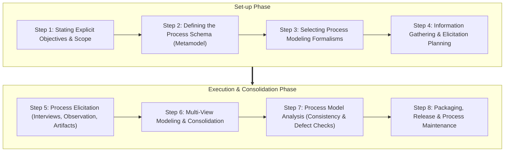

---

### 2.2.1 Step 1: Stating Explicit Objectives and Scope
Process modeling requires substantial expenditure of engineering hours. Clear boundary definition prevents runaway scoping and determines the required depth of abstraction.

> [!info] Scoping Checklist for Process Engineers
> - **Why are we modeling?** (Regulatory compliance audit, tool automation, junior developer onboarding, or bottleneck optimization?)
> - **Who are the primary users?** (Software Engineering Process Group [SEPG], external contractors, project managers, or frontline developers?)
> - **What level of detail is required?** (Coarse lifecycle milestones vs. atomic, low-level technical work instructions?)
> - **What are the organizational boundaries?** (A single feature team, a specific business vertical, or the entire corporate enterprise?)

#### Industrial Case Studies: Diverse Scoping Scenarios
The required modeling strategy varies drastically based on business objectives:

| Dimension | DocVault (Tool Automation) | Selene (Training & Guidance) | Soster (SPI & Optimization) |
| :--- | :--- | :--- | :--- |
| **Objective** | Automate a single targeted workflow: Defect Management. | Provide daily onboarding training and operational guidance. | Support continuous process improvement (SPI) and schedule predictability. |
| **Scope Width** | Extremely Narrow. | Exceptionally Wide (Entire lifecycle). | Mid-Range & Complex. |
| **Primary Users** | Subcontractors building the defect tracking toolchain. | All developers, testers, analysts, and project managers. | Software Engineering Process Group (SEPG) & Project Leads. |
| **User Expectations** | Unambiguous, formal state transitions with pre- and postconditions. | Highly readable process handbook with rich checklists and templates. | Formal models with quantitative metric hooks for defect leakage. |
| **Excluded Scope** | Source code implementation, architecture, and module testing. | None. Comprehensive coverage across all development disciplines. | Core software engineering (focuses purely on customization processes). |

---

### 2.2.2 Step 2: Defining the Process Schema (Metamodel)
A **process schema** (or process metamodel) is the formal conceptual framework defining the allowable entity types, attributes, and relationship semantics used to describe any process.

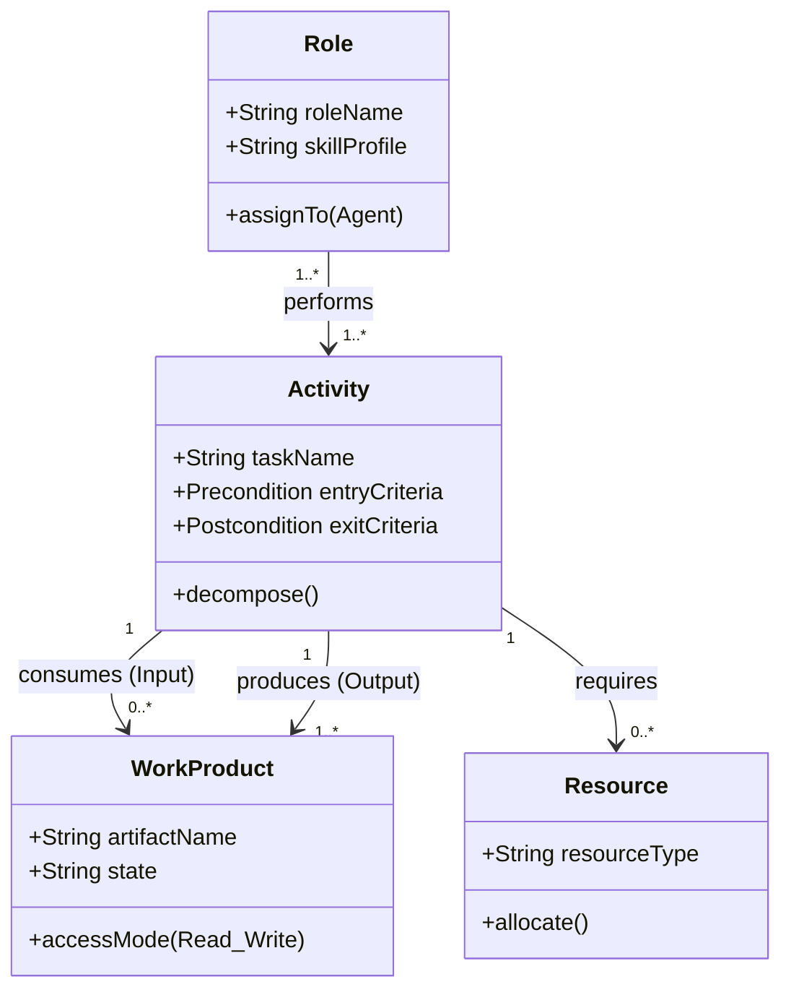

- **Core Abstract Entities:**
  - **Activity:** The structural unit of work (e.g., Architecture Design, Code Review, Unit Testing). Can be recursively decomposed into subtasks and atomic steps.
  - **Work Product:** The concrete information artifacts consumed, modified, or produced by activities (e.g., Requirements Spec, UML Model, Source File, Test Log).
  - **Role:** An abstract profile encapsulating functional responsibilities, skills, and competencies (e.g., Software Architect, Security Lead, Test Engineer).
  - **Resource:** Physical, human, or automated assets necessary to enact the work (e.g., compilers, test benches, licensed servers).
- **Standardize Before Modeling:** Adhering strictly to established schemas (such as SPEM 2.0 or MVP-L) prevents logical flaws, such as erroneously modeling a lifecycle phase as an input artifact.

---

### 2.2.3 Step 3: Selecting Process Modeling Formalisms
Process engineers must evaluate four major spectrums of formalisms:

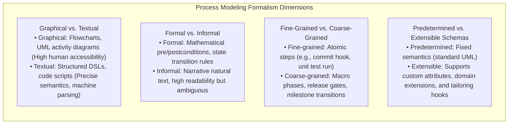

---

### 2.2.4 Step 4: Information Gathering & Elicitation Planning
Before engaging developers, process engineers formulate an elicitation schedule:
- Identifying authoritative role representatives across all participating project disciplines.
- Gathering existing project documentation, code repositories, issue tracker tickets, and past retrospectives.
- Formulating structured interview guides and workshop agendas.

---

### 2.2.5 Step 5: Process Elicitation Techniques & Developer Engagement
Capturing the truth of how software is actually developed requires diverse empirical methods:

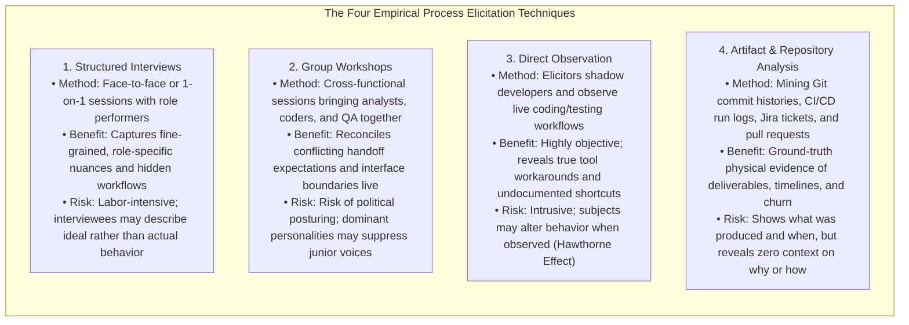

#### Elicitor Behavioral Rules & Engaging Developers
- **Maintain a Non-Judgmental Stance:** Process performers dread criticism or micromanagement. If an elicitor acts like an auditor, developers will describe an embellished, idealized process rather than reality.
- **Focus on Work Products First:** Activities are abstract and difficult to recall accurately. Artifacts (code commits, design diagrams, test reports) are tangible; tracing what is produced makes associated tasks easy to reconstruct.
- **Capture Process Variants:** Document conditional branch paths (e.g., *"If the project is under extreme deadline pressure, code reviews are bypassed in favor of retrospective audits"*).
- **Demonstrate Personal Benefits:** Show developers that clear process definitions eliminate weekend crunch time, reduce ambiguous task handoffs, and clarify accountability.
- **Perform Live Validation:** Draft visual workflows live during interviews to verify immediate mutual understanding.

---

### 2.2.6 Step 6: Multi-View Modeling & Integration
Because software systems are large and compartmentalized, no single individual possesses complete intellectual visibility over the entire lifecycle.

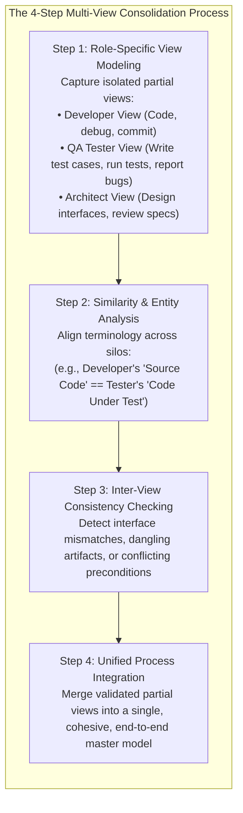

---

### 2.2.7 Step 7: Process Model Analysis & Quality Assurance
Once drafted, the process model must undergo rigorous static and dynamic verification:

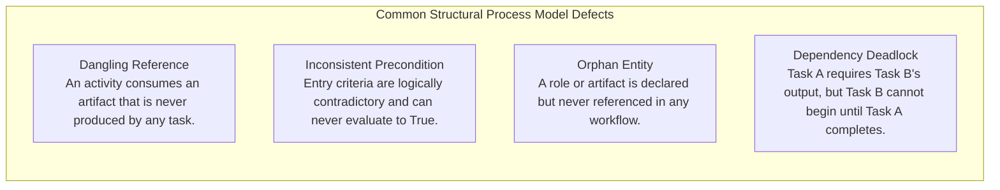

#### Analytical Verification Techniques
1. **Consistency Analysis:** Ensures textual task descriptions match modeled input/output artifact definitions, and nomenclature is unified.
2. **Completeness Analysis:** Verifies that all macro-phases are fully decomposed into actionable, atomic human instructions.
3. **Dynamic Simulation Analysis:** Analyzes simulated process execution to identify resource starvation, scheduling bottlenecks, and concurrency deadlocks.
4. **Automated Syntactic Checking:** For formal domain-specific languages (e.g., MVP-L), automated compilers verify semantic typing and precondition completeness.

---

### 2.2.8 Step 8: Packaging, Release & Process Maintenance
The finalized process model is synthesized into actionable organizational artifacts:
- Compiling models into browsable **Electronic Process Guides (EPGs)**.
- Establishing formal feedback channels for developers to submit change proposals and defect reports against process descriptions.
- Reviewing process metrics periodically to drive continuous process improvement (QIP / CMMI cycles).

### 2.2.9 Critical Investment Risks in Process Modeling
1. **Process Embellishment (Inaccurate Reporting):** Performers document what management wants to hear rather than what actually happens, rendering the model useless for improvement.
2. **Budget & Schedule Overruns:** Process elicitation consumes hundreds of high-value engineering hours. Without dedicated time budgets, the initiative collapses under development pressure.
3. **Model Complexity (Over-Engineering):** Models balloon into unmanageable monstrosities with thousands of interconnected entities that nobody reads or maintains.

---

## 2.3 Process Modeling Notations & Languages

### 2.3.1 Key Notation Characteristics & The Eight Formal Requirements (R1–R8)

#### Four Key Dimensions of Process Notations
Before choosing a modeling formalism, process engineers classify notations along four foundational architectural dimensions (Münch & Armbrust, 2012):

```mermaid
flowchart TD
    subgraph NotationDimensions["The 4 Foundational Dimensions of Process Notations"]
        direction TB
        D1["<b>1. Process Programming vs. Process Improvement</b><br/>• <i>Programming:</i> Formal, machine-interpretable code designed for automated engine execution.<br/>• <i>Improvement:</i> Conceptual, communicative models designed for human understanding and optimization."]
        D2["<b>2. Hidden vs. Guiding Notations</b><br/>• <i>Hidden:</i> Process rules are implicitly baked inside automated tools (e.g., Jira transitions).<br/>• <i>Guiding:</i> The model explicitly advises and steers human developers through daily tasks."]
        D3["<b>3. Prescriptive vs. Proscriptive Notations</b><br/>• <i>Prescriptive:</i> Rigidly dictates exact allowable sequences ('Do A, then B').<br/>• <i>Proscriptive:</i> Defines external boundary constraints and forbidden states, granting autonomy within guardrails."]
        D4["<b>4. Single-Person vs. Multi-Person Notations</b><br/>• <i>Single-Person:</i> Focuses on atomic, individual task execution at the workstation level.<br/>• <i>Multi-Person:</i> Coordinates cross-functional workflows, role handoffs, and distributed team synchronization."]
    end
```

#### The Eight Formal Requirements for Process Notations (R1–R8)
To serve as an effective standard in professional software engineering, a modeling notation must satisfy eight criteria:

| Requirement | Designation | Operational Mandate |
| :--- | :--- | :--- |
| **R1** | **Natural Representation** | Captures real-world software engineering concepts (activities, artifacts, roles) intuitively without artificial contortions. |
| **R2** | **Support of Measurement** | Natively integrates quantitative process and product metrics directly into structural definitions (GQM alignment). |
| **R3** | **Tailorability of Models** | Allows modular adaptation, extension, and customization for diverse project scopes and team sizes. |
| **R4** | **Formality** | Establishes unambiguous syntax and execution semantics enabling automated analysis, consistency checking, and simulation. |
| **R5** | **Understandability** | Easily comprehended, validated, and enacted by human practitioners across roles (engineers, managers, auditors). |
| **R6** | **Executability** | Machine-interpretable by workflow management systems, continuous integration toolchains, and process engines. |
| **R7** | **Flexibility** | Accommodates human cognitive discretion, non-linear creativity, exploratory tinkering, and dynamic exceptions. |
| **R8** | **Traceability** | Natively links activities to artifacts, roles, tools, and business objectives across the lifecycle. |

---

### 2.3.2 Multi-View Process Language (MVP-L)
Developed at the University of Maryland and the University of Kaiserslautern, **MVP-L** was designed specifically to support Software Process Improvement (SPI), the Quality Improvement Paradigm (QIP), and the Goal-Question-Metric (GQM) approach.

#### David Parnas' Concept of Information Hiding in Processes (1972)
MVP-L pioneered the application of classic software engineering encapsulation principles to process architectures:

```mermaid
flowchart TD
    subgraph MVPL_Model["MVP-L Process Model Architecture"]
        subgraph Interface["Process Model Interface (Externally Visible)"]
            Params["Formal Product Parameters<br/>• Consumes (Input Artifacts)<br/>• Produces (Output Artifacts)"]
            Attrs["Exported Process Attributes<br/>• Spent Effort<br/>• Defect Count"]
            Criteria["Explicit Logic Gates<br/>• Entry Criteria (Preconditions)<br/>• Exit Criteria (Postconditions)"]
        end
        
        subgraph Body["Process Model Body (Hidden Implementation)"]
            Impl["Task Execution Details<br/>• Step-by-step human instructions<br/>• Automated compiler / tool invocations<br/>• Local sub-process orchestrations"]
        end
        
        Interface --> Body
    end
    
    OtherProcess["External Process"] -.->|Interacts ONLY via| Interface
```

- **Information Hiding:** The internal operational steps of a process are encapsulated entirely within the **Process Body**. External collaborating processes can only interact through the **Process Interface** via formal product parameters.
- **Localizing Process Evolution:** When a development team updates their internal coding guidelines or switches compilers, only the body of the coding process changes. Because the interface (inputs, outputs, entry/exit criteria) remains stable, the rest of the enterprise process architecture is unaffected.

#### The Four Core Typed Object-Oriented Models in MVP-L
1. **`product_model`:** Defines the internal structure and lifecycle attributes of an artifact class (e.g., `Design_Document`, `Source_Code`, exporting attributes like `status = {incomplete, complete}`).
2. **`resource_model`:** Represents active personnel (teams, developers) or passive software tools (linters, compilers), declaring skill profiles and available capacity.
3. **`process_model`:** The core work unit that imports products and resources, defines formal preconditions, and executes tasks.
4. **`attribute_model`:** Represents quantitative measurement indicators (effort, defect density, complexity). Directly binds GQM metrics into the process framework.

#### Implicit Control Flow via State Transitions
Unlike traditional flowchart languages, MVP-L does not rely on rigid sequential control arrows. Control flow is **implicit**, governed strictly by Boolean constraints:

```mermaid
stateDiagram-v2
    direction LR
    [*] --> NonExistent : Project Start
    NonExistent --> Incomplete : Process Starts (Write)
    Incomplete --> Complete : Exit Criteria Met (Pass Review)
    Complete --> Incomplete : Rework Required (Defect Found)
    Complete --> [*] : Delivery
```

- **Process States:**
  - `Enabled`: All Boolean Entry Criteria evaluate to `True`.
  - `Active`: An actor triggers enactment; work is actively being performed.
  - `Disabled`: Task completion occurs and Exit Criteria evaluate to `True`.
- **Local Invariants:** Mathematical expressions that must evaluate to `True` throughout enactment (e.g., `spent_effort <= max_allocated_budget`), triggering alerts upon overrun.

---

## 2.4 OMG SPEM 2.0 & Tooling (EPF Composer)

### 2.4.1 The SPEM 2.0 Metamodel Standard
The **Software and Systems Process Engineering Metamodel (SPEM 2.0)** is an international formal standard released by the Object Management Group (OMG).

```mermaid
flowchart TD
    subgraph SPEM_Triad["SPEM 2.0 Core Metamodel Triad"]
        direction TB
        RoleDef["Role Definition ('WHO')<br/>Encapsulates competencies, skill sets, and responsibilities<br/>(e.g., Test Engineer, System Architect)"]
        TaskDef["Task Definition ('WHAT')<br/>A typed unit of work broken down into distinct steps<br/>(e.g., Execute Integration Test, Inspect Architecture)"]
        WorkProductDef["Work Product Definition ('OUTCOME')<br/>Tangible artifacts consumed, updated, or delivered<br/>(e.g., Test Plan, Component Binary, Defect Log)"]
        Guidance["Guidance<br/>Supporting templates, checklists, whitepapers, and best practices"]
        
        RoleDef -->|Performs / Is Primary Owner| TaskDef
        TaskDef -->|Consumes (Mandatory / Optional)| WorkProductDef
        TaskDef -->|Produces / Updates| WorkProductDef
        Guidance -.->|Enriches & Guides| RoleDef
        Guidance -.->|Enriches & Guides| TaskDef
        Guidance -.->|Enriches & Guides| WorkProductDef
    end
```

- **UML 2.0 Profile Alignment:** SPEM 2.0 is defined as a UML profile. Process engineers can utilize standard UML modeling environments, leveraging Activity Diagrams and State Machine Diagrams to visualize complex workflows.
- **Unified Domain Vocabulary:** SPEM resolved decades of terminological chaos across software methodologies, unifying disparate concepts under a shared semantic metamodel.

---

### 2.4.2 Decoupling Method Content from Context-Specific Processes
A defining architectural innovation of SPEM 2.0 is the complete structural separation between static organizational knowledge and dynamic project schedules:

```mermaid
flowchart LR
    subgraph MethodContent["1. Reusable Method Content (Static Library)"]
        direction TB
        R_Lib["Role Definitions<br/>(Architect, Coder)"]
        T_Lib["Task Definitions<br/>(Refactor Code, Unit Test)"]
        W_Lib["Work Product Definitions<br/>(Design Model, Binary)"]
        R_Lib --- T_Lib --- W_Lib
    end
    
    subgraph ProcessWorkflow["2. Context-Specific Process (Dynamic Workflow)"]
        direction TB
        Phase1["Phase 1: Inception<br/>• Role Use: Lead Architect<br/>• Task Use: Draft Concept<br/>• Work Product Use: Vision Doc"]
        Phase2["Phase 2: Construction<br/>• Role Use: Senior Developer<br/>• Task Use: Implement Module<br/>• Work Product Use: Tested Code"]
        Phase1 --> Phase2
    end
    
    MethodContent ==>|Instantiated & Configured into| ProcessWorkflow
```

| Dimension | Reusable Method Content | Context-Specific Process |
| :--- | :--- | :--- |
| **Core Nature** | Static repository of enterprise best practices and engineering standards. | Dynamic workflow configured for a specific project execution. |
| **Perspective** | Describes **WHO, WHAT, and HOW** independently of time or calendar deadlines. | Describes **WHEN** tasks are scheduled, mapping increments onto project phases. |
| **Elements** | Abstract `RoleDefinition`, `TaskDefinition`, `WorkProductDefinition`. | Instantiated references: `RoleUse`, `TaskUse`, `WorkProductUse`. |
| **Lifecycle** | Highly stable across years; captures cumulative corporate intellectual capital. | Volatile and customized per project based on budget, team size, and risk. |

---

### 2.4.3 Eclipse Process Framework (EPF) Composer
**EPF Composer** is the premier open-source toolchain implementing the SPEM 2.0 standard, widely utilized for authoring, configuring, tailoring, and publishing enterprise process models.

#### Key Functional Capabilities
- **OpenUP Pre-Populated Content:** Includes the open-source OpenUP methodology library, serving as a ready-to-use template incorporating Agile and Unified Process best practices.
- **Method vs. Process Authoring Split:** Features dual workspaces:
  - *Method Authoring Tab:* Build roles, tasks, guidance templates, and artifact libraries.
  - *Process Configuration Tab:* Assemble capability patterns and delivery processes mapped to Gantt-like lifecycle phases.
- **Electronic Process Guide (EPG) Generation:** Automatically compiles the underlying model repository into responsive, hyperlinked HTML websites (EPGs) deployed on corporate intranets for developer guidance.

#### Process Variability Mechanisms (Inheritance in Process Engineering)
To support seamless reuse without modifying base corporate libraries, EPF Composer introduces four object-oriented variability patterns:

```mermaid
flowchart TD
    subgraph VariabilityMechanisms["EPF Composer Process Variability Patterns"]
        direction TB
        Contribute["1. Contribute<br/>Seamlessly appends new checklists, guidelines, or steps to a base element<br/>without modifying the original source library."]
        Replace["2. Replace<br/>Completely substitutes a base element with a tailored variant specific to the project context."]
        Extend["3. Extend<br/>Inherits all properties and associations of a base element, allowing local specialization<br/>(analogous to object-oriented class inheritance)."]
        ExtendReplace["4. Extend and Replace<br/>Inherits properties, specializes them locally, and suppresses the original base element from publication."]
    end
```

> [!example] Practical Application of Variability
> If a high-security defense project requires additional cryptographic validation during code review, the team uses **Contribute** to attach a "Cryptographic Audit Checklist" to the standard corporate "Peer Code Review" task. The base corporate method library remains untouched, yet the published project EPG reflects the specialized security requirements.


---

# Chapter 3: Software Processes in the Product Life Cycle & Advanced Controls

## 3.1 The Product Lifecycle Stages & Engineering Qualities

### 3.1.1 Product Lifecycle vs. Management Phase View
A software product life cycle encompasses the evolving technical states of the product, traversing five core engineering stages from initial conception to eventual decommissioning.

```mermaid
flowchart LR
    Req["1. Requirements<br/>• Eliciting & analyzing<br/>• Documenting constraints<br/>• Defining acceptance gates"]
    Des["2. Design<br/>• High-level architecture<br/>• Detailed module interfaces<br/>• UML interaction models"]
    Impl["3. Implementation<br/>• Coding & CBD reuse<br/>• Unit test integration<br/>• Refactoring code smells"]
    Test["4. Testing<br/>• Constructive QA<br/>• V&V execution<br/>• Defect elimination"]
    Maint["5. Maintenance<br/>• Adaptive evolution<br/>• Paying down technical debt<br/>• Zero code decay"]
    
    Req --> Des --> Impl --> Test --> Maint
    Maint -.->|Evolutionary Loop| Req
```

### 3.1.2 Requirements Elicitation: The Three Stakeholder Dimensions
Requirements engineers must bridge three human disconnects when translating business intent into software specifications:

```mermaid
flowchart TD
    subgraph StakeholderDimensions["Three Stakeholder Elicitation Challenges"]
        direction TB
        D1["1. Lack of Technical Experience<br/>• Problem: Stakeholders cannot express needs in algorithmic or technical terms.<br/>• Solution: Developers act as guides, translating business goals into cost-bounded functional options."]
        D2["2. Fleeting & Volatile Desires<br/>• Problem: User wants are erratic, contradictory, or change upon seeing competitor features.<br/>• Solution: Deploy Minimum Viable Products (MVPs), usability prototypes, and focus groups to test true utility."]
        D3["3. Imperfect Communication & Translation<br/>• Problem: Natural language ambiguities lead to divergent mental models.<br/>• Solution: Standardize requirements using plain-English User Stories with explicit acceptance criteria."]
    end
```

### 3.1.3 Architectural Modeling with UML: Avoiding Detail Bloat
When modeling software architectures using Unified Modeling Language (UML), engineering teams must balance completeness against human cognitive limits:
- **Structural Mapping (Class Diagrams):** Maps the static Object-Oriented layout, defining attributes, methods, visibility, and relational associations (`is-a` inheritance, `has-a` composition).
- **Behavioral Execution (Sequence Diagrams):** Visualizes temporal message flows between collaborating objects and boundary actors during the execution of a concrete use case.

> [!warning] UML Principle: Combat Detail Bloat
> UML diagrams must emphasize high-level communication rather than exhaustive code generation. Modeling every single private getter, setter, and primitive variable produces unreadable diagrams that nobody maintains. Keep UML visual representations lean, intuitive, and focused strictly on high-impact structural decisions.

### 3.1.4 Code Implementation Paradigms
Modern software construction relies on three core tenets:
1. **Component-Based Development (CBD) & Reuse:** Maximizing the integration of verified commercial off-the-shelf (COTS) components, libraries, and microservices reduces baseline cycle times.
2. **Object-Oriented & Modular Decomposition:** Encapsulation and modular decoupling keep large, complex codebases intellectually manageable and maintainable over decades.
3. **Cognitive Accommodation (Tinkerer Support):** Engineering guidelines must provide clear architectural guardrails while allowing developers the exploratory autonomy ("mindful tinkering") necessary for creative optimization.

### 3.1.5 Verification vs. Validation (V&V)
Testing is structured into two complementary quality assurance dimensions:

```mermaid
flowchart TD
    subgraph VV_Framework["Verification & Validation Quality Framework"]
        direction LR
        subgraph Verification["Verification ('Build the System Right')"]
            direction TB
            VerDef["Definition: Confirming conformance to engineering specifications."]
            VerAct["Activities: Static code analysis, formal peer inspections, unit testing, CI build checks."]
            VerFocus["Focus: Catching internal logic defects, interface errors, and specification drift early."]
        end
        subgraph Validation["Validation ('Build the Right System')"]
            direction TB
            ValDef["Definition: Confirming fulfillment of user expectations and business utility."]
            ValAct["Activities: User Acceptance Testing (UAT), customer focus groups, beta canary deployments."]
            ValFocus["Focus: Ensuring usability, fitness-for-purpose, market fit, and end-user adoption."]
        end
    end
```

### 3.1.6 Technical Debt, Code Decay & The Refactoring Discipline
Taking shortcuts during construction provides temporary velocity but incurs **technical debt**. Neglecting this debt leads to progressive **code decay**, driving up defect rates and inflating maintenance costs.

> [!info] The Refactoring Discipline
> **Refactoring** is the disciplined practice of modifying internal code structures to enhance readability, reduce complexity, and eliminate technical debt **without altering the observable external functional behavior** of the software.

#### Ten Critical Code Smells to Eliminate
1. **Obsolete & Misleading Comments:** Narrative text that contradicts updated code implementations.
2. **Commented-Out Dead Code:** Blocks of dormant code cluttering files rather than relying on Git version history.
3. **Duplicate Code ("Copy-Paste Programming"):** Identical logic repeated across multiple routines.
4. **Vague & Ambiguous Identifiers:** Cryptic variable or function names (e.g., `temp1`, `doProcess()`).
5. **Functions with Multiple Responsibilities:** Violating the Single Responsibility Principle (SRP).
6. **Bloated Routines (>10 Lines):** Overly long functions that obscure high-level algorithmic logic.
7. **Excessive Parameter Lists (>4 Arguments):** Indicating a missing abstraction or object encapsulation.
8. **Divergent Change & Shotgun Surgery:** Modifying one class requires tiny edits across dozens of files.
9. **Feature Envy:** A method accesses the data of another object more than its own.
10. **Primitive Obsession:** Over-relying on basic primitives instead of domain-specific value objects.

---

## 3.2 Requirements Engineering & Nonfunctional Scope

### 3.2.1 Mitigating Drivers of Project Failure
Rigorously defining explicit requirements eliminates three catastrophic failure drivers:
- **Developer Bias:** In the absence of documented specifications, developers build features they personally find interesting or technically fun, ignoring commercial utility.
- **Team Desynchronization:** Developers working without unified specifications build conflicting, incompatible subsystems that explode during system integration.
- **Stakeholder Volatility & Scope Creep:** Vague requirement baselines invite continuous, uncontrolled feature additions that exhaust budgets and destroy schedules.

### 3.2.2 The Eight Engineering Qualities of Requirements (Texas DIR, 2008)
To serve as an authoritative contract, software requirements must exhibit eight formal characteristics:

```mermaid
flowchart TD
    subgraph ReqQualities["The 8 Essential Requirements Qualities (Texas DIR, 2008)"]
        direction TB
        Q1["1. Correct: Accurately represents true stakeholder and business intent."]
        Q2["2. Unambiguous: Subject to only one single, clear interpretation by all parties."]
        Q3["3. Complete: Contains all necessary functional criteria, constraints, and error states."]
        Q4["4. Consistent: Contains zero internal contradictions or conflicting statements."]
        Q5["5. Ranked for Priority: Explicitly categorized by criticality (e.g., MoSCoW scale)."]
        Q6["6. Verifiable / Testable: Formulated so testers can design a concrete pass/fail verification test."]
        Q7["7. Modifiable: Structured modularly so edits can be applied without cascading disruption."]
        Q8["8. Traceable: Explicitly linked backwards to business needs and forwards to code/tests."]
    end
    Q1 --- Q2 --- Q3 --- Q4
    Q5 --- Q6 --- Q7 --- Q8
```

> [!important] The Imperative of Verifiability
> A requirement that cannot be verified is completely useless. Vague nonfunctional statements such as *"The system shall be fast and responsive"* must be replaced with quantitatively testable thresholds: *"Under peak loads of 10,000 concurrent users, 95% of database queries must return within $\le 500\text{ ms}$."*

### 3.2.3 Two Pillars of Nonfunctional Scope: Quality Attributes vs. Constraints
Nonfunctional requirements fall into two structurally distinct categories:

```mermaid
flowchart LR
    subgraph Pillar1["Pillar 1: Quality Attributes (Internally Chosen)"]
        direction TB
        QA1["Maintainability: Low effort required to refactor and patch code."]
        QA2["Reliability: Statistical probability of failure-free execution (MTBF, MTTF)."]
        QA3["Portability: Effort required to migrate to alternate environments."]
        QA4["Efficiency: Memory footprint and CPU consumption per transaction."]
    end
    
    subgraph Pillar2["Pillar 2: Constraints (Externally Mandated)"]
        direction TB
        C1["Technology Limits: Mandated programming languages, DBMS, or framework APIs."]
        C2["Platform Boundaries: Mandated deployment OS (e.g., iOS 17+, Linux kernel 6.x)."]
        C3["Regulatory Compliance: Statutory mandates (e.g., GDPR, HIPAA, IEC 62304)."]
        C4["Geographic Data Laws: Physical residency rules for cloud database servers."]
    end
```

---

## 3.3 Project Governance & Human Coordination Controls

### 3.3.1 Optimizing the Triple Constraint Matrix
Project managers balance three interdependent boundaries: **Time**, **Scope**, and **Cost**. Each boundary can be configured according to three strategic postures:

| Boundary Option | Time (Duration / Schedule) | Scope (Features & Quality) | Cost (Budget & Resources) |
| :--- | :--- | :--- | :--- |
| **Constrain (Fixed)** | Delivery deadline is strictly unmovable (e.g., statutory compliance deadline). | Scope and safety specifications are 100% non-negotiable. | Financial budget and personnel headcount are strictly capped. |
| **Enhance (Optimize)** | Accelerate delivery to release ahead of market competitors. | Maximize secondary feature inclusion and user satisfaction. | Minimize operational expenditures; achieve maximum resource efficiency. |
| **Accept (Negotiable)** | Schedule slippage is acceptable if required to secure quality. | Non-critical features may be dropped to protect delivery date. | Cost overruns or overtime budget authorized to meet targets. |

### 3.3.2 Tuckman's Model of Group Development
Software engineering teams evolve through five psychological phases of cooperation (Tuckman, 1965):

```mermaid
flowchart LR
    F["1. Forming<br/>Orientation, polite interactions,<br/>establishing ground rules."] --> St["2. Storming<br/>Conflict, interpersonal friction,<br/>competing technical views."]
    St --> N["3. Norming<br/>Consensus, stabilized roles,<br/>shared team conventions."]
    N --> P["4. Performing<br/>High synergy, autonomous problem solving,<br/>frictionless velocity."]
    P --> A["5. Adjourning<br/>Project conclusion, archiving assets,<br/>retrospective debrief."]
```

### 3.3.3 The RACI Responsibility Assignment Matrix
To eliminate role ambiguity, overlapping efforts, and task neglect across engineering teams, projects utilize the **RACI Responsibility Assignment Matrix**:
- **Responsible (R):** The "doer" assigned to complete the task or deliverable.
- **Accountable (A):** The sole decision-maker with ultimate veto and delivery sign-off authority. *(Rule: Exactly one 'A' per deliverable).*
- **Consulted (C):** Subject matter experts who provide bidirectional advice and input.
- **Informed (I):** Stakeholders kept updated unidirectionally on progress and milestones.

#### Official Lecture RACI Allocation (Week 3 Slide 14)
The authoritative RACI allocation matrix presented in the CKS222 curriculum maps four core software deliverables across four cross-functional engineering roles:

| Project Deliverable | Team Lead | Frontend Lead | Frontend Developer | Backend Developer |
| :--- | :---: | :---: | :---: | :---: |
| **Requirements Specification** | Consulted / Informed | Accountable / Informed | Responsible | Responsible |
| **Interface / API Design** | Informed | Informed | Responsible | Accountable |
| **Backend Coding** | Informed | Consulted | Informed | Responsible / Accountable |
| **User Acceptance Testing (UAT)** | Consulted / Informed | Responsible / Accountable | Responsible | Responsible |

> [!tip] Analysis of the Lecture RACI Architecture
> 1. **Shared Technical Responsibility:** Both `Frontend Developer` and `Backend Developer` are co-Responsible (`R`) for Requirements Specification and UAT, ensuring developers validate functionality against requirements end-to-end.
> 2. **Accountability Separation:** Accountability (`A`) is split by architectural expertise: the `Backend Developer` owns API Design and Backend Coding, while the `Frontend Lead` owns Requirements Specification signoff and final UAT approval.
> 3. **Governance & Anti-Pattern Defense:** In industry coursework audits, examiners enforce strict RACI constraints: each deliverable must have **at least one 'R'** and **strictly one 'A'** to avoid decision gridlock. Dual designations (e.g., `R/A`) signify that the lead both authors the technical core and carries final legal accountability.

---

### 3.3.4 Structured Decision-Making: Eisenhower Matrix & Fist of Five

#### 1. Eisenhower Prioritization Matrix
Balances development workloads by categorizing incoming tasks across urgency and importance:

```mermaid
flowchart TD
    subgraph EisenhowerGrid["The Eisenhower Decision Matrix in Software Projects"]
        direction TB
        subgraph TopRow["High Urgency"]
            direction LR
            Do["<b>Do (Urgent & Important)</b><br/>Perform immediately and correctly.<br/><i>Lecture Example:</i> Documenting complex code so a newly onboarded engineer can begin work; hotfixing production outages."]
            Del["<b>Delegate (Urgent & Not Important)</b><br/>Assign to junior roles or automation scripts.<br/><i>Lecture Example:</i> Routine admin ticket filing, updating environment licenses."]
        end
        subgraph BottomRow["Low Urgency"]
            direction LR
            Dec["<b>Decide (Not Urgent & Important)</b><br/>Schedule dedicated calendar time deliberately.<br/><i>Lecture Example:</i> Strategic code refactoring, paying down technical debt, architecture reviews."]
            Drop["<b>Delete (Not Urgent & Not Important)</b><br/>Eliminate completely from backlog.<br/><i>Lecture Example:</i> Unused speculative prototypes, vanity features with zero user demand."]
        end
    end
    TopRow --- BottomRow
```

#### 2. Fist of Five Consensus Method
A rapid, transparent voting protocol used during sprint planning, architectural reviews, and process tailoring sessions to gauge team consensus and identify hidden reservations:

```mermaid
flowchart LR
    subgraph FistOfFive["Fist of Five Consensus Scale (Week 3 Slide 15)"]
        direction TB
        Fist["<b>Fist (0 Fingers): Strong Reject</b><br/>• Blocks consensus entirely.<br/>• Major blocking issue halts progress until resolved."]
        OneTwo["<b>1 to 2 Fingers: Reject</b><br/>• Serious reservations or major/minor issues.<br/>• Requires immediate plenary group discussion & resolution."]
        ThreeFive["<b>3 to 5 Fingers: Accept</b><br/>• 3: Weak acceptance (minor issues resolved later).<br/>• 4: Solid agreement.<br/>• 5: Total endorsement & strong leadership/championing."]
    end
    Fist --> OneTwo --> ThreeFive
```

> [!important] The "Below Three" Governance Gate
> In professional agile governance (and USM CKS222 coursework gate assessments), **any vote below a 'Three' (Fist, 1, or 2)** acts as a process halt trigger. The team must pause, document the specific blocking concern, negotiate architectural or process compromises, and re-vote until universal agreement ($\ge 3$) is attained.

---

### 3.3.5 Agile Estimation Paradigms & Planning Poker
To overcome the **planning fallacy** and cognitive optimism bias, agile software processes deploy relative estimation:
- **Story Points vs. Ideal Days:**
  - **Story Points:** Relative abstraction representing effort, complexity, and technical risk (typically using modified Fibonacci: $1, 2, 3, 5, 8$). Scale is calibrated internally by the team.
  - **Ideal Days:** Absolute calendar duration assuming a developer works with 100% focus and zero interruptions. Fails to account for typical workplace distractions, context switches, and coordination meetings.
- **Planning Poker:** Team members privately select point cards simultaneously, exposing discrepancies. Outliers (highest and lowest bidders) explain their reasoning, revealing hidden technical complexities and establishing consensus.

---

### 3.3.6 Scope Management: Traditional Statement of Work (SOW) vs. Agile Backlog

A pivotal governance transition in software engineering is the shift from contractually frozen statements of work to backlog-driven dynamic scope:

```mermaid
flowchart LR
    subgraph TraditionalScope["Traditional Scope: Statement of Work (SOW)"]
        direction TB
        T1["<b>Rigid Upfront Baseline</b><br/>Scope defined exhaustively in a formal, heavily-documented legal contract."]
        T2["<b>High Project Failure Risk</b><br/>Unmanaged requirement changes cause massive schedule slips and budget overruns.<br/><i>'Swimming up a waterfall is prohibited.'</i>"]
        T1 --> T2
    end
    
    subgraph AgileScope["Agile Scope: Backlog-Driven Management"]
        direction TB
        A1["<b>Emergent Scope Definition</b><br/>Scope is represented as an adaptable, prioritized list of items (Product & Sprint Backlogs)."]
        A2["<b>Adaptive Value Commitment</b><br/>Requirements emerge continuously, enabling teams to pivot and address volatile market needs."]
        A1 --> A2
    end
    
    TraditionalScope -.->|Replaced By| AgileScope
```

| Scope Dimension | Traditional Statement of Work (SOW) | Agile Backlog-Driven Scope |
| :--- | :--- | :--- |
| **Baseline Definition** | Heavily documented, rigid upfront specification legally signed before coding begins. | Emergent, lightweight, ordered list of user stories refined continuously across sprints. |
| **Change Tolerance** | Inflexible. Mid-project modifications require costly formal contract change orders. | Welcomed. Backlog re-ordering allows new priorities to replace low-value items dynamically. |
| **Risk Posture** | Extreme risk when market assumptions shift (*"swimming up a waterfall is prohibited"*). | Continuous risk mitigation through 2-to-4 week incremental deliveries and empirical feedback. |

---

## 3.4 Quantitative Project Auditing: EVM, Earned Schedule & EVM Triads

### 3.4.1 Traditional Earned Value Management (EVM) Foundations
Earned Value Management (EVM) is the gold standard for measuring project performance against the triple constraint baseline:

```mermaid
flowchart TD
    subgraph EVM_Metrics["Core EVM Baseline Indicators"]
        PV["Planned Value (PV / BCWS)<br/>Budgeted cost of work scheduled to be completed by date t."]
        EV["Earned Value (EV / BCWP)<br/>Budgeted cost of physical work actually performed by date t."]
        AC["Actual Cost (AC / ACWP)<br/>Total monetary expenditures incurred in executing work to date t."]
        BAC["Budget at Completion (BAC)<br/>Total allocated financial budget for the entire project."]
    end
```

#### Core Mathematical Formulas & Variance Indicators
$$\text{Cost Variance (CV)} = EV - AC \quad (\text{CV} < 0 \implies \text{Over Budget})$$

$$\text{Schedule Variance (SV)} = EV - PV \quad (\text{SV} < 0 \implies \text{Behind Schedule})$$

$$\text{Cost Performance Index (CPI)} = \frac{EV}{AC} \quad (\text{CPI} < 1.0 \implies \text{Cost Inefficient})$$

$$\text{Schedule Performance Index (SPI)} = \frac{EV}{PV} \quad (\text{SPI} < 1.0 \implies \text{Progressing Slower Than Planned})$$

---

### 3.4.2 EVM Worked Example 1: Behind Schedule & Over Budget
> [!example] Scenario 1 Setup: E-Commerce Payment Gateway
> - **Total Schedule:** 10 Months
> - **Total Budget at Completion (BAC):** $\text{RM } 500{,}000$ (Planned linear burn: $\text{RM } 50{,}000/\text{month}$)
> - **Audit Time (Actual Time, AT):** Month 6 ($AT = 6.0\text{ months}$)
> - **Planned Value (PV):** $\text{RM } 300{,}000$ (Planned 60% completion by Month 6)
> - **Earned Value (EV):** $\text{RM } 200{,}000$ (Only 40% physical work completed)
> - **Actual Cost (AC):** $\text{RM } 250{,}000$ (Actual funds spent)
> - **Earned Schedule (ES):** $4.0\text{ Months}$ (An EV of $\text{RM } 200{,}000$ was scheduled to be achieved at Month 4)

#### Calculations & Interpretations
1. **Traditional EVM Indices:**
   - $CV = EV - AC = 200{,}000 - 250{,}000 = -\text{RM } 50{,}000$ *(Unfavorable: Over budget by RM 50,000)*
   - $SV = EV - PV = 200{,}000 - 300{,}000 = -\text{RM } 100{,}000$ *(Unfavorable: Behind schedule by RM 100,000 worth of work)*
   - $CPI = \frac{EV}{AC} = \frac{200{,}000}{250{,}000} = 0.80$ *(Yielding only RM 0.80 of value for every RM 1.00 spent)*
   - $SPI = \frac{EV}{PV} = \frac{200{,}000}{300{,}000} = 0.67$ *(Progressing at only 67% of planned velocity)*
2. **Time-Based Earned Schedule Metrics:**
   - $SV_t = ES - AT = 4.0 - 6.0 = -2.0\text{ Months}$ *(The project is exactly 2.0 calendar months delayed)*
   - $SPI_t = \frac{ES}{AT} = \frac{4.0}{6.0} = 0.67$

---

### 3.4.3 The Late-Stage Metric Collapse & The Earned Schedule (ES) Remedy
Traditional EVM possesses a dangerous mathematical flaw during the late stages of a troubled project:

```mermaid
flowchart TD
    subgraph EVM_Flaw["The Late-Stage SPI Distortion Mechanism"]
        Late["Project runs severely past deadline (AT > Planned Duration)"]
        WorkDone["Team eventually finishes all work: EV reaches BAC"]
        PVFixed["Baseline Planned Value capped: PV = BAC"]
        Collapse["Mathematical Result: SV = EV - PV = 0<br/>SPI = EV / PV = 1.00!"]
        Delusion["False Management Illusion: Metrics report 'On Schedule' despite being months late!"]
        
        Late --> WorkDone --> PVFixed --> Collapse --> Delusion
    end
```

To resolve this defect, Lipke (2003) developed **Earned Schedule (ES)**, converting performance into time units:
$$\text{Time-Based Schedule Variance: } SV_t = ES - AT$$

$$\text{Time-Based Schedule Performance Index: } SPI_t = \frac{ES}{AT}$$

---

### 3.4.4 EVM Worked Example 2: Metric Collapse Demonstration
> [!example] Scenario 2 Setup: Core Banking Portal Project
> - **Baseline Schedule:** 12 Months
> - **Budget at Completion (BAC):** $\text{RM } 1{,}200{,}000$
> - **Actual Time (AT):** Completed late at Month 15 ($AT = 15.0\text{ months}$)
> - **Planned Value (PV):** $\text{RM } 1{,}200{,}000$ (Capped at BAC)
> - **Earned Value (EV):** $\text{RM } 1{,}200{,}000$ (100% of physical scope delivered)
> - **Actual Cost (AC):** $\text{RM } 1{,}500{,}000$
> - **Earned Schedule (ES):** $12.0\text{ Months}$ (Scope was scheduled to be completed by Month 12)

#### Calculations: Traditional EVM vs. Earned Schedule
| Metric | Traditional EVM | Time-Based Earned Schedule (ES) | Operational Interpretation |
| :--- | :--- | :--- | :--- |
| **Cost Variance** | $CV = 1.2M - 1.5M = -\text{RM } 300{,}000$ | $CV = -\text{RM } 300{,}000$ | Over budget by RM 300,000. |
| **Cost Performance** | $CPI = \frac{1.2M}{1.5M} = 0.80$ | $CPI = 0.80$ | Poor cost efficiency. |
| **Schedule Variance** | $SV = 1.2M - 1.2M = \mathbf{0.0}$ | $SV_t = 12.0 - 15.0 = \mathbf{-3.0\text{ Months}}$ | **Traditional EVM reports zero variance! ES exposes 3 months delay.** |
| **Schedule Index** | $SPI = \frac{1.2M}{1.2M} = \mathbf{1.00}$ | $SPI_t = \frac{12.0}{15.0} = \mathbf{0.80}$ | **Traditional EVM reports 'perfect performance'! ES reveals true 0.80 velocity.** |

---

### 3.4.5 EVM Triads & Agile Scope Rating (A-SPSRI)
Traditional EVM measures financial burn and task volume, but remains blind to whether the underlying requirements scope is stable or disintegrating under unmanaged scope creep. **EVM Triads** solve this by measuring performance across three joint dimensions:

$$\text{EVM Triad} = \left( x\%, S_{xj}, C_{xj} \right)$$

- $x\%$ **(Physical Progress Milestone):** Calendar completion percentage (e.g., 25%, 50%, 75%, 100%).
- $S_{xj}$ **(Scope Completeness Score):** Measured using the **Agile Software Project Scope Rating Index (A-SPSRI)** across 22 critical elements (scaled from 0 to 100).
- $C_{xj}$ **(Accumulated Cost):** Actual financial expenditure accumulated at milestone $j$.

```mermaid
flowchart LR
    subgraph ASPSRI_Buckets["The 22 A-SPSRI Critical Scope Elements"]
        direction TB
        B1["Bucket 1: User Story & Requirements Definition (8 Elements)<br/>• Nonfunctional criteria quantified (e.g., latency <= 2s)<br/>• User stories satisfy INVEST criteria<br/>• Edge case error handling specified"]
        B2["Bucket 2: Architectural & Design Completeness (7 Elements)<br/>• Interface contracts modeled with UML sequence diagrams<br/>• External regulatory boundaries identified (IEC 62304 / GDPR)<br/>• Database entity relational schemas stabilized"]
        B3["Bucket 3: Verification & Environmental Readiness (7 Elements)<br/>• Given-When-Then (GWT) acceptance criteria defined<br/>• Automated CI test harness and staging pipelines operational<br/>• Defect classification taxonomies established"]
    end
```

#### Joint Probability Forecasting via Monte Carlo Simulations
By evaluating triads across historical projects, auditors run **Monte Carlo simulations** to generate joint probability density distributions, mapping cost percentiles ($P_{c10}$ to $P_{c90}$) against scope percentiles ($P_{s10}$ to $P_{s90}$) to detect cost overruns before they materialize.

---

### 3.4.6 EVM Triad Worked Case Studies

#### Case Study 1: The Illusion of Concurrent Health
Two projects report identical traditional EVM metrics at the 50% physical completion mark ($x\% = 50\%$):
- **Project A (Mobile Banking App):** Budget $\text{RM } 500{,}000$, Spent $C_{xj} = \text{RM } 250{,}000$.
- **Project B (E-Hospital Portal):** Budget $\text{RM } 500{,}000$, Spent $C_{xj} = \text{RM } 250{,}000$.
- **Traditional EVM Blackboard:** Both report $EV = \text{RM } 250{,}000$, $AC = \text{RM } 250{,}000$, $CPI = 1.00$. Traditional managers conclude both are perfectly healthy.

```mermaid
flowchart TD
    subgraph TriadComparison["Auditing with EVM Triads (x%, S_xj, C_xj)"]
        direction LR
        subgraph ProjA["Project A: Mobile Banking"]
            TA["Triad: (50%, 88/100, RM 250k)"]
            InterpA["High Scope Score (88/100):<br/>Acceptance criteria, data models, and APIs are locked.<br/>Monte Carlo Forecast: Project finishes on budget at RM 500k."]
        end
        subgraph ProjB["Project B: E-Hospital Portal"]
            TB["Triad: (50%, 32/100, RM 250k)"]
            InterpB["Catastrophic Scope Score (32/100):<br/>68% of user stories lack acceptance criteria; schemas volatile.<br/>Monte Carlo Forecast: Massive rework ahead, 80% cost overrun."]
        end
    end
    ProjA --- ProjB
```

#### Case Study 2: Quantifying an IoT Smart Grid Project
An auditor evaluates an IoT Smart Grid project at milestone $x\% = 30\%$ with expenditures $C_{xj} = \text{RM } 120{,}000$:
- **A-SPSRI Audit across 22 Elements:**
  - 11 elements fully satisfied (Score contribution: 50.0 points)
  - 6 elements partially satisfied (Score contribution: 5.0 points)
  - 5 elements completely unaddressed (Score contribution: 0.0 points)
  - **Final Scope Rating Score ($S_{xj}$):** $55 / 100$
- **Resulting Milestone Triad:**
  $$\left( 30\%, 55/100, \text{RM } 120{,}000 \right)$$
- **Auditor Verdict:** The scope score of 55 indicates severe exposure in verification readiness. While current budget burn is on track, failure to specify acceptance test criteria will generate exponential defect cascades during construction.

---

# Chapter 4: Agile and Lean Development Processes

## 4.1 The Agile Mindset & Industrial Adoption

### 4.1.1 The Agile Philosophy and Core Values
The Agile philosophy represents a fundamental paradigm shift away from heavyweight, predictive, plan-driven methodologies toward lightweight, empirical, and adaptive software development. Rather than attempting to freeze volatile requirements into massive upfront specification documents, Agile acknowledges that software development operates in environments of high uncertainty where business domains, user needs, and technologies change continuously.

In February 2001, seventeen software practitioners formulated the **Agile Manifesto** (*Manifesto for Agile Software Development*), which established four foundational values that redefine project success:

```mermaid
flowchart TD
    subgraph AgileManifesto["The Four Foundational Values of the Agile Manifesto"]
        direction TB
        V1["1. People Over Tools<br/><b>Individuals and interactions</b> over processes and tools"]
        V2["2. Working Code Over Documentation<br/><b>Working software</b> over comprehensive documentation"]
        V3["3. Collaboration Over Contract<br/><b>Customer collaboration</b> over contract negotiation"]
        V4["4. Adaptability Over Plan<br/><b>Responding to change</b> over following a plan"]
    end
    
    subgraph PracticalImplications["Engineering & Process Implications"]
        direction TB
        I1["Short, Timeboxed Iterations (2–4 Weeks)"]
        I2["Continuous Incremental Delivery of Functional Slices"]
        I3["Direct Customer Alignment & Shared Ownership"]
        I4["Tight Feedback Loops & Continuous Course Correction"]
    end
    
    AgileManifesto ==> PracticalImplications
```

#### Detailed Breakdown of the Four Values
1. **Individuals and Interactions over Processes and Tools:** While mature development tools and defined processes provide support, software is fundamentally authored and coordinated by human minds. Rigid adherence to bureaucratic process models suffocates developer creativity and cross-functional problem-solving. Prioritizing open dialogue, mutual trust, and immediate interpersonal communication prevents siloed misunderstandings.
2. **Working Software over Comprehensive Documentation:** Heavyweight software requirements specifications (SRS) and extensive design blueprints quickly become obsolete as systems evolve. While architectural documentation remains valuable, the only undeniable measure of true progress is functional, compiled, tested, and deployable software.
3. **Customer Collaboration over Contract Negotiation:** Traditional contracts establish adversarial relationships focused on blame allocation, fixed scope, and change-order penalties. Agile replaces rigid legalistic boundaries with daily or weekly customer collaboration, treating clients as active partners who co-create system requirements throughout the lifecycle.
4. **Responding to Change over Following a Plan:** A detailed five-year plan creates the illusion of certainty while ignoring market, technological, and competitive volatility. Agile processes actively welcome changing requirements—even late in development—harnessing change as a competitive advantage for the client rather than an administrative disruption.

---

### 4.1.2 Empirical Industrial Adoption Metrics: The HP Survey
Empirical research consistently proves that transition to agile practices yields profound measurable improvements across project delivery, product quality, and organizational culture. A comprehensive industrial survey conducted by **Hewlett-Packard (HP)** across 601 commercial development organizations demonstrated widespread adoption and quantifiable benefits:

```mermaid
flowchart LR
    subgraph HP_Adoption["HP Industrial Survey: Industry Adoption Distribution (N = 601)"]
        direction TB
        P_Lean["51% Leaning Toward Agile"]
        P_Pure["16% Pure Agile"]
        P_Hyb["24% Hybrid (Agile + Plan-Driven)"]
        P_WLean["7% Leaning Toward Waterfall"]
        P_WPure["2% Pure Waterfall"]
    end

    subgraph HP_Benefits["Quantified Organizational Performance Improvements"]
        direction TB
        B1["54% Enhanced Cross-Team Collaboration"]
        B2["52% Measurable Increase in Software Quality"]
        B3["49% Increased End-Customer Satisfaction"]
        B4["43% Shortened Time-to-Market"]
        B5["42% Reduced Total Cost of Development"]
    end

    HP_Adoption --> HP_Benefits
```

#### Key Findings from Industrial Practice
- **Decisive Migration away from Pure Waterfall:** Only **2%** of modern development organizations maintain pure Waterfall lifecycles, and a mere 7% lean toward Waterfall. Over **91%** of surveyed organizations have adopted Agile, Hybrid, or Agile-leaning delivery frameworks.
- **Collaboration as the Primary Driver:** 54% of respondents cite enhanced cross-functional team collaboration as their primary operational breakthrough, dismantling historical friction between developers, QA testers, and business executives.
- **Productivity & Financial Gains:** Shortened release cycles (43%) directly translate into rapid feedback loops, enabling organizations to eliminate non-value-adding features early, driving a **42% net reduction in development expenditure**.

---

## 4.2 The Scrum Framework: Roles, Events, and Artifacts

### 4.2.1 Empirical Process Control and the Sprint Engine
Scrum is an iterative, incremental agile process framework designed for developing, delivering, and sustaining complex software systems. Scrum operates entirely on **Empirical Process Control theory (Empiricism)**, asserting that knowledge develops from experience and making decisions based on observed reality rather than predictive speculation.

```mermaid
flowchart TD
    subgraph Empiricism["The Three Pillars of Scrum Empiricism"]
        direction TB
        P1["1. Transparency<br/>Significant aspects of the process must be visible to those responsible for the outcome.<br/>• Shared Definition of Done<br/>• Unified Product Backlog visible to all"]
        P2["2. Inspection<br/>Artifacts and progress toward goals must be inspected frequently to detect undesirable variances.<br/>• Daily Scrums, Sprint Reviews, and Retrospectives"]
        P3["3. Adaptation<br/>If an inspection reveals deviations outside acceptable tolerances, adjustments must be made immediately.<br/>• Sprint Backlog adjustments, process re-engineering"]
    end
```

#### The Sprint as a Timeboxed Engine
- **Timeboxed Execution:** Scrum structures all engineering work into recurring, timeboxed cycles termed **Sprints**, typically lasting between **two to four weeks**.
- **Continuous Cadence:** A new Sprint commences immediately upon the conclusion of the preceding Sprint. There are no hiatus periods, buffer phases, or unassigned design windows between Sprints.
- **Preventing the Planning Fallacy:** By limiting the planning horizon strictly to the current Sprint's timebox, teams eliminate the psychological bias known as the *planning fallacy*—the systematic tendency to underestimate the duration, costs, and risks of future actions when forecasting over multi-month or multi-year spans.

---

### 4.2.2 The Three Core Scrum Roles
Scrum defines three specific, cross-functional roles within a Scrum Team. A Scrum Team contains no internal hierarchies or sub-teams; it is a single cohesive unit of professionals focused on one objective at a time: the Product Goal.

```mermaid
flowchart LR
    subgraph ScrumRoles["The Three Scrum Roles and Core Accountabilities"]
        direction TB
        PO["<b>Product Owner (PO)</b><br/>• Accountable for maximizing product value<br/>• Sole owner of the Product Backlog<br/>• Clearly defines & orders backlog items<br/>• Voice of customer & business stakeholders"]
        SM["<b>Scrum Master (SM)</b><br/>• Accountable for Scrum adoption & effectiveness<br/>• Servant-leader & organizational process coach<br/>• Identifies & removes developer impediments<br/>• Facilitates ceremonies & shields team from churn"]
        DEV["<b>Developers (Dev Team)</b><br/>• Accountable for delivering a usable Increment<br/>• Self-managing & cross-functional<br/>• Estimate effort & size backlog items<br/>• Own technical architecture & Sprint Backlog plan"]
    end
```

| Role | Core Accountabilities | Key Artifact Owned | Authority Boundary |
| :--- | :--- | :--- | :--- |
| **Product Owner (PO)** | Maximizing the return on investment (ROI) and value delivered by the team's work; gathering customer needs; defining acceptance criteria. | **Product Backlog** | Sole decision-maker regarding *what* gets built and *in what priority order*. Nobody can force developers to work on non-backlog tasks. |
| **Scrum Master (SM)** | Enforcing the Scrum framework as defined in the Scrum Guide; coaching the team in self-management; removing organizational blockers. | **Process Health & Velocity Metrics** | Authority over the *process and environment*, not over people or product architecture. |
| **Developers** | Technical execution, testing, design, and continuous integration; authoring code that conforms strictly to the Definition of Done. | **Sprint Backlog** | Sole authority over *how* to build the selected items and *how much work* can realistically fit into a Sprint. |

---

### 4.2.3 The Five Structured Scrum Events
Every Scrum event is a formal opportunity to inspect and adapt Scrum artifacts, specifically designed to enable critical transparency and eliminate the overhead of unstructured meetings:

```mermaid
sequenceDiagram
    autonumber
    actor Stakeholder as Stakeholders & Clients
    participant PO as Product Owner
    participant SM as Scrum Master
    participant DEV as Developers

    Note over PO,DEV: Sprint Planning (Max 8h for 1-month sprint)
    PO->>DEV: Present Product Goal & Ordered Backlog
    DEV->>DEV: Formulate Sprint Goal, select PBIs & decompose tasks
    DEV-->>PO: Deliver committed Sprint Backlog

    loop Every 24 Hours during the Sprint (Timebox: <= 4 Weeks)
        Note over SM,DEV: Daily Scrum (Strictly 15 Minutes)
        DEV->>DEV: Inspect progress toward Sprint Goal & identify impediments
        SM->>SM: Record & initiate impediment removal
    end

    Note over Stakeholder,DEV: Sprint Review (Max 4h for 1-month sprint)
    DEV->>Stakeholder: Live demonstration of working Product Increment
    Stakeholder-->>PO: Provide immediate feedback & market updates
    PO->>PO: Adapt and re-order Product Backlog

    Note over PO,DEV: Sprint Retrospective (Max 3h for 1-month sprint)
    DEV->>DEV: Inspect team dynamics, processes, tools & DoD
    DEV->>SM: Identify top process improvements for next Sprint
```

1. **The Sprint (Container Event):** A timebox of one month or less during which a usable, potentially releasable Increment of product is created. Sprints consist of Sprint Planning, Daily Scrums, Sprint Review, and Sprint Retrospective. No changes are made during a Sprint that would endanger the Sprint Goal.
2. **Sprint Planning:** Initiates the Sprint by laying out the work to be performed. Addresses three topics:
   - *Topic One: Why is this Sprint valuable?* (The PO proposes how the product could increase its value; the entire Scrum team drafts the **Sprint Goal**).
   - *Topic Two: What can be Done this Sprint?* (Developers select items from the Product Backlog to include in the current Sprint).
   - *Topic Three: How will the chosen work get done?* (Developers decompose each chosen Product Backlog item into granular tasks, typically requiring one day or less).
3. **Daily Scrum (Stand-up):** A 15-minute timeboxed event held every working day at the same time and place for the developers. Developers inspect progress toward the Sprint Goal and adapt the Sprint Backlog as necessary, identifying immediate blockers:
   - What did I accomplish yesterday that helped the team meet the Sprint Goal?
   - What will I do today to help the team meet the Sprint Goal?
   - Do I see any impediments that prevent me or the team from meeting the Sprint Goal?
4. **Sprint Review:** Held at the conclusion of the Sprint to inspect the outcome of the Sprint and determine future adaptations. The Scrum Team presents the results of their work to key stakeholders in the form of a live working software demonstration. The Product Backlog is adjusted to reflect newly emergent opportunities.
5. **Sprint Retrospective:** The final event of the Sprint. The Scrum Team inspects how the last Sprint went with regards to individuals, interactions, processes, tools, and their Definition of Done. The team identifies the most helpful changes to improve its quality, efficiency, and happiness, selecting actionable process enhancements to execute in the upcoming Sprint.

---

### 4.2.4 The Three Core Scrum Artifacts
Scrum’s artifacts represent work or value, explicitly designed to maximize transparency of key information:

```mermaid
flowchart TD
    subgraph ScrumArtifacts["Scrum Artifacts & Their Integrated Commitments"]
        direction TB
        A1["<b>1. Product Backlog</b><br/>An emergent, ordered list of what is needed to improve the product.<br/>Single source of requirements.<br/><i>Commitment: Product Goal</i>"]
        A2["<b>2. Sprint Backlog</b><br/>Composed of:<br/>• Sprint Goal (Why)<br/>• Selected Product Backlog Items (What)<br/>• Actionable plan for delivery (How)<br/><i>Commitment: Sprint Goal</i>"]
        A3["<b>3. Product Increment</b><br/>A concrete stepping stone toward the Product Goal.<br/>Must be fully usable, verified, and integrated with all prior increments.<br/><i>Commitment: Definition of Done (DoD)</i>"]
    end
    A1 --> A2 --> A3
```

- **Product Backlog:** An emergent, ordered list of everything that is known to be needed in the product. It is never static; as the business environment, technical constraints, or user feedback evolve, the Product Owner continuously refines, re-estimates, and re-orders items.
- **Sprint Backlog:** The set of Product Backlog items selected for the Sprint, plus an actionable plan for delivering the Increment. It is created *by* the developers *for* the developers, providing a real-time, highly visible picture of the work remaining.
- **Product Increment:** Each Increment is additive to all prior Increments and thoroughly tested, ensuring that all Increments work together. To provide value, the Increment must be usable. Multiple Increments may be created within a Sprint; the sum of the Increments is presented at the Sprint Review.

---

## 4.3 Agile Requirements Engineering: User Stories & Definition of Done

### 4.3.1 User Story Format, Decomposition Hierarchy & The "Three Cs"
Traditional waterfall software requirements rely on exhaustive, multi-hundred-page Software Requirements Specifications (SRS) filled with formal, passive-voice "The system shall..." declarations. Agile replaces these disconnected documents with lightweight, conversational artifacts called **User Stories**.

#### The Canonical User Story Template
$$\text{As a } \langle \text{ROLE} \rangle, \text{ I want } \langle \text{FUNCTIONALITY} \rangle \text{ so that } \langle \text{BUSINESS BENEFIT / VALUE} \rangle$$

- **$\langle \text{ROLE} \rangle$:** Defines the specific end-user, persona, or consumer interacting with the feature (e.g., *Registered Customer*, *Store Administrator*, *Billing Auditor*).
- **$\langle \text{FUNCTIONALITY} \rangle$:** Describes the discrete technical behavior or capability desired.
- **$\langle \text{BUSINESS BENEFIT} \rangle$:** Articulates the quantifiable underlying business justification, preventing the construction of vanity features that add no measurable value.

#### The 4-Tier Agile Decomposition Hierarchy (Week 4 Slide 10)
Agile requirements cascade from overarching product backlogs down to daily atomic engineering tasks:

```mermaid
flowchart TD
    subgraph DecompositionHierarchy["Agile Requirement Decomposition Hierarchy (Slide 10)"]
        direction TB
        PB["<b>Product Backlog</b><br/>High-level, comprehensive repository of all desired system capabilities."]
        
        subgraph EpicLevel["Epic Layer (Broad Feature Themes)"]
            E1["Epic 1: User Profile"]
            E2["Epic 2: Shopping Cart"]
        end
        
        subgraph StoryLevel["User Story Layer (Conversational Slices)"]
            S1["User Story 1:<br/><i>'As a registered user, I want to be able to view my order history,<br/>so that I can track my purchases and ensure that all orders have been delivered.'</i>"]
            S2["User Story 2:<br/><i>'As a customer, I want to be able to add items to my shopping cart and checkout easily,<br/>so that I can quickly purchase the products I need and complete my transaction.'</i>"]
        end
        
        subgraph TaskLevel["Task Layer (Actionable 1-to-3 Day Technical Work)"]
            T1["Tasks 1, 2, ... n<br/>(e.g., Build GET /orders API, design UI table, write DB query)"]
            T2["Tasks 1, 2, ... n<br/>(e.g., Redis cart session store, Stripe payment hook, checkout validation)"]
        end
        
        PB --> E1 & E2
        E1 --> S1 --> T1
        E2 --> S2 --> T2
    end
```

#### Ron Jeffries' "Three Cs" Framework
A user story is not merely a written specification; it is an ongoing social interaction. Ron Jeffries formalized this through the **Three Cs**:

```mermaid
flowchart LR
    subgraph ThreeCs["Ron Jeffries' Three Cs Concept"]
        direction TB
        C1["<b>1. Card</b><br/>A physical index card or digital ticket capturing the core narrative.<br/>Enforces conciseness; serves as a token representing requirement intent."]
        C2["<b>2. Conversation</b><br/>Collaborative dialogue between developers, testers, and the Product Owner.<br/>Uncovers hidden assumptions, edge cases, and architectural constraints."]
        C3["<b>3. Confirmation</b><br/>The acceptance criteria and verification tests.<br/>Provides explicit conditions under which the story is proven functionally complete."]
    end
    C1 --> C2 --> C3
```

---

### 4.3.2 The INVEST Quality Validation Framework
Created by Bill Wake, the **INVEST mnemonic** provides six objective quality criteria that a well-formed user story must satisfy before being committed to a Sprint Backlog:

```mermaid
flowchart TD
    subgraph INVEST_Model["The INVEST Quality Criteria for Agile User Stories"]
        direction TB
        I["<b>I - Independent:</b> Free of cross-story dependencies; can be prioritized, scheduled, and released in any sequence."]
        N["<b>N - Negotiable:</b> Not an immutable contract; details are co-created through discussion between developers and PO."]
        V["<b>V - Valuable:</b> Delivers clear, tangible value to the end-user or business stakeholder, never just internal technical chores."]
        E["<b>E - Estimable:</b> Sufficiently clear and bounded so developers can assign relative effort points or sizing."]
        S["<b>S - Small:</b> Sized small enough to be designed, coded, and verified comfortably within a single 2-week Sprint."]
        T["<b>T - Testable:</b> Possesses unambiguous, verifiable acceptance criteria enabling automated or manual QA pass/fail execution."]
    end
```

| INVEST Criterion | Structural Requirement | Failure Mode / Anti-Pattern |
| :--- | :--- | :--- |
| **Independent** | Stories should be decoupled so that scheduling Story A does not require simultaneous delivery of Story B. | Architecture-layer splitting (e.g., "Build Database" vs "Build Frontend") creating strict serial dependencies. |
| **Negotiable** | Captures *what* and *why*, leaving *how* open to developer technical ingenuity during Sprint execution. | Micro-specifying database column types or UI pixel offsets on the card, preventing refactoring. |
| **Valuable** | Must yield direct value to a user persona or client organization. | Internal engineering stories (e.g., "Refactor auth class") that provide zero visible benefit to business stakeholders. |
| **Estimable** | The scope and technical uncertainty must be small enough for developers to reach consensus on sizing. | Vague, sprawling statements (e.g., "Implement search engine") where developers cannot forecast work effort. |
| **Small** | Typically decomposed to require between 1 to 3 days of development effort. | "Epic" stories requiring multi-sprint completion, causing incomplete increments and carry-overs. |
| **Testable** | Must define concrete inputs and expected postconditions that can be verified objectively. | Subjective acceptance criteria such as "The user interface must be fast, modern, and user-friendly." |

---

### 4.3.3 The Definition of Done (DoD) & Given-When-Then Criteria
In traditional projects, teams frequently declare tasks "90% done" for months, masking unperformed integration, documentation, and regression testing. In Scrum, work is binary: an item is either **Done** or **Not Done**.

#### Given-When-Then (GWT) Acceptance Syntax
Originating from Behavior-Driven Development (BDD), individual user story acceptance criteria are expressed using strict **Given-When-Then** triples:
- **Given (Context):** Establishes the initial state, preconditions, or system boundary context.
- **When (Action):** Specifies the behavior, command, or event triggered by the user or external API.
- **Then (Outcome):** Declares the expected postconditions, observable state transitions, or verification results.

> [!example] Authoritative Lecture Example (Week 4 Slide 12)
> - **Given (Context):** `Given the user is logged in as an administrator`
> - **When (Action):** `When they attempt to deactivate comments`
> - **Then (Outcome):** `Then the comments section is disabled and a success alert displays`

> [!example] Secondary Commercial Example (E-Commerce)
> - **Given (Context):** `Given an authenticated customer with RM 150 in their shopping cart`
> - **When (Action):** `When the customer enters a valid promotional discount code 'SAVE20' and clicks apply`
> - **Then (Outcome):** `Then the cart total updates to RM 120, a '20% Applied' badge renders, and the discount is logged to the transaction ledger`

#### The Three Structural Layers of the Definition of Done (DoD)
While acceptance criteria vary per user story, the **Definition of Done (DoD)** is a formal agreement applied globally across *all* Product Backlog items within the organization:

```mermaid
flowchart TD
    subgraph DoD_Layers["The Three Mandatory Layers of the Definition of Done (DoD)"]
        direction TB
        L1["<b>Layer 1: Core Story Acceptance Criteria</b><br/>• 100% of user story-specific Given-When-Then acceptance criteria pass.<br/>• Functional validation signed off by the Product Owner."]
        L2["<b>Layer 2: Process Compliance & Quality Standards</b><br/>• Source code refactored to eliminate code smells and architectural debt.<br/>• Peer code review completed and approved by at least one senior engineer.<br/>• Static code analysis (SAST/Linters) reports zero high/critical warnings.<br/>• Inline code documentation and API schemas (OpenAPI/Swagger) updated."]
        L3["<b>Layer 3: Absolute Integration Verification</b><br/>• Code merged into the primary integration trunk.<br/>• Automated unit, component, and regression test suites executed with 100% pass rate.<br/>• End-to-end integration and User Acceptance Testing (UAT) completed.<br/>• Automated CI/CD pipeline builds a deployable container ready for staging/production."]
    end
    L1 --> L2 --> L3
```

> [!important] The Inviolability of the DoD
> If a Product Backlog item does not meet the Definition of Done, it cannot be released, nor can it be presented as complete at the Sprint Review. Instead, it returns immediately to the Product Backlog for future re-estimation and scheduling.

---

## 4.4 Extreme Programming (XP): Values, Twin-Track Cycles, and Practices

### 4.4.1 Extreme Programming Philosophy and Twin-Track Feedback
Formulated by Kent Beck, **Extreme Programming (XP)** is a disciplined, code-centric agile methodology that pushes beneficial software engineering practices to "extreme" levels. If unit testing is beneficial, XP mandates that *everyone* test constantly (TDD); if code review is good, XP mandates that review occur *continuously* (Pair Programming); if integration is beneficial, XP mandates integrating *multiple times per day* (Continuous Integration).

```mermaid
flowchart TD
    subgraph XPTwinTrack["XP Twin-Track Feedback Cadence"]
        direction TB
        subgraph QuarterlyCycle["Quarterly Theme Cycle (Strategic Alignment)"]
            Q1["Define High-Level Business Themes & Strategic Release Goals"]
            Q2["Establish Project Slack (Low-priority tasks dropped under schedule stress)"]
        end
        subgraph WeeklyCycle["Weekly User Story Cycle (Tactical Execution)"]
            W1["Select User Stories for the Current Week"]
            W2["Decompose Stories into 1-to-3 Day Granular Coding Tasks"]
            W3["Execute Test-Driven Development (TDD) and Pair Programming"]
            W4["Deploy Tested, Working Functional Features at Week's End"]
        end
        QuarterlyCycle ==> WeeklyCycle
    end
```

#### The Principle of Continuous Refactoring
Unlike Waterfall methods which front-load extensive architectural design into early phases, XP asserts that architectural design emerges through continuous execution:
- **No Separate Design Phase:** Developers design directly in code and refactor continuously.
- **Architectural Emergence:** The system architecture is incrementally adapted and refactored whenever a new user story demands architectural changes, eliminating speculative, unused infrastructure (*You Aren't Gonna Need It - YAGNI*).
- **Lowering the Cost of Change:** By backing all code with comprehensive automated unit test suites, XP prevents the exponential increase in the cost of late-stage software changes historically observed in Waterfall lifecycles.

---

### 4.4.2 Core Social Behaviors in Co-Located XP Teams
XP recognizes that technical engineering practices fail without an enabling social and cultural team structure:

```mermaid
flowchart LR
    subgraph XPSocial["XP Core Collaborative & Social Practices"]
        direction TB
        S1["<b>Sit Together (Team Co-location)</b><br/>• Entire team works in a single, open shared workspace.<br/>• Eliminates asynchronous communication delays (slack, email).<br/>• High osmotic communication: overhearing solutions passively."]
        S2["<b>Whole Team (Cross-Functional Inclusion)</b><br/>• Developers, dedicated customer experts, and QA testers sit together.<br/>• Customer representative is physically present to answer questions instantly.<br/>• Eliminates formal ticketing handoff queues."]
        S3["<b>Informative Workspace & Project Slack</b><br/>• Physical walls display real-time burndown charts and build monitors.<br/>• Weekly iterations deliberately include 'slack' (optional non-critical tasks).<br/>• If unforeseen complexity emerges, slack tasks are dropped to protect release deadlines."]
    end
```

---

### 4.4.3 Advanced Technical XP Practices for Defect Prevention
XP enforces five tightly coupled engineering practices that together eliminate the vast majority of software defects before code reaches staging environments:

```mermaid
flowchart TD
    subgraph XPTechnical["The Triad of Technical XP Engineering Practices"]
        direction TB
        TDD["<b>Test-Driven Development (TDD)</b><br/>1. Red: Write an automated unit test that fails.<br/>2. Green: Author minimal code to pass test.<br/>3. Refactor: Clean architecture without breaking tests."]
        PAIR["<b>Pair Programming & Collective Ownership</b><br/>• Driver writes code, manages keyboard/syntax.<br/>• Navigator reviews code, checks edge cases, guides architecture.<br/>• Roles switch continuously; any pair can edit any file."]
        CI["<b>Continuous Integration & 10-Minute Build</b><br/>• Code committed and integrated into trunk every few hours.<br/>• 100% automated test suite executes.<br/>• Absolute build rule: System build & tests must finish in <= 10 minutes."]
    end
    TDD <--> PAIR
    PAIR <--> CI
    CI <--> TDD
```

#### 4.4.3.1 Test-Driven Development (TDD / Test-First Programming)
- Developers are strictly forbidden from writing production code until they have authored an automated unit test that demonstrates the missing capability.
- **Benefits:**
  - Guarantees near **100% unit test coverage** by construction.
  - Forces modular, loosely coupled software designs (code that is written to pass unit tests must be intrinsically testable and decoupled from external dependencies).
  - Serves as executable, unambiguous documentation of system behavior.

#### 4.4.3.2 Pair Programming
- Two software engineers work side-by-side on one workstation:
  - **The Driver:** Holds the keyboard, typing source code and focusing on syntactic mechanics and algorithmic flow.
  - **The Navigator:** Observes every line written, conducting real-time continuous code review, detecting edge-case bugs, verifying naming conventions, and aligning code with overarching architectural designs.
- **Empirical Results:** Studies confirm pair programming produces significantly higher code quality, lower defect rates, and rapid cross-training of institutional domain knowledge, offsetting minor short-term pairing overheads.

#### 4.4.3.3 Continuous Integration (CI) and the "Ten-Minute Build"
- Developers integrate code into the shared mainline branch multiple times a day (typically every 2 to 4 hours).
- **The Ten-Minute Build Mandate:** The automated build toolchain—compiling source code, packaging binaries, and executing 100% of the automated regression test suite—**must execute in under 10 minutes**.
- **Impact:** If a build breaks, fixing the build takes precedence over all other development activities. Rapid builds provide immediate feedback, pinpointing broken code to the exact revision committed within the last few minutes.

---

## 4.5 Lean Software Development: Capabilities, Wastes, and Continuous Flow

### 4.5.1 Lean Principles Adapted from Manufacturing
Derived from Mary and Tom Poppendieck's translation of the **Toyota Production System (TPS)**, Lean Software Development optimizes the end-to-end value delivery stream by treating software development as an ongoing learning process rather than a static manufacturing assembly line.

```mermaid
flowchart TD
    subgraph LeanCapabilities["The Four Core Lean Organizational Capabilities"]
        direction TB
        C1["<b>1. Identifying Process Waste Immediately</b><br/>Recognizing non-value-adding activities across the software value stream."]
        C2["<b>2. Conducting Immediate Root Cause Analysis</b><br/>Diagnosing underlying systematic defects using techniques like the 5 Whys."]
        C3["<b>3. Continuous Knowledge Sharing & Learning</b><br/>Institutionalizing discoveries through shared repositories, refactoring, and brown-bag sessions."]
        C4["<b>4. Organization-Wide Scaling</b><br/>Propagating lean optimization practices across all squads, management tiers, and operations."]
    end
```

#### Proactive Standardization
Lean relies on defining **standard work procedures**. By standardizing recurring engineering tasks (such as code review checklists, deployment runbooks, or onboarding sequences), organizations eliminate unwarranted process variance, establishing a stable, measurable baseline upon which continuous improvement (*Kaizen*) can be executed.

---

### 4.5.2 The Three Major Wastes in Software Development
In Lean terminology, **waste (*Muda*)** is defined as any activity, resource expenditure, or intermediate deliverable that consumes time or money without providing direct, tangible value to the customer. Software development exhibits three predominant forms of waste:

```mermaid
flowchart LR
    subgraph LeanWastes["The Three Software Development Wastes (Muda)"]
        direction TB
        W1["<b>1. Defects & Rework</b><br/>• Escaped bugs, regressions, security flaws.<br/>• Rework in production is up to <b>80% more costly</b> than early prevention.<br/>• Diverts engineer hours away from new feature innovation."]
        W2["<b>2. Overproduction (Gold Plating)</b><br/>• Implementing bloated features users never requested.<br/>• Premature technical optimization or complex abstractions.<br/>• Purchasing redundant software tooling/licenses."]
        W3["<b>3. Waiting & Handoff Friction</b><br/>• Idle developers waiting for QA staging availability.<br/>• Blocked pull requests waiting for manual management signoffs.<br/>• Context loss and delays across departmental silos."]
    end
```

| Category of Waste | Software Engineering manifestations | Economic & Engineering Impact | Lean Mitigation Technique |
| :--- | :--- | :--- | :--- |
| **Defects & Rework** | Code bugs, architectural vulnerabilities, false positive security alerts. | Production fixes cost up to **80% more**; destroys team morale and release predictability. | Test-Driven Development, Continuous Integration, Automated Regression Test Suites. |
| **Overproduction (Gold Plating)** | Building complex multi-tenant hooks for single-user apps; over-engineered design patterns. | Increases codebase maintenance overhead and cognitive burden without business return. | Minimal Viable Product (MVP), YAGNI (*You Aren't Gonna Need It*), strict PO feature prioritization. |
| **Waiting & Handoffs** | Waiting for manual QA verification, database migration approvals, or environment spinning. | Increases cycle time; context switching causes knowledge decay and multi-day bottlenecks. | Self-service CI/CD automation, cross-functional autonomous teams, Infrastructure as Code (IaC). |

---

## 4.6 Integrating Security into Agile & Lean: SDL-Agile & OWASP SAMM

### 4.6.1 The Tension Between Traditional Security and Agile Speed
Traditional security methodologies—such as the classic Microsoft Security Development Lifecycle (SDL)—were architected for heavyweight, multi-year Waterfall releases. They mandated comprehensive security audits, static threat models, and penetration testing signoffs spanning several months before software could ship.

Under modern Agile and DevOps delivery cadences where software deploys weekly or daily, traditional security gates are perceived as obstructive bottlenecks. Attempting to force multi-week manual security reviews into a two-week Sprint causes teams to bypass security entirely, resulting in critical production vulnerabilities.

```mermaid
flowchart TD
    subgraph SecurityEvolution["Reconciling Security Rigor with Agile Speed"]
        direction LR
        subgraph WaterfallSec["Traditional SDL (Heavyweight)"]
            WS1["Multi-month threat modeling"]
            WS2["End-of-project penetration tests"]
            WS3["Centralized security bureaucracy"]
            WS4["Release gate bottlenecks"]
        end
        subgraph SDLAgile["Microsoft SDL-Agile (Lean Compromise)"]
            AS1["Every-Sprint daily SAST & incremental threat models"]
            AS2["Bucket tasks rotated each iteration"]
            AS3["Embedded Security Champions in dev teams"]
            AS4[">50% vulnerability reduction with zero velocity loss"]
        end
    end
    WaterfallSec ==>|Transformed Into| SDLAgile
```

---

### 4.6.2 Microsoft SDL-Agile: The Three Structured Timelines
To resolve the conflict between security rigor and agile velocity, Microsoft developed **SDL-Agile**, which restructures mandatory security touchpoints across three distinct project timelines:

```mermaid
flowchart TD
    subgraph SDLAgileStructure["Microsoft SDL-Agile: Three Structured Requirement Timelines"]
        direction TB
        subgraph OneTime["1. One-Time Kickoff Requirements"]
            OT1["Establish Core Security & Privacy Contacts"]
            OT2["Define System Attack Surface Boundaries"]
            OT3["Construct Baseline Architectural Threat Model"]
        end
        subgraph EverySprint["2. Every-Sprint Mandatory Requirements"]
            ES1["Execute Daily Static Code Analysis (SAST) in CI Pipeline"]
            ES2["Threat Model All Newly Introduced User Stories"]
            ES3["Mandate Context-Aware Input Filtering & Escaping Libraries"]
            ES4["Enforce Modern Approved Cryptographic Primitives (No MD5/SHA1)"]
        end
        subgraph BucketTasks["3. Bucket Requirements (Rotating Every Sprint)"]
            B1["Bucket 1: Planning<br/>(Incident Response, Escalation Runbooks)"]
            B2["Bucket 2: Design Review<br/>(Deep Cryptographic Review, Privacy Audit)"]
            B3["Bucket 3: Verification<br/>(Dynamic Fuzzing, Attack Surface Scans)"]
        end
    end
    OneTime --> EverySprint
    EverySprint <--> BucketTasks
```

#### Detailed Breakdown of SDL-Agile Timelines
1. **One-Time Kickoff Requirements:** Completed once during project inception or initial architectural framing:
   - Designate security engineering contacts and escalation pathways.
   - Profile the overarching system attack surface (exposed ports, APIs, untrusted endpoints).
   - Formulate initial threat models identifying core trust boundaries.
2. **Every-Sprint Mandatory Requirements:** High-impact, automated security activities executed during *every single Sprint*:
   - Daily automated static code analysis (SAST) integrated directly into the CI pipeline; builds fail if high-severity vulnerabilities are introduced.
   - Lightweight threat modeling for all new user stories altering data schemas, authentication, or network boundaries.
   - Enforce standard parameterization and escaping frameworks to eliminate injection attacks (SQLi, XSS).
   - Enforce strong cryptographic algorithms (e.g., AES-256-GCM, TLS 1.3), banning deprecated legacy primitives.
3. **Bucket Requirements (Rotating Security Tasks):** Complex tasks that cannot fit into every Sprint are divided into three distinct "buckets": **Planning**, **Design Review**, and **Verification**. In each Sprint, the team selects and completes at least one task from each bucket, ensuring total security coverage over rolling quarterly cycles without overwhelming developer sprint capacity.

#### The Role of Embedded Security Champions
SDL-Agile decentralizes security governance by embedding designated **Security Champions** directly within cross-functional agile development teams. Rather than waiting for external security auditors, Security Champions are active software developers trained in secure coding, threat modeling, and defensive architecture. They serve as the first line of defense, ensuring security criteria are embedded into every user story's Definition of Done.

---

### 4.6.3 OWASP SAMM: Software Assurance Maturity Model
The **OWASP Software Assurance Maturity Model (SAMM 2.0)** is an open, measurable, and actionable framework designed to evaluate, formulate, and benchmark an organization's software security posture.

#### The 5 Business Functions & 15 Security Practices Architecture (Week 4 Slides 20 & 21)
SAMM decomposes software security assurance into 5 core business functions, each containing 3 security practices, which are further evaluated across **Stream A** and **Stream B**:

```mermaid
flowchart TD
    subgraph SAMMFramework["OWASP SAMM Architecture: 5 Business Functions, 15 Practices & Dual Streams"]
        direction TB
        subgraph F1["1. Governance (Strategy, Policy & Education)"]
            G1["Strategy & Metrics<br/>• Stream A: Create & Promote<br/>• Stream B: Measure & Improve"]
            G2["Policy & Compliance<br/>• Stream A: Policy & Standards<br/>• Stream B: Compliance Management"]
            G3["Education & Guidance<br/>• Stream A: Training & Awareness<br/>• Stream B: Organization & Culture"]
        end
        subgraph F2["2. Design (Threat Modeling & Architecture)"]
            D1["Threat Assessment<br/>• Stream A: Application Risk<br/>• Stream B: Threat Modeling"]
            D2["Security Requirements<br/>• Stream A: Software Requirements<br/>• Stream B: Supplier Security"]
            D3["Security Architecture<br/>• Stream A: Architecture Design<br/>• Stream B: Technology Architecture"]
        end
        subgraph F3["3. Implementation (Build, Deploy & Defects)"]
            I1["Secure Build<br/>• Stream A: Build Process<br/>• Stream B: Software Dependencies"]
            I2["Secure Deployment<br/>• Stream A: Deployment Process<br/>• Stream B: Secret Management"]
            I3["Defect Management<br/>• Stream A: Defect Tracking<br/>• Stream B: Metrics & Feedback"]
        end
        subgraph F4["4. Verification (Architecture, Test & Security)"]
            V1["Architecture Assessment<br/>• Stream A: Architecture Validation<br/>• Stream B: Architecture Mitigation"]
            V2["Requirements-Driven Testing<br/>• Stream A: Control Verification<br/>• Stream B: Misuse/Abuse Testing"]
            V3["Security Testing<br/>• Stream A: Scalable Baseline (SAST)<br/>• Stream B: Deep Understanding (DAST/PenTest)"]
        end
        subgraph F5["5. Operations (Incidents, Environment & Ops)"]
            O1["Incident Management<br/>• Stream A: Incident Detection<br/>• Stream B: Incident Response"]
            O2["Environment Management<br/>• Stream A: Configuration Hardening<br/>• Stream B: Patch & Update"]
            O3["Operational Management<br/>• Stream A: Data Protection<br/>• Stream B: Legacy Management"]
        end
    end
```

#### The Three SAMM Maturity Levels
Across each of the 30 underlying practice streams, SAMM benchmarks organizational maturity along three progressive tiers:

```mermaid
flowchart LR
    subgraph SAMMMaturity["OWASP SAMM Progressive Maturity Levels"]
        direction TB
        M1["<b>Maturity Level 1: Initial / Ad-hoc</b><br/>• Ad-hoc, unstructured execution of basic security tasks.<br/>• Dependent on individual heroic developer efforts.<br/>• High process variance and unstandardized tools."]
        M2["<b>Maturity Level 2: Defined / Structured</b><br/>• Explicitly documented processes, centralized guidelines, and standardized checklists.<br/>• Consistent execution across multiple development squads.<br/>• Structured cross-team coordination."]
        M3["<b>Maturity Level 3: Optimizing / Automated</b><br/>• Comprehensive automated verification embedded in CI/CD toolchains.<br/>• Continuous quantitative measurement and metrics-driven optimization.<br/>• Automated compliance enforcement at enterprise scale."]
    end
    M1 --> M2 --> M3
```

---

## 4.7 Academic References & Lecture Block 2 Summary

### 4.7.1 Curriculum Synthesis: Weeks 3 and 4
Across Weeks 3 and 4, the software engineering curriculum has systematically linked:
1. **Product Lifecycle States:** Navigating systems from conceptualization, feasibility, and architecture through iterative development, verification, deployment, maintenance, and ultimate retirement.
2. **Project Management Governance:** Balancing the Triple Constraints (Scope, Time, Cost) through Earned Value Management (EVM) and EVM Triad milestone auditing ($x\%, S_{xj}, C_{xj}$).
3. **Agile & Lean Methodologies:** Harnessing backlog-driven frameworks (Scrum, Extreme Programming, and Lean Software Development) to prevent the planning fallacy, eliminate operational waste (*Muda*), and deliver high-quality working software through continuous empirical feedback loops.
4. **Continuous Security Assurance:** Transitioning from heavyweight security gates to lean, automated pipelines using Microsoft SDL-Agile and OWASP SAMM, ensuring systems are intrinsically resilient by design.

### 4.7.2 Academic and Industrial References
- **Beck, K.** (2004). *Extreme Programming Explained: Embrace Change* (2nd ed.). Addison-Wesley Professional.
- **Khan, A. A., & Le, D. N.** (2022). *Evolving Software Processes: Trends and Future Directions*. John Wiley & Sons.
- **Münch, J., & Armbrust, O.** (2012). *Software Process Definition and Management*. Springer Science & Business Media.
- **OWASP Foundation.** (2020). *Software Assurance Maturity Model (SAMM) Version 2.0*. OWASP Foundation.
- **Poppendieck, M., & Poppendieck, T.** (2003). *Lean Software Development: An Agile Toolkit*. Addison-Wesley Professional.
- **Royce, W. W.** (1970). *Managing the Development of Large Software Systems*. IEEE WESCON, 1–9.
- **Schwaber, K., & Sutherland, J.** (2020). *The Scrum Guide: The Definitive Guide to Scrum: The Rules of the Game*. Scrum.org.
- **Standish Group.** (2015). *CHAOS Report 2015: Extreme Chaos*. The Standish Group International.
