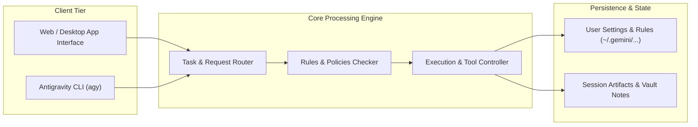

# Example Documentation & Diagram Proof

This file demonstrates that markdown documents and external notes are **completely exempt** from the 156-column CLI terminal limit. You can use full-width multi-branch diagrams, wide tables, and rich text without artificial wrapping.

---

## 1. Full-Width Mermaid Architecture Diagram (No Column Restrictions)

---

## 2. Unconstrained Data Table

| Module | Purpose | Active Policy | Terminal Constraint | File Constraint |
| :--- | :--- | :--- | :--- | :--- |
| **CLI Terminal** | Interactive terminal output | `< 156 cols` for diagrams | **Enforced** | N/A |
| **Markdown Notes** | Permanent documentation & vaults | Full rich layout | Exempt | **None (Full Width)** |
| **Source Code** | Project development | Native formatting | Exempt | **None** |

---

## 3. Verified Rules in Action

1. **Native Tool Creation**: This file was written directly using `write_to_file`, avoiding unnecessary PowerShell / shell wrapper prompts.
2. **Zero Text Wrapping**: Normal sentences and explanations span naturally across whatever editor width you view them in.
