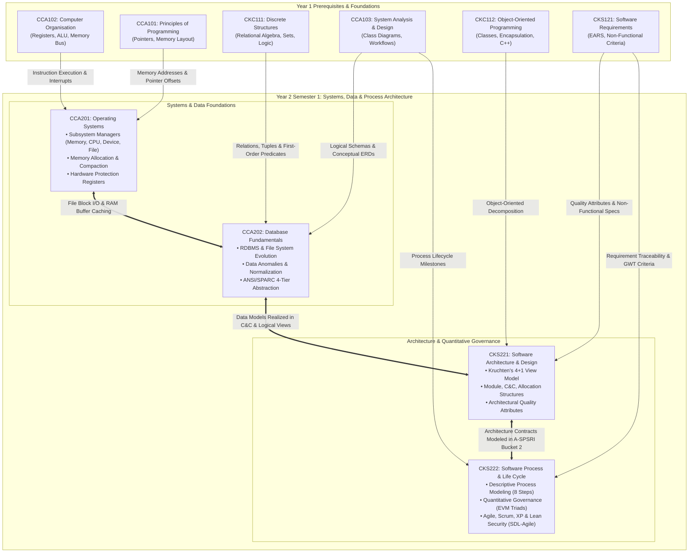
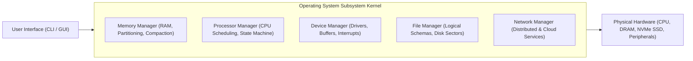
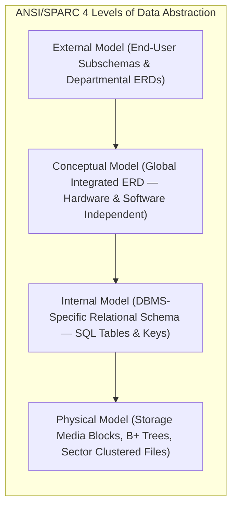
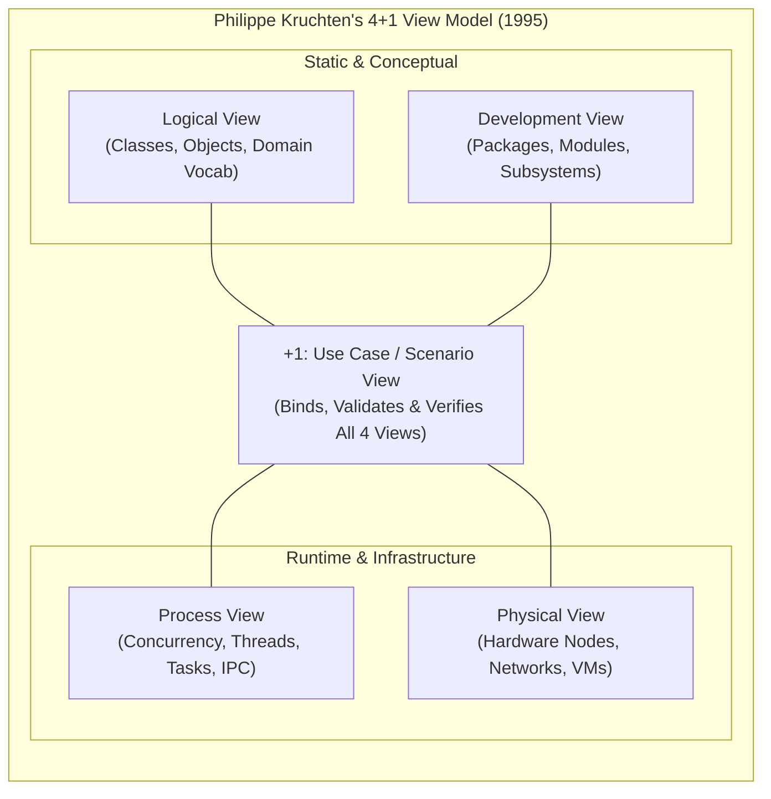
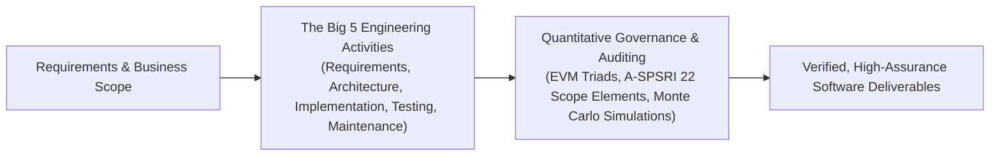
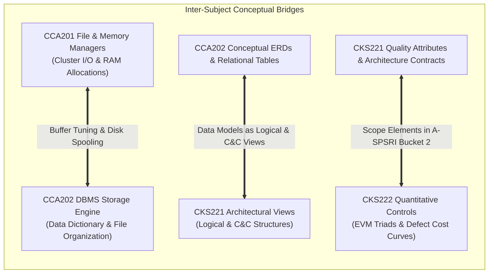

# 🧠 Computer Science & Software Engineering Master Knowledge Base — Year 2

> [!abstract] Overview & Navigation
> This master document provides a comprehensive, interconnected synthesis of the engineering principles, systems foundations, and quantitative governance frameworks established across **Year 2 Semester 1 (Y2S1)**.
> 
> Every section, concept, formula, and glossary term links directly into the exact chapters and heading anchors of your Year 2 vault notes:
> 
> ### 💻 Year 2 Semester 1 Core Systems & Architecture Stream:
> - **[[Y2S1/CCA201 Operating Systems|CCA201: Operating Systems]]**
> - **[[Y2S1/CCA202 Database Fundamentals|CCA202: Database Fundamentals]]**
> - **[[Y2S1/CKS221 Software Architecture and Design|CKS221: Software Architecture and Design]]**
> - **[[Y2S1/CKS222 Software Process and Life Cycle|CKS222: Software Process and Life Cycle]]**
> 
> ---
> > [!tip] 🔙 Foundational Curriculum Navigation
> > For Year 1 foundations (C++ programming, computer organization, discrete mathematics, system analysis, OOP, and software requirements), navigate to:
> > **[[knowledge_Y1|🧠 Year 1 Master Knowledge Base (Y1S1 & Y1S2 Foundations)]]**

---

## 🗺️ Academic Roadmap & Interdisciplinary Architecture (Year 2)

---

# 📘 Part I: Year 2 Semester 1 (Y2S1 Core Curriculum)

---

## 1. ⚙️ [[Y2S1/CCA201 Operating Systems|CCA201: Operating Systems]]

Focuses on the operating system as the chief software component arbitrating physical hardware resources (CPU, RAM, storage, peripherals), managing memory allocation and fragmentation, coordinating concurrent subsystems, and virtualizing the computing environment.

### 1.1 [[Y2S1/CCA201 Operating Systems#1.1 Fundamentals of Operating Systems|Core Concepts & Subsystem Architecture]]
- **Definition & Mandate**: [[Y2S1/CCA201 Operating Systems#1.1.1 What is an Operating System?|Operating System (Chief software component)]] responsible for resource virtualization, hardware protection, and policy enforcement (determining *who* gets *what*, *when*, and *how much*).
- **Core Subsystems**:
  - **Memory Manager**: [[Y2S1/CCA201 Operating Systems#1.2.1 Main Memory Manager|RAM validation, allocation, protection, and reclaiming]].
  - **Processor Manager**: [[Y2S1/CCA201 Operating Systems#1.2.2 Processor Manager|CPU traffic controller, thread context switching, and time slicing]].
  - **Device Manager**: [[Y2S1/CCA201 Operating Systems#1.2.3 Device Manager|Peripheral allocation, device driver binding, buffering, and spooling]].
  - **File Manager**: [[Y2S1/CCA201 Operating Systems#1.2.4 File Manager|Access permission enforcement, directory indexing, and disk cluster mapping]].
  - **Network Manager**: [[Y2S1/CCA201 Operating Systems#1.2.5 Network Manager & User Interface|Coordinating shared distributed memory, remote CPUs, and storage]].

### 1.2 [[Y2S1/CCA201 Operating Systems#1.3 Subsystem Cooperation: A Complete Interaction Lifecycle|Subsystem Cooperation Lifecycle]]
- **Nine-Step Execution Flow**: [[Y2S1/CCA201 Operating Systems#1.3 Subsystem Cooperation: A Complete Interaction Lifecycle|Mouse interrupt in Device Manager]] $\to$ UI translation $\to$ Processor Manager acknowledgement $\to$ File Manager sector lookup on disk $\to$ Memory Manager loading executable into RAM $\to$ CPU instruction execution $\to$ secondary storage writeback $\to$ UI rendering.

### 1.3 [[Y2S1/CCA201 Operating Systems#1.5 Taxonomy and Classifications of Operating Systems|OS Taxonomy & Classifications]]
- **Classification Criteria**: Categorized based on **Response Time** and **Method of Data Entry**:
  - **Batch Systems**: [[Y2S1/CCA201 Operating Systems#1.5.1 Batch Systems|Sequential job bundling; throughput-driven; hours to days turnaround]].
  - **Interactive Systems**: [[Y2S1/CCA201 Operating Systems#1.5.2 Interactive Systems|Direct terminal conversational engagement; time-sliced CPU sharing; seconds to minutes turnaround]].
  - **Real-Time Systems (RTOS)**: [[Y2S1/CCA201 Operating Systems#1.5.3 Real-Time Operating Systems (RTOS)|Predictable time-bounded determinism]]. Differentiated into **Hard RTOS** (deadline failure causes catastrophic system destruction) vs **Soft RTOS** (deadline failure results in degraded service quality).
  - **Hybrid & Embedded Systems**: [[Y2S1/CCA201 Operating Systems#1.5.4 Hybrid and Embedded Systems|Foreground interactive with background batch]]; [[Y2S1/CCA201 Operating Systems#1.5.4 Hybrid and Embedded Systems|Embedded ROM microkernels with non-interchangeable software]].

### 1.4 [[Y2S1/CCA201 Operating Systems#2.2 Four Foundational Early Memory Allocation Schemes|Foundational Memory Allocation Schemes]]
- **Single-User Contiguous**: [[Y2S1/CCA201 Operating Systems#2.2.1 Scheme 1: Single-User Contiguous Allocation|Monolithic single-job execution; zero multiprogramming support]].
- **Fixed Partitions (Static)**: [[Y2S1/CCA201 Operating Systems#2.2.2 Scheme 2: Fixed Partitions|Static division supporting multiprogramming]]. Suffers from **Internal Fragmentation** (wasted memory *inside* an allocated block due to job size mismatch).
- **Dynamic Partitions (Variable)**: [[Y2S1/CCA201 Operating Systems#2.2.3 Scheme 3: Dynamic Partitions|Jobs allocated exact memory requested]]. Eliminates internal fragmentation but produces **External Fragmentation** (scattered non-contiguous holes *between* allocated blocks preventing new jobs from loading).

### 1.5 [[Y2S1/CCA201 Operating Systems#2.3 Partition Allocation Algorithms: First-Fit vs. Best-Fit|Allocation Algorithms: First-Fit vs. Best-Fit]]
- **First-Fit Allocation**: [[Y2S1/CCA201 Operating Systems#2.3.1 Comparative Analysis: First-Fit vs. Best-Fit|Free list ordered by memory address (low to high)]]; allocates the very first block with sufficient size; fast execution with minimal scan overhead.
- **Best-Fit Allocation**: [[Y2S1/CCA201 Operating Systems#2.3.1 Comparative Analysis: First-Fit vs. Best-Fit|Free list ordered by block size (smallest to largest)]]; searches the entire table to allocate the smallest fitting block; minimizes immediate wasted space but creates microscopic unusable slivers and incurs high search overhead.

### 1.6 [[Y2S1/CCA201 Operating Systems#2.4 Deallocation Mechanics in Dynamic Partition Systems|Dynamic Deallocation Mechanics]]
- **The Three Topological Cases**:
  1. *Case 1 (Adjacent to 1 Free Block)*: [[Y2S1/CCA201 Operating Systems#2.4.1 Case 1: Joining Two Free Blocks|Merge released space with neighboring free block; adjust start address and sum sizes]].
  2. *Case 2 (Between 2 Free Blocks)*: [[Y2S1/CCA201 Operating Systems#2.4.2 Case 2: Joining Three Free Blocks|Consolidate all three blocks into one unified entry; mark redundant table slot as null]].
  3. *Case 3 (Isolated Block)*: [[Y2S1/CCA201 Operating Systems#2.4.3 Case 3: Deallocating an Isolated Block|Surrounded by busy allocations; allocate a fresh slot in the Free List]].

### 1.7 [[Y2S1/CCA201 Operating Systems#2.5 Relocatable Dynamic Partitions: Compaction & Hardware Registers|Compaction & Hardware Address Translation]]
- **Compaction (Defragmentation)**: [[Y2S1/CCA201 Operating Systems#2.5.1 Memory Compaction (Defragmentation)|Reclaiming external fragmentation by shifting active programs toward one boundary to create a single large free partition]].
- **Hardware Register Pair**:
  - **Bounds Register**: [[Y2S1/CCA201 Operating Systems#2.5.2 Hardware Assistance: Bounds & Relocation Registers|Stores maximum legal logical address; traps out-of-bounds violations to prevent memory corruption]].
  - **Relocation Register**: [[Y2S1/CCA201 Operating Systems#2.5.2 Hardware Assistance: Bounds & Relocation Registers|Stores physical base address]]; hardware dynamically computes:
    $$\text{Physical Address} = \text{Logical Address} + \text{Relocation Register}$$

### 1.8 [[Y2S1/CCA201 Operating Systems#Chapter 3: Virtual Memory Management: Paging, Segmentation, and Caching|Virtual Memory: Paged & Demand Paging Allocation]]
- **Paged Memory Allocation**: [[Y2S1/CCA201 Operating Systems#3.1 Paged Memory Allocation|Divides jobs into fixed Pages and RAM into Page Frames; eliminates external fragmentation and compaction; internal fragmentation confined to final page]].
- **Mathematical Address Translation**:
  $$\text{Page Number} = \left\lfloor \frac{\text{Logical Address}}{\text{Page Size}} \right\rfloor, \quad \text{Displacement} = \text{Logical Address} \pmod{\text{Page Size}}$$
  $$\text{Physical Address} = (\text{Page Frame Number} \times \text{Page Frame Size}) + \text{Displacement}$$
- **Demand Paging Mechanics**: [[Y2S1/CCA201 Operating Systems#3.2 Demand Paging Memory Allocation|Loads pages on demand; Page Fault interrupt triggers Page Fault Handler; PMT tracks Status, Modified (Dirty), and Referenced bits across 4 operational states; Thrashing occurs when excessive swapping starves the CPU]].

### 1.9 [[Y2S1/CCA201 Operating Systems#3.3 Page Replacement Policies|Page Replacement Policies & Memory Sizing]]
- **FIFO & Belady's Anomaly**: [[Y2S1/CCA201 Operating Systems#3.3.1 First-In, First-Out (FIFO) & Belady's Anomaly|Evicts oldest page in memory; susceptible to Belady's Anomaly where allocating more page frames increases page faults]].
- **Least Recently Used (LRU)**: [[Y2S1/CCA201 Operating Systems#3.3.2 Least Recently Used (LRU) Replacement|Stack algorithm immune to Belady's Anomaly; hardware approximations: Clock Replacement (circular queue with second-chance reference bit) and Bit-Shifting (8-bit aging register)]].
- **Denning's Working Set**: [[Y2S1/CCA201 Operating Systems#3.3.3 The Working Set Concept (Peter Denning)|Set of pages referenced during time window $\Delta$; prevents thrashing in time-sharing systems]].

### 1.10 [[Y2S1/CCA201 Operating Systems#3.4 Segmented Memory Allocation|Segmented & Segmented/Demand Paged Allocation]]
- **Segmented Memory Allocation**: [[Y2S1/CCA201 Operating Systems#3.4 Segmented Memory Allocation|Divides jobs into variable-sized logical code modules (main program, subroutines); 2D addressing $(\text{Segment}, \text{Displacement})$; SMT tracking; eliminates internal fragmentation but creates external fragmentation]].
- **Segmented Paging**: [[Y2S1/CCA201 Operating Systems#3.5 Segmented/Demand Paged Memory Allocation|Subdivides logical segments into equal-sized pages; unites logical modularity with zero external fragmentation; 3D addressing $(\text{Segment}, \text{Page}, \text{Displacement})$; four tables (JT, SMT, PMT, MMT); hardware accelerated by Associative Memory (TLB)]].
- **Cache Memory Models**: [[Y2S1/CCA201 Operating Systems#3.7 Cache Memory Architecture and Mathematical Models|L1/L2 on-chip SRAM; Hit Ratio and Average Memory Access Time (AMAT)]]:
  $$\text{AMAT} = \text{Avg\_Cache\_AccessTime} + (1 - \text{Hit Ratio}) \times \text{Avg\_MainMem\_AccTime}$$

### 1.11 [[Y2S1/CCA201 Operating Systems#Chapter 4: Processor Management: Job Scheduling, Process Dispatching, and State Models|Processor Management & Multi-Level Scheduling]]
- **Core Entities**: [[Y2S1/CCA201 Operating Systems#4.1.2 Foundational Definitions and Taxonomies|Processor (hardware) vs. Program/Job (passive file) vs. Process/Task (active entity) vs. Thread (schedulable execution unit)]].
- **Interrupts & Context Switching**: [[Y2S1/CCA201 Operating Systems#4.1.3 Interrupts and Context Switching|Hardware traps saving/restoring CPU registers and PC into PCB; dual-task analogy]].
- **Hierarchical Schedulers**: [[Y2S1/CCA201 Operating Systems#4.2 The Two-Tier (and Three-Tier) Scheduling Hierarchy|Job Scheduler (high-level spooler-to-READY admission), Process Scheduler (low-level CPU dispatcher), and Mid-Level Scheduler (swapping overloaded processes to disk)]].
- **State Models**:
  - *Process State Model (5 States)*: [[Y2S1/CCA201 Operating Systems#4.3 Job and Process State Machine|HOLD $\to$ READY $\to$ RUNNING $\to$ WAITING $\to$ FINISHED]].
  - *Thread State Model (5 States)*: [[Y2S1/CCA201 Operating Systems#4.4 Thread States and OS Thread Lifecycle|READY, RUNNING, WAITING, DELAYED, BLOCKED]].
- **Control Blocks & Queues**: [[Y2S1/CCA201 Operating Systems#4.5 Process Control Blocks (PCB) and Queue Topologies|Process Control Block (PCB) and TCB; system queues operate as lightweight linked lists of PCB pointers]].
- **Scheduling Policies**: [[Y2S1/CCA201 Operating Systems#4.6 Process Scheduling Policies and Optimization Criteria|Six criteria: Throughput, Turnaround, Response, Waiting, CPU Utilization, Fairness; Preemptive (time-sliced quantum) vs. Non-Preemptive policies]].

---

## 2. 🗄️ [[Y2S1/CCA202 Database Fundamentals|CCA202: Database Fundamentals]]

Covers the evolution of enterprise data management from traditional file processing to modern relational and NoSQL architectures, business rules translation, relational schema design, and the ANSI/SPARC 4-tier data abstraction model.

### 2.1 [[Y2S1/CCA202 Database Fundamentals#1.1 The Ubiquity of Databases: Everyday Systems & Operations|Ubiquity of Databases & Core Engineering Mandates]]
- **Everyday Systems**: Modern digital society relies on databases as persistent operational backbones across e-commerce, social media, flight/hotel booking, and healthcare/pharmacy workflows.
- **The Five Core Mandates**: [[Y2S1/CCA202 Database Fundamentals#1.1.1 The Five Core Operational Mandates: Why Databases Are Needed|Safe durable storage]], [[Y2S1/CCA202 Database Fundamentals#1.1.1 The Five Core Operational Mandates: Why Databases Are Needed|sub-second indexed searching]], [[Y2S1/CCA202 Database Fundamentals#1.1.1 The Five Core Operational Mandates: Why Databases Are Needed|accurate synchronized updates]], [[Y2S1/CCA202 Database Fundamentals#1.1.1 The Five Core Operational Mandates: Why Databases Are Needed|chronological transaction audit logging (WAL)]], and [[Y2S1/CCA202 Database Fundamentals#1.1.1 The Five Core Operational Mandates: Why Databases Are Needed|integrity constraint enforcement]].

### 2.2 [[Y2S1/CCA202 Database Fundamentals#1.2 Data vs. Information: The Foundations of Knowledge|Data, Information & Metadata Architecture]]
- **Data vs. Information**: [[Y2S1/CCA202 Database Fundamentals#1.2 Data vs. Information: The Foundations of Knowledge|Raw Data (atomic unprocessed facts)]] transformed via contextual processing into [[Y2S1/CCA202 Database Fundamentals#1.2 Data vs. Information: The Foundations of Knowledge|Information (accurate, relevant, and timely insights)]] within the DIKW hierarchy.
- **Database & Metadata**: A database stores end-user data alongside [[Y2S1/CCA202 Database Fundamentals#1.3 Introducing the Database & The Foundational Role of Metadata|Metadata (data about data)]], manifesting across three tiers:
  1. *Tabular / Spreadsheet Tier*: Column schema definitions & cell notes vs row data values.
  2. *Operating System / File Tier*: File attributes (type, size, dimensions) vs raw pixel/binary payload.
  3. *DBMS Architecture Tier*: [[Y2S1/CCA202 Database Fundamentals#1.3.2 Concrete Multi-Tier Manifestations of Metadata vs. Data|Data Dictionary (system catalog)]] vs underlying user tables.

### 2.3 [[Y2S1/CCA202 Database Fundamentals#1.4 Database Management Systems (DBMS): Architecture, Roles & Intermediation|DBMS Architecture, Roles & Intermediation]]
- **The Intermediary Role**: The DBMS shields applications from physical storage complexities, coordinates concurrent sharing, translates declarative queries into physical disk I/O, and presents unified logical views.
- **Departmental Roles**: Arbitrates distinct role-based access for [[Y2S1/CCA202 Database Fundamentals#1.4.2 Departmental User Roles & Centralized DBMS Access|Payroll Officers (staff details), Customer Service Advisors (accounts), and Sales Managers (inventory)]].
- **DBMS Interaction Subsystems**: [[Y2S1/CCA202 Database Fundamentals#1.4.4 The DBMS Interaction Model & Internal Subsystems|Query Processing, Storage & Buffer Management, Security/RBAC, Backup & Crash Recovery, Concurrency Control, Transaction ACID Management, and Data Dictionary Catalog]].
- **Three-Tier Advantages**: [[Y2S1/CCA202 Database Fundamentals#1.4.5 Comprehensive Advantages of Implementing a DBMS|1. Data integration & reduced inconsistency; 2. Increased end-user productivity; 3. Improved sharing, security, access, decision-making, and data quality]].

### 2.4 [[Y2S1/CCA202 Database Fundamentals#1.5 Comprehensive Taxonomy and Classification of Databases|Taxonomy and Classifications of Databases]]
- **Five Classification Dimensions**:
  - *User Concurrency*: Single-User (Desktop) vs Multi-User (Workgroup $< 50$ vs Enterprise $> 1000$).
  - *Geographic Location*: Centralized vs Distributed vs Cloud-Native Managed Services (SLA-driven).
  - *Data Domain*: General-Purpose (multidisciplinary, e.g. LexisNexis, ProQuest) vs Discipline-Specific (GIS, CompuStat, GenBank).
  - *Intended Data Usage*: Operational (OLTP - day-to-day transactions) vs Analytical (OLAP - multidimensional cubes, Data Warehouses, Business Intelligence).
  - *Data Structuring*: Unstructured (raw audio/video) vs Structured (relational tables) vs Semi-Structured (XML, JSON).

### 2.5 [[Y2S1/CCA202 Database Fundamentals#1.6 The Critical Importance of Database Design & Normalization Case Study|Database Design Imperatives & Normalization Case Study]]
- **The Five Fatal Flaws of Poor Flat Design**: Walkthrough of Figure 1.5 employee skills table:
  1. *Orphan Records / Blank Rows*: Violates entity integrity.
  2. *Non-Atomic Name Formatting*: Inconsistent string conventions prevent alphabetical sorting by surname.
  3. *Scattered Multi-Valued Attributes*: Repeating skills across columns (`Skill1`, `Skill2`, `Skill3`) forces cumbersome `OR` queries.
  4. *Semantic Inconsistencies & Synonyms*: Discrepant naming (`Basic Database Manipulation` vs `Basic DB manipulation`) breaks aggregations.
  5. *Schema Rigidity & Column Bloat*: Adding a 4th certification forces schema alterations, sparse nulls, and application rewrites.
- **Relational Normalization Resolution**: Decomposing into database `Programmer` with [[Y2S1/CCA202 Database Fundamentals#1.6.2 The Relational Solution: Normalization into Database Programmer|EMPLOYEE, standardized SKILL catalog (13 codes), and CERTIFIED associative bridge entity]].

### 2.6 [[Y2S1/CCA202 Database Fundamentals#1.7 Evolution of Data Processing: From File Systems to Databases|File System Evolution & Foundational Terminology]]
- **Historical Timeline**: [[Y2S1/CCA202 Database Fundamentals#1.7 Evolution of Data Processing: From File Systems to Databases|Manual File Systems (1950s) ➔ Computerized 3GL File Systems (1960s) ➔ Spreadsheet Redux (1980s) ➔ Modern Centralized DBMS (1970s-Present)]].
- **Siloed Departmental Architecture**: Separate departmental files (Sales vs. Personnel) creating isolated islands of information.
- **Foundational File Terminology**: [[Y2S1/CCA202 Database Fundamentals#1.7.2 Foundational File Processing Terminology|Data (raw symbols) ➔ Field (meaningful attribute) ➔ Record (logically connected tuple) ➔ File (collection of related records)]].

### 2.7 [[Y2S1/CCA202 Database Fundamentals#1.8 Critical Flaws of File Systems & The Three Fundamental Data Anomalies|File System Pitfalls & The Three Fundamental Data Anomalies]]
- **Dependence Hazards**:
  - *Structural Dependence*: Hardcoded file offsets require rewriting all application programs upon schema alterations.
  - *Data Dependence*: Code coupled to storage formatting (byte order, integer width).
- **Data Redundancy Triad**: Causes poor data security, severe data inconsistency, and elevated data-entry errors.
- **The Three Critical Data Anomalies**:
  1. *Update Anomaly*: Updating redundant data inconsistently (e.g., Leah's phone typo `615-882-2144` vs `615-882-1244`) creates contradictory records.
  2. *Insertion Anomaly*: Inability to record an independent entity (e.g., new agent Mahan) without dummy customer policy data.
  3. *Deletion Anomaly*: Deleting one record (customer Anne) inadvertently purges the sole record of the associated agent.

### 2.8 [[Y2S1/CCA202 Database Fundamentals#1.9 Modern Database Systems Architecture & The Five Environment Components|Database System Environment & DBMS Core Functions]]
- **The Five Major Environment Components**:
  1. *Hardware*: Physical servers, NVMe storage arrays, networking.
  2. *Software*: Operating system, DBMS engine, utilities, application programs.
  3. *People*: System Administrator, DBA, Database Designer, Analysts/Programmers, End Users.
  4. *Procedures*: Security rules, operational standards, backup/recovery protocols.
  5. *Data*: End-user tables and integrated system catalog metadata.
- **The Nine Core DBMS Functions**: [[Y2S1/CCA202 Database Fundamentals#1.10 The Nine Core Functions of a Modern DBMS|1. Data Dictionary Management; 2. Storage Management & Performance Tuning; 3. Data Transformation & Presentation; 4. Security Management; 5. Multi-User Access Control; 6. Backup & Recovery Management; 7. Data Integrity Management; 8. Database Access Languages & APIs (SQL DDL/DML); 9. Database Communication Interfaces]].

### 2.9 [[Y2S1/CCA202 Database Fundamentals#1.11 Inherent Trade-Offs and Disadvantages of Database Systems|Strategic Trade-Offs of Database Systems]]
- **Inherent Trade-Offs**: [[Y2S1/CCA202 Database Fundamentals#1.11 Inherent Trade-Offs and Disadvantages of Database Systems|Increased licensing costs, DBA management complexity, continuous patching/currency, vendor lock-in, and rapid hardware upgrade cycles]].

### 2.10 [[Y2S1/CCA202 Database Fundamentals#2.1 Fundamentals of Data Modeling & The Importance of Blueprints|Data Modeling Foundations & Core Building Blocks]]
- **Data Modeling Foundations**: An iterative, progressive engineering process creating abstract graphical blueprints of real-world constructs; essential for communication between non-technical stakeholders and database architects.
- **The Four Semantic Data Models**: Relational (tabular), Entity-Relationship (conceptual ERD standard), Object-Based (classes & encapsulation), and Semi-Structured (XML & JSON markup).
- **Core Building Blocks**:
  - *Entities*: Unique, distinct real-world objects or abstractions (physical like `CUSTOMER` vs abstract like `FLIGHT_ROUTE`).
  - *Attributes*: Characteristics of entities (equivalent to fields; e.g., `AGENT_CODE`, `AGENT_PHONE`).
  - *Relationships*: Bidirectional associations ($1:M$, $M:N$, $1:1$).
  - *Constraints*: Explicit integrity restrictions placed on data (e.g., student CGPA between $0.00$ and $4.00$; working hours $\ge 0.00$).

### 2.11 [[Y2S1/CCA202 Database Fundamentals#2.3 Business Rules: Formulation, Governance & Structural Translation|Business Rules: Governance, Naming Conventions & Structural Translation]]
- **Business Rule Definition**: Brief, precise, unambiguous organizational policy statements establishing the entities, attributes, relationships, and constraints of a problem domain.
- **Five Primary Sources**: Company managers, policy makers, department managers, written operational documentation, and direct end-user interviews.
- **Structural Linguistic Decomposition**:
  - Nouns $\to$ **Entities** (e.g., `STUDENT`, `SUBJECT`).
  - Verbs $\to$ **Relationships** (e.g., `registers`, `teaches`).
  - Descriptors / Adjectives $\to$ **Attributes** and **Constraints**.
- **Two-Question Diagnostic**: Determining connectivity ($1:M, M:N, 1:1$) by interrogating bidirectional cardinality:
  1. *How many instances of B are related to one instance of A?*
  2. *How many instances of A are related to one instance of B?*
- **Naming Conventions**: Descriptive, unambiguous, and standardized terminology (e.g., `STUDENT_FNAME`, `BOOK_ISBN`) promoting self-documenting schemas.

### 2.12 [[Y2S1/CCA202 Database Fundamentals#2.4 Chronological Evolution of Data Models: Early Navigational Models|Early Navigational Models: Hierarchical & Network Architectures]]
- **Hierarchical Model (1960s - North American Rockwell / IBM IMS)**:
  - *Inverted Tree Structure*: Root segment with parent-child segments; strictly $1:M$ relationships; each child has exactly one parent.
  - *Pavement Case Study*: `Pavement Improvement` $\to$ `Reconstruction`, `Maintenance`, `Rehabilitation` $\to$ `Routine`, `Corrective`, `Preventive`.
  - *Trade-offs*: Promotes 1:M conceptual simplicity and DBMS-enforced integrity; but requires low-level physical disk knowledge, rigid pointer navigation, and lacks ad-hoc queries.
- **Network Model (Late 1960s – 1970s - CODASYL DBTG)**:
  - *Arbitrary Graph Topology*: Permits record types to have multiple parents, natively supporting complex $M:N$ associations.
  - *Maintenance Case Study*: `Joint Seal` and `Crack Seal` shared across `Rigid Pavement` and `Flexible Pavement`, converging onto `Silicone Sealant` and `Asphalt Sealant`.
  - *DBTG Standard Concepts*: Introduced foundational constructs still used today: **Schema** (global DBA view), **Subschema** (application view), **DDL** (`CREATE, ALTER, DROP`), and **DML** (`SELECT, INSERT, UPDATE, DELETE`).

### 2.13 [[Y2S1/CCA202 Database Fundamentals#2.5 The Relational Database Model & SQL Architecture|The Relational Database Model & SQL Architecture]]
- **Mathematical Foundations (E.F. Codd, 1970)**: Represents data logically in two-dimensional **relations (tables)** of intersecting rows (**tuples**) and columns (**attributes**), completely isolating users from physical disk layouts.
- **Shared Common Attributes**: Tables are linked logically through common keys (e.g., `AGENT` $\parallel$——o{ `CUSTOMER` linked via `AGENT_CODE`), promoting complete **structural independence**.
- **Three-Tier Application Architecture**: End-user Interface $\leftrightarrow$ Independent Stored Tables $\leftrightarrow$ Declarative SQL Query Engine.
- **Trade-offs**: Tabular simplicity and declarative SQL ad-hoc querying; requires substantial hardware/system software overhead and risk of unmanaged end-user application sprawl.

### 2.14 [[Y2S1/CCA202 Database Fundamentals#2.6 The Entity-Relationship (ER) Model & Notation Systems|The Entity-Relationship (ER) Model & Notation Systems]]
- **Conceptual Visual Bridge (Peter Chen, 1976)**: Graphical representation of entities, attributes, and relationships (connectivity) complementing the relational model.
- **Notation Master Comparison across Connectivities**:
  - *One-to-Many (1:M)*: Chen (`1` to `M` diamond `paints`) vs. Crow's Foot (`||` to `}|` `PAINTER` paints `PAINTING`) vs. UML Class (`1..1` to `1..*`).
  - *Many-to-Many (M:N)*: Chen (`M` to `N` diamond `learns`) vs. Crow's Foot (`}|` to `|{` `EMPLOYEE` learns `SKILL`) vs. UML Class (`1..*` to `1..*`).
  - *One-to-One (1:1)*: Chen (`1` to `1` diamond `manages`) vs. Crow's Foot (`||` to `||` `EMPLOYEE` manages `STORE`) vs. UML Class (`1..1` to `1..1`).
- **Trade-offs**: Highly effective visual communication tool integrated with relational designs; limited native constraint expression and information loss if attributes are suppressed to prevent crowded diagrams.

### 2.15 [[Y2S1/CCA202 Database Fundamentals#2.7 Object-Oriented (OODM) & Extended Relational (ORDBMS) Models|Object-Oriented (OODM) & Extended Relational (ORDBMS) Models]]
- **Object-Oriented Data Model (OODM)**:
  - *Objects & Methods*: Combines data attributes and operational behavior (methods: `hire()`, `fire()`, `assignproject()`) within encapsulated objects.
  - *Class Hierarchy & Inheritance*: Upside-down tree where each class has only one parent; objects inherit parent attributes and methods.
  - *UML Class Diagrams & Multiplicity Ranges*: Association multiplicity explicitly specified: Optional ($0..1$), Exactly One ($1$ or $1..1$), Zero or more ($0..*$ or $*$), One or more ($1..*$), Specific bounded range ($2..6$).
- **Object/Relational Database Management Systems (ORDBMS / ERDM)**: Extended relational model blending OO inheritance and complex objects with relational table simplicity; native support for semi-structured **XML** (`<studentsList>`, `<student id="...">`) for interoperable data exchange.

### 2.16 [[Y2S1/CCA202 Database Fundamentals#2.8 The Big Data Era & NoSQL Database Architectures|The Big Data Era & NoSQL Database Architectures]]
- **The Big Data Imperative**: Addressing the **3 Vs** (Volume: massive petabyte scale; Velocity: real-time streaming processing; Variety: highly disparate formats).
- **NoSQL Architectural Characteristics**: Non-relational, distributed cluster architectures; horizontal scale-out; eventual consistency prioritized over strict ACID transactions; native support for sparse data via **Key-Value stores**.
- **Case Study (Trucks-R-Us Driver 2732)**: Contrasts traditional relational tables (plagued by sparse empty `NULL` columns for variable driver certifications `CERT1`, `CERT2`, `CERT3`) against key-value pairs (`(2732, CERT1, 80)`, `(2732, CERT3, 95)`), achieving maximum storage efficiency and schema agility.
- **Big Data Technology Ecosystem**: Interconnected stack uniting **Hadoop**, **HDFS (Hadoop Distributed File System)** for fault-tolerant distributed storage, **MapReduce** for parallel batch compute, and **NoSQL** engines.

### 2.17 [[Y2S1/CCA202 Database Fundamentals#2.9 Master Comparative Synthesis of Data Models|Master Comparative Synthesis of Data Models]]
- **Semantics vs. Timeline Evolution**: Progression from low semantics/structural dependency (Hierarchical & Network, 1960s) $\to$ Structural independence with ad-hoc SQL (Relational, 1970) $\to$ Visual conceptual abstraction (ER, 1976) $\to$ Rich semantic objects & XML exchange (OO & O/R, 1985–1990s) $\to$ High-performance schema-less Big Data stores (NoSQL, 2009).
- **Master Terminology Cross-Reference Across Paradigms**:
  - *Vendor Filing Cabinet*: Real-World Group $\to$ File Processing **File** $\to$ Hierarchical **Segment type** $\to$ Network **Record type** $\to$ Relational **Table** $\to$ ER **Entity set** $\to$ OO **Class**.
  - *Global Supplies Inc.*: Real-World Single Entity $\to$ File Processing **Record** $\to$ Hierarchical **Segment occurrence** $\to$ Network **Current record** $\to$ Relational **Row (Tuple)** $\to$ ER **Entity occurrence** $\to$ OO **Object instance**.
  - *Contact Name*: Real-World Property $\to$ File Processing **Field** $\to$ Hierarchical **Segment field** $\to$ Network **Record field** $\to$ Relational **Table attribute** $\to$ ER **Entity attribute** $\to$ OO **Object attribute**.
  - *Vendor ID (G12987)*: Real-World Identifier $\to$ File Processing **Index** $\to$ Hierarchical **Sequence field** $\to$ Network **Record key** $\to$ Relational **Primary Key** $\to$ ER **Entity identifier** $\to$ OO **Object identifier (OID)**.

### 2.18 [[Y2S1/CCA202 Database Fundamentals#2.10 The ANSI/SPARC Four Levels of Data Abstraction|The ANSI/SPARC Four Levels of Data Abstraction]]
- **Degrees of Abstraction Spectrum**:
  - *High Abstraction*: **Object-Oriented Model** (Hardware-Independent, Software-Independent).
  - *Medium Abstraction*: **Relational Model** (Hardware-Independent, Software-Dependent).
  - *Low Abstraction*: **Network & Hierarchical Models** (Hardware-Dependent, Software-Dependent).
- **The Four Tier Architecture**:
  1. *External Model*: Tailored end-user views and departmental subschemas (e.g., Student Registration View with $0..6$ classes per student and $35$ seat limit; Class Scheduling View with $0..3$ classes per professor).
  2. *Conceptual Model*: Global, enterprise-wide integrated schema; hardware and software independent; produced via **logical design**.
  3. *Internal Model*: Concrete mapping of conceptual schema to chosen DBMS constructs (e.g., SQL DDL `CREATE TABLE PROFESSOR`, `CLASS`, `ROOM`, `COURSE`); software dependent, hardware independent.
  4. *Physical Model*: Lowest level governing disk blocks, sector geometry, and secondary storage media access paths; hardware and software dependent.
- **Architectural Data Independence Principles**:
  - *Logical Data Independence*: Modifying internal schema (table structures, indexes) does not alter the conceptual model or external user views.
  - *Physical Data Independence*: Modifying physical storage devices (NVMe migrations, block sizes) does not impact the internal schema or SQL queries.

### 2.19 [[Y2S1/CCA202 Database Fundamentals#Chapter 3: The Relational Database Model: Structure, Operators, and Integrity|The Relational Database Model: Structure, Operators, and Integrity]]
- **Relational Architecture & Relvars**: [[Y2S1/CCA202 Database Fundamentals#3.1 Logical View of Data and Relational Table Anatomy|Logical representation decoupling storage physics]]; [[Y2S1/CCA202 Database Fundamentals#3.1.2 The TinyCollege STUDENT Table Case Study|TinyCollege STUDENT Case Study (12 attributes, 8 tuples, domain boundaries)]]; [[Y2S1/CCA202 Database Fundamentals#3.1.3 Entities, Entity Types, and Entity Sets|Taxonomy of Entity, Entity Type, and Entity Set]]; [[Y2S1/CCA202 Database Fundamentals#3.1.5 Relation vs. Relvar (C.J. Date Formulation)|C.J. Date Relvar container vs. immutable relation value dynamics]].
- **Determination & Key Taxonomy**:
  - *Determination & Functional Dependence*: [[Y2S1/CCA202 Database Fundamentals#3.2.1 The Concept and Mathematical Foundations of Determination|Principle of determination ($A \to B$) and asymmetry]]; [[Y2S1/CCA202 Database Fundamentals#3.2.2 Functional Dependence vs. Full Functional Dependence|Full Functional Dependence where dependent requires complete composite determinant (e.g. `(StudentID, CourseID) -> CourseGrade`)]].
  - *Key Hierarchy*: [[Y2S1/CCA202 Database Fundamentals#3.2.3 Comprehensive Taxonomy of Relational Database Keys|Concentric ring model: Superkey (identifies row) $\supset$ Candidate Key (minimal/irreducible) $\supset$ Primary Key (selected identifier)]]; [[Y2S1/CCA202 Database Fundamentals#3.2.4 Real-World Case Walkthrough: The TinyCollege and Employee Key Analysis|Foreign Key (referential link), Secondary Key (search index)]]; [[Y2S1/CCA202 Database Fundamentals#3.2.5 Concept Check Exercises: Superkeys vs. Candidate Keys (With Solutions)|Superkey vs Candidate Key evaluations]].
- **Relational Integrity Rules & Null Management**:
  - *Entity Integrity*: [[Y2S1/CCA202 Database Fundamentals#3.3.1 Entity Integrity: Primary Key Requirements and Uniqueness|Primary key must be strictly unique and non-null]].
  - *Referential Integrity*: [[Y2S1/CCA202 Database Fundamentals#3.3.2 Referential Integrity: Foreign Keys and Parent-Child Coordination|Foreign key must match parent PK or be null]]; [[Y2S1/CCA202 Database Fundamentals#3.3.3 The Concept of Controlled Redundancy: Why Common Attributes Make RDBMS Work|Controlled redundancy enabling relational links]].
  - *Integrity Diagnostics & Null Flags*: [[Y2S1/CCA202 Database Fundamentals#3.3.4 Diagnosing Referential Integrity: Real-World Case Studies|Detecting phantom references (Order #003) vs permissible nulls (Customer Olowski)]]; [[Y2S1/CCA202 Database Fundamentals#3.3.5 Proper Handling of Null Values: Operational Problems, Flags, and Table Constraints|Dummy variable flags (`AGENT_CODE = -99`), `NOT NULL`, and `UNIQUE` constraints]].
- **Relational Algebra Operators (Closure Property)**:
  - *Theoretical Basis*: [[Y2S1/CCA202 Database Fundamentals#3.4.1 Theoretical Foundations of Relational Algebra and the Property of Closure|Property of Closure producing new relations for query chaining]].
  - *Unary Operators*: [[Y2S1/CCA202 Database Fundamentals#3.4.2 Unary Operators: SELECT (Sigma) and PROJECT (Pi) Walkthroughs|SELECT / RESTRICT ($\sigma$ horizontal row slice) and PROJECT ($\pi$ vertical attribute slice)]].
  - *Binary Set Operators*: [[Y2S1/CCA202 Database Fundamentals#3.4.3 Binary Set Operators and Union-Compatibility: UNION, INTERSECT, and DIFFERENCE|UNION ($\cup$), INTERSECT ($\cap$), and DIFFERENCE ($-$) requiring strict Union-Compatibility]].
  - *Product & Joins*: [[Y2S1/CCA202 Database Fundamentals#3.4.4 The PRODUCT (Cartesian Product) Operator Mechanics|PRODUCT ($\times$ yielding $|R| \times |S|$ rows)]]; [[Y2S1/CCA202 Database Fundamentals#3.4.5 The Family of JOIN Operators: Inner vs. Outer Joins|Join taxonomy]]; [[Y2S1/CCA202 Database Fundamentals#3.4.6 The Three-Stage Mathematical Mechanics of a Natural Join|Natural Join 3-stage derivation: Product $\to$ Select common key $\to$ Project duplicate column]]; [[Y2S1/CCA202 Database Fundamentals#3.4.7 EQUIJOIN and THETA JOIN Comparisons|Equijoin ($=$) retaining duplicate columns vs. Theta Join ($\bowtie_\theta$ inequalities)]]; [[Y2S1/CCA202 Database Fundamentals#3.4.8 OUTER JOINS for Diagnosing Referential Integrity Anomalies|Left/Right Outer Joins preserving unmatched tuples with NULLs to audit broken foreign keys]].
  - *Division Operator*: [[Y2S1/CCA202 Database Fundamentals#3.4.9 The DIVIDE Operator (Division) and Universal Qualification Queries|DIVIDE ($\div$) resolving universal qualification ("all") queries]].
- **Metadata, Relationship Implementation & Indexing**:
  - *Data Dictionary & System Catalog*: [[Y2S1/CCA202 Database Fundamentals#3.5.1 The Data Dictionary: "The Database Designer's Database"|Data dictionary recording types, formats, nullability and constraints]]; [[Y2S1/CCA202 Database Fundamentals#3.5.2 The System Catalog: Structural and Environmental Metadata|System catalog managing dynamic metadata queryable via SQL]]; [[Y2S1/CCA202 Database Fundamentals#3.5.3 Resolving Semantic Confusion: Homonyms and Synonyms|Homonyms vs. Synonyms disambiguation]].
  - *Relationship Implementation Patterns*: [[Y2S1/CCA202 Database Fundamentals#3.5.4 Implementing 1:M Relationships: The Painter and Painting Case Study|1:M (PK on "1" side becomes FK on "many" side)]]; [[Y2S1/CCA202 Database Fundamentals#3.5.5 Implementing 1:1 Relationships: The Professor and Department Null-Minimization Principle|1:1 Null-Minimization Principle (placing FK in DEPARTMENT)]]; [[Y2S1/CCA202 Database Fundamentals#3.5.6 Resolving M:N Relationships: Bridge Entities and Composite Keys|M:N resolution via Bridge Entity with Composite PK (`ENROLL`)]].
  - *Historical Accuracy & Indexing*: [[Y2S1/CCA202 Database Fundamentals#3.6.1 Controlled Redundancy for Historical Accuracy: The Order Invoice Line Price Case Study|Controlled redundancy freezing past transaction pricing (`LINE_PRICE` vs `PROD_PRICE`)]]; [[Y2S1/CCA202 Database Fundamentals#3.6.2 Physical and Logical Indexing Mechanics: Keys, Pointers, and B-Trees|B+ Tree index keys and storage pointers transforming $O(N)$ linear scans into $O(\log N)$ searches]]; [[Y2S1/CCA202 Database Fundamentals#3.6.3 Unique vs. Non-Unique Indexes: Structure and Performance Impact|Unique vs. Non-Unique Index pointer structures]].
  - *Codd's 12 Rules*: [[Y2S1/CCA202 Database Fundamentals#3.7 Dr. E. F. Codd's Twelve Relational Database Rules (1985)|Dr. E. F. Codd's 12 Relational Database Rules (Rule 0 through Rule 12) benchmark]].

### 2.20 [[Y2S1/CCA202 Database Fundamentals#Chapter 4: Entity-Relationship (ER) Modeling: Concepts, Cardinality, and Schema Design|Entity-Relationship (ER) Modeling: Concepts, Cardinality, and Schema Design]]
- **ER Model vs. Relational Model**: [[Y2S1/CCA202 Database Fundamentals#4.1 Foundations of the Entity-Relationship (ER) Model|Conceptual visual abstraction vs. logical relational implementation]]; [[Y2S1/CCA202 Database Fundamentals#4.1.2 Side-by-Side Implementation Comparison: Sales Transactions in RDBMS vs. ERD|Sales transactions in RDBMS (Transaction, Product, Customer tables) vs. Crow's Foot ERD]]; [[Y2S1/CCA202 Database Fundamentals#4.1.3 Relational Keys in ER Schema Implementation: Candidate, Alternate, and Superkeys|Candidate, Alternate, Primary, and Superkeys]]; [[Y2S1/CCA202 Database Fundamentals#4.1.4 SQL Table Definition and Unique Constraints|SQL `PRIMARY KEY` vs `UNIQUE` constraints (Roll_number vs Citizen_ID)]]; [[Y2S1/CCA202 Database Fundamentals#4.1.5 Entity Definitions: Entity Set vs. Entity Instance|Entity Set (Table) vs Entity Instance (Row)]].
- **Attribute Taxonomy & Multi-Valued Resolution**:
  - *Core Attribute Dimensions*: [[Y2S1/CCA202 Database Fundamentals#4.2.1 Required vs. Optional Attributes (The Student Entity Case Study)|Required vs. Optional (Chen ovals vs. Crow's Foot)]]; [[Y2S1/CCA202 Database Fundamentals#4.2.2 Attribute Domains and Identifiers: Single and Composite Identifiers|Single vs. Composite Identifiers (`CLASS_CODE` vs `CRS_CODE + CLASS_SECTION`)]]; [[Y2S1/CCA202 Database Fundamentals#4.2.3 Structural Decomposition: Simple vs. Composite Attributes|Simple vs. Composite attributes (Address, Phone Number)]]; [[Y2S1/CCA202 Database Fundamentals#4.2.4 Value Cardinality: Single-Valued vs. Multi-Valued Attributes|Single-Valued vs. Multi-Valued attributes]].
  - *Resolving Multi-Valued Attributes*: [[Y2S1/CCA202 Database Fundamentals#4.2.5 Resolving Multi-Valued Attributes: Structural Rigidity vs. Relational Child Entities|Option 1 multiple columns (structural rigidity flaw) vs. Option 2 1:M identifying child entity `CAR_COLOR` (optimal standard)]].
  - *Derived Attributes & Trade-Offs*: [[Y2S1/CCA202 Database Fundamentals#4.2.6 Derived and Computed Attributes (The Employee Age Case Study)|Derived attributes (`EMP_AGE = CurrentDate - DOB`)]]; [[Y2S1/CCA202 Database Fundamentals#4.2.7 Storage Trade-Offs: The Stored vs. Not Stored Decision Matrix|Stored vs. Not Stored decision matrix (CPU vs storage vs freshness)]]; [[Y2S1/CCA202 Database Fundamentals#4.2.8 Practice Exercise Walkthrough: Boston College Student-Professor Advising System|Boston College advising exercise]].
- **Relationships, Connectivity & Existence**:
  - *Semantics & Directionality*: [[Y2S1/CCA202 Database Fundamentals#4.3.1 Relationship Semantics: Participants, Verbs, and Bidirectional Traversal|Active verbs and mandatory bidirectional operations]]; [[Y2S1/CCA202 Database Fundamentals#4.3.2 Establishing Connectivities: The Division Management Business Rule Dilemma|The Division Management business rule dilemma (1:1 vs 1:M)]].
  - *Cardinality Bounds*: [[Y2S1/CCA202 Database Fundamentals#4.3.3 Connectivity vs. Cardinality: Quantifying Minimum and Maximum Bounds|$(min, max)$ constraints (`PROFESSOR teaches CLASS (1, 4)`)]].
  - *Existence Independence*: [[Y2S1/CCA202 Database Fundamentals#4.3.4 Existence Dependence vs. Existence Independence: Strong vs. Weak Entities|Existence-dependent vs. Strong/Regular entities]]; [[Y2S1/CCA202 Database Fundamentals#4.3.5 The Industrial Parts Scenario: In-House vs. Vendor Supply|XYZ Corporation in-house parts vs. vendor supply]].
- **Relationship Strength, Weak Entities & Participation**:
  - *Relationship Strength*: [[Y2S1/CCA202 Database Fundamentals#4.4.1 Relationship Strength: Weak (Non-Identifying) vs. Strong (Identifying) Relationships|Weak/Non-Identifying (dashed line, child PK lacks parent PK) vs. Strong/Identifying (solid line, child PK inherits parent PK)]]; [[Y2S1/CCA202 Database Fundamentals#4.4.2 Course and Class Strength Variations: Dashed Line vs. Solid Line|Course/Class dashed vs solid line models]]; [[Y2S1/CCA202 Database Fundamentals#4.4.3 Customer and Order Strength Analysis|Customer/Order strength analysis]].
  - *Weak Entity Criteria & Case Studies*: [[Y2S1/CCA202 Database Fundamentals#4.4.4 Formal Criteria for Weak Entities|Existence-dependent + Derived PK rules]]; [[Y2S1/CCA202 Database Fundamentals#4.4.5 Weak Entity Case Study: Employee and Dependent (Ch04_ShortCo Walkthrough)|Ch04_ShortCo `EMPLOYEE` and `DEPENDENT` real table data]]; [[Y2S1/CCA202 Database Fundamentals#4.4.6 Weak Entity Architectural Case Study: Building and Room|`BUILDING` and `ROOM` weak entity mapping]].
  - *Participation & Symbols*: [[Y2S1/CCA202 Database Fundamentals#4.5.1 Optional vs. Mandatory Participation Semantics|Optional ($0$) vs. Mandatory ($\ge 1$) participation]]; [[Y2S1/CCA202 Database Fundamentals#4.5.2 Optional Participation Walkthroughs|Course catalog class generation and research faculty]]; [[Y2S1/CCA202 Database Fundamentals#4.5.3 Mandatory Participation Walkthroughs|Class existence and faculty assignments]]; [[Y2S1/CCA202 Database Fundamentals#4.5.4 Comprehensive Reference Table of Crow's Foot Cardinality Symbols|Table 4.3 Crow's Foot symbols (`O{`, `|{`, `||`, `O|`)]].
- **Relationship Degrees, Recursive Topologies & M:N Resolution**:
  - *Degrees & Recursive Topologies*: [[Y2S1/CCA202 Database Fundamentals#4.6.1 Classification of Relationship Degrees: Unary, Binary, and Ternary|Unary, Binary, and Ternary associations]]; [[Y2S1/CCA202 Database Fundamentals#4.6.2 Recursive Topologies: 1:1, 1:M, and M:N|Recursive topologies (1:1 Marriage, 1:M Management hierarchy, M:N Course prerequisites)]]; [[Y2S1/CCA202 Database Fundamentals#4.6.3 Ternary Relationships: Conceptual Triad vs. Relational Decomposition|Ternary relational decomposition (`DOCTOR`, `PATIENT`, `DRUG` via `PRESCRIPTION` table)]].
  - *Resolving M:N Relationships*: [[Y2S1/CCA202 Database Fundamentals#4.7.1 Why Relational Engines Reject Direct M:N Relationships|1NF multi-valued cell violations]]; [[Y2S1/CCA202 Database Fundamentals#4.7.2 The Bridge Entity Pattern: Decomposing M:N into Two 1:M Relationships|The Bridge Entity pattern (Associative/Composite entity)]]; [[Y2S1/CCA202 Database Fundamentals#4.7.3 Structural Anatomy of Bridge Entities|Composite PKs and transactional payload attributes]]; [[Y2S1/CCA202 Database Fundamentals#4.7.4 Concrete Data Walkthrough: TinyCollege Student Enrollment in Class Sections|TinyCollege student enrollment walkthrough (`STUDENT`, `CLASS`, `ENROLL`)]].
  - *Enterprise ERD Methodology & Master Matrix*: [[Y2S1/CCA202 Database Fundamentals#4.8.1 The Six-Step Enterprise ERD Engineering Methodology|Six-step enterprise design protocol]]; [[Y2S1/CCA202 Database Fundamentals#4.8.2 Comprehensive Entity-Relationship Matrix of Tiny College (The 12 Enterprise Relationships Blueprint)|Tiny College 12-relationship master architecture matrix]].

---

## 3. 🏛️ [[Y2S1/CKS221 Software Architecture and Design|CKS221: Software Architecture and Design]]

Covers the principles of software architecture, the distinction between structures and documented views, architectural quality attributes (performance, security, modifiability, scalability), and Philippe Kruchten's foundational "4+1" View Model.

### 3.1 [[Y2S1/CKS221 Software Architecture and Design#1.1 The Discipline and Foundations of Software Architecture|Foundations & The Four Tenets of Architecture]]
- **Building Analogy**: [[Y2S1/CKS221 Software Architecture and Design#1.1.1 The Building Architecture Analogy|Civil engineering blueprints govern physical construction just as software architecture blueprints govern code assembly and evolution]].
- **Formal Definition**: [[Y2S1/CKS221 Software Architecture and Design#1.1.2 Formal Definition of Software Architecture|Set of structures needed to reason about the system, comprising software elements, relations among them, and properties of both]].
- **The Four Inviolable Tenets**:
  1. *Architecture is a Set of Structures*: [[Y2S1/CKS221 Software Architecture and Design#1.1.3 The Four Foundational Tenets|Multiple orthogonal structures coexist simultaneously]].
  2. *Architecture is an Abstraction*: [[Y2S1/CKS221 Software Architecture and Design#1.1.3 The Four Foundational Tenets|Focuses on public interfaces; deliberately suppresses private implementation details]].
  3. *Every System Has an Architecture*: [[Y2S1/CKS221 Software Architecture and Design#1.1.3 The Four Foundational Tenets|Present in all software, whether intentionally planned or accidental]].
  4. *Not All Architectures Are Good*: [[Y2S1/CKS221 Software Architecture and Design#1.1.3 The Four Foundational Tenets|Descriptive definition; a system may possess a rigid, vulnerable architecture]].

### 3.2 [[Y2S1/CKS221 Software Architecture and Design#1.3 Architectural Structures vs. Architectural Views|Structures vs. Views: The Essential Distinction]]
- **Structure**: [[Y2S1/CKS221 Software Architecture and Design#1.3 Architectural Structures vs. Architectural Views|The actual set of elements as they exist in software or hardware in reality]].
- **View**: [[Y2S1/CKS221 Software Architecture and Design#1.3 Architectural Structures vs. Architectural Views|A representation of a coherent set of architectural elements written and read by system stakeholders]].
- **Core Axiom**: *"Architects design structures. They document views of those structures."*
- **Human Body Analogy**: [[Y2S1/CKS221 Software Architecture and Design#1.3.1 The Human Body Analogy|Skeletal, vascular, and X-ray views all describe different aspects of the same unified human anatomy]].

### 3.3 [[Y2S1/CKS221 Software Architecture and Design#1.4 The Three Primary Categories of Architectural Structures|The Three Primary Categories of Architectural Structures]]
- **Module Structures (Static Code Units)**: [[Y2S1/CKS221 Software Architecture and Design#1.4.1 1. Module Structures (Static Code Units)|Implementation units (packages, classes); relationships: `is-a`, `is-part-of`, `depends-on`; primary tool for reasoning about **modifiability**]].
- **Component-and-Connector (C&C) Structures (Runtime Dynamics)**: [[Y2S1/CKS221 Software Architecture and Design#1.4.2 2. Component-and-Connector (C&C) Structures (Runtime Dynamics)|Runtime computational elements (components) and interaction pathways (connectors); ports and roles; primary tool for reasoning about **performance**, **security**, and **concurrency**]].
- **Allocation Structures (Environment Mappings)**:
  - *Deployment Structure*: [[Y2S1/CKS221 Software Architecture and Design#1.4.3 3. Allocation Structures (Software-to-Environment Mappings)|Mapping software components to hardware nodes and networks]].
  - *Implementation Structure*: [[Y2S1/CKS221 Software Architecture and Design#1.4.3 3. Allocation Structures (Software-to-Environment Mappings)|Mapping modules to directory hierarchies and repositories]].
  - *Work Assignment Structure*: [[Y2S1/CKS221 Software Architecture and Design#1.4.3 3. Allocation Structures (Software-to-Environment Mappings)|Assigning development tasks to engineering teams and contractors]].

### 3.4 [[Y2S1/CKS221 Software Architecture and Design#2.2 Quality Attributes (Non-Functional Requirements)|Architectural Quality Attributes]]
- **Architecture as Primary Determinant**: Non-functional system qualities are fundamentally determined by structural architecture, not localized coding tricks.
- **Core Attributes**:
  - **Performance**: [[Y2S1/CKS221 Software Architecture and Design#2.2 Quality Attributes (Non-Functional Requirements)|Latency, throughput, resource sharing, communication overhead]].
  - **Security**: [[Y2S1/CKS221 Software Architecture and Design#2.2 Quality Attributes (Non-Functional Requirements)|Authentication, authorization, confidentiality, attack surface reduction]].
  - **Modifiability**: [[Y2S1/CKS221 Software Architecture and Design#2.2 Quality Attributes (Non-Functional Requirements)|Decoupling, information hiding, single-point change impact]].
  - **Scalability**: [[Y2S1/CKS221 Software Architecture and Design#2.2 Quality Attributes (Non-Functional Requirements)|Horizontal scale-out vs vertical scale-up; eliminating hardcoded limits]].

### 3.5 [[Y2S1/CKS221 Software Architecture and Design#2.3 The Rationale and Practice of Architecture Documentation|Rationale & Practice of Architecture Documentation]]
- **The Britt Principle**: [[Y2S1/CKS221 Software Architecture and Design#2.3 The Rationale and Practice of Architecture Documentation|Designing without documentation is like winking in the dark; nobody knows what you are doing]].
- **The Three Fundamental Uses**:
  1. *Means of Education*: [[Y2S1/CKS221 Software Architecture and Design#2.3.1 The Three Fundamental Uses of Architecture Documentation|Onboarding new developers, architects, and funding sponsors]].
  2. *Stakeholder Communication*: [[Y2S1/CKS221 Software Architecture and Design#2.3.1 The Three Fundamental Uses of Architecture Documentation|Reconciling divergent priorities and benchmarking progress]].
  3. *Basis for Construction & Analysis*: [[Y2S1/CKS221 Software Architecture and Design#2.3.1 The Three Fundamental Uses of Architecture Documentation|Binding technical contracts for implementers and evaluators]].

### 3.6 [[Y2S1/CKS221 Software Architecture and Design#2.4 Philippe Kruchten's "4+1" Architectural View Model|Kruchten's "4+1" Architectural View Model]]
- **Logical View**: [[Y2S1/CKS221 Software Architecture and Design#2.4.1 1. The Logical View|Captures domain vocabulary using classes and objects; class, object, sequence diagrams]].
- **Process View**: [[Y2S1/CKS221 Software Architecture and Design#2.4.2 2. The Process View|Addresses runtime concurrency, threads, tasks, and synchronization; control/data flowcharts]].
- **Development View**: [[Y2S1/CKS221 Software Architecture and Design#2.4.3 3. The Development View (Implementation View)|Organizes physical codebase modules, packages, and third-party libraries; package diagrams]].
- **Physical View**: [[Y2S1/CKS221 Software Architecture and Design#2.4.4 4. The Physical View (Deployment View)|Maps components to hardware processors, virtual machines, and network topology; deployment diagrams]].
- **+1 Use Case View**: [[Y2S1/CKS221 Software Architecture and Design#2.4.5 +1. The Use Case View (Scenario View)|Binds, exercises, and validates all four views using concrete user scenarios; use case diagrams]].

### 3.7 [[Y2S1/CKS221 Software Architecture and Design#Chapter 3: Architectural Styles and Design Patterns|Architectural Styles and Design Patterns]]
- **Definition & Anatomy**: [[Y2S1/CKS221 Software Architecture and Design#3.1.1 Formal Definition of an Architectural Style|Specialization of element and relation types with constraints; consists of Components, Connectors, Topological Constraints, and Semantic Models]].
- **Nine Core Architectural Styles**:
  1. *Client-Server*: [[Y2S1/CKS221 Software Architecture and Design#3.2.1 1. Client-Server Architecture|Partitions system into service requestors and providers across 2-tier, 3-tier, n-tier, or cloud topologies; centralized data management and client flexibility]].
  2. *Peer-to-Peer (P2P)*: [[Y2S1/CKS221 Software Architecture and Design#3.2.2 2. Peer-to-Peer (P2P) Architecture|Symmetrical nodes acting as both client and server; decentralized, fault-tolerant, distributed processing (BitTorrent, Blockchain)]].
  3. *Data-Centered (Repository)*: [[Y2S1/CKS221 Software Architecture and Design#3.2.3 3. Data-Centered Architecture (Repository / Blackboard)|Centralized persistent data store accessed by independent client components; promotes integrability and decoupled additions]].
  4. *Event-Driven Architecture (EDA)*: [[Y2S1/CKS221 Software Architecture and Design#3.2.4 4. Event-Driven Architecture (EDA)|Asynchronous decoupling around state-change events; 4 components: Event, Event Producer, Event Broker (Kafka, RabbitMQ), Event Consumer]].
  5. *Layered Pattern*: [[Y2S1/CKS221 Software Architecture and Design#3.2.5 5. Layered Pattern Architecture|Horizontal stacked layers with cohesive interfaces; ERP case study (UI, functionality, business rules, core, database)]].
  6. *Service-Oriented Architecture (SOA)*: [[Y2S1/CKS221 Software Architecture and Design#3.2.6 6. Service-Oriented Architecture (SOA)|Enterprise reusable services communicating over an Enterprise Service Bus (ESB)]].
  7. *Microservice Architecture*: [[Y2S1/CKS221 Software Architecture and Design#3.2.7 7. Microservice Architecture|Autonomous, independently deployable services organized around business capabilities with Database-per-Service isolation]].
  8. *Data Flow (Pipe-and-Filter)*: [[Y2S1/CKS221 Software Architecture and Design#3.2.8 8. Data Flow Architecture (Pipe-and-Filter)|Progressive data stream transformation through stateless Filters connected by data transmission Pipes]].
  9. *Main Program / Subprogram*: [[Y2S1/CKS221 Software Architecture and Design#3.2.9 9. Main Program and Subprogram Architecture|Hierarchical procedural call-and-return control structure]].

### 3.8 [[Y2S1/CKS221 Software Architecture and Design#Chapter 4: Module Views and Module Styles|Module Views and Module Styles]]
- **Anatomy & Properties**: [[Y2S1/CKS221 Software Architecture and Design#4.1.1 Overview and Elements of Module Views|Implementation units with coherent responsibilities; Modules vs. Subsystems (Mars Rover case study); properties include responsibilities, visibility, revision history]].
- **Three Foundational Relations**: [[Y2S1/CKS221 Software Architecture and Design#4.1.2 Relations in Module Views|`is-part-of` (part-whole aggregation), `depends-on` (operational reliance), `is-a` (generalization/specialization)]].
- **Core Module Styles**:
  - *Decomposition Style*: [[Y2S1/CKS221 Software Architecture and Design#4.2.1 1. The Decomposition Style|`is-part-of` hierarchy; strictly acyclic and single-parent rules; blueprints work breakdown structure]].
  - *Uses Style*: [[Y2S1/CKS221 Software Architecture and Design#4.2.2 2. The Uses Style|`uses` relation (A requires correct B); essential for planning incremental delivery subsets and test isolation (ATIA-M case study)]].
  - *Generalization Style*: [[Y2S1/CKS221 Software Architecture and Design#4.2.3 3. The Generalization Style|`is-a` inheritance hierarchy capturing commonalities and variations for reuse and polymorphism (PetStore case study)]].
  - *Layered Style*: [[Y2S1/CKS221 Software Architecture and Design#4.2.4 4. The Layered Style|Unidirectional `allowed-to-use` relation; strictly acyclic; modifiability and separation of concerns]].
- **Notational Innovations in Layered Architecture**: [[Y2S1/CKS221 Software Architecture and Design#4.2.5 Notational Variations and Geometry in Layered Architecture|Five visual representations: Stack of boxes, Segmented layers, Concentric Rings (innermost = lowest kernel, multi-way geometric adjacency), Layers with a Sidecar (cross-cutting platform utilities), Size and Color cues]].

---

## 4. 🔄 [[Y2S1/CKS222 Software Process and Life Cycle|CKS222: Software Process and Life Cycle]]

Focuses on the empirical discipline of software engineering, descriptive process modeling methodologies, lifecycle models, verification vs validation, and quantitative project governance using Earned Value Management (EVM) Triads and Monte Carlo risk simulations.

### 4.1 [[Y2S1/CKS222 Software Process and Life Cycle#1.1 Fundamentals of Software Engineering & Process|Software Process Foundations & Failure Dynamics]]
- **Formal Definition (ISO/IEC/IEEE 24765)**: [[Y2S1/CKS222 Software Process and Life Cycle#1.1.1 The Discipline of Software Engineering|Systematic application of scientific and technological knowledge, methods, and experience to software design, implementation, testing, and documentation]].
- **The CHAOS Failure Findings**: [[Y2S1/CKS222 Software Process and Life Cycle#1.1.2 The Software Crisis & Failure Rates: CHAOS Report Findings|Over 25,000 projects studied; general failure rates 17%-22%, with 40%-50% challenged]]. Large Waterfall projects suffer a **42% total cancellation rate** due to requirements volatility, contrasted with 23% in Agile.
- **Socio-Technical Dimension**: [[Y2S1/CKS222 Software Process and Life Cycle#1.1.3 The Human and Social Dimension of Software Development|Primacy of trust, psychological safety, and interpersonal soft skills over raw syntax proficiency]].

### 4.2 [[Y2S1/CKS222 Software Process and Life Cycle#1.5 Prescriptive Process Model Classes & Lifecycles|Lifecycle Models: Waterfall to Agile]]
- **Royce Waterfall (1970)**: [[Y2S1/CKS222 Software Process and Life Cycle#1.5.2 Winston Royce's Waterfall Model (1970)|Linear sequential execution; late defect discovery and catastrophic vulnerability to requirements volatility]].
- **Basili Iterative Enhancement (1975)**: [[Y2S1/CKS222 Software Process and Life Cycle#1.5.3 Basili & Turner's Iterative Enhancement (1975)|Pioneered multi-pass evolutionary increments]].
- **Boehm Spiral Model (1988)**: [[Y2S1/CKS222 Software Process and Life Cycle#1.5.4 Barry Boehm's Spiral Model (1986)|Risk-driven cyclic model combining prototyping with milestone gates]].
- **Agile & Scrum**: [[Y2S1/CKS222 Software Process and Life Cycle#4.2 The Scrum Framework: Roles, Events, and Artifacts|Cross-functional self-organizing teams, 2-4 week sprints, sprint backlog, daily scrums, and inspect-and-adapt retrospectives]].

### 4.3 [[Y2S1/CKS222 Software Process and Life Cycle#2.2 The 8-Step Descriptive Process Modeling Methodology|Descriptive Process Modeling (The 8-Step Methodology)]]
- **Set-up Phase**:
  1. *Step 1*: [[Y2S1/CKS222 Software Process and Life Cycle#2.2.1 Step 1: Stating Explicit Objectives and Scope|Stating explicit objectives and scope]].
  2. *Step 2*: [[Y2S1/CKS222 Software Process and Life Cycle#2.2.2 Step 2: Defining the Process Schema (Metamodel)|Defining the process schema (activities, artifacts, roles, resources)]].
  3. *Step 3*: [[Y2S1/CKS222 Software Process and Life Cycle#2.2.3 Step 3: Selecting Process Modeling Formalisms|Selecting formalisms (Role-Activity Diagrams, Petri nets, BPMN)]].
  4. *Step 4*: [[Y2S1/CKS222 Software Process and Life Cycle#2.2.4 Step 4: Information Gathering & Elicitation Planning|Information gathering and elicitation planning]].
- **Execution & Consolidation Phase**:
  5. *Step 5*: [[Y2S1/CKS222 Software Process and Life Cycle#2.2.5 Step 5: Process Elicitation Techniques & Developer Engagement|Process elicitation (interviews, observation, artifact inspection)]].
  6. *Step 6*: [[Y2S1/CKS222 Software Process and Life Cycle#2.2.6 Step 6: Multi-View Modeling & Integration|Multi-view modeling and reconciliation of discrepancies]].
  7. *Step 7*: [[Y2S1/CKS222 Software Process and Life Cycle#2.2.7 Step 7: Process Model Analysis & Quality Assurance|Process model analysis (consistency and defect checks)]].
  8. *Step 8*: [[Y2S1/CKS222 Software Process and Life Cycle#2.2.8 Step 8: Packaging, Release & Process Maintenance|Packaging, release, and continuous process maintenance]].

### 4.4 [[Y2S1/CKS222 Software Process and Life Cycle#3.1 The Product Lifecycle Stages & Engineering Qualities|The Big 5 Lifecycle Activities & V&V]]
- **Requirements Engineering**: [[Y2S1/CKS222 Software Process and Life Cycle#3.1.2 Requirements Elicitation: The Three Stakeholder Dimensions|Managing the Three Cognitive Dilemmas: tacit knowledge, volatile desires, and linguistic translation ambiguities]].
- **Software Architecture & UML**: [[Y2S1/CKS222 Software Process and Life Cycle#3.1.3 Architectural Modeling with UML: Avoiding Detail Bloat|Balancing completeness against cognitive load; avoiding UML detail bloat]].
- **Component-Based Construction**: [[Y2S1/CKS222 Software Process and Life Cycle#3.1.4 Code Implementation Paradigms|Maximizing reuse of commercial components while supporting developer autonomy]].
- **Verification vs. Validation (V&V)**:
  - *Verification*: [[Y2S1/CKS222 Software Process and Life Cycle#3.1.5 Verification vs. Validation (V&V)|"Are we building the product right?" (Conformance to specifications)]].
  - *Validation*: [[Y2S1/CKS222 Software Process and Life Cycle#3.1.5 Verification vs. Validation (V&V)|"Are we building the right product?" (Fulfilling true user operational needs)]].
- **Software Evolution & Lehman's Laws**: [[Y2S1/CKS222 Software Process and Life Cycle#3.1.6 Technical Debt, Code Decay & The Refactoring Discipline|Continuous change (Law I) and increasing complexity (Law II) unless actively refactored]].

### 4.5 [[Y2S1/CKS222 Software Process and Life Cycle#3.4 Quantitative Project Auditing: EVM, Earned Schedule & EVM Triads|Quantitative Project Governance: EVM Triads & A-SPSRI]]
- **Traditional EVM Blind Spot**: [[Y2S1/CKS222 Software Process and Life Cycle#3.4.3 The Late-Stage Metric Collapse & The Earned Schedule (ES) Remedy|Traditional EVM ($PV, EV, AC, CPI, SPI$) measures financial expenditure and task progress, but is blind to unmanaged scope creep and unstable requirements]].
- **EVM Triads**: Joint evaluation across three parameters:
  $$\text{EVM Triad} = \left( x\%, S_{xj}, C_{xj} \right)$$
  - $x\%$: Physical completion milestone.
  - $S_{xj}$: Scope completeness score measured via the **Agile Software Project Scope Rating Index (A-SPSRI)** across 22 critical elements (Bucket 1: Requirements; Bucket 2: Architecture; Bucket 3: Verification Readiness).
  - $C_{xj}$: Accumulated financial expenditure.
- **Monte Carlo Simulations**: [[Y2S1/CKS222 Software Process and Life Cycle#3.4.5 EVM Triads & Agile Scope Rating (A-SPSRI)|Generates joint probability distributions to forecast project cost overruns ($P_{c90}$) and delivery dates before construction begins]].

### 4.6 [[Y2S1/CKS222 Software Process and Life Cycle#Chapter 4: Agile and Lean Development Processes|Agile & Lean Methodologies, XP, and Continuous Security]]
- **Agile Philosophy & Industrial Adoption**: [[Y2S1/CKS222 Software Process and Life Cycle#4.1 The Agile Mindset & Industrial Adoption|Four core values of the Agile Manifesto; HP empirical survey of 601 organizations demonstrating 54% collaboration boost, 52% software quality rise, and 42% cost reduction]].
- **The Scrum Framework**:
  - *Empiricism & Cadence*: [[Y2S1/CKS222 Software Process and Life Cycle#4.2.1 Empirical Process Control and the Sprint Engine|Transparency, inspection, and adaptation; 2-to-4 week timeboxed Sprints defeating the planning fallacy]].
  - *Core Roles*: [[Y2S1/CKS222 Software Process and Life Cycle#4.2.2 The Three Core Scrum Roles|Product Owner (value & backlog owner), Scrum Master (process coach & obstacle remover), Developers (usable Increment creators)]].
  - *Events & Artifacts*: [[Y2S1/CKS222 Software Process and Life Cycle#4.2.3 The Five Structured Scrum Events|Sprint Planning, Daily Scrum (15-min), Sprint Review, Retrospective; Product Backlog, Sprint Backlog, Product Increment]].
- **Agile Requirements & Definition of Done**:
  - *User Stories & The 3 Cs*: [[Y2S1/CKS222 Software Process and Life Cycle#4.3.1 User Story Format, Decomposition Hierarchy & The "Three Cs"|Canonical user story template; Ron Jeffries' Card, Conversation, and Confirmation]].
  - *The INVEST Framework*: [[Y2S1/CKS222 Software Process and Life Cycle#4.3.2 The INVEST Quality Validation Framework|Independent, Negotiable, Valuable, Estimable, Small, Testable requirements standards]].
  - *Definition of Done (DoD)*: [[Y2S1/CKS222 Software Process and Life Cycle#4.3.3 The Definition of Done (DoD) & Given-When-Then Criteria|Given-When-Then criteria; three mandatory layers: Story acceptance, process/code review compliance, and absolute integration/regression verification]].
- **Extreme Programming (XP)**:
  - *Feedback Loops & Refactoring*: [[Y2S1/CKS222 Software Process and Life Cycle#4.4.1 Extreme Programming Philosophy and Twin-Track Feedback|Weekly user story cycles and quarterly strategic theme cycles; continuous architecture refactoring replacing upfront design phases]].
  - *Social Practices*: [[Y2S1/CKS222 Software Process and Life Cycle#4.4.2 Core Social Behaviors in Co-Located XP Teams|Sit Together (co-location), Whole Team (cross-functional), informative workspaces with project slack]].
  - *Defect Prevention Triad*: [[Y2S1/CKS222 Software Process and Life Cycle#4.4.3 Advanced Technical XP Practices for Defect Prevention|Test-Driven Development (TDD: Red-Green-Refactor), Pair Programming (Driver/Navigator), and Continuous Integration with the 10-Minute Build mandate]].
- **Lean Software Development & Waste Elimination**:
  - *Lean Philosophy*: [[Y2S1/CKS222 Software Process and Life Cycle#4.5.1 Lean Principles Adapted from Manufacturing|Adapted from Toyota Production System (TPS); 4 core organizational capabilities and proactive standardization]].
  - *The 3 Software Wastes (Muda)*: [[Y2S1/CKS222 Software Process and Life Cycle#4.5.2 The Three Major Wastes in Software Development|Defects & Rework (production bugs cost 80% more), Overproduction/Gold Plating (bloated unrequested features), and Waiting/Handoff friction]].
- **Integrating Security: SDL-Agile & OWASP SAMM**:
  - *Microsoft SDL-Agile*: [[Y2S1/CKS222 Software Process and Life Cycle#4.6.2 Microsoft SDL-Agile: The Three Structured Timelines|Reconciles security rigor with agile speed via One-Time kickoff tasks, Every-Sprint mandatory automated SAST/threat modeling, and rotating Bucket requirements (Planning, Design, Verification); embedded Security Champions]].
  - *OWASP SAMM*: [[Y2S1/CKS222 Software Process and Life Cycle#4.6.3 OWASP SAMM: Software Assurance Maturity Model|Assesses security posture across 5 business functions (Governance, Design, Implementation, Verification, Operations) across 3 maturity levels (Initial, Defined, Optimizing)]].

---

# 🔗 Part II: Cross-Disciplinary Synthesis & Master Concept Matrix

---

## 5. Direct Conceptual Mappings Across Year 2 Subjects

| Domain / Concept | Source Subject & Topic | Destination Subject & Topic | Direct Interdisciplinary Synthesis |
| :--- | :--- | :--- | :--- |
| **Physical Storage vs. Logical Model** | [[Y2S1/CCA201 Operating Systems#1.2.4 File Manager|CCA201: File Manager]] | [[Y2S1/CCA202 Database Fundamentals#2.10 The ANSI/SPARC Four Levels of Data Abstraction|CCA202: ANSI/SPARC Physical Model]] | The OS File Manager manages raw secondary storage sector allocations, while the DBMS Physical Model translates relational tables into OS file blocks without exposing disk mechanics to end users. |
| **Process Concurrency & Mutual Exclusion** | [[Y2S1/CCA201 Operating Systems#1.2.2 Processor Manager|CCA201: Processor Manager]] | [[Y2S1/CKS221 Software Architecture and Design#2.4 Philippe Kruchten's "4+1" Architectural View Model|CKS221: Process View]] | Operating system CPU scheduling and thread state transitions form the concrete runtime infrastructure modeled abstractly in Kruchten's architectural Process View. |
| **Data Integrity & Anomalies** | [[Y2S1/CCA202 Database Fundamentals#1.8 Critical Flaws of File Systems & The Three Fundamental Data Anomalies|CCA202: File System Data Anomalies]] | [[Y2S1/CKS222 Software Process and Life Cycle#4.5.2 The Three Major Wastes in Software Development|CKS222: Defect Taxonomies]] | Failure to enforce structural independence and normalization in database schemas introduces latent human **faults** that manifest as runtime **errors** (contradictory records) and commercial system **failures**. |
| **Architectural Specifications as Project Controls** | [[Y2S1/CKS221 Software Architecture and Design#1.4 The Three Primary Categories of Architectural Structures|CKS221: Module & Allocation Structures]] | [[Y2S1/CKS222 Software Process and Life Cycle#3.4 Quantitative Project Auditing: EVM, Earned Schedule & EVM Triads|CKS222: A-SPSRI Scope Bucket 2]] | Documenting Module and C&C structures directly satisfies the 7 architectural completeness criteria of the A-SPSRI rating index, preventing downstream defect cascades. |
| **Quality Attributes vs. Non-Functional Constraints** | [[Y2S1/CKS221 Software Architecture and Design#2.2 Quality Attributes (Non-Functional Requirements)|CKS221: Quality Attributes]] | [[Y2S1/CKS222 Software Process and Life Cycle#3.1.2 Requirements Elicitation: The Three Stakeholder Dimensions|CKS222: Requirements Dilemmas]] | Architectural quality attributes (performance, modifiability, security) provide the rigorous mathematical targets required to resolve volatile user desires during requirements engineering. |
| **Continuous Integration & Quality Gating** | [[Y2S1/CKS222 Software Process and Life Cycle#4.4.3 Advanced Technical XP Practices for Defect Prevention|CKS222: XP CI & 10-Minute Build]] | [[Y2S1/CKS221 Software Architecture and Design#2.4.3 3. The Development View (Implementation View)|CKS221: Development View]] | XP's automated 10-minute continuous integration builds enforce structural constraints documented in Kruchten's Development View at commit time. |
| **Security Architecture vs. SDL-Agile Pipelines** | [[Y2S1/CKS221 Software Architecture and Design#2.2 Quality Attributes (Non-Functional Requirements)|CKS221: Security Quality Attribute]] | [[Y2S1/CKS222 Software Process and Life Cycle#4.6.2 Microsoft SDL-Agile: The Three Structured Timelines|CKS222: SDL-Agile Requirements]] | Architectural security attack surfaces and cryptographic protocols are verified dynamically across SDL-Agile's Every-Sprint and Bucket verification pipelines. |

---

## 6. Master Glossary of Core Terminology (Year 2)

- **[[Y2S1/CKS222 Software Process and Life Cycle#3.4 Quantitative Project Auditing: EVM, Earned Schedule & EVM Triads|A-SPSRI (Agile Software Project Scope Rating Index)]]**: A 22-element quantitative audit framework measuring requirements, architectural, and verification completeness on a 0–100 scale to govern project risk.
- **[[Y2S1/CCA202 Database Fundamentals#2.10 The ANSI/SPARC Four Levels of Data Abstraction|ANSI/SPARC Framework]]**: A four-tier architectural database modeling framework (External, Conceptual, Internal, Physical) guaranteeing structural and data independence.
- **[[Y2S1/CKS221 Software Architecture and Design#3.1.1 Formal Definition of an Architectural Style|Architectural Style]]**: A specialization of element and relation types, together with a set of constraints on how they can be used, encompassing components, connectors, topological constraints, and semantic models.
- **[[Y2S1/CCA202 Database Fundamentals#4.7 Resolving M:N Relationships with Associative (Bridge) Entities|Associative Entity (Bridge Entity)]]**: An entity used to transform a conceptual M:N relationship into two 1:M relationships, with a composite primary key formed from the parent entities' foreign keys.
- **[[Y2S1/CCA201 Operating Systems#3.3.1 First-In, First-Out (FIFO) & Belady's Anomaly|Belady's Anomaly (FIFO Anomaly)]]**: The counter-intuitive phenomenon under FIFO page replacement where increasing the number of physical memory frames allocated to a process results in an increase in page faults.
- **[[Y2S1/CCA201 Operating Systems#2.3 Partition Allocation Algorithms: First-Fit vs. Best-Fit|Best-Fit Allocation]]**: A memory management algorithm that searches the entire free list to assign the smallest memory block with sufficient size, minimizing immediate wasted space.
- **[[Y2S1/CCA201 Operating Systems#2.5 Relocatable Dynamic Partitions: Compaction & Hardware Registers|Bounds Register]]**: A hardware processor register storing the maximum legal address of a partition, halting out-of-bounds memory accesses via hardware protection faults.
- **[[Y2S1/CCA202 Database Fundamentals#2.3 Business Rules: Formulation, Governance & Structural Translation|Business Rule]]**: A brief, precise, unambiguous policy statement that establishes entity definitions, attributes, and relationship constraints in a data model.
- **[[Y2S1/CCA201 Operating Systems#3.7.2 Mathematical Caching Models|Cache Hit Ratio]]**: The percentage of memory access requests satisfied directly by high-speed cache memory rather than querying slower main RAM.
- **[[Y2S1/CCA202 Database Fundamentals#3.2.3 Comprehensive Taxonomy of Relational Database Keys|Candidate Key]]**: A minimal superkey without unnecessary or redundant attributes, based on full functional dependency and eligible for selection as the primary key.
- **[[Y2S1/CCA202 Database Fundamentals#3.7 Dr. E. F. Codd's Twelve Relational Database Rules (1985)|Codd's 12 Rules]]**: A set of twelve foundational principles formulated by Dr. E.F. Codd in 1985 to benchmark and define true relational database management systems.
- **[[Y2S1/CCA201 Operating Systems#2.5 Relocatable Dynamic Partitions: Compaction & Hardware Registers|Compaction (Defragmentation)]]**: The operating system process of shifting active programs in memory to consolidate scattered free holes into a single contiguous partition.
- **[[Y2S1/CKS221 Software Architecture and Design#1.4 The Three Primary Categories of Architectural Structures|Component-and-Connector (C&C) Structure]]**: An architectural structure consisting of runtime execution entities (components) and interaction pathways (connectors), governing performance and concurrency.
- **[[Y2S1/CCA202 Database Fundamentals#4.2 Attributes Classification in ER Models|Composite Attribute]]**: An attribute that can be subdivided into smaller meaningful component attributes (e.g., Address into Street, City, State, Zip).
- **[[Y2S1/CCA201 Operating Systems#4.1.3 Interrupts and Context Switching|Context Switch]]**: The operating system mechanism of saving the CPU register state, program counter, and memory mappings of an active process into its PCB and restoring the state of another.
- **[[Y2S1/CCA202 Database Fundamentals#3.6.1 Controlled Redundancy for Historical Accuracy: The Order Invoice Line Price Case Study|Controlled Redundancy]]**: The intentional, managed replication of data attributes (such as Foreign Keys or historical price snapshots) to enforce relational links and preserve point-in-time accuracy without creating unmanaged anomalies.
- **[[Y2S1/CCA202 Database Fundamentals#1.8 Critical Flaws of File Systems & The Three Fundamental Data Anomalies|Data Anomaly]]**: A condition developing in unnormalized or redundant data systems where updates, insertions, or deletions generate contradictory records or unintended data loss.
- **[[Y2S1/CCA202 Database Fundamentals#1.8.4 Data Redundancy & "Islands of Information"|Data Redundancy]]**: The unnecessary duplication of identical data across multiple scattered departmental locations, leading to islands of information, data inconsistency, and entry errors.
- **[[Y2S1/CCA202 Database Fundamentals#1.4 Database Management Systems (DBMS): Architecture, Roles & Intermediation|DBMS (Database Management System)]]**: A software suite that manages database structures, controls access, enforces ACID consistency, and abstracts physical storage complexity.
- **[[Y2S1/CKS221 Software Architecture and Design#4.2.1 1. The Decomposition Style|Decomposition Style]]**: A module architectural style showing how system responsibilities are partitioned hierarchically into submodules via the `is-part-of` relation, constrained to be strictly acyclic with single parents.
- **[[Y2S1/CKS222 Software Process and Life Cycle#4.3.3 The Definition of Done (DoD) & Given-When-Then Criteria|Definition of Done (DoD)]]**: A formal, agreed-upon checklist of quality and technical standards (story acceptance, code refactoring, peer review, test pass rate, integration) that every backlog item must satisfy before being considered complete.
- **[[Y2S1/CCA201 Operating Systems#3.2 Demand Paging Memory Allocation|Demand Paging]]**: A virtual memory scheme that loads pages into physical memory frames only when actively requested by the CPU during execution, backed by secondary storage swapping.
- **[[Y2S1/CCA202 Database Fundamentals#4.2 Attributes Classification in ER Models|Derived Attribute]]**: An attribute whose value is not stored physically in persistent media but is computed dynamically on demand using an algorithm or existing stored attributes (e.g., Age from DOB).
- **[[Y2S1/CKS222 Software Process and Life Cycle#2.2 The 8-Step Descriptive Process Modeling Methodology|Descriptive Process Modeling]]**: The empirical engineering science of capturing, formulating, and standardizing the actual "As-Is" workflows enacted by software teams.
- **[[Y2S1/CCA202 Database Fundamentals#3.2.1 The Concept and Mathematical Foundations of Determination|Determination]]**: The state in which knowing the value of one attribute (the determinant) uniquely identifies the value of another attribute (the dependent), denoted $A \to B$.
- **[[Y2S1/CCA201 Operating Systems#2.2 Four Foundational Early Memory Allocation Schemes|Dynamic Partitions]]**: A memory allocation scheme where jobs are allocated the exact memory requested upon arrival, eliminating internal fragmentation but introducing external fragmentation.
- **[[Y2S1/CCA202 Database Fundamentals#3.4.7 EQUIJOIN and THETA JOIN Comparisons|Equijoin]]**: A relational join operation linking tables based on an equality comparison operator ($=$), preserving duplicate comparison columns in the output relation.
- **[[Y2S1/CKS221 Software Architecture and Design#3.2.4 4. Event-Driven Architecture (EDA)|Event-Driven Architecture (EDA)]]**: An architectural style decoupling producers and consumers asynchronously around discrete state changes (events) via intermediary message brokers.
- **[[Y2S1/CKS222 Software Process and Life Cycle#3.4 Quantitative Project Auditing: EVM, Earned Schedule & EVM Triads|EVM Triad]]**: A multi-dimensional project governance metric $(x\%, S_{xj}, C_{xj})$ integrating physical completion, A-SPSRI scope score, and actual costs to detect project failure.
- **[[Y2S1/CCA201 Operating Systems#2.2 Four Foundational Early Memory Allocation Schemes|External Fragmentation]]**: Memory waste occurring between allocated partitions when total free memory is sufficient, but fragmented into scattered non-contiguous blocks.
- **[[Y2S1/CKS222 Software Process and Life Cycle#4.4 Extreme Programming (XP): Values, Twin-Track Cycles, and Practices|Extreme Programming (XP)]]**: A disciplined, code-centric agile development method pushing beneficial software engineering practices to extreme levels (continuous refactoring, TDD, pair programming, 10-minute builds).
- **[[Y2S1/CCA201 Operating Systems#2.3 Partition Allocation Algorithms: First-Fit vs. Best-Fit|First-Fit Allocation]]**: A memory management algorithm that scans memory sequentially by address and allocates the very first block of sufficient size.
- **[[Y2S1/CCA201 Operating Systems#2.2 Four Foundational Early Memory Allocation Schemes|Fixed Partitions]]**: A static memory allocation scheme dividing RAM into predetermined slots supporting multiprogramming, susceptible to internal fragmentation.
- **[[Y2S1/CCA202 Database Fundamentals#3.2.2 Functional Dependence vs. Full Functional Dependence|Full Functional Dependence]]**: A condition in which a dependent attribute is determined by the entirety of a composite determinant and is not functionally dependent on any proper subset of it.
- **[[Y2S1/CCA202 Database Fundamentals#3.2.1 The Concept and Mathematical Foundations of Determination|Functional Dependence]]**: The relationship where the value of one or more attributes uniquely determines the value of one or more other attributes in a table.
- **[[Y2S1/CKS221 Software Architecture and Design#4.2.3 3. The Generalization Style|Generalization Style]]**: A module style capturing commonalities and variations across modules via the `is-a` generalization/specialization relation to support reuse and evolution.
- **[[Y2S1/CCA202 Database Fundamentals#2.8 The Big Data Era & NoSQL Database Architectures|HDFS (Hadoop Distributed File System)]]**: A distributed, fault-tolerant file system designed to store massive datasets across clusters of commodity hardware, working in tandem with MapReduce and NoSQL engines.
- **[[Y2S1/CCA202 Database Fundamentals#3.6.2 Physical and Logical Indexing Mechanics: Keys, Pointers, and B-Trees|Index (Database)]]**: An ordered auxiliary search structure comprising index keys and physical memory/disk pointers designed to accelerate row retrieval from $O(N)$ to $O(\log N)$ or $O(1)$.
- **[[Y2S1/CKS222 Software Process and Life Cycle#4.3.2 The INVEST Quality Validation Framework|INVEST Framework]]**: A quality validation standard created by Bill Wake for agile user stories: Independent, Negotiable, Valuable, Estimable, Small, and Testable.
- **[[Y2S1/CCA201 Operating Systems#2.2 Four Foundational Early Memory Allocation Schemes|Internal Fragmentation]]**: Unusable memory space left inside an allocated partition when the partition assigned to a job exceeds the job's actual memory requirement.
- **[[Y2S1/CCA201 Operating Systems#4.2 The Two-Tier (and Three-Tier) Scheduling Hierarchy|Job Scheduler]]**: The high-level long-term scheduler responsible for selecting spooled jobs from the HOLD queue and admitting them into the READY queue based on resource limits.
- **[[Y2S1/CCA202 Database Fundamentals#2.8 The Big Data Era & NoSQL Database Architectures|Key-Value Store]]**: A schema-less NoSQL storage paradigm where each row represents a single attribute/value pair of an entity, optimized for massive sparse datasets without null storage overhead.
- **[[Y2S1/CKS221 Software Architecture and Design#2.4 Philippe Kruchten's "4+1" Architectural View Model|Kruchten's 4+1 View Model]]**: An architectural framework organizing representations into Logical, Process, Development, and Physical views, bound together by the +1 Use Case view.
- **[[Y2S1/CKS221 Software Architecture and Design#4.2.4 4. The Layered Style|Layered Style]]**: A module architectural style grouping modules into ordered horizontal layers governed by unidirectional `allowed-to-use` relations to maximize portability and modifiability.
- **[[Y2S1/CKS222 Software Process and Life Cycle#4.5 Lean Software Development: Capabilities, Wastes, and Continuous Flow|Lean Software Development]]**: An adaptation of the Toyota Production System optimizing software value delivery streams through waste elimination (*Muda*), root cause analysis, and proactive standardization.
- **[[Y2S1/CKS222 Software Process and Life Cycle#3.1.6 Technical Debt, Code Decay & The Refactoring Discipline|Lehman's Laws of Software Evolution]]**: Empirical laws dictating that software systems must continually adapt (Law I) and will experience increasing complexity (Law II) unless actively refactored.
- **[[Y2S1/CCA202 Database Fundamentals#2.10 The ANSI/SPARC Four Levels of Data Abstraction|Logical Data Independence]]**: The architectural principle enabling modifications to the internal DBMS schema without affecting the conceptual global schema or end-user external views.
- **[[Y2S1/CKS221 Software Architecture and Design#3.2.7 7. Microservice Architecture|Microservice Architecture]]**: An architectural style decomposing applications into small, autonomous, independently deployable services organized around business capabilities with isolated databases.
- **[[Y2S1/CKS222 Software Process and Life Cycle#4.6.2 Microsoft SDL-Agile: The Three Structured Timelines|Microsoft SDL-Agile]]**: A lean security methodology structuring security compliance across One-Time kickoff requirements, Every-Sprint mandatory automated tasks, and rotating Bucket tasks, supported by embedded Security Champions.
- **[[Y2S1/CCA202 Database Fundamentals#1.3 Introducing the Database & The Foundational Role of Metadata|Metadata]]**: Data about data describing schema definitions, constraints, data types, and relationships that enable database systems to be self-describing and integrated.
- **[[Y2S1/CKS221 Software Architecture and Design#1.4 The Three Primary Categories of Architectural Structures|Module Structure]]**: A static architectural structure of implementation units (packages, classes) governing system modifiability and information hiding.
- **[[Y2S1/CKS221 Software Architecture and Design#4.1.1 Overview and Elements of Module Views|Module View]]**: An architectural view representing the static organization of code units (packages, classes), their documented properties, internal relations, and topological constraints.
- **[[Y2S1/CCA202 Database Fundamentals#2.7 Object-Oriented (OODM) & Extended Relational (ORDBMS) Models|Multiplicity]]**: In UML and object-oriented modeling, the specification of the number of allowed object instances associated with another object, defined as a range (e.g., 0..1, 1, 0..*, 1..*, 2..6).
- **[[Y2S1/CCA202 Database Fundamentals#3.4.6 The Three-Stage Mathematical Mechanics of a Natural Join|Natural Join]]**: A relational join that links tables by comparing all common attributes, selecting rows with matching values, and projecting out duplicate join columns through a three-stage algebraic process.
- **[[Y2S1/CCA202 Database Fundamentals#2.8 The Big Data Era & NoSQL Database Architectures|NoSQL Databases]]**: High-performance, non-relational database architectures designed for Big Data, providing horizontal scale-out, high availability, and eventual consistency.
- **[[Y2S1/CCA202 Database Fundamentals#2.7 Object-Oriented (OODM) & Extended Relational (ORDBMS) Models|OODM (Object-Oriented Data Model)]]**: A semantic data model representing entities as objects containing attributes, relationships, and operational methods, organized in an upside-down tree class hierarchy with inheritance and UML class diagrams.
- **[[Y2S1/CCA201 Operating Systems#1.1 Fundamentals of Operating Systems|Operating System]]**: The chief software program managing all hardware and software resources, virtualizing execution environments, and enforcing system protection.
- **[[Y2S1/CKS222 Software Process and Life Cycle#4.6.3 OWASP SAMM: Software Assurance Maturity Model|OWASP SAMM]]**: A comprehensive software assurance maturity model assessing organizational security posture across 5 business functions and 15 practices across 3 progressive maturity levels.
- **[[Y2S1/CCA201 Operating Systems#3.2.2 The Page Fault Handling Cycle|Page Fault]]**: A hardware trap generated by the MMU when a program attempts to access a virtual memory page whose PMT status bit indicates it is not currently resident in physical RAM.
- **[[Y2S1/CCA201 Operating Systems#3.1.2 Paging Tracking Tables: JT, PMT, and MMT|Page Map Table (PMT)]]**: A process-specific table tracking the logical page to physical page frame mappings, along with status, modified (dirty), and reference bits.
- **[[Y2S1/CCA201 Operating Systems#3.1 Paged Memory Allocation|Paged Memory Allocation]]**: A non-contiguous memory management scheme dividing programs into fixed-size Pages and physical RAM into Page Frames, eliminating external fragmentation.
- **[[Y2S1/CKS221 Software Architecture and Design#3.2.2 2. Peer-to-Peer (P2P) Architecture|Peer-to-Peer (P2P) Architecture]]**: A decentralized network architecture where every node possesses symmetrical capabilities and responsibilities as both client and server.
- **[[Y2S1/CCA202 Database Fundamentals#2.10 The ANSI/SPARC Four Levels of Data Abstraction|Physical Data Independence]]**: The architectural principle enabling alterations to physical storage hardware, disk blocks, or low-level access methods without impacting the internal relational schema or application logic.
- **[[Y2S1/CKS221 Software Architecture and Design#3.2.8 8. Data Flow Architecture (Pipe-and-Filter)|Pipe-and-Filter Architecture]]**: A data flow style where data streams are progressively transformed through a chain of stateless processing filters connected by unidirectional pipes.
- **[[Y2S1/CCA201 Operating Systems#4.5 Process Control Blocks (PCB) and Queue Topologies|Process Control Block (PCB)]]**: An authoritative kernel data structure storing all state, execution, memory, and accounting metadata for an active process.
- **[[Y2S1/CKS222 Software Process and Life Cycle#4.2.4 The Three Core Scrum Artifacts|Product Increment]]**: A concrete, fully-functional stepping stone toward the Product Goal that meets the Definition of Done and integrates seamlessly with all previous increments.
- **[[Y2S1/CCA201 Operating Systems#4.2 The Two-Tier (and Three-Tier) Scheduling Hierarchy|Process Scheduler]]**: The low-level short-term scheduler (dispatcher) that allocates CPU cores to processes in the READY queue and enforces preemption.
- **[[Y2S1/CCA201 Operating Systems#1.5 Taxonomy and Classifications of Operating Systems|Real-Time Operating System (RTOS)]]**: An operating system engineered for time-critical environments where computation correctness requires satisfying strict deadline constraints.
- **[[Y2S1/CCA202 Database Fundamentals#3.4 Relational Algebra and Set Operators|Relational Algebra]]**: A formal theoretical system of unary and binary set operators (Select, Project, Union, Intersect, Difference, Product, Join, Divide) that manipulate relations while upholding the property of closure.
- **[[Y2S1/CCA202 Database Fundamentals#2.5 The Relational Database Model & SQL Architecture|Relational Model]]**: A data model representing information as two-dimensional tables (relations) linked logically through common attributes, governed by declarative SQL.
- **[[Y2S1/CCA201 Operating Systems#2.5 Relocatable Dynamic Partitions: Compaction & Hardware Registers|Relocation Register]]**: A hardware register holding the physical base memory address of an allocated job, added dynamically to logical addresses during execution.
- **[[Y2S1/CCA202 Database Fundamentals#3.1.5 Relation vs. Relvar (C.J. Date Formulation)|Relvar (Relation Variable)]]**: A named database container or variable holding a relation value, comprising an invariant heading schema and a dynamically mutating body.
- **[[Y2S1/CKS222 Software Process and Life Cycle#4.2.2 The Three Core Scrum Roles|Scrum Master (SM)]]**: The Scrum team role accountable for establishing Scrum as defined in the Scrum Guide, coaching the team, and removing organizational impediments.
- **[[Y2S1/CCA201 Operating Systems#3.4 Segmented Memory Allocation|Segment Map Table (SMT)]]**: A per-process table storing the base physical memory addresses and boundary lengths for each logical code/data segment.
- **[[Y2S1/CCA201 Operating Systems#3.4 Segmented Memory Allocation|Segmented Memory Allocation]]**: A memory management scheme dividing programs into variable-sized logical segments reflecting structural source code modules (main routines, procedures, arrays).
- **[[Y2S1/CCA201 Operating Systems#3.5 Segmented/Demand Paged Memory Allocation|Segmented Paging]]**: A hybrid virtual memory architecture subdividing variable-length logical segments into fixed-size physical pages to combine logical modularity with zero external fragmentation.
- **[[Y2S1/CKS221 Software Architecture and Design#3.2.6 6. Service-Oriented Architecture (SOA)|Service-Oriented Architecture (SOA)]]**: An enterprise architecture integrating distributed, reusable software components (services) communicating over a common bus platform (ESB).
- **[[Y2S1/CKS221 Software Architecture and Design#1.1 The Discipline and Foundations of Software Architecture|Software Architecture]]**: The set of software structures needed to reason about the system, comprising software elements, relations among them, and properties of both.
- **[[Y2S1/CKS222 Software Process and Life Cycle#1.1 Fundamentals of Software Engineering & Process|Software Process]]**: A structured set of goal-oriented activities enacted by humans and toolchains to construct, verify, deploy, or maintain software systems.
- **[[Y2S1/CKS222 Software Process and Life Cycle#4.2.1 Empirical Process Control and the Sprint Engine|Sprint]]**: A timeboxed iteration of 2 to 4 weeks in Scrum during which a usable, tested Product Increment is created, initiating the next Sprint immediately upon completion.
- **[[Y2S1/CKS221 Software Architecture and Design#4.1.1 Overview and Elements of Module Views|Subsystem]]**: An aggregated software module that carries out a functionally cohesive subset of the system's mission, can be executed independently, and can be developed incrementally.
- **[[Y2S1/CCA202 Database Fundamentals#1.8.2 Structural Dependence vs. Structural Independence|Structural Dependence]]**: A condition in file systems where data access is strictly dependent on the physical and logical file layout, requiring application programs to be rewritten and recompiled whenever the file structure changes.
- **[[Y2S1/CCA202 Database Fundamentals#3.2.3 Comprehensive Taxonomy of Relational Database Keys|Superkey]]**: Any attribute or combination of attributes that uniquely identifies every tuple within a relation, functionally determining all attributes in the row.
- **[[Y2S1/CKS222 Software Process and Life Cycle#4.4.3 Advanced Technical XP Practices for Defect Prevention|Test-Driven Development (TDD)]]**: An XP engineering practice where developers author automated unit tests before writing functional code, following the Red-Green-Refactor cycle.
- **[[Y2S1/CCA202 Database Fundamentals#3.4.7 EQUIJOIN and THETA JOIN Comparisons|Theta Join]]**: A relational join operation that links tables based on an explicit comparison operator other than simple equality (e.g., $<, \le, >, \ge, \ne$).
- **[[Y2S1/CCA201 Operating Systems#4.1.2 Foundational Definitions and Taxonomies|Thread]]**: A lightweight, schedulable unit of execution within a process that shares address space and system resources with sibling threads while maintaining its own program counter and stack.
- **[[Y2S1/CCA201 Operating Systems#3.2.4 System Thrashing|Thrashing]]**: A pathological operating state where the system spends significantly more time swapping pages between RAM and disk than executing user instructions, causing performance collapse.
- **[[Y2S1/CCA201 Operating Systems#3.5 Segmented/Demand Paged Memory Allocation|Translation Lookaside Buffer (TLB)]]**: High-speed on-chip associative cache registers that accelerate virtual-to-physical address translation by storing recently accessed page frame mappings.
- **[[Y2S1/CCA202 Database Fundamentals#3.4.3 Binary Set Operators and Union-Compatibility: UNION, INTERSECT, and DIFFERENCE|Union-Compatibility]]**: The structural prerequisite for relational set operations (Union, Intersect, Difference) requiring that participating tables possess the same number of columns with matching domains.
- **[[Y2S1/CKS221 Software Architecture and Design#4.2.2 2. The Uses Style|Uses Style]]**: A module style tracking operational dependencies where Module A requires the correct functioning of Module B, facilitating incremental subset planning and test isolation.
- **[[Y2S1/CKS222 Software Process and Life Cycle#4.3.1 User Story Format, Decomposition Hierarchy & The "Three Cs"|User Story]]**: A lightweight, conversational requirements artifact formatted from the user's perspective (*As a... I want... so that...*), operationalized via Card, Conversation, and Confirmation.
- **[[Y2S1/CKS222 Software Process and Life Cycle#3.1.5 Verification vs. Validation (V&V)|Verification vs. Validation (V&V)]]**: Verification confirms conformance to engineering specifications ("building the product right"); Validation confirms fulfillment of operational user needs ("building the right product").
- **[[Y2S1/CCA202 Database Fundamentals#4.4.4 Formal Criteria for Weak Entities|Weak Entity]]**: An entity that is existence-dependent on a parent entity and possesses a primary key partially or totally derived from the parent entity's primary key.
- **[[Y2S1/CCA201 Operating Systems#3.3.3 The Working Set Concept (Peter Denning)|Working Set]]**: The collection of pages referenced by an executing process within a recent time window $\Delta$, used by the operating system to prevent thrashing.
