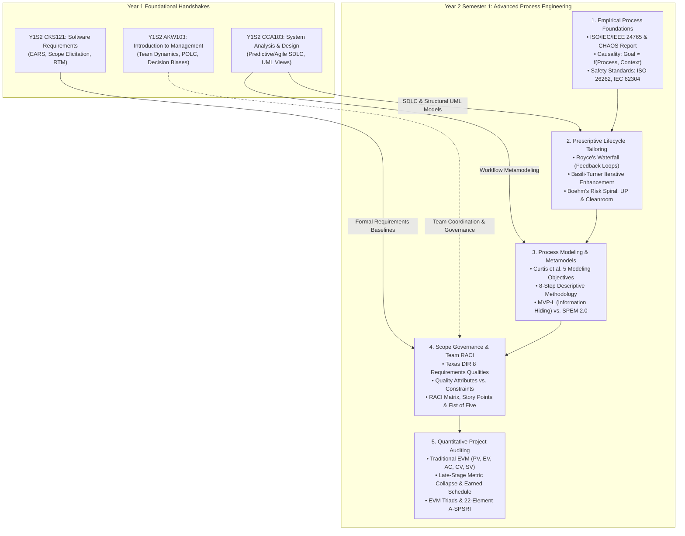
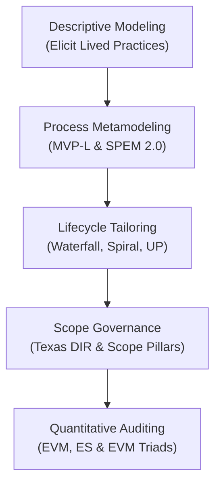
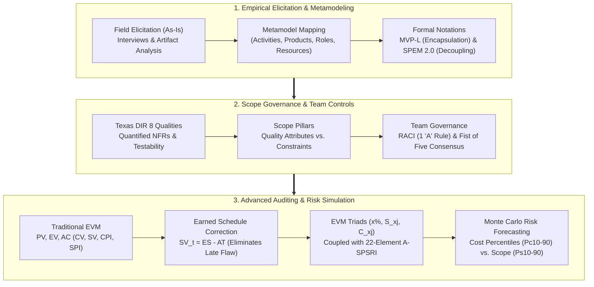

# 🔄 Computer Science & Software Engineering Master Knowledge Base — Year 2

> [!abstract] Overview & Navigation
> This master document provides a rigorous, deep synthesis of advanced software engineering disciplines, formal process modeling, statutory compliance, scope governance, and quantitative project controls acquired in **Year 2 Semester 1 (Y2S1)** and upper-level curricula.
> 
> Every section in this document links directly into the exact chapters, sections, and anchors of your Year 2 vault notes:
> 
> ### 💻 Year 2 Curriculum:
> - **Y2S1 Core**:
>   - [[Y2S1/CKS222 Software Process and Life Cycle|CKS222: Software Process and Life Cycle]]
> 
> ---
> > [!tip] ⬅️ Prerequisite & Foundational Navigation
> > For Year 1 foundational theory (programming principles, computer organisation, discrete mathematics, OOP, systems analysis, and requirements engineering), navigate to:
> > **[[knowledge_Y1|🧠 Year 1 Master Knowledge Base (Y1S1 & Y1S2 Foundations)]]**

---

## 🗺️ Academic Roadmap & Prerequisite Handoffs (Year 2)

Year 2 shifts the engineering paradigm from isolated component construction to organizational process governance, empirical measurement, and life-critical statutory compliance:

---

# 📙 Part I: Year 2 Semester 1 (Y2S1 Core)

---

## 1. 🔄 [[Y2S1/CKS222 Software Process and Life Cycle|CKS222: Software Process and Life Cycle]]

Investigates formal software engineering lifecycles, prescriptive vs. descriptive process modeling (MVP-L, SPEM 2.0), requirements scope governance (Texas DIR, Scope Pillars), and advanced quantitative project auditing (EVM, Earned Schedule, EVM Triads).

### 1.1 [[Y2S1/CKS222 Software Process and Life Cycle#1.1 Fundamentals of Software Engineering & Process|Software Engineering Foundations & Empirical Realities]]
- **Formal Definition (ISO/IEC/IEEE 24765:2017)**: [[Y2S1/CKS222 Software Process and Life Cycle#1.1.1 The Discipline of Software Engineering|Disciplined application of scientific knowledge to design, code, test, and document software]].
- **The Standish Group CHAOS Report**: [[Y2S1/CKS222 Software Process and Life Cycle#1.1.2 The Software Crisis & Failure Rates: CHAOS Report Findings|Empirical failure rates across 25,000+ projects]]: Large Waterfall projects fail at **42%** vs. Agile at **23%** due to rigid planning and coordination complexity.
- **The Human Dimension**: [[Y2S1/CKS222 Software Process and Life Cycle#1.1.3 The Human and Social Dimension of Software Development|Primacy of psychological safety, trust, and soft skills]]; developers perform best under professional self-determination.
- **Process-Product Causality**: [[Y2S1/CKS222 Software Process and Life Cycle#1.2.1 The Causal Relationship: Goal ≈ f(Process, Context)|Fundamental formula $Goal \approx f(Process, Context)$]]; high quality relies on repeatable processes, not unsustainable heroic overtime.
- **Regulatory Standards**: [[Y2S1/CKS222 Software Process and Life Cycle#1.2.3 Industrial Regulations & Safety-Critical Standards|Critical process compliance in safety domains]] via IEC 61508 (Functional Safety), ISO 26262 (Automotive), IEC 62304 (Medical Devices), ECSS (Space), and CMMI / SPICE.

### 1.2 [[Y2S1/CKS222 Software Process and Life Cycle#1.5 Prescriptive Process Model Classes & Lifecycles|Prescriptive Lifecycle Architectures]]
- **Waterfall Model (Royce 1970)**: [[Y2S1/CKS222 Software Process and Life Cycle#1.5.2 Winston Royce's Waterfall Model (1970)|Linear abstraction progression with adjacent feedback loops]]; optimal only when requirements are fully stable upfront.
- **Iterative Enhancement (Basili & Turner 1975)**: [[Y2S1/CKS222 Software Process and Life Cycle#1.5.3 Basili & Turner's Iterative Enhancement (1975)|Stepwise refinement building an executable architectural core first]], executing mini-waterfalls with architectural refactoring.
- **Spiral Model (Boehm 1986)**: [[Y2S1/CKS222 Software Process and Life Cycle#1.5.4 Barry Boehm's Spiral Model (1986)|Risk-driven meta-model cycling through 4 quadrants]] (Objectives, Risk Resolution, Development & Verification, Planning Next Phases).
- **Unified Process (Jacobson et al. 1999)**: [[Y2S1/CKS222 Software Process and Life Cycle#1.5.5 The Unified Process (UP)|Architecture-centric, use-case driven iterative framework]] structured into Inception, Elaboration, Construction, and Transition.
- **Cleanroom Software Engineering (Mills et al. 1987)**: [[Y2S1/CKS222 Software Process and Life Cycle#1.5.6 IBM's Cleanroom Software Engineering (1987)|Defect prevention via mathematical formal verification]]; development compiles zero code; independent certification team performs statistical testing to certify MTTF.

### 1.3 [[Y2S1/CKS222 Software Process and Life Cycle#2.1 Motivations and Core Objectives of Process Modeling|Process Modeling Objectives & Descriptive Elicitation]]
- **Curtis et al. (1992) 5 Objectives**: [[Y2S1/CKS222 Software Process and Life Cycle#2.1.2 The Five Core Objectives of Process Modeling (Curtis et al., 1992)|Communication, Continuous Improvement, Project Management & Control, Human Guidance (EPGs), and Automated Tool Execution]].
- **The 8-Step Descriptive Methodology**: [[Y2S1/CKS222 Software Process and Life Cycle#2.2 The 8-Step Descriptive Process Modeling Methodology|Disciplined process engineering method]] (Objectives & Scope, Schema, Formalisms, Elicitation Plan, Field Elicitation, Role Views, Analysis, Packaging).
- **Elicitation Psychology & Traps**: [[Y2S1/CKS222 Software Process and Life Cycle#2.2.5 Step 5: Process Elicitation Techniques & Developer Engagement|Adopting a non-judgmental stance to avoid process embellishment]]; anchoring interviews in concrete work products (artifacts first) to capture real variations.
- **Defect Detection in Process Models**: [[Y2S1/CKS222 Software Process and Life Cycle#2.2.7 Step 7: Process Model Analysis & Quality Assurance|Static & dynamic analysis detecting dangling references, inconsistent preconditions, orphan entities, and dependency deadlocks]].
- **Multi-View Integration**: [[Y2S1/CKS222 Software Process and Life Cycle#2.2.6 Step 6: Multi-View Modeling & Integration|Four-step synthesis of independent role-specific views]]: Modeling $\to$ Similarity Analysis $\to$ Consistency Checking $\to$ Global Integration.

### 1.4 [[Y2S1/CKS222 Software Process and Life Cycle#2.3 Process Modeling Notations & Languages|Process Metamodels: MVP-L vs. SPEM 2.0]]
- **MVP-L Information Hiding**: [[Y2S1/CKS222 Software Process and Life Cycle#2.3.2 Multi-View Process Language (MVP-L)|Applies David Parnas' modularity]]; separates visible Process Interface (parameters, attributes, entry/exit criteria) from hidden Process Body (tool instructions) to ensure locality of change.
- **MVP-L Typed Constructs & Control Flow**: [[Y2S1/CKS222 Software Process and Life Cycle#2.3.2 Multi-View Process Language (MVP-L)|Four models (`product_model`, `resource_model`, `process_model`, `attribute_model`)]]; implicit control flow driven by Boolean entry/exit criteria and local invariants.
- **SPEM 2.0 Decoupling**: [[Y2S1/CKS222 Software Process and Life Cycle#2.4.2 Decoupling Method Content from Context-Specific Processes|Separates static Method Content (reusable Role, Task, and Work Product definitions) from dynamic Context-Specific Processes (timeline breakdown structures)]].
- **EPF Composer Variability**: [[Y2S1/CKS222 Software Process and Life Cycle#2.4.3 Eclipse Process Framework (EPF) Composer|Object-oriented process inheritance mechanisms]]: Contribute, Replace, Extend, and Extend & Replace.

### 1.5 [[Y2S1/CKS222 Software Process and Life Cycle#3.2 Requirements Engineering & Nonfunctional Scope|Scope Governance, Quality Attributes & Team RACI]]
- **Texas DIR (2008) Framework**: [[Y2S1/CKS222 Software Process and Life Cycle#3.2.2 The Eight Engineering Qualities of Requirements (Texas DIR, 2008)|8 mandatory requirements criteria]] (Correct, Unambiguous, Complete, Consistent, Ranked, Verifiable, Modifiable, Traceable); non-functional criteria must be quantified with metrics, thresholds, and stress contexts.
- **The Two Scope Pillars**:
  - *Pillar 1: Quality Attributes*: [[Y2S1/CKS222 Software Process and Life Cycle#3.2.3 Two Pillars of Nonfunctional Scope: Quality Attributes vs. Constraints|Internally engineered trade-offs evaluated on a continuous spectrum]] (Maintainability, Reliability, Portability, Efficiency).
  - *Pillar 2: Architectural Constraints*: [[Y2S1/CKS222 Software Process and Life Cycle#3.2.3 Two Pillars of Nonfunctional Scope: Quality Attributes vs. Constraints|Externally mandated, non-negotiable boundaries evaluated via binary compliance]] (Technology limits, OS runtimes, statutory laws like PDPA, PCI-DSS, BNM RMiT).
- **RACI Governance**: [[Y2S1/CKS222 Software Process and Life Cycle#3.3.3 The RACI Responsibility Assignment Matrix|Responsible, Accountable, Consulted, Informed]]; strict Golden Rule: **exactly one Accountable (A) owner per deliverable**.
- **Estimation & Consensus**: [[Y2S1/CKS222 Software Process and Life Cycle#3.3.5 Agile Estimation Paradigms & Planning Poker|Relative Story Points (Fibonacci scale) vs. Ideal Days]]; Planning Poker defeats optimism bias; [[Y2S1/CKS222 Software Process and Life Cycle#3.3.4 Structured Decision-Making: Eisenhower Matrix & Fist of Five|Fist of Five consensus voting]].

### 1.6 [[Y2S1/CKS222 Software Process and Life Cycle#3.4 Quantitative Project Auditing: EVM, Earned Schedule & EVM Triads|Quantitative Project Controls: EVM, Earned Schedule & EVM Triads]]
- **Traditional EVM Metrics**: [[Y2S1/CKS222 Software Process and Life Cycle#3.4.1 Traditional Earned Value Management (EVM) Foundations|$PV$, $EV$, $AC$, Cost Variance ($CV = EV - AC$), Schedule Variance ($SV = EV - PV$), $CPI = EV / AC$, and $SPI = EV / PV$]].
- **The Late-Stage EVM Metric Collapse**: [[Y2S1/CKS222 Software Process and Life Cycle#3.4.3 The Late-Stage Metric Collapse & The Earned Schedule (ES) Remedy|As a delayed project nears completion, $EV \to PV = BAC \implies SV \to 0$ and $SPI \to 1.0$, falsely masking project delays]].
- **Time-Based Earned Schedule (ES)**: [[Y2S1/CKS222 Software Process and Life Cycle#3.4.3 The Late-Stage Metric Collapse & The Earned Schedule (ES) Remedy|Mathematical correction restoring temporal accuracy]]: $SV_t = ES - AT$ (time variance in months) and $SPI_t = ES / AT$.
- **EVM Triads & A-SPSRI Scope Governance**:
  - *Triad Formulation*: [[Y2S1/CKS222 Software Process and Life Cycle#3.4.5 EVM Triads & Agile Scope Rating (A-SPSRI)|$\text{EVM Triad} = (x\%, S_{xj}, C_{xj})$]] combining physical progress $x\%$, A-SPSRI scope score $S_{xj}$ (0–100), and accumulated expenditure $C_{xj}$.
  - *A-SPSRI Index*: [[Y2S1/CKS222 Software Process and Life Cycle#3.4.5 EVM Triads & Agile Scope Rating (A-SPSRI)|22 critical scope elements across Requirements, Architecture, and Verification]]; Monte Carlo simulations forecast cost overruns before they materialize.
- **Worked Auditing Scenarios**: [[Y2S1/CKS222 Software Process and Life Cycle#3.4.6 EVM Triad Worked Case Studies|Applied case studies]] illustrating concurrent health illusions (Mobile Banking vs. E-Hospital) and IoT Smart Grid scope audits.

---

# 🔗 Part II: Advanced Software Engineering & Quantitative Controls Synthesis

---

## 2. 🌐 Advanced Process Governance & Auditing Pipeline

### 2.1 Direct Conceptual Mappings: Year 1 Foundations to Year 2 Engineering

| Foundational Concept (Year 1 Source) | Advanced Process Application (Year 2 Destination) | Interdisciplinary Synthesis & Operational Handoff |
| :--- | :--- | :--- |
| **Requirements Engineering (CKS121)** [[Y1S2/CKS121 Software Requirements#Chapter 1: Introduction & Fundamentals of Requirements Engineering\|CKS121 (EARS, SRS & Kano)]] | **Scope Governance (CKS222)** [[Y2S1/CKS222 Software Process and Life Cycle#3.2.3 Two Pillars of Nonfunctional Scope: Quality Attributes vs. Constraints\|CKS222 (Scope Pillars & Texas DIR)]] | Informal stakeholder needs formalize into EARS syntax in Y1, then in Y2 are audited against Texas DIR (2008) testability standards and partitioned into tradeable Quality Attributes vs non-negotiable Constraints. |
| **System Analysis & Design (CCA103)** [[Y1S2/CCA103 System Analysis and Design#Chapter 6: Approaches to System Development\|CCA103 (Predictive/Agile SDLC)]] | **Lifecycle & Metamodeling (CKS222)** [[Y2S1/CKS222 Software Process and Life Cycle#1.5 Prescriptive Process Model Classes & Lifecycles\|CKS222 (Lifecycles & SPEM 2.0)]] | Conceptual lifecycle methodologies (Waterfall vs Scrum) advance into formal mathematical and object-oriented process metamodels (MVP-L information hiding and SPEM 2.0 / EPF Composer variability). |
| **Organizational Management (AKW103)** [[Y1S2/AKW103 Introduction to Management#Chapter 1: Managing in Today's World\|AKW103 (POLC, Leadership & Teams)]] | **Process RACI & Governance (CKS222)** [[Y2S1/CKS222 Software Process and Life Cycle#3.3.3 The RACI Responsibility Assignment Matrix\|CKS222 (RACI & Decision Frameworks)]] | High-level organizational leadership and Tuckman team development translate directly into operational RACI matrices (enforcing the strict one-Accountable owner rule) and Fist of Five consensus voting. |
| **Object-Oriented Programming (CKC112)** [[Y1S2/CKC112 Object Oriented Programming#Chapter 4: Inheritance, Polymorphism, and Virtual Functions\|CKC112 (Inheritance & Polymorphism)]] | **EPF Process Variability (CKS222)** [[Y2S1/CKS222 Software Process and Life Cycle#2.4.3 Eclipse Process Framework (EPF) Composer\|CKS222 (Contribute, Replace, Extend)]] | Object-oriented class inheritance and specialization mechanisms are adapted to process engineering via EPF Composer variability patterns (Contribute, Replace, Extend, Extend and Replace). |

---

## 3. 📊 High-Yield Master Comparative Reference (Year 2)

### 3.1 Quantitative Project Auditing & Control Paradigms

| Dimension | Traditional EVM ([[Y2S1/CKS222 Software Process and Life Cycle#3.4.1 Traditional Earned Value Management (EVM) Foundations\|CKS222]]) | Earned Schedule (ES) ([[Y2S1/CKS222 Software Process and Life Cycle#3.4.3 The Late-Stage Metric Collapse & The Earned Schedule (ES) Remedy\|CKS222]]) | EVM Triads with A-SPSRI ([[Y2S1/CKS222 Software Process and Life Cycle#3.4.5 EVM Triads & Agile Scope Rating (A-SPSRI)\|CKS222]]) |
| :--- | :--- | :--- | :--- |
| **Primary Metric Units** | Monetary currency values ($PV, EV, AC, CV, SV$). | Calendar time units ($ES, AT, SV_t, SPI_t$ in months/weeks). | Vector $(x\%, S_{xj}, C_{xj})$ combining progress %, A-SPSRI scope score (0–100), and actual cost. |
| **Schedule Variance** | $SV = EV - PV$ (expressed in currency). | $SV_t = ES - AT$ (expressed in time duration). | Tracks schedule via physical milestone completion $x\%$. |
| **Late-Stage Behavior** | **Metric Collapse Flaw:** As $EV \to PV$, $SV \to 0$ and $SPI \to 1.0$, falsely masking project delays! | **Reliable:** Retains true time variance ($SV_t < 0$) and true velocity index ($SPI_t < 1.0$) until actual delivery. | **Predictive:** Couples cost with scope completeness to simulate probability distributions (Monte Carlo). |
| **Scope Stability Tracking** | Blind to scope creep; assumes baseline scope definition is perfect. | Blind to scope volatility; tracks only temporal progression. | **Active Scope Governance:** Evaluates 22 critical scope elements (A-SPSRI) across requirements, design, and verification. |

---

## 4. 📖 Master Glossary of Year 2 Core Terminology

- **A-SPSRI (Agile Software Project Scope Rating Index)**: [[Y2S1/CKS222 Software Process and Life Cycle#3.4.5 EVM Triads & Agile Scope Rating (A-SPSRI)|A 22-element scope maturity index (0–100) auditing user stories, architecture, and verification to predict cost overruns]].
- **Earned Schedule (ES)**: [[Y2S1/CKS222 Software Process and Life Cycle#3.4.3 The Late-Stage Metric Collapse & The Earned Schedule (ES) Remedy|An extension of EVM mapping earned value back to the baseline schedule to provide time-based schedule variance ($SV_t$) and performance index ($SPI_t$)]].
- **Earned Value Management (EVM)**: [[Y2S1/CKS222 Software Process and Life Cycle#3.4.1 Traditional Earned Value Management (EVM) Foundations|A quantitative project management technique integrating scope, schedule, and cost baselines using Planned Value, Earned Value, and Actual Cost]].
- **EVM Triads**: [[Y2S1/CKS222 Software Process and Life Cycle#3.4.5 EVM Triads & Agile Scope Rating (A-SPSRI)|A multi-dimensional audit vector $(x\%, S_{xj}, C_{xj})$ linking progress percentage, A-SPSRI scope score, and actual expenditure]].
- **MVP-L (Multi-View Process Language)**: [[Y2S1/CKS222 Software Process and Life Cycle#2.3.2 Multi-View Process Language (MVP-L)|A formal process modeling language implementing David Parnas' information hiding and implicit Boolean control flow]].
- **Process Schema**: [[Y2S1/CKS222 Software Process and Life Cycle#2.2.2 Step 2: Defining the Process Schema (Metamodel)|A conceptual metamodel defining the entities (Activities, Work Products, Roles, Resources) and relationships used to describe a process]].
- **Quality Attributes vs. Constraints**: [[Y2S1/CKS222 Software Process and Life Cycle#3.2.3 Two Pillars of Nonfunctional Scope: Quality Attributes vs. Constraints|Internally engineered continuous trade-offs (Quality Attributes) versus externally mandated, non-negotiable binary boundaries (Constraints)]].
- **RACI Matrix**: [[Y2S1/CKS222 Software Process and Life Cycle#3.3.3 The RACI Responsibility Assignment Matrix|A governance framework allocating Responsible, Accountable, Consulted, and Informed roles, requiring exactly one Accountable owner per deliverable]].
- **SPEM 2.0 (Software & Systems Process Engineering Metamodel)**: [[Y2S1/CKS222 Software Process and Life Cycle#2.4.2 Decoupling Method Content from Context-Specific Processes|An OMG standard metamodel decoupling reusable static Method Content from dynamic context-specific project workflows]].
- **Texas DIR (2008) Framework**: [[Y2S1/CKS222 Software Process and Life Cycle#3.2.2 The Eight Engineering Qualities of Requirements (Texas DIR, 2008)|Eight mandatory criteria for requirements specification, mandating explicit quantification of non-functional thresholds and stress contexts]].

---

> [!tip] Direct Vault Navigation
> - **Y2S1 Core**: [[Y2S1/CKS222 Software Process and Life Cycle|CKS222 Software Process and Life Cycle]]
> - **Previous Year Master Document**: [[knowledge_Y1|🧠 Year 1 Master Knowledge Base (Y1S1 & Y1S2 Foundations)]]
