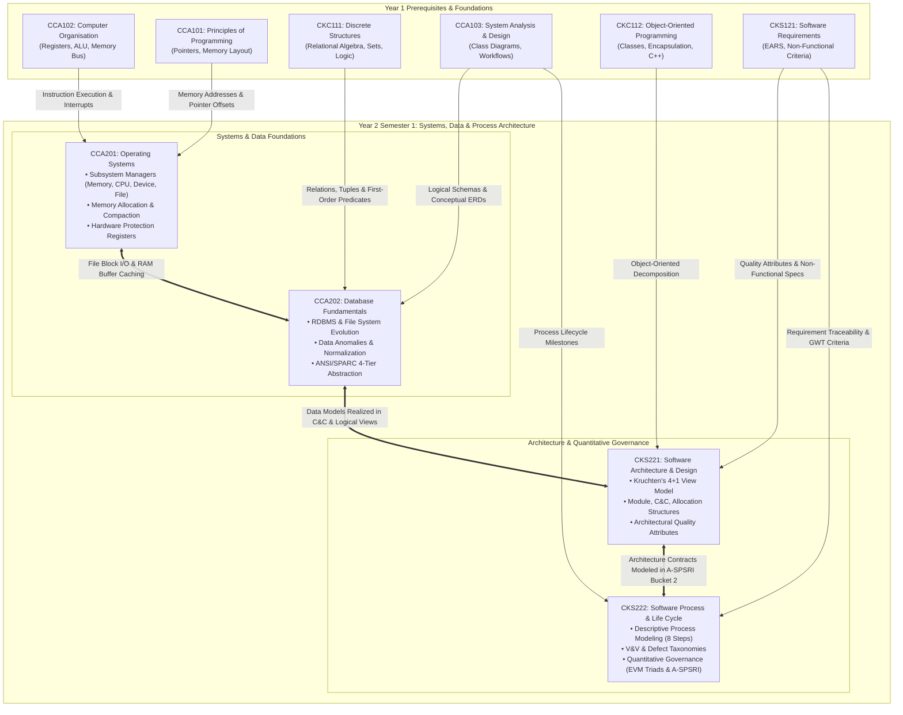
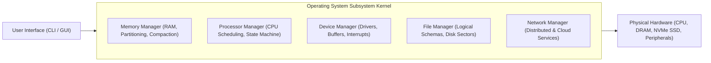
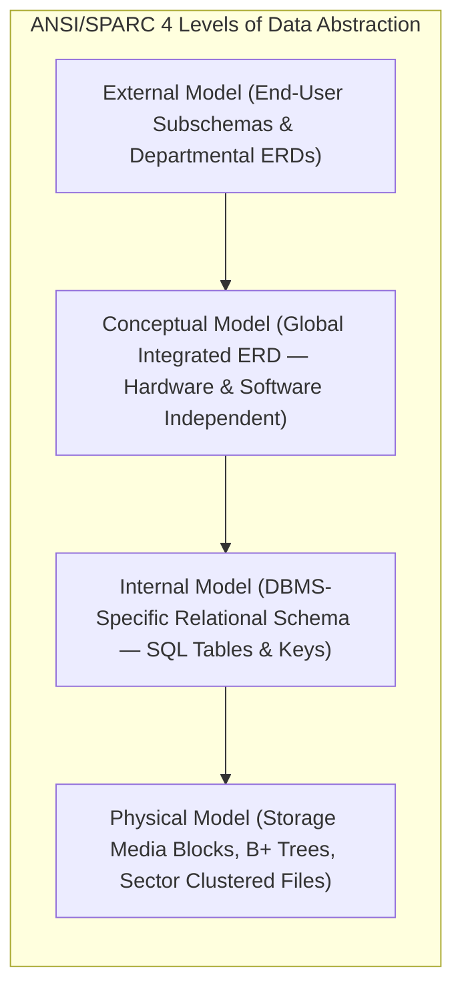
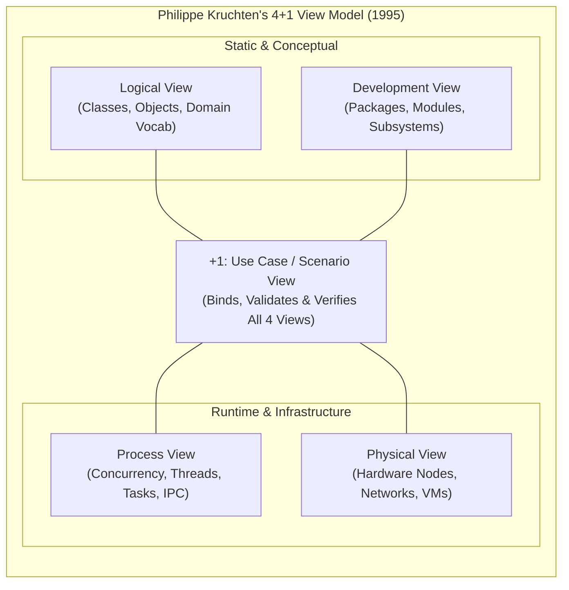
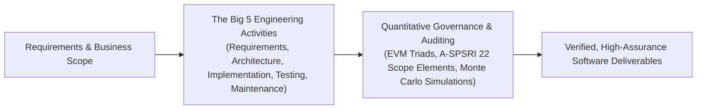
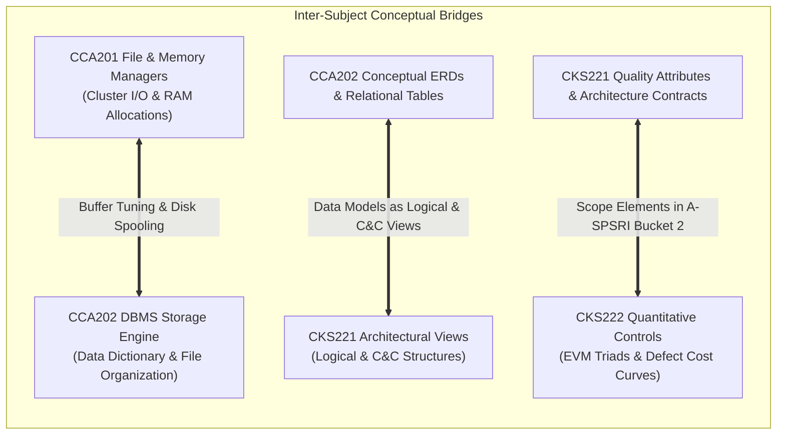

# 🧠 Computer Science & Software Engineering Master Knowledge Base — Year 2

> [!abstract] Overview & Navigation
> This master document provides a comprehensive, interconnected synthesis of the engineering principles, systems foundations, and quantitative governance frameworks established across **Year 2 Semester 1 (Y2S1)**.
> 
> Every section, concept, formula, and glossary term links directly into the exact chapters and heading anchors of your Year 2 vault notes:
> 
> ### 💻 Year 2 Semester 1 Core Systems & Architecture Stream:
> - **[[Y2S1/CCA201 Operating Systems|CCA201: Operating Systems]]**
> - **[[Y2S1/CCA202 Database Fundamentals|CCA202: Database Fundamentals]]**
> - **[[Y2S1/CKS221 Software Architecture and Design|CKS221: Software Architecture and Design]]**
> - **[[Y2S1/CKS222 Software Process and Life Cycle|CKS222: Software Process and Life Cycle]]**
> 
> ---
> > [!tip] 🔙 Foundational Curriculum Navigation
> > For Year 1 foundations (C++ programming, computer organization, discrete mathematics, system analysis, OOP, and software requirements), navigate to:
> > **[[knowledge_Y1|🧠 Year 1 Master Knowledge Base (Y1S1 & Y1S2 Foundations)]]**

---

## 🗺️ Academic Roadmap & Interdisciplinary Architecture (Year 2)

---

# 📘 Part I: Year 2 Semester 1 (Y2S1 Core Curriculum)

---

## 1. ⚙️ [[Y2S1/CCA201 Operating Systems|CCA201: Operating Systems]]

Focuses on the operating system as the chief software component arbitrating physical hardware resources (CPU, RAM, storage, peripherals), managing memory allocation and fragmentation, coordinating concurrent subsystems, and virtualizing the computing environment.

### 1.1 [[Y2S1/CCA201 Operating Systems#1.1 Fundamentals of Operating Systems|Core Concepts & Subsystem Architecture]]
- **Definition & Mandate**: [[Y2S1/CCA201 Operating Systems#1.1.1 What is an Operating System?|Operating System (Chief software component)]] responsible for resource virtualization, hardware protection, and policy enforcement (determining *who* gets *what*, *when*, and *how much*).
- **Core Subsystems**:
  - **Memory Manager**: [[Y2S1/CCA201 Operating Systems#1.2.1 Main Memory Manager|RAM validation, allocation, protection, and reclaiming]].
  - **Processor Manager**: [[Y2S1/CCA201 Operating Systems#1.2.2 Processor Manager|CPU traffic controller, thread context switching, and time slicing]].
  - **Device Manager**: [[Y2S1/CCA201 Operating Systems#1.2.3 Device Manager|Peripheral allocation, device driver binding, buffering, and spooling]].
  - **File Manager**: [[Y2S1/CCA201 Operating Systems#1.2.4 File Manager|Access permission enforcement, directory indexing, and disk cluster mapping]].
  - **Network Manager**: [[Y2S1/CCA201 Operating Systems#1.2.5 Network Manager & User Interface|Coordinating shared distributed memory, remote CPUs, and storage]].

### 1.2 [[Y2S1/CCA201 Operating Systems#1.3 Subsystem Cooperation: A Complete Interaction Lifecycle|Subsystem Cooperation Lifecycle]]
- **Nine-Step Execution Flow**: [[Y2S1/CCA201 Operating Systems#1.3 Subsystem Cooperation: A Complete Interaction Lifecycle|Mouse interrupt in Device Manager]] $\to$ UI translation $\to$ Processor Manager acknowledgement $\to$ File Manager sector lookup on disk $\to$ Memory Manager loading executable into RAM $\to$ CPU instruction execution $\to$ secondary storage writeback $\to$ UI rendering.

### 1.3 [[Y2S1/CCA201 Operating Systems#1.5 Taxonomy and Classifications of Operating Systems|OS Taxonomy & Classifications]]
- **Classification Criteria**: Categorized based on **Response Time** and **Method of Data Entry**:
  - **Batch Systems**: [[Y2S1/CCA201 Operating Systems#1.5.1 Batch Systems|Sequential job bundling; throughput-driven; hours to days turnaround]].
  - **Interactive Systems**: [[Y2S1/CCA201 Operating Systems#1.5.2 Interactive Systems|Direct terminal conversational engagement; time-sliced CPU sharing; seconds to minutes turnaround]].
  - **Real-Time Systems (RTOS)**: [[Y2S1/CCA201 Operating Systems#1.5.3 Real-Time Operating Systems (RTOS)|Predictable time-bounded determinism]]. Differentiated into **Hard RTOS** (deadline failure causes catastrophic system destruction) vs **Soft RTOS** (deadline failure results in degraded service quality).
  - **Hybrid & Embedded Systems**: [[Y2S1/CCA201 Operating Systems#1.5.4 Hybrid and Embedded Systems|Foreground interactive with background batch]]; [[Y2S1/CCA201 Operating Systems#1.5.4 Hybrid and Embedded Systems|Embedded ROM microkernels with non-interchangeable software]].

### 1.4 [[Y2S1/CCA201 Operating Systems#2.2 Four Foundational Early Memory Allocation Schemes|Foundational Memory Allocation Schemes]]
- **Single-User Contiguous**: [[Y2S1/CCA201 Operating Systems#2.2.1 Scheme 1: Single-User Contiguous Allocation|Monolithic single-job execution; zero multiprogramming support]].
- **Fixed Partitions (Static)**: [[Y2S1/CCA201 Operating Systems#2.2.2 Scheme 2: Fixed Partitions|Static division supporting multiprogramming]]. Suffers from **Internal Fragmentation** (wasted memory *inside* an allocated block due to job size mismatch).
- **Dynamic Partitions (Variable)**: [[Y2S1/CCA201 Operating Systems#2.2.3 Scheme 3: Dynamic Partitions|Jobs allocated exact memory requested]]. Eliminates internal fragmentation but produces **External Fragmentation** (scattered non-contiguous holes *between* allocated blocks preventing new jobs from loading).

### 1.5 [[Y2S1/CCA201 Operating Systems#2.3 Partition Allocation Algorithms: First-Fit vs. Best-Fit|Allocation Algorithms: First-Fit vs. Best-Fit]]
- **First-Fit Allocation**: [[Y2S1/CCA201 Operating Systems#2.3.1 Comparative Analysis: First-Fit vs. Best-Fit|Free list ordered by memory address (low to high)]]; allocates the very first block with sufficient size; fast execution with minimal scan overhead.
- **Best-Fit Allocation**: [[Y2S1/CCA201 Operating Systems#2.3.1 Comparative Analysis: First-Fit vs. Best-Fit|Free list ordered by block size (smallest to largest)]]; searches the entire table to allocate the smallest fitting block; minimizes immediate wasted space but creates microscopic unusable slivers and incurs high search overhead.

### 1.6 [[Y2S1/CCA201 Operating Systems#2.4 Deallocation Mechanics in Dynamic Partition Systems|Dynamic Deallocation Mechanics]]
- **The Three Topological Cases**:
  1. *Case 1 (Adjacent to 1 Free Block)*: [[Y2S1/CCA201 Operating Systems#2.4.1 Case 1: Joining Two Free Blocks|Merge released space with neighboring free block; adjust start address and sum sizes]].
  2. *Case 2 (Between 2 Free Blocks)*: [[Y2S1/CCA201 Operating Systems#2.4.2 Case 2: Joining Three Free Blocks|Consolidate all three blocks into one unified entry; mark redundant table slot as null]].
  3. *Case 3 (Isolated Block)*: [[Y2S1/CCA201 Operating Systems#2.4.3 Case 3: Deallocating an Isolated Block|Surrounded by busy allocations; allocate a fresh slot in the Free List]].

### 1.7 [[Y2S1/CCA201 Operating Systems#2.5 Relocatable Dynamic Partitions: Compaction & Hardware Registers|Compaction & Hardware Address Translation]]
- **Compaction (Defragmentation)**: [[Y2S1/CCA201 Operating Systems#2.5.1 Memory Compaction (Defragmentation)|Reclaiming external fragmentation by shifting active programs toward one boundary to create a single large free partition]].
- **Hardware Register Pair**:
  - **Bounds Register**: [[Y2S1/CCA201 Operating Systems#2.5.2 Hardware Assistance: Bounds & Relocation Registers|Stores maximum legal logical address; traps out-of-bounds violations to prevent memory corruption]].
  - **Relocation Register**: [[Y2S1/CCA201 Operating Systems#2.5.2 Hardware Assistance: Bounds & Relocation Registers|Stores physical base address]]; hardware dynamically computes:
    $$\text{Physical Address} = \text{Logical Address} + \text{Relocation Register}$$

---

## 2. 🗄️ [[Y2S1/CCA202 Database Fundamentals|CCA202: Database Fundamentals]]

Covers the evolution of enterprise data management from traditional file processing to modern relational and NoSQL architectures, business rules translation, relational schema design, and the ANSI/SPARC 4-tier data abstraction model.

### 2.1 [[Y2S1/CCA202 Database Fundamentals#1.1 Data vs. Information: The Foundations of Knowledge|Data vs. Information Foundations]]
- **Raw Data**: [[Y2S1/CCA202 Database Fundamentals#1.1 Data vs. Information: The Foundations of Knowledge|Unprocessed facts and observations]] representing atomic building blocks.
- **Information**: [[Y2S1/CCA202 Database Fundamentals#1.1 Data vs. Information: The Foundations of Knowledge|Processed, structured, contextualized data revealing operational meaning]]; must be accurate, relevant, and timely to enable sound decision-making.
- **Database & Metadata**: [[Y2S1/CCA202 Database Fundamentals#1.2 Database and Database Management System (DBMS) Concepts|Shared integrated repository storing end-user data alongside metadata (self-describing data characteristics)]].

### 2.2 [[Y2S1/CCA202 Database Fundamentals#1.3 Taxonomy and Classifications of Databases|Taxonomy of Databases]]
- **Classification Criteria**:
  - *User Concurrency*: [[Y2S1/CCA202 Database Fundamentals#1.3 Taxonomy and Classifications of Databases|Single-User (Desktop) vs Multi-User (Workgroup, Enterprise)]].
  - *Location*: [[Y2S1/CCA202 Database Fundamentals#1.3 Taxonomy and Classifications of Databases|Centralized vs Distributed vs Cloud Databases]].
  - *Usage*: [[Y2S1/CCA202 Database Fundamentals#1.3 Taxonomy and Classifications of Databases|Operational (OLTP - day-to-day transactions) vs Analytical (OLAP - data warehouses, business intelligence)]].
  - *Structure*: [[Y2S1/CCA202 Database Fundamentals#1.3 Taxonomy and Classifications of Databases|Unstructured vs Structured vs Semi-Structured (XML, JSON)]].

### 2.3 [[Y2S1/CCA202 Database Fundamentals#1.5 Evolution of Data Processing: From File Systems to Databases|File Systems vs Database Systems & Data Anomalies]]
- **Structural Dependence**: [[Y2S1/CCA202 Database Fundamentals#1. Structural Dependence|Application programs tightly coupled to file layouts; changing file structure requires rewriting all reading programs]].
- **Data Dependence**: [[Y2S1/CCA202 Database Fundamentals#2. Data Dependence|Program code hardwired to physical storage formats]].
- **Data Redundancy & "Islands of Information"**: [[Y2S1/CCA202 Database Fundamentals#3. Data Redundancy and "Islands of Information"|Duplicated records across departments causing storage waste, security breaches, and inconsistency]].
- **The Three Critical Data Anomalies**:
  1. *Update Anomaly*: [[Y2S1/CCA202 Database Fundamentals#4. Data Anomalies|Modifying data in one file while leaving redundant copies unchanged creates contradictory records]].
  2. *Insertion Anomaly*: [[Y2S1/CCA202 Database Fundamentals#4. Data Anomalies|Inability to record an independent entity (e.g., a new agent) without creating an unrelated entity (a dummy customer)]].
  3. *Deletion Anomaly*: [[Y2S1/CCA202 Database Fundamentals#4. Data Anomalies|Deleting one record inadvertently purges essential related data (e.g., deleting a customer deletes the only record of an agent)]].

### 2.4 [[Y2S1/CCA202 Database Fundamentals#1.6 Core Functions of a Modern DBMS|Core Functions of a Modern DBMS]]
- **System Engines**: [[Y2S1/CCA202 Database Fundamentals#1.6 Core Functions of a Modern DBMS|Data Dictionary Management]], [[Y2S1/CCA202 Database Fundamentals#1.6 Core Functions of a Modern DBMS|Data Storage & Performance Tuning]], [[Y2S1/CCA202 Database Fundamentals#1.6 Core Functions of a Modern DBMS|Data Transformation & Presentation]], [[Y2S1/CCA202 Database Fundamentals#1.6 Core Functions of a Modern DBMS|Security & Privacy Management]], [[Y2S1/CCA202 Database Fundamentals#1.6 Core Functions of a Modern DBMS|Multi-User Concurrency & ACID Controls]], [[Y2S1/CCA202 Database Fundamentals#1.6 Core Functions of a Modern DBMS|Backup & Disaster Recovery]], [[Y2S1/CCA202 Database Fundamentals#1.6 Core Functions of a Modern DBMS|Integrity Enforcement]], and [[Y2S1/CCA202 Database Fundamentals#1.6 Core Functions of a Modern DBMS|Declarative SQL Query Engine (DDL + DML)]].

### 2.5 [[Y2S1/CCA202 Database Fundamentals#2.2 Business Rules: Bridging Business Logic to Schemas|Business Rules & Cardinality Decomposition]]
- **Business Rule Definition**: [[Y2S1/CCA202 Database Fundamentals#2.2.1 What is a Business Rule?|Brief, precise, unambiguous organizational policy statement serving as the bridge between users and database designers]].
- **Structural Mapping**:
  - Nouns $\to$ **Entities** (e.g., `Customer`, `Invoice`).
  - Verbs $\to$ **Relationships** (e.g., `generates`).
  - Descriptors/Adjectives $\to$ **Attributes** (e.g., `invoice_total`, `due_date`).
- **Two-Question Cardinality Diagnostic**: [[Y2S1/CCA202 Database Fundamentals#2.2.4 Determining Relationship Type: The Two-Question Diagnostic|Asking bidirectional 'how many' questions]] to determine connectivity ($1:1$, $1:M$, $M:N$).

### 2.6 [[Y2S1/CCA202 Database Fundamentals#2.3 Chronological Evolution of Data Models|Evolution of Data Models]]
- **Hierarchical Model (1960s)**: [[Y2S1/CCA202 Database Fundamentals#2.3.1 Hierarchical Model (1960s)|Inverted tree; parent-child segments; 1:M only; complex pointer navigation]].
- **Network Model (1970s)**: [[Y2S1/CCA202 Database Fundamentals#2.3.2 Network Model (Late 1960s – 1970s)|Graph structure; handles M:N; DBTG standard; introduced DDL, DML, Schema, Subschema]].
- **Relational Model (1970s - Codd)**: [[Y2S1/CCA202 Database Fundamentals#2.3.3 The Relational Model (1970s)|Mathematical relations; 2D tables, tuples, attributes; linked via shared keys; declarative SQL; full structural independence]].
- **Entity-Relationship Model (1980s - Chen)**: [[Y2S1/CCA202 Database Fundamentals#2.3.4 The Entity-Relationship (ER) Model (1980s)|Visual ERD conceptual standard; communication bridge]].
- **OODM & Object/Relational (1990s)**: [[Y2S1/CCA202 Database Fundamentals#2.3.5 Object-Oriented Data Model (OODM) & Object/Relational (ORDBMS)|Encapsulated objects, inheritance, UML notation, XML semi-structured exchange]].
- **Big Data & NoSQL (2000s-Present)**: [[Y2S1/CCA202 Database Fundamentals#2.3.6 The Big Data Era & NoSQL Databases (2000s – Present)|Addressing the 3 Vs (Volume, Velocity, Variety); non-relational, horizontal scale-out; eventual consistency; Key-Value, Document, Column, and Graph stores; Hadoop HDFS & MapReduce]].

### 2.7 [[Y2S1/CCA202 Database Fundamentals#2.4 The ANSI/SPARC Four Levels of Data Abstraction|The ANSI/SPARC 4 Levels of Abstraction]]
- **External Model**: [[Y2S1/CCA202 Database Fundamentals#2.4.1 1. The External Model (External Schema)|End-user departmental views and subschemas]].
- **Conceptual Model**: [[Y2S1/CCA202 Database Fundamentals#2.4.2 2. The Conceptual Model (Conceptual Schema)|Global organizational ERD; software and hardware independent; logical design]].
- **Internal Model**: [[Y2S1/CCA202 Database Fundamentals#2.4.3 3. The Internal Model (Internal Schema)|DBMS-specific schema; tables, keys, datatypes; software dependent but hardware independent; exhibits logical independence]].
- **Physical Model**: [[Y2S1/CCA202 Database Fundamentals#2.4.4 4. The Physical Model|Lowest level; persistent storage media blocks and indexes; exhibits physical independence]].

---

## 3. 🏛️ [[Y2S1/CKS221 Software Architecture and Design|CKS221: Software Architecture and Design]]

Covers the principles of software architecture, the distinction between structures and documented views, architectural quality attributes (performance, security, modifiability, scalability), and Philippe Kruchten's foundational "4+1" View Model.

### 3.1 [[Y2S1/CKS221 Software Architecture and Design#1.1 The Discipline and Foundations of Software Architecture|Foundations & The Four Tenets of Architecture]]
- **Building Analogy**: [[Y2S1/CKS221 Software Architecture and Design#1.1.1 The Building Architecture Analogy|Civil engineering blueprints govern physical construction just as software architecture blueprints govern code assembly and evolution]].
- **Formal Definition**: [[Y2S1/CKS221 Software Architecture and Design#1.1.2 Formal Definition of Software Architecture|Set of structures needed to reason about the system, comprising software elements, relations among them, and properties of both]].
- **The Four Inviolable Tenets**:
  1. *Architecture is a Set of Structures*: [[Y2S1/CKS221 Software Architecture and Design#1.1.3 The Four Foundational Tenets|Multiple orthogonal structures coexist simultaneously]].
  2. *Architecture is an Abstraction*: [[Y2S1/CKS221 Software Architecture and Design#1.1.3 The Four Foundational Tenets|Focuses on public interfaces; deliberately suppresses private implementation details]].
  3. *Every System Has an Architecture*: [[Y2S1/CKS221 Software Architecture and Design#1.1.3 The Four Foundational Tenets|Present in all software, whether intentionally planned or accidental]].
  4. *Not All Architectures Are Good*: [[Y2S1/CKS221 Software Architecture and Design#1.1.3 The Four Foundational Tenets|Descriptive definition; a system may possess a rigid, vulnerable architecture]].

### 3.2 [[Y2S1/CKS221 Software Architecture and Design#1.3 Architectural Structures vs. Architectural Views|Structures vs. Views: The Essential Distinction]]
- **Structure**: [[Y2S1/CKS221 Software Architecture and Design#1.3 Architectural Structures vs. Architectural Views|The actual set of elements as they exist in software or hardware in reality]].
- **View**: [[Y2S1/CKS221 Software Architecture and Design#1.3 Architectural Structures vs. Architectural Views|A representation of a coherent set of architectural elements written and read by system stakeholders]].
- **Core Axiom**: *"Architects design structures. They document views of those structures."*
- **Human Body Analogy**: [[Y2S1/CKS221 Software Architecture and Design#1.3.1 The Human Body Analogy|Skeletal, vascular, and X-ray views all describe different aspects of the same unified human anatomy]].

### 3.3 [[Y2S1/CKS221 Software Architecture and Design#1.4 The Three Primary Categories of Architectural Structures|The Three Primary Categories of Architectural Structures]]
- **Module Structures (Static Code Units)**: [[Y2S1/CKS221 Software Architecture and Design#1.4.1 1. Module Structures (Static Code Units)|Implementation units (packages, classes); relationships: `is-a`, `is-part-of`, `depends-on`; primary tool for reasoning about **modifiability**]].
- **Component-and-Connector (C&C) Structures (Runtime Dynamics)**: [[Y2S1/CKS221 Software Architecture and Design#1.4.2 2. Component-and-Connector (C&C) Structures (Runtime Dynamics)|Runtime computational elements (components) and interaction pathways (connectors); ports and roles; primary tool for reasoning about **performance**, **security**, and **concurrency**]].
- **Allocation Structures (Environment Mappings)**:
  - *Deployment Structure*: [[Y2S1/CKS221 Software Architecture and Design#1.4.3 3. Allocation Structures (Software-to-Environment Mappings)|Mapping software components to hardware nodes and networks]].
  - *Implementation Structure*: [[Y2S1/CKS221 Software Architecture and Design#1.4.3 3. Allocation Structures (Software-to-Environment Mappings)|Mapping modules to directory hierarchies and repositories]].
  - *Work Assignment Structure*: [[Y2S1/CKS221 Software Architecture and Design#1.4.3 3. Allocation Structures (Software-to-Environment Mappings)|Assigning development tasks to engineering teams and contractors]].

### 3.4 [[Y2S1/CKS221 Software Architecture and Design#2.2 Quality Attributes (Non-Functional Requirements)|Architectural Quality Attributes]]
- **Architecture as Primary Determinant**: Non-functional system qualities are fundamentally determined by structural architecture, not localized coding tricks.
- **Core Attributes**:
  - **Performance**: [[Y2S1/CKS221 Software Architecture and Design#2.2 Quality Attributes (Non-Functional Requirements)|Latency, throughput, resource sharing, communication overhead]].
  - **Security**: [[Y2S1/CKS221 Software Architecture and Design#2.2 Quality Attributes (Non-Functional Requirements)|Authentication, authorization, confidentiality, attack surface reduction]].
  - **Modifiability**: [[Y2S1/CKS221 Software Architecture and Design#2.2 Quality Attributes (Non-Functional Requirements)|Decoupling, information hiding, single-point change impact]].
  - **Scalability**: [[Y2S1/CKS221 Software Architecture and Design#2.2 Quality Attributes (Non-Functional Requirements)|Horizontal scale-out vs vertical scale-up; eliminating hardcoded limits]].

### 3.5 [[Y2S1/CKS221 Software Architecture and Design#2.3 The Rationale and Practice of Architecture Documentation|Rationale & Practice of Architecture Documentation]]
- **The Britt Principle**: [[Y2S1/CKS221 Software Architecture and Design#2.3 The Rationale and Practice of Architecture Documentation|Designing without documentation is like winking in the dark; nobody knows what you are doing]].
- **The Three Fundamental Uses**:
  1. *Means of Education*: [[Y2S1/CKS221 Software Architecture and Design#2.3.1 The Three Fundamental Uses of Architecture Documentation|Onboarding new developers, architects, and funding sponsors]].
  2. *Stakeholder Communication*: [[Y2S1/CKS221 Software Architecture and Design#2.3.1 The Three Fundamental Uses of Architecture Documentation|Reconciling divergent priorities and benchmarking progress]].
  3. *Basis for Construction & Analysis*: [[Y2S1/CKS221 Software Architecture and Design#2.3.1 The Three Fundamental Uses of Architecture Documentation|Binding technical contracts for implementers and evaluators]].

### 3.6 [[Y2S1/CKS221 Software Architecture and Design#2.4 Philippe Kruchten's "4+1" Architectural View Model|Kruchten's "4+1" Architectural View Model]]
- **Logical View**: [[Y2S1/CKS221 Software Architecture and Design#2.4.1 1. The Logical View|Captures domain vocabulary using classes and objects; class, object, sequence diagrams]].
- **Process View**: [[Y2S1/CKS221 Software Architecture and Design#2.4.2 2. The Process View|Addresses runtime concurrency, threads, tasks, and synchronization; control/data flowcharts]].
- **Development View**: [[Y2S1/CKS221 Software Architecture and Design#2.4.3 3. The Development View (Implementation View)|Organizes physical codebase modules, packages, and third-party libraries; package diagrams]].
- **Physical View**: [[Y2S1/CKS221 Software Architecture and Design#2.4.4 4. The Physical View (Deployment View)|Maps components to hardware processors, virtual machines, and network topology; deployment diagrams]].
- **+1 Use Case View**: [[Y2S1/CKS221 Software Architecture and Design#2.4.5 +1. The Use Case View (Scenario View)|Binds, exercises, and validates all four views using concrete user scenarios; use case diagrams]].

---

## 4. 🔄 [[Y2S1/CKS222 Software Process and Life Cycle|CKS222: Software Process and Life Cycle]]

Focuses on the empirical discipline of software engineering, descriptive process modeling methodologies, lifecycle models, verification vs validation, and quantitative project governance using Earned Value Management (EVM) Triads and Monte Carlo risk simulations.

### 4.1 [[Y2S1/CKS222 Software Process and Life Cycle#1.1 Fundamentals of Software Engineering & Process|Software Process Foundations & Failure Dynamics]]
- **Formal Definition (ISO/IEC/IEEE 24765)**: [[Y2S1/CKS222 Software Process and Life Cycle#1.1.1 The Discipline of Software Engineering|Systematic application of scientific and technological knowledge, methods, and experience to software design, implementation, testing, and documentation]].
- **The CHAOS Failure Findings**: [[Y2S1/CKS222 Software Process and Life Cycle#1.1.2 The Software Crisis & Failure Rates: CHAOS Report Findings|Over 25,000 projects studied; general failure rates 17%-22%, with 40%-50% challenged]]. Large Waterfall projects suffer a **42% total cancellation rate** due to requirements volatility, contrasted with 23% in Agile.
- **Socio-Technical Dimension**: [[Y2S1/CKS222 Software Process and Life Cycle#1.1.3 The Human and Social Dimension of Software Development|Primacy of trust, psychological safety, and interpersonal soft skills over raw syntax proficiency]].

### 4.2 [[Y2S1/CKS222 Software Process and Life Cycle#1.5 Chronological Evolution of Software Process Models|Lifecycle Models: Waterfall to Agile]]
- **Royce Waterfall (1970)**: [[Y2S1/CKS222 Software Process and Life Cycle#1.5.1 Linear Sequential: Royce's Waterfall Model (1970)|Linear sequential execution; late defect discovery and catastrophic vulnerability to requirements volatility]].
- **Basili Iterative Enhancement (1975)**: [[Y2S1/CKS222 Software Process and Life Cycle#1.5.3 Basili & Turner's Iterative Enhancement (1975)|Pioneered multi-pass evolutionary increments]].
- **Boehm Spiral Model (1988)**: [[Y2S1/CKS222 Software Process and Life Cycle#1.5.4 Risk-Driven Synthesis: Barry Boehm's Spiral Model (1988)|Risk-driven cyclic model combining prototyping with milestone gates]].
- **Agile & Scrum**: [[Y2S1/CKS222 Software Process and Life Cycle#1.5.7 Agile Paradigms & The Scrum Framework (Schwaber & Sutherland, 1995)|Cross-functional self-organizing teams, 2-4 week sprints, sprint backlog, daily scrums, and inspect-and-adapt retrospectives]].

### 4.3 [[Y2S1/CKS222 Software Process and Life Cycle#2.2 The 8-Step Descriptive Process Modeling Methodology|Descriptive Process Modeling (The 8-Step Methodology)]]
- **Set-up Phase**:
  1. *Step 1*: [[Y2S1/CKS222 Software Process and Life Cycle#2.2.1 Step 1: Stating Explicit Objectives and Scope|Stating explicit objectives and scope]].
  2. *Step 2*: [[Y2S1/CKS222 Software Process and Life Cycle#2.2.2 Step 2: Defining the Process Schema (Metamodel)|Defining the process schema (activities, artifacts, roles, resources)]].
  3. *Step 3*: [[Y2S1/CKS222 Software Process and Life Cycle#2.2.3 Step 3: Selecting Process Modeling Formalisms|Selecting formalisms (Role-Activity Diagrams, Petri nets, BPMN)]].
  4. *Step 4*: [[Y2S1/CKS222 Software Process and Life Cycle#2.2.4 Step 4: Information Gathering & Elicitation Planning|Information gathering and elicitation planning]].
- **Execution & Consolidation Phase**:
  5. *Step 5*: [[Y2S1/CKS222 Software Process and Life Cycle#2.2.5 Step 5: Process Elicitation Execution|Process elicitation (interviews, observation, artifact inspection)]].
  6. *Step 6*: [[Y2S1/CKS222 Software Process and Life Cycle#2.2.6 Step 6: Multi-View Modeling & Consolidation|Multi-view modeling and reconciliation of discrepancies]].
  7. *Step 7*: [[Y2S1/CKS222 Software Process and Life Cycle#2.2.7 Step 7: Process Model Analysis|Process model analysis (consistency and defect checks)]].
  8. *Step 8*: [[Y2S1/CKS222 Software Process and Life Cycle#2.2.8 Step 8: Packaging, Release & Process Maintenance|Packaging, release, and continuous process maintenance]].

### 4.4 [[Y2S1/CKS222 Software Process and Life Cycle#3.1 Software Engineering Lifecycle Activities: The Big Five|The Big 5 Lifecycle Activities & V&V]]
- **Requirements Engineering**: [[Y2S1/CKS222 Software Process and Life Cycle#3.1.2 Requirements Engineering: The Three Cognitive Dilemmas|Managing the Three Cognitive Dilemmas: tacit knowledge, volatile desires, and linguistic translation ambiguities]].
- **Software Architecture & UML**: [[Y2S1/CKS222 Software Process and Life Cycle#3.1.3 Architectural Modeling with UML: Avoiding Detail Bloat|Balancing completeness against cognitive load; avoiding UML detail bloat]].
- **Component-Based Construction**: [[Y2S1/CKS222 Software Process and Life Cycle#3.1.4 Code Implementation Paradigms|Maximizing reuse of commercial components while supporting developer autonomy]].
- **Verification vs. Validation (V&V)**:
  - *Verification*: [[Y2S1/CKS222 Software Process and Life Cycle#3.1.5 Verification vs. Validation (V&V)|"Are we building the product right?" (Conformance to specifications)]].
  - *Validation*: [[Y2S1/CKS222 Software Process and Life Cycle#3.1.5 Verification vs. Validation (V&V)|"Are we building the right product?" (Fulfilling true user operational needs)]].
- **Software Evolution & Lehman's Laws**: [[Y2S1/CKS222 Software Process and Life Cycle#3.2 Maintenance Engineering & Software Evolution: Lehman's Laws|Continuous change (Law I) and increasing complexity (Law II) unless actively refactored]].

### 4.5 [[Y2S1/CKS222 Software Process and Life Cycle#3.4 Quantitative Project Governance: Earned Value Management (EVM)|Quantitative Project Governance: EVM Triads & A-SPSRI]]
- **Traditional EVM Blind Spot**: [[Y2S1/CKS222 Software Process and Life Cycle#3.4.4 The Critical Blind Spot of Traditional EVM|Traditional EVM ($PV, EV, AC, CPI, SPI$) measures financial expenditure and task progress, but is blind to unmanaged scope creep and unstable requirements]].
- **EVM Triads**: Joint evaluation across three parameters:
  $$\text{EVM Triad} = \left( x\%, S_{xj}, C_{xj} \right)$$
  - $x\%$: Physical completion milestone.
  - $S_{xj}$: Scope completeness score measured via the **Agile Software Project Scope Rating Index (A-SPSRI)** across 22 critical elements (Bucket 1: Requirements; Bucket 2: Architecture; Bucket 3: Verification Readiness).
  - $C_{xj}$: Accumulated financial expenditure.
- **Monte Carlo Simulations**: [[Y2S1/CKS222 Software Process and Life Cycle#3.4.5 EVM Triads: Integrating Scope Rating Index (A-SPSRI)|Generates joint probability distributions to forecast project cost overruns ($P_{c90}$) and delivery dates before construction begins]].

---

# 🔗 Part II: Cross-Disciplinary Synthesis & Master Concept Matrix

---

## 5. Direct Conceptual Mappings Across Year 2 Subjects

| Domain / Concept | Source Subject & Topic | Destination Subject & Topic | Direct Interdisciplinary Synthesis |
| :--- | :--- | :--- | :--- |
| **Physical Storage vs. Logical Model** | [[Y2S1/CCA201 Operating Systems#1.2.4 File Manager|CCA201: File Manager]] | [[Y2S1/CCA202 Database Fundamentals#2.4 The ANSI/SPARC Four Levels of Data Abstraction|CCA202: ANSI/SPARC Physical Model]] | The OS File Manager manages raw secondary storage sector allocations, while the DBMS Physical Model translates relational tables into OS file blocks without exposing disk mechanics to end users. |
| **Process Concurrency & Mutual Exclusion** | [[Y2S1/CCA201 Operating Systems#1.2.2 Processor Manager|CCA201: Processor Manager]] | [[Y2S1/CKS221 Software Architecture and Design#2.4 Philippe Kruchten's "4+1" Architectural View Model|CKS221: Process View]] | Operating system CPU scheduling and thread state transitions form the concrete runtime infrastructure modeled abstractly in Kruchten's architectural Process View. |
| **Data Integrity & Anomalies** | [[Y2S1/CCA202 Database Fundamentals#1.5 Evolution of Data Processing: From File Systems to Databases|CCA202: File System Data Anomalies]] | [[Y2S1/CKS222 Software Process and Life Cycle#3.3 The Core Defect Cycle: Fault, Error, Failure & The Cost of Delay|CKS222: Defect Taxonomies]] | Failure to enforce structural independence and normalization in database schemas introduces latent human **faults** that manifest as runtime **errors** (contradictory records) and commercial system **failures**. |
| **Architectural Specifications as Project Controls** | [[Y2S1/CKS221 Software Architecture and Design#1.4 The Three Primary Categories of Architectural Structures|CKS221: Module & Allocation Structures]] | [[Y2S1/CKS222 Software Process and Life Cycle#3.4 Quantitative Project Governance: Earned Value Management (EVM)|CKS222: A-SPSRI Scope Bucket 2]] | Documenting Module and C&C structures directly satisfies the 7 architectural completeness criteria of the A-SPSRI rating index, preventing downstream defect cascades. |
| **Quality Attributes vs. Non-Functional Constraints** | [[Y2S1/CKS221 Software Architecture and Design#2.2 Quality Attributes (Non-Functional Requirements)|CKS221: Quality Attributes]] | [[Y2S1/CKS222 Software Process and Life Cycle#3.1 Software Engineering Lifecycle Activities: The Big Five|CKS222: Requirements Dilemmas]] | Architectural quality attributes (performance, modifiability, security) provide the rigorous mathematical targets required to resolve volatile user desires during requirements engineering. |

---

## 6. Master Glossary of Core Terminology (Year 2)

- **[[Y2S1/CKS222 Software Process and Life Cycle#3.4 Quantitative Project Governance: Earned Value Management (EVM)|A-SPSRI (Agile Software Project Scope Rating Index)]]**: A 22-element quantitative audit framework measuring requirements, architectural, and verification completeness on a 0–100 scale to govern project risk.
- **[[Y2S1/CCA202 Database Fundamentals#2.4 The ANSI/SPARC Four Levels of Data Abstraction|ANSI/SPARC Framework]]**: A four-tier architectural database modeling framework (External, Conceptual, Internal, Physical) guaranteeing structural and data independence.
- **[[Y2S1/CCA201 Operating Systems#2.3 Partition Allocation Algorithms: First-Fit vs. Best-Fit|Best-Fit Allocation]]**: A memory management algorithm that searches the entire free list to assign the smallest memory block with sufficient size, minimizing immediate wasted space.
- **[[Y2S1/CCA201 Operating Systems#2.5 Relocatable Dynamic Partitions: Compaction & Hardware Registers|Bounds Register]]**: A hardware processor register storing the maximum legal address of a partition, halting out-of-bounds memory accesses via hardware protection faults.
- **[[Y2S1/CCA202 Database Fundamentals#2.2 Business Rules: Bridging Business Logic to Schemas|Business Rule]]**: A brief, precise, unambiguous policy statement that establishes entity definitions, attributes, and relationship constraints in a data model.
- **[[Y2S1/CCA201 Operating Systems#2.5 Relocatable Dynamic Partitions: Compaction & Hardware Registers|Compaction (Defragmentation)]]**: The operating system process of shifting active programs in memory to consolidate scattered free holes into a single contiguous partition.
- **[[Y2S1/CKS221 Software Architecture and Design#1.4 The Three Primary Categories of Architectural Structures|Component-and-Connector (C&C) Structure]]**: An architectural structure consisting of runtime execution entities (components) and interaction pathways (connectors), governing performance and concurrency.
- **[[Y2S1/CCA202 Database Fundamentals#1.5 Evolution of Data Processing: From File Systems to Databases|Data Anomaly]]**: A condition developing in unnormalized or redundant data systems where updates, insertions, or deletions generate contradictory records or unintended data loss.
- **[[Y2S1/CCA202 Database Fundamentals#1.2 Database and Database Management System (DBMS) Concepts|DBMS (Database Management System)]]**: A software suite that manages database structures, controls access, enforces ACID consistency, and abstracts physical storage complexity.
- **[[Y2S1/CKS222 Software Process and Life Cycle#2.2 The 8-Step Descriptive Process Modeling Methodology|Descriptive Process Modeling]]**: The empirical engineering science of capturing, formulating, and standardizing the actual "As-Is" workflows enacted by software teams.
- **[[Y2S1/CCA201 Operating Systems#2.2 Four Foundational Early Memory Allocation Schemes|Dynamic Partitions]]**: A memory allocation scheme where jobs are allocated the exact memory requested upon arrival, eliminating internal fragmentation but introducing external fragmentation.
- **[[Y2S1/CKS222 Software Process and Life Cycle#3.4 Quantitative Project Governance: Earned Value Management (EVM)|EVM Triad]]**: A multi-dimensional project governance metric $(x\%, S_{xj}, C_{xj})$ integrating physical completion, A-SPSRI scope score, and actual costs to detect project failure.
- **[[Y2S1/CCA201 Operating Systems#2.2 Four Foundational Early Memory Allocation Schemes|External Fragmentation]]**: Memory waste occurring between allocated partitions when total free memory is sufficient, but fragmented into scattered non-contiguous blocks.
- **[[Y2S1/CCA201 Operating Systems#2.3 Partition Allocation Algorithms: First-Fit vs. Best-Fit|First-Fit Allocation]]**: A memory management algorithm that scans memory sequentially by address and allocates the very first block of sufficient size.
- **[[Y2S1/CCA201 Operating Systems#2.2 Four Foundational Early Memory Allocation Schemes|Fixed Partitions]]**: A static memory allocation scheme dividing RAM into predetermined slots supporting multiprogramming, susceptible to internal fragmentation.
- **[[Y2S1/CCA201 Operating Systems#2.2 Four Foundational Early Memory Allocation Schemes|Internal Fragmentation]]**: Unusable memory space left inside an allocated partition when the partition assigned to a job exceeds the job's actual memory requirement.
- **[[Y2S1/CKS221 Software Architecture and Design#2.4 Philippe Kruchten's "4+1" Architectural View Model|Kruchten's 4+1 View Model]]**: An architectural framework organizing representations into Logical, Process, Development, and Physical views, bound together by the +1 Use Case view.
- **[[Y2S1/CKS222 Software Process and Life Cycle#3.2 Maintenance Engineering & Software Evolution: Lehman's Laws|Lehman's Laws of Software Evolution]]**: Empirical laws dictating that software systems must continually adapt (Law I) and will experience increasing complexity (Law II) unless actively refactored.
- **[[Y2S1/CKS221 Software Architecture and Design#1.4 The Three Primary Categories of Architectural Structures|Module Structure]]**: A static architectural structure of implementation units (packages, classes) governing system modifiability and information hiding.
- **[[Y2S1/CCA202 Database Fundamentals#2.3 Chronological Evolution of Data Models|NoSQL Databases]]**: High-performance, non-relational database architectures designed for Big Data, providing horizontal scale-out, high availability, and eventual consistency.
- **[[Y2S1/CCA201 Operating Systems#1.1 Fundamentals of Operating Systems|Operating System]]**: The chief software program managing all hardware and software resources, virtualizing execution environments, and enforcing system protection.
- **[[Y2S1/CCA201 Operating Systems#1.5 Taxonomy and Classifications of Operating Systems|Real-Time Operating System (RTOS)]]**: An operating system engineered for time-critical environments where computation correctness requires satisfying strict deadline constraints.
- **[[Y2S1/CCA202 Database Fundamentals#2.3 Chronological Evolution of Data Models|Relational Model]]**: A data model representing information as two-dimensional tables (relations) linked logically through common attributes, governed by declarative SQL.
- **[[Y2S1/CCA201 Operating Systems#2.5 Relocatable Dynamic Partitions: Compaction & Hardware Registers|Relocation Register]]**: A hardware register holding the physical base memory address of an allocated job, added dynamically to logical addresses during execution.
- **[[Y2S1/CKS221 Software Architecture and Design#1.1 The Discipline and Foundations of Software Architecture|Software Architecture]]**: The set of software structures needed to reason about the system, comprising software elements, relations among them, and properties of both.
- **[[Y2S1/CKS222 Software Process and Life Cycle#1.1 Fundamentals of Software Engineering & Process|Software Process]]**: A structured set of goal-oriented activities enacted by humans and toolchains to construct, verify, deploy, or maintain software systems.
- **[[Y2S1/CKS222 Software Process and Life Cycle#3.1 Software Engineering Lifecycle Activities: The Big Five|Verification vs. Validation (V&V)]]**: Verification confirms conformance to engineering specifications ("building the product right"); Validation confirms fulfillment of operational user needs ("building the right product").
